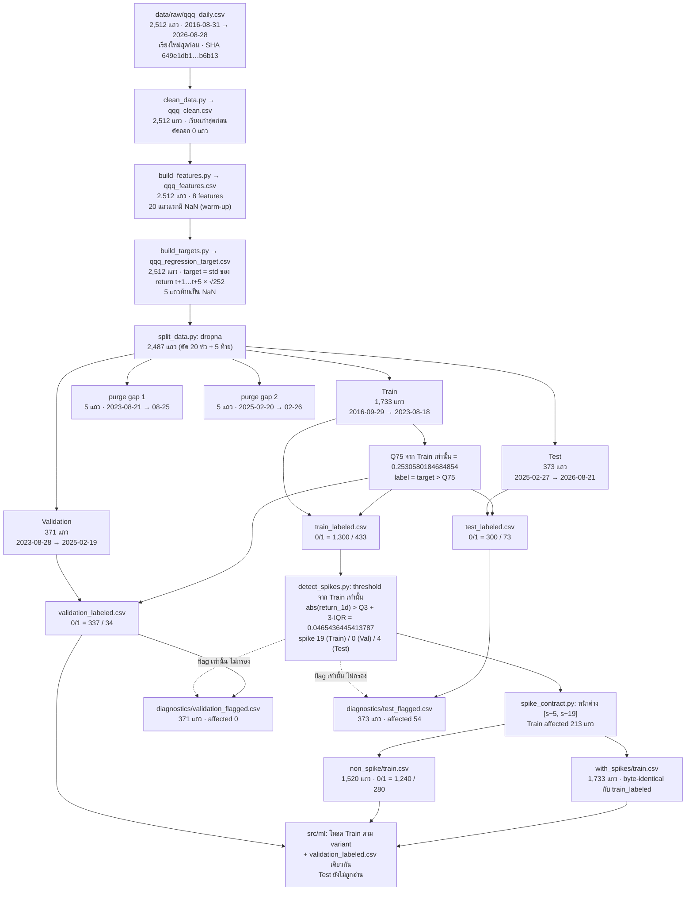

# DATA FLOW — จำนวนแถวจริงทุกขั้น

> ตัวเลขทั้งหมดวัดจากไฟล์บนดิสก์เมื่อ 2026-10-11 · รายละเอียดการตรวจ: [`DATA_PIPELINE_AUDIT.md`](DATA_PIPELINE_AUDIT.md)

## เลขคณิตของ split

| ขั้น | แถว |
| --- | --- |
| ทั้งหมด | 2,512 |
| − NaN (20 warm-up + 5 ไม่มี target) | 2,487 |
| − purge gap 2 × 5 | 2,477 |
| Train = floor(2,477 × 0.70) | 1,733 |
| Validation = floor(2,477 × 0.15) | 371 |
| Test = ส่วนที่เหลือ | 373 |

Purge gap 5 แถวเท่ากับ horizon ของ target พอดี (ไม่มีส่วนเผื่อ): แถวสุดท้ายของ Train (2023-08-18)
ใช้ return ถึง 2023-08-25 และ Validation เริ่ม 2023-08-28 · feature มองย้อนหลังได้ถึง 20 วันข้าม boundary
ซึ่งไม่ใช่ leakage เพราะเป็นข้อมูลอดีต
