# คู่มือฉบับเดียวจบ โปรเจกต์ QQQ Volatility Forecasting

> **เขียนให้ใครอ่าน:** คนที่ไม่เคยเรียน machine learning ไม่รู้จักข้อมูลหุ้น และไม่เคยเห็นโปรเจกต์นี้มาก่อน
> **อ่านจบแล้วทำอะไรได้:** เล่าได้ครบว่าโปรเจกต์ทำอะไร ทำอย่างไรทีละขั้น ทำไมทำแบบนั้น ได้ผลอะไร และสรุปว่าอะไร
> **เวลาอ่าน:** หัวข้อ 1 ถึง 12 ใช้ราว 2 ชั่วโมง หัวข้อ 13 ถึง 15 เป็นส่วนอ้างอิง (สูตร ตัวย่อ ศัพท์) ที่เปิดดูเมื่อต้องการ ถ้ามีเวลา 5 นาที ให้อ่านหัวข้อ 1 และหัวข้อ 10
> **ที่มาของตัวเลข:** ทุกตัวเลขมาจากไฟล์ใน repo ตรวจล่าสุด 2026-10-11 (รายการไฟล์อยู่ในหัวข้อ 15)

## วิธีอ่านเอกสารนี้

- หัวข้อเรียงตามลำดับที่ทำโปรเจกต์จริง ตั้งแต่ข้อมูลดิบจนถึงข้อสรุป จึงควรอ่านเรียงกัน
- ศัพท์เทคนิคใช้ภาษาอังกฤษตามที่ใช้กันจริง และอธิบายความหมายครั้งแรกที่เจอ ถ้าลืมให้เปิดหัวข้อ 14 ซึ่งรวมตัวย่อทุกตัว (ย่อมาจากอะไร อ่านว่าอะไร) และศัพท์ทุกคำไว้
- ไม่ต้องเก่งคณิตศาสตร์ สูตรทุกสูตรเขียนเป็นข้อความธรรมดา มีคำอ่านและตัวอย่างตัวเลขกำกับ วิธีอ่านสัญลักษณ์อยู่ในหัวข้อ 2.9 และสูตรทั้งหมดรวมอยู่ในหัวข้อ 13
- ท้ายหัวข้อใหญ่มีบรรทัด **"พูดสั้น ๆ ได้ว่า"** เป็นประโยคที่ใช้เล่าให้คนอื่นฟังได้ทันที
- ส่วนที่ขึ้นต้นว่า **"ลงลึก"** ข้ามได้ในการอ่านรอบแรก

## สารบัญ

| หัวข้อ | อ่านแล้วได้อะไร |
| --- | --- |
| [1. ภาพรวมใน 1 หน้า](#1-ภาพรวมใน-1-หน้า) | โปรเจกต์ทำอะไร ทำไม และได้ผลอะไร (ถ้าอ่านได้หัวข้อเดียว ให้อ่านหัวข้อนี้) |
| [2. พื้นฐานที่ต้องรู้ก่อน](#2-พื้นฐานที่ต้องรู้ก่อน) | ความรู้พื้นฐาน: ราคา return ความผันผวน ML การแบ่งข้อมูล leakage และวิธีอ่านสัญลักษณ์คณิตศาสตร์ |
| [3. การเตรียมข้อมูลทีละขั้น](#3-การเตรียมข้อมูลทีละขั้น) | ไฟล์ราคาดิบกลายเป็นตารางที่โมเดลเรียนได้อย่างไร ทีละขั้นทั้ง 8 ขั้น |
| [4. การทดลองเรื่อง spike](#4-การทดลองเรื่อง-spike) | spike คืออะไร ทดลองอะไรกับมัน และต้องระวังอะไรเวลาตีความ |
| [5. โมเดลทั้ง 19 ตัว](#5-โมเดลทั้ง-19-ตัว) | โมเดลทั้ง 19 ตัวทำงานอย่างไร และพิสูจน์อย่างไรว่าเขียนถูก |
| [6. วัดผลอย่างไร](#6-วัดผลอย่างไร) | อ่านตัวเลขผลลัพธ์อย่างไร และทำไมต้องมีช่วงความเชื่อมั่น |
| [7. ผลบน Validation](#7-ผลบน-validation) | ผลบนข้อสอบซ้อม |
| [8. ล็อกทุกอย่างแล้วเปิด Test ครั้งเดียว](#8-ล็อกทุกอย่างแล้วเปิด-test-ครั้งเดียว) | ขั้นตอนล็อกก่อนเปิดข้อสอบจริง |
| [9. ผลบน Test](#9-ผลบน-test) | ผลบนข้อสอบจริง |
| [10. สรุปทั้งโปรเจกต์](#10-สรุปทั้งโปรเจกต์) | คำตอบของคำถามวิจัย ข้อจำกัด และสิ่งที่ได้เรียนรู้ |
| [11. แผนที่ไฟล์ และวิธีรัน](#11-แผนที่ไฟล์-และวิธีรัน) | ไฟล์อะไรอยู่ที่ไหน รันอย่างไร และใช้เครื่องมืออะไร |
| [12. เตรียมนำเสนอและตอบคำถาม](#12-เตรียมนำเสนอและตอบคำถาม) | บทพูดสองนาที คำถามที่น่าจะถูกถามพร้อมคำตอบ และสิ่งที่ต้องทำก่อนวันส่ง |
| [13. สูตรทั้งหมดพร้อมวิธีอ่าน](#13-สูตรทั้งหมดพร้อมวิธีอ่าน) | สูตรทุกสูตร พร้อมคำอ่าน ความหมายของแต่ละตัว และตัวอย่างตัวเลข |
| [14. ตัวย่อและอภิธานศัพท์](#14-ตัวย่อและอภิธานศัพท์) | ตัวย่อทุกตัวย่อมาจากอะไร และความหมายของศัพท์ทุกคำ |
| [15. ที่มาของตัวเลข](#15-ที่มาของตัวเลข) | ตัวเลขแต่ละกลุ่มมาจากไฟล์ไหน |

---

## 1. ภาพรวมใน 1 หน้า

### 1.1 โปรเจกต์นี้คืออะไร

นี่คือโปรเจกต์ของวิชา machine learning (รหัสวิชา 01076641) โจทย์ของวิชาให้เลือกข้อมูลจริงมาหนึ่งชุด ตั้งปัญหาเอง เตรียมข้อมูลเอง **เขียนโมเดลเองโดยไม่ใช้ library สำเร็จรูป** แล้ววัดผล เปรียบเทียบ และอภิปราย

เราเลือกทำเรื่อง **การทำนายความผันผวนของกองทุน QQQ ใน 5 วันทำการข้างหน้า** พูดแบบภาษาคนคือ "ดูราคาย้อนหลังถึงวันนี้ แล้วบอกว่าสัปดาห์หน้าราคาจะแกว่งแรงแค่ไหน" โดยทำนายสองแบบ

1. **ทำนายเป็นตัวเลข** ว่าจะแกว่งเท่าไร (เรียกว่า regression)
2. **ทำนายเป็นใช่หรือไม่** ว่าจะเป็นช่วง "ผันผวนสูง" หรือเปล่า (เรียกว่า classification)

### 1.2 คำถามที่ทำให้โปรเจกต์นี้ต่างจากการ "เทรนโมเดลเฉย ๆ"

ตลาดหุ้นมีบางวันที่ราคากระชากแรงผิดปกติ เช่นช่วงโควิดเดือนมีนาคม 2020 เราเรียกวันแบบนี้ว่า **spike** วันเหล่านี้มีน้อยมากแต่ค่าสุดโต่ง เราจึงตั้งคำถามวิจัยว่า

> **ถ้าตัดช่วง spike ออกจากข้อมูลที่ใช้สอนโมเดล โมเดลจะทำนายได้ดีขึ้นหรือแย่ลง**

วิธีตอบคือสอนโมเดลทุกตัวสองรอบ รอบแรกใช้ข้อมูลครบ (เรียกว่า `with_spike`) รอบสองใช้ข้อมูลที่ตัดช่วง spike ออก (เรียกว่า `non_spike`) แล้ววัดผลบนข้อมูลชุดเดียวกัน

### 1.3 เส้นทางของโปรเจกต์ทั้งหมด

```text
ข้อมูลราคารายวันของ QQQ 2,512 วัน (2016–2026)
        │  ขั้น 1–2  ตรึงข้อมูล และทำความสะอาด
        ▼
สร้าง feature 8 ตัว (ใช้ข้อมูลถึงวันนี้)   +   สร้าง target (ความผันผวน 5 วันข้างหน้า)
        │  ขั้น 3–5  ตัดแถวที่คำนวณไม่ครบ เหลือ 2,487 แถว
        ▼
แบ่งตามเวลา    Train 1,733  │  Validation 371  │  Test 373
        │  ขั้น 6–8  ตั้งเส้นแบ่ง "ผันผวนสูง" และเส้นแบ่ง spike จาก Train เท่านั้น
        ▼
ข้อมูลสอนสองแบบ    with_spike 1,733 แถว      non_spike 1,520 แถว
        │  สอนโมเดล 19 ตัว × 2 แบบ = 38 ชุด (ลองการตั้งค่ารวม 280 ครั้ง)
        ▼
เลือกการตั้งค่าบน Validation  →  สรุปผล  เปรียบเทียบ  วัดความไม่แน่นอน
        │  ล็อกโมเดลและการตัดสินใจทั้งหมด
        ▼
เปิด Test ครั้งเดียว  →  ผลสุดท้าย  →  รายงานและสไลด์
```

งานแบ่งเป็นสามช่วงตามลำดับ คือ (1) เตรียมข้อมูลและตรวจสอบความถูกต้อง (2) เขียนและสอนโมเดล 19 ตัว และ (3) สรุปผล เปิด Test และเขียนรายงาน เอกสารนี้เล่าตามลำดับเดียวกัน

### 1.4 ผลลัพธ์ในสี่บรรทัด

1. โมเดลทำนายได้ **ดีกว่าการเดาสุ่มชัดเจน** แต่เหนือกว่ากฎง่าย ๆ ที่ไม่ต้องสอนอะไรเลยเพียงเล็กน้อย
2. **ยังสรุปไม่ได้** ว่าการตัด spike ช่วยหรือทำร้ายโมเดล ผลต่างที่วัดได้เล็กกว่าความไม่แน่นอนของการวัด
3. โมเดล **ทำงานได้ในช่วงตลาดปกติ** แต่ภายในช่วงที่ตลาดปั่นป่วน โมเดลแยกไม่ออกว่าวันไหนจะแกว่งแรง
4. โมเดลที่ซับซ้อน **ไม่ได้ดีกว่าโมเดลพื้นฐานอย่างมีนัยสำคัญ**

ผลแบบนี้ไม่ได้แปลว่าโปรเจกต์ล้มเหลว คุณค่าของงานอยู่ที่ความถูกต้องของวิธีทำ และการรายงานตามจริงว่าข้อมูลบอกอะไรได้และบอกอะไรไม่ได้ (อธิบายในหัวข้อ 10)

### 1.5 หลักการหกข้อที่ยึดตลอดโปรเจกต์

ทุกขั้นตอนในเอกสารนี้มาจากหลักการหกข้อนี้ ถ้าจำหลักการได้ จะเข้าใจว่าทำไมแต่ละขั้นถึงทำแบบนั้น

| หลักการ | ความหมาย | เห็นได้ที่ไหน |
| --- | --- | --- |
| 1. ห้ามให้อนาคตรั่ว | ตอนทำนายวันที่ t ใช้ได้เฉพาะสิ่งที่รู้ ณ สิ้นวัน t | หัวข้อ 2.6 และ 3 |
| 2. คำนวณทุกอย่างจากข้อมูลสอนเท่านั้น | เส้นแบ่ง ค่าเฉลี่ย และการปรับสเกล ห้ามแอบดูข้อมูลทดสอบ | หัวข้อ 3 ขั้นที่ 7 และ 8 |
| 3. เขียนเอง แล้วพิสูจน์ว่าถูก | โมเดลเขียนด้วย NumPy และเทียบผลกับ library ทีละแถว | หัวข้อ 5.1 |
| 4. วัดความไม่แน่นอนก่อนสรุป | ตัวเลขที่ต่างกันเล็กน้อยอาจเป็นแค่ความบังเอิญ | หัวข้อ 6.8 |
| 5. ล็อกก่อนเปิดข้อสอบจริง | ตัดสินใจทุกอย่างให้เสร็จก่อนดูผลสุดท้าย และดูครั้งเดียว | หัวข้อ 8 |
| 6. รายงานตามจริงและทำซ้ำได้ | ผลที่ไม่สวยก็รายงาน และคนอื่นรันตามแล้วได้ผลเดิม | หัวข้อ 10 และ 11 |

### 1.6 โจทย์ของวิชาต้องการอะไร และเราตอบตรงไหน

| สิ่งที่โจทย์ต้องการ | เราทำอะไร | อ่านต่อ |
| --- | --- | --- |
| ตั้งปัญหาจากข้อมูลจริง ใช้ feature อย่างน้อย 5 ตัว | ทำนายความผันผวนของ QQQ ด้วย feature 8 ตัว | หัวข้อ 1 ถึง 3 |
| เตรียมข้อมูลและวิเคราะห์ข้อมูล | 8 ขั้นตอน พร้อมการทดลองเรื่อง spike | หัวข้อ 3 และ 4 |
| เขียนโมเดล regression และ classification เอง | 19 โมเดลเขียนด้วย NumPy | หัวข้อ 5 |
| มีโมเดลนอกเนื้อหาที่สอน พร้อมอธิบายกลไก | Elastic Net และ AdaBoost | หัวข้อ 5.6 |
| เทียบโมเดลที่เขียนเองกับ library | เทียบคำทำนายทีละแถว | หัวข้อ 5.1 |
| บันทึกโมเดล โหลดกลับ แล้วทดสอบซ้ำ | ทำครบ 38 ชุด | หัวข้อ 5.2 |
| วัดผลด้วย metric ที่กำหนด | ครบทุกตัว | หัวข้อ 6 และ 7 |
| เปรียบเทียบ วิเคราะห์ และอภิปราย | เทียบกับกฎง่าย ๆ เทียบสองแบบข้อมูล และแยกผลตามช่วงตลาด | หัวข้อ 7 ถึง 10 |
| รายงาน สไลด์ และโค้ด | อยู่ในโฟลเดอร์ `deliverables/` และ `notebooks/` | หัวข้อ 11 |

ตารางจับคู่เกณฑ์ให้คะแนนกับหลักฐานแบบละเอียดอยู่ที่ [`docs/report/TRACEABILITY.md`](../report/TRACEABILITY.md)

**พูดสั้น ๆ ได้ว่า:** เราทำนายว่าสัปดาห์หน้า QQQ จะแกว่งแรงแค่ไหนจากราคาย้อนหลัง ด้วยโมเดล 19 ตัวที่เขียนเอง และทดลองว่าการตัดช่วงราคากระชากแรงออกจากข้อมูลสอนช่วยหรือไม่ คำตอบคือยังสรุปไม่ได้

---

## 2. พื้นฐานที่ต้องรู้ก่อน

หัวข้อนี้ปูพื้นทุกอย่างที่ต้องใช้ในหัวข้อถัดไป ไม่ต้องมีความรู้มาก่อน

### 2.1 QQQ และข้อมูลราคา

**QQQ** คือกองทุนรวมที่ซื้อขายในตลาดหุ้นได้เหมือนหุ้นตัวหนึ่ง กองทุนแบบนี้เรียกว่า **ETF** ย่อมาจาก Exchange-Traded Fund แปลตรงตัวว่า "กองทุนที่ซื้อขายในตลาดหลักทรัพย์" กองทุนนี้ถือหุ้นตามดัชนี Nasdaq-100 ซึ่งประกอบด้วยบริษัทขนาดใหญ่ 100 แห่งในตลาด Nasdaq ส่วนใหญ่เป็นบริษัทเทคโนโลยี ราคาของ QQQ จึงสะท้อนภาพรวมของหุ้นเทคโนโลยีสหรัฐ

- **QQQ** ไม่ได้ย่อมาจากคำใด เป็น "ชื่อย่อหลักทรัพย์" (ticker) ที่ใช้เรียกกองทุน Invesco QQQ Trust ในตลาด เหมือนที่หุ้นไทยมีชื่อย่ออย่าง PTT
- **Nasdaq** คือชื่อตลาดหุ้นแห่งหนึ่งของสหรัฐ ย่อมาจาก National Association of Securities Dealers Automated Quotations
- **ดัชนี** (index) คือตัวเลขตัวเดียวที่สรุปราคาของหุ้นทั้งกลุ่ม

**ถ้าไม่เคยรู้จักหุ้นเลย** ให้เริ่มจากสี่คำนี้

- **หุ้น** (stock) คือส่วนแบ่งความเป็นเจ้าของบริษัท ใครถือหุ้นก็เป็นเจ้าของบริษัทส่วนหนึ่ง
- **ตลาดหุ้น** (stock market หรือ exchange) คือสถานที่กลางที่คนมาซื้อขายหุ้นกัน ราคาไม่มีใครกำหนด แต่ขยับตามแรงซื้อและแรงขาย ถ้าคนอยากซื้อมากกว่าอยากขาย ราคาจะขึ้น
- **กองทุนรวม** (fund) คือการรวมเงินของคนจำนวนมากไปซื้อหุ้นหลายตัวพร้อมกัน คนที่ซื้อกองทุนหนึ่งหน่วยจึงเท่ากับถือหุ้นหลายบริษัททีละนิด
- **ราคาปิด** (close) คือราคาของการซื้อขายครั้งสุดท้ายก่อนตลาดปิดในวันนั้น เป็นราคาที่ใช้อ้างอิงมากที่สุด เราจึงใช้ราคาปิดคำนวณเกือบทุกอย่าง

ตลาดเปิดเพียงวันละไม่กี่ชั่วโมง ราคาระหว่างวันขยับตลอด ข้อมูลรายวันจึงสรุปทั้งวันไว้ด้วยราคาสี่ค่า คือราคาแรกของวัน ราคาสูงสุด ราคาต่ำสุด และราคาสุดท้าย

ข้อมูลที่เราใช้คือ **ราคารายวัน** หนึ่งวันมีหนึ่งแถว แต่ละแถวมี 5 ค่า เรียกรวมกันว่า **OHLCV** ซึ่งเป็นอักษรตัวแรกของชื่อทั้งห้า

| ชื่อ | ความหมาย | ตัวอย่าง (วันที่ 3 มิ.ย. 2019) |
| --- | --- | --- |
| Open | ราคาตอนตลาดเปิด | 173.52 |
| High | ราคาสูงสุดของวัน | 173.95 |
| Low | ราคาต่ำสุดของวัน | 169.27 |
| Close | ราคาตอนตลาดปิด | 170.12 |
| Volume | จำนวนหน่วยที่ซื้อขายในวันนั้น | 75,842,290 |

**วันทำการ** (trading day) คือวันที่ตลาดเปิด คือจันทร์ถึงศุกร์ที่ไม่ใช่วันหยุด หนึ่งปีมีประมาณ 252 วันทำการ เมื่อเอกสารนี้พูดว่า "5 วันข้างหน้า" หมายถึง 5 วันทำการ หรือประมาณหนึ่งสัปดาห์

### 2.2 ผลตอบแทน (return)

ราคาเป็นดอลลาร์เทียบกันข้ามช่วงเวลายาก เพราะราคาปิดวันแรกของข้อมูลในปี 2016 คือ 116 ส่วนวันสุดท้ายในปี 2026 คือ 716 เราจึงดูเป็น **เปอร์เซ็นต์การเปลี่ยนแปลง** แทน เรียกว่า return

```text
return ของวันนี้ = (ราคาปิดวันนี้ ÷ ราคาปิดเมื่อวาน) − 1
```

ตัวอย่าง: ราคาปิดวันที่ 3 มิ.ย. 2019 คือ 170.12 วันถัดมาปิดที่ 174.91 ดังนั้น return ของวันที่ 4 มิ.ย. คือ 174.91 ÷ 170.12 − 1 = +0.0282 หรือ +2.82%

วันปกติราคาขยับไม่มาก ครึ่งหนึ่งของวันทั้งหมดในข้อมูลสอนขยับไม่เกิน 0.70% (ทั้งขึ้นและลง)

### 2.3 ความผันผวน (volatility)

**ความผันผวน** คือขนาดของการแกว่งตัวของราคา ไม่สนใจว่าขึ้นหรือลง สนใจแค่ว่าขยับแรงแค่ไหน

เราวัดด้วย **ส่วนเบี่ยงเบนมาตรฐาน** (standard deviation ย่อว่า SD) ของ return รายวัน SD บอกว่าโดยเฉลี่ยแล้วค่าแต่ละค่าอยู่ห่างจากค่าเฉลี่ยของกลุ่มเท่าไร ถ้า return ห้าวันติดกันเป็น +0.1%, −0.2%, +0.1%, 0%, −0.1% ค่าอยู่ใกล้กัน SD จะเล็ก แต่ถ้าเป็น +5%, −4%, −9%, +8%, −12% ค่ากระจายมาก SD จะใหญ่

SD ของ return รายวันเป็นตัวเลขเล็กและตีความยาก วงการการเงินจึงแปลงเป็น **หน่วยต่อปี** ด้วยการคูณ √252 (รากที่สองของจำนวนวันทำการในหนึ่งปี)

```text
ความผันผวนต่อปี = SD ของ return รายวัน × √252        (√252 ≈ 15.87)
```

ค่าที่ได้อ่านเป็นเปอร์เซ็นต์ต่อปีได้ เช่น 0.14 คือแกว่งในอัตราราว 14% ต่อปี ซึ่งถือว่าสงบ ส่วนช่วงโควิดเดือนมีนาคม 2020 ค่าขึ้นไปสูงสุดราว 1.50 หรือ 150% ต่อปี

**ทำไมอยากทำนายความผันผวน** เพราะมันถูกใช้ตรง ๆ ในงานการเงินสามเรื่อง คือการตั้งราคา option การตัดสินใจว่าจะลงทุนมากน้อยแค่ไหน และการบริหารความเสี่ยง ถ้ารู้ล่วงหน้าว่าสัปดาห์หน้าตลาดจะปั่นป่วน ก็ลดขนาดการลงทุนหรือป้องกันความเสี่ยงได้ทัน

**ข้อควรจำ:** เราทำนาย "จะแกว่งแรงแค่ไหน" ไม่ได้ทำนาย "จะขึ้นหรือลง" สองเรื่องนี้ต่างกัน

### 2.4 Machine learning คืออะไร

**Machine learning** (ML) คือการให้คอมพิวเตอร์ **หากฎจากตัวอย่าง** แทนที่คนจะเขียนกฎให้

ในโปรเจกต์นี้ ตัวอย่างหนึ่งตัวคือ "วันหนึ่งวัน" ซึ่งมีสองส่วน

- **feature** คือสิ่งที่เรารู้ ณ สิ้นวันนั้น เช่น วันนี้ราคาขยับเท่าไร สัปดาห์ที่ผ่านมาแกว่งแรงแค่ไหน
- **target** คือคำตอบที่อยากรู้ ในที่นี้คือความผันผวนของ 5 วันถัดไป

เรามีวันในอดีตจำนวนมากที่รู้ทั้ง feature และ target (เพราะ 5 วันถัดไปของวันเหล่านั้นผ่านมาแล้ว) จึงให้คอมพิวเตอร์ดูตัวอย่างเหล่านี้แล้วหาความสัมพันธ์ สิ่งที่ได้เรียกว่า **โมเดล** (model) ซึ่งรับ feature ของวันใหม่แล้วทำนาย target ได้ ขั้นตอนที่ให้โมเดลเรียนจากตัวอย่างเรียกว่า **การสอน** หรือ **train**

โปรเจกต์นี้ใช้ ML สามประเภท

| ประเภท | คำตอบที่ทำนาย | ตัวอย่างในโปรเจกต์ |
| --- | --- | --- |
| **Regression** | ตัวเลข | ความผันผวนของ 5 วันข้างหน้าเท่ากับ 0.18 |
| **Classification** | หมวดหมู่ | 5 วันข้างหน้า "ผันผวนสูง" หรือ "ไม่สูง" |
| **Clustering** | ไม่มีคำตอบให้ดู โมเดลจัดกลุ่มเอง | วันที่หน้าตาคล้ายกันอยู่กลุ่มเดียวกัน |

สองประเภทแรกมีคำตอบให้โมเดลดูตอนสอน เรียกว่า supervised learning ประเภทที่สามไม่มีคำตอบให้ดู เรียกว่า unsupervised learning

### 2.5 ทำไมต้องแบ่งข้อมูลเป็นสามชุด

ถ้าวัดความเก่งของโมเดลด้วยข้อมูลชุดเดียวกับที่ใช้สอน โมเดลจะดูเก่งเกินจริง เหมือนนักเรียนที่ทำข้อสอบซึ่งเคยเห็นเฉลยมาแล้ว เราจึงแบ่งข้อมูลเป็นสามชุดที่มีหน้าที่ต่างกัน

| ชุด | เปรียบได้กับ | ใช้ทำอะไร |
| --- | --- | --- |
| **Train** | หนังสือเรียนและแบบฝึกหัด | ให้โมเดลเรียนรู้ |
| **Validation** | ข้อสอบซ้อม | เทียบว่าการตั้งค่าแบบไหนดีที่สุด |
| **Test** | ข้อสอบจริง | วัดผลสุดท้าย **ครั้งเดียว** |

ทำไมต้องมีทั้งข้อสอบซ้อมและข้อสอบจริง เพราะเมื่อเราใช้ข้อสอบซ้อมเลือกวิธีที่ได้คะแนนดีที่สุด คะแนนซ้อมของวิธีนั้นจะสูงเกินจริงเล็กน้อย (บังเอิญเข้าทางข้อสอบชุดนั้น) คะแนนที่เชื่อได้จริงต้องมาจากข้อสอบที่ไม่เคยถูกใช้ตัดสินใจอะไรเลย นั่นคือ Test

### 2.6 Leakage และเหตุผลที่ห้ามสุ่มสลับข้อมูล

**Leakage** (ข้อมูลรั่ว) คือการที่โมเดลได้เห็นข้อมูลซึ่งในสถานการณ์จริงยังไม่มีทางรู้ ผลคือโมเดลดูเก่งมากตอนทดสอบ แต่ใช้จริงไม่ได้

ข้อมูลที่เรียงตามเวลารั่วง่ายเป็นพิเศษ งาน ML ทั่วไปมักสุ่มสลับแถวก่อนแบ่งชุด แต่กับข้อมูลของเราทำแบบนั้นไม่ได้ ด้วยเหตุผลนี้

- target ของวันที่ t ใช้ return ของวันที่ t+1 ถึง t+5
- target ของวันที่ t+1 ใช้ return ของวันที่ t+2 ถึง t+6
- สองวันนี้ใช้ข้อมูลซ้ำกัน 4 ใน 5 วัน ค่าจึงแทบเท่ากัน

ถ้าสุ่มสลับ วันที่ t อาจไปอยู่ในชุดสอน ส่วนวันที่ t+1 ไปอยู่ในชุดทดสอบ โมเดลแค่จำคำตอบของวันข้างเคียงก็ตอบถูกแล้วโดยไม่ต้องเรียนรู้อะไร การตรวจสอบของเราพบว่าถ้าแบ่งแบบสุ่ม จะได้คะแนน R² สูงถึง 0.83 **โดยไม่ใช้ feature เลย** ซึ่งเป็นคะแนนปลอม

วิธีที่ถูกคือ **แบ่งตามลำดับเวลา** ใช้อดีตสอน แล้วทดสอบกับอนาคต เหมือนการใช้งานจริง

### 2.7 Overfitting, hyperparameter และ grid search

**Overfitting** คือการที่โมเดลจำรายละเอียดของข้อมูลสอนมากเกินไป รวมถึงความบังเอิญที่ไม่เกิดซ้ำ จึงทำคะแนนบนข้อมูลสอนได้ดี แต่ทำนายข้อมูลใหม่ได้แย่ เหมือนนักเรียนที่ท่องเฉลยแบบฝึกหัดได้หมดแต่ทำโจทย์ใหม่ไม่ได้

**Hyperparameter** คือค่าที่คนต้องกำหนดให้โมเดลก่อนสอน โมเดลหาเองไม่ได้ เช่น ต้นไม้ตัดสินใจจะลึกได้กี่ชั้น หรือจะดูเพื่อนบ้านกี่ตัว ค่าเหล่านี้กำหนดว่าโมเดลจะซับซ้อนแค่ไหน

**Grid search** คือการลองค่า hyperparameter ทุกชุดในรายการที่เตรียมไว้ สอนโมเดลด้วยแต่ละชุด แล้วเลือกชุดที่ได้คะแนนบน Validation ดีที่สุด

**ตัวอย่างให้เห็นภาพ** ต้นไม้ตัดสินใจ (decision tree) มี hyperparameter ชื่อ `max_depth` คือจำนวนชั้นของคำถามที่ถามต่อกันได้

- ถ้าให้ลึกเพียง 1 ชั้น ต้นไม้ถามได้คำถามเดียว กฎที่ได้หยาบเกินไป ทำนายได้แย่ทั้งข้อมูลสอนและข้อมูลใหม่ อาการนี้เรียกว่า **underfitting** (เรียนน้อยเกินไป)
- ถ้าให้ลึก 20 ชั้น ต้นไม้ถามได้ละเอียดจนแยกวันในข้อมูลสอนออกเป็นกลุ่มละวันสองวัน มันจะตอบข้อมูลสอนถูกเกือบหมด แต่กฎที่ได้คือการจำ ไม่ใช่ความเข้าใจ จึงทำนายข้อมูลใหม่ได้แย่ นี่คือ overfitting
- ค่าที่ดีอยู่ระหว่างกลาง และไม่มีใครรู้ล่วงหน้าว่าเท่าไร เราจึงลองค่า 2, 3 และ 5 แล้วให้ Validation ตัดสิน ในแบบ `with_spike` ค่าที่ชนะคือ 2

**สังเกต overfitting ได้อย่างไร:** คะแนนบน Train ดีมาก แต่คะแนนบน Validation แย่กว่ามาก ช่องว่างระหว่างสองตัวเลขนี้คือสัญญาณ

**คำที่ต้องแยกให้ออก:** ค่าที่โมเดล **เรียนรู้เอง** จากข้อมูล (เช่น น้ำหนักของแต่ละ feature หรือคำถามในต้นไม้) เรียกว่า **parameter** ส่วนค่าที่ **คนตั้งให้** ก่อนสอนเรียกว่า **hyperparameter** ความสามารถของโมเดลในการทำนายข้อมูลที่ไม่เคยเห็นเรียกว่า **generalization** ซึ่งเป็นเป้าหมายที่แท้จริงของการสอนโมเดล

### 2.8 การปรับสเกล (standardization)

feature แต่ละตัวมีขนาดต่างกันมาก เช่น `rsi_14` มีค่า 0 ถึง 100 ส่วน `return_1d` มีค่าราว 0.01 โมเดลหลายชนิดจะให้ความสำคัญกับตัวที่ค่าใหญ่กว่าโดยไม่ตั้งใจ เราจึงปรับทุก feature ให้มีค่าเฉลี่ย 0 และ SD เท่ากับ 1 ก่อนสอน

จุดสำคัญคือค่าเฉลี่ยและ SD ที่ใช้ปรับ **คำนวณจาก Train เท่านั้น** แล้วนำค่าเดียวกันไปปรับ Validation และ Test ตามหลักการข้อ 2

### 2.9 วิธีอ่านสัญลักษณ์คณิตศาสตร์ที่จะเจอ

สูตรในเอกสารนี้ใช้สัญลักษณ์ไม่กี่ตัว ถ้าอ่านตารางนี้ออก จะอ่านสูตรทั้งหมดในหัวข้อ 13 ได้

| สัญลักษณ์ | อ่านว่า | ความหมาย | ตัวอย่าง |
| --- | --- | --- | --- |
| `x²` | x ยกกำลังสอง | x คูณกับตัวเอง | 3² = 3 × 3 = 9 |
| `√x` | รากที่สองของ x | จำนวนที่คูณกับตัวเองแล้วได้ x | √9 = 3 |
| `\|x\|` | ค่าสัมบูรณ์ของ x | ขนาดของ x โดยไม่สนเครื่องหมายบวกลบ | \|−2\| = 2 และ \|2\| = 2 |
| `Σ` | ซิกมา หรือ "ผลรวมของ" | นำทุกค่ามาบวกกัน | Σ ของ 1, 2, 3 คือ 6 |
| `x̄` | x บาร์ | ค่าเฉลี่ยของ x (ผลรวมหารด้วยจำนวน) | ค่าเฉลี่ยของ 1, 2, 3 คือ 2 |
| `y` และ `ŷ` | วาย และ วายแฮต | `y` คือค่าจริง `ŷ` คือค่าที่โมเดลทำนาย | y = 0.20, ŷ = 0.18 |
| `x_i` | x ตัวที่ i | ค่าของแถว (วัน) ที่ i | x_1 คือค่าของวันแรก |
| `n` | เอ็น | จำนวนแถวหรือจำนวนตัวอย่าง | Validation มี n = 371 |
| `t` | ที | วันที่กำลังพิจารณา `t+1` คือวันทำการถัดไป `t−1` คือวันทำการก่อนหน้า | ถ้า t คือวันจันทร์ t+1 คือวันอังคาร |
| `w` และ `b` | ดับเบิลยู และ บี | `w` คือน้ำหนัก (weight) ที่โมเดลให้แต่ละ feature `b` คือค่าคงที่ที่บวกเพิ่ม (bias หรือ intercept) | ŷ = b + w × x |
| `w·x` | w ดอต x | คูณทีละคู่แล้วบวกกัน | w1×x1 + w2×x2 + ... |
| `‖w‖²` | นอร์มของ w ยกกำลังสอง | นำน้ำหนักแต่ละตัวยกกำลังสองแล้วบวกกัน | ถ้า w = (3, 4) จะได้ 9 + 16 = 25 |
| `‖w‖₁` | นอร์มหนึ่งของ w | นำขนาดของน้ำหนักแต่ละตัวมาบวกกัน | ถ้า w = (3, −4) จะได้ 3 + 4 = 7 |
| `e` | อี | ค่าคงที่ประมาณ 2.718 ใช้ในสูตรที่เกี่ยวกับการเติบโตและความน่าจะเป็น | e² ≈ 7.39 |
| `exp(x)` | เอกซ์โพเนนเชียลของ x | e ยกกำลัง x | exp(0) = 1 |
| `ln(x)` | ลอนของ x หรือลอการิทึมธรรมชาติ | ต้องนำ e ยกกำลังเท่าไรจึงได้ x เป็นการย้อนกลับของ exp | ln(1) = 0 และ ln(2.718) ≈ 1 |
| `max(a, b)` | แมกซ์ | เลือกตัวที่มากกว่า | max(0, −3) = 0 |
| `≈` | ประมาณ | มีค่าใกล้เคียง | √252 ≈ 15.87 |
| `≤` และ `≥` | น้อยกว่าหรือเท่ากับ และ มากกว่าหรือเท่ากับ | | 3 ≤ 5 |
| `[a, b]` | ช่วง a ถึง b | ทุกค่าตั้งแต่ a ถึง b | [0.06, 0.47] |
| `1e-6` | หนึ่งอีลบหก | วิธีเขียนเลขเล็กมากของคอมพิวเตอร์ หมายถึง 1 × 10⁻⁶ | 1e-6 = 0.000001 |

### 2.10 สถิติพื้นฐานที่ใช้ทั้งเอกสาร พร้อมตัวอย่าง

หัวข้อนี้สอนสถิติเท่าที่ต้องใช้ โดยใช้ตัวอย่างชุดเดียวตลอด คือ return ของ 5 วันสมมติ: **+1%, −2%, +0.5%, +3%, −1.5%**

**ค่าเฉลี่ย (mean)** คือผลรวมหารด้วยจำนวน ได้ (1 − 2 + 0.5 + 3 − 1.5) ÷ 5 = **0.2%** บอกว่า "โดยรวมแล้ว" ค่าอยู่ตรงไหน

**ค่ากลาง (median)** คือค่าที่อยู่ตรงกลางเมื่อเรียงจากน้อยไปมาก เรียงแล้วได้ −2, −1.5, **0.5**, 1, 3 ค่ากลางคือ **0.5%** ครึ่งหนึ่งของข้อมูลอยู่ต่ำกว่าค่านี้ และอีกครึ่งอยู่สูงกว่า

**ทำไมต้องมีสองตัว** ถ้าเปลี่ยนค่า +3% เป็น +30% ค่าเฉลี่ยจะกระโดดเป็น 5.6% ทั้งที่สี่วันที่เหลือเหมือนเดิม แต่ค่ากลางยังเป็น 0.5% ค่าเฉลี่ยจึงถูกค่าสุดโต่งดึงได้ง่าย ส่วนค่ากลางทนกว่า ค่าที่สุดโต่งผิดจากพวกแบบนี้เรียกว่า **outlier** (ค่าผิดปกติ) และวัน spike ของเราก็คือ outlier ของ return

**ส่วนเบี่ยงเบนมาตรฐาน (SD)** บอกว่าค่ากระจายห่างจากค่าเฉลี่ยแค่ไหน คิดทีละขั้นได้ดังนี้

| ค่า | ห่างจากค่าเฉลี่ย 0.2 | ยกกำลังสอง |
| --- | --- | --- |
| +1 | +0.8 | 0.64 |
| −2 | −2.2 | 4.84 |
| +0.5 | +0.3 | 0.09 |
| +3 | +2.8 | 7.84 |
| −1.5 | −1.7 | 2.89 |
| รวม | | 16.30 |

นำผลรวม 16.30 หารด้วย 4 (จำนวนค่าลบหนึ่ง) ได้ 4.075 ค่านี้เรียกว่า **ความแปรปรวน** (variance) ถอดรากที่สองได้ **SD = 2.02%** ถ้าคูณ √252 จะได้ความผันผวนต่อปี 0.32 ซึ่งสูงกว่าเส้นแบ่ง 0.2531 ของเรา ห้าวันนี้จึงนับเป็นช่วง "ผันผวนสูง"

**ควอร์ไทล์และเปอร์เซ็นไทล์** เปอร์เซ็นไทล์ที่ 75 (percentile) คือค่าที่ 75% ของข้อมูลอยู่ต่ำกว่า ควอร์ไทล์ (quartile) คือเปอร์เซ็นไทล์ที่ 25, 50 และ 75 ซึ่งแบ่งข้อมูลเป็นสี่ส่วนเท่ากัน เรียกว่า Q1, Q2 (คือค่ากลาง) และ Q3 ตัวอย่างในชีวิตจริง: ถ้าคะแนนสอบของเราอยู่ที่เปอร์เซ็นไทล์ที่ 75 แปลว่าเราได้คะแนนสูงกว่าเพื่อน 75% ของห้อง

**การแจกแจง (distribution)** คือภาพรวมว่าค่าต่าง ๆ เกิดบ่อยแค่ไหน return ของหุ้นมีลักษณะเฉพาะ คือวันส่วนใหญ่ขยับเล็กน้อย แต่มีไม่กี่วันที่ขยับแรงมาก ลักษณะนี้เรียกว่า **หางยาว** (heavy tail) และเป็นเหตุผลที่เราต้องคิดเรื่อง spike

**ความน่าจะเป็น (probability)** คือตัวเลข 0 ถึง 1 ที่บอกว่าเหตุการณ์น่าจะเกิดแค่ไหน 0 คือไม่เกิดแน่ 1 คือเกิดแน่ และ 0.25 คือเกิดราวหนึ่งในสี่ครั้ง โมเดล classification ของเราให้ค่านี้ออกมา

**การเดาสุ่ม (random chance)** คือผลที่จะได้ถ้าไม่มีความรู้อะไรเลย ใช้เป็นพื้นต่ำสุดที่โมเดลต้องชนะ เช่น ถ้าวันผันผวนสูงมี 9.2% ของทั้งหมด การสุ่มชี้วันขึ้นมาหนึ่งวันจะถูก 9.2%

**สหสัมพันธ์ (correlation)** วัดว่าสองสิ่งขึ้นลงตามกันแค่ไหน ค่าอยู่ระหว่าง −1 ถึง 1

| ค่า | ความหมาย | ตัวอย่าง |
| --- | --- | --- |
| ใกล้ +1 | ขึ้นลงตามกัน | ความผันผวน 5 วันกับ 20 วันของเรา (0.80) |
| ใกล้ 0 | ไม่เกี่ยวกัน | เลขท้ายทะเบียนรถกับราคาหุ้น |
| ใกล้ −1 | สวนทางกัน | ความเร็วรถกับเวลาที่ใช้เดินทาง |

**นัยสำคัญทางสถิติ (statistical significance)** คือการถามว่าความต่างที่เห็น "ใหญ่กว่าความบังเอิญ" หรือไม่ ถ้าโยนเหรียญ 10 ครั้งแล้วออกหัว 6 ครั้ง เรายังสรุปไม่ได้ว่าเหรียญเอียง เพราะเหรียญปกติก็ออกแบบนี้ได้บ่อย แต่ถ้าโยน 10,000 ครั้งแล้วออกหัว 6,000 ครั้ง เราสรุปได้ หลักเดียวกันนี้ใช้กับการเทียบโมเดลในหัวข้อ 6.8

### 2.11 โมเดล "เรียนรู้" อย่างไร: ตัวอย่างที่คิดตามได้ด้วยมือ

คำว่าเรียนรู้ฟังดูลึกลับ แต่ที่จริงคือการ **หาตัวเลขที่ทำให้ทายผิดน้อยที่สุด** ตัวอย่างนี้ใช้ข้อมูลสมมติ 4 วัน โดย x คือความผันผวนของเดือนที่ผ่านมา และ y คือความผันผวนของสัปดาห์ถัดไป (สิ่งที่อยากทาย)

| วัน | x | y (ค่าจริง) |
| --- | --- | --- |
| 1 | 0.10 | 0.12 |
| 2 | 0.20 | 0.18 |
| 3 | 0.30 | 0.26 |
| 4 | 0.40 | 0.32 |

เราเลือก **รูปแบบของกฎ** เป็นเส้นตรง `ŷ = b0 + b1 × x` แล้วลองค่า b0 และ b1 สามชุด วัดความผิดพลาดด้วยผลรวมของ (ค่าจริง − ค่าทาย)²

| กฎ | ค่าทายของ 4 วัน | ผลรวมความผิดพลาดยกกำลังสอง |
| --- | --- | --- |
| ทาย 0.20 ทุกวัน (b0 = 0.20, b1 = 0) | 0.20, 0.20, 0.20, 0.20 | 0.0248 |
| ทายว่าเท่ากับ x (b0 = 0, b1 = 1) | 0.10, 0.20, 0.30, 0.40 | 0.0088 |
| b0 = 0.05, b1 = 0.68 | 0.118, 0.186, 0.254, 0.322 | 0.00008 |

กฎที่สามผิดน้อยที่สุด และเป็นคำตอบที่สูตรของ linear regression ให้พอดี (สูตรอยู่ในหัวข้อ 13.3) นี่คือทั้งหมดของการ "สอน" โมเดลตัวนี้ เมื่อมีวันใหม่ที่ x = 0.25 โมเดลจะทาย 0.05 + 0.68 × 0.25 = 0.22

โมเดลทุกตัวในโปรเจกต์นี้ แม้จะซับซ้อนกว่ามาก ก็ประกอบจากสามส่วนเดียวกัน

| ส่วน | ในตัวอย่างนี้ | ในโมเดลอื่น |
| --- | --- | --- |
| 1. รูปแบบของกฎ | เส้นตรง | ชุดคำถามของต้นไม้ ชั้นของโครงข่ายประสาท การโหวตของเพื่อนบ้าน |
| 2. ตัววัดความผิดพลาด (loss) | ผลรวมกำลังสองของความผิดพลาด | cross-entropy, hinge loss และอื่น ๆ |
| 3. วิธีปรับกฎให้ loss ลดลง | สูตรที่ได้คำตอบในครั้งเดียว | ค่อย ๆ ปรับทีละรอบ (gradient descent) หรือเพิ่มต้นไม้ทีละต้น |

เมื่ออ่านเรื่องโมเดลในหัวข้อ 5 ให้ถามสามข้อนี้กับทุกโมเดล จะเห็นว่าแต่ละตัวต่างกันตรงไหน

**พูดสั้น ๆ ได้ว่า:** เราให้คอมพิวเตอร์เรียนจากวันในอดีตที่รู้คำตอบแล้ว โดยแบ่งข้อมูลตามเวลาเป็นชุดสอน ชุดซ้อม และชุดสอบจริง และระวังไม่ให้ข้อมูลจากอนาคตรั่วเข้าไปในการสอน

---

## 3. การเตรียมข้อมูลทีละขั้น

งานส่วนนี้คือการเปลี่ยนไฟล์ราคาดิบให้เป็นตารางที่โมเดลเรียนได้ มี 8 ขั้น รันทั้งหมดได้ด้วยคำสั่งเดียว (`python -m src.run_data_pipeline`) และแต่ละขั้นเขียนรายงานผลลงโฟลเดอร์ `outputs/reports/`

เพื่อให้เห็นภาพ เราจะตามวันเดียวกันไปตลอดหัวข้อนี้ คือ **วันที่ 3 มิถุนายน 2019** ซึ่งอยู่ในข้อมูลสอน

### ขั้นที่ 1 ได้ข้อมูลดิบมา และตรึงไว้

- **ทำอะไร:** ดาวน์โหลดราคารายวันของ QQQ จากเว็บไซต์ Nasdaq เก็บเป็นไฟล์ `data/raw/qqq_daily.csv` มี 2,512 แถว ตั้งแต่ 31 สิงหาคม 2016 ถึง 28 สิงหาคม 2026
- **ทำไมต้องตรึง:** Nasdaq ให้ดาวน์โหลดย้อนหลังได้ 10 ปีนับจากวันที่ดาวน์โหลด ถ้าดาวน์โหลดใหม่พรุ่งนี้ ข้อมูลจะเลื่อนไปหนึ่งวัน ผลการทดลองจะไม่เหมือนเดิมและไม่มีใครตรวจซ้ำได้ เราจึงเก็บไฟล์ชุดเดียวไว้ใน repo และห้ามเขียนทับ
- **รู้ได้อย่างไรว่าไฟล์ไม่ถูกแก้:** เราบันทึกค่า **SHA-256** ของไฟล์ไว้ใน [`data/manifests/qqq_daily_snapshot.json`](../../data/manifests/qqq_daily_snapshot.json) SHA-256 คือ "ลายนิ้วมือ" ของไฟล์ ถ้าไฟล์เปลี่ยนแม้ตัวอักษรเดียว ลายนิ้วมือจะเปลี่ยนทั้งหมด โปรแกรมตรวจลายนิ้วมือนี้ก่อนใช้งานทุกครั้ง

### ขั้นที่ 2 ทำความสะอาด

ไฟล์ [`src/clean_data.py`](../../src/clean_data.py) ตรวจและจัดระเบียบข้อมูลดิบ

| ตรวจอะไร | ถ้าเจอทำอย่างไร |
| --- | --- |
| วันที่อ่านไม่ออก หรือค่าที่ไม่ใช่ตัวเลข | ตัดแถวนั้นทิ้ง |
| แถวซ้ำกันทุกค่า | เก็บไว้แถวเดียว |
| วันเดียวกันแต่ราคาไม่ตรงกัน | หยุดทำงานและแจ้งข้อผิดพลาด เพราะไม่รู้ว่าค่าไหนถูก |
| ค่าว่าง | ตัดแถวนั้นทิ้ง |
| ราคาเป็นศูนย์หรือติดลบ | ตัดแถวนั้นทิ้ง |
| ราคาสูงสุดต่ำกว่าราคาต่ำสุด หรือราคาเปิดอยู่นอกช่วง | ตัดแถวนั้นทิ้ง |
| ปริมาณซื้อขายติดลบ | ตัดแถวนั้นทิ้ง |

จากนั้นเรียงแถวจากวันเก่าไปวันใหม่ (ไฟล์ดิบเรียงจากใหม่ไปเก่า)

**ผล:** เข้า 2,512 แถว ออก 2,512 แถว ไม่มีแถวใดถูกตัด แปลว่าข้อมูลดิบสะอาดอยู่แล้ว ขั้นนี้ยังมีประโยชน์เพราะทำให้เรา **พิสูจน์ได้** ว่าข้อมูลสะอาด ไม่ใช่แค่เชื่อว่าสะอาด หลักฐานอยู่ใน `outputs/reports/cleaning_report.json`

### ขั้นที่ 3 สร้าง feature 8 ตัว

ไฟล์ [`src/build_features.py`](../../src/build_features.py) สร้างตัวเลข 8 ตัวต่อวัน ทุกตัวคำนวณจากข้อมูล **ถึงสิ้นวันนั้นเท่านั้น**

| feature | วิธีคำนวณ | บอกอะไร | ค่าของวันที่ 3 มิ.ย. 2019 |
| --- | --- | --- | --- |
| `return_1d` | ราคาปิดวันนี้ ÷ ราคาปิดเมื่อวาน − 1 | วันนี้ขึ้นหรือลงเท่าไร | −2.20% |
| `return_5d` | ราคาปิดวันนี้ ÷ ราคาปิด 5 วันก่อน − 1 | สัปดาห์นี้ขึ้นหรือลงเท่าไร | −4.51% |
| `historical_volatility_5d` | SD ของ return 5 วันล่าสุด × √252 | สัปดาห์ที่ผ่านมาแกว่งแรงแค่ไหน | 0.163 |
| `historical_volatility_20d` | SD ของ return 20 วันล่าสุด × √252 | เดือนที่ผ่านมาแกว่งแรงแค่ไหน | 0.200 |
| `intraday_range` | (ราคาสูงสุด − ราคาต่ำสุด) ÷ ราคาปิด | ภายในวันนี้ราคาเหวี่ยงกว้างแค่ไหน | 0.0275 |
| `sma_ratio_5_20` | ราคาปิดเฉลี่ย 5 วัน ÷ ราคาปิดเฉลี่ย 20 วัน | ราคาช่วงสั้นอยู่เหนือหรือใต้แนวโน้ม | 0.967 |
| `rsi_14` | ดัชนี RSI 14 วัน | ช่วงนี้ถูกซื้อมากหรือขายมากเกินไป | 26.8 |
| `volume_zscore_20` | (ปริมาณวันนี้ − ค่าเฉลี่ย 20 วัน) ÷ SD 20 วัน | วันนี้ซื้อขายคึกคักผิดปกติแค่ไหน | 2.33 |

**ชื่อ feature อ่านอย่างไร:** เลขท้ายชื่อคือจำนวนวันทำการที่มองย้อนหลัง โดย `d` ย่อมาจาก day เช่น `5d` คือ 5 วัน ส่วนคำย่อในชื่อมีดังนี้ `sma` ย่อมาจาก Simple Moving Average (ค่าเฉลี่ยเคลื่อนที่อย่างง่าย คือค่าเฉลี่ยของ N วันล่าสุด ซึ่งคำนวณใหม่ทุกวัน) `rsi` ย่อมาจาก Relative Strength Index (ดัชนีกำลังสัมพัทธ์) และ `zscore` คือการวัดว่าค่าหนึ่งห่างจากค่าเฉลี่ยกี่เท่าของ SD สูตรของ feature ทุกตัวพร้อมตัวอย่างอยู่ในหัวข้อ 13.1

**อ่านวันตัวอย่าง:** วันที่ 3 มิ.ย. 2019 ราคาร่วง 2.2% ในวันเดียว ร่วงสะสม 4.5% ในหนึ่งสัปดาห์ ราคาอยู่ใต้แนวโน้ม (ค่า 0.967 ต่ำกว่า 1) RSI ต่ำกว่า 30 ซึ่งถือว่าถูกขายมากเกินไป และปริมาณซื้อขายสูงกว่าปกติมาก (สูงกว่าค่าเฉลี่ย 2.33 เท่าของ SD) ทั้งหมดบอกว่าเป็นวันที่ตลาดตื่นตระหนก

**ลงลึก: RSI คืออะไร** RSI (Relative Strength Index) เทียบขนาดของวันที่ราคาขึ้นกับวันที่ราคาลงในช่วง 14 วัน ค่าอยู่ระหว่าง 0 ถึง 100 ถ้าช่วงนั้นมีแต่วันขึ้น ค่าจะใกล้ 100 ถ้ามีแต่วันลง ค่าจะใกล้ 0 นักลงทุนมักถือว่าต่ำกว่า 30 คือขายมากเกินไป และสูงกว่า 70 คือซื้อมากเกินไป เราใช้สูตรมาตรฐานของ Wilder ซึ่งเฉลี่ยแบบให้น้ำหนักวันล่าสุดมากกว่า

**ทำไมเลือก 8 ตัวนี้** เราเลือกให้ครอบคลุมสี่มุม คือทิศทางราคา (`return_1d`, `return_5d`) ความผันผวนที่ผ่านมา (`historical_volatility_5d`, `historical_volatility_20d`, `intraday_range`) ตำแหน่งเทียบกับแนวโน้ม (`sma_ratio_5_20`, `rsi_14`) และพฤติกรรมการซื้อขาย (`volume_zscore_20`) โจทย์กำหนดขั้นต่ำ 5 ตัว

**ผลข้างเคียง:** feature ที่ดูย้อนหลัง 20 วันคำนวณไม่ได้ใน 20 แถวแรกของข้อมูล เพราะยังมีประวัติไม่พอ

### ขั้นที่ 4 สร้าง target หรือ "เฉลย"

ไฟล์ [`src/build_targets.py`](../../src/build_targets.py) สร้างคอลัมน์ `target_volatility_5d`

> **นิยาม:** target ของวันที่ t คือ SD ของ return ในวันที่ t+1 ถึง t+5 (5 วันทำการ **ถัดไป** ไม่นับวันนี้) คูณด้วย √252

#### คำนวณจริงสำหรับวันที่ 3 มิ.ย. 2019

| วัน | ราคาปิด | return ของวันนั้น |
| --- | --- | --- |
| 3 มิ.ย. (วันนี้) | 170.12 | ไม่นับ |
| 4 มิ.ย. | 174.91 | +2.816% |
| 5 มิ.ย. | 176.21 | +0.743% |
| 6 มิ.ย. | 177.61 | +0.795% |
| 7 มิ.ย. | 181.04 | +1.931% |
| 10 มิ.ย. | 183.15 | +1.165% |

1. หาค่าเฉลี่ยของ return 5 ค่า: (2.816 + 0.743 + 0.795 + 1.931 + 1.165) ÷ 5 = 1.490%
2. หาว่าแต่ละค่าห่างจากค่าเฉลี่ยเท่าไร แล้วยกกำลังสอง ได้ 1.757, 0.558, 0.484, 0.195, 0.105 รวมกันได้ 3.099
3. หารด้วย 4 (จำนวนค่าลบหนึ่ง) แล้วถอดรากที่สอง: √(3.099 ÷ 4) = 0.880% นี่คือ SD ของ return รายวัน
4. คูณ √252: 0.00880 × 15.87 = **0.1397**

target ของวันที่ 3 มิ.ย. 2019 จึงเท่ากับ 0.1397 ตรงกับค่าในไฟล์ (0.1397204461) อ่านว่า "ใน 5 วันทำการถัดจากวันนั้น ราคาแกว่งในอัตราราว 14% ต่อปี"

**ข้อสังเกตที่น่าสนใจ:** วันที่ 3 มิ.ย. ดูน่ากลัวมากจาก feature ทุกตัว แต่ 5 วันถัดมาราคากลับฟื้นตัวอย่างสงบ target จึงต่ำ ตัวอย่างนี้แสดงว่างานทำนายนี้ยากจริง สัญญาณที่ดูแรงไม่ได้ตามด้วยความผันผวนเสมอไป

**เทียบกับช่วงวิกฤต:** วันที่ 9 มี.ค. 2020 return ของ 5 วันถัดไปคือ +5.45%, −4.36%, −9.17%, +8.47%, −11.98% ได้ target เท่ากับ 1.42 สูงกว่าวันตัวอย่างราว 10 เท่า

**ทำไมหารด้วย 4 ไม่ใช่ 5:** เป็นสูตรมาตรฐานของ SD เมื่อคำนวณจากตัวอย่าง (หารด้วยจำนวนค่าลบหนึ่ง) ในโค้ดเขียนว่า `ddof=1`

**จุดที่กัน leakage:** feature ของวันที่ t ใช้ข้อมูลถึงวันที่ t ส่วน target ใช้วันที่ t+1 ถึง t+5 สองส่วนนี้ไม่ซ้อนกันเลย

### ขั้นที่ 5 ตัดแถวที่คำนวณไม่ครบ

- 20 แถวแรกไม่มี feature ครบ (ขั้นที่ 3)
- 5 แถวสุดท้ายไม่มี target เพราะยังไม่มี "5 วันถัดไป" ให้คำนวณ

ตัดออกรวม 25 แถว เหลือ **2,487 แถว** ที่ใช้ได้

### ขั้นที่ 6 แบ่งข้อมูลตามเวลา พร้อมเว้นช่องว่าง

ไฟล์ [`src/split_data.py`](../../src/split_data.py) แบ่งข้อมูลเป็น 70% / 15% / 15% ตามลำดับเวลา

```text
ลำดับเวลา ──────────────────────────────────────────────────────────────────►
│◄────────── Train 1,733 ──────────►│เว้น 5│◄── Validation 371 ──►│เว้น 5│◄──── Test 373 ────►│
  29 ก.ย. 2016 – 18 ส.ค. 2023              28 ส.ค. 2023 – 19 ก.พ. 2025       27 ก.พ. 2025 – 21 ส.ค. 2026
```

**ทำไมต้องเว้น 5 วันระหว่างชุด** (เรียกว่า purge gap) target ของวันสุดท้ายใน Train ใช้ return ของ 5 วันถัดไป ถ้าไม่เว้น 5 วันนั้นจะเป็นวันแรก ๆ ของ Validation พอดี ข้อมูลของ Validation ก็จะรั่วเข้ามาในชุดสอน เราจึงทิ้ง 5 วันทำการที่อยู่ตรงรอยต่อทั้งสองจุด (รวม 10 แถว)

### ขั้นที่ 7 ติดป้าย "ผันผวนสูง" สำหรับงาน classification

งาน classification ต้องการคำตอบแบบใช่หรือไม่ เราจึงต้องนิยามว่า "ผันผวนสูง" คือเท่าไร

- เรียง target ของ **Train** จากน้อยไปมาก แล้วหาค่าที่ 75% ของข้อมูลอยู่ต่ำกว่า ค่านี้เรียกว่า **ควอร์ไทล์ที่ 3** หรือ Q75 ได้ **0.2531**
- กฎ: ถ้า target ของวันใด **มากกว่า** 0.2531 ให้ป้ายเป็น 1 (ผันผวนสูง) ไม่อย่างนั้นเป็น 0 ป้ายนี้เก็บในคอลัมน์ `target_high_volatility`
- ใช้เส้นแบ่งเดียวกันกับ Validation และ Test โดยไม่คำนวณใหม่

วันตัวอย่างของเรา (target 0.1397) ต่ำกว่าเส้นแบ่ง จึงได้ป้าย 0

| ชุด | จำนวนแถว | วันผันผวนสูง | สัดส่วน |
| --- | --- | --- | --- |
| Train | 1,733 | 433 | 25.0% |
| Validation | 371 | 34 | 9.2% |
| Test | 373 | 73 | 19.6% |

**ทำไมสัดส่วนไม่เท่ากัน** Train ได้ 25% ตามนิยามของ Q75 แต่ Validation (ส.ค. 2023 – ก.พ. 2025) เป็นช่วงที่ตลาดสงบ จึงมีวันผันผวนสูงเพียง 9.2% ส่วน Test มีเหตุการณ์ตลาดผันผวนแรงในเดือนเมษายน 2025 จึงมี 19.6% ช่วงเวลาที่ตลาดมีพฤติกรรมต่างกันแบบนี้เรียกว่า **regime** ต่างกัน ข้อเท็จจริงนี้มีผลกับการอ่านผลลัพธ์ทุกตาราง จึงควรจำไว้

วันผันผวนสูง (ป้าย 1) เรียกอีกอย่างว่า **positive** ส่วนวันปกติ (ป้าย 0) เรียกว่า **negative**

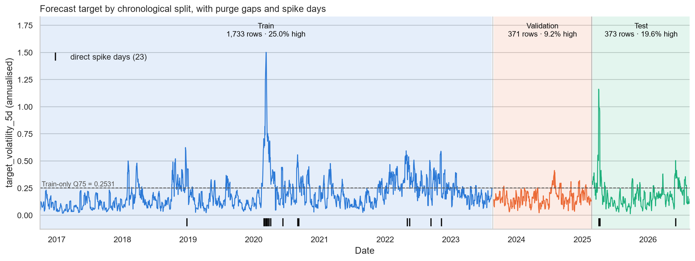

**รูป:** ค่า target ตลอด 10 ปี แถบสีคือสามชุดข้อมูล (น้ำเงินคือ Train ส้มคือ Validation เขียวคือ Test) เส้นประคือเส้นแบ่ง 0.2531 ขีดด้านล่างคือวันที่เกิด spike จะเห็นยอดแหลมปี 2020 ใน Train และปี 2025 ใน Test ส่วน Validation ค่อนข้างราบ

### ขั้นที่ 8 ตรวจหาวัน spike

ไฟล์ [`src/detect_spikes.py`](../../src/detect_spikes.py) หาวันที่ราคากระชากแรงผิดปกติ ด้วยกฎทางสถิติที่ใช้กันทั่วไปสำหรับหาค่าผิดปกติ

1. ดูขนาดของ return รายวัน (ไม่สนใจเครื่องหมาย) ใน **Train**
2. หา Q1 (ค่าที่ 25% ของข้อมูลอยู่ต่ำกว่า) ได้ 0.30% และ Q3 (ค่าที่ 75% อยู่ต่ำกว่า) ได้ 1.39%
3. ระยะห่างระหว่างสองค่านี้เรียกว่า IQR ได้ 1.09%
4. เส้นแบ่ง spike = Q3 + 3 × IQR = **4.65%**

วันใดที่ราคาขึ้นหรือลงเกิน 4.65% ในวันเดียว นับเป็น spike การคูณ 3 ทำให้เส้นแบ่งอยู่ไกลมาก จับเฉพาะวันที่สุดโต่งจริง ๆ

**ผล:** พบ 23 วันจากทั้งหมด

| ชุด | จำนวนวัน spike | รายละเอียด |
| --- | --- | --- |
| Train | 19 | 11 วันอยู่ในช่วง ก.พ. – เม.ย. 2020 (โควิด) วันที่แรงที่สุดคือ 16 มี.ค. 2020 ราคาร่วง 11.98% |
| Validation | 0 | ไม่มีเลย |
| Test | 4 | 3, 4 และ 9 เม.ย. 2025 (วันที่ 9 ราคาพุ่ง 12.00%) และ 5 มิ.ย. 2026 |

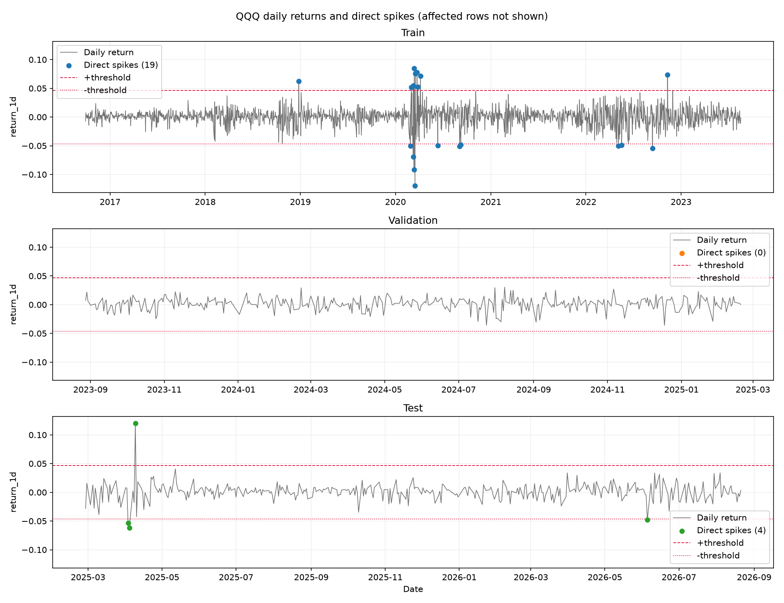

**รูป:** return รายวันของสามชุดข้อมูล เส้นประและเส้นจุดสีแดงคือเส้นแบ่ง +4.65% และ −4.65% จุดคือวันที่ถูกนับเป็น spike (Train 19 วัน Validation 0 วัน Test 4 วัน)

### การตรวจสอบว่าขั้นตอนทั้งหมดถูกต้อง

ก่อนใช้ข้อมูลสอนโมเดล เราตรวจสายการเตรียมข้อมูลทั้งหมด (เรียกว่า audit) ผลคือ **ข้อมูลปลอดภัยสำหรับการสอนโมเดล ไม่พบการรั่วของข้อมูลอนาคต** การตรวจที่สำคัญถูกเขียนเป็นโปรแกรมทดสอบอัตโนมัติใน [`tests/test_audit_guards.py`](../../tests/test_audit_guards.py) ซึ่งรันซ้ำได้ทุกเมื่อ

| ตรวจอะไร | ตรวจอย่างไร |
| --- | --- |
| feature ไม่ใช้ข้อมูลอนาคต | ตัดข้อมูลหลังวันที่ t ทิ้ง แล้วคำนวณใหม่ ค่าของวันที่ t ต้องเท่าเดิม |
| feature และ target คำนวณถูก | เขียนสูตรใหม่อีกชุดแบบอิสระ แล้วเทียบกับค่าในไฟล์ |
| ชุดข้อมูลไม่ทับกัน | ช่องว่างระหว่างชุดต้องไม่น้อยกว่า 5 วัน |
| เส้นแบ่งมาจาก Train เท่านั้น | แก้ค่าใน Validation และ Test แล้วเส้นแบ่งต้องไม่เปลี่ยน |
| ไม่มีการสุ่มสลับข้อมูล | ค้นทุกไฟล์โค้ดว่าไม่มีคำสั่งสุ่มสลับ |
| Test ไม่ถูกแอบอ่าน | มีเพียง 3 ไฟล์โค้ดที่อ้างถึง Test ได้ |
| ทำซ้ำได้ | รันสายการเตรียมข้อมูลสองรอบ ได้ไฟล์เหมือนกันทุกไบต์ทั้ง 14 ไฟล์ |

รายงานการตรวจฉบับเต็มอยู่ที่ [`docs/audit/DATA_PIPELINE_AUDIT.md`](../audit/DATA_PIPELINE_AUDIT.md)

**พูดสั้น ๆ ได้ว่า:** จากราคาดิบ 2,512 วัน เราสร้าง feature 8 ตัวจากข้อมูลย้อนหลัง สร้างเฉลยจากความผันผวนของ 5 วันถัดไป แบ่งข้อมูลตามเวลาเป็นสามชุดโดยเว้นช่องว่างกันรั่ว และตั้งเส้นแบ่งทุกเส้นจากชุดสอนเท่านั้น

---

## 4. การทดลองเรื่อง spike

### 4.1 ทำไมถึงทำ

วัน spike มีเพียง 19 วันจาก 1,733 วันในชุดสอน แต่มีค่าสุดโต่งมาก มีสองความเชื่อที่ขัดกัน

- **ความเชื่อที่ 1:** spike เป็นสิ่งรบกวน โมเดลจะพยายามปรับตัวให้เข้ากับวันไม่กี่วันนี้จนเรียนรู้รูปแบบปกติได้แย่ลง ถ้าตัดออก โมเดลควรดีขึ้น
- **ความเชื่อที่ 2:** spike คือตัวอย่างของสิ่งที่เราอยากทำนายที่สุด ถ้าตัดออก โมเดลจะไม่เคยเห็นภาวะสุดโต่ง และควรแย่ลง

เราไม่รู้ว่าความเชื่อไหนถูก จึงทดลอง

### 4.2 spike หนึ่งวันกระทบกี่แถว

การตัดแค่วัน spike วันเดียวไม่พอ เพราะวันรอบข้างก็ "มองเห็น" วันนั้นด้วย

```text
วัน        s−5  s−4  s−3  s−2  s−1  [ s ]  s+1  s+2  ...  s+19
target      ●    ●    ●    ●    ●                               target ของ 5 วันก่อนหน้ามองไปข้างหน้าถึงวัน s
feature                              ●     ●    ●   ...    ●    feature ย้อนหลัง 20 วันของวัน s ถึง s+19 มีวัน s อยู่ข้างใน
ตัดออก     ├──────────────── 25 แถวต่อ spike หนึ่งวัน ────────────────┤
```

- 5 วันก่อน spike: target ของวันเหล่านี้คำนวณจาก 5 วันถัดไป ซึ่งรวมวัน spike
- วัน spike และ 19 วันถัดมา: feature ที่ดูย้อนหลัง 20 วันของวันเหล่านี้มี return ของวัน spike อยู่ข้างใน

เราจึงตัดทั้งหน้าต่าง ตั้งแต่ 5 วันก่อนถึง 19 วันหลัง spike แต่ละครั้ง หน้าต่างของ spike ที่อยู่ใกล้กันซ้อนทับกัน (โดยเฉพาะเดือนมีนาคม 2020) รวมแล้วตัดออก **213 แถว**

### 4.3 ข้อมูลสอนสองแบบ

| | `with_spike` | `non_spike` |
| --- | --- | --- |
| ข้อมูลสอน (Train) | ครบ 1,733 แถว | ตัดออก 213 แถว เหลือ 1,520 แถว |
| วันผันผวนสูงใน Train | 433 วัน (25.0%) | 280 วัน (18.4%) |
| ค่า target สูงสุดใน Train | 1.50 | 0.55 |
| Validation และ Test | เหมือนกันทุกประการ | เหมือนกันทุกประการ |

การที่ Validation และ Test เหมือนกันทั้งสองแบบเป็นหัวใจของการออกแบบ เพราะทำให้เทียบกันได้ตรง ๆ ว่าโมเดลที่สอนต่างกันทำข้อสอบชุดเดียวกันได้ต่างกันแค่ไหน

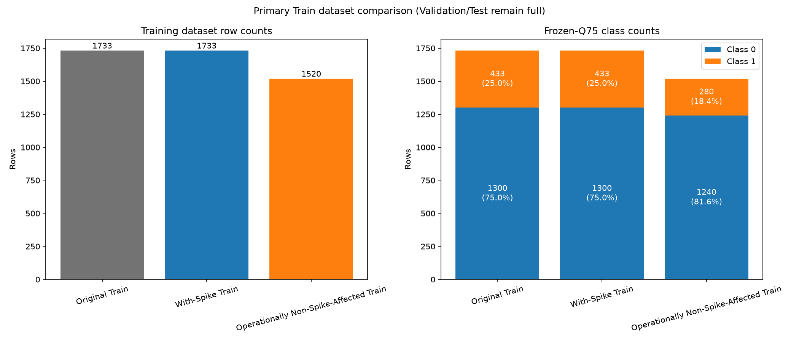

**รูป:** ซ้ายคือจำนวนแถวของข้อมูลสอน ขวาคือจำนวนวันปกติ (Class 0) และวันผันผวนสูง (Class 1) แท่ง Original Train กับ With-Spike Train เท่ากัน เพราะแบบ `with_spike` คือข้อมูลสอนเดิมทั้งหมด แท่งที่สามคือแบบ `non_spike`

### 4.4 ข้อควรระวังในการตีความ

นี่คือจุดที่ต้องพูดให้ชัดทุกครั้งที่อธิบายการทดลองนี้ แถวที่ตัดออก 213 แถวเป็นวันผันผวนสูงถึง 153 แถว (71.8%) การตัดจึงเปลี่ยน **สามอย่างพร้อมกัน**

1. จำนวนตัวอย่างที่ใช้สอนลดลง (1,733 เป็น 1,520)
2. สัดส่วนวันผันผวนสูงลดลง (25.0% เป็น 18.4%)
3. ช่วงตลาดปั่นป่วนหายไปจากข้อมูลสอน

ถ้าผลของสองแบบต่างกัน เราบอกไม่ได้ว่าต่างเพราะข้อไหน สิ่งที่วัดได้จึงเป็น **ผลของนโยบายตัดแถวทั้งชุด** ไม่ใช่ผลของ spike เพียงอย่างเดียว สถานการณ์ที่หลายปัจจัยเปลี่ยนพร้อมกันจนแยกผลไม่ได้แบบนี้เรียกว่า **confound**

**พูดสั้น ๆ ได้ว่า:** เราตัดช่วงรอบวันราคากระชากแรง 213 แถวออกจากข้อมูลสอน แล้วเทียบกับการสอนด้วยข้อมูลครบ โดยวัดบนข้อสอบชุดเดียวกัน แต่การตัดเปลี่ยนหลายอย่างพร้อมกัน ผลที่ได้จึงเป็นผลของนโยบายตัดแถวทั้งชุด

---

## 5. โมเดลทั้ง 19 ตัว

### 5.1 "เขียนเอง" หมายความว่าอะไร และพิสูจน์อย่างไรว่าเขียนถูก

ปกติการทำ ML จะเรียกใช้ library สำเร็จรูป เช่น scikit-learn ซึ่งสอนโมเดลได้ในบรรทัดเดียว โจทย์ของวิชาห้ามทำแบบนั้น เราต้อง **เขียนขั้นตอนการเรียนรู้ของโมเดลเองทั้งหมด** โดยใช้ได้เพียง NumPy ซึ่งเป็น library สำหรับคำนวณตัวเลขและเมทริกซ์ โค้ดอยู่ในโฟลเดอร์ `src/ml/` หนึ่งโมเดลหนึ่งไฟล์

โจทย์อนุญาตให้ใช้ library ได้อย่างเดียวคือ **ใช้ตรวจคำตอบ** ทุกโมเดลของเราจึงมีคำสั่ง `reference()` ที่สร้างโมเดลชนิดเดียวกันจาก scikit-learn หรือ XGBoost ด้วยการตั้งค่าเดียวกัน แล้วโปรแกรมทดสอบจะสอนทั้งสองฝั่งด้วยข้อมูลเดียวกันและเทียบคำทำนายทีละแถว การเทียบแบบนี้เรียกว่า **parity**

| กลุ่มโมเดล | ผลต่างจาก library |
| --- | --- |
| `simple_linear`, `multiple_linear`, `polynomial`, `gaussian_nb`, `knn`, `adaboost`, `mlp` | ไม่เกิน 0.000000000000002 (ตรงกันถึงทศนิยมตำแหน่งสุดท้ายที่คอมพิวเตอร์เก็บได้) |
| `perceptron`, `decision_tree`, `random_forest`, `gradient_boosting`, `xgboost` | ตรงกันทุกแถว |
| `kmeans`, `agglomerative` | จัดกลุ่มตรงกัน 100% |
| `elastic_net` | คำทำนายต่างไม่เกิน 0.000003 เพราะใช้กฎการหยุดวนรอบต่างจาก library |
| `svm` | ค่าที่โมเดลพยายามลดต่างไม่เกิน 0.000003 เพราะใช้วิธีหาคำตอบต่างจาก library |
| `logistic` | ต่างไม่เกิน 0.001 เพราะหยุดที่ 5,000 รอบก่อนถึงคำตอบสุดท้าย |
| `slp` | ต่าง 0.07 ถึง 0.29 เพราะหยุดที่โควตา 1,000 รอบ ขณะที่โมเดลของ library วิ่งจนถึงคำตอบสุดท้าย |
| `stacking` | ไม่มี library ที่ทำแบบเดียวกัน จึงตรวจด้วยวิธีอื่น (สร้างซ้ำทีละส่วน และทดสอบว่าไม่มีข้อมูลรั่ว) |

สรุปคือ 14 จาก 19 โมเดลตรงกับ library อย่างสมบูรณ์ อีก 5 ตัวต่างด้วยเหตุผลที่อธิบายได้

### 5.2 ทุกโมเดลผ่านสายพานเดียวกัน

ไม่ว่าโมเดลชนิดไหน ขั้นตอนการสอนเหมือนกันหมด โค้ดอยู่ที่ `src/ml/core/trainer.py`

```text
1. โหลดข้อมูลของแบบที่เลือก (with_spike หรือ non_spike)
2. ปรับสเกล feature โดยใช้ค่าจาก Train เท่านั้น (โมเดลตระกูลต้นไม้ไม่ต้องปรับ)
3. วนลองทุกการตั้งค่าในรายการ (grid search)
       สอนด้วย Train  →  ทำนาย Validation  →  คิดคะแนน
4. เลือกการตั้งค่าที่ได้คะแนนบน Validation ดีที่สุด
5. บันทึกโมเดลลงไฟล์  →  โหลดกลับขึ้นมา  →  ทำนายซ้ำ  →  ต้องได้ค่าเดิม
6. เขียนไฟล์ผลลัพธ์ทั้งหมดลง outputs/modeling/<แบบข้อมูล>/<ประเภทงาน>/<ชื่อโมเดล>/
```

- **ลองทั้งหมดกี่ครั้ง:** รวมทุกโมเดลมี 140 การตั้งค่าต่อแบบข้อมูล เมื่อทำสองแบบจึงสอนทั้งหมด 280 ครั้ง เหลือผู้ชนะ 38 ชุด (19 โมเดล × 2 แบบ)
- **เกณฑ์เลือกผู้ชนะ:** regression ใช้ RMSE ต่ำสุด classification ใช้ average precision สูงสุด clustering ใช้ silhouette สูงสุด (metric เหล่านี้อธิบายในหัวข้อ 6)
- **ขั้นที่ 5 สำคัญอย่างไร:** โจทย์กำหนดให้บันทึกโมเดล โหลดกลับ แล้วทดสอบซ้ำ ทุกชุดมีไฟล์ `load_verification.json` ที่บันทึกว่าผ่าน และมีโปรแกรมทดสอบที่โหลดโมเดลทั้ง 38 ชุดจากไฟล์มาทำนายซ้ำอีกรอบ

**เมื่อนำโมเดลไปทำนายวันใหม่** ขั้นตอนคือ คำนวณ feature 8 ตัวของวันนั้น ปรับสเกลด้วยค่าเฉลี่ยและ SD ที่เก็บไว้จาก Train แล้วป้อนให้โมเดลที่โหลดจากไฟล์ โมเดลจะคืนค่าทำนายออกมา ไม่มีการเรียนรู้เพิ่มในขั้นนี้

รายการค่าที่ลองทั้งหมดอยู่ใน [`configs/modeling.json`](../../configs/modeling.json) และการตั้งค่าที่ชนะของทุกโมเดลอยู่ใน [`outputs/modeling/report/tables/model_inventory.md`](../../outputs/modeling/report/tables/model_inventory.md)

### 5.3 โมเดล regression 4 ตัว (ทำนายเป็นตัวเลข)

หัวข้อ 5.3 ถึง 5.5 อธิบายแนวคิดของแต่ละโมเดลด้วยคำพูด ชื่อในวงเล็บคือชื่อที่ใช้ในโค้ดและในตารางผล ตารางในสามหัวข้อนี้เป็นภาพรวมแบบสั้น คำอธิบายแบบละเอียดทีละโมเดล (แนวคิด สิ่งที่เปรียบได้ วิธีเรียนรู้ จุดแข็งจุดอ่อน และผลในโปรเจกต์) อยู่ในหัวข้อ 5.8 ส่วนสูตรของทุกโมเดลพร้อมคำอ่านอยู่ในหัวข้อ 13.3 ถึง 13.5

| โมเดล | แนวคิดแบบสั้น |
| --- | --- |
| **Simple Linear Regression** (`simple_linear`) | ลากเส้นตรงหนึ่งเส้นจาก feature ตัวเดียว: `คำทำนาย = a + b × feature` โปรแกรมลองทีละ feature ทั้ง 8 ตัวแล้วเลือกตัวที่ดีที่สุด ในแบบ `with_spike` ตัวที่ถูกเลือกคือ `historical_volatility_20d` |
| **Multiple Linear Regression** (`multiple_linear`) | ใช้ทั้ง 8 feature พร้อมกัน แต่ละตัวมีน้ำหนักของตัวเอง: `คำทำนาย = a + b1 × f1 + ... + b8 × f8` หาน้ำหนักที่ทำให้ความผิดพลาดกำลังสองรวมน้อยที่สุด |
| **Polynomial Regression** (`polynomial`) | เหมือน simple linear แต่ใส่กำลังสองและกำลังสามของ feature เข้าไปด้วย ทำให้เส้นโค้งได้ |
| **Elastic Net** ★ (`elastic_net`) | multiple linear ที่เพิ่ม "ค่าปรับ" เมื่อน้ำหนักมีขนาดใหญ่ เพื่อให้คำตอบนิ่งเมื่อ feature ซ้ำซ้อนกัน (หัวข้อ 5.6) |

### 5.4 โมเดล classification 13 ตัว (ทำนายใช่หรือไม่)

โมเดลเหล่านี้ไม่ได้ตอบแค่ 0 หรือ 1 แต่ให้ **คะแนน** ของแต่ละวัน (ส่วนใหญ่เป็นความน่าจะเป็นระหว่าง 0 ถึง 1) ว่าน่าจะผันผวนสูงแค่ไหน แล้วตัดสินว่าเป็น 1 เมื่อคะแนนเกิน 0.5 ยกเว้น `svm` และ `perceptron` ซึ่งให้คะแนนเป็นระยะห่างจากเส้นแบ่ง (เป็นบวกหรือลบได้) จึงตัดสินว่าเป็น 1 เมื่อคะแนนมากกว่า 0

#### กลุ่มเส้นแบ่งตรง

โมเดลกลุ่มนี้รวม feature แบบถ่วงน้ำหนักแล้วตัดสินจากผลรวม ต่างกันที่วิธีหาน้ำหนัก

| โมเดล | แนวคิดแบบสั้น |
| --- | --- |
| **Logistic Regression** (`logistic`) | แปลงผลรวมถ่วงน้ำหนักเป็นความน่าจะเป็นด้วยฟังก์ชัน sigmoid แล้วค่อย ๆ ปรับน้ำหนักไปทางที่ทำให้ทายผิดน้อยลง (วิธีนี้เรียกว่า gradient descent) เป็นโมเดลพื้นฐานที่ใช้เป็นตัวเทียบ |
| **Perceptron** (`perceptron`) | ดูตัวอย่างทีละตัว ปรับน้ำหนักเฉพาะเมื่อทายผิด จะหยุดนิ่งได้ต่อเมื่อมีเส้นตรงที่แบ่งสองกลุ่มได้สมบูรณ์ ซึ่งข้อมูลของเราไม่มี |
| **Single-Layer Perceptron** (`slp`) | หน่วยประมวลผลหนึ่งตัวที่ใช้ sigmoid เหมือน logistic แต่ปรับน้ำหนักทีละกลุ่มย่อยของข้อมูล |
| **Support Vector Machine** (`svm`) | หาเส้นแบ่งที่เว้นระยะห่างจากทั้งสองกลุ่มให้กว้างที่สุด ใช้ร่วมกับ PCA ตามที่โจทย์กำหนด |

#### กลุ่มความน่าจะเป็นและระยะทาง

| โมเดล | แนวคิดแบบสั้น |
| --- | --- |
| **Gaussian Naive Bayes** (`gaussian_nb`) | จำค่าเฉลี่ยและการกระจายของแต่ละ feature แยกตามกลุ่ม เมื่อเจอวันใหม่ก็ถามว่า "หน้าตาแบบนี้เหมือนวันผันผวนสูงหรือวันปกติมากกว่ากัน" โดยสมมติว่า feature ไม่เกี่ยวข้องกัน |
| **k-Nearest Neighbors** (`knn`) | ไม่ได้เรียนรู้อะไร แค่เก็บข้อมูลสอนไว้ เมื่อเจอวันใหม่ก็หา k วันในอดีตที่ feature คล้ายที่สุด แล้วให้วันเหล่านั้นโหวต วันที่คล้ายกว่ามีเสียงมากกว่า |

#### กลุ่มโครงข่ายประสาท

| โมเดล | แนวคิดแบบสั้น |
| --- | --- |
| **Multi-Layer Perceptron** (`mlp`) | หน่วยประมวลผลหลายตัวเรียงเป็นชั้น ชั้นกลาง (ชั้นซ่อน) ช่วยให้จับความสัมพันธ์ที่ไม่ใช่เส้นตรงได้ เรียนรู้ด้วยการส่งความผิดพลาดย้อนกลับไปปรับน้ำหนักทุกชั้น (backpropagation) |

#### กลุ่มต้นไม้และการรวมหลายโมเดล

| โมเดล | แนวคิดแบบสั้น |
| --- | --- |
| **Decision Tree** (`decision_tree`) | ชุดคำถามใช่หรือไม่ที่ต่อกันเป็นต้นไม้ เช่น "ความผันผวน 20 วันเกิน 0.25 ไหม" แต่ละขั้นเลือกคำถามที่แยกสองกลุ่มได้สะอาดที่สุด |
| **Random Forest** (`random_forest`) | ต้นไม้หลายสิบต้น แต่ละต้นเห็นข้อมูลที่สุ่มมาไม่เหมือนกัน แล้วเฉลี่ยคำตอบ การเฉลี่ยทำให้ผลนิ่งกว่าต้นไม้ต้นเดียว ใช้ร่วมกับ PCA ตามที่โจทย์กำหนด |
| **Gradient Boosting** (`gradient_boosting`) | ต้นไม้เล็ก ๆ ต่อกันทีละต้น ต้นใหม่เรียนเฉพาะส่วนที่ต้นก่อนหน้ายังทายผิด |
| **XGBoost** (`xgboost`) | gradient boosting รุ่นที่ใช้ข้อมูลความโค้งของความผิดพลาดประกอบการตัดสินใจ และมีกลไกกันต้นไม้ซับซ้อนเกินไป |
| **AdaBoost** ★ (`adaboost`) | ต้นไม้ชั้นเดียวต่อกันทีละต้น โดยเพิ่มน้ำหนักให้ตัวอย่างที่ทายผิด เพื่อให้ต้นถัดไปสนใจตัวอย่างเหล่านั้น (หัวข้อ 5.6) |
| **Stacking** (`stacking`) | โมเดลซ้อนโมเดล: ให้ logistic, decision tree และ k-NN ทำนายก่อน แล้วให้ logistic อีกตัวเรียนว่าควรเชื่อใครมากน้อยแค่ไหน |

### 5.5 โมเดล clustering 2 ตัว (จัดกลุ่มโดยไม่มีคำตอบ)

| โมเดล | แนวคิดแบบสั้น |
| --- | --- |
| **k-Means** (`kmeans`) | วางจุดศูนย์กลาง k จุด แล้วทำสองขั้นสลับกันจนนิ่ง คือจัดแต่ละวันเข้ากลุ่มของจุดศูนย์กลางที่ใกล้ที่สุด แล้วย้ายจุดศูนย์กลางไปที่ค่าเฉลี่ยของกลุ่ม |
| **Agglomerative Clustering** (`agglomerative`) | เริ่มจากทุกวันเป็นกลุ่มของตัวเอง แล้วรวมสองกลุ่มที่ใกล้กันที่สุดซ้ำไปเรื่อย ๆ จนเหลือ k กลุ่ม |

**PCA คืออะไร** PCA (Principal Component Analysis) คือการย่อจำนวน feature เช่นจาก 8 ตัวเหลือ 4 ตัว โดยรวม feature ที่บอกเรื่องคล้ายกันเข้าด้วยกันและเก็บส่วนที่มีข้อมูลมากที่สุดไว้ โจทย์กำหนดให้ลองกับ Random Forest และ SVM ผลคือ SVM เลือกใช้ PCA 4 ตัว ส่วน Random Forest ทำได้ดีกว่าเมื่อไม่ใช้ PCA

### 5.6 โมเดลนอกเนื้อหาที่สอนสองตัว

โจทย์กำหนดให้มีโมเดลที่ไม่ได้สอนในห้อง และต้องอธิบายกลไกภายในอย่างละเอียด เราเลือกสองตัวนี้ด้วยเหตุผลที่มาจากข้อมูล

#### Elastic Net: โมเดลนอกเนื้อหาตัวที่หนึ่ง

**ปัญหาที่มันแก้** feature ของเราบางคู่ซ้ำซ้อนกัน เช่น ความผันผวนย้อนหลัง 5 วันกับ 20 วัน ซึ่งขึ้นลงตามกันมาก (ค่าสหสัมพันธ์ 0.80 จากเต็ม 1) เมื่อ feature ซ้ำซ้อน linear regression ธรรมดาจะแบ่งน้ำหนักให้คู่นี้แบบไม่นิ่ง ข้อมูลเปลี่ยนนิดเดียว น้ำหนักเปลี่ยนมาก

**วิธีแก้** Elastic Net ไม่ได้พยายามลดความผิดพลาดอย่างเดียว แต่ลดผลรวมของสามส่วน

```text
สิ่งที่ลด = ความผิดพลาดของคำทำนาย  +  ค่าปรับแบบ L1  +  ค่าปรับแบบ L2
```

- **ค่าปรับแบบ L1** คิดจากผลรวมขนาดของน้ำหนัก ผลคือน้ำหนักของ feature ที่ช่วยน้อยจะถูกดันจน **เป็นศูนย์พอดี** เท่ากับคัด feature นั้นทิ้ง
- **ค่าปรับแบบ L2** คิดจากผลรวมกำลังสองของน้ำหนัก ผลคือน้ำหนักทุกตัวเล็กลง และ feature ที่ซ้ำซ้อนกันจะแบ่งน้ำหนักกันอย่างนิ่ง
- มี hyperparameter สองตัว คือ `alpha` (ค่าปรับแรงแค่ไหน) และ `l1_ratio` (สัดส่วนของ L1 ต่อ L2)

**วิธีหาคำตอบ** เราใช้วิธี coordinate descent คือปรับน้ำหนักทีละตัวโดยตรึงตัวอื่นไว้ วนไปเรื่อย ๆ จนน้ำหนักแทบไม่เปลี่ยน ในแต่ละรอบ ถ้า feature ตัวใดช่วยอธิบายส่วนที่เหลือได้น้อยกว่าระดับที่กำหนด น้ำหนักของตัวนั้นจะถูกตั้งเป็นศูนย์ กลไกนี้เรียกว่า soft-threshold

**ลงลึก: สูตร** (คำอ่านทีละตัวอยู่ในหัวข้อ 13.3) สิ่งที่ลดคือ `J(w) = (1/2n)·‖y − Xw‖² + α·ρ·‖w‖₁ + α·(1−ρ)/2·‖w‖²` และน้ำหนักของ feature ตัวที่ j ในแต่ละรอบคือ `w_j = S(ρ_j, α·ρ) / (z_j + α·(1−ρ))` โดย `S(v, γ) = sign(v)·max(|v| − γ, 0)`

**ผลที่ได้** การตั้งค่าที่ชนะคือ `alpha = 0.1` และ `l1_ratio = 0.25` โมเดลดันน้ำหนักเป็นศูนย์ 3 จาก 8 ตัวในแบบ `with_spike` (คือ `return_1d`, `return_5d`, `volume_zscore_20`) และ 4 จาก 8 ตัวในแบบ `non_spike` เหลือเฉพาะ feature กลุ่มความผันผวนและแนวโน้ม

#### AdaBoost: โมเดลนอกเนื้อหาตัวที่สอง

**แนวคิด** AdaBoost สร้าง "โมเดลอ่อน" จำนวนมากต่อกัน โมเดลอ่อนที่เราใช้คือต้นไม้ที่ถามคำถามเดียว (เรียกว่า stump) แต่ละตัวทำนายได้ดีกว่าเดาสุ่มเพียงเล็กน้อย แต่เมื่อรวมกัน 100 ตัวจะได้โมเดลที่ดีขึ้น

**ขั้นตอน** มีหกข้อ (สูตรเต็มอยู่ในหัวข้อ 13.4)

1. เริ่มต้นให้ทุกตัวอย่างมีน้ำหนักเท่ากัน
2. สอน stump หนึ่งตัวบนข้อมูลที่ถ่วงน้ำหนัก
3. วัดความผิดพลาดของ stump ตัวนั้น โดยตัวอย่างที่น้ำหนักมากนับมาก
4. กำหนด "สิทธิ์ออกเสียง" ของ stump: ยิ่งผิดน้อยยิ่งมีเสียงมาก ถ้าผิดครึ่งหนึ่ง (เท่ากับเดาสุ่ม) จะไม่มีเสียงเลย สูตรคือ `สิทธิ์ออกเสียง = learning_rate × ln((1 − ความผิดพลาด) ÷ ความผิดพลาด)`
5. **เพิ่มน้ำหนักให้ตัวอย่างที่ทายผิด** เพื่อให้ stump ตัวถัดไปให้ความสนใจกับตัวอย่างที่ยาก
6. ทำซ้ำข้อ 2 ถึง 5 จนครบจำนวน stump คำตอบสุดท้ายคือผลโหวตถ่วงน้ำหนักของ stump ทั้งหมด

**ทำไมเลือกตัวนี้** กลไกในข้อ 5 ทำให้ตัวอย่างที่ทายผิดซ้ำ ๆ ถูกเพิ่มน้ำหนักทบไปเรื่อย ๆ วันที่สุดโต่งอย่าง spike จึงอาจดึงความสนใจของโมเดลไปมากเกินควร เราจึงตั้งสมมติฐานไว้ **ก่อนทดลอง** ว่า AdaBoost น่าจะเป็นโมเดลที่ได้ประโยชน์จากการตัด spike มากที่สุด (ผลอยู่ในหัวข้อ 9.5)

**ผลที่ได้** การตั้งค่าที่ชนะคือ stump 100 ตัวและ `learning_rate = 0.5` stump ตัวแรกมีความผิดพลาด 0.25 ส่วนตัวท้าย ๆ มีความผิดพลาดใกล้ 0.5 และแทบไม่มีสิทธิ์ออกเสียง เพราะตัวอย่างที่เหลือให้แก้คือตัวอย่างที่ยากจริง ๆ ในแบบ `with_spike` ค่า loss ตอนจบการสอนคือ 0.579 และเมื่อวัดบน Validation ได้ 0.577 สองค่านี้ใกล้กัน จึงไม่มีสัญญาณของ overfitting

### 5.7 สามโมเดลที่หยุดเพราะครบโควตา

`slp`, `perceptron` และ `logistic` หยุดสอนเพราะครบจำนวนรอบที่กำหนดไว้ ไม่ใช่เพราะเรียนจนนิ่ง โดยเฉพาะ `perceptron` ซึ่งไม่มีวันนิ่งกับข้อมูลชุดนี้ คะแนนของสามตัวนี้จึงเป็นคะแนนของ "วิธีนี้ภายใต้จำนวนรอบที่กำหนด" ข้อนี้อธิบายว่าทำไม `perceptron` ได้คะแนนแย่มาก ทั้งที่โค้ดถูกต้อง (ตรงกับ library ทุกแถว)

### 5.8 ลงลึกทีละโมเดล

หัวข้อนี้สอนโมเดลที่เหลืออีก 17 ตัวทีละตัว (Elastic Net และ AdaBoost อยู่ในหัวข้อ 5.6 แล้ว) ทุกตัวเล่าด้วยโครงเดียวกัน คือ แนวคิด สิ่งที่เปรียบได้ วิธีเรียนรู้ ค่าที่เราลอง จุดแข็งและจุดอ่อน และสิ่งที่เกิดขึ้นในโปรเจกต์นี้ สูตรของแต่ละตัวอยู่ในหัวข้อ 13

#### Simple Linear Regression (`simple_linear`)

- **แนวคิด:** ใช้ feature ตัวเดียวทำนายด้วยเส้นตรง เป็นโมเดลที่ง่ายที่สุดเท่าที่จะเป็นได้ และเป็นตัวอย่างเดียวกับที่คิดด้วยมือในหัวข้อ 2.11
- **เปรียบได้กับ:** การบอกว่า "ยิ่งเดือนที่แล้วผันผวนมาก สัปดาห์หน้ายิ่งผันผวนมาก ในอัตราคงที่"
- **เรียนรู้อย่างไร:** มีสูตรคำนวณความชันและจุดตัดแกนได้ในครั้งเดียว ไม่ต้องวนรอบ
- **ค่าที่เราลอง:** ลองทีละ feature ทั้ง 8 ตัว แล้วเลือกตัวที่ได้ RMSE บน Validation ต่ำสุด
- **จุดแข็ง:** เข้าใจง่ายที่สุด อธิบายได้ด้วยตัวเลขสองตัว **จุดอ่อน:** ใช้ข้อมูลเพียง 1 ใน 8 และจับได้แต่ความสัมพันธ์แบบเส้นตรง
- **ในโปรเจกต์นี้:** แบบ `with_spike` เลือก `historical_volatility_20d` ส่วนแบบ `non_spike` เลือก `return_1d` การที่ feature ที่ถูกเลือกเปลี่ยนไปเมื่อข้อมูลสอนเปลี่ยน บอกว่าไม่มี feature ตัวใดเด่นขาดจากตัวอื่น

#### Multiple Linear Regression (`multiple_linear`)

- **แนวคิด:** ใช้ feature ทั้ง 8 ตัวพร้อมกัน แต่ละตัวมีน้ำหนักของตัวเอง แล้วบวกรวมกัน
- **เปรียบได้กับ:** การให้คะแนนรวมจากหลายวิชา โดยแต่ละวิชามีหน่วยกิตไม่เท่ากัน
- **เรียนรู้อย่างไร:** หาน้ำหนักทั้ง 8 ตัวที่ทำให้ผลรวมความผิดพลาดยกกำลังสองน้อยที่สุด ได้คำตอบในครั้งเดียว
- **ค่าที่เราลอง:** ไม่มี โมเดลนี้ไม่มี hyperparameter
- **จุดแข็ง:** เร็ว อ่านน้ำหนักได้ว่า feature ใดดันค่าทำนายขึ้นหรือลง **จุดอ่อน:** เมื่อ feature ซ้ำซ้อนกัน น้ำหนักจะไม่นิ่ง ซึ่งเป็นปัญหาที่ Elastic Net ออกแบบมาแก้
- **ในโปรเจกต์นี้:** เป็นโมเดลพื้นฐานที่ใช้เทียบกับโมเดลตัวแทนของงาน regression และบน Test แบบ `with_spike` ได้ RMSE ต่ำสุดในตาราง (0.1158) แม้จะแยกจาก Elastic Net ไม่ได้ทางสถิติ

#### Polynomial Regression (`polynomial`)

- **แนวคิด:** เหมือน simple linear แต่เพิ่มกำลังสองและกำลังสามของ feature ทำให้เส้นทำนายโค้งได้
- **เปรียบได้กับ:** การบอกว่า "ความผันผวนไม่ได้เพิ่มในอัตราคงที่ ช่วงแรกเพิ่มช้า ช่วงหลังเพิ่มเร็ว"
- **เรียนรู้อย่างไร:** สร้างคอลัมน์ใหม่จาก feature เดิม (ค่ายกกำลังสอง ค่ายกกำลังสาม) แล้วใช้วิธีเดียวกับ multiple linear
- **ค่าที่เราลอง:** feature 8 ตัว คูณกับ degree 2 และ 3 รวม 16 แบบ
- **จุดแข็ง:** จับความสัมพันธ์ที่โค้งได้ **จุดอ่อน:** เส้นโค้งพุ่งแรงมากเมื่อเจอค่าที่อยู่นอกช่วงที่เคยเห็นตอนสอน ยิ่ง degree สูงยิ่งเสี่ยง
- **ในโปรเจกต์นี้:** แบบ `with_spike` เลือก degree 3 ของ `historical_volatility_20d` และบน Test ได้ RMSE 0.1401 ซึ่งแย่กว่าการทายค่าเฉลี่ย (0.1380) ส่วนแบบ `non_spike` เลือก degree 2 ของ `return_5d` และได้ 0.1142 ซึ่งต่ำสุดในตารางของแบบนั้น ผลที่เหวี่ยงขนาดนี้คือตัวอย่างของจุดอ่อนข้างต้น

#### Logistic Regression (`logistic`)

- **แนวคิด:** รวม feature แบบถ่วงน้ำหนักเหมือน linear regression แต่ส่งผลรวมผ่านฟังก์ชัน sigmoid เพื่อให้ได้ความน่าจะเป็นระหว่าง 0 ถึง 1 แม้ชื่อมีคำว่า regression แต่ใช้ทำ classification
- **เปรียบได้กับ:** เครื่องชั่งที่วางหลักฐาน 8 ชิ้นลงไป แต่ละชิ้นหนักไม่เท่ากัน ยิ่งตาชั่งเอียงไปทาง "ผันผวนสูง" มาก ความน่าจะเป็นยิ่งเข้าใกล้ 1
- **เรียนรู้อย่างไร:** เริ่มจากน้ำหนักเริ่มต้น คำนวณว่าทายผิดไปทางไหน แล้วขยับน้ำหนักทีละนิดไปทางที่ทำให้ cross-entropy ลดลง ทำซ้ำสูงสุด 5,000 รอบ (gradient descent)
- **ค่าที่เราลอง:** ความแรงของค่าปรับ L2 สามระดับ (0, 0.001, 0.01) คูณกับการถ่วงน้ำหนักคลาสสองแบบ คือไม่ถ่วง กับแบบ `balanced` ซึ่งให้วันผันผวนสูงมีน้ำหนักมากขึ้นเพื่อชดเชยที่มีจำนวนน้อย รวม 6 แบบ
- **จุดแข็ง:** เรียบง่าย ให้ความน่าจะเป็นที่ตีความได้ และมักเป็นคู่เทียบที่เอาชนะยาก **จุดอ่อน:** เส้นแบ่งเป็นเส้นตรงเท่านั้น
- **ในโปรเจกต์นี้:** เป็นโมเดลพื้นฐานที่ใช้เทียบกับโมเดลตัวแทนของงาน classification บน Test ได้ AP 0.552 ใกล้กับ `mlp` (0.599) จนแยกกันไม่ได้ทางสถิติ

#### Perceptron (`perceptron`)

- **แนวคิด:** โมเดลเส้นแบ่งตรงรุ่นแรกสุด (คิดขึ้นช่วงปลายทศวรรษ 1950) ตอบได้แค่ใช่หรือไม่ ไม่มีความน่าจะเป็น
- **เปรียบได้กับ:** คนที่แก้ตัวเฉพาะตอนถูกจับได้ว่าผิด ถ้าตอบถูกก็ไม่เปลี่ยนอะไร
- **เรียนรู้อย่างไร:** ดูข้อมูลทีละวันตามลำดับ ถ้าทายผิดก็ขยับเส้นแบ่งไปทางวันนั้น ถ้าทายถูกก็ข้ามไป
- **ค่าที่เราลอง:** learning rate สามค่า (0.001, 0.01, 0.1)
- **จุดแข็ง:** ง่ายมาก และถ้าข้อมูลแบ่งด้วยเส้นตรงได้สมบูรณ์ รับประกันว่าจะหาเส้นนั้นเจอ **จุดอ่อน:** ถ้าแบ่งไม่ได้สมบูรณ์ (ซึ่งเป็นกรณีของเรา) มันจะแก้ไปแก้มาไม่มีวันหยุด และผลสุดท้ายขึ้นกับว่าวันสุดท้ายที่มันแก้คือวันไหน
- **ในโปรเจกต์นี้:** ได้ ROC-AUC ราว 0.30 ซึ่งแย่กว่าเดาสุ่ม ผลนี้ตรงกับ library ทุกแถว จึงเป็นธรรมชาติของวิธีนี้ ไม่ใช่ข้อผิดพลาดของโค้ด เราเก็บไว้ในรายงานเพราะมันแสดงให้เห็นว่าทำไมจึงมีการพัฒนา logistic regression ขึ้นมาแทน

#### Single-Layer Perceptron (`slp`)

- **แนวคิด:** หน่วยประมวลผลหนึ่งตัวที่ใช้ sigmoid เป็น "เซลล์ประสาท" หนึ่งเซลล์ของโครงข่ายประสาท ในทางคณิตศาสตร์เป็นโมเดลเดียวกับ logistic regression
- **ต่างจาก logistic อย่างไร:** ต่างที่วิธีสอน `logistic` ดูข้อมูลทั้งหมดก่อนปรับน้ำหนักหนึ่งครั้ง ส่วน `slp` ปรับหลังดูข้อมูลทีละกลุ่มย่อย (batch) และมีกลไกหยุดเร็ว (early stopping) คือกันข้อมูล 15% ท้ายของ Train ไว้ดูว่าคะแนนยังดีขึ้นอยู่หรือไม่
- **ต่างจาก perceptron อย่างไร:** `slp` มี loss ที่ลดลงได้อย่างต่อเนื่อง จึงสอนได้แม้ข้อมูลจะแบ่งด้วยเส้นตรงไม่ได้สมบูรณ์
- **ค่าที่เราลอง:** ขนาด batch (32 หรือทั้งหมด) ค่าปรับ L2 และ learning rate รวม 8 แบบ
- **ในโปรเจกต์นี้:** มีไว้เป็นสะพานเชื่อมจาก perceptron ไปสู่ MLP ผู้ชนะวิ่งจนครบ 1,000 รอบโดยกลไกหยุดเร็วไม่เคยทำงาน (หัวข้อ 5.7)

#### Multi-Layer Perceptron (`mlp`)

- **แนวคิด:** นำหน่วยแบบ `slp` หลายตัวมาต่อกันเป็นชั้น ชั้นแรกรับ feature 8 ตัว ชั้นกลาง (ชั้นซ่อน) สร้าง "feature ใหม่" ขึ้นเองจากการผสม feature เดิม และชั้นสุดท้ายให้ความน่าจะเป็น
- **เปรียบได้กับ:** คณะกรรมการสองชั้น กรรมการชั้นแรก 16 คนต่างมองข้อมูลคนละมุมแล้วให้ความเห็น ประธานฟังความเห็นทั้ง 16 แล้วตัดสิน
- **เรียนรู้อย่างไร:** ทายก่อน (forward) วัดความผิดพลาดที่ชั้นสุดท้าย แล้วส่งความผิดพลาดย้อนกลับไปบอกแต่ละชั้นว่าควรปรับน้ำหนักอย่างไร (backpropagation) ทำซ้ำหลายรอบ
- **ค่าที่เราลอง:** โครงสร้างชั้นซ่อนสามแบบ (16 หน่วย, 32 หน่วย, หรือสองชั้น 16 และ 8 หน่วย) ค่าปรับ L2 และ learning rate รวม 12 แบบ
- **จุดแข็ง:** จับความสัมพันธ์ที่ไม่เป็นเส้นตรงและการทำงานร่วมกันของหลาย feature ได้ **จุดอ่อน:** มีน้ำหนักให้เรียนจำนวนมาก ต้องการข้อมูลมาก อธิบายยากว่าตัดสินจากอะไร และผลขึ้นกับการตั้งค่า
- **ในโปรเจกต์นี้:** เป็นโมเดลตัวแทนของงาน classification แบบ `with_spike` (ชั้นซ่อนหนึ่งชั้น 16 หน่วย) ได้อันดับ 1 ทั้งบน Validation และ Test แต่ช่วงความเชื่อมั่นซ้อนกับโมเดลอื่นจนอ้างไม่ได้ว่าดีที่สุด

#### Support Vector Machine (`svm`)

- **แนวคิด:** หาเส้นแบ่งที่ไม่ใช่แค่แบ่งได้ แต่ **เว้นระยะห่างจากทั้งสองกลุ่มให้กว้างที่สุด** เพราะเส้นที่มีที่ว่างรอบตัวมากย่อมทนต่อข้อมูลใหม่ที่คลาดเคลื่อนเล็กน้อยได้ดีกว่า
- **เปรียบได้กับ:** การตีเส้นแบ่งถนนระหว่างรถสองฝั่ง เราอยากให้เส้นอยู่กลางช่องว่างที่กว้างที่สุด ไม่ใช่ชิดฝั่งใดฝั่งหนึ่ง
- **ชื่อมาจากไหน:** วันที่อยู่ใกล้เส้นแบ่งที่สุดเป็นตัวกำหนดตำแหน่งของเส้น วันเหล่านี้เรียกว่า support vector ส่วนวันที่อยู่ไกลออกไปไม่มีผลต่อเส้นเลย
- **ค่าที่เราลอง:** `C` สามค่า (0.1, 1, 10) ซึ่งกำหนดว่ายอมให้มีวันอยู่ผิดฝั่งได้แค่ไหน ค่า C น้อยคือยอมมากเพื่อแลกกับช่องว่างที่กว้าง คูณกับการใช้หรือไม่ใช้ PCA รวม 12 แบบ
- **จุดแข็ง:** ไม่ไวต่อวันที่อยู่ไกลเส้นแบ่ง **จุดอ่อน:** ให้คะแนนเป็นระยะห่าง ไม่ใช่ความน่าจะเป็น และแบบที่เราเขียนเป็นเส้นแบ่งตรงเท่านั้น
- **ในโปรเจกต์นี้:** ทั้งสองแบบข้อมูลเลือกใช้ PCA 4 ตัว และได้คะแนนอยู่ครึ่งบนของตารางอย่างสม่ำเสมอทั้งบน Validation และ Test

#### Gaussian Naive Bayes (`gaussian_nb`)

- **แนวคิด:** จำ "หน้าตาเฉลี่ย" ของวันผันผวนสูงและวันปกติไว้ (ค่าเฉลี่ยและการกระจายของแต่ละ feature) เมื่อเจอวันใหม่ก็ถามว่าเหมือนกลุ่มไหนมากกว่า
- **เปรียบได้กับ:** หมอที่วินิจฉัยจากอาการทีละอย่างแยกกัน "ไข้สูงแบบนี้พบบ่อยในโรค A" และ "ไอแบบนี้พบบ่อยในโรค A" แล้วคูณโอกาสเข้าด้วยกัน โดยไม่คิดว่าอาการสองอย่างเกี่ยวข้องกัน
- **เรียนรู้อย่างไร:** แค่คำนวณค่าเฉลี่ยและความแปรปรวนของแต่ละ feature แยกตามกลุ่ม ไม่มีการวนรอบ จึงเร็วที่สุด
- **ค่าที่เราลอง:** `var_smoothing` สามค่า เป็นตัวเลขเล็ก ๆ ที่บวกเข้าไปในความแปรปรวนเพื่อกันการหารด้วยเลขใกล้ศูนย์
- **จุดแข็ง:** เร็ว ใช้ข้อมูลน้อยก็ทำงานได้ **จุดอ่อน:** ข้อสมมติว่า feature ไม่เกี่ยวข้องกันไม่จริงสำหรับข้อมูลของเรา (ความผันผวน 5 วันกับ 20 วันเกี่ยวกันมาก) หลักฐานเดียวกันจึงถูกนับซ้ำ ทำให้โมเดลมั่นใจเกินไป
- **ในโปรเจกต์นี้:** มักเตือนบ่อยกว่าโมเดลส่วนใหญ่ บน Test แบบ `non_spike` จับวันผันผวนสูงได้ 53 จาก 73 วัน (recall 0.73) ซึ่งมากที่สุด แต่ precision เพียง 0.49 คือเตือนผิดราวครึ่งหนึ่ง

#### k-Nearest Neighbors (`knn`)

- **แนวคิด:** ไม่สร้างกฎอะไรเลย เก็บข้อมูลสอนทั้งหมดไว้ เมื่อเจอวันใหม่ก็หา k วันในอดีตที่ feature คล้ายที่สุด แล้วดูว่าวันเหล่านั้นตามด้วยความผันผวนสูงกี่วัน
- **เปรียบได้กับ:** การถามว่า "ครั้งก่อน ๆ ที่ตลาดหน้าตาแบบนี้ เกิดอะไรขึ้นต่อ"
- **เรียนรู้อย่างไร:** ไม่มีการเรียนรู้ งานทั้งหมดเกิดตอนทำนาย คือการวัดระยะห่างจากวันใหม่ไปยังทุกวันในข้อมูลสอน
- **ค่าที่เราลอง:** `k` สี่ค่า (3, 5, 9, 15) คูณกับวิธีโหวตสองแบบ คือทุกเสียงเท่ากัน (`uniform`) หรือวันที่ใกล้กว่ามีเสียงมากกว่า (`distance`) รวม 8 แบบ
- **จุดแข็ง:** ไม่มีข้อสมมติเรื่องรูปร่างของเส้นแบ่ง **จุดอ่อน:** ต้องปรับสเกล feature ก่อนเสมอ ไม่อย่างนั้น feature ที่ค่าใหญ่จะครอบงำระยะห่าง และถ้า k น้อยเกินไปจะไวต่อวันแปลก ๆ
- **ในโปรเจกต์นี้:** ผู้ชนะใช้ k = 15 (แบบ `with_spike`) และ k = 9 (แบบ `non_spike`) โดยโหวตแบบ `distance` ทั้งคู่

#### Decision Tree (`decision_tree`)

- **แนวคิด:** ชุดคำถามใช่หรือไม่ที่ถามต่อกันเป็นกิ่งก้าน เช่น "ความผันผวน 20 วันเกิน 0.25 ไหม" ถ้าใช่ไปทางขวาแล้วถามต่อ ถ้าไม่ไปทางซ้าย จนถึงปลายกิ่งซึ่งให้คำตอบ
- **เปรียบได้กับ:** แผนผังการคัดกรองผู้ป่วยที่พยาบาลใช้ ถามทีละข้อแล้วเดินตามลูกศร
- **เรียนรู้อย่างไร:** ที่แต่ละจุด ลองทุกคำถามที่เป็นไปได้ (ทุก feature และทุกค่าตัด) แล้วเลือกคำถามที่แยกวันผันผวนสูงออกจากวันปกติได้สะอาดที่สุด วัดด้วยค่า Gini จากนั้นทำซ้ำกับแต่ละฝั่ง
- **ค่าที่เราลอง:** `max_depth` (ลึกได้กี่ชั้น: 2, 3, 5) คูณกับ `min_samples_leaf` (ปลายกิ่งต้องมีอย่างน้อยกี่วัน: 5, 10) รวม 6 แบบ
- **จุดแข็ง:** อ่านกฎได้ด้วยตาเปล่า ไม่ต้องปรับสเกล **จุดอ่อน:** ไม่นิ่ง ข้อมูลเปลี่ยนเล็กน้อยต้นไม้อาจเปลี่ยนทั้งต้น และให้คะแนนได้ไม่กี่ระดับ (เท่ากับจำนวนปลายกิ่ง) จึงจัดอันดับวันได้หยาบ
- **ในโปรเจกต์นี้:** อยู่ท้ายตารางอย่างสม่ำเสมอ ซึ่งเป็นเหตุผลที่มีโมเดลอีกสี่ตัวข้างล่างที่นำต้นไม้หลายต้นมารวมกัน

#### สามวิธีรวมหลายโมเดลเข้าด้วยกัน (ensemble)

โมเดลห้าตัวถัดไปใช้แนวคิดเดียวกัน คือ **หลายโมเดลที่ไม่เก่งมาก เมื่อรวมกันอย่างถูกวิธีจะเก่งกว่าตัวเดียว** ต่างกันที่วิธีรวม

| วิธี | ทำอย่างไร | โมเดลของเรา |
| --- | --- | --- |
| **Bagging** (ย่อจาก bootstrap aggregating) | สร้างหลายโมเดล **แยกกัน** บนข้อมูลที่สุ่มมาต่างกัน แล้วเฉลี่ยคำตอบ เพื่อให้ผลนิ่งขึ้น | `random_forest` |
| **Boosting** | สร้างโมเดล **ต่อกันทีละตัว** โดยตัวใหม่แก้จุดที่ตัวก่อนยังผิด | `adaboost`, `gradient_boosting`, `xgboost` |
| **Stacking** | ให้โมเดล **ต่างชนิดกัน** ทำนายก่อน แล้วให้อีกโมเดลเรียนว่าควรเชื่อใครแค่ไหน | `stacking` |

#### Random Forest (`random_forest`)

- **แนวคิด:** ปลูกต้นไม้หลายสิบต้น โดยทำให้แต่ละต้นต่างกัน แล้วเฉลี่ยคำตอบ ความผิดพลาดของแต่ละต้นจะหักล้างกันไปบางส่วน
- **เปรียบได้กับ:** การถามความเห็นจากคน 100 คนที่ได้อ่านข่าวไม่เหมือนกัน แล้วใช้ค่าเฉลี่ย ซึ่งมักแม่นกว่าความเห็นของคนใดคนหนึ่ง
- **ทำให้ต้นไม้ต่างกันอย่างไร:** สองทาง คือแต่ละต้นเห็นข้อมูลสอนที่สุ่มหยิบมาแบบหยิบซ้ำได้ และที่แต่ละคำถามต้นไม้เลือกได้จาก feature ที่สุ่มมาเพียง 2 ตัว
- **ค่าที่เราลอง:** ความลึกของต้นไม้ (3, 5) จำนวนต้น (50, 100) และการใช้ PCA รวม 7 แบบ
- **จุดแข็ง:** นิ่งกว่าต้นไม้ต้นเดียวมาก **จุดอ่อน:** อ่านกฎด้วยตาเปล่าไม่ได้แล้ว
- **ในโปรเจกต์นี้:** เป็นโมเดลตัวแทนของงาน classification แบบ `non_spike` เพราะได้อันดับ 1 บน Validation แต่บน Test ตกไปอันดับ 10 เป็นตัวอย่างของ selection bias ในหัวข้อ 9.4

#### Gradient Boosting (`gradient_boosting`)

- **แนวคิด:** เริ่มจากคำทายหยาบ ๆ ค่าเดียว แล้วเพิ่มต้นไม้เล็กทีละต้น ต้นใหม่แต่ละต้นถูกสอนให้ทาย "ส่วนที่ยังผิดอยู่" ของต้นก่อนหน้าทั้งหมดรวมกัน
- **เปรียบได้กับ:** การร่างภาพ เส้นแรกวางโครงหยาบ ๆ เส้นถัดไปแก้เฉพาะจุดที่ยังเพี้ยน ทำซ้ำจนภาพคมขึ้นเรื่อย ๆ
- **ค่าที่เราลอง:** จำนวนต้น (50, 100) ความลึก (1, 2) และ learning rate (0.03, 0.1) ซึ่งกำหนดว่าจะเชื่อการแก้ของต้นใหม่แต่ละต้นแค่ไหน รวม 8 แบบ
- **จุดแข็ง:** มักเป็นโมเดลที่แม่นที่สุดสำหรับข้อมูลแบบตาราง **จุดอ่อน:** ถ้าเพิ่มต้นไม้มากเกินไปจะ overfit และสอนช้ากว่า random forest เพราะต้องสร้างทีละต้นตามลำดับ
- **ในโปรเจกต์นี้:** ผู้ชนะแบบ `with_spike` ใช้ต้นไม้ลึกเพียง 1 ชั้น 50 ต้น ซึ่งเป็นขนาดเล็กที่สุดในรายการ บอกว่าข้อมูลของเราไม่ได้ให้รางวัลกับความซับซ้อน

#### XGBoost (`xgboost`)

- **แนวคิด:** gradient boosting ที่ปรับปรุงสองจุด หนึ่ง ใช้ข้อมูลความโค้งของ loss (ไม่ใช่แค่ความชัน) จึงรู้ว่าควรก้าวไกลแค่ไหน สอง มีค่าปรับในตัวที่กันต้นไม้ซับซ้อนเกินไป
- **ชื่อมาจาก:** eXtreme Gradient Boosting เป็น library ที่นิยมมากในการแข่งขันด้านข้อมูล เราเขียนขั้นตอนของมันขึ้นใหม่ด้วย NumPy และได้คำทำนายตรงกับ library ทุกแถว
- **ค่าที่เราลอง:** ชุดค่าที่เตรียมไว้ 8 ชุด ประกอบด้วยจำนวนต้น ความลึก learning rate ค่า `reg_lambda` (ทำให้ค่าของปลายกิ่งเล็กลง) และ `gamma` (ประโยชน์ขั้นต่ำที่คำถามต้องมีจึงจะเก็บไว้)
- **ในโปรเจกต์นี้:** เป็นหนึ่งในสามโมเดลที่ผลบน Test ต่างกันระหว่างสองแบบข้อมูลจนช่วงไม่คร่อมศูนย์ โดยดีกว่าเมื่อตัด spike ออก (หัวข้อ 9.5)

#### Stacking (`stacking`)

- **แนวคิด:** โมเดลสองชั้น ชั้นล่างคือโมเดลสามตัวที่ต่างชนิดกัน (logistic regression, decision tree, k-NN) ชั้นบนคือ logistic regression อีกตัวที่รับความน่าจะเป็นจากทั้งสามมาเป็น feature แล้วเรียนว่าควรให้น้ำหนักใครเท่าไร
- **เปรียบได้กับ:** ผู้จัดการที่ฟังที่ปรึกษาสามคน แล้วเรียนรู้จากประสบการณ์ว่าคนไหนเชื่อได้ในเรื่องอะไร
- **จุดที่ต้องระวังมาก:** ถ้าให้ชั้นบนเรียนจากคำทายที่ชั้นล่างทำกับ **ข้อมูลที่ตัวเองเคยเห็น** ชั้นบนจะเชื่อโมเดลที่จำเก่งเกินจริง เราจึงให้ชั้นล่างทายเฉพาะช่วงเวลาที่มันยังไม่เคยเห็น โดยแบ่งข้อมูลสอนตามเวลาเป็นช่วง ๆ สอนด้วยอดีตแล้วทายช่วงถัดไป และเว้น 5 วันกันรั่วเหมือนการแบ่งชุดข้อมูลหลัก
- **ค่าที่เราลอง:** ไม่มี ใช้การตั้งค่าเดียว
- **ในโปรเจกต์นี้:** ได้ AP ต่ำกว่า `logistic` ซึ่งเป็นโมเดลฐานตัวหนึ่งของมันเองในทุกตาราง การซ้อนชั้นจึงไม่ได้ช่วย ซึ่งเกิดได้เมื่อโมเดลฐานทายคล้ายกันจนไม่มีอะไรให้ชั้นบนผสม

#### k-Means (`kmeans`)

- **แนวคิด:** จัดวันเป็น k กลุ่มโดยไม่ดูคำตอบ ให้วันในกลุ่มเดียวกันมี feature คล้ายกันที่สุด
- **เปรียบได้กับ:** การตั้งร้านสาขา k แห่งในเมือง ให้ลูกค้าทุกคนไปร้านที่ใกล้บ้านที่สุด แล้วย้ายร้านไปอยู่ใจกลางของลูกค้ากลุ่มนั้น ทำซ้ำจนร้านไม่ต้องย้ายอีก
- **ค่าที่เราลอง:** `k` ตั้งแต่ 2 ถึง 6 แล้วเลือกค่าที่ได้ silhouette สูงสุด
- **จุดแข็ง:** เร็วและเข้าใจง่าย **จุดอ่อน:** ต้องบอกจำนวนกลุ่มล่วงหน้า และผลขึ้นกับจุดเริ่มต้น เราจึงเริ่ม 10 ครั้งจากจุดต่างกันแล้วเก็บครั้งที่ดีที่สุด
- **ในโปรเจกต์นี้:** เลือก k = 2 และกลุ่มเล็กที่ได้มีวันผันผวนสูงหนาแน่นกว่ากลุ่มใหญ่กว่าสามเท่า (หัวข้อ 7.3)

#### Agglomerative Clustering (`agglomerative`)

- **แนวคิด:** จัดกลุ่มจากล่างขึ้นบน เริ่มจากทุกวันเป็นกลุ่มของตัวเอง แล้วรวมสองกลุ่มที่ใกล้กันที่สุดซ้ำไปเรื่อย ๆ จนเหลือ k กลุ่ม คำว่า agglomerative แปลว่าการเกาะรวมกัน
- **เปรียบได้กับ:** การสร้างแผนผังเครือญาติ เริ่มจากคนแต่ละคน รวมพี่น้องเป็นครอบครัว รวมครอบครัวเป็นตระกูล
- **ค่าที่เราลอง:** `k` ตั้งแต่ 2 ถึง 6 คูณกับกฎวัดความใกล้ของกลุ่ม (linkage) สองแบบ คือ `ward` และ `average` รวม 10 แบบ
- **ต่างจาก k-means อย่างไร:** ไม่ต้องสุ่มจุดเริ่มต้น ผลจึงเหมือนเดิมทุกครั้ง แต่ช้ากว่า และไม่มีกฎสำหรับวันใหม่ในตัว เราจึงจัดวันใหม่เข้ากลุ่มที่จุดศูนย์กลางใกล้ที่สุด
- **ในโปรเจกต์นี้:** มีไว้เทียบกับ k-means ว่าวิธีที่ต่างกันให้กลุ่มคล้ายกันหรือไม่ ในแบบ `with_spike` ทั้งสองวิธีแบ่งได้กลุ่มขนาดใกล้เคียงกัน (73 กับ 78 วันในกลุ่มเล็ก)

#### PCA: ตัวช่วย ไม่ใช่โมเดล

- **แนวคิด:** feature 8 ตัวของเราบางตัวบอกเรื่องซ้ำกัน PCA สร้าง feature ชุดใหม่ที่แต่ละตัวเป็นส่วนผสมของ feature เดิม เรียงจากตัวที่เก็บข้อมูลได้มากที่สุด แล้วเก็บเฉพาะตัวแรก ๆ
- **เปรียบได้กับ:** การถ่ายภาพวัตถุสามมิติลงบนกระดาษ เราเลือกมุมกล้องที่เห็นรายละเอียดมากที่สุด แม้จะเสียมิติไปหนึ่งมิติ ภาพก็ยังบอกรูปร่างได้เกือบครบ
- **ค่าที่เราลอง:** เก็บ 2, 4 หรือ 6 ตัว เทียบกับไม่ใช้ PCA โจทย์กำหนดให้ลองกับ SVM และ Random Forest
- **ในโปรเจกต์นี้:** SVM ทำได้ดีที่สุดเมื่อใช้ 4 ตัว ส่วน Random Forest ทำได้ดีที่สุดเมื่อไม่ใช้ คำอธิบายที่เป็นไปได้คือต้นไม้ตั้งคำถามกับ feature ทีละตัว การผสม feature เข้าด้วยกันทำให้คำถามของต้นไม้ตีความยากขึ้นโดยไม่ได้ประโยชน์

**พูดสั้น ๆ ได้ว่า:** เราเขียนโมเดล 19 ตัวเองด้วย NumPy และพิสูจน์ว่าถูกโดยเทียบคำทำนายกับ library ทีละแถว ทุกโมเดลถูกสอนด้วยขั้นตอนเดียวกัน คือลองหลายการตั้งค่า เลือกตัวที่ดีที่สุดบนข้อสอบซ้อม แล้วบันทึกและโหลดกลับมาตรวจ

---

## 6. วัดผลอย่างไร

### 6.1 Metric ของงาน regression

สมมติค่าจริงสามวันคือ 0.10, 0.20, 0.40 และโมเดลทำนาย 0.15, 0.18, 0.25 ความผิดพลาดของแต่ละวันคือ 0.05, 0.02, 0.15

| Metric | คำนวณอย่างไร | ค่าในตัวอย่าง | อ่านอย่างไร |
| --- | --- | --- | --- |
| **MAE** | เฉลี่ยขนาดความผิดพลาด | (0.05 + 0.02 + 0.15) ÷ 3 = 0.073 | โดยเฉลี่ยทายผิดเท่าไร ยิ่งต่ำยิ่งดี |
| **RMSE** | ยกกำลังสองความผิดพลาด เฉลี่ย แล้วถอดราก | 0.092 | เหมือน MAE แต่ลงโทษการผิดมาก ๆ หนักกว่า ยิ่งต่ำยิ่งดี |
| **R²** | 1 − (ความผิดพลาดของโมเดล ÷ ความผิดพลาดของการทายค่าเฉลี่ย) | 0.456 | โมเดลดีกว่าการทายค่าเฉลี่ยของชุดนั้นเท่าไร |

**อ่าน R² อย่างไร** 1 คือทายถูกทุกวัน 0 คือดีเท่ากับการทายค่าเฉลี่ยทุกวัน และ **ติดลบได้** ซึ่งแปลว่าแย่กว่าการทายค่าเฉลี่ยเสียอีก R² ติดลบไม่ได้แปลว่าโค้ดผิด แต่แปลว่ารูปแบบที่โมเดลเรียนมาใช้กับข้อมูลชุดนั้นไม่ได้ดี

ความผันผวนติดลบไม่ได้ แต่สมการเส้นตรงให้ค่าติดลบได้ เราจึงปัดคำทำนายที่ติดลบให้เป็น 0 ก่อนคิดคะแนน

### 6.2 Metric ของงาน classification

ทุกอย่างเริ่มจากตารางสี่ช่องที่เรียกว่า **confusion matrix** ซึ่งนับว่าโมเดลทายถูกและผิดแบบไหนกี่วัน ตัวอย่างนี้คือผลจริงของโมเดล `mlp` บน Validation 371 วัน

| | โมเดลทายว่าปกติ | โมเดลทายว่าผันผวนสูง |
| --- | --- | --- |
| **จริง ๆ เป็นวันปกติ** (337 วัน) | 329 วัน ทายถูก (TN) | 8 วัน เตือนผิด (FP) |
| **จริง ๆ ผันผวนสูง** (34 วัน) | 26 วัน พลาด (FN) | 8 วัน จับได้ (TP) |

| Metric | สูตร | ค่าของ `mlp` | ตอบคำถามว่า |
| --- | --- | --- | --- |
| **Accuracy** | (TN + TP) ÷ ทั้งหมด | (329 + 8) ÷ 371 = 0.908 | ทายถูกกี่เปอร์เซ็นต์ |
| **Precision** | TP ÷ (TP + FP) | 8 ÷ 16 = 0.500 | เวลาโมเดลเตือน เชื่อได้แค่ไหน |
| **Recall** หรือ **Sensitivity** | TP ÷ (TP + FN) | 8 ÷ 34 = 0.235 | วันผันผวนสูงจริง โมเดลจับได้กี่ส่วน |
| **Specificity** หรือ **TNR** | TN ÷ (TN + FP) | 329 ÷ 337 = 0.976 | วันปกติ โมเดลไม่เตือนผิดกี่ส่วน |
| **F1** | ค่ากลางระหว่าง precision กับ recall | 0.320 | สมดุลของการเตือนที่แม่นและการจับให้ครบ |

Recall กับ Sensitivity เป็นค่าเดียวกันสองชื่อ และ Specificity กับ TNR (true negative rate) ก็เป็นค่าเดียวกัน โจทย์เขียนแยกเป็นสองรายการ ตารางของเราจึงแสดงทั้งสองคอลัมน์

### 6.3 ทำไม accuracy ใช้ตัดสินไม่ได้

Validation มีวันผันผวนสูงเพียง 34 จาก 371 วัน ถ้าโมเดล **ตอบว่า "ปกติ" ทุกวันโดยไม่ดูข้อมูลเลย** จะทายถูก 337 วัน ได้ accuracy 90.8% เท่ากับ `mlp` พอดี ทั้งที่จับวันผันผวนสูงไม่ได้สักวัน

เมื่อกลุ่มหนึ่งมีจำนวนน้อยกว่าอีกกลุ่มมาก (เรียกว่าคลาสไม่สมดุล) accuracy จะสูงโดยอัตโนมัติและไม่บอกอะไร เราจึงใช้ metric ที่ดูกลุ่มส่วนน้อยโดยเฉพาะ และรายงาน accuracy คู่กับ metric อื่นเสมอ

### 6.4 ROC-AUC และ average precision วัดการจัดอันดับ

Metric ในหัวข้อ 6.2 ขึ้นกับจุดตัด 0.5 ถ้าเปลี่ยนจุดตัด ค่าก็เปลี่ยน มี metric อีกสองตัวที่ไม่ขึ้นกับจุดตัด เพราะดูว่าโมเดล **เรียงลำดับ** วันได้ดีแค่ไหน

- **ROC-AUC** ตอบคำถามว่า "ถ้าสุ่มวันผันผวนสูงมาหนึ่งวัน กับวันปกติมาหนึ่งวัน โมเดลให้คะแนนวันผันผวนสูงมากกว่าด้วยโอกาสเท่าไร" ค่า 1.0 คือเรียงถูกเสมอ **0.5 คือเท่ากับเดาสุ่ม** ต่ำกว่า 0.5 คือเรียงกลับด้าน
- **Average precision** (AP) ตอบคำถามว่า "ถ้าเรียงวันตามคะแนนจากสูงไปต่ำ วันผันผวนสูงจริงกองอยู่ด้านบนแค่ไหน" ค่า 1.0 คือวันผันผวนสูงทุกวันอยู่บนสุด **ค่าของการเดาสุ่มเท่ากับสัดส่วนวันผันผวนสูงในชุดนั้น** คือ 0.092 บน Validation และ 0.196 บน Test

**ตัวอย่างที่คิดตามได้ด้วยมือ** สมมติมี 5 วัน โมเดลให้คะแนนดังนี้ (เรียงจากคะแนนสูงไปต่ำ)

| วัน | คะแนนจากโมเดล | ความจริง |
| --- | --- | --- |
| A | 0.9 | ผันผวนสูง |
| B | 0.8 | ปกติ |
| C | 0.7 | ปกติ |
| D | 0.5 | ผันผวนสูง |
| E | 0.3 | ปกติ |

ขั้นแรก ดูว่าจุดตัดเปลี่ยนผลอย่างไร โมเดลตัวเดียวกัน คะแนนชุดเดียวกัน แต่ได้ precision และ recall ต่างกันตามจุดตัดที่เลือก

| จุดตัด | วันที่ถูกเตือน | TP | FP | FN | Precision | Recall |
| --- | --- | --- | --- | --- | --- | --- |
| 0.85 (เข้มงวด) | A | 1 | 0 | 1 | 1.00 | 0.50 |
| 0.6 | A, B, C | 1 | 2 | 1 | 0.33 | 0.50 |
| 0.4 (ผ่อนปรน) | A, B, C, D | 2 | 2 | 0 | 0.50 | 1.00 |

จุดตัดที่เข้มงวดทำให้เตือนน้อยแต่แม่น ส่วนจุดตัดที่ผ่อนปรนทำให้จับได้ครบแต่เตือนผิดมากขึ้น การเลือกจุดตัดจึงเป็นการแลกกันระหว่างสองอย่างนี้

ขั้นที่สอง คิด **ROC-AUC** โดยจับคู่วันผันผวนสูง (A, D) กับวันปกติ (B, C, E) ทุกคู่ รวม 6 คู่ แล้วนับว่ากี่คู่ที่วันผันผวนสูงได้คะแนนมากกว่า A ชนะทั้งสามคู่ ส่วน D ชนะเฉพาะ E รวมชนะ 4 จาก 6 คู่ ได้ ROC-AUC = 4 ÷ 6 = **0.67**

ขั้นที่สาม คิด **AP** โดยไล่จากบนลงล่าง ทุกครั้งที่เจอวันผันผวนสูงให้จด precision ณ ตำแหน่งนั้น เจอ A ที่ลำดับ 1 ได้ 1 ÷ 1 = 1.0 เจอ D ที่ลำดับ 4 ได้ 2 ÷ 4 = 0.5 เฉลี่ยได้ AP = **0.75** ส่วนการเดาสุ่มจะได้ AP เท่ากับสัดส่วนวันผันผวนสูง คือ 2 ÷ 5 = 0.40

ทั้งสองค่าไม่ขึ้นกับจุดตัดเลย เพราะดูแค่ลำดับ และ AP ลงโทษหนักกว่าเมื่อวันผันผวนสูงตกไปอยู่ล่าง ๆ ของรายการ

**เราใช้ AP เป็น metric หลัก** ในการเลือกโมเดล classification เพราะให้ความสำคัญกับกลุ่มส่วนน้อยซึ่งเป็นสิ่งที่เราสนใจ

**ข้อควรระวังที่สำคัญ:** เพราะค่าเดาสุ่มของ AP ขึ้นกับสัดส่วนวันผันผวนสูง **AP จากข้อมูลคนละชุดจึงเทียบกันตรง ๆ ไม่ได้** ต้องเทียบกับค่าเดาสุ่มหรือ baseline ของชุดเดียวกันเสมอ

### 6.5 Loss และ performance curve

**Loss** คือตัวเลขที่โมเดลพยายามลดระหว่างสอน บอกว่าตอนนี้คำทำนายห่างจากคำตอบแค่ไหน แต่ละโมเดลมี loss ชนิดของตัวเอง จึงเทียบค่า loss ข้ามโมเดลต่างชนิดไม่ได้

**Performance curve** คือกราฟของ loss ในแต่ละรอบของการสอน ใช้ดูว่าโมเดลเรียนจนนิ่งหรือยัง เส้นที่ลดลงแล้วราบแปลว่านิ่งแล้ว

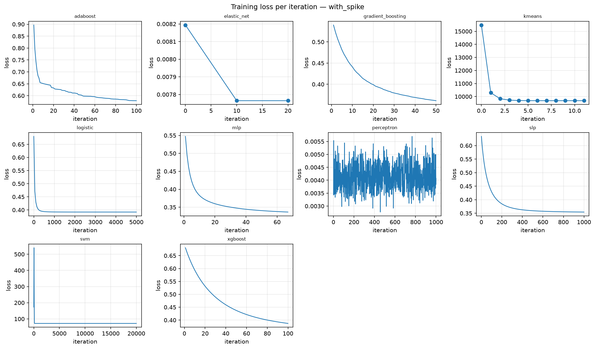

**รูป:** แกนนอนคือรอบของการสอน (iteration) แกนตั้งคือ loss รูปมี 10 โมเดลที่สอนเป็นรอบ ส่วนใหญ่ loss ลดลงแล้วราบ ส่วน `perceptron` แกว่งไปมาไม่นิ่ง ตามที่อธิบายในหัวข้อ 5.7 โมเดลที่ได้คำตอบในครั้งเดียวหรือไม่ได้สอนเป็นรอบ เช่น linear regression, k-NN และ decision tree จะไม่มีกราฟ

### 6.6 Metric ของงาน clustering

**Silhouette** วัดว่ากลุ่มที่ได้แยกจากกันชัดแค่ไหน ค่าอยู่ระหว่าง −1 ถึง 1 ยิ่งใกล้ 1 แปลว่าสมาชิกอยู่ใกล้เพื่อนในกลุ่มเดียวกันและไกลจากกลุ่มอื่น

### 6.7 Baseline หรือเส้นฐานเปรียบเทียบ

คะแนนเดี่ยว ๆ บอกไม่ได้ว่าดีหรือแย่ ต้องมีคู่เทียบ **baseline** คือกฎง่าย ๆ ที่ไม่ต้องสอนอะไรเลย ถ้าโมเดลชนะ baseline ไม่ได้ ก็ไม่มีเหตุผลที่จะใช้โมเดล

| ชื่อ | ใช้กับงาน | กฎ |
| --- | --- | --- |
| `baseline_train_mean` | regression | ทายค่าเฉลี่ยของ target ในชุดสอนทุกวัน |
| `baseline_persistence` | regression | ทายว่า 5 วันข้างหน้าจะผันผวนเท่ากับ 5 วันที่ผ่านมา |
| `baseline_majority` | classification | ทายว่า "ปกติ" ทุกวัน |
| `baseline_persistence` | classification | ใช้ความผันผวนของ 5 วันที่ผ่านมาเป็นคะแนนโดยตรง |

ทั้งหมดใช้เฉพาะข้อมูลที่รู้ ณ สิ้นวันนั้น จึงไม่มี leakage

### 6.8 ความไม่แน่นอน และเหตุผลที่ตัวเลขต่างกันนิดเดียวไม่นับ

นี่คือแนวคิดที่สำคัญที่สุดของโปรเจกต์ และเป็นสิ่งที่ทำให้ข้อสรุปของเราต่างจากการอ่านตารางแบบผิวเผิน

**ปัญหา** สมมติโมเดล A ได้ AP 0.267 และโมเดล B ได้ 0.255 A ดีกว่า B จริงหรือ คำตอบคือยังไม่รู้ เพราะคะแนนนี้วัดจากวันผันผวนสูงเพียง 34 วัน ถ้าบังเอิญได้ข้อมูลช่วงอื่น คะแนนอาจสลับกัน

**เปรียบให้เห็นภาพ** สมมติอยากรู้ว่าคนทั้งเมืองชอบกาแฟร้อนหรือกาแฟเย็นมากกว่า ถ้าถามคน 34 คนแล้ว 19 คนตอบว่ากาแฟเย็น (56%) เรายังไม่กล้าสรุป เพราะถ้าถามอีก 34 คน อาจได้ 15 คน (44%) ก็ได้ แต่ถ้าถาม 3,400 คนแล้วได้ 56% เรามั่นใจได้มาก ตัวเลข 56% เท่ากัน แต่น้ำหนักของหลักฐานต่างกัน **ช่วงความเชื่อมั่น** คือวิธีเขียนความต่างนี้ออกมาเป็นตัวเลข คำตอบจาก 34 คนจะมีช่วงกว้าง (ราว 39% ถึง 73%) ส่วนคำตอบจาก 3,400 คนจะมีช่วงแคบ (ราว 54% ถึง 58%) คะแนนของโมเดลบน Validation ก็เหมือนการถามคน 34 คน เพราะมีวันผันผวนสูงให้วัดเพียง 34 วัน

ตัวเลข **95%** เป็นธรรมเนียมที่ใช้กันทั่วไป หมายความว่าถ้าทำการทดลองแบบเดียวกันซ้ำหลายครั้ง ช่วงที่สร้างด้วยวิธีนี้จะครอบค่าจริงราว 95 ครั้งจาก 100 ครั้ง

**ข้อมูลของเรามีข้อมูลจริงน้อยกว่าที่เห็น** target ของวันติดกันแทบเท่ากัน (ใช้ข้อมูลซ้ำกัน 4 ใน 5 วัน ค่าความคล้ายระหว่างวันติดกันสูงถึง 0.92 จากเต็ม 1) ข้อมูล 1,733 แถวจึงมีค่าเทียบเท่าตัวอย่างที่อิสระต่อกันเพียงราว 50 ถึง 200 ตัว

**วิธีวัดความไม่แน่นอน** เราใช้วิธีที่เรียกว่า **block bootstrap**

1. มีผลทำนายของ 371 วัน เรียงตามเวลา
2. สุ่มหยิบ "ก้อน" ที่เป็น 20 วันติดกันมาหลายก้อน ต่อกันจนครบ 371 วัน (ก้อนเดียวกันถูกหยิบซ้ำได้)
3. คำนวณคะแนนบนชุดที่สุ่มได้
4. ทำซ้ำ 2,000 รอบ ได้คะแนน 2,000 ค่า
5. ตัดค่าต่ำสุด 2.5% และสูงสุด 2.5% ทิ้ง ช่วงที่เหลือคือ **ช่วงความเชื่อมั่น 95%**

ที่ต้องหยิบเป็นก้อน 20 วัน ไม่หยิบทีละวัน เพราะวันติดกันไม่อิสระต่อกัน การหยิบทีละวันจะทำให้ช่วงแคบเกินจริง

**อ่านช่วงความเชื่อมั่น** ตารางของเราเขียนว่า `0.2668 [0.0579, 0.4724]` หมายความว่าค่าที่วัดได้คือ 0.2668 แต่ค่าจริงน่าจะอยู่ที่ไหนก็ได้ระหว่าง 0.06 ถึง 0.47 ช่วงที่กว้างขนาดนี้บอกว่าเรารู้น้อยมากว่าโมเดลเก่งแค่ไหนจริง ๆ

**เทียบสองโมเดล** ในแต่ละรอบของการสุ่ม เราคำนวณ **ผลต่าง** ของคะแนนสองโมเดลบนข้อมูลชุดเดียวกัน (เรียกว่าการเทียบแบบจับคู่ หรือ paired) แล้วดูช่วงความเชื่อมั่นของผลต่าง

> **กฎที่ใช้ตลอดโปรเจกต์:** ถ้าช่วงความเชื่อมั่นของผลต่าง **คร่อมศูนย์** (ด้านหนึ่งติดลบ อีกด้านเป็นบวก) แปลว่ายังบอกไม่ได้ว่าโมเดลไหนดีกว่า เราจะไม่อ้างว่าต่างกัน

ในตาราง คอลัมน์ `tied_with_leader = yes` หมายความว่าโมเดลนั้นแยกจากอันดับหนึ่งไม่ได้ตามกฎนี้

**ลงลึก: เทียบหลายคู่พร้อมกัน** เมื่อเทียบ 17 โมเดลพร้อมกันที่ระดับ 95% เราควรคาดว่าจะมีราว 1 โมเดลที่ช่วงไม่คร่อมศูนย์โดยบังเอิญ ทั้งที่ไม่มีความต่างจริง การเจอ 1 โมเดลจาก 17 จึงไม่ใช่หลักฐาน

**พูดสั้น ๆ ได้ว่า:** เราไม่ใช้ accuracy เพราะทายว่า "ปกติ" ทุกวันก็ได้ 90.8% แล้ว เราใช้ average precision และเทียบกับกฎง่าย ๆ ที่ไม่ต้องสอน และเพราะข้อมูลมีน้อยกว่าที่เห็น เราจึงวัดช่วงความเชื่อมั่นของทุกผลต่าง ถ้าช่วงคร่อมศูนย์ เราไม่อ้างว่าต่างกัน

---

## 7. ผลบน Validation

ตัวเลขในหัวข้อนี้วัดบน Validation ซึ่งเป็นชุดที่ใช้เลือกการตั้งค่า ตัวเลขจึง **ดูดีกว่าความเป็นจริงเล็กน้อย** (หัวข้อ 2.5) ศัพท์ที่ใช้เรียกคือ selection score ผลที่เชื่อได้จริงอยู่ในหัวข้อ 9

### 7.1 Regression

| แบบข้อมูล | โมเดล | RMSE [ช่วง 95%] | MAE | R² | เทียบกับอันดับ 1 |
| --- | --- | --- | --- | --- | --- |
| `with_spike` | `elastic_net` ★ | 0.0668 [0.0610, 0.0739] | 0.0539 | 0.017 | อันดับ 1 |
| `with_spike` | `multiple_linear` | 0.0689 [0.0617, 0.0779] | 0.0542 | -0.045 | แยกไม่ได้ |
| `with_spike` | `simple_linear` | 0.0690 [0.0609, 0.0789] | 0.0557 | -0.050 | แยกไม่ได้ |
| `with_spike` | `polynomial` | 0.0691 [0.0606, 0.0797] | 0.0552 | -0.051 | แยกไม่ได้ |
| `with_spike` | `baseline_train_mean` (baseline) | 0.0751 [0.0673, 0.0837] | 0.0623 | -0.243 | แย่กว่า |
| `with_spike` | `baseline_persistence` (baseline) | 0.0826 [0.0750, 0.0901] | 0.0673 | -0.503 | แย่กว่า |
| `non_spike` | `elastic_net` ★ | 0.0643 [0.0572, 0.0741] | 0.0510 | 0.091 | อันดับ 1 |
| `non_spike` | `polynomial` | 0.0661 [0.0596, 0.0755] | 0.0509 | 0.039 | แยกไม่ได้ |
| `non_spike` | `simple_linear` | 0.0665 [0.0582, 0.0783] | 0.0527 | 0.027 | แยกไม่ได้ |
| `non_spike` | `multiple_linear` | 0.0668 [0.0597, 0.0761] | 0.0530 | 0.017 | แยกไม่ได้ |
| `non_spike` | `baseline_train_mean` (baseline) | 0.0676 [0.0585, 0.0805] | 0.0535 | -0.008 | แยกไม่ได้ |
| `non_spike` | `baseline_persistence` (baseline) | 0.0826 [0.0750, 0.0901] | 0.0673 | -0.503 | แย่กว่า |

**อ่านคอลัมน์:** ★ คือโมเดลตัวแทนของงานนั้น (หัวข้อ 8) แถวที่เขียนว่า (baseline) คือกฎง่าย ๆ ที่ไม่ต้องสอน ตัวเลขในวงเล็บเหลี่ยมคือช่วงความเชื่อมั่น 95% คอลัมน์ "เทียบกับอันดับ 1" มาจากการเทียบแบบจับคู่ในหัวข้อ 6.8 โดย "แยกไม่ได้" คือช่วงของผลต่างคร่อมศูนย์ และ "แย่กว่า" คือช่วงไม่คร่อมศูนย์

**ที่มา:** `outputs/modeling/report/<แบบข้อมูล>/leaderboard_regression.csv` ยิ่ง RMSE ต่ำยิ่งดี ยิ่ง R² สูงยิ่งดี

**อ่านตาราง** สี่ข้อ

- โมเดลทั้ง 4 ตัวได้ RMSE ต่ำกว่า baseline ทั้งสองตัว ในทั้งสองแบบข้อมูล
- แต่ 4 โมเดลได้คะแนนใกล้กันมาก และการเทียบแบบจับคู่บอกว่า **แยกจากกันไม่ได้** จึงไม่อ้างว่าตัวไหนดีที่สุด
- ในแบบ `non_spike` baseline ที่ทายค่าเฉลี่ย (0.0676) ตามมาติด ๆ และแยกจากอันดับหนึ่งไม่ได้เช่นกัน เพราะเมื่อตัดช่วง spike ออก ค่าเฉลี่ยของข้อมูลสอนจะลดลงมาใกล้ระดับของ Validation
- R² อยู่ใกล้ศูนย์ และบางตัวติดลบ สาเหตุคือ Validation สงบกว่า Train มาก (target ใน Train มี SD 0.144 และค่าสูงสุด 1.50 ส่วน Validation มี SD 0.068 และค่าสูงสุด 0.41) เมื่อค่าจริงแกว่งน้อย การทายค่าเฉลี่ยก็ผิดไม่มากอยู่แล้ว โมเดลที่เรียนจากช่วงปั่นป่วนจึงเอาชนะได้ยาก

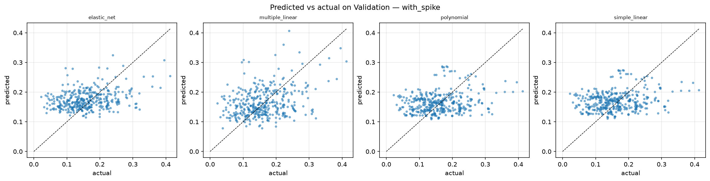

**รูป:** แต่ละจุดคือหนึ่งวัน จุดที่อยู่บนเส้นทแยงคือทายถูกพอดี จะเห็นว่าจุดเกาะเป็นกลุ่มแนวนอน แปลว่าคำทำนายขยับตามค่าจริงได้น้อย

### 7.2 Classification

| อันดับ | โมเดล | AP [ช่วง 95%] | ROC-AUC | F1 | Recall | Precision | Accuracy | จับได้ (จาก 34) | เตือนผิด | เทียบกับอันดับ 1 |
| --- | --- | --- | --- | --- | --- | --- | --- | --- | --- | --- |
| 1 | `mlp` ★ | 0.2668 [0.0579, 0.4724] | 0.676 | 0.320 | 0.235 | 0.500 | 0.908 | 8 | 8 | อันดับ 1 |
| 2 | `random_forest` | 0.2548 [0.0603, 0.4586] | 0.686 | 0.292 | 0.206 | 0.500 | 0.908 | 7 | 7 | แยกไม่ได้ |
| 3 | `gradient_boosting` | 0.2531 [0.0548, 0.4746] | 0.675 | 0.245 | 0.176 | 0.400 | 0.900 | 6 | 9 | แยกไม่ได้ |
| 4 | `svm` | 0.2514 [0.0514, 0.4651] | 0.679 | 0.255 | 0.176 | 0.462 | 0.906 | 6 | 7 | แยกไม่ได้ |
| 5 | `xgboost` | 0.2508 [0.0559, 0.4681] | 0.669 | 0.245 | 0.176 | 0.400 | 0.900 | 6 | 9 | แยกไม่ได้ |
| – | `baseline_persistence` (baseline) | 0.2474 [0.0545, 0.5002] | 0.721 | 0.290 | 0.294 | 0.286 | 0.868 | 10 | 25 | แยกไม่ได้ |
| 6 | `slp` | 0.2427 [0.0545, 0.4432] | 0.680 | 0.261 | 0.176 | 0.500 | 0.908 | 6 | 6 | แยกไม่ได้ |
| 7 | `adaboost` | 0.2363 [0.0626, 0.4381] | 0.677 | 0.222 | 0.176 | 0.300 | 0.887 | 6 | 14 | แยกไม่ได้ |
| 8 | `logistic` | 0.2330 [0.0526, 0.4301] | 0.673 | 0.261 | 0.176 | 0.500 | 0.908 | 6 | 6 | แยกไม่ได้ |
| 9 | `stacking` | 0.2262 [0.0551, 0.4176] | 0.664 | 0.235 | 0.176 | 0.353 | 0.895 | 6 | 11 | แยกไม่ได้ |
| 10 | `gaussian_nb` | 0.2218 [0.0464, 0.4333] | 0.667 | 0.281 | 0.265 | 0.300 | 0.876 | 9 | 21 | แยกไม่ได้ |
| 11 | `knn` | 0.2037 [0.0610, 0.4015] | 0.699 | 0.200 | 0.147 | 0.312 | 0.892 | 5 | 11 | แยกไม่ได้ |
| 12 | `decision_tree` | 0.1732 [0.0494, 0.3562] | 0.642 | 0.310 | 0.324 | 0.297 | 0.868 | 11 | 26 | แยกไม่ได้ |
| – | `baseline_majority` (baseline) | 0.0916 [0.0350, 0.1779] | 0.500 | 0.000 | 0.000 | – | 0.908 | 0 | 0 | แย่กว่า |
| 13 | `perceptron` | 0.0648 [0.0310, 0.1334] | 0.299 | 0.000 | 0.000 | 0.000 | 0.876 | 0 | 12 | แยกไม่ได้ |

**อ่านคอลัมน์:** "จับได้" คือจำนวนวันผันผวนสูงที่โมเดลเตือนถูก (TP) "เตือนผิด" คือจำนวนวันปกติที่โมเดลเตือน (FP) เครื่องหมาย – คือไม่มีค่า เพราะ `baseline_majority` ไม่เคยเตือนเลย จึงคำนวณ precision ไม่ได้ คอลัมน์อื่นอ่านเหมือนตารางในหัวข้อ 7.1

**ที่มา:** `outputs/modeling/report/with_spike/leaderboard_classification.csv` เรียงตาม AP จากมากไปน้อย การเดาสุ่มได้ AP 0.092 และ ROC-AUC 0.5 ตารางของแบบ `non_spike` อยู่ที่ `outputs/modeling/report/non_spike/leaderboard_classification.md`

**อ่านตาราง** ห้าข้อ

1. **โมเดลเกือบทุกตัวดีกว่าเดาสุ่ม** AP อยู่ราว 0.17 ถึง 0.27 เทียบกับ 0.092 และ ROC-AUC อยู่ราว 0.64 ถึง 0.70 เทียบกับ 0.5
2. **แต่แยกอันดับระหว่างโมเดลไม่ได้เลย** ช่วงความเชื่อมั่นของ AP กว้างมาก (ของ `mlp` คือ 0.06 ถึง 0.47) และทั้ง 13 โมเดลแยกจากอันดับหนึ่งไม่ได้ สาเหตุคือมีวันผันผวนสูงให้วัดเพียง 34 วัน แม้แต่ `perceptron` ซึ่งคะแนนต่ำสุดก็ยังขึ้นว่า "แยกไม่ได้" เพราะช่วงของผลต่างกว้างจนแตะศูนย์ (−0.39 ถึง +0.003) คำว่า "แยกไม่ได้" จึงไม่ได้แปลว่าดีเท่ากัน แต่แปลว่าข้อมูลน้อยเกินกว่าจะยืนยันความต่าง
3. **กฎง่าย ๆ ทำได้ใกล้เคียงโมเดล** `baseline_persistence` ซึ่งไม่ได้สอนอะไรเลย อยู่กลางตาราง และได้ ROC-AUC สูงกว่าทุกโมเดล มีเพียง 5 จาก 13 โมเดลที่ AP สูงกว่า baseline นี้
4. **โมเดลเตือนน้อยเกินไป** ดูคอลัมน์ "จับได้" จากวันผันผวนสูง 34 วัน โมเดลส่วนใหญ่จับได้เพียง 5 ถึง 11 วัน เพราะโมเดลเรียนจากช่วงที่ปั่นป่วนกว่า Validation มาก คะแนนที่ให้จึงไม่ค่อยเกินจุดตัด 0.5
5. **accuracy ไม่ช่วยตัดสิน** หลายโมเดลได้ 0.908 เท่ากับ `baseline_majority` ที่ตอบว่า "ปกติ" ทุกวัน

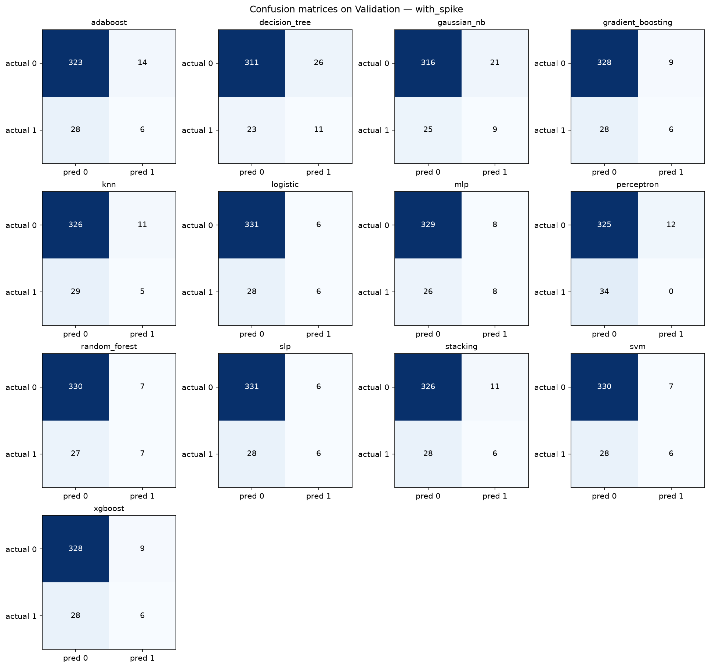

**รูป:** ตารางสี่ช่องแบบเดียวกับหัวข้อ 6.2 ของทั้ง 13 โมเดล แถวคือค่าจริง (actual) คอลัมน์คือค่าที่โมเดลทาย (pred) ช่องล่างขวาคือวันผันผวนสูงที่จับได้ ซึ่งมีเพียง 0 ถึง 11 วันจาก 34 วัน

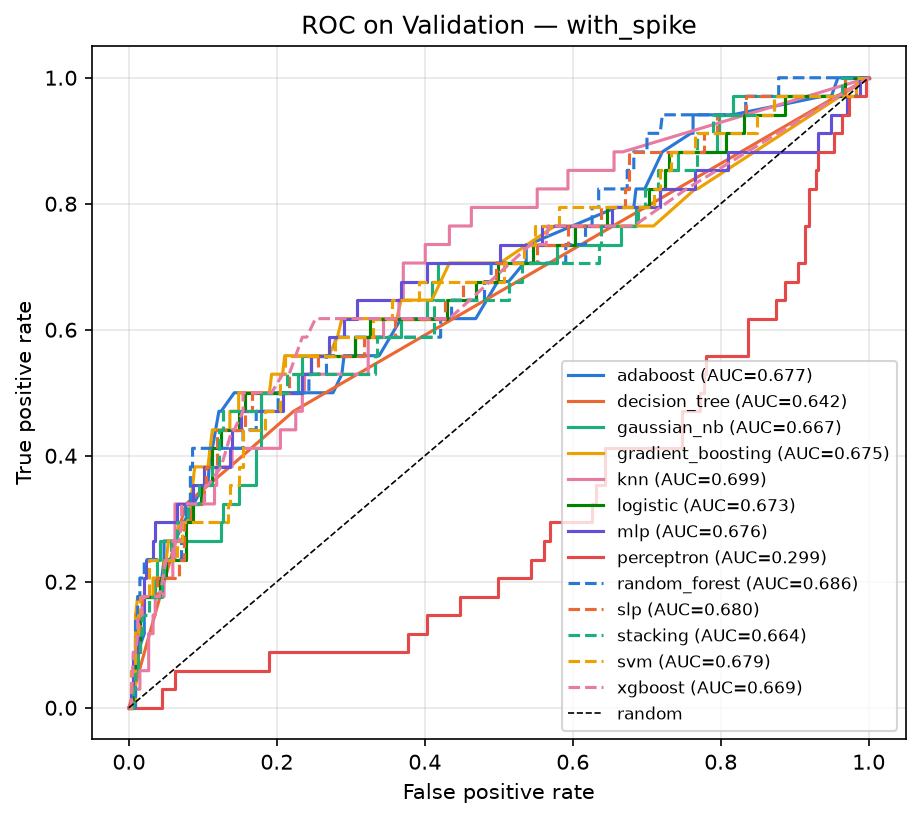

**รูป:** กราฟ ROC ยิ่งโค้งเข้าหามุมซ้ายบนยิ่งดี เส้นประทแยงคือการเดาสุ่ม เส้นของโมเดลส่วนใหญ่เกาะกลุ่มกัน ตรงกับที่ตารางบอกว่าแยกอันดับไม่ได้ เส้นที่อยู่ใต้เส้นทแยงคือ `perceptron`

### 7.3 Clustering

ทั้ง k-Means และ Agglomerative เลือกแบ่งเป็น 2 กลุ่ม ได้ silhouette ราว 0.36 ในแบบ `with_spike` คำถามที่น่าสนใจกว่าคือ กลุ่มที่โมเดลจัดเองโดยไม่เห็นคำตอบ ตรงกับวันผันผวนสูงแค่ไหน

| โมเดล (`with_spike`) | กลุ่ม | จำนวนวันใน Validation | วันผันผวนสูง | สัดส่วน |
| --- | --- | --- | --- | --- |
| `kmeans` | กลุ่มเล็ก | 73 | 16 | 21.9% |
| `kmeans` | กลุ่มใหญ่ | 298 | 18 | 6.0% |
| `agglomerative` | กลุ่มเล็ก | 78 | 16 | 20.5% |
| `agglomerative` | กลุ่มใหญ่ | 293 | 18 | 6.1% |

กลุ่มเล็กมีสัดส่วนวันผันผวนสูงมากกว่ากลุ่มใหญ่กว่าสามเท่า (เทียบกับค่ารวม 9.2%) แปลว่า feature เพียงอย่างเดียวก็แยก "ช่วงตลาดปั่นป่วน" ออกมาได้ระดับหนึ่งโดยไม่ต้องมีคำตอบ ที่มา: notebook 04 หัวข้อ 10

### 7.4 feature ตัวไหนสำคัญ

**วิธีวัด** เรียกว่า permutation importance: สลับลำดับค่าของ feature หนึ่งตัวบน Validation เพื่อทำลายข้อมูลใน feature นั้น แล้วดูว่าคะแนนของโมเดลแย่ลงเท่าไร ยิ่งแย่ลงมาก แปลว่าโมเดลพึ่ง feature นั้นมาก เราสลับเป็นก้อน 20 วันติดกันและทำซ้ำ 30 รอบ

<!-- BEGIN GENERATED: outputs/modeling/report/tables/feature_importance_with_spike.md -->
### Block-permutation importance averaged over models — with_spike

| feature | drop_in_ap_mean | drop_in_ap_std_across_models | rise_in_rmse_mean | rise_in_rmse_std_across_models |
| --- | --- | --- | --- | --- |
| return_1d | -0.0019 | 0.0081 | 0.0001 | 0.0001 |
| return_5d | 0.0017 | 0.0074 | -0.0001 | 0.0003 |
| historical_volatility_5d | 0.0053 | 0.0165 | -0.0004 | 0.0007 |
| historical_volatility_20d | 0.0336 | 0.0282 | 0.0038 | 0.0034 |
| intraday_range | 0.0060 | 0.0127 | -0.0005 | 0.0015 |
| sma_ratio_5_20 | 0.0040 | 0.0054 | 0.0002 | 0.0003 |
| rsi_14 | 0.0197 | 0.0155 | 0.0010 | 0.0019 |
| volume_zscore_20 | 0.0017 | 0.0057 | -0.0003 | 0.0007 |
<!-- END GENERATED -->

**อ่านตาราง:** `drop_in_ap_mean` คือ AP ที่ลดลงเมื่อสลับ feature นั้น เฉลี่ยจาก classifier 13 ตัว `rise_in_rmse_mean` คือ RMSE ที่เพิ่มขึ้น เฉลี่ยจากโมเดล regression 4 ตัว สองคอลัมน์ที่ชื่อลงท้ายด้วย `std_across_models` บอกว่าแต่ละโมเดลให้ค่าต่างกันแค่ไหน ค่าติดลบเล็กน้อยแปลว่าสลับแล้วคะแนนไม่ได้แย่ลง ซึ่งเท่ากับ feature นั้นไม่มีผล

- `historical_volatility_20d` สำคัญที่สุด ตามด้วย `rsi_14` สอดคล้องกับปรากฏการณ์ที่รู้จักกันดีว่า **ช่วงผันผวนมักตามด้วยช่วงผันผวน** (เรียกว่า volatility clustering)
- `return_1d`, `return_5d` และ `volume_zscore_20` แทบไม่มีผล ตรงกับสามตัวที่ Elastic Net ดันน้ำหนักเป็นศูนย์ในหัวข้อ 5.6 ทั้งที่เป็นการวัดคนละวิธี
- ค่าในคอลัมน์ `std_across_models` ใหญ่พอ ๆ กับค่าเฉลี่ยหรือมากกว่า แปลว่าโมเดลแต่ละตัวพึ่ง feature ต่างกันมาก อันดับที่ต่ำกว่าสองตัวแรกจึงยังไม่น่าเชื่อถือ
- **ข้อจำกัดของวิธีนี้:** feature ที่ซ้ำซ้อนกันจะ "แบ่งความสำคัญ" กัน เมื่อสลับตัวหนึ่ง อีกตัวยังให้ข้อมูลเดิมได้ ค่าจึงดูต่ำกว่าความจริง

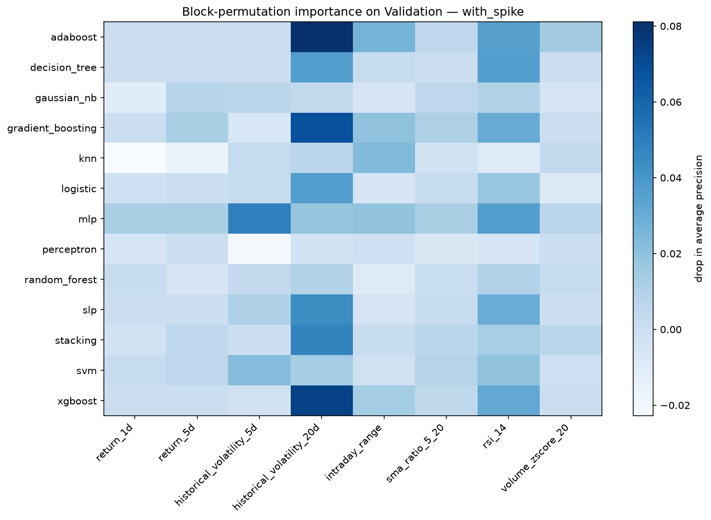

**รูป:** แต่ละแถวคือหนึ่งโมเดล แต่ละคอลัมน์คือหนึ่ง feature สีเข้มแปลว่า AP ลดลงมากเมื่อสลับ feature นั้น คอลัมน์ `historical_volatility_20d` เข้มที่สุดสำหรับโมเดลส่วนใหญ่ แต่ไม่ใช่ทุกโมเดล เช่น `mlp` พึ่ง `historical_volatility_5d` มากกว่า

### 7.5 with_spike เทียบ non_spike บน Validation

ตารางนี้ตอบคำถามวิจัยรอบแรก `delta` คือคะแนนของ `non_spike` ลบด้วยคะแนนของ `with_spike` สำหรับ AP ค่าบวกแปลว่าตัด spike แล้วดีขึ้น สำหรับ RMSE ค่าลบแปลว่าดีขึ้น `delta_95` คือช่วงความเชื่อมั่นของผลต่าง

<!-- BEGIN GENERATED: outputs/modeling/report/comparison_a_vs_b.md -->
### Paired comparison: non_spike − with_spike (Validation)

| model | task | metric | with_spike | non_spike | delta | delta_95 | verdict |
| --- | --- | --- | --- | --- | --- | --- | --- |
| elastic_net | regression | rmse | 0.0668 | 0.0643 | -0.0026 | [-0.0053, +0.0019] | inconclusive |
| multiple_linear | regression | rmse | 0.0689 | 0.0668 | -0.0020 | [-0.0036, -0.0000] | non_spike better |
| polynomial | regression | rmse | 0.0691 | 0.0661 | -0.0030 | [-0.0073, +0.0016] | inconclusive |
| simple_linear | regression | rmse | 0.0690 | 0.0665 | -0.0026 | [-0.0066, +0.0026] | inconclusive |
| adaboost | classification | average_precision | 0.2363 | 0.2407 | 0.0044 | [-0.0307, +0.0627] | inconclusive |
| decision_tree | classification | average_precision | 0.1732 | 0.1887 | 0.0155 | [-0.0380, +0.0970] | inconclusive |
| gaussian_nb | classification | average_precision | 0.2218 | 0.2292 | 0.0074 | [-0.0007, +0.0187] | inconclusive |
| gradient_boosting | classification | average_precision | 0.2531 | 0.2525 | -0.0006 | [-0.0445, +0.0223] | inconclusive |
| knn | classification | average_precision | 0.2037 | 0.2082 | 0.0045 | [-0.0441, +0.0601] | inconclusive |
| logistic | classification | average_precision | 0.2330 | 0.2513 | 0.0183 | [-0.0110, +0.0401] | inconclusive |
| mlp | classification | average_precision | 0.2668 | 0.2808 | 0.0139 | [-0.0429, +0.0772] | inconclusive |
| perceptron | classification | average_precision | 0.0648 | 0.0742 | 0.0094 | [-0.0012, +0.0575] | inconclusive |
| random_forest | classification | average_precision | 0.2548 | 0.3010 | 0.0462 | [-0.0168, +0.1155] | inconclusive |
| slp | classification | average_precision | 0.2427 | 0.2474 | 0.0047 | [-0.0477, +0.0441] | inconclusive |
| stacking | classification | average_precision | 0.2262 | 0.2311 | 0.0049 | [-0.0386, +0.0477] | inconclusive |
| svm | classification | average_precision | 0.2514 | 0.2501 | -0.0013 | [-0.0108, +0.0082] | inconclusive |
| xgboost | classification | average_precision | 0.2508 | 0.2652 | 0.0144 | [-0.0148, +0.0386] | inconclusive |
| agglomerative | clustering | silhouette | 0.3602 | 0.4642 | 0.1040 | n/a | no interval |
| kmeans | clustering | silhouette | 0.3666 | 0.3298 | -0.0367 | n/a | no interval |

> ผลต่างในตารางนี้คือผลของ **นโยบายตัดแถวทั้งชุด** ไม่ใช่ผลของ spike เพียงอย่างเดียว: การตัด 213 แถวทำให้ class prior ของ Train เปลี่ยนจาก 25.0% เป็น 18.4%, จำนวนแถวลดจาก 1,733 เป็น 1,520 และ regime ที่ผันผวนสูงหายไปจาก Train พร้อมกัน ทั้งสาม confound นี้แยกจากกันไม่ได้ด้วยการทดลองนี้ delta = non_spike − with_spike บน Validation 371 แถวชุดเดียวกัน ช่วง 95% จาก paired moving-block bootstrap (block 20 วัน) และเมื่อเทียบ 17 โมเดลพร้อมกัน ควรคาดว่าจะมีราว 1 แถวที่ช่วงไม่คร่อมศูนย์โดยบังเอิญ
<!-- END GENERATED -->

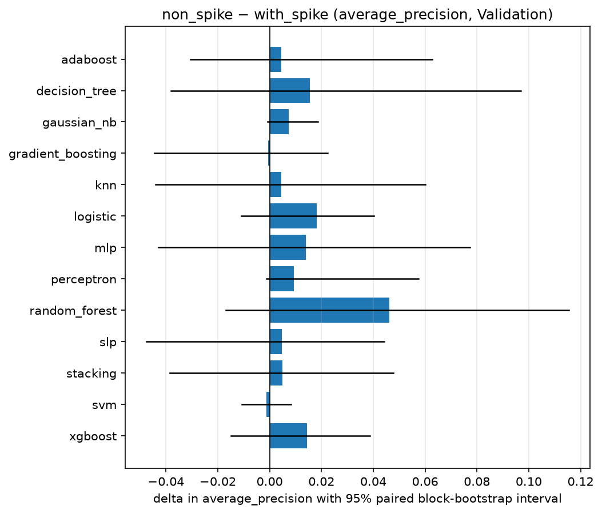

**รูป:** แท่งคือผลต่างของ AP ของ classifier แต่ละตัว เส้นแนวนอนสีดำคือช่วงความเชื่อมั่น 95% ทุกเส้นในรูปนี้พาดผ่านเลขศูนย์

**อ่านผล** สี่ข้อ

- คอลัมน์ `verdict` สรุปผลของแต่ละแถว `inconclusive` แปลว่าช่วงคร่อมศูนย์จึงยังตัดสินไม่ได้ สองแถวท้ายเป็นโมเดล clustering ซึ่งไม่มีช่วงความเชื่อมั่น (`no interval`)
- โมเดลส่วนใหญ่ได้คะแนนดีขึ้นเล็กน้อยเมื่อตัด spike
- แต่ **16 จาก 17 โมเดลได้ผลว่า `inconclusive`** คือช่วงคร่อมศูนย์ มีเพียง `multiple_linear` ที่ช่วงไม่คร่อมศูนย์ ซึ่งเท่ากับจำนวนที่คาดว่าจะเกิดโดยบังเอิญ (หัวข้อ 6.8)
- **Validation ไม่มีวัน spike เลย** จึงทดสอบไม่ได้ว่าโมเดลแต่ละแบบรับมือกับ spike ได้ดีแค่ไหน คำถามนั้นต้องรอดูบน Test

### 7.6 ตรวจความเสถียรด้วย walk-forward

Validation มีวันผันผวนสูงเพียง 34 วันจากสภาพตลาดแบบเดียว เราจึงตรวจอีกทางว่าอันดับของโมเดลคงที่ข้ามช่วงเวลาหรือไม่

**วิธีทำ** เรียกว่า walk-forward: ใช้เฉพาะข้อมูลในชุดสอน สอนโมเดลด้วยช่วงต้น แล้วทดสอบกับช่วงถัดไป จากนั้นขยายช่วงสอนออกไปและทำซ้ำ รวม 4 รอบ (แต่ละรอบเรียกว่า fold) ช่วงที่ใช้ทดสอบครอบคลุมเดือนกรกฎาคม 2019 ถึงสิงหาคม 2023 และมีวันผันผวนสูงรวม 353 วัน เราใช้การตั้งค่าเดิมที่เลือกไว้แล้ว **ไม่ได้ใช้ผลนี้เลือกโมเดลหรือปรับค่าใหม่**

<!-- BEGIN GENERATED: outputs/modeling/report/tables/walk_forward_with_spike.md -->
### Walk-forward average precision inside Train — with_spike

| model | fold_0_ap | fold_1_ap | fold_2_ap | fold_3_ap | folds_used | positives | pooled_ap | pooled_low | pooled_high |
| --- | --- | --- | --- | --- | --- | --- | --- | --- | --- |
| gaussian_nb | 0.8282 | 0.6361 | 0.7775 | 0.4436 | 4 | 353 | 0.7124 | 0.5717 | 0.8151 |
| gradient_boosting | 0.8117 | 0.5722 | 0.8168 | 0.5522 | 4 | 353 | 0.7120 | 0.5857 | 0.8059 |
| logistic | 0.8173 | 0.6103 | 0.7847 | 0.4511 | 4 | 353 | 0.7030 | 0.5548 | 0.8083 |
| random_forest | 0.8079 | 0.6003 | 0.8018 | 0.5108 | 4 | 353 | 0.6833 | 0.5582 | 0.7797 |
| svm | 0.7946 | 0.6118 | 0.7839 | 0.4556 | 4 | 353 | 0.6718 | 0.5280 | 0.7842 |
| slp | 0.7946 | 0.5278 | 0.7658 | 0.4313 | 4 | 353 | 0.6717 | 0.5205 | 0.7813 |
| adaboost | 0.7998 | 0.5650 | 0.8330 | 0.4458 | 4 | 353 | 0.6708 | 0.5383 | 0.7772 |
| xgboost | 0.7604 | 0.5602 | 0.8042 | 0.5628 | 4 | 353 | 0.6690 | 0.5514 | 0.7645 |
| mlp | 0.7662 | 0.5310 | 0.8070 | 0.4385 | 4 | 353 | 0.6663 | 0.5203 | 0.7738 |
| stacking | n/a | 0.5861 | 0.8200 | 0.4417 | 3 | 273 | 0.6473 | 0.5119 | 0.7693 |
| knn | 0.7504 | 0.6400 | 0.7724 | 0.4553 | 4 | 353 | 0.6406 | 0.5153 | 0.7510 |
| decision_tree | 0.5803 | 0.4013 | 0.7242 | 0.3880 | 4 | 353 | 0.5750 | 0.4401 | 0.6958 |
| perceptron | 0.1852 | 0.5271 | 0.6226 | 0.2144 | 4 | 353 | 0.3337 | 0.2478 | 0.4690 |
<!-- END GENERATED -->

**อ่านตาราง:** `fold_0_ap` ถึง `fold_3_ap` คือ AP ของแต่ละรอบ `folds_used` คือจำนวนรอบที่สอนได้ `positives` คือจำนวนวันผันผวนสูงที่ใช้วัด `pooled_ap` คือ AP เมื่อรวมทุกรอบเข้าด้วยกัน ส่วน `pooled_low` ถึง `pooled_high` คือช่วงความเชื่อมั่น 95%

- **สภาพตลาดมีผลมากกว่าชนิดของโมเดล** โมเดลเดียวกันได้ AP ราว 0.8 ในรอบแรก แต่ราว 0.45 ในรอบสุดท้าย ต่างกันมากกว่าที่โมเดลต่างชนิดต่างกันในรอบเดียวกัน
- **อันดับตรงกับ Validation เพียงบางส่วน** ค่าความสอดคล้องของอันดับ (Spearman) คือ 0.49 สำหรับ `with_spike` และ 0.17 สำหรับ `non_spike` (1 คือตรงกันทุกลำดับ 0 คือไม่เกี่ยวกัน)
- สิ่งที่คงที่ทุกมุมมองคือ `perceptron` และ `decision_tree` อยู่ท้ายตาราง
- ช่อง fold แรกของ `stacking` เขียนว่า `n/a` (ไม่มีค่า) เพราะโมเดลนี้ต้องแบ่งข้อมูลสอนภายในอีกชั้น ส่วนแรกสุดที่ได้คือ 275 วันแรกของชุดสอน (ก.ย. 2016 – ต.ค. 2017) ซึ่งไม่มีวันผันผวนสูงเลย (วันผันผวนสูงวันแรกของข้อมูลคือ 29 ม.ค. 2018) โมเดลจึงไม่มีตัวอย่างของวันผันผวนสูงให้เรียน

**พูดสั้น ๆ ได้ว่า:** บนข้อสอบซ้อม โมเดลเกือบทุกตัวดีกว่าเดาสุ่ม แต่ข้อสอบซ้อมมีวันผันผวนสูงเพียง 34 วัน จึงตัดสินไม่ได้ว่าโมเดลไหนดีที่สุด และตัดสินไม่ได้ว่าการตัด spike ช่วยหรือไม่

---

## 8. ล็อกทุกอย่างแล้วเปิด Test ครั้งเดียว

### 8.1 ทำไมต้องเข้มงวดกับ Test

Test คือข้อสอบจริง คะแนนบน Test เป็นตัวเลขชุดเดียวของโปรเจกต์ที่ไม่ถูกปนเปื้อนด้วยการเลือก ถ้าเราดูผล Test แล้วกลับไปปรับโมเดล หรือเลือกโมเดลที่ทำ Test ได้ดีมานำเสนอ คะแนน Test ก็จะกลายเป็นคะแนนซ้อมอีกชุดหนึ่ง และไม่มีตัวเลขใดเหลือให้เชื่อได้

### 8.2 ขั้นตอนที่ใช้

1. **ไม่สอนโมเดลใหม่ด้วย Train รวม Validation** โมเดลที่วัดบน Test คือโมเดลชุดเดียวกับที่เลือกไว้
2. **ไม่ปรับจุดตัด** ใช้ 0.5 คงที่ตามเดิม
3. **ล็อก** คำสั่ง `finalize --dry-run` บันทึกลายนิ้วมือ (hash) ของไฟล์โมเดลทั้ง 38 ชุด และชื่อ **โมเดลตัวแทน** ของแต่ละงาน ลงไฟล์ [`outputs/modeling/selection_lock.json`](../../outputs/modeling/selection_lock.json) แล้วบันทึกไฟล์นี้เข้าระบบเก็บประวัติโค้ด (git) ก่อนเปิด Test
4. **เปิด Test ครั้งเดียว** คำสั่ง `finalize --allow-test` ตรวจว่าไฟล์โมเดลยังตรงกับที่ล็อกไว้ แล้วจึงประเมิน
5. **ออกใบรับรอง** โปรแกรมเขียน [`outputs/modeling/finalize_receipt.json`](../../outputs/modeling/finalize_receipt.json) บันทึกเวลา ลายนิ้วมือของไฟล์ Test และรุ่นของโค้ด เมื่อมีไฟล์นี้แล้ว คำสั่งจะปฏิเสธการรันซ้ำ

**โมเดลตัวแทน** (headline model) คือโมเดลที่ได้คะแนนสูงสุดบน Validation ของแต่ละงานและแต่ละแบบข้อมูล การระบุชื่อไว้ก่อนเปิด Test ทำให้เราเลือกโมเดลที่บังเอิญทำ Test ได้ดีมาอวดย้อนหลังไม่ได้

| งาน | แบบข้อมูล | โมเดลตัวแทนที่ล็อกไว้ |
| --- | --- | --- |
| classification | `with_spike` | `mlp` |
| classification | `non_spike` | `random_forest` |
| regression | `with_spike` | `elastic_net` |
| regression | `non_spike` | `elastic_net` |

Test ถูกเปิดเมื่อวันที่ 11 ตุลาคม 2026 เวลา 14:02 น. ตามเวลาสากล (UTC)

**พูดสั้น ๆ ได้ว่า:** เราบันทึกว่าจะวัดโมเดลชุดไหนและจะชูโมเดลตัวไหนไว้ก่อน แล้วเปิดข้อสอบจริงครั้งเดียว โปรแกรมออกใบรับรองและไม่ยอมให้รันซ้ำ จึงไม่มีทางเลือกผลย้อนหลังได้

---

## 9. ผลบน Test

### 9.1 ผลของโมเดลตัวแทน

<!-- BEGIN GENERATED: outputs/modeling/report/tables/test_headline_summary.md -->
### Locked headline models: Validation score, one-shot Test score and the best baseline

| task | variant | headline | metric | validation | test | test_low | test_high | rank_on_test | best_baseline | baseline_test | beats_baseline |
| --- | --- | --- | --- | --- | --- | --- | --- | --- | --- | --- | --- |
| classification | with_spike | mlp | average_precision | 0.2668 | 0.5991 | 0.2605 | 0.7603 | 1 of 13 | baseline_persistence | 0.5365 | yes |
| classification | non_spike | random_forest | average_precision | 0.3010 | 0.5240 | 0.2161 | 0.6796 | 10 of 13 | baseline_persistence | 0.5365 | no |
| regression | with_spike | elastic_net | rmse | 0.0668 | 0.1174 | 0.0709 | 0.1746 | 2 of 4 | baseline_train_mean | 0.1380 | yes |
| regression | non_spike | elastic_net | rmse | 0.0643 | 0.1230 | 0.0688 | 0.1859 | 3 of 4 | baseline_train_mean | 0.1400 | yes |
<!-- END GENERATED -->

**อ่านตาราง:** `validation` คือคะแนนบนข้อสอบซ้อม `test` คือคะแนนบนข้อสอบจริง `test_low` ถึง `test_high` คือช่วงความเชื่อมั่น 95% `rank_on_test` คืออันดับเมื่อเรียงทุกโมเดลตามคะแนน Test `best_baseline` คือกฎง่าย ๆ ที่ดีที่สุด `baseline_test` คือคะแนนของกฎนั้นบน Test และ `beats_baseline` บอกว่าโมเดลตัวแทนได้คะแนนดีกว่ากฎนั้นหรือไม่ สำหรับ `average_precision` ค่ามากดีกว่า สำหรับ `rmse` ค่าน้อยดีกว่า

### 9.2 ตารางเต็มของงาน classification

ตารางแรกคือโมเดลที่สอนแบบ `with_spike`

| อันดับ | โมเดล | AP [ช่วง 95%] | ROC-AUC | F1 | Recall | Precision | Accuracy | จับได้ (จาก 73) | AP บน Validation | เทียบกับอันดับ 1 |
| --- | --- | --- | --- | --- | --- | --- | --- | --- | --- | --- |
| 1 | `mlp` ★ | 0.5991 [0.2605, 0.7603] | 0.793 | 0.571 | 0.493 | 0.679 | 0.855 | 36 | 0.2668 | อันดับ 1 |
| 2 | `random_forest` | 0.5775 [0.2366, 0.7393] | 0.787 | 0.500 | 0.425 | 0.608 | 0.834 | 31 | 0.2548 | แยกไม่ได้ |
| 3 | `svm` | 0.5716 [0.2402, 0.7438] | 0.783 | 0.487 | 0.397 | 0.630 | 0.836 | 29 | 0.2514 | แยกไม่ได้ |
| 4 | `gaussian_nb` | 0.5538 [0.2390, 0.7289] | 0.770 | 0.581 | 0.616 | 0.549 | 0.826 | 45 | 0.2218 | แยกไม่ได้ |
| 5 | `slp` | 0.5536 [0.2473, 0.7470] | 0.780 | 0.504 | 0.425 | 0.620 | 0.836 | 31 | 0.2427 | แยกไม่ได้ |
| 6 | `logistic` | 0.5518 [0.2482, 0.7452] | 0.782 | 0.520 | 0.438 | 0.640 | 0.842 | 32 | 0.2330 | แยกไม่ได้ |
| 7 | `knn` | 0.5472 [0.2187, 0.7309] | 0.785 | 0.551 | 0.479 | 0.648 | 0.847 | 35 | 0.2037 | แยกไม่ได้ |
| – | `baseline_persistence` (baseline) | 0.5365 [0.1589, 0.7246] | 0.726 | 0.493 | 0.507 | 0.481 | 0.796 | 37 | – | แยกไม่ได้ |
| 8 | `gradient_boosting` | 0.5332 [0.2223, 0.7096] | 0.767 | 0.439 | 0.370 | 0.540 | 0.815 | 27 | 0.2531 | แยกไม่ได้ |
| 9 | `xgboost` | 0.5305 [0.2021, 0.7067] | 0.772 | 0.455 | 0.384 | 0.560 | 0.820 | 28 | 0.2508 | แยกไม่ได้ |
| 10 | `stacking` | 0.5131 [0.2395, 0.7154] | 0.790 | 0.571 | 0.575 | 0.568 | 0.831 | 42 | 0.2262 | แยกไม่ได้ |
| 11 | `adaboost` | 0.4858 [0.2145, 0.6807] | 0.761 | 0.485 | 0.452 | 0.524 | 0.812 | 33 | 0.2363 | แย่กว่า |
| 12 | `decision_tree` | 0.3792 [0.1524, 0.5643] | 0.745 | 0.480 | 0.493 | 0.468 | 0.791 | 36 | 0.1732 | แย่กว่า |
| – | `baseline_majority` (baseline) | 0.1957 [0.0885, 0.3003] | 0.500 | 0.000 | 0.000 | – | 0.804 | 0 | – | แย่กว่า |
| 13 | `perceptron` | 0.1374 [0.0657, 0.2463] | 0.275 | 0.058 | 0.041 | 0.097 | 0.737 | 3 | 0.0648 | แย่กว่า |

ตารางที่สองคือโมเดลที่สอนแบบ `non_spike`

| อันดับ | โมเดล | AP [ช่วง 95%] | ROC-AUC | F1 | Recall | Precision | Accuracy | จับได้ (จาก 73) | AP บน Validation | เทียบกับอันดับ 1 |
| --- | --- | --- | --- | --- | --- | --- | --- | --- | --- | --- |
| 1 | `gaussian_nb` | 0.5884 [0.2441, 0.7462] | 0.778 | 0.582 | 0.726 | 0.486 | 0.796 | 53 | 0.2292 | อันดับ 1 |
| 2 | `xgboost` | 0.5823 [0.2509, 0.7436] | 0.789 | 0.547 | 0.479 | 0.636 | 0.845 | 35 | 0.2652 | แยกไม่ได้ |
| 3 | `svm` | 0.5805 [0.2446, 0.7504] | 0.785 | 0.459 | 0.342 | 0.694 | 0.842 | 25 | 0.2501 | แยกไม่ได้ |
| 4 | `gradient_boosting` | 0.5653 [0.2460, 0.7310] | 0.786 | 0.376 | 0.260 | 0.679 | 0.831 | 19 | 0.2525 | แยกไม่ได้ |
| 5 | `mlp` | 0.5639 [0.2507, 0.7235] | 0.789 | 0.504 | 0.438 | 0.593 | 0.831 | 32 | 0.2808 | แยกไม่ได้ |
| 6 | `logistic` | 0.5510 [0.2472, 0.7391] | 0.778 | 0.504 | 0.425 | 0.620 | 0.836 | 31 | 0.2513 | แยกไม่ได้ |
| 7 | `stacking` | 0.5499 [0.2440, 0.7150] | 0.789 | 0.485 | 0.452 | 0.524 | 0.812 | 33 | 0.2311 | แยกไม่ได้ |
| 8 | `adaboost` | 0.5443 [0.2261, 0.7297] | 0.774 | 0.500 | 0.411 | 0.638 | 0.839 | 30 | 0.2407 | แยกไม่ได้ |
| 9 | `knn` | 0.5389 [0.2514, 0.7067] | 0.801 | 0.424 | 0.342 | 0.556 | 0.818 | 25 | 0.2082 | แยกไม่ได้ |
| – | `baseline_persistence` (baseline) | 0.5365 [0.1589, 0.7246] | 0.726 | 0.493 | 0.507 | 0.481 | 0.796 | 37 | – | แยกไม่ได้ |
| 10 | `random_forest` ★ | 0.5240 [0.2161, 0.6796] | 0.781 | 0.472 | 0.397 | 0.580 | 0.826 | 29 | 0.3010 | แยกไม่ได้ |
| 11 | `slp` | 0.4963 [0.2080, 0.6769] | 0.742 | 0.500 | 0.479 | 0.522 | 0.812 | 35 | 0.2474 | แย่กว่า |
| 12 | `decision_tree` | 0.3844 [0.1761, 0.5137] | 0.692 | 0.431 | 0.342 | 0.581 | 0.823 | 25 | 0.1887 | แย่กว่า |
| – | `baseline_majority` (baseline) | 0.1957 [0.0885, 0.3003] | 0.500 | 0.000 | 0.000 | – | 0.804 | 0 | – | แย่กว่า |
| 13 | `perceptron` | 0.1328 [0.0624, 0.2276] | 0.263 | 0.081 | 0.068 | 0.100 | 0.697 | 5 | 0.0742 | แย่กว่า |

**ที่มา:** `outputs/modeling/final/<แบบข้อมูล>/leaderboard_classification.csv` ★ คือโมเดลตัวแทนที่ล็อกไว้ การเดาสุ่มบน Test ได้ AP 0.196

### 9.3 ตารางของงาน regression

| แบบข้อมูล | โมเดล | RMSE [ช่วง 95%] | MAE | R² | RMSE บน Validation | เทียบกับอันดับ 1 |
| --- | --- | --- | --- | --- | --- | --- |
| `with_spike` | `multiple_linear` | 0.1158 [0.0711, 0.1680] | 0.0722 | 0.296 | 0.0689 | อันดับ 1 |
| `with_spike` | `elastic_net` ★ | 0.1174 [0.0709, 0.1746] | 0.0731 | 0.276 | 0.0668 | แยกไม่ได้ |
| `with_spike` | `simple_linear` | 0.1356 [0.0754, 0.1985] | 0.0834 | 0.035 | 0.0690 | แย่กว่า |
| `with_spike` | `baseline_train_mean` (baseline) | 0.1380 [0.0806, 0.2060] | 0.0882 | -0.001 | – | แยกไม่ได้ |
| `with_spike` | `polynomial` | 0.1401 [0.0754, 0.2037] | 0.0861 | -0.031 | 0.0691 | แย่กว่า |
| `with_spike` | `baseline_persistence` (baseline) | 0.1502 [0.0919, 0.2222] | 0.0936 | -0.185 | – | แย่กว่า |
| `non_spike` | `polynomial` | 0.1142 [0.0720, 0.1641] | 0.0743 | 0.315 | 0.0661 | อันดับ 1 |
| `non_spike` | `multiple_linear` | 0.1180 [0.0705, 0.1732] | 0.0721 | 0.268 | 0.0668 | แยกไม่ได้ |
| `non_spike` | `elastic_net` ★ | 0.1230 [0.0688, 0.1859] | 0.0736 | 0.206 | 0.0643 | แยกไม่ได้ |
| `non_spike` | `simple_linear` | 0.1372 [0.0733, 0.2087] | 0.0827 | 0.011 | 0.0665 | แยกไม่ได้ |
| `non_spike` | `baseline_train_mean` (baseline) | 0.1400 [0.0745, 0.2132] | 0.0844 | -0.030 | – | แยกไม่ได้ |
| `non_spike` | `baseline_persistence` (baseline) | 0.1502 [0.0919, 0.2222] | 0.0936 | -0.185 | – | แย่กว่า |

**ที่มา:** `outputs/modeling/final/<แบบข้อมูล>/leaderboard_regression.csv` ★ คือโมเดลตัวแทนที่ล็อกไว้

**ข้อสังเกต:** คอลัมน์ "เทียบกับอันดับ 1" ขึ้นกับความกว้างของช่วงของผลต่าง ไม่ได้ขึ้นกับคะแนนอย่างเดียว แถวที่คะแนนแย่กว่าจึงอาจขึ้นว่า "แยกไม่ได้" ได้ ถ้าผลต่างของมันแกว่งมาก เช่น `baseline_train_mean` ในแบบ `with_spike` ซึ่งคะแนนแย่กว่า `simple_linear` แต่ช่วงของผลต่างกว้างกว่า

### 9.4 อ่านผล หกข้อ

**ข้อ 1 โมเดลดีกว่าการเดาสุ่มชัดเจน** `mlp` ได้ AP 0.599 เทียบกับการเดาสุ่ม 0.196 ช่วงความเชื่อมั่นของ `mlp` (0.26 ถึง 0.76) อยู่เหนือระดับเดาสุ่มทั้งช่วง

**ข้อ 2 แต่เหนือกว่ากฎง่าย ๆ เพียงเล็กน้อย** `baseline_persistence` ได้ AP 0.536 ใกล้กับโมเดลส่วนใหญ่ และแยกจากอันดับหนึ่งไม่ได้ทางสถิติ ฝั่ง regression โมเดลตัวแทนได้ RMSE ต่ำกว่า baseline ที่ทายค่าเฉลี่ย (ราว 0.12 เทียบกับ 0.14) แต่ baseline ตัวนี้ก็แยกจากอันดับหนึ่งไม่ได้ทางสถิติเช่นกัน

**ข้อ 3 ผู้นำบนข้อสอบซ้อมไม่ได้เป็นผู้นำบนข้อสอบจริงเสมอไป** `random_forest` ได้อันดับ 1 บน Validation ของแบบ `non_spike` แต่บน Test ตกไปอยู่อันดับ 10 จาก 13 และได้คะแนนต่ำกว่า baseline นี่คือตัวอย่างตรง ๆ ของสิ่งที่เตือนไว้ในหัวข้อ 2.5 ส่วน `mlp` ยังคงเป็นอันดับ 1

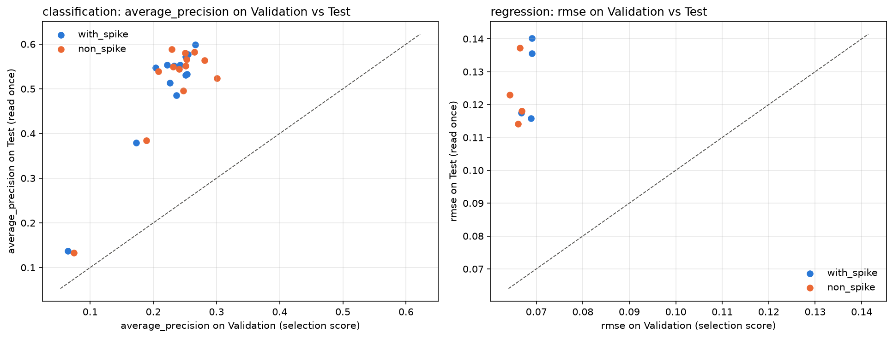

**รูป:** แต่ละจุดคือหนึ่งโมเดล แกนนอนคือคะแนนบน Validation แกนตั้งคือคะแนนบน Test ซ้ายคือ classification ขวาคือ regression ถ้าอันดับบน Validation บอกอันดับบน Test ได้ดี จุดจะเรียงเป็นแนวเฉียง แต่ในรูปซ้าย จุดส่วนใหญ่เกาะเป็นก้อนโดยไม่มีแนวโน้มชัดเจน และจุดขวาสุด (คะแนน Validation สูงสุด คือ `random_forest` แบบ `non_spike`) ไม่ได้อยู่สูงสุด

**ข้อ 4 AP บน Test สูงกว่า Validation มาก ไม่ได้แปลว่าโมเดลเก่งขึ้น** AP ของ `mlp` เพิ่มจาก 0.27 เป็น 0.60 แต่อย่าลืมว่าค่าเดาสุ่มของ AP ก็เพิ่มจาก 0.092 เป็น 0.196 เพราะ Test มีวันผันผวนสูงมากกว่า (หัวข้อ 6.4) เหตุผลอีกส่วนอยู่ในข้อถัดไป

**ข้อ 5 โมเดลเก่งช่วงตลาดปกติ ไม่เก่งช่วงปั่นป่วน** นี่คือข้อค้นพบที่ชัดที่สุดของโปรเจกต์ เราแยก Test เป็นสองส่วน

- **ช่วงรอบวัน spike** 54 แถว (หน้าต่างรอบ spike ของเดือนเมษายน 2025 และมิถุนายน 2026) มีวันผันผวนสูง 38 วัน หรือ 70%
- **ช่วงปกติ** 319 แถวที่เหลือ มีวันผันผวนสูง 35 วัน หรือ 11%

<!-- BEGIN GENERATED: outputs/modeling/report/tables/test_segments_classification.md -->
### Test metrics by diagnostic segment — classification

| model | variant | segment | rows | positives | average_precision | roc_auc | recall | precision | f1 |
| --- | --- | --- | --- | --- | --- | --- | --- | --- | --- |
| adaboost | non_spike | non_spike | 319 | 35 | 0.3372 | 0.7370 | 0.3714 | 0.5200 | 0.4333 |
| adaboost | non_spike | spike_affected | 54 | 38 | 0.8281 | 0.6102 | 0.4474 | 0.7727 | 0.5667 |
| adaboost | with_spike | non_spike | 319 | 35 | 0.3212 | 0.7251 | 0.3429 | 0.4138 | 0.3750 |
| adaboost | with_spike | spike_affected | 54 | 38 | 0.6804 | 0.3413 | 0.5526 | 0.6176 | 0.5833 |
| logistic | non_spike | non_spike | 319 | 35 | 0.3639 | 0.7444 | 0.2000 | 0.5385 | 0.2917 |
| logistic | non_spike | spike_affected | 54 | 38 | 0.7200 | 0.3668 | 0.6316 | 0.6486 | 0.6400 |
| logistic | with_spike | non_spike | 319 | 35 | 0.3882 | 0.7545 | 0.2286 | 0.6154 | 0.3333 |
| logistic | with_spike | spike_affected | 54 | 38 | 0.7168 | 0.3734 | 0.6316 | 0.6486 | 0.6400 |
| mlp | non_spike | non_spike | 319 | 35 | 0.4048 | 0.7454 | 0.2857 | 0.5263 | 0.3704 |
| mlp | non_spike | spike_affected | 54 | 38 | 0.7310 | 0.4227 | 0.5789 | 0.6286 | 0.6027 |
| mlp | with_spike | non_spike | 319 | 35 | 0.4451 | 0.7709 | 0.3429 | 0.5714 | 0.4286 |
| mlp | with_spike | spike_affected | 54 | 38 | 0.7837 | 0.5296 | 0.6316 | 0.7500 | 0.6857 |
| random_forest | non_spike | non_spike | 319 | 35 | 0.3898 | 0.7344 | 0.3714 | 0.4815 | 0.4194 |
| random_forest | non_spike | spike_affected | 54 | 38 | 0.7664 | 0.5510 | 0.4211 | 0.6957 | 0.5246 |
| random_forest | with_spike | non_spike | 319 | 35 | 0.3782 | 0.7455 | 0.3429 | 0.4800 | 0.4000 |
| random_forest | with_spike | spike_affected | 54 | 38 | 0.8011 | 0.5757 | 0.5000 | 0.7308 | 0.5938 |
<!-- END GENERATED -->

<!-- BEGIN GENERATED: outputs/modeling/report/tables/test_segments_regression.md -->
### Test metrics by diagnostic segment — regression

| model | variant | segment | rows | rmse | mae | r2 |
| --- | --- | --- | --- | --- | --- | --- |
| elastic_net | non_spike | non_spike | 319 | 0.0692 | 0.0550 | 0.1752 |
| elastic_net | non_spike | spike_affected | 54 | 0.2759 | 0.1838 | -0.3351 |
| elastic_net | with_spike | non_spike | 319 | 0.0707 | 0.0564 | 0.1395 |
| elastic_net | with_spike | spike_affected | 54 | 0.2564 | 0.1722 | -0.1526 |
| multiple_linear | non_spike | non_spike | 319 | 0.0683 | 0.0525 | 0.1972 |
| multiple_linear | non_spike | spike_affected | 54 | 0.2620 | 0.1880 | -0.2042 |
| multiple_linear | with_spike | non_spike | 319 | 0.0694 | 0.0536 | 0.1714 |
| multiple_linear | with_spike | spike_affected | 54 | 0.2533 | 0.1819 | -0.1253 |
<!-- END GENERATED -->

**อ่านตาราง:** คอลัมน์ `segment` ค่า `non_spike` คือช่วงปกติ ค่า `spike_affected` คือช่วงรอบวัน spike ส่วนคอลัมน์ `variant` คือแบบข้อมูลที่ใช้สอน เป็นคนละเรื่องกัน

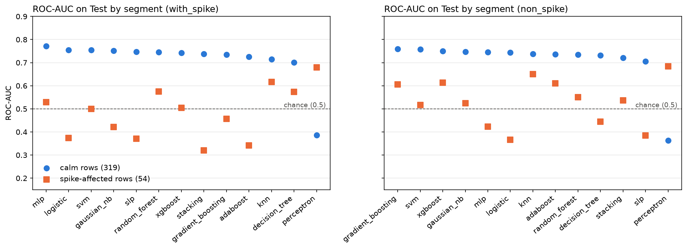

**รูป:** ซ้ายคือโมเดลที่สอนแบบ `with_spike` ขวาคือแบบ `non_spike` วงกลมสีน้ำเงินคือ ROC-AUC ในช่วงปกติ อยู่ราว 0.70 ถึง 0.77 สำหรับทุกโมเดลยกเว้น `perceptron` สี่เหลี่ยมสีส้มคือช่วงรอบวัน spike กระจายอยู่รอบเส้นประ 0.5 ซึ่งเท่ากับเดาสุ่ม

- ในช่วงปกติ โมเดลแยกวันผันผวนสูงได้จริง (ROC-AUC ของโมเดลในตารางอยู่ราว 0.72 ถึง 0.77)
- ในช่วงรอบวัน spike ROC-AUC ของโมเดลในตารางอยู่ระหว่าง 0.34 ถึง 0.61 **โมเดลแยกไม่ออกว่าวันไหนในช่วงนั้นจะผันผวนสูง** ค่า AP ที่ดูสูง (0.7 ถึง 0.8) มาจากการที่วันส่วนใหญ่ในช่วงนั้นผันผวนสูงอยู่แล้ว การเดาสุ่มในช่วงนั้นก็ได้ AP ราว 0.70 เพราะ 38 จาก 54 วันเป็นวันผันผวนสูง
- ฝั่ง regression ก็เช่นกัน RMSE ในช่วงปกติอยู่ราว 0.07 แต่ในช่วงรอบวัน spike อยู่ราว 0.25 ถึง 0.28

สรุปคือโมเดลรู้ว่า "ตอนนี้ตลาดกำลังปั่นป่วน" ซึ่ง `baseline_persistence` ก็รู้เหมือนกัน แต่ไม่รู้ว่าความปั่นป่วนจะเริ่มเมื่อไรหรือจะจบวันไหน คะแนนรวมที่ดูสูงมาจากการแยก "ช่วงปั่นป่วน" ออกจาก "ช่วงปกติ" ได้ ไม่ได้มาจากการทำนายภายในช่วงปั่นป่วน

**ข้อ 6 โมเดลซับซ้อนไม่ได้ดีกว่าโมเดลพื้นฐานอย่างมีนัยสำคัญ** เราเทียบโมเดลตัวแทนกับโมเดลพื้นฐานที่สอนในห้อง (`logistic` สำหรับ classification และ `multiple_linear` สำหรับ regression) แบบจับคู่

<!-- BEGIN GENERATED: outputs/modeling/report/tables/test_headline_vs_classroom.md -->
### Headline vs classroom model on Test (paired block bootstrap)

| task | variant | metric | classroom_model | classroom_score | headline | headline_score | delta | delta_low | delta_high | improvement_percent | interval_excludes_zero |
| --- | --- | --- | --- | --- | --- | --- | --- | --- | --- | --- | --- |
| classification | with_spike | average_precision | logistic | 0.5518 | mlp | 0.5991 | 0.0473 | -0.0137 | 0.0766 | 8.5643 | no |
| classification | non_spike | average_precision | logistic | 0.5510 | random_forest | 0.5240 | -0.0270 | -0.1678 | 0.0793 | -4.8974 | no |
| regression | with_spike | rmse | multiple_linear | 0.1158 | elastic_net | 0.1174 | 0.0016 | -0.0092 | 0.0089 | -1.4215 | no |
| regression | non_spike | rmse | multiple_linear | 0.1180 | elastic_net | 0.1230 | 0.0049 | -0.0119 | 0.0158 | -4.1832 | no |
<!-- END GENERATED -->

**อ่านตาราง:** `improvement_percent` เป็นบวกเมื่อโมเดลตัวแทนดีกว่า `interval_excludes_zero = no` คือช่วงคร่อมศูนย์

`mlp` ดีกว่า `logistic` ราว 8.6% แต่ช่วงคร่อมศูนย์ ส่วน `random_forest` และ `elastic_net` ทำได้แย่กว่าโมเดลพื้นฐานเล็กน้อย เราจึง **ไม่อ้าง** ว่าโมเดลซับซ้อนดีกว่า ข้อสรุปที่มีหลักฐานมากกว่าคือ บนโจทย์นี้โมเดลเรียบง่ายทำได้ดีพอ ๆ กับโมเดลที่ซับซ้อนที่สุดที่เราเขียน

### 9.5 คำถามวิจัยบน Test: ตัด spike แล้วดีขึ้นไหม

ตารางนี้เทียบโมเดลเดียวกันที่สอนสองแบบ บน Test ชุดเดียวกัน ด้วยวิธีจับคู่แบบเดียวกับหัวข้อ 7.5

<!-- BEGIN GENERATED: outputs/modeling/report/tables/test_spike_policy.md -->
### Same model with and without spike rows, on Test (paired block bootstrap)

| task | model | metric | with_spike | non_spike | delta | delta_low | delta_high | direction | interval_excludes_zero |
| --- | --- | --- | --- | --- | --- | --- | --- | --- | --- |
| classification | adaboost | average_precision | 0.4858 | 0.5443 | 0.0585 | -0.0324 | 0.1168 | non_spike better | no |
| classification | decision_tree | average_precision | 0.3792 | 0.3844 | 0.0052 | -0.1502 | 0.1190 | non_spike better | no |
| classification | gaussian_nb | average_precision | 0.5538 | 0.5884 | 0.0346 | -0.0064 | 0.0632 | non_spike better | no |
| classification | gradient_boosting | average_precision | 0.5332 | 0.5653 | 0.0322 | -0.0254 | 0.0891 | non_spike better | no |
| classification | knn | average_precision | 0.5472 | 0.5389 | -0.0083 | -0.1005 | 0.0946 | with_spike better | no |
| classification | logistic | average_precision | 0.5518 | 0.5510 | -0.0008 | -0.0184 | 0.0156 | with_spike better | no |
| classification | mlp | average_precision | 0.5991 | 0.5639 | -0.0352 | -0.0792 | 0.0276 | with_spike better | no |
| classification | perceptron | average_precision | 0.1374 | 0.1328 | -0.0046 | -0.0313 | -0.0001 | with_spike better | yes |
| classification | random_forest | average_precision | 0.5775 | 0.5240 | -0.0534 | -0.1284 | 0.0106 | with_spike better | no |
| classification | slp | average_precision | 0.5536 | 0.4963 | -0.0573 | -0.1184 | -0.0038 | with_spike better | yes |
| classification | stacking | average_precision | 0.5131 | 0.5499 | 0.0368 | -0.0721 | 0.1233 | non_spike better | no |
| classification | svm | average_precision | 0.5716 | 0.5805 | 0.0088 | -0.0015 | 0.0184 | non_spike better | no |
| classification | xgboost | average_precision | 0.5305 | 0.5823 | 0.0518 | 0.0163 | 0.0931 | non_spike better | yes |
| regression | elastic_net | rmse | 0.1174 | 0.1230 | 0.0055 | -0.0045 | 0.0122 | with_spike better | no |
| regression | multiple_linear | rmse | 0.1158 | 0.1180 | 0.0022 | -0.0017 | 0.0051 | with_spike better | no |
| regression | polynomial | rmse | 0.1401 | 0.1142 | -0.0260 | -0.0575 | 0.0041 | non_spike better | no |
| regression | simple_linear | rmse | 0.1356 | 0.1372 | 0.0016 | -0.0288 | 0.0198 | with_spike better | no |
<!-- END GENERATED -->

**อ่านตาราง:** `delta` คือคะแนนของ `non_spike` ลบด้วยคะแนนของ `with_spike` `delta_low` ถึง `delta_high` คือช่วงความเชื่อมั่น 95% ของผลต่าง `direction` บอกว่าแบบไหนได้คะแนนดีกว่า และ `interval_excludes_zero = yes` คือช่วงไม่คร่อมศูนย์

- **ทิศทางไม่ตรงกับ Validation** บน Validation โมเดลส่วนใหญ่ดีขึ้นเมื่อตัด spike แต่บน Test ผลแบ่งครึ่ง classifier 7 ตัวดีขึ้นและ 6 ตัวแย่ลง ส่วน regression 3 จาก 4 ตัวแย่ลงเล็กน้อย
- **ช่วงคร่อมศูนย์ใน 14 จาก 17 โมเดล** อีก 3 โมเดลชี้ไปคนละทาง: `slp` และ `perceptron` ดีกว่าเมื่อเก็บ spike ไว้ ส่วน `xgboost` ดีกว่าเมื่อตัดออก
- **ข้อสังเกตจากตารางแยกช่วง** (ไม่มีช่วงความเชื่อมั่น จึงเป็นเพียงข้อสังเกต) โมเดล regression สองตัวในตารางแยกช่วงของหัวข้อ 9.4 (`elastic_net` และ `multiple_linear`) เมื่อสอนแบบไม่มี spike ได้ RMSE ต่ำกว่าเล็กน้อยในช่วงปกติ แต่สูงกว่าในช่วงรอบวัน spike ซึ่งสมเหตุสมผล เพราะไม่เคยเห็นตัวอย่างแบบนั้นตอนสอน
- **สมมติฐานเรื่อง AdaBoost** บน Test `adaboost` เป็น classifier ที่ AP เพิ่มขึ้นมากที่สุดเมื่อตัด spike (จาก 0.486 เป็น 0.544) ไปในทิศทางเดียวกับสมมติฐานในหัวข้อ 5.6 แต่ช่วงยังคร่อมศูนย์ จึงเป็นข้อสังเกต ยังไม่ใช่ข้อพิสูจน์

**พูดสั้น ๆ ได้ว่า:** บนข้อสอบจริง โมเดลดีกว่าเดาสุ่มชัดเจนแต่เหนือกว่ากฎง่าย ๆ เพียงเล็กน้อย ทำงานได้ในช่วงตลาดปกติแต่ไม่ใช่ช่วงปั่นป่วน โมเดลซับซ้อนไม่ได้ชนะโมเดลพื้นฐานอย่างมีนัยสำคัญ และการตัด spike ยังสรุปไม่ได้ว่าช่วยหรือทำร้าย

---

## 10. สรุปทั้งโปรเจกต์

### 10.1 คำตอบของคำถามวิจัย

> ข้อมูลชุดนี้ **ไม่สนับสนุน** ว่าการตัดช่วง spike ออกจากข้อมูลสอนทำให้โมเดลทำนายดีขึ้น และไม่สนับสนุนว่าทำให้แย่ลงเช่นกัน ผลต่างที่วัดได้เล็กกว่าความไม่แน่นอนของการวัด ทั้งบน Validation และบน Test และทิศทางของสองชุดไม่ตรงกัน

### 10.2 ข้อค้นพบสี่ข้อ

1. **ทำนายได้ แต่ได้น้อย** จากข้อมูลราคาย้อนหลังเพียงอย่างเดียว โมเดลทำนายความผันผวน 5 วันข้างหน้าได้ดีกว่าการเดาสุ่มชัดเจน แต่เหนือกว่ากฎ "เท่ากับ 5 วันที่ผ่านมา" เพียงเล็กน้อย
2. **เก่งผิดที่** โมเดลทำงานได้ในช่วงตลาดปกติ แต่แยกวันผันผวนสูงภายในช่วงปั่นป่วนไม่ได้ ซึ่งเป็นช่วงที่การเตือนล่วงหน้ามีค่ามากที่สุด
3. **ซับซ้อนไม่ได้แปลว่าดีกว่า** โมเดลเรียบง่ายอย่าง logistic regression ทำได้ดีพอ ๆ กับโครงข่ายประสาทและโมเดลตระกูล boosting
4. **คะแนนซ้อมหลอกได้** ผู้นำบน Validation ไม่ได้เป็นผู้นำบน Test เสมอไป

### 10.3 อะไรอ้างได้ และอะไรอ้างไม่ได้

| อ้างได้ เพราะมีหลักฐาน | อ้างไม่ได้ |
| --- | --- |
| โมเดลตัวแทนดีกว่าการเดาสุ่มอย่างชัดเจนบน Test | "โมเดล X ดีที่สุด" |
| กฎง่าย ๆ จากความผันผวนย้อนหลังทำได้ใกล้เคียงโมเดล | "ML ดีกว่ากฎง่าย ๆ มาก" |
| โมเดลแยกวันผันผวนสูงในช่วงปกติได้ แต่ในช่วงรอบวัน spike ทำได้ใกล้เดาสุ่ม | "โมเดลเตือนวิกฤตล่วงหน้าได้" |
| ผลต่างระหว่างสอนแบบมีและไม่มี spike เล็กกว่าความไม่แน่นอน | "ตัด spike แล้วดีขึ้น" หรือ "ตัดแล้วแย่ลง" |
| โมเดลที่เขียนเองให้ผลตรงกับ library | "โมเดลซับซ้อนดีกว่าโมเดลพื้นฐาน 8.6%" โดยไม่บอกว่าช่วงคร่อมศูนย์ |
| ข้อมูลไม่มีการรั่วของอนาคต และ Test ถูกเปิดครั้งเดียว | "accuracy 90%" โดยไม่บอกว่าทายปกติทุกวันก็ได้เท่ากัน |

### 10.4 ผลที่ "สรุปไม่ได้" มีค่าอย่างไร

ถ้าเราดูเฉพาะค่าที่วัดได้บน Validation โดยไม่วัดความไม่แน่นอน เราคงเขียนรายงานว่า "ตัด spike แล้วโมเดลดีขึ้น" และ "MLP ดีกว่า logistic 14%" ทั้งสองประโยคฟังดูเป็นผลงานที่ดี แต่ **ไม่มีหลักฐานรองรับ** ทั้งคู่ เพราะเมื่อวัดบนข้อสอบจริง ทิศทางของผลแรกไม่ยืนยัน และผลที่สองแยกจากความบังเอิญไม่ได้

คุณค่าของโปรเจกต์นี้จึงอยู่ที่สามเรื่อง

- **วิธีทำที่ถูกต้อง** ไม่มีข้อมูลรั่ว เส้นแบ่งทุกเส้นมาจากชุดสอน และข้อสอบจริงถูกเปิดครั้งเดียว
- **โมเดลที่เขียนเองและพิสูจน์ได้** ว่าตรงกับ library
- **ข้อสรุปที่ซื่อตรง** บอกชัดว่าข้อมูลสนับสนุนอะไรและไม่สนับสนุนอะไร

### 10.5 ข้อจำกัด

1. **ตัวอย่างไม่อิสระต่อกัน** ข้อมูลจริงมีน้อยกว่าจำนวนแถวมาก ช่วงความเชื่อมั่นจึงกว้าง
2. **Validation เป็นสภาพตลาดแบบเดียว** สงบ ไม่มี spike และมีวันผันผวนสูง 34 วัน จึงเลือกโมเดลได้ไม่แม่น
3. **การเทียบสองแบบข้อมูลถูก confound** จำนวนแถว สัดส่วนคลาส และสภาพตลาดเปลี่ยนพร้อมกัน
4. **ช่วงรอบวัน spike ใน Test มีเพียง 54 แถวจากสองเหตุการณ์** ผลแยกช่วงจึงเป็นข้อสังเกต
5. **จุดตัดคงที่ 0.5** ทำให้โมเดลเตือนน้อยเมื่อสภาพตลาดเปลี่ยน
6. **ใช้เฉพาะราคาย้อนหลัง** ไม่มีข้อมูลที่มองไปข้างหน้า เช่น ดัชนี VIX (ความผันผวนที่ตลาดคาดการณ์) หรือปฏิทินประกาศตัวเลขเศรษฐกิจ
7. **สินทรัพย์เดียว ช่วงเวลาเดียว** ผลอาจไม่ใช้กับสินทรัพย์อื่น
8. **ลายนิ้วมือของไฟล์ข้อมูลที่สร้างขึ้นผูกกับ Windows** เพราะรูปแบบการขึ้นบรรทัดใหม่ของไฟล์ต่างกันตามระบบปฏิบัติการ

งานนี้เป็นงานศึกษาในรายวิชา ไม่ใช่คำแนะนำการลงทุน และโมเดลไม่ได้ถูกทดสอบกับการซื้อขายจริง

### 10.6 ถ้าทำต่อจะทำอะไร

- เพิ่ม feature ที่มองไปข้างหน้า เช่น VIX เพื่อช่วยทำนายจุดเริ่มของความผันผวน
- ทำกลุ่มควบคุมสำหรับการทดลอง spike เช่น ตัดแถวปกติจำนวนเท่ากันออก เพื่อแยกผลของ spike ออกจากผลของจำนวนแถวที่ลดลง
- ใช้ walk-forward ในการเลือกโมเดลแทนการใช้ Validation ช่วงเดียว
- ทดสอบกับสินทรัพย์อื่น

### 10.7 สิ่งที่ได้เรียนรู้

- การทำให้โมเดลที่เขียนเองตรงกับ library ถึงทศนิยมตำแหน่งสุดท้าย บังคับให้เข้าใจรายละเอียดที่ตำราข้ามไป เช่น ลำดับการสุ่ม กฎการหยุดวนรอบ และการตัดสินเมื่อคะแนนเท่ากัน
- กับข้อมูลที่เรียงตามเวลา ความถูกต้องของขั้นตอนสำคัญกว่าการเลือกโมเดล
- ช่วงความเชื่อมั่นเปลี่ยนข้อสรุปได้ทั้งหมด

**พูดสั้น ๆ ได้ว่า:** การตัด spike ไม่ได้ช่วยหรือทำร้ายโมเดลอย่างที่วัดได้ โมเดลทำนายได้ดีกว่าเดาสุ่มแต่เหนือกว่ากฎง่าย ๆ ไม่มาก และทำงานได้เฉพาะช่วงตลาดปกติ จุดแข็งของงานคือวิธีทำที่ไม่มีข้อมูลรั่ว และการรายงานตามจริง

---

## 11. แผนที่ไฟล์ และวิธีรัน

### 11.1 อะไรอยู่ที่ไหน

| ที่อยู่ | เนื้อหา |
| --- | --- |
| `data/raw/qqq_daily.csv` | ข้อมูลดิบ 2,512 วัน (ห้ามแก้) |
| `src/*.py` | โค้ดเตรียมข้อมูล: ทำความสะอาด สร้าง feature สร้าง target แบ่งข้อมูล ตรวจ spike |
| `src/ml/regression/`, `classification/`, `clustering/` | โมเดล 19 ตัว หนึ่งไฟล์ต่อหนึ่งโมเดล |
| `src/ml/core/` | ส่วนกลางที่ทุกโมเดลใช้: โหลดข้อมูล สอน คิดคะแนน วัดความไม่แน่นอน วาดรูป |
| `src/ml/run.py` | คำสั่งหลักของงานโมเดล |
| `configs/modeling.json` | รายการโมเดลและค่าที่ลอง |
| `outputs/modeling/<แบบข้อมูล>/<ประเภทงาน>/<โมเดล>/` | ผลของแต่ละโมเดล: น้ำหนัก การตั้งค่า คะแนน คำทำนาย |
| `outputs/modeling/report/` | ตารางสรุปบน Validation |
| `outputs/modeling/final/` | ตารางสรุปบน Test |
| `outputs/figures/` | รูปทั้งหมด |
| `outputs/reports/` | รายงานของแต่ละขั้นในการเตรียมข้อมูล |
| `notebooks/` | สมุดบันทึกที่เปิดอ่านผลพร้อมคำอธิบายได้ |
| `tests/` | โปรแกรมทดสอบอัตโนมัติ 1,271 ข้อ |
| `deliverables/` | รายงาน (`report.docx`, `report.pdf`) และสไลด์ (`slides.pptx`) |
| `docs/` | เอกสารทั้งหมด |

### 11.2 อยากดูอะไร เปิดไฟล์ไหน

| อยากดู | เปิด |
| --- | --- |
| ข้อมูลและ feature พร้อมกราฟ | [`notebooks/01_data_cleaning.ipynb`](../../notebooks/01_data_cleaning.ipynb), [`02_eda_and_features.ipynb`](../../notebooks/02_eda_and_features.ipynb) |
| ผลของโมเดล regression | [`notebooks/03_regression.ipynb`](../../notebooks/03_regression.ipynb) |
| ผลของโมเดล classification และ clustering | [`notebooks/04_classification.ipynb`](../../notebooks/04_classification.ipynb) |
| การเปรียบเทียบทั้งหมดและผลบน Test | [`notebooks/05_results_comparison.ipynb`](../../notebooks/05_results_comparison.ipynb) |
| รายงานฉบับเต็ม | [`deliverables/report.docx`](../../deliverables/report.docx) หรือต้นฉบับ [`docs/report/REPORT_DRAFT.md`](../report/REPORT_DRAFT.md) |
| สไลด์พร้อมบทพูด | [`deliverables/slides.pptx`](../../deliverables/slides.pptx) |
| การตั้งค่าที่ชนะของทุกโมเดล | [`outputs/modeling/report/tables/model_inventory.md`](../../outputs/modeling/report/tables/model_inventory.md) |
| สูตรและรายละเอียดของแต่ละโมเดล | [`docs/plan/MODEL_CARDS.md`](../plan/MODEL_CARDS.md) |
| ผลการตรวจสอบข้อมูล | [`docs/audit/DATA_PIPELINE_AUDIT.md`](../audit/DATA_PIPELINE_AUDIT.md) |

### 11.3 วิธีรันตั้งแต่ต้น

ต้องมี Windows, Python 3.14 และ Git รายละเอียดและการแก้ปัญหาอยู่ใน [`RUNBOOK.md`](RUNBOOK.md)

```bat
rem 1. สร้างสภาพแวดล้อมและติดตั้ง library
py -3.14 -m venv .venv
.\.venv\Scripts\python.exe -m pip install -r requirements.txt

rem 2. สร้างข้อมูลจากไฟล์ดิบที่มากับ repo
.\.venv\Scripts\python.exe -m src.run_data_pipeline --overwrite-generated
.\.venv\Scripts\python.exe -m src.run_data_pipeline --output-root "tmp\phase1-reproduction" --overwrite-generated
.\.venv\Scripts\python.exe -m src.run_spike_analysis --reproduced-root "tmp\phase1-reproduction" --overwrite-generated

rem 3. ตรวจว่าทุกอย่างทำงาน (ราว 10 นาที)
.\.venv\Scripts\python.exe -m pytest -q
```

ผลของโมเดลที่สอนแล้วทั้ง 38 ชุดมากับ repo จึงเปิด notebook 03 ถึง 05 ดูผลได้ทันทีโดยไม่ต้องสอนใหม่

| คำสั่ง | ทำอะไร | ใช้เวลา |
| --- | --- | --- |
| `python -m src.ml.run report --variant with_spike` | สร้างตารางจัดอันดับและรูปบน Validation | ราว 15 วินาที |
| `python -m src.ml.run compare` | เทียบ `with_spike` กับ `non_spike` | ราว 15 วินาที |
| `python -m src.ml.run analyze --variant with_spike` | คำนวณ feature importance และ walk-forward | 3 ถึง 4 นาที |
| `python -m src.ml.docs_sync` | เติมตารางในเอกสารให้ตรงกับไฟล์ผล | ราว 30 วินาที |

(ทุกคำสั่งในตารางให้ขึ้นต้นด้วย `.\.venv\Scripts\python.exe` แทนคำว่า `python`)

หลังรันคำสั่งเหล่านี้ `git status` อาจขึ้นว่ามีไฟล์ถูกแก้ ทั้งที่เนื้อหาเหมือนเดิม สาเหตุคือ Windows กับ Git ใช้เครื่องหมายขึ้นบรรทัดใหม่ต่างกัน ตรวจได้ด้วยคำสั่ง `git diff` ซึ่งจะไม่แสดงอะไรถ้าเนื้อหาไม่เปลี่ยน

> **สองข้อห้าม**
> ข้อแรก **ห้ามรัน `finalize --allow-test` ซ้ำ** Test ถูกเปิดไปแล้ว คำสั่งจะปฏิเสธเอง
> ข้อสอง **ห้ามสอนโมเดลใหม่ทับของเดิม** เพราะไฟล์จะไม่ตรงกับที่ล็อกไว้ก่อนเปิด Test

### 11.4 เรามั่นใจในความถูกต้องได้อย่างไร

- **โปรแกรมทดสอบอัตโนมัติ 1,271 ข้อ** ครอบคลุมการเตรียมข้อมูล โมเดลทุกตัว และเอกสาร
- **ทดสอบจากศูนย์** คัดลอก repo ไปโฟลเดอร์ใหม่แล้วทำตามคำสั่งข้างต้น ข้อมูลที่สร้างใหม่ตรงกับของเดิม และโปรแกรมทดสอบผ่านทั้งหมด รอบล่าสุด (13 ต.ค. 2026) สร้างสภาพแวดล้อมใหม่และติดตั้ง library ใหม่ทั้งหมดด้วย โดยทำบนเครื่องเดิม ยังไม่ได้ลองบนเครื่องอื่น
- **ตารางในเอกสารถูกเติมจากไฟล์ผลโดยตรง** และมีโปรแกรมทดสอบที่แจ้งเตือนถ้าเอกสารไม่ตรงกับไฟล์ผล
- **ทุกขั้นที่มีการสุ่มใช้เลขตั้งต้นคงที่** (เรียกว่า seed เช่น `random_state = 42` ในโมเดล และ 20261011 ในการทำ bootstrap) คอมพิวเตอร์จึงสุ่มได้ลำดับเดิมทุกครั้ง และผลเหมือนเดิมทุกครั้งที่รัน

### 11.5 เครื่องมือที่ใช้

| เครื่องมือ | คืออะไร | ใช้ทำอะไรในโปรเจกต์ |
| --- | --- | --- |
| **Python** 3.14 | ภาษาโปรแกรม | เขียนโค้ดทั้งหมด |
| **NumPy** (ย่อจาก Numerical Python) | library คำนวณตัวเลขและเมทริกซ์ | เขียนโมเดลทั้ง 19 ตัว |
| **pandas** | library จัดการตารางข้อมูล | เตรียมข้อมูล (อ่านไฟล์ สร้าง feature แบ่งชุด) |
| **matplotlib** | library วาดกราฟ | สร้างรูปทั้งหมด |
| **scikit-learn** และ **XGBoost** | library โมเดลสำเร็จรูป | ใช้ตรวจคำตอบของโมเดลที่เขียนเองเท่านั้น |
| **pytest** | เครื่องมือรันโปรแกรมทดสอบอัตโนมัติ | ตรวจว่าโค้ดและเอกสารถูกต้อง |
| **Jupyter Notebook** (ไฟล์ `.ipynb`) | สมุดบันทึกที่รวมโค้ด ผลลัพธ์ และคำอธิบายไว้ด้วยกัน | แสดงผลพร้อมคำอธิบายใน `notebooks/` |
| **Git** และ **GitHub** | ระบบเก็บประวัติการแก้ไขไฟล์ และเว็บไซต์ที่เก็บโปรเจกต์ | เก็บโค้ด ผลลัพธ์ และหลักฐานว่าล็อกก่อนเปิด Test |

ศัพท์ที่เจอในโฟลเดอร์และคำสั่ง: **repo** (ย่อจาก repository) คือโฟลเดอร์โปรเจกต์ที่ Git ดูแล **commit** คือการบันทึกการเปลี่ยนแปลงหนึ่งครั้งลงประวัติ **venv** (ย่อจาก virtual environment) คือชุด Python และ library ที่แยกไว้ใช้กับโปรเจกต์นี้โดยเฉพาะ **CSV** (Comma-Separated Values) คือไฟล์ตารางที่คั่นค่าด้วยจุลภาค และ **JSON** (JavaScript Object Notation) คือไฟล์ข้อความที่เก็บข้อมูลเป็นคู่ของชื่อกับค่า

---

## 12. เตรียมนำเสนอและตอบคำถาม

### 12.1 เล่าโปรเจกต์ในสองนาที

> โปรเจกต์ของเราทำนายว่าอีก 5 วันทำการข้างหน้า กองทุน QQQ จะผันผวนแค่ไหน จากข้อมูลราคารายวันย้อนหลัง 10 ปี ทั้งแบบทำนายเป็นตัวเลขและแบบทำนายว่าจะผันผวนสูงหรือไม่
>
> คำถามที่เราสนใจคือ วันที่ราคากระชากแรงผิดปกติซึ่งมีไม่กี่วัน ช่วยหรือทำร้ายการเรียนรู้ของโมเดล เราจึงสอนโมเดลทุกตัวสองแบบ คือแบบใช้ข้อมูลครบและแบบตัดช่วงราคากระชากออก แล้ววัดบนข้อมูลชุดเดียวกัน
>
> เราเขียนโมเดล 19 ตัวเองด้วย NumPy และพิสูจน์ว่าถูกโดยเทียบกับ library ทีละแถว เราระวังเรื่องข้อมูลรั่วเป็นพิเศษ แบ่งข้อมูลตามเวลา ตั้งเส้นแบ่งทุกเส้นจากชุดสอน และเปิดชุดทดสอบสุดท้ายเพียงครั้งเดียวหลังล็อกทุกการตัดสินใจ
>
> ผลคือ โมเดลทำนายได้ดีกว่าการเดาสุ่มชัดเจน แต่เหนือกว่ากฎง่าย ๆ เพียงเล็กน้อย และทำงานได้เฉพาะช่วงตลาดปกติ ส่วนคำถามเรื่องการตัดช่วงราคากระชาก ผลต่างที่วัดได้เล็กกว่าความไม่แน่นอนของการวัด เราจึงสรุปว่ายังบอกไม่ได้ว่าช่วยหรือทำร้าย
>
> สิ่งที่เราภูมิใจคือวิธีทำที่ตรวจสอบได้ทุกขั้น และการรายงานผลตามจริง

### 12.2 คำถามที่น่าจะถูกถาม พร้อมคำตอบ

#### เรื่องโจทย์และข้อมูล

**ถาม 1:** โปรเจกต์นี้แก้ปัญหาอะไร

**ตอบ:** ทำนายว่า 5 วันทำการข้างหน้าราคา QQQ จะแกว่งแรงแค่ไหน ทั้งแบบตัวเลขและแบบผันผวนสูงหรือไม่ จาก feature 8 ตัวที่คำนวณจากราคาและปริมาณซื้อขายในอดีต

**ถาม 2:** target นิยามอย่างไร

**ตอบ:** ส่วนเบี่ยงเบนมาตรฐานของ return รายวันในวันที่ t+1 ถึง t+5 คูณ √252 ให้เป็นหน่วยต่อปี ไม่รวมวันที่ t

**ถาม 3:** มั่นใจได้อย่างไรว่าไม่มี leakage

**ตอบ:** สี่ชั้น หนึ่ง feature ทุกตัวใช้ข้อมูลถึงวันที่ t เท่านั้น เราทดสอบโดยตัดอนาคตทิ้งแล้วคำนวณใหม่ได้ค่าเดิม สอง แบ่งข้อมูลตามเวลา ไม่สุ่มสลับ สาม เว้นช่องว่าง 5 วันระหว่างชุด เท่ากับระยะที่ target มองไปข้างหน้า สี่ เส้นแบ่งและค่าที่ใช้ปรับสเกลคำนวณจากชุดสอนเท่านั้น

**ถาม 4:** ทำไมไม่สุ่มสลับข้อมูลแล้วทำ cross-validation ตามปกติ

**ตอบ:** target ของวันติดกันใช้ข้อมูลซ้ำกัน 4 ใน 5 วัน ถ้าสุ่มสลับ โมเดลจะเห็นคำตอบที่แทบเหมือนของชุดทดสอบ เราตรวจแล้วว่าทำแบบนั้นได้ R² 0.83 โดยไม่ใช้ feature เลย ซึ่งเป็นคะแนนปลอม

**ถาม 5:** ทำไมใช้ Q75 เป็นเส้นแบ่ง และทำไมคำนวณจากชุดสอนเท่านั้น

**ตอบ:** Q75 นิยาม "ผันผวนสูง" ว่าเป็น 25% บนสุดของช่วงที่ใช้สอน ต้องคำนวณจากชุดสอนเท่านั้นเพราะตอนทำนายจริงเรายังไม่รู้ค่าของอนาคต

**ถาม 6:** ทำไม Validation มีวันผันผวนสูงแค่ 9.2% ทั้งที่ Train มี 25%

**ตอบ:** เพราะช่วง ส.ค. 2023 ถึง ก.พ. 2025 ตลาดสงบกว่าช่วงที่ใช้สอน ซึ่งมีทั้งโควิดปี 2020 และตลาดขาลงปี 2022 เป็นความต่างของสภาพตลาด ไม่ใช่ข้อผิดพลาด

#### เรื่องการทดลอง spike

**ถาม 7:** spike นิยามอย่างไร และทำไมตัด 213 แถว ไม่ใช่ 19 แถว

**ตอบ:** spike คือวันที่ราคาขยับเกิน 4.65% ซึ่งมาจากกฎ Q3 + 3 × IQR ของขนาด return บนชุดสอน มี 19 วัน แต่ละวันกระทบแถวตั้งแต่ 5 วันก่อนถึง 19 วันหลัง เพราะ target มองไปข้างหน้า 5 วัน และ feature มองย้อนหลัง 20 วัน รวมแบบไม่นับซ้ำได้ 213 แถว

**ถาม 8:** ตัด spike แล้วดีขึ้นไหม

**ตอบ:** ยังสรุปไม่ได้ บน Validation โมเดลส่วนใหญ่ดีขึ้นเล็กน้อย แต่ 16 จาก 17 โมเดลมีช่วงความเชื่อมั่นคร่อมศูนย์ บน Test ผลแบ่งครึ่งและ 14 จาก 17 โมเดลคร่อมศูนย์ ทิศทางของสองชุดไม่ตรงกัน

**ถาม 9:** ทำไมไม่สรุปว่าดีขึ้น ในเมื่อตัวเลขบน Validation ดีขึ้นเกือบทุกตัว

**ตอบ:** เพราะผลต่างเล็กกว่าความไม่แน่นอนของการวัด และการตัดแถวเปลี่ยนสามอย่างพร้อมกัน คือจำนวนแถว สัดส่วนวันผันผวนสูง และสภาพตลาดในชุดสอน อีกทั้ง Validation ไม่มี spike เลย เมื่อดูบน Test ทิศทางก็ไม่ยืนยัน

#### เรื่องโมเดล

**ถาม 10:** "เขียนเอง" จริงไหม พิสูจน์อย่างไร

**ตอบ:** โมเดลทุกตัวอยู่ใน `src/ml/` ใช้เพียง NumPy ในส่วนเรียนรู้และทำนาย library ถูกเรียกเฉพาะในคำสั่ง `reference()` เพื่อเทียบผล มีโปรแกรมทดสอบที่เทียบคำทำนายทีละแถว 14 จาก 19 โมเดลตรงกันสมบูรณ์ อีก 5 ตัวต่างด้วยเหตุผลที่อธิบายได้

**ถาม 11:** ทำไมเลือก Elastic Net และ AdaBoost เป็นโมเดลนอกเนื้อหา

**ตอบ:** Elastic Net เพราะ feature ของเราซ้ำซ้อนกัน (ความผันผวน 5 วันกับ 20 วันมีสหสัมพันธ์ 0.80) ซึ่งเป็นปัญหาที่ค่าปรับ L1 และ L2 ออกแบบมาแก้ AdaBoost เพราะกลไกเพิ่มน้ำหนักให้ตัวอย่างที่ทายผิดทำให้มันน่าจะไวต่อวันสุดโต่ง จึงเหมาะกับการทดลองเรื่อง spike

**ถาม 12:** `perceptron` ได้ ROC-AUC 0.30 แย่กว่าเดาสุ่ม เขียนผิดหรือเปล่า

**ตอบ:** ไม่ผิด ผลตรงกับ library ทุกแถว Perceptron จะหยุดนิ่งได้ต้องมีเส้นตรงที่แบ่งสองกลุ่มได้สมบูรณ์ ข้อมูลของเราไม่มี มันจึงจบที่น้ำหนักของการแก้ครั้งสุดท้าย

**ถาม 13:** R² ติดลบได้อย่างไร แปลว่าโมเดลพังไหม

**ตอบ:** R² ติดลบแปลว่าทายแย่กว่าการตอบค่าเฉลี่ยของชุดนั้นทุกวัน ไม่ใช่ข้อผิดพลาดของโค้ด สาเหตุคือโมเดลเรียนจากช่วงที่ปั่นป่วนกว่า Validation มาก บน Test ซึ่งมีช่วงปั่นป่วน R² ของโมเดลตัวแทนกลับเป็นบวก (ราว 0.2 ถึง 0.3)

#### เรื่องการวัดผล

**ถาม 14:** ทำไมไม่ใช้ accuracy ตัดสิน

**ตอบ:** ทายว่า "ปกติ" ทุกวันก็ได้ accuracy 337 ÷ 371 = 90.8% แล้ว โดยจับวันผันผวนสูงไม่ได้เลย เราจึงใช้ average precision เป็นหลัก และรายงาน ROC-AUC, F1, recall ประกอบ

**ถาม 15:** โมเดลไหนดีที่สุด

**ตอบ:** ข้อมูลไม่พอจะบอก บน Validation ทั้ง 13 classifier แยกจากอันดับหนึ่งไม่ได้ บน Test ยังมี 10 จาก 13 ตัวอยู่ในกลุ่มนำ สิ่งที่บอกได้คือ `perceptron` และ `decision_tree` อยู่ท้ายตารางอย่างสม่ำเสมอ และโมเดลที่เหลือทำได้ใกล้เคียงกัน

**ถาม 16:** block bootstrap คืออะไร ทำไมต้องใช้

**ตอบ:** คือการสุ่มข้อมูลซ้ำเป็นก้อน 20 วันติดกัน 2,000 รอบ เพื่อดูว่าคะแนนแกว่งได้แค่ไหน ต้องสุ่มเป็นก้อนเพราะวันติดกันไม่อิสระต่อกัน ถ้าสุ่มทีละวัน ช่วงความเชื่อมั่นจะแคบเกินจริง

**ถาม 17:** ทำไม AP บน Test สูงกว่า Validation มาก โมเดลเก่งขึ้นหรือ

**ตอบ:** ไม่ใช่ AP ขึ้นกับสัดส่วนวันผันผวนสูง ซึ่ง Test มี 19.6% ส่วน Validation มี 9.2% ค่าเดาสุ่มจึงเพิ่มจาก 0.092 เป็น 0.196 อีกเหตุผลคือ Test มีช่วงปั่นป่วนชัดเจน ซึ่งโมเดลแยกออกจากช่วงปกติได้ง่าย

#### เรื่อง Test และข้อสรุป

**ถาม 18:** ทำไมต้องล็อกก่อนเปิด Test และทำไมเปิดได้ครั้งเดียว

**ตอบ:** เพื่อให้คะแนน Test เป็นตัวเลขที่ไม่ถูกปนเปื้อนด้วยการเลือก ถ้าดูผลแล้วปรับโมเดล หรือเลือกโมเดลที่ทำ Test ได้ดีมานำเสนอ คะแนนนั้นจะสูงเกินจริง เราจึงบันทึกโมเดลและชื่อโมเดลตัวแทนไว้ก่อน และโปรแกรมปฏิเสธการรันซ้ำ

**ถาม 19:** ทำไมไม่สอนโมเดลใหม่ด้วย Train รวม Validation ก่อนวัด Test

**ตอบ:** เป็นทางเลือกที่ทำได้ แต่เราเลือกไม่ทำ เพราะจะได้โมเดลชุดใหม่ที่ไม่เคยถูกตรวจบนข้อมูลใดเลย และการตั้งค่าที่เลือกไว้อาจไม่เหมาะกับข้อมูลที่ใหญ่ขึ้น การวัดโมเดลชุดเดิมซึ่งผ่านการตรวจกับ library และการโหลดซ้ำมาแล้ว ทำให้เส้นทางจากการเลือกถึงผลสุดท้ายตรงไปตรงมาและตรวจสอบได้

**ถาม 20:** `random_forest` เป็นอันดับ 1 บน Validation ทำไมตกไปอันดับ 10 บน Test

**ตอบ:** เพราะอันดับบน Validation ตัดสินจากวันผันผวนสูงเพียง 34 วัน ความต่างระหว่างอันดับต้น ๆ เล็กกว่าความไม่แน่นอนอยู่แล้ว อันดับ 1 จึงมีส่วนของความบังเอิญ นี่คือตัวอย่างของ selection bias

**ถาม 21:** สรุปแล้วโปรเจกต์นี้สำเร็จหรือล้มเหลว

**ตอบ:** สำเร็จในสิ่งที่ตั้งใจ คือสร้างโมเดลที่เขียนเองและพิสูจน์ได้ ทำการทดลองที่ไม่มีข้อมูลรั่ว และได้คำตอบที่เชื่อถือได้ คำตอบคือโมเดลช่วยได้น้อยกว่าที่คาด และการตัด spike ยังสรุปไม่ได้ ผลที่ไม่เป็นไปตามคาดแต่วัดอย่างถูกต้อง มีค่ากว่าผลที่ดูดีแต่มาจากวิธีที่ผิด

**ถาม 22:** ถ้าทำใหม่จะแก้อะไร

**ตอบ:** เพิ่ม feature ที่มองไปข้างหน้าเช่น VIX ทำกลุ่มควบคุมสำหรับการทดลอง spike และใช้ walk-forward เลือกโมเดลแทน Validation ช่วงเดียว

**ถาม 23:** ทำซ้ำได้ไหม

**ตอบ:** ได้ ไฟล์ราคาดิบอยู่ใน repo พร้อมลายนิ้วมือ การรันสายเตรียมข้อมูลสองรอบได้ไฟล์เหมือนกันทั้ง 14 ไฟล์ และเราทดสอบโดยคัดลอก repo ไปโฟลเดอร์ใหม่แล้วทำตามคู่มือ โปรแกรมทดสอบผ่านทั้งหมด

### 12.3 ข้อผิดพลาดที่พบบ่อยเวลาอธิบาย

| อย่าพูดว่า | ให้พูดว่า |
| --- | --- |
| "โมเดลของเราแม่น 90%" | "accuracy 90.8% ไม่มีความหมาย เพราะทายว่าปกติทุกวันก็ได้เท่ากัน เราดู average precision แทน" |
| "MLP เป็นโมเดลที่ดีที่สุด" | "MLP ได้คะแนนสูงสุด แต่แยกจากอีกหลายโมเดลไม่ได้ทางสถิติ" |
| "ตัด spike แล้วโมเดลดีขึ้น" | "ผลต่างเล็กกว่าความไม่แน่นอน จึงยังสรุปไม่ได้" |
| "spike ทำให้โมเดลแย่ลง" | "เราวัดได้แค่ผลของนโยบายตัดแถวทั้งชุด ซึ่งเปลี่ยนหลายอย่างพร้อมกัน" |
| "โมเดลทำนายวิกฤตได้" | "โมเดลรู้ว่าตลาดกำลังปั่นป่วน แต่ทำนายจุดเริ่มไม่ได้" |
| "AP บน Test สูงกว่า โมเดลจึงเก่งขึ้น" | "AP เทียบข้ามชุดข้อมูลไม่ได้ เพราะสัดส่วนวันผันผวนสูงต่างกัน" |

### 12.4 สิ่งที่ต้องทำเองก่อนวันส่ง

กำหนดส่งคือ 18 ตุลาคม 2026 แผนรายวันอยู่ใน [`docs/plan/ROADMAP.md`](../plan/ROADMAP.md)

1. กรอกชื่อและรหัสนักศึกษาในหน้าปกของ `deliverables/report.docx` และสไลด์แผ่นแรก แล้วส่งออก PDF ใหม่
2. อ่านรายงานทั้งฉบับหนึ่งรอบ และปรับสำนวนให้เป็นของตัวเอง
3. ซ้อมนำเสนอด้วยบทพูดในสไลด์ ให้อยู่ใน 15 ถึง 20 นาที
4. ยืนยันว่าลงทะเบียนกลุ่มและชุดข้อมูลใน Google Sheet ของวิชาแล้ว

---

## 13. สูตรทั้งหมดพร้อมวิธีอ่าน

หัวข้อนี้รวมสูตรทุกสูตรที่โปรเจกต์ใช้ เขียนเป็นข้อความธรรมดา แต่ละสูตรมีสามส่วน คือ **สูตร** **อ่านว่า** (ประโยคภาษาไทยที่พูดแทนสูตรได้) และ **ตัวอย่าง** ที่คิดตามได้ด้วยเครื่องคิดเลข ถ้าเจอสัญลักษณ์ที่ไม่คุ้น ให้ย้อนดูตารางในหัวข้อ 2.9

ไม่จำเป็นต้องจำสูตร สิ่งที่ควรได้จากหัวข้อนี้คือ เมื่อมีคนชี้สูตรแล้วถามว่า "ตัวนี้คืออะไร" เราตอบได้

### 13.1 สูตรของข้อมูลและ feature

#### Return (ผลตอบแทนรายวัน)

```text
r_t = P_t ÷ P_(t−1) − 1
```

- **อ่านว่า:** return ของวันนี้ เท่ากับราคาปิดวันนี้ หารด้วยราคาปิดเมื่อวาน แล้วลบหนึ่ง
- **แต่ละตัวคือ:** `P_t` คือราคาปิด (Close) ของวันที่ t และ `P_(t−1)` คือราคาปิดของวันทำการก่อนหน้า
- **ตัวอย่าง:** 174.91 ÷ 170.12 − 1 = 0.0282 หรือ +2.82% ถ้าใช้ `P_(t−5)` แทน `P_(t−1)` จะได้ return 5 วัน (`return_5d`)

#### ค่าเฉลี่ย (mean)

```text
x̄ = (x_1 + x_2 + ... + x_n) ÷ n
```

- **อ่านว่า:** ค่าเฉลี่ย เท่ากับผลรวมของทุกค่า หารด้วยจำนวนค่า
- **ตัวอย่าง:** ค่าเฉลี่ยของ 2, 4, 9 คือ (2 + 4 + 9) ÷ 3 = 5

#### ส่วนเบี่ยงเบนมาตรฐาน (standard deviation, SD)

```text
SD = √( Σ (x_i − x̄)² ÷ (n − 1) )
```

- **อ่านว่า:** นำแต่ละค่าลบด้วยค่าเฉลี่ย ยกกำลังสอง บวกทั้งหมดเข้าด้วยกัน หารด้วยจำนวนค่าลบหนึ่ง แล้วถอดรากที่สอง
- **ความหมาย:** โดยทั่วไปแล้วแต่ละค่าอยู่ห่างจากค่าเฉลี่ยเท่าไร ค่ายิ่งกระจาย SD ยิ่งใหญ่
- **ทำไมยกกำลังสอง:** เพื่อให้ระยะห่างด้านบวกและด้านลบไม่หักล้างกัน แล้วจึงถอดรากกลับมาเป็นหน่วยเดิม
- **ทำไมหารด้วย n − 1:** เป็นสูตรมาตรฐานเมื่อคำนวณจากตัวอย่างเพียงบางส่วน ในโค้ดเขียนว่า `ddof=1` (ย่อจาก delta degrees of freedom คือจำนวนที่นำไปลบออกจาก n)
- **ตัวอย่าง:** ค่า 2, 4, 9 มีค่าเฉลี่ย 5 ระยะห่างคือ −3, −1, 4 ยกกำลังสองได้ 9, 1, 16 รวมเป็น 26 หารด้วย 2 ได้ 13 ถอดรากได้ SD ≈ 3.61
- **คำที่เกี่ยวข้อง:** ค่าก่อนถอดราก (13 ในตัวอย่าง) เรียกว่า **ความแปรปรวน** (variance) นั่นคือ variance = SD²

#### ความผันผวนต่อปี (annualized volatility)

```text
ความผันผวนต่อปี = SD ของ return รายวัน × √252
```

- **อ่านว่า:** นำ SD ของ return รายวันมาคูณด้วยรากที่สองของ 252
- **ทำไมต้องเป็น √252:** หนึ่งปีมีประมาณ 252 วันทำการ ถ้า return แต่ละวันไม่ขึ้นต่อกัน ความแปรปรวนของทั้งปีจะเท่ากับ 252 เท่าของความแปรปรวนรายวัน และเพราะ SD คือรากที่สองของความแปรปรวน SD ของทั้งปีจึงเท่ากับ √252 เท่าของ SD รายวัน (√252 ≈ 15.87)
- **ตัวอย่าง:** SD รายวัน 0.88% ให้ความผันผวนต่อปี 0.0088 × 15.87 = 0.1397 หรือราว 14% ต่อปี

สูตรนี้ใช้สามที่ ต่างกันที่ช่วงวันที่นำมาคิด

```text
historical_volatility_5d  ของวัน t = SD ของ r_(t−4) ถึง r_t      × √252     (5 วันที่ผ่านมา รวมวันนี้)
historical_volatility_20d ของวัน t = SD ของ r_(t−19) ถึง r_t     × √252     (20 วันที่ผ่านมา รวมวันนี้)
target_volatility_5d      ของวัน t = SD ของ r_(t+1) ถึง r_(t+5)  × √252     (5 วันข้างหน้า ไม่รวมวันนี้)
```

สองบรรทัดแรกเป็น feature เพราะใช้แต่อดีต บรรทัดที่สามเป็น target เพราะใช้อนาคต

#### Intraday range (ช่วงราคาในวัน)

```text
intraday_range = (High − Low) ÷ Close
```

- **อ่านว่า:** ราคาสูงสุดลบราคาต่ำสุดของวัน หารด้วยราคาปิด
- **ตัวอย่าง:** (173.95 − 169.27) ÷ 170.12 = 0.0275 คือภายในวันนั้นราคาเหวี่ยงกว้าง 2.75% ของราคาปิด

#### SMA และ SMA ratio

```text
SMA_N ของวัน t = (P_t + P_(t−1) + ... + P_(t−N+1)) ÷ N
sma_ratio_5_20 = SMA_5 ÷ SMA_20
```

- **อ่านว่า:** SMA ของ N วัน คือค่าเฉลี่ยของราคาปิด N วันล่าสุด ส่วน ratio คือค่าเฉลี่ย 5 วันหารด้วยค่าเฉลี่ย 20 วัน
- **SMA ย่อมาจาก** Simple Moving Average คำว่า moving (เคลื่อนที่) หมายถึงหน้าต่าง N วันนี้เลื่อนไปข้างหน้าทุกวัน
- **ความหมายของ ratio:** มากกว่า 1 คือราคาช่วงสั้นอยู่เหนือแนวโน้มของเดือน น้อยกว่า 1 คืออยู่ใต้แนวโน้ม วันตัวอย่างได้ 0.967

#### RSI (Relative Strength Index)

```text
ขั้น 1   การเปลี่ยนแปลงของราคาปิดแต่ละวัน:  ถ้าขึ้น นับเป็น gain   ถ้าลง นับเป็น loss (เก็บเป็นค่าบวก)
ขั้น 2   avg_gain และ avg_loss = ค่าเฉลี่ยแบบ Wilder ของ 14 วัน
              ค่าแรก      = ค่าเฉลี่ยธรรมดาของ 14 วันแรก
              ค่าถัดไป    = (ค่าเฉลี่ยเมื่อวาน × 13 + ค่าของวันนี้) ÷ 14
ขั้น 3   RS  = avg_gain ÷ avg_loss
ขั้น 4   RSI = 100 − 100 ÷ (1 + RS)
```

- **อ่านว่า:** เทียบขนาดเฉลี่ยของวันที่ราคาขึ้นกับวันที่ราคาลง แล้วแปลงให้เป็นตัวเลข 0 ถึง 100
- **แต่ละตัวคือ:** RS ย่อมาจาก Relative Strength (กำลังสัมพัทธ์) ส่วน Wilder คือชื่อผู้คิดวิธีเฉลี่ยที่ให้น้ำหนักวันล่าสุดมากกว่าวันเก่า
- **ตัวอย่าง:** ถ้า avg_gain = 1 และ avg_loss = 3 จะได้ RS = 0.333 และ RSI = 100 − 100 ÷ 1.333 = 25 ซึ่งต่ำกว่า 30 คือช่วงที่ราคาลงเป็นหลัก

#### z-score

```text
z = (x − ค่าเฉลี่ย) ÷ SD
volume_zscore_20 = (Volume วันนี้ − ค่าเฉลี่ย Volume 20 วัน) ÷ SD ของ Volume 20 วัน
```

- **อ่านว่า:** ค่านี้ห่างจากค่าเฉลี่ยกี่เท่าของ SD
- **ตัวอย่าง:** z = 2.33 แปลว่าปริมาณซื้อขายวันนั้นสูงกว่าค่าเฉลี่ยของ 20 วันอยู่ 2.33 เท่าของ SD ส่วน z = 0 คือเท่ากับค่าเฉลี่ยพอดี และ z ติดลบคือต่ำกว่าค่าเฉลี่ย

#### ควอร์ไทล์ IQR และเส้นแบ่งสองเส้น

```text
Q1 (ควอร์ไทล์ที่ 1)        = ค่าที่ 25% ของข้อมูลอยู่ต่ำกว่า
Q3 หรือ Q75 (ควอร์ไทล์ที่ 3) = ค่าที่ 75% ของข้อมูลอยู่ต่ำกว่า
IQR = Q3 − Q1

เส้นแบ่ง spike         = Q3 + 3 × IQR  ของ |r_t| ใน Train      = 1.39% + 3 × 1.09% = 4.65%
เส้นแบ่ง "ผันผวนสูง"   = Q75 ของ target ใน Train                = 0.2531
ป้าย (label)           = 1 ถ้า target > 0.2531   ไม่อย่างนั้น = 0
```

- **อ่านว่า:** เรียงข้อมูลจากน้อยไปมาก Q1 คือจุดหนึ่งในสี่ Q3 คือจุดสามในสี่ ส่วน IQR คือระยะห่างระหว่างสองจุดนี้ ซึ่งครอบคลุมข้อมูลครึ่งกลาง
- **IQR ย่อมาจาก** Interquartile Range (พิสัยระหว่างควอร์ไทล์)
- **ทำไมใช้ Q3 + 3 × IQR:** เป็นกฎหาค่าผิดปกติที่ใช้กันทั่วไป ตัวคูณที่นิยมคือ 1.5 สำหรับค่าผิดปกติทั่วไป และ 3 สำหรับค่าผิดปกติรุนแรง เราใช้ 3 เพื่อจับเฉพาะวันที่สุดโต่งจริง

### 13.2 สูตรที่ใช้ก่อนสอนโมเดล

#### Standardization (การปรับสเกล)

```text
z = (x − ค่าเฉลี่ยของ feature นั้นใน Train) ÷ SD ของ feature นั้นใน Train
```

- **อ่านว่า:** นำค่าของ feature ลบด้วยค่าเฉลี่ย แล้วหารด้วย SD โดยค่าเฉลี่ยและ SD มาจาก Train เท่านั้น
- **ผล:** ทุก feature มีค่าเฉลี่ย 0 และ SD เท่ากับ 1 บน Train จึงเทียบกันได้
- **ตัวอย่าง:** ถ้า `rsi_14` ใน Train มีค่าเฉลี่ย 55 และ SD 12 วันที่ RSI เท่ากับ 31 จะถูกแปลงเป็น (31 − 55) ÷ 12 = −2.0 (ตัวเลข 55 และ 12 สมมติขึ้นเพื่อแสดงวิธีคิด)

#### PCA (Principal Component Analysis)

```text
ขั้น 1   ปรับสเกล feature ทั้ง 8 ตัว
ขั้น 2   หา "ทิศทาง" ในข้อมูลที่ค่ากระจายตัวมากที่สุด เรียกว่า component ที่ 1
ขั้น 3   หาทิศทางถัดไปที่กระจายมากรองลงมา และตั้งฉากกับทิศทางก่อนหน้า ทำซ้ำจนครบ
ขั้น 4   เก็บเฉพาะ k ทิศทางแรก    feature ใหม่ = ผลรวมถ่วงน้ำหนักของ feature เดิม
```

- **อ่านว่า:** PCA สร้าง feature ชุดใหม่ที่เป็นส่วนผสมของ feature เดิม โดยเรียงจากตัวที่เก็บข้อมูลได้มากที่สุด แล้วทิ้งตัวท้าย ๆ
- **PCA ย่อมาจาก** Principal Component Analysis (การวิเคราะห์องค์ประกอบหลัก)
- **ลงลึก:** ทิศทางเหล่านี้คือ eigenvector ของตาราง covariance (ตารางที่บอกว่า feature แต่ละคู่ขึ้นลงตามกันแค่ไหน) และปริมาณข้อมูลที่แต่ละทิศทางเก็บได้คือ eigenvalue สัดส่วนข้อมูลที่ component ที่ k เก็บได้เท่ากับ eigenvalue ของมันหารด้วยผลรวมของ eigenvalue ทั้งหมด

### 13.3 สูตรของโมเดล regression

ทุกโมเดลในกลุ่มนี้ใช้หลักเดียวกัน เรียกว่า **least squares** (กำลังสองน้อยที่สุด) คือหาค่าน้ำหนักที่ทำให้ผลรวมของความผิดพลาดยกกำลังสองน้อยที่สุด

```text
สิ่งที่ลด = Σ (y_i − ŷ_i)²
```

- **อ่านว่า:** นำค่าจริงลบค่าทำนายของแต่ละวัน ยกกำลังสอง แล้วบวกกันทุกวัน

#### Simple Linear Regression

```text
ŷ = b0 + b1 × x

b1 = Σ (x_i − x̄)(y_i − ȳ) ÷ Σ (x_i − x̄)²
b0 = ȳ − b1 × x̄
```

- **อ่านว่า:** ค่าทำนายเท่ากับค่าคงที่ บวกความชันคูณ feature
- **แต่ละตัวคือ:** `b1` คือความชัน (slope) บอกว่าเมื่อ x เพิ่มหนึ่งหน่วย ค่าทำนายเพิ่มเท่าไร `b0` คือจุดตัดแกน (intercept) คือค่าทำนายเมื่อ x เป็นศูนย์
- **ที่มาของ b1:** ตัวเศษวัดว่า x กับ y ขยับไปทางเดียวกันแค่ไหน ตัวส่วนวัดว่า x กระจายแค่ไหน
- **ตัวอย่าง:** ถ้า b0 = 0.10 และ b1 = 0.5 วันที่ x = 0.20 จะได้ค่าทำนาย 0.10 + 0.5 × 0.20 = 0.20

#### Multiple Linear Regression

```text
ŷ = b0 + b1 × x1 + b2 × x2 + ... + b8 × x8
```

- **อ่านว่า:** ค่าทำนายเท่ากับค่าคงที่ บวกผลรวมของน้ำหนักคูณ feature ทั้ง 8 ตัว
- **แต่ละตัวคือ:** `b1` ถึง `b8` เรียกว่า **สัมประสิทธิ์** (coefficient) หรือน้ำหนักของแต่ละ feature
- **หาคำตอบอย่างไร:** มีวิธีคำนวณที่ได้คำตอบในครั้งเดียวโดยไม่ต้องวนรอบ ในโค้ดใช้คำสั่ง `lstsq` (ย่อจาก least squares) ของ NumPy

#### Polynomial Regression

```text
ŷ = b0 + b1 × z + b2 × z² + b3 × z³          (z คือ feature หนึ่งตัวที่ปรับสเกลแล้ว)
```

- **อ่านว่า:** เหมือน simple linear แต่เพิ่มพจน์กำลังสองและกำลังสามของ feature
- **degree** คือกำลังสูงสุดที่ใช้ ถ้า degree = 2 จะหยุดที่ z² คำว่า polynomial แปลว่าพหุนาม
- **ผล:** เส้นทำนายโค้งได้ จึงจับความสัมพันธ์ที่ไม่เป็นเส้นตรง

#### Elastic Net

```text
สิ่งที่ลด  J(b) = ‖y − Xb‖² ÷ (2n)   +   α × ρ × ‖b‖₁   +   α × (1 − ρ) ÷ 2 × ‖b‖²
                 └ ความผิดพลาด ┘       └ ค่าปรับ L1 ┘       └── ค่าปรับ L2 ──┘
```

- **อ่านว่า:** สิ่งที่ลดมีสามส่วน คือความผิดพลาดยกกำลังสองเฉลี่ย บวกค่าปรับตามขนาดของน้ำหนัก (L1) บวกค่าปรับตามกำลังสองของน้ำหนัก (L2)
- **แต่ละตัวคือ:** `X` คือตาราง feature (หนึ่งแถวต่อหนึ่งวัน) `b` คือน้ำหนักทั้งหมด `Xb` คือค่าทำนายของทุกวัน `n` คือจำนวนวัน `α` (แอลฟา ในโค้ดคือ `alpha`) กำหนดว่าค่าปรับแรงแค่ไหน และ `ρ` (โร ในโค้ดคือ `l1_ratio`) กำหนดสัดส่วนของ L1 ต่อ L2
- **L1 และ L2** เป็นชื่อเรียกวิธีวัดขนาดสองแบบ L1 คือผลรวมของขนาด L2 คือผลรวมของกำลังสอง การเพิ่มค่าปรับแบบนี้เรียกว่า **regularization**

วิธีหาคำตอบคือปรับน้ำหนักทีละตัว (coordinate descent) ด้วยสูตร

```text
b_j = S(ρ_j , α × ρ) ÷ (z_j + α × (1 − ρ))

S(v, γ) = sign(v) × max(|v| − γ, 0)          ← เรียกว่า soft-threshold
```

- **อ่านว่า:** น้ำหนักของ feature ตัวที่ j เท่ากับ "ความเกี่ยวข้องของ feature นั้นกับส่วนที่ยังอธิบายไม่ได้" หลังหักค่าเกณฑ์ออก แล้วหารด้วยตัวปรับขนาด
- **แต่ละตัวคือ:** `ρ_j` คือความเกี่ยวข้องของ feature ตัวที่ j กับความผิดพลาดที่เหลือเมื่อไม่ใช้ feature นั้น `z_j` คือขนาดของ feature นั้น `sign(v)` คือเครื่องหมายของ v (+1 หรือ −1) และ `γ` (แกมมา) คือค่าเกณฑ์
- **ตัวอย่างของ S:** ถ้าเกณฑ์คือ 0.2 แล้ว S(0.5, 0.2) = 0.3 ส่วน S(−0.5, 0.2) = −0.3 และ **S(0.1, 0.2) = 0** ค่าที่เล็กกว่าเกณฑ์ถูกตัดเป็นศูนย์พอดี นี่คือเหตุผลที่ Elastic Net คัด feature ทิ้งได้

#### การปัดค่าทำนายที่ติดลบ

```text
ค่าทำนายที่ใช้คิดคะแนน = max(ŷ, 0)
```

- **อ่านว่า:** ถ้าค่าทำนายติดลบ ให้ใช้ 0 แทน เพราะความผันผวนติดลบไม่ได้

### 13.4 สูตรของโมเดล classification

#### Sigmoid

```text
σ(z) = 1 ÷ (1 + e^(−z))
```

- **อ่านว่า:** ซิกมอยด์ของ z เท่ากับหนึ่ง หารด้วยหนึ่งบวก e ยกกำลังลบ z
- **ความหมาย:** แปลงตัวเลขอะไรก็ได้ให้อยู่ระหว่าง 0 ถึง 1 เพื่อให้อ่านเป็นความน่าจะเป็นได้ `σ` คืออักษรกรีกซิกมาตัวเล็ก (คนละตัวกับ Σ ที่แปลว่าผลรวม)
- **ตัวอย่าง:** σ(0) = 0.5 และ σ(2) ≈ 0.88 และ σ(−2) ≈ 0.12 ยิ่ง z มาก ผลยิ่งเข้าใกล้ 1

#### Logistic Regression และ cross-entropy

```text
p = σ(w·x + b)

loss ของหนึ่งวัน = −[ y × ln(p) + (1 − y) × ln(1 − p) ]
สิ่งที่ลด        = ค่าเฉลี่ยของ loss ทุกวัน + (λ ÷ 2) × ‖w‖²
```

- **อ่านว่า:** ความน่าจะเป็นที่จะผันผวนสูง เท่ากับซิกมอยด์ของผลรวมถ่วงน้ำหนักของ feature ส่วน loss วัดว่าความน่าจะเป็นที่ให้ห่างจากคำตอบจริงแค่ไหน
- **แต่ละตัวคือ:** `y` คือคำตอบจริง (0 หรือ 1) `p` คือความน่าจะเป็นที่โมเดลให้ `λ` (แลมบ์ดา ในโค้ดคือ `l2`) คือความแรงของค่าปรับ L2
- **loss นี้ชื่อ** binary cross-entropy (ย่อว่า BCE) หรือ log loss เป็นตัวเดียวกัน ในตารางผลบางโมเดลเรียกว่า `binary_logistic_loss`
- **ตัวอย่าง:** วันที่ผันผวนสูงจริง (y = 1) ถ้าโมเดลให้ p = 0.9 จะได้ loss = −ln(0.9) = 0.105 (น้อย เพราะทายใกล้) แต่ถ้าให้ p = 0.1 จะได้ loss = −ln(0.1) = 2.303 (มาก เพราะมั่นใจผิดทาง)

#### Gradient descent (วิธีปรับน้ำหนัก)

```text
w ← w − η × gradient
gradient ของ logistic = Xᵀ(p − y) ÷ n + λ × w
```

- **อ่านว่า:** น้ำหนักใหม่ เท่ากับน้ำหนักเดิม ลบด้วยอัตราการเรียนรู้คูณ gradient
- **แต่ละตัวคือ:** ลูกศร `←` แปลว่า "แทนค่าเดิมด้วยค่าใหม่" `η` (อีตา ในโค้ดคือ `learning_rate`) คือขนาดของก้าว **gradient** คือทิศทางที่ทำให้ loss เพิ่มเร็วที่สุด เราจึงเดินสวนทางกับมัน และ `Xᵀ(p − y)` คือการนำความผิดพลาดของแต่ละวัน (p − y) มาถ่วงด้วยค่าของ feature แล้วบวกกัน
- **เปรียบได้กับ:** การเดินลงเขาในหมอก ทุกก้าวเราคลำดูว่าทางไหนชันลงที่สุด แล้วก้าวไปทางนั้น
- **ศัพท์ที่เกี่ยวข้อง:** หนึ่งรอบที่ดูข้อมูลครบทุกแถวเรียกว่า **epoch** ถ้าปรับน้ำหนักหลังดูข้อมูลทีละกลุ่มย่อย กลุ่มนั้นเรียกว่า **batch** หรือ mini-batch

#### Perceptron

```text
ทำนาย:   ŷ = sign(w·x + b)                  (ป้ายถูกแปลงเป็น −1 กับ +1)
ถ้าทายผิด:   w ← w + η × y × x      และ      b ← b + η × y
ถ้าทายถูก:   ไม่ทำอะไร
```

- **อ่านว่า:** ดูทีละวัน ถ้าทายผิด ให้ขยับน้ำหนักไปทางคำตอบที่ถูก
- **ต่างจาก logistic อย่างไร:** perceptron ไม่มีความน่าจะเป็น มีแค่ถูกหรือผิด จึงหยุดได้ต่อเมื่อไม่มีวันไหนทายผิดเลย

#### SLP: Single-Layer Perceptron

ใช้สูตรเดียวกับ logistic regression ทุกอย่าง (sigmoid และ cross-entropy) ต่างกันที่วิธีสอน คือปรับน้ำหนักหลังดูข้อมูลทีละ batch (เช่น 32 วัน) ตามลำดับเวลา และหยุดเร็ว (early stopping) เมื่อคะแนนบนส่วนท้าย 15% ของ Train ไม่ดีขึ้น

#### MLP: Multi-Layer Perceptron

```text
ชั้นซ่อน:    h = relu(x·W1 + b1)            relu(z) = max(0, z)
ชั้นออก:     p = σ(h·W2 + b2)
loss:        cross-entropy แบบเดียวกับ logistic
```

- **อ่านว่า:** นำ feature มารวมแบบถ่วงน้ำหนักหลายชุดพร้อมกัน ได้ค่าของหน่วยในชั้นซ่อน ตัดค่าติดลบทิ้ง แล้วรวมแบบถ่วงน้ำหนักอีกครั้งเป็นความน่าจะเป็น
- **แต่ละตัวคือ:** `W1` และ `W2` คือตารางน้ำหนักของแต่ละชั้น `h` คือค่าของหน่วยในชั้นซ่อน (hidden layer) ซึ่งโมเดลแบบ `with_spike` ของเรามีหนึ่งชั้น 16 หน่วย และ **ReLU** ย่อมาจาก Rectified Linear Unit คือฟังก์ชันที่เปลี่ยนค่าติดลบเป็นศูนย์และคงค่าบวกไว้ ฟังก์ชันแบบนี้เรียกรวมว่า activation function
- **ตัวอย่างของ relu:** relu(3) = 3 และ relu(−2) = 0
- **Backpropagation** คือวิธีคำนวณ gradient ของทุกชั้น โดยเริ่มจากความผิดพลาดที่ชั้นออก (p − y) แล้วส่งย้อนกลับไปชั้นก่อนหน้าทีละชั้น จากนั้นปรับน้ำหนักด้วย gradient descent

#### SVM: Support Vector Machine

```text
สิ่งที่ลด  J(w, b) = ½ × ‖w‖²  +  C × Σ max(0, 1 − y_i × (w·x_i + b))          (y เป็น −1 หรือ +1)
```

- **อ่านว่า:** ลดขนาดของน้ำหนัก (ซึ่งเท่ากับทำให้ช่องว่างรอบเส้นแบ่งกว้างขึ้น) บวกกับค่าปรับของวันที่อยู่ผิดฝั่งหรืออยู่ใกล้เส้นแบ่งเกินไป
- **แต่ละตัวคือ:** `w·x + b` คือคะแนน บอกว่าวันนั้นอยู่ฝั่งไหนของเส้นแบ่งและห่างแค่ไหน `y × คะแนน` เรียกว่า **margin** เป็นบวกเมื่ออยู่ถูกฝั่ง พจน์ `max(0, 1 − margin)` เรียกว่า **hinge loss** และ `C` กำหนดว่าจะลงโทษการอยู่ผิดฝั่งแรงแค่ไหน
- **ตัวอย่างของ hinge loss:** วันผันผวนสูง (y = +1) ที่ได้คะแนน 2.0 มี loss = max(0, 1 − 2.0) = 0 (อยู่ถูกฝั่งและห่างพอ) ถ้าได้คะแนน 0.4 มี loss = 0.6 (ถูกฝั่งแต่ใกล้ไป) ส่วนวันปกติ (y = −1) ที่ได้คะแนน 0.4 มี loss = 1.4 (ผิดฝั่ง)

#### Gaussian Naive Bayes

```text
P(กลุ่ม | x)  ∝  P(กลุ่ม) × P(x1 | กลุ่ม) × P(x2 | กลุ่ม) × ... × P(x8 | กลุ่ม)

P(x_j | กลุ่ม) = 1 ÷ √(2π × var) × exp( −(x_j − μ)² ÷ (2 × var) )
```

- **อ่านว่า:** โอกาสที่วันนี้อยู่ในกลุ่มหนึ่ง เป็นสัดส่วนกับ สัดส่วนของกลุ่มนั้นในข้อมูลสอน คูณด้วยโอกาสที่จะเห็นค่าของ feature แต่ละตัวในกลุ่มนั้น
- **แต่ละตัวคือ:** เครื่องหมาย `|` ในวงเล็บอ่านว่า "เมื่อรู้ว่า" `∝` อ่านว่า "เป็นสัดส่วนกับ" `μ` (มิว) คือค่าเฉลี่ยและ `var` คือความแปรปรวนของ feature นั้นในกลุ่มนั้น `π` (พาย) ≈ 3.1416 บรรทัดที่สองคือสูตรของเส้นโค้งรูประฆัง (Gaussian หรือการแจกแจงปกติ) ซึ่งให้ค่าสูงเมื่อ x อยู่ใกล้ค่าเฉลี่ย
- **ชื่อมาจากไหน:** Bayes คือชื่อกฎความน่าจะเป็นที่ใช้ในบรรทัดแรก Naive (ไร้เดียงสา) คือการสมมติว่า feature แต่ละตัวไม่เกี่ยวข้องกัน จึงคูณกันตรง ๆ ได้ และ Gaussian คือการสมมติว่าแต่ละ feature กระจายเป็นรูประฆัง
- **ตัดสินอย่างไร:** คำนวณทั้งสองกลุ่ม แล้วปรับให้ผลรวมเป็น 1 จะได้ความน่าจะเป็นของแต่ละกลุ่ม

#### k-Nearest Neighbors (k-NN)

```text
ระยะห่างระหว่างวัน a กับวัน b = √( (a1 − b1)² + (a2 − b2)² + ... + (a8 − b8)² )

คะแนน = ผลรวมของ (1 ÷ ระยะห่าง) ของเพื่อนบ้านที่เป็นวันผันผวนสูง
         ÷ ผลรวมของ (1 ÷ ระยะห่าง) ของเพื่อนบ้านทั้ง k ตัว
```

- **อ่านว่า:** วัดว่าสองวันต่างกันแค่ไหนจาก feature ทั้ง 8 ตัว เลือก k วันในอดีตที่ใกล้ที่สุด แล้วให้โหวต โดยวันที่ใกล้กว่ามีเสียงมากกว่า
- **ระยะห่างแบบนี้ชื่อ** Euclidean distance คือระยะเส้นตรงแบบเดียวกับที่วัดบนแผนที่ แต่ใช้ 8 มิติ
- **ตัวอย่าง:** k = 3 เพื่อนบ้านอยู่ห่าง 0.5 (ผันผวนสูง), 1.0 (ผันผวนสูง), 2.0 (ปกติ) เสียงคือ 2, 1, 0.5 คะแนน = (2 + 1) ÷ (2 + 1 + 0.5) = 0.857

#### Decision Tree และ Gini

```text
Gini ของกลุ่ม = 2 × p × (1 − p)                 (p คือสัดส่วนวันผันผวนสูงในกลุ่ม)

ประโยชน์ของคำถาม (gain) = Gini ก่อนแบ่ง − ( สัดส่วนฝั่งซ้าย × Gini ฝั่งซ้าย + สัดส่วนฝั่งขวา × Gini ฝั่งขวา )
```

- **อ่านว่า:** Gini วัดว่ากลุ่มปนกันแค่ไหน ต้นไม้เลือกคำถามที่ทำให้ Gini ลดลงมากที่สุด
- **ค่าของ Gini:** 0 คือกลุ่มบริสุทธิ์ (มีแต่ชนิดเดียว) และ 0.5 คือปนกันครึ่งต่อครึ่ง ซึ่งแย่ที่สุด
- **ตัวอย่าง:** กลุ่ม 10 วัน มีวันผันผวนสูง 5 วัน ได้ Gini = 2 × 0.5 × 0.5 = 0.5 ถ้าคำถามหนึ่งแบ่งเป็นฝั่งซ้าย 5 วัน (ผันผวนสูง 4) และฝั่งขวา 5 วัน (ผันผวนสูง 1) แต่ละฝั่งได้ Gini = 2 × 0.8 × 0.2 = 0.32 ประโยชน์ของคำถามนี้คือ 0.5 − (0.5 × 0.32 + 0.5 × 0.32) = 0.18
- **ทำนายอย่างไร:** วันใหม่ตอบคำถามไล่ลงไปจนถึงปลายกิ่ง (เรียกว่า leaf หรือใบ) คะแนนคือสัดส่วนวันผันผวนสูงของข้อมูลสอนในใบนั้น
- วิธีสร้างต้นไม้แบบนี้ชื่อ **CART** ย่อมาจาก Classification And Regression Trees

#### Random Forest

```text
คะแนน = ค่าเฉลี่ยของคะแนนจากต้นไม้ทุกต้น
```

- **อ่านว่า:** สร้างต้นไม้หลายต้น แล้วเฉลี่ยคำตอบ
- **ทำให้ต้นไม้ต่างกันอย่างไร:** สองวิธี หนึ่ง แต่ละต้นเห็นข้อมูลสอนที่สุ่มหยิบมา n แถวแบบหยิบซ้ำได้ (เรียกว่า bootstrap sample) สอง ที่แต่ละคำถาม ต้นไม้เลือกได้จาก feature ที่สุ่มมาเพียง 2 ตัว (รากที่สองของ 8 ปัดลง)

#### AdaBoost

```text
ความผิดพลาดของ stump ตัวที่ m:     ε_m = ผลรวมน้ำหนักของวันที่ทายผิด ÷ ผลรวมน้ำหนักทั้งหมด
สิทธิ์ออกเสียง:                     α_m = learning_rate × ln( (1 − ε_m) ÷ ε_m )
ปรับน้ำหนักของวันที่ทายผิด:          น้ำหนักใหม่ = น้ำหนักเดิม × exp(α_m)       แล้วปรับให้น้ำหนักรวมเป็น 1
คำตอบสุดท้าย:                       F(x) = Σ α_m × h_m(x)                      (h_m ตอบ −1 หรือ +1)
```

- **อ่านว่า:** stump ที่ผิดน้อยได้สิทธิ์ออกเสียงมาก วันที่ทายผิดถูกเพิ่มน้ำหนัก และคำตอบสุดท้ายคือผลรวมของเสียงทั้งหมด
- **แต่ละตัวคือ:** `ε` (เอปไซลอน) คือความผิดพลาดแบบถ่วงน้ำหนัก `α` (แอลฟา) คือสิทธิ์ออกเสียง `h_m(x)` คือคำตอบของ stump ตัวที่ m และ `F(x)` คือผลโหวตรวม ถ้าเป็นบวกแปลว่าทายว่าผันผวนสูง
- **ตัวอย่างจากโมเดลจริง:** stump ตัวแรกมี ε = 0.2475 ได้ α = 0.5 × ln(0.7525 ÷ 0.2475) = 0.5 × 1.112 = 0.556 และวันที่มันทายผิดถูกคูณน้ำหนักด้วย exp(0.556) = 1.74 ส่วน stump ตัวท้ายที่มี ε = 0.4937 ได้ α เพียง 0.013 และถ้า ε = 0.5 (เท่ากับเดาสุ่ม) จะได้ α = ln(1) = 0 คือไม่มีเสียงเลย
- **AdaBoost ย่อมาจาก** Adaptive Boosting (boosting ที่ปรับตัวตามความผิดพลาด) รูปแบบที่เราใช้ชื่อ SAMME

#### Gradient Boosting

```text
เริ่มต้น:      F = ln( p̄ ÷ (1 − p̄) )                  (p̄ คือสัดส่วนวันผันผวนสูงใน Train)
ทำซ้ำ M รอบ:
    p         = σ(F)                                   ความน่าจะเป็นปัจจุบันของแต่ละวัน
    residual  = y − p                                  ส่วนที่ยังทายผิด
    สร้างต้นไม้เล็กหนึ่งต้นให้ทำนาย residual
    ค่าของใบ  = Σ residual ÷ Σ p × (1 − p)             (รวมเฉพาะวันที่ตกในใบนั้น)
    F         ← F + learning_rate × ค่าของใบ
คำตอบสุดท้าย:  p = σ(F)
```

- **อ่านว่า:** เริ่มจากการทายค่าเดียวกันทุกวัน แล้วเพิ่มต้นไม้ทีละต้น โดยแต่ละต้นแก้ส่วนที่ต้นก่อนหน้ายังทายผิด
- **แต่ละตัวคือ:** `F` คือคะแนนสะสมก่อนแปลงเป็นความน่าจะเป็น ค่า `ln(p ÷ (1 − p))` เรียกว่า log-odds เป็นการย้อนกลับของ sigmoid และ **residual** คือค่าจริงลบค่าทำนาย
- **ตัวอย่างค่าเริ่มต้น:** Train แบบ `with_spike` มีวันผันผวนสูง 25% จึงได้ F = ln(0.25 ÷ 0.75) = −1.099 ซึ่ง σ(−1.099) = 0.25 พอดี
- **ทำไมชื่อ gradient:** residual ในที่นี้คือ gradient ของ cross-entropy (กลับเครื่องหมาย) การเพิ่มต้นไม้จึงเป็น gradient descent ที่เดินด้วยต้นไม้แทนการปรับน้ำหนัก

#### XGBoost

```text
ของแต่ละวัน:    g = p − y          h = p × (1 − p)
ของแต่ละกลุ่ม:  G = Σ g            H = Σ h

ค่าของใบ           = −G ÷ (H + λ)
คุณภาพของกลุ่ม      = G² ÷ (H + λ)
ประโยชน์ของคำถาม    = คุณภาพฝั่งซ้าย + คุณภาพฝั่งขวา − คุณภาพก่อนแบ่ง
เก็บคำถามไว้เมื่อ     ประโยชน์ > γ
```

- **อ่านว่า:** เป็น gradient boosting ที่ใช้ทั้งความชัน (g) และความโค้ง (h) ของ loss ในการตัดสินว่าจะแบ่งตรงไหนและใบควรมีค่าเท่าไร
- **แต่ละตัวคือ:** `g` เรียกว่า gradient และ `h` เรียกว่า hessian `λ` (แลมบ์ดา ในโค้ดคือ `reg_lambda`) ทำให้ค่าของใบเล็กลงเพื่อกันโมเดลมั่นใจเกินไป และ `γ` (แกมมา ในโค้ดคือ `gamma`) คือประโยชน์ขั้นต่ำที่คำถามต้องมี ไม่อย่างนั้นจะถูกตัดทิ้ง
- **ตัวอย่าง:** ใบที่มี G = −2 และ H = 1.5 เมื่อ λ = 1 ได้ค่าของใบ = 2 ÷ 2.5 = 0.8 ถ้าไม่มี λ จะได้ 2 ÷ 1.5 = 1.33 ซึ่งแรงกว่า
- **XGBoost ย่อมาจาก** eXtreme Gradient Boosting

#### Stacking

```text
p สุดท้าย = σ( b + w1 × p_logistic + w2 × p_decision_tree + w3 × p_knn )
```

- **อ่านว่า:** นำความน่าจะเป็นจากโมเดลฐานสามตัวมาเป็น feature ของ logistic regression อีกชั้นหนึ่ง
- **ข้อระวังที่โค้ดจัดการไว้:** ความน่าจะเป็นที่ใช้สอนชั้นบนต้องมาจากวันที่โมเดลฐานไม่เคยเห็นตอนสอน (เรียกว่า out-of-sample) ไม่อย่างนั้นชั้นบนจะเชื่อโมเดลฐานที่จำข้อมูลเก่งเกินจริง โมเดลชั้นบนเรียกว่า meta-learner

### 13.5 สูตรของโมเดล clustering

#### k-Means

```text
สิ่งที่ลด (inertia) = Σ ระยะห่างยกกำลังสอง จากแต่ละวันไปยังจุดศูนย์กลางของกลุ่มที่มันอยู่

ทำสลับกันจนนิ่ง:
    ขั้น 1   จัดแต่ละวันเข้ากลุ่มของจุดศูนย์กลางที่ใกล้ที่สุด
    ขั้น 2   ย้ายจุดศูนย์กลางไปที่ค่าเฉลี่ยของสมาชิกในกลุ่ม
```

- **แต่ละตัวคือ:** `k` คือจำนวนกลุ่มที่กำหนดล่วงหน้า จุดศูนย์กลางของกลุ่มเรียกว่า **centroid** และ **inertia** คือผลรวมระยะห่างยกกำลังสองภายในกลุ่ม ยิ่งน้อยกลุ่มยิ่งกระชับ
- วิธีเลือกจุดเริ่มต้นที่เราใช้ชื่อ k-means++ ซึ่งเลือกจุดเริ่มต้นให้อยู่ห่างกัน

#### Agglomerative Clustering

```text
ต้นทุนของการรวมกลุ่ม A กับ B

แบบ ward      = ( |A| × |B| ÷ (|A| + |B|) ) × ระยะห่างยกกำลังสองระหว่างจุดศูนย์กลางของ A กับ B
แบบ average   = ค่าเฉลี่ยของระยะห่างระหว่างทุกคู่ที่ตัวหนึ่งอยู่ใน A และอีกตัวอยู่ใน B
```

- **อ่านว่า:** เริ่มจากทุกวันเป็นกลุ่มของตัวเอง ทุกขั้นรวมสองกลุ่มที่มีต้นทุนต่ำที่สุด จนเหลือ k กลุ่ม
- **แต่ละตัวคือ:** `|A|` ในที่นี้คือจำนวนสมาชิกของกลุ่ม A กฎที่ใช้วัดต้นทุนเรียกว่า **linkage** แบบ `with_spike` เลือก ward ส่วนแบบ `non_spike` เลือก average
- **ตัวอย่างของ ward:** กลุ่ม A มี 2 วัน กลุ่ม B มี 3 วัน จุดศูนย์กลางห่างกันยกกำลังสองได้ 4 ต้นทุน = (2 × 3 ÷ 5) × 4 = 4.8
- วิธีนี้ไม่มีกฎสำหรับวันใหม่ในตัว เราจึงจัดวันใหม่เข้ากลุ่มที่จุดศูนย์กลางอยู่ใกล้ที่สุด

#### Silhouette

```text
s ของหนึ่งวัน = (b − a) ÷ max(a, b)
silhouette ของทั้งชุด = ค่าเฉลี่ยของ s ทุกวัน
```

- **แต่ละตัวคือ:** `a` คือระยะห่างเฉลี่ยจากวันนั้นไปยังสมาชิกอื่นในกลุ่มเดียวกัน และ `b` คือระยะห่างเฉลี่ยไปยังสมาชิกของกลุ่มอื่นที่ใกล้ที่สุด
- **ตัวอย่าง:** ถ้า a = 1 และ b = 3 จะได้ s = (3 − 1) ÷ 3 = 0.67 แปลว่าวันนั้นอยู่ใกล้กลุ่มตัวเองมากกว่ากลุ่มอื่นชัดเจน ถ้า s ใกล้ 0 คืออยู่ตรงรอยต่อ และถ้าติดลบคือน่าจะอยู่ผิดกลุ่ม

### 13.6 สูตรของ metric

#### Metric ของ regression

```text
MAE  = Σ |y_i − ŷ_i| ÷ n
MSE  = Σ (y_i − ŷ_i)² ÷ n
RMSE = √MSE
R²   = 1 − Σ (y_i − ŷ_i)² ÷ Σ (y_i − ȳ)²
```

| ชื่อ | ย่อมาจาก | อ่านว่า |
| --- | --- | --- |
| MAE | Mean Absolute Error | ค่าเฉลี่ยของขนาดความผิดพลาด |
| MSE | Mean Squared Error | ค่าเฉลี่ยของความผิดพลาดยกกำลังสอง |
| RMSE | Root Mean Squared Error | รากที่สองของ MSE ซึ่งกลับมาเป็นหน่วยเดียวกับ target |
| R² | R-squared หรือ coefficient of determination | หนึ่งลบด้วย "ความผิดพลาดของโมเดล หารด้วยความผิดพลาดของการทายค่าเฉลี่ย" |

- **ตัวอย่าง** (ค่าจริง 0.10, 0.20, 0.40 และค่าทำนาย 0.15, 0.18, 0.25): ความผิดพลาดคือ 0.05, 0.02, 0.15 ได้ MAE = 0.22 ÷ 3 = 0.073 ส่วน MSE = (0.0025 + 0.0004 + 0.0225) ÷ 3 = 0.00847 และ RMSE = √0.00847 = 0.092 ค่าเฉลี่ยของค่าจริงคือ 0.233 ผลรวมกำลังสองของระยะห่างจากค่าเฉลี่ยคือ 0.0467 จึงได้ R² = 1 − 0.0254 ÷ 0.0467 = 0.456
- **ทำไม RMSE มากกว่า MAE เสมอหรือเท่ากัน:** การยกกำลังสองทำให้ความผิดพลาดก้อนใหญ่ (0.15) มีน้ำหนักมากกว่าก้อนเล็ก

#### Metric ของ classification ที่มาจาก confusion matrix

```text
Accuracy                 = (TP + TN) ÷ (TP + TN + FP + FN)
Precision                = TP ÷ (TP + FP)
Recall = Sensitivity = TPR = TP ÷ (TP + FN)
Specificity = TNR        = TN ÷ (TN + FP)
FPR                      = FP ÷ (FP + TN) = 1 − Specificity
F1                       = 2 × Precision × Recall ÷ (Precision + Recall)
```

| ตัวย่อ | ย่อมาจาก | ความหมายในโปรเจกต์นี้ |
| --- | --- | --- |
| TP | True Positive | วันผันผวนสูงที่โมเดลเตือนถูก (จับได้) |
| FP | False Positive | วันปกติที่โมเดลเตือน (เตือนผิด) |
| TN | True Negative | วันปกติที่โมเดลไม่เตือน (ถูก) |
| FN | False Negative | วันผันผวนสูงที่โมเดลไม่เตือน (พลาด) |
| TPR | True Positive Rate | เท่ากับ recall |
| TNR | True Negative Rate | เท่ากับ specificity |
| FPR | False Positive Rate | สัดส่วนวันปกติที่ถูกเตือนผิด |

วิธีจำ: คำแรก (True หรือ False) บอกว่าโมเดลทายถูกหรือผิด คำที่สอง (Positive หรือ Negative) บอกว่าโมเดลทายว่าอะไร

- **F1** ไม่ได้ย่อมาจากคำใด เป็นชื่อของค่ากลางชนิดหนึ่ง (harmonic mean) ระหว่าง precision กับ recall ซึ่งจะสูงได้ต่อเมื่อทั้งสองตัวสูง
- **ตัวอย่าง** (`mlp` บน Validation: TP 8, FP 8, FN 26, TN 329): precision = 8 ÷ 16 = 0.5 และ recall = 8 ÷ 34 = 0.235 ได้ F1 = 2 × 0.5 × 0.235 ÷ 0.735 = 0.32

#### ROC-AUC

```text
ROC curve = กราฟของ TPR (แกนตั้ง) เทียบกับ FPR (แกนนอน) เมื่อเลื่อนจุดตัดจากสูงสุดลงมาต่ำสุด
ROC-AUC   = พื้นที่ใต้กราฟนั้น
```

- **ROC ย่อมาจาก** Receiver Operating Characteristic ชื่อนี้มาจากงานเรดาร์สมัยสงครามโลก ซึ่งใช้วัดว่าเครื่องรับแยกสัญญาณจริงออกจากสัญญาณรบกวนได้ดีแค่ไหน **AUC ย่อมาจาก** Area Under the Curve (พื้นที่ใต้กราฟ)
- **อ่านว่า:** ถ้าสุ่มวันผันผวนสูงหนึ่งวันและวันปกติหนึ่งวัน ROC-AUC คือโอกาสที่โมเดลให้คะแนนวันผันผวนสูงมากกว่า
- **ค่า:** 1.0 คือเรียงถูกทั้งหมด 0.5 คือเท่ากับเดาสุ่ม ต่ำกว่า 0.5 คือเรียงกลับด้าน

#### Average precision (AP)

```text
AP = Σ (Recall_k − Recall_(k−1)) × Precision_k
```

- **อ่านว่า:** เรียงวันตามคะแนนจากสูงไปต่ำ ไล่ลงมาทีละวัน ทุกครั้งที่เจอวันผันผวนสูงจริง ให้จด precision ณ จุดนั้น AP คือค่าเฉลี่ยของ precision ที่จดไว้
- **แต่ละตัวคือ:** `k` คือลำดับในรายการที่เรียงแล้ว `Precision_k` และ `Recall_k` คือค่าที่ได้ถ้าเราเตือนเฉพาะ k วันแรก พื้นที่ใต้กราฟ precision เทียบกับ recall (เรียกว่า PR curve) คือสิ่งที่ AP ประมาณ
- **ตัวอย่าง:** เรียงตามคะแนนแล้วคำตอบจริงเป็น 1, 0, 1, 0 (มีวันผันผวนสูง 2 วัน) เจอวันแรกที่ลำดับ 1 ซึ่ง precision = 1 ÷ 1 = 1.0 เจอวันที่สองที่ลำดับ 3 ซึ่ง precision = 2 ÷ 3 = 0.667 ได้ AP = (1.0 + 0.667) ÷ 2 = 0.833
- **ค่าของการเดาสุ่ม** เท่ากับสัดส่วนวันผันผวนสูงในชุดนั้น

#### ชื่อ loss ที่เห็นในตารางผล

| ชื่อในคอลัมน์ `loss_name` | คืออะไร |
| --- | --- |
| `binary_cross_entropy`, `log_loss`, `binary_logistic_loss` | cross-entropy ตัวเดียวกัน ต่างกันแค่ชื่อที่แต่ละ library ใช้ |
| `hinge_loss` | ค่าเฉลี่ยของ max(0, 1 − margin) ของ SVM |
| `exponential_loss` | ค่าเฉลี่ยของ exp(−margin ÷ 2) ของ AdaBoost |
| `perceptron_criterion` | ค่าเฉลี่ยของ max(0, −margin) ของ perceptron |

### 13.7 สูตรของการวัดความไม่แน่นอน

#### Block bootstrap และช่วงความเชื่อมั่น

```text
ทำซ้ำ 2,000 รอบ:
    สุ่มจุดเริ่มของก้อน 20 วันติดกัน จำนวน 19 ก้อน   (สำหรับ Validation: 19 × 20 = 380 วัน แล้วตัดให้เหลือ 371 วัน)
    คำนวณคะแนนบนชุดที่สุ่มได้
ช่วงความเชื่อมั่น 95% = [ ค่าที่ 2.5% ของคะแนน 2,000 ค่าอยู่ต่ำกว่า , ค่าที่ 97.5% อยู่ต่ำกว่า ]
```

- **อ่านว่า:** สร้างชุดข้อมูลจำลองจากข้อมูลจริง 2,000 ชุด ดูว่าคะแนนแกว่งได้แค่ไหน แล้วตัดปลายสองข้างออกข้างละ 2.5%
- **คำว่า bootstrap** มาจากสำนวนอังกฤษที่แปลว่าดึงตัวเองขึ้นด้วยหูรองเท้าบูต หมายถึงการประมาณความไม่แน่นอนจากข้อมูลชุดเดียวที่มี โดยไม่ต้องเก็บข้อมูลเพิ่ม
- **CI** ย่อมาจาก Confidence Interval (ช่วงความเชื่อมั่น)

#### การเทียบแบบจับคู่

```text
ในแต่ละรอบ b:    ผลต่าง_b = คะแนนของโมเดล B บนชุดที่สุ่มได้ − คะแนนของโมเดล A บนชุดเดียวกัน
ช่วง 95% ของผลต่าง = [ ค่าที่ 2.5% , ค่าที่ 97.5% ] ของผลต่าง 2,000 ค่า

ถ้าช่วงมีเลข 0 อยู่ข้างใน (คร่อมศูนย์)   →   ยังบอกไม่ได้ว่าใครดีกว่า
ถ้าทั้งช่วงอยู่ฝั่งเดียวของ 0            →   ต่างกันจริง
```

- **ทำไมต้องจับคู่:** สองโมเดลถูกวัดบนวันชุดเดียวกันทุกรอบ ความยากง่ายของวันจึงหักล้างกัน เหลือแต่ความต่างของโมเดล ช่วงที่ได้จึงแคบกว่าการเทียบช่วงของแต่ละโมเดลแยกกัน
- **ตัวอย่างจริง:** `mlp` เทียบกับ `logistic` บน Test ได้ผลต่าง +0.047 ช่วง [−0.014, +0.077] ช่วงนี้มีเลข 0 อยู่ข้างใน จึงสรุปไม่ได้ว่า `mlp` ดีกว่า

#### Permutation importance

```text
ความสำคัญของ feature = คะแนนเดิม − ค่าเฉลี่ยของคะแนนหลังสลับลำดับค่าของ feature นั้น (30 รอบ)
```

- **อ่านว่า:** ถ้าทำลายข้อมูลใน feature หนึ่งแล้วคะแนนตกมาก แปลว่าโมเดลพึ่ง feature นั้นมาก คำว่า permutation แปลว่าการสลับลำดับ

#### สหสัมพันธ์ (correlation) สามแบบที่เอกสารนี้พูดถึง

```text
สหสัมพันธ์ของ x กับ y = Σ (x_i − x̄)(y_i − ȳ) ÷ √( Σ (x_i − x̄)² × Σ (y_i − ȳ)² )
```

- **อ่านว่า:** วัดว่าสองตัวแปรขึ้นลงตามกันแค่ไหน ค่าอยู่ระหว่าง −1 ถึง 1 โดย 1 คือขึ้นลงตามกันสมบูรณ์ 0 คือไม่เกี่ยวกัน และ −1 คือสวนทางกันสมบูรณ์
- **ใช้ตรงไหน:** ค่า 0.80 ระหว่างความผันผวน 5 วันกับ 20 วัน (หัวข้อ 5.6)
- **Autocorrelation** คือสหสัมพันธ์ของตัวแปรกับตัวเองในวันก่อนหน้า (x ของวันนี้เทียบกับ x ของเมื่อวาน) ค่า 0.92 ของ target ในหัวข้อ 6.8 คือค่านี้ ย่อว่า ACF (Autocorrelation Function)
- **Spearman** คือสหสัมพันธ์ที่คิดจาก **อันดับ** แทนค่าจริง ใช้ตอบว่าการจัดอันดับสองชุดเรียงเหมือนกันแค่ไหน ค่า 0.49 และ 0.17 ในหัวข้อ 7.6 คือค่านี้

---

## 14. ตัวย่อและอภิธานศัพท์

หัวข้อนี้มีสองส่วน ส่วนแรกคือตัวย่อทุกตัว (ย่อมาจากอะไร อ่านออกเสียงอย่างไร) ส่วนที่สองคือศัพท์ทุกคำ จัดเป็นเจ็ดหมวดตามเรื่อง เพื่อให้อ่านไล่ทีละหมวดเหมือนบทเรียนได้ ถ้าต้องการหาคำใดคำหนึ่ง ให้กด Ctrl+F แล้วพิมพ์คำนั้น

คอลัมน์ "อ่านว่า" เขียนเสียงอ่านโดยประมาณเป็นภาษาไทย เพื่อให้พูดตอนนำเสนอได้

### 14.1 ตัวย่อ: ย่อมาจากอะไร และแปลว่าอะไร

เรียงตามตัวอักษร ตัวย่อที่เป็นชื่อ metric และชื่อโมเดลมีสูตรอยู่ในหัวข้อ 13

| ตัวย่อ | อ่านว่า | ย่อมาจาก | ความหมาย |
| --- | --- | --- | --- |
| **ACF** | เอ-ซี-เอฟ | Autocorrelation Function | ความคล้ายของค่าวันนี้กับค่าของตัวเองในวันก่อนหน้า |
| **AdaBoost** | อะ-ดา-บูสต์ | Adaptive Boosting | โมเดลที่ต่อโมเดลอ่อนหลายตัว และเพิ่มน้ำหนักให้ตัวอย่างที่ทายผิด |
| **AP** | เอ-พี | Average Precision | คะแนนการจัดอันดับที่เน้นกลุ่มส่วนน้อย เป็น metric หลักของงาน classification |
| **AUC** | เอ-ยู-ซี | Area Under the Curve | พื้นที่ใต้กราฟ มักหมายถึงใต้กราฟ ROC |
| **BCE** | บี-ซี-อี | Binary Cross-Entropy | loss ของงานทายใช่หรือไม่ เรียกอีกชื่อว่า log loss |
| **CART** | คาร์ต | Classification And Regression Trees | วิธีสร้าง decision tree ที่เราใช้ |
| **CI** | ซี-ไอ | Confidence Interval | ช่วงความเชื่อมั่น |
| **CSV** | ซี-เอส-วี | Comma-Separated Values | ไฟล์ตารางที่คั่นค่าด้วยจุลภาค เปิดด้วย Excel ได้ |
| **ddof** | ดี-ดี-โอ-เอฟ | Delta Degrees of Freedom | จำนวนที่ลบออกจาก n ในตัวหารของ SD (`ddof=1` คือหารด้วย n − 1) |
| **EDA** | อี-ดี-เอ | Exploratory Data Analysis | การสำรวจข้อมูลด้วยกราฟและสถิติก่อนสร้างโมเดล (ชื่อ notebook 02) |
| **ETF** | อี-ที-เอฟ | Exchange-Traded Fund | กองทุนรวมที่ซื้อขายในตลาดหุ้นได้เหมือนหุ้น |
| **F1** | เอฟ-วัน | (ไม่ได้ย่อจากคำใด ชื่อเต็มคือ F1 score) | ค่ากลางระหว่าง precision กับ recall เลข 1 หมายถึงให้น้ำหนักสองตัวเท่ากัน |
| **FN** | เอฟ-เอ็น | False Negative | วันผันผวนสูงที่โมเดลไม่เตือน |
| **FP** | เอฟ-พี | False Positive | วันปกติที่โมเดลเตือนผิด |
| **FPR** | เอฟ-พี-อาร์ | False Positive Rate | สัดส่วนวันปกติที่ถูกเตือนผิด |
| **hv** | เอช-วี | historical volatility | ความผันผวนย้อนหลัง (ใช้ในชื่อ feature) |
| **IQR** | ไอ-คิว-อาร์ | Interquartile Range | ระยะห่างระหว่าง Q1 กับ Q3 |
| **JSON** | เจ-สัน | JavaScript Object Notation | ไฟล์ข้อความที่เก็บข้อมูลเป็นคู่ของชื่อกับค่า |
| **k-NN** | เค-เอ็น-เอ็น | k-Nearest Neighbors | โมเดลที่ให้เพื่อนบ้านที่ใกล้ที่สุด k ตัวโหวต |
| **L1, L2** | แอล-วัน, แอล-ทู | (ชื่อเรียกวิธีวัดขนาดสองแบบ) | L1 คือผลรวมของขนาด L2 คือผลรวมของกำลังสอง ใช้เป็นค่าปรับน้ำหนัก |
| **MAE** | เอ็ม-เอ-อี | Mean Absolute Error | ค่าเฉลี่ยของขนาดความผิดพลาด |
| **ML** | เอ็ม-แอล | Machine Learning | การให้คอมพิวเตอร์หากฎจากตัวอย่าง |
| **MLP** | เอ็ม-แอล-พี | Multi-Layer Perceptron | โครงข่ายประสาทที่มีชั้นซ่อน |
| **MSE** | เอ็ม-เอส-อี | Mean Squared Error | ค่าเฉลี่ยของความผิดพลาดยกกำลังสอง |
| **n/a** | เอ็น-เอ | not available หรือ not applicable | ไม่มีค่า หรือใช้ไม่ได้กับแถวนั้น |
| **Nasdaq** | แนส-แด็ก | National Association of Securities Dealers Automated Quotations | ชื่อตลาดหุ้นของสหรัฐ |
| **NB** | เอ็น-บี | Naive Bayes | โมเดลความน่าจะเป็นที่สมมติว่า feature ไม่เกี่ยวข้องกัน |
| **NumPy** | นัม-พาย | Numerical Python | library คำนวณตัวเลขที่ใช้เขียนโมเดลทั้งหมด |
| **OHLCV** | โอ-เอช-แอล-ซี-วี | Open, High, Low, Close, Volume | ราคาเปิด สูงสุด ต่ำสุด ปิด และปริมาณซื้อขาย |
| **PCA** | พี-ซี-เอ | Principal Component Analysis | วิธีย่อจำนวน feature |
| **PDF** | พี-ดี-เอฟ | Portable Document Format | ไฟล์เอกสารที่เปิดแล้วหน้าตาเหมือนกันทุกเครื่อง (รูปแบบของรายงานที่ส่ง) |
| **PR curve** | พี-อาร์ เคิร์ฟ | Precision-Recall curve | กราฟของ precision เทียบกับ recall |
| **Q1, Q3, Q75** | คิว-วัน, คิว-ทรี, คิว-เจ็ดสิบห้า | Quartile 1, Quartile 3, 75th percentile | ค่าที่ 25% และ 75% ของข้อมูลอยู่ต่ำกว่า (Q3 กับ Q75 คือค่าเดียวกัน) |
| **QQQ** | คิว-คิว-คิว | (ไม่ได้ย่อจากคำใด) | ชื่อย่อหลักทรัพย์ของกองทุน Invesco QQQ Trust |
| **R²** | อาร์-สแควร์ | R-squared | โมเดลดีกว่าการทายค่าเฉลี่ยเท่าไร ชื่อเต็มคือ coefficient of determination |
| **ReLU** | เร-ลู | Rectified Linear Unit | ฟังก์ชันที่เปลี่ยนค่าติดลบเป็นศูนย์ |
| **repo** | รี-โพ | repository | โฟลเดอร์โปรเจกต์ที่ Git เก็บประวัติการแก้ไขไว้ |
| **RMSE** | อาร์-เอ็ม-เอส-อี | Root Mean Squared Error | รากที่สองของ MSE เป็น metric หลักของงาน regression |
| **ROC** | อาร์-โอ-ซี | Receiver Operating Characteristic | กราฟของ TPR เทียบกับ FPR |
| **ROC-AUC** | อาร์-โอ-ซี เอ-ยู-ซี | ROC รวมกับ AUC | พื้นที่ใต้กราฟ ROC ค่า 0.5 คือเท่ากับเดาสุ่ม |
| **RS, RSI** | อาร์-เอส, อาร์-เอส-ไอ | Relative Strength, Relative Strength Index | ดัชนีที่เทียบวันขึ้นกับวันลง ค่า 0 ถึง 100 |
| **SAMME** | แซม-มี | Stagewise Additive Modeling using a Multi-class Exponential loss function | ชื่อรูปแบบของ AdaBoost ที่เราเขียน |
| **SD** | เอส-ดี | Standard Deviation | ส่วนเบี่ยงเบนมาตรฐาน วัดการกระจายของค่า |
| **SHA-256** | ชา สอง-ห้า-หก | Secure Hash Algorithm 256-bit | วิธีคำนวณลายนิ้วมือของไฟล์ |
| **SLP** | เอส-แอล-พี | Single-Layer Perceptron | หน่วยประมวลผลเดียวที่ใช้ sigmoid |
| **SMA** | เอส-เอ็ม-เอ | Simple Moving Average | ค่าเฉลี่ยของ N วันล่าสุด |
| **SVM** | เอส-วี-เอ็ม | Support Vector Machine | โมเดลที่หาเส้นแบ่งซึ่งห่างจากทั้งสองกลุ่มมากที่สุด |
| **TN** | ที-เอ็น | True Negative | วันปกติที่โมเดลไม่เตือน |
| **TNR** | ที-เอ็น-อาร์ | True Negative Rate | เท่ากับ specificity |
| **TP** | ที-พี | True Positive | วันผันผวนสูงที่โมเดลเตือนถูก |
| **TPR** | ที-พี-อาร์ | True Positive Rate | เท่ากับ recall |
| **UTC** | ยู-ที-ซี | Coordinated Universal Time | เวลามาตรฐานสากล (เวลาไทยเร็วกว่า 7 ชั่วโมง) |
| **venv** | เวนฟ์ | virtual environment | ชุด Python และ library ที่แยกไว้ใช้กับโปรเจกต์นี้โดยเฉพาะ |
| **VIX** | วิกซ์ | Cboe Volatility Index | ดัชนีที่วัดความผันผวนซึ่งตลาดคาดการณ์ไว้ล่วงหน้า |
| **XGBoost** | เอกซ์-จี-บูสต์ | eXtreme Gradient Boosting | gradient boosting ที่ใช้ความโค้งของ loss และมีค่าปรับ |

### 14.2 ศัพท์ จัดตามหมวด

#### หมวด ก การเงินและข้อมูลราคา

| คำ | อ่านว่า | ความหมาย | ในโปรเจกต์นี้ |
| --- | --- | --- | --- |
| **Stock** | สต็อก | หุ้น คือส่วนแบ่งความเป็นเจ้าของบริษัท | QQQ ถือหุ้นของบริษัท 100 แห่ง |
| **Index** | อิน-เด็กซ์ | ดัชนี คือตัวเลขตัวเดียวที่สรุปราคาของหุ้นทั้งกลุ่ม | Nasdaq-100 |
| **Ticker** | ทิก-เกอร์ | ชื่อย่อหลักทรัพย์ที่ใช้เรียกหุ้นหรือกองทุนในตลาด | QQQ |
| **Trading day** | เทรด-ดิง เดย์ | วันทำการ คือวันที่ตลาดเปิดซื้อขาย | หนึ่งปีมีราว 252 วัน และ "5 วัน" ในเอกสารนี้คือ 5 วันทำการ |
| **Open, High, Low, Close** | โอ-เพ่น, ไฮ, โลว์, โคลส | ราคาแรก สูงสุด ต่ำสุด และสุดท้ายของวัน | สี่คอลัมน์ของข้อมูลดิบ |
| **Volume** | วอล-ลุ่ม | ปริมาณซื้อขาย คือจำนวนหน่วยที่เปลี่ยนมือในวันนั้น | ใช้สร้าง `volume_zscore_20` |
| **Return** | รี-เทิร์น | ผลตอบแทน คือเปอร์เซ็นต์การเปลี่ยนแปลงของราคา | `return_1d` ของวันตัวอย่างคือ −2.20% |
| **Volatility** | โว-ลา-ทิ-ลิ-ตี | ความผันผวน คือขนาดการแกว่งของราคา ไม่สนทิศทาง | สิ่งที่โปรเจกต์นี้ทำนาย |
| **Annualize** | แอน-นวล-ไลซ์ | การแปลงค่าให้เป็นหน่วยต่อปี | คูณ SD รายวันด้วย √252 |
| **Volatility clustering** | โว-ลา-ทิ-ลิ-ตี คลัส-เตอ-ริง | ปรากฏการณ์ที่ช่วงผันผวนมักตามด้วยช่วงผันผวน | เหตุผลที่ `historical_volatility_20d` เป็น feature ที่สำคัญที่สุด |
| **Spike** | สไปก์ | วันที่ราคาขยับแรงผิดปกติ | วันที่ขยับเกิน 4.65% มี 23 วันในข้อมูล |
| **Regime** | เร-จีม | ช่วงเวลาที่ตลาดมีพฤติกรรมแบบหนึ่ง | Validation เป็นช่วงสงบ ส่วน Test มีช่วงปั่นป่วน |

#### หมวด ข ข้อมูลและการเตรียมข้อมูล

| คำ | อ่านว่า | ความหมาย | ในโปรเจกต์นี้ |
| --- | --- | --- | --- |
| **Feature** | ฟี-เจอร์ | ข้อมูลที่ป้อนให้โมเดลใช้ทำนาย | 8 ตัว คำนวณจากราคาถึงสิ้นวันนั้น |
| **Target** | ทาร์-เก็ต | คำตอบที่โมเดลต้องทำนาย | `target_volatility_5d` |
| **Label** | เล-เบล | ป้ายคำตอบของงาน classification | 1 ถ้า target เกิน 0.2531 ไม่อย่างนั้น 0 |
| **Positive, negative** | พอ-ซิ-ทีฟ, เน-กา-ทีฟ | กลุ่มที่เราสนใจจับ และกลุ่มที่เหลือ | วันผันผวนสูง (ป้าย 1) และวันปกติ (ป้าย 0) |
| **Class imbalance** | คลาส อิม-บา-ลานซ์ | สภาพที่กลุ่มหนึ่งมีจำนวนน้อยกว่าอีกกลุ่มมาก | Validation มีวันผันผวนสูงเพียง 9.2% |
| **Train, Validation, Test** | เทรน, วา-ลิ-เด-ชัน, เทสต์ | ชุดสอน ชุดซ้อม และชุดสอบจริง | 1,733 / 371 / 373 แถว |
| **Hold-out** | โฮลด์-เอาต์ | ข้อมูลที่กันไว้ไม่ให้โมเดลเห็นตอนสอน | ชุด Test |
| **Leakage** | ลีก-เคจ | การที่ข้อมูลซึ่งไม่ควรรู้รั่วเข้าไปในการสอน | กันด้วยการแบ่งตามเวลาและเว้นช่องว่าง |
| **Purge gap** | เพิร์จ แก็ป | ช่องว่างที่เว้นระหว่างชุดข้อมูลเพื่อกันรั่ว | 5 วันทำการที่รอยต่อแต่ละจุด |
| **Standardization** | สแตน-ดาร์-ได-เซ-ชัน | การปรับสเกล feature ให้มีค่าเฉลี่ย 0 และ SD 1 | ใช้ค่าจาก Train เท่านั้น |
| **z-score** | ซี-สกอร์ | ค่าที่บอกว่าห่างจากค่าเฉลี่ยกี่เท่าของ SD | `volume_zscore_20` ของวันตัวอย่างคือ 2.33 |
| **Outlier** | เอาต์-ไล-เออร์ | ค่าผิดปกติ คือค่าที่ห่างจากค่าส่วนใหญ่มาก | วัน spike คือ outlier ของ return |
| **Variant** | แว-เรียนต์ | แบบของข้อมูลสอน | มีสองแบบ คือ `with_spike` และ `non_spike` |
| **with_spike, non_spike** | วิธ-สไปก์, นอน-สไปก์ | ข้อมูลสอนแบบครบ และแบบตัดช่วง spike ออก | 1,733 แถว และ 1,520 แถว |
| **Pipeline** | ไปป์-ไลน์ | ชุดขั้นตอนที่ทำต่อเนื่องกันโดยอัตโนมัติ | การเตรียมข้อมูล 8 ขั้นรันด้วยคำสั่งเดียว |
| **Snapshot** | สแนป-ช็อต | สำเนาของข้อมูล ณ เวลาหนึ่งที่ตรึงไว้ไม่ให้เปลี่ยน | ไฟล์ `data/raw/qqq_daily.csv` |
| **Hash** | แฮช | ลายนิ้วมือของไฟล์ ใช้ตรวจว่าไฟล์ไม่ถูกแก้ | ใช้ทั้งกับข้อมูลดิบและกับโมเดลที่ล็อกก่อนเปิด Test |
| **Audit** | ออ-ดิต | การตรวจสอบความถูกต้องอย่างเป็นระบบ | การตรวจสายการเตรียมข้อมูลก่อนสอนโมเดล |

#### หมวด ค การสอนโมเดล

| คำ | อ่านว่า | ความหมาย | ในโปรเจกต์นี้ |
| --- | --- | --- | --- |
| **Model** | โม-เดล | กฎที่คอมพิวเตอร์เรียนรู้จากตัวอย่าง | มี 19 ตัว |
| **Parameter** | พา-รา-มิ-เตอร์ | ค่าที่โมเดลเรียนรู้เองจากข้อมูล | น้ำหนักของ feature คำถามในต้นไม้ |
| **Hyperparameter** | ไฮ-เปอร์-พา-รา-มิ-เตอร์ | ค่าที่คนกำหนดให้โมเดลก่อนสอน | `max_depth` ของต้นไม้ `k` ของ k-NN |
| **Grid search** | กริด เสิร์ช | การลองค่า hyperparameter ทุกชุดในรายการ | 140 การตั้งค่าต่อแบบข้อมูล |
| **Weight** | เวต | น้ำหนัก คือตัวเลขที่บอกว่าแต่ละ feature มีผลต่อคำทำนายแค่ไหน | Elastic Net ให้น้ำหนักศูนย์กับ 3 feature |
| **Coefficient** | โค-เอ-ฟิ-เชียนต์ | สัมประสิทธิ์ เป็นอีกชื่อของน้ำหนักในโมเดลเชิงเส้น | `b1` ถึง `b8` |
| **Bias, intercept** | ไบ-แอส, อิน-เตอร์-เซปต์ | ค่าคงที่ที่บวกเพิ่มในสมการของโมเดล | `b0` |
| **Loss** | ลอส | ตัวเลขที่โมเดลพยายามลดระหว่างสอน บอกว่าทายห่างจากคำตอบแค่ไหน | cross-entropy ของ logistic regression |
| **Gradient** | เกร-เดียนต์ | ทิศทางที่ทำให้ loss เพิ่มเร็วที่สุด | ใช้บอกว่าควรขยับน้ำหนักไปทางไหน |
| **Gradient descent** | เกร-เดียนต์ ดี-เซนต์ | วิธีปรับน้ำหนักทีละน้อยไปทางที่ทำให้ loss ลดลง | ใช้สอน `logistic`, `slp`, `mlp`, `svm` |
| **Learning rate** | เลิร์น-นิง เรต | อัตราการเรียนรู้ คือขนาดของก้าวในการปรับน้ำหนักแต่ละครั้ง | `logistic` ใช้ 0.05 |
| **Iteration** | อิ-เทอ-เร-ชัน | หนึ่งรอบของขั้นตอนที่ทำซ้ำ | แกนนอนของ performance curve |
| **Epoch** | อี-พ็อก | หนึ่งรอบที่โมเดลดูข้อมูลสอนครบทุกแถว | `perceptron` วิ่ง 1,000 epoch |
| **Batch, mini-batch** | แบตช์ | กลุ่มย่อยของข้อมูลที่ใช้ปรับน้ำหนักหนึ่งครั้ง | `mlp` ใช้ทีละ 32 วัน |
| **Early stopping** | เออร์-ลี สต็อป-ปิง | การหยุดสอนก่อนครบรอบ เมื่อคะแนนบนข้อมูลที่กันไว้ไม่ดีขึ้น | ใช้กับ `slp` และ `mlp` |
| **Converge** | คอน-เวิร์จ | ลู่เข้า คือสอนไปจนค่าแทบไม่เปลี่ยนแล้ว | `perceptron` ไม่ลู่เข้ากับข้อมูลชุดนี้ |
| **Overfitting** | โอ-เวอร์-ฟิต-ติง | การที่โมเดลจำข้อมูลสอนมากเกินไปจนทำนายข้อมูลใหม่ได้แย่ | ต้นไม้ที่ลึกเกินไป |
| **Underfitting** | อัน-เดอร์-ฟิต-ติง | การที่โมเดลหยาบเกินไปจนจับรูปแบบไม่ได้ | ต้นไม้ที่ถามได้คำถามเดียว |
| **Generalization** | เจน-เนอ-รัล-ไล-เซ-ชัน | ความสามารถในการทำนายข้อมูลที่ไม่เคยเห็น | สิ่งที่คะแนนบน Test วัด |
| **Regularization** | เร-กิว-ลา-ไร-เซ-ชัน | การเพิ่มค่าปรับเพื่อไม่ให้น้ำหนักใหญ่เกินไป ช่วยลด overfitting | ค่าปรับ L1 และ L2 ของ Elastic Net |
| **Seed** | ซีด | เลขตั้งต้นของการสุ่ม ใช้เลขเดิมจะสุ่มได้ลำดับเดิม | `random_state = 42` |
| **Library** | ไล-บรา-รี | ชุดโค้ดสำเร็จรูปที่ผู้อื่นเขียนไว้ให้เรียกใช้ | scikit-learn ใช้ตรวจคำตอบเท่านั้น |
| **Parity** | แพ-ริ-ตี | การที่โมเดลที่เขียนเองให้ผลตรงกับ library | 14 จาก 19 โมเดลตรงกันสมบูรณ์ |
| **Artifact** | อาร์-ติ-แฟกต์ | ไฟล์ผลลัพธ์ที่โปรแกรมสร้างขึ้น | ไฟล์น้ำหนักโมเดล `model.npz` |

#### หมวด ง ชนิดของงานและส่วนประกอบของโมเดล

| คำ | อ่านว่า | ความหมาย | ในโปรเจกต์นี้ |
| --- | --- | --- | --- |
| **Supervised learning** | ซู-เปอร์-ไวซ์ด เลิร์น-นิง | การเรียนรู้แบบมีคำตอบให้ดูตอนสอน | regression และ classification |
| **Unsupervised learning** | อัน-ซู-เปอร์-ไวซ์ด เลิร์น-นิง | การเรียนรู้แบบไม่มีคำตอบให้ดู | clustering |
| **Regression** | รี-เกรส-ชัน | งานทำนายตัวเลข | ทำนายค่าความผันผวน 4 โมเดล |
| **Classification** | คลาส-ซิ-ฟิ-เค-ชัน | งานทำนายหมวดหมู่ | ทำนายว่าผันผวนสูงหรือไม่ 13 โมเดล |
| **Classifier** | คลาส-ซิ-ไฟ-เออร์ | โมเดลที่ทำงาน classification | เช่น `logistic`, `mlp` |
| **Clustering** | คลัส-เตอ-ริง | งานจัดกลุ่มโดยไม่มีคำตอบให้ดู | 2 โมเดล |
| **Least squares** | ลีสต์ สแควร์ส | หลักการหาน้ำหนักที่ทำให้ผลรวมความผิดพลาดยกกำลังสองน้อยที่สุด | ใช้ในโมเดล regression ทุกตัว |
| **Collinearity** | โค-ลิ-เนีย-ริ-ตี | สภาพที่ feature หลายตัวขึ้นลงตามกันจนบอกข้อมูลซ้ำกัน | ความผันผวน 5 วันกับ 20 วัน (สหสัมพันธ์ 0.80) |
| **Sigmoid** | ซิก-มอยด์ | ฟังก์ชันที่แปลงตัวเลขใดก็ได้ให้อยู่ระหว่าง 0 ถึง 1 | ใช้ใน `logistic`, `slp`, `mlp` |
| **Hidden layer** | ฮิด-เดน เล-เยอร์ | ชั้นซ่อน คือชั้นของหน่วยที่อยู่ระหว่างข้อมูลเข้ากับคำตอบ | `mlp` แบบ `with_spike` มีหนึ่งชั้น 16 หน่วย |
| **Activation function** | แอค-ทิ-เว-ชัน ฟังก์-ชัน | ฟังก์ชันที่แปลงผลรวมถ่วงน้ำหนักของหน่วยในโครงข่ายประสาท | ReLU และ sigmoid |
| **Backpropagation** | แบ็ก-พรอ-พา-เก-ชัน | วิธีคำนวณ gradient โดยส่งความผิดพลาดย้อนกลับทีละชั้น | ใช้สอน `mlp` |
| **Margin** | มาร์-จิน | ระยะจากเส้นแบ่ง เป็นบวกเมื่ออยู่ถูกฝั่ง | สิ่งที่ SVM พยายามทำให้กว้าง |
| **Support vector** | ซัพ-พอร์ต เวก-เตอร์ | จุดข้อมูลที่อยู่ใกล้เส้นแบ่งที่สุด และเป็นตัวกำหนดตำแหน่งของเส้น | ที่มาของชื่อ SVM |
| **Decision tree** | ดี-ซิ-ชัน ทรี | โมเดลที่เป็นชุดคำถามใช่หรือไม่ต่อกันเป็นต้นไม้ | `decision_tree` |
| **Leaf** | ลีฟ | ใบ คือปลายกิ่งของต้นไม้ ซึ่งเป็นจุดที่ให้คำตอบ | คะแนนของใบคือสัดส่วนวันผันผวนสูงในใบนั้น |
| **Stump** | สตัมป์ | ต้นไม้ที่ถามคำถามเดียว | โมเดลอ่อน 100 ตัวของ AdaBoost |
| **Ensemble** | ออน-ซอม-เบิล | การรวมคำตอบของหลายโมเดล | random forest, boosting, stacking |
| **Bagging** | แบ็ก-กิง | การสร้างหลายโมเดลแยกกันบนข้อมูลที่สุ่มมาต่างกัน แล้วเฉลี่ย | `random_forest` |
| **Boosting** | บูส-ติง | การต่อโมเดลอ่อนหลายตัว โดยตัวใหม่แก้ข้อผิดพลาดของตัวก่อนหน้า | `adaboost`, `gradient_boosting`, `xgboost` |
| **Stacking** | สแต็ก-กิง | การให้โมเดลชั้นบนเรียนจากคำตอบของโมเดลฐานหลายตัว | `stacking` |
| **Meta-learner** | เม-ตา-เลิร์น-เนอร์ | โมเดลชั้นบนของ stacking | logistic regression ที่รับคำทายของสามโมเดลฐาน |
| **Centroid** | เซน-ทรอยด์ | จุดศูนย์กลางของกลุ่ม คือค่าเฉลี่ยของสมาชิก | ใช้ใน k-means |
| **Linkage** | ลิง-เคจ | กฎที่ใช้วัดว่าสองกลุ่มใกล้กันแค่ไหน | `ward` และ `average` |

#### หมวด จ การวัดผล

| คำ | อ่านว่า | ความหมาย | ในโปรเจกต์นี้ |
| --- | --- | --- | --- |
| **Metric** | เม-ตริก | ตัวเลขที่ใช้วัดว่าโมเดลดีแค่ไหน | RMSE สำหรับ regression และ AP สำหรับ classification |
| **Baseline** | เบส-ไลน์ | กฎง่าย ๆ ที่ไม่ต้องสอน ใช้เป็นเส้นฐานเปรียบเทียบ | ทายค่าเฉลี่ย หรือทายว่าปกติทุกวัน |
| **Persistence** | เพอร์-ซิส-เทนซ์ | กฎที่ทายว่าอนาคตจะเหมือนอดีตที่เพิ่งผ่านมา | `baseline_persistence` ซึ่งโมเดลชนะได้เพียงเล็กน้อย |
| **Residual** | รี-ซิด-ดวล | ส่วนที่เหลือ คือค่าจริงลบค่าทำนาย | สิ่งที่ต้นไม้ของ gradient boosting เรียน |
| **Confusion matrix** | คอน-ฟิว-ชัน เม-ทริกซ์ | ตารางสี่ช่องที่นับ TP, FP, FN, TN | ของ `mlp` คือ 8, 8, 26, 329 |
| **Threshold** | เธรช-โฮลด์ | จุดตัด คือค่าที่คะแนนต้องเกินจึงจะนับว่าเตือน | 0.5 คงที่ |
| **Accuracy** | แอค-คิว-ระ-ซี | สัดส่วนที่ทายถูกจากทั้งหมด | 90.8% ได้แม้ทายว่าปกติทุกวัน จึงใช้ตัดสินไม่ได้ |
| **Precision** | พรี-ซิ-ชัน | เวลาโมเดลเตือน ถูกกี่ส่วน | `mlp` ได้ 0.50 บน Validation |
| **Recall, sensitivity** | รี-คอล, เซน-ซิ-ทิ-วิ-ตี | วันผันผวนสูงจริง จับได้กี่ส่วน | `mlp` ได้ 0.235 บน Validation |
| **Specificity** | สเป-ซิ-ฟิ-ซิ-ตี | วันปกติ ไม่เตือนผิดกี่ส่วน | `mlp` ได้ 0.976 บน Validation |
| **Cross-entropy** | ครอส-เอน-โทร-ปี | loss ที่วัดว่าความน่าจะเป็นที่โมเดลให้ห่างจากคำตอบจริงแค่ไหน | loss ของ `logistic` และ `mlp` |
| **Hinge loss** | ฮินจ์ ลอส | loss ของ SVM ที่เป็นศูนย์เมื่ออยู่ถูกฝั่งและห่างเส้นแบ่งพอ | loss ของ `svm` |
| **Silhouette** | ซิล-ลู-เอ็ต | คะแนนของการจัดกลุ่ม ยิ่งสูงกลุ่มยิ่งแยกชัด | ราว 0.36 ในแบบ `with_spike` |
| **Inertia** | อิ-เนอร์-เชีย | ผลรวมระยะห่างยกกำลังสองจากแต่ละจุดไปยังจุดศูนย์กลางของกลุ่ม | สิ่งที่ k-means ลด |
| **Leaderboard** | ลี-เดอร์-บอร์ด | ตารางจัดอันดับโมเดลตามคะแนน | ตารางในหัวข้อ 7 และ 9 |
| **Selection score** | ซี-เล็ก-ชัน สกอร์ | คะแนนบน Validation ซึ่งถูกใช้เลือกการตั้งค่า | ดูดีกว่าความจริงเล็กน้อย |
| **Headline model** | เฮด-ไลน์ โม-เดล | โมเดลตัวแทนที่ระบุชื่อไว้ก่อนเปิด Test | `mlp`, `random_forest`, `elastic_net` |
| **Feature importance** | ฟี-เจอร์ อิม-พอร์-แทนซ์ | ตัวเลขที่บอกว่าโมเดลพึ่ง feature แต่ละตัวมากแค่ไหน | ตารางในหัวข้อ 7.4 |
| **Permutation importance** | เพอร์-มิว-เท-ชัน อิม-พอร์-แทนซ์ | วิธีวัดความสำคัญโดยสลับลำดับค่าของ feature แล้วดูว่าคะแนนแย่ลงเท่าไร | วิธีที่เราใช้ |

#### หมวด ฉ สถิติและความไม่แน่นอน

| คำ | อ่านว่า | ความหมาย | ในโปรเจกต์นี้ |
| --- | --- | --- | --- |
| **Mean** | มีน | ค่าเฉลี่ย คือผลรวมหารด้วยจำนวน | `baseline_train_mean` ทายค่านี้ทุกวัน |
| **Median** | มี-เดียน | ค่ากลาง คือค่าที่อยู่ตรงกลางเมื่อเรียงข้อมูล | target ใน Train มีค่ากลาง 0.16 |
| **Variance** | แว-เรียนซ์ | ความแปรปรวน คือ SD ยกกำลังสอง | ใช้ในสูตรของ Gaussian Naive Bayes |
| **Percentile** | เปอร์-เซ็น-ไทล์ | ค่าที่ข้อมูลร้อยละหนึ่ง ๆ อยู่ต่ำกว่า | เปอร์เซ็นไทล์ที่ 2.5 และ 97.5 เป็นขอบของช่วงความเชื่อมั่น |
| **Quartile** | ควอร์-ไทล์ | จุดที่แบ่งข้อมูลที่เรียงแล้วเป็นสี่ส่วนเท่ากัน | Q75 เป็นเส้นแบ่ง "ผันผวนสูง" |
| **Distribution** | ดิส-ทริ-บิว-ชัน | การแจกแจง คือภาพรวมว่าค่าต่าง ๆ เกิดบ่อยแค่ไหน | return ของหุ้นมีหางยาว |
| **Probability** | พรอ-บา-บิ-ลิ-ตี | ความน่าจะเป็น คือตัวเลข 0 ถึง 1 ที่บอกว่าเหตุการณ์น่าจะเกิดแค่ไหน | คะแนนที่ classifier ส่วนใหญ่ให้ |
| **Random chance** | แรน-ดอม ชานซ์ | ผลที่ได้จากการเดาสุ่มโดยไม่มีความรู้ | AP 0.196 และ ROC-AUC 0.5 บน Test |
| **Correlation** | คอร์-รี-เล-ชัน | สหสัมพันธ์ วัดว่าสองตัวแปรขึ้นลงตามกันแค่ไหน ค่า −1 ถึง 1 | 0.80 ระหว่างความผันผวน 5 วันกับ 20 วัน |
| **Autocorrelation** | ออ-โต-คอร์-รี-เล-ชัน | ความคล้ายของค่าวันนี้กับค่าของตัวเองในวันก่อนหน้า | 0.92 สำหรับ target |
| **Bootstrap** | บูต-สแตรป | การสุ่มข้อมูลซ้ำจากข้อมูลที่มี เพื่อประมาณความไม่แน่นอน | 2,000 รอบ |
| **Block bootstrap** | บล็อก บูต-สแตรป | bootstrap ที่สุ่มเป็นก้อนของวันติดกัน | ก้อนละ 20 วัน |
| **Confidence interval** | คอน-ฟิ-เดนซ์ อิน-เตอร์-วัล | ช่วงความเชื่อมั่น คือช่วงที่ค่าจริงน่าจะอยู่ | AP ของ `mlp` บน Test คือ [0.26, 0.76] |
| **Paired comparison** | แพร์ด คอม-แพ-ริ-ซัน | การเทียบสองโมเดลบนข้อมูลชุดเดียวกันทุกรอบของการสุ่ม | ใช้ตัดสินว่า "คร่อมศูนย์" หรือไม่ |
| **Statistical significance** | สตา-ทิส-ติ-คัล ซิก-นิ-ฟิ-แคนซ์ | นัยสำคัญทางสถิติ คือความต่างที่ใหญ่กว่าความบังเอิญ | ผลต่างส่วนใหญ่ของเราไม่ถึงระดับนี้ |
| **Selection bias** | ซี-เล็ก-ชัน ไบ-แอส | การที่คะแนนของตัวที่ถูกเลือกสูงเกินจริง เพราะถูกเลือกจากคะแนนนั้นเอง | `random_forest` ตกจากอันดับ 1 เป็น 10 |
| **Confound** | คอน-ฟาวด์ | สถานการณ์ที่หลายปัจจัยเปลี่ยนพร้อมกันจนแยกผลไม่ได้ | การตัด spike เปลี่ยนสามอย่างพร้อมกัน |
| **Out-of-sample** | เอาต์-ออฟ-แซม-เปิล | ข้อมูลที่โมเดลไม่ได้เห็นตอนสอน | คำทายที่ใช้สอนชั้นบนของ stacking |
| **Fold** | โฟลด์ | หนึ่งช่วงของข้อมูลในการทดสอบแบบแบ่งหลายรอบ | walk-forward มี 4 fold |
| **Walk-forward** | วอล์ก-ฟอร์-เวิร์ด | การสอนด้วยช่วงต้นแล้วทดสอบกับช่วงถัดไป ทำซ้ำหลายรอบ | ใช้ตรวจความเสถียรในหัวข้อ 7.6 |

#### หมวด ช เครื่องมือและไฟล์

| คำ | อ่านว่า | ความหมาย | ในโปรเจกต์นี้ |
| --- | --- | --- | --- |
| **Notebook** | โน้ต-บุ๊ก | ไฟล์ที่รวมโค้ด ผลลัพธ์ และคำอธิบายไว้ด้วยกัน (นามสกุล `.ipynb`) | มี 5 ไฟล์ใน `notebooks/` |
| **Git** | กิต | ระบบเก็บประวัติการแก้ไขไฟล์ | ใช้เป็นหลักฐานว่าล็อกก่อนเปิด Test |
| **Commit** | คอม-มิต | การบันทึกการเปลี่ยนแปลงหนึ่งครั้งลงประวัติของ Git | ไฟล์ล็อกถูก commit ก่อนเปิด Test |
| **Test (ของโค้ด)** | เทสต์ | โปรแกรมสั้น ๆ ที่ตรวจว่าโค้ดทำงานถูก เป็นคนละเรื่องกับชุดข้อมูล Test | มี 1,271 ข้อ รันด้วย pytest |
| **Lock, receipt** | ล็อก, รี-ซีต | ไฟล์ที่บันทึกว่าจะวัดอะไร และไฟล์ที่ยืนยันว่าวัดไปแล้ว | `selection_lock.json` และ `finalize_receipt.json` |

---

## 15. ที่มาของตัวเลข

| ตัวเลขเรื่อง | มาจากไฟล์ |
| --- | --- |
| ข้อมูลดิบและการทำความสะอาด | `data/manifests/qqq_daily_snapshot.json`, `outputs/reports/cleaning_report.json` |
| feature และ target | `outputs/reports/feature_report.json`, `outputs/reports/regression_target_report.json` |
| การแบ่งข้อมูลและช่องว่าง | `outputs/reports/data_split_report.json` |
| เส้นแบ่ง "ผันผวนสูง" และจำนวนวันในแต่ละชุด | `outputs/reports/classification_threshold.json` |
| spike และข้อมูลสอนสองแบบ | `outputs/reports/spike_analysis.json`, `outputs/reports/spike_event_audit.csv`, `outputs/reports/experiment_dataset_report.json` |
| การตั้งค่าและคะแนนของแต่ละโมเดล | `outputs/modeling/<แบบข้อมูล>/<ประเภทงาน>/<โมเดล>/` |
| ผลบน Validation | `outputs/modeling/report/` |
| ผลบน Test | `outputs/modeling/final/`, `outputs/modeling/finalize_receipt.json` |
| ผลเทียบกับ library | `docs/tasks/claude-model-progress.md` และโปรแกรมทดสอบใน `tests/ml/` |
| ผลการตรวจสอบข้อมูล | `docs/audit/DATA_PIPELINE_AUDIT.md` |

ตารางที่อยู่ระหว่างบรรทัด `BEGIN GENERATED` กับ `END GENERATED` ในไฟล์นี้ถูกเติมจากไฟล์ผลด้วยคำสั่ง `python -m src.ml.docs_sync` และมีโปรแกรมทดสอบตรวจว่าตรงกันเสมอ ตารางอื่นคัดจากไฟล์ผลเมื่อ 2026-10-11 ซึ่งจะไม่เปลี่ยนอีก เพราะโมเดลถูกล็อกแล้ว
