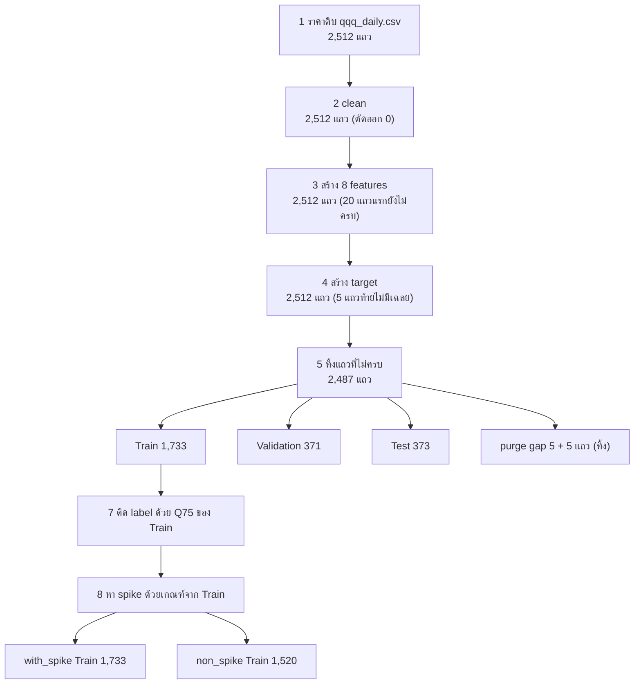

# คู่มือโปรเจกต์ฉบับอ่านรู้เรื่อง — QQQ Volatility Forecasting

> **สถานะเอกสาร:** ฉบับร่าง เขียนเมื่อ 2026-10-11 บน branch `feat/report-and-finalize`
> **เขียนให้ใครอ่าน:** คนที่ยังไม่เคยเรียน machine learning, สถิติ หรือการเงินมาก่อน อ่านจากบนลงล่างจบแล้วควรอธิบายโปรเจกต์นี้ให้อาจารย์ฟังได้
> **ที่มาของตัวเลข:** ทุกตัวเลขในเอกสารนี้อ่านมาจากไฟล์จริงใน repo หรือคำนวณซ้ำจากไฟล์นั้น (บอกแหล่งไว้ในแต่ละหัวข้อ) อะไรที่ยังไม่ได้วัดจะเขียนว่า **"ยังไม่ได้ทำ"**
> **เรื่องสำคัญที่สุดที่ต้องจำ:** ตอนนี้ยัง **ไม่มีผลบน Test set เลย** ตัวเลขผลลัพธ์ทั้งหมดในเอกสารนี้เป็นผลบน Validation เท่านั้น

## สารบัญ

1. [โปรเจกต์นี้คืออะไรใน 10 บรรทัด](#1-โปรเจกต์นี้คืออะไรใน-10-บรรทัด)
2. [พื้นฐานที่ต้องรู้ก่อน](#2-พื้นฐานที่ต้องรู้ก่อน)
3. [เส้นทางของข้อมูลทีละขั้น](#3-เส้นทางของข้อมูลทีละขั้น)
4. [การทดลอง spike: with_spike กับ non_spike](#4-การทดลอง-spike-with_spike-กับ-non_spike)
5. [โมเดล 19 ตัว](#5-โมเดล-19-ตัว)
6. [วัดผลยังไง](#6-วัดผลยังไง)
7. [ผลบน Validation ตอนนี้](#7-ผลบน-validation-ตอนนี้)
8. [โครงสร้าง repo](#8-โครงสร้าง-repo)
9. [วิธีใช้ repo ตั้งแต่ clone](#9-วิธีใช้-repo-ตั้งแต่-clone)
10. [สิ่งที่ยังไม่เสร็จและแผนถัดไป](#10-สิ่งที่ยังไม่เสร็จและแผนถัดไป)
11. [อภิธานศัพท์ และคำถามที่อาจารย์น่าจะถาม](#11-อภิธานศัพท์-และคำถามที่อาจารย์น่าจะถาม)

---

## 1. โปรเจกต์นี้คืออะไรใน 10 บรรทัด

1. เราเอาราคารายวันของกองทุน **QQQ** ย้อนหลัง 10 ปี (2,512 วันทำการ ตั้งแต่ 2016-08-31 ถึง 2026-08-28) มาเป็นข้อมูล
2. คำถามที่อยากตอบคือ **"อีก 5 วันทำการข้างหน้า ราคาจะแกว่งแรงแค่ไหน"** ความแกว่งนี้เรียกว่า volatility
3. เราตอบคำถามเดียวกัน 2 แบบ: ทำนายเป็น **ตัวเลข** (regression) และทำนายเป็น **ใช่/ไม่ใช่ว่าจะแกว่งแรง** (classification)
4. ข้อมูลที่ป้อนให้โมเดลมี 8 ตัวเลขต่อวัน (เรียกว่า feature) ทุกตัวคำนวณจากอดีตเท่านั้น ไม่แอบดูอนาคต
5. ข้อมูลถูกแบ่งตามเวลาเป็น 3 ช่วง: Train 1,733 วัน (ให้โมเดลเรียน) / Validation 371 วัน (ใช้เลือกโมเดล) / Test 373 วัน (เก็บไว้สอบครั้งสุดท้าย)
6. เราเขียนโมเดลเอง **19 ตัว** ด้วย NumPy ล้วน (regression 4, classification 13, clustering 2) แล้วเทียบผลกับ library สำเร็จรูปว่าได้คำตอบเดียวกัน
7. มีการทดลองเสริม: วันที่ราคากระโดดแรงผิดปกติ (spike) ถ้าตัดออกจาก Train แล้วโมเดลจะดีขึ้นหรือแย่ลง จึงมีชุด Train 2 แบบคือ `with_spike` และ `non_spike`
8. ตอนนี้โมเดลทั้ง 19 ตัว train เสร็จแล้วทั้ง 2 แบบ (รวม 38 ชุดผลลัพธ์) และวัดผลบน Validation แล้ว
9. **ยังไม่ได้ทำ:** ตาราง leaderboard รวม, การเทียบ A↔B อย่างเป็นระบบ, feature importance, การวัดผลบน Test, notebook 03/04/05, รายงานและสไลด์
10. กำหนดส่งจริงคือ **2026-10-18** (ไม่ใช่ 12 ต.ค. ที่พิมพ์ใน PDF โจทย์)

**แผนที่การอ่าน**

| ถ้าอยากรู้ | อ่านหัวข้อ |
| --- | --- |
| ศัพท์และแนวคิดพื้นฐาน | 2 |
| ข้อมูลมาจากไหน ผ่านอะไรมาบ้าง | 3, 4 |
| โมเดลแต่ละตัวคิดยังไง | 5 |
| ตัวเลขผลลัพธ์อ่านยังไง เชื่อได้แค่ไหน | 6, 7 |
| ไฟล์ไหนทำอะไร รันยังไง | 8, 9 |
| เหลืออะไรต้องทำ | 10 |
| เตรียมตอบอาจารย์ | 11 |

---

## 2. พื้นฐานที่ต้องรู้ก่อน

### 2.1 QQQ และราคาแบบ OHLCV

**QQQ** คือกองทุนที่ซื้อขายในตลาดหุ้นได้เหมือนหุ้นตัวหนึ่ง (เรียกว่า ETF) ข้อมูลของเราโหลดมาจากหน้า historical data ของ Nasdaq (ระบุไว้ใน `data/manifests/qqq_daily_snapshot.json`)

ในแต่ละวันทำการ ตลาดบันทึกตัวเลข 5 ตัว เรียกรวมว่า **OHLCV**

| ตัวย่อ | ความหมาย | ตัวอย่างจริง วันที่ 2019-06-03 |
| --- | --- | --- |
| **O**pen | ราคาตอนตลาดเปิด | 173.52 |
| **H**igh | ราคาสูงสุดของวัน | 173.95 |
| **L**ow | ราคาต่ำสุดของวัน | 169.27 |
| **C**lose | ราคาตอนตลาดปิด | 170.12 |
| **V**olume | จำนวนหน่วยที่ซื้อขายกันในวันนั้น | 75,842,290 |

"วันทำการ" คือวันที่ตลาดเปิด ไม่นับเสาร์อาทิตย์และวันหยุดตลาด ปีหนึ่งมีประมาณ 252 วัน (เลขนี้จะโผล่มาอีกครั้งตอนคำนวณ volatility)

### 2.2 Return — ราคาเปลี่ยนไปกี่เปอร์เซ็นต์

**Return** คือผลตอบแทนรายวัน บอกว่าราคาปิดวันนี้ต่างจากเมื่อวานกี่เปอร์เซ็นต์

```text
return วันนี้ = (ราคาปิดวันนี้ ÷ ราคาปิดเมื่อวาน) − 1
```

ตัวอย่าง: วันทำการก่อนหน้า (2019-05-31) ปิดที่ 173.95 วันที่ 2019-06-03 ปิดที่ 170.12
จึงได้ `170.12 ÷ 173.95 − 1 = −0.0220` คือ **ราคาลง 2.20%**

โปรเจกต์นี้ใช้ return แบบนี้ (เรียกว่า **simple return**) ทุกจุด ไม่ได้ใช้ log return ถ้าอาจารย์ถามต้องตอบให้ตรง

### 2.3 Volatility — ราคาแกว่งแรงแค่ไหน

**Volatility** คือขนาดของความแกว่ง ไม่สนว่าขึ้นหรือลง สนแค่ว่า "เหวี่ยง" มากไหม

เปรียบเทียบ: return เหมือนถามว่า "วันนี้รถไปข้างหน้าหรือถอยหลังกี่เมตร" ส่วน volatility ถามว่า "รถคันนี้ขับกระตุกแค่ไหน" รถที่วิ่ง +1%, +1%, +1% ทุกวันมี volatility ต่ำมาก ส่วนรถที่ +5%, −4%, −9%, +8% มี volatility สูงมาก

ในทางตัวเลข volatility คือ **standard deviation** (ส่วนเบี่ยงเบนมาตรฐาน) ของ return หลายวัน standard deviation คือตัวเลขที่บอกว่าค่าต่าง ๆ กระจายห่างจากค่าเฉลี่ยของมันโดยเฉลี่ยเท่าไร

**ทำไมอยากทำนาย:** คนที่ถือสินทรัพย์อยากรู้ล่วงหน้าว่าช่วงหน้าจะปั่นป่วนไหม เพื่อเตรียมรับความเสี่ยง และ volatility มีนิสัยที่ทำให้พอทำนายได้ คือ **ช่วงที่แกว่งแรงมักตามด้วยช่วงที่แกว่งแรง ช่วงที่สงบมักตามด้วยช่วงที่สงบ**

### 2.4 Machine learning 3 แบบที่ใช้ในโปรเจกต์นี้

**Machine learning (ML)** คือการให้คอมพิวเตอร์หากฎจากตัวอย่างเอง แทนที่เราจะเขียนกฎให้

ศัพท์ 2 คำที่ต้องรู้ก่อน

- **Feature** = ข้อมูลที่ป้อนให้โมเดลดู (โจทย์) ของเรามี 8 ตัวต่อวัน เช่น return ของวันนี้
- **Target** = คำตอบที่อยากให้โมเดลทาย (เฉลย) ของเราคือ volatility ของ 5 วันข้างหน้า

| แบบ | คืออะไร | ในโปรเจกต์นี้ |
| --- | --- | --- |
| **Supervised — regression** | มีเฉลย และเฉลยเป็น **ตัวเลข** | ทาย `target_volatility_5d` เช่น 0.1397 |
| **Supervised — classification** | มีเฉลย และเฉลยเป็น **กลุ่ม** | ทาย `target_high_volatility` ว่าเป็น 1 (แกว่งแรง) หรือ 0 (ไม่แรง) |
| **Unsupervised — clustering** | **ไม่มีเฉลย** ให้โมเดลจับกลุ่มวันที่หน้าตาคล้ายกันเอง | แบ่งวันออกเป็นกลุ่มจาก 8 features |

"Supervised" แปลว่ามีครูคอยบอกเฉลย ส่วน "unsupervised" คือไม่มีครู

### 2.5 ทำไมต้องแบ่ง train / validation / test

เปรียบกับการเตรียมสอบ

- **Train** = แบบฝึกหัดที่มีเฉลย โมเดลใช้เรียน (1,733 วัน)
- **Validation** = ข้อสอบซ้อม ใช้ตัดสินว่าจะเลือกโมเดลแบบไหน ตั้งค่าแบบไหน (371 วัน)
- **Test** = ข้อสอบจริง เปิดได้ครั้งเดียวตอนจบ เพื่อรายงานว่าโมเดลเก่งจริงแค่ไหน (373 วัน)

ถ้าวัดผลบนข้อมูลชุดเดียวกับที่ใช้เรียน โมเดลที่ "ท่องเฉลย" จะดูเก่งทั้งที่ไม่เข้าใจอะไร
และถ้าเปิดข้อสอบจริงดูหลายรอบเพื่อปรับโมเดล คะแนนข้อสอบจริงก็ไม่ใช่คะแนนจริงอีกต่อไป นี่คือเหตุผลที่โปรเจกต์นี้ **ห้ามแตะ Test จนถึงขั้นสุดท้าย**

### 2.6 Leakage และทำไมข้อมูลตามเวลาห้าม shuffle

**Leakage** (ข้อมูลรั่ว) คือการที่โมเดลได้เห็นข้อมูลที่ในโลกจริงยังไม่มีทางรู้ ณ เวลาที่ต้องทำนาย เหมือนแอบเห็นเฉลยก่อนสอบ ผลที่ได้จะดูดีเกินจริง

ข้อมูลของเราเรียงตามเวลา จึงมีกับดักเฉพาะตัว

- **Shuffle** คือการสับลำดับแถวแบบสุ่มก่อนแบ่งข้อมูล ทำได้กับข้อมูลที่แต่ละแถวไม่เกี่ยวกัน (เช่น รูปแมวกับรูปหมา) แต่ **ห้ามทำกับข้อมูลตามเวลา**
- เหตุผล: target ของวันที่อยู่ติดกันใช้ข้อมูลอนาคตช่วงที่ซ้อนกันเกือบทั้งหมด (วันนี้ดู 5 วันข้างหน้า พรุ่งนี้ก็ดู 5 วันข้างหน้าซึ่งซ้ำกัน 4 วัน) ถ้าสับแล้วแบ่ง วันจันทร์ไปอยู่ Train วันอังคารไปอยู่ Test โมเดลก็แทบจะเห็นเฉลยของ Test แล้ว
- หลักฐานจาก audit: ถ้าแบ่งแบบสับ จะได้ R² สูงถึง 0.83 **โดยไม่ต้องใช้ feature เลย** ซึ่งเป็นตัวเลขหลอก โปรเจกต์นี้จึงแบ่งตามลำดับเวลาเท่านั้น (อดีต → Train, กลาง → Validation, ล่าสุด → Test)

ศัพท์ที่เกี่ยวข้อง: feature ที่ใช้เฉพาะข้อมูลของวันนี้และก่อนหน้า เรียกว่า **causal** feature ทั้ง 8 ตัวของเราเป็น causal ทั้งหมด (audit ทดสอบโดยตัดข้อมูลอนาคตทิ้งแล้วคำนวณใหม่ ได้ค่าเท่าเดิมทุกตัว)

### 2.7 Overfitting

**Overfitting** คือโมเดลจำรายละเอียดปลีกย่อยของ Train ได้แม่นเกินไป จนทำนายข้อมูลใหม่ได้แย่ เหมือนนักเรียนที่ท่องข้อสอบเก่าได้ทุกข้อแต่เจอข้อใหม่แล้วทำไม่ได้

สัญญาณของ overfitting คือ คะแนนบน Train ดีมาก แต่คะแนนบน Validation แย่ โมเดลที่ซับซ้อนมาก (เช่น ต้นไม้ที่ลึกมาก) เสี่ยงกว่าโมเดลที่เรียบง่าย

### 2.8 Hyperparameter

โมเดลมีตัวเลข 2 ชนิด

- **Parameter** = ตัวเลขที่โมเดล **เรียนรู้เอง** จาก Train เช่น น้ำหนักของแต่ละ feature
- **Hyperparameter** = ตัวเลขที่ **เราต้องตั้งให้ก่อน** train เช่น ต้นไม้ลึกได้กี่ชั้น หรือ k-NN จะดูเพื่อนบ้านกี่คน

เราไม่รู้ล่วงหน้าว่าค่าไหนดี จึงลองหลายค่า วิธีลองแบบไล่ทุกค่าที่กำหนดไว้เรียกว่า **grid search** แต่ละชุดค่าที่ลองเรียกว่า **candidate**

ตัวอย่างจริง: `knn` ลอง 8 candidates แล้วบน `with_spike` ชุดที่ชนะคือ k = 15 (ดูเพื่อนบ้าน 15 วัน) การตัดสินว่าใครชนะใช้คะแนนบน **Validation** เท่านั้น

---

## 3. เส้นทางของข้อมูลทีละขั้น

ภาพรวม (จำนวนแถวทุกขั้นมาจาก [`docs/audit/DATA_FLOW.md`](../audit/DATA_FLOW.md) และตรวจซ้ำกับไฟล์จริงแล้ว)



### ขั้นที่ 1 — Download: ได้ราคาดิบมา

- ไฟล์: `data/raw/qqq_daily.csv` มี 2,512 แถว (1 แถว = 1 วันทำการ) ช่วง 2016-08-31 ถึง 2026-08-28 คอลัมน์คือ `Date, Close, Volume, Open, High, Low`
- ไฟล์นี้เรียกว่า **snapshot** คือ "ภาพถ่าย" ของข้อมูล ณ วันที่โหลด เราไม่โหลดใหม่ เพราะแหล่งข้อมูลเป็นแบบเลื่อนช่วง 10 ปีไปเรื่อย ๆ ถ้าโหลดใหม่จะได้ช่วงวันที่ไม่เหมือนเดิม และตัวเลขทั้งโปรเจกต์จะเปลี่ยน
- เพื่อพิสูจน์ว่าไฟล์ไม่ถูกแก้ เราเก็บ **SHA-256** ของไฟล์ไว้ SHA-256 คือ "ลายนิ้วมือ" ของไฟล์ ถ้าไฟล์เปลี่ยนแม้ 1 ตัวอักษร ลายนิ้วมือจะเปลี่ยนทันที ค่าที่เก็บไว้ขึ้นต้น `649e1db1` ลงท้าย `b6b13`
- ไฟล์นี้ **ถูก track ใน git แล้ว** (commit `7690862`) clone มาก็ได้เลย
- audit เทียบกับปฏิทินตลาดแล้ว: วันธรรมดา 2,608 วัน − วันหยุดตลาด 96 วัน = 2,512 พอดี ไม่มีวันขาดหรือเกิน

### ขั้นที่ 2 — Clean: ตรวจและจัดระเบียบ

ไฟล์ [`src/clean_data.py`](../../src/clean_data.py) ทำ 2 อย่าง

1. **ตรวจหาแถวเสีย** เช่น วันที่ซ้ำ, ราคาติดลบหรือเป็นศูนย์, High ต่ำกว่า Low, ค่าว่าง ถ้าเจอจะตัดทิ้ง
2. **เรียงใหม่** ไฟล์ดิบเรียงจากวันล่าสุดไปวันเก่าสุด เราต้องการเก่าสุดก่อน เพื่อให้คำนวณ "เมื่อวาน" ได้ถูก และเปลี่ยนรูปแบบวันที่จาก `08/31/2016` เป็น `2016-08-31`

ผลจริง: **เข้า 2,512 แถว ออก 2,512 แถว ไม่มีแถวไหนถูกตัด** ค่าตัวเลขทุกคอลัมน์เท่าเดิมทุกค่า ข้อมูลดิบสะอาดอยู่แล้ว ขั้นนี้จึงเป็นการ "ตรวจให้แน่ใจ" มากกว่าการ "แก้"

### ขั้นที่ 3 — Features: สร้าง 8 ตัวเลขที่ป้อนให้โมเดล

ไฟล์ [`src/build_features.py`](../../src/build_features.py) สร้าง 8 features ต่อวัน ทุกตัวใช้ข้อมูลของวันนั้นและก่อนหน้าเท่านั้น

| # | ชื่อ | ความหมายเป็นภาษาคน | ค่าจริงวันที่ 2019-06-03 |
| --- | --- | --- | --- |
| 1 | `return_1d` | วันนี้ราคาปิดเปลี่ยนจากเมื่อวานกี่ % | −0.0220 (ลง 2.20%) |
| 2 | `return_5d` | ราคาปิดวันนี้เปลี่ยนจาก 5 วันทำการก่อนกี่ % | −0.0451 (ลง 4.51%) |
| 3 | `historical_volatility_5d` | 5 วันที่ผ่านมาแกว่งแรงแค่ไหน | 0.1627 |
| 4 | `historical_volatility_20d` | 20 วันที่ผ่านมาแกว่งแรงแค่ไหน | 0.2000 |
| 5 | `intraday_range` | ในวันนี้ ราคาสูงสุดกับต่ำสุดห่างกันกี่ % ของราคาปิด | 0.0275 |
| 6 | `sma_ratio_5_20` | ราคาเฉลี่ย 5 วัน ÷ ราคาเฉลี่ย 20 วัน | 0.9674 |
| 7 | `rsi_14` | ตัวชี้วัด 0–100 ว่า 14 วันที่ผ่านมา วันขึ้นมีแรงมากกว่าวันลงแค่ไหน | 26.82 |
| 8 | `volume_zscore_20` | วันนี้ซื้อขายมากผิดปกติแค่ไหน เทียบกับ 20 วันที่ผ่านมา | 2.33 |

อธิบายเพิ่มทีละตัว

- **`historical_volatility_5d` / `_20d`**: เอา `return_1d` ของ 5 (หรือ 20) วันล่าสุดมาหา standard deviation แล้วคูณ √252 เพื่อแปลงเป็นหน่วย "ต่อปี" (เรียกว่า **annualize**) ค่า 0.20 อ่านว่า "แกว่งประมาณ 20% ต่อปี" ตัว 5 วันไวต่อเหตุการณ์ล่าสุดแต่แกว่งง่ายเพราะคำนวณจากแค่ 5 ค่า ตัว 20 วันนิ่งกว่า
- **`intraday_range`**: `(High − Low) ÷ Close` ตัวอย่าง `(173.95 − 169.27) ÷ 170.12 = 0.0275` คือในวันเดียวราคาเหวี่ยงกว้าง 2.75%
- **`sma_ratio_5_20`**: SMA ย่อจาก simple moving average คือค่าเฉลี่ยราคาปิดย้อนหลัง ตัวอย่าง เฉลี่ย 5 วัน = 174.872 เฉลี่ย 20 วัน = 180.7735 หารกันได้ 0.9674 ค่าน้อยกว่า 1 แปลว่าช่วงสั้นราคาต่ำกว่าช่วงยาว คือกำลังเป็นขาลง
- **`rsi_14`**: RSI ย่อจาก relative strength index ค่าใกล้ 100 แปลว่าช่วงนี้ขึ้นเกือบทุกวัน ค่าใกล้ 0 แปลว่าลงเกือบทุกวัน ตัวอย่าง 26.82 คือช่วงนั้นลงหนักกว่าขึ้นชัดเจน (โค้ดใช้สูตรแบบ Wilder ซึ่งเฉลี่ยแบบถ่วงน้ำหนักให้วันใหม่ทีละน้อย)
- **`volume_zscore_20`**: **z-score** คือการถามว่า "ค่านี้ห่างจากค่าเฉลี่ยกี่เท่าของ standard deviation" ตัวอย่าง volume วันนั้น 75,842,290 ค่าเฉลี่ย 20 วัน 43,405,139.5 standard deviation 13,907,643.8 จึงได้ `(75,842,290 − 43,405,139.5) ÷ 13,907,643.8 = 2.33` คือซื้อขายหนาแน่นกว่าปกติมาก (หน้าต่าง 20 วันนี้นับรวมวันนี้ด้วย)

**ทำไม 20 แถวแรกใช้ไม่ได้:** feature ที่ต้องดูย้อนหลัง 20 วันยังคำนวณไม่ได้จนกว่าจะมีข้อมูลครบ ช่วงนี้เรียกว่า **warm-up** ค่าที่ยังคำนวณไม่ได้จะถูกบันทึกเป็น **NaN** (ย่อจาก not a number แปลว่า "ไม่มีค่า") แถวแรกที่ครบทั้ง 8 ตัวคือ 2016-09-29

### ขั้นที่ 4 — Target: สร้างเฉลย

ไฟล์ [`src/build_targets.py`](../../src/build_targets.py) สร้างคอลัมน์ `target_volatility_5d`

> **นิยาม:** target ของวันที่ t = standard deviation ของ `return_1d` ในวันที่ t+1 ถึง t+5 (5 วันทำการ **ถัดไป** ไม่นับวันนี้) คูณด้วย √252

**ตัวอย่างคำนวณจริง: วันที่ 2019-06-03** (เป็นแถวใน Train ค่าจาก `data/interim/qqq_regression_target.csv`)

ขั้น 1 — ดู return ของ 5 วันทำการถัดไป

| วัน | ราคาปิด | `return_1d` |
| --- | ---: | ---: |
| 2019-06-03 (วันนี้) | 170.12 | — |
| 2019-06-04 | 174.91 | +2.816% |
| 2019-06-05 | 176.21 | +0.743% |
| 2019-06-06 | 177.61 | +0.795% |
| 2019-06-07 | 181.04 | +1.931% |
| 2019-06-10 | 183.15 | +1.165% |

ขั้น 2 — หาค่าเฉลี่ยของ 5 ค่านี้: `(2.816 + 0.743 + 0.795 + 1.931 + 1.165) ÷ 5 = 1.490%`

ขั้น 3 — ดูว่าแต่ละวันห่างจากค่าเฉลี่ยเท่าไร แล้วยกกำลังสอง

| วัน | ห่างจากค่าเฉลี่ย | ยกกำลังสอง |
| --- | ---: | ---: |
| 06-04 | +1.326 | 1.757 |
| 06-05 | −0.747 | 0.558 |
| 06-06 | −0.696 | 0.484 |
| 06-07 | +0.441 | 0.195 |
| 06-10 | −0.325 | 0.105 |
| รวม | | 3.099 |

ขั้น 4 — หารด้วย 4 (จำนวนค่า − 1) แล้วถอดรากที่สอง: `√(3.099 ÷ 4) = 0.880%`
นี่คือ standard deviation ของ return รายวัน การหารด้วย n−1 แทน n เป็นสูตรมาตรฐานเมื่อคำนวณจากตัวอย่าง ในโค้ดเขียนว่า `ddof=1`

ขั้น 5 — คูณ √252 (≈ 15.87) เพื่อแปลงเป็นต่อปี: `0.00880 × 15.87 = 0.1397`

**ดังนั้น `target_volatility_5d` ของวันที่ 2019-06-03 = 0.1397** (ตรงกับค่าในไฟล์ 0.1397204461)
อ่านว่า "ใน 5 วันทำการถัดจากนั้น ราคาแกว่งในอัตราเทียบเท่าประมาณ 14% ต่อปี"

เทียบให้เห็นภาพ: วันที่ 2020-03-09 (ช่วงโควิด) return 5 วันถัดไปคือ +5.45%, −4.36%, −9.17%, +8.47%, −11.98% ได้ target = **1.4222** แรงกว่าตัวอย่างข้างบนราว 10 เท่า

**ทำไม 5 แถวท้ายใช้ไม่ได้:** 5 วันสุดท้ายของข้อมูลยังไม่มี "5 วันถัดไป" ให้คำนวณ target จึงเป็น NaN

**จุดที่กัน leakage:** feature ของวัน t ดูได้ถึงวัน t เท่านั้น ส่วน target ดูวัน t+1 ถึง t+5 สองส่วนนี้ไม่ซ้อนกันเลย

### ขั้นที่ 5 — ทิ้งแถวที่ไม่ครบ

```text
2,512 แถว − 20 แถวแรก (warm-up) − 5 แถวท้าย (ไม่มี target) = 2,487 แถว
```

### ขั้นที่ 6 — Split ตามเวลา พร้อม purge gap

ไฟล์ [`src/split_data.py`](../../src/split_data.py) แบ่งตาม **ลำดับเวลา** ไม่มีการสับ

| ส่วน | จำนวนแถว | ช่วงวันที่ |
| --- | ---: | --- |
| Train | 1,733 | 2016-09-29 → 2023-08-18 |
| purge gap 1 (ทิ้ง) | 5 | 2023-08-21 → 2023-08-25 |
| Validation | 371 | 2023-08-28 → 2025-02-19 |
| purge gap 2 (ทิ้ง) | 5 | 2025-02-20 → 2025-02-26 |
| Test | 373 | 2025-02-27 → 2026-08-21 |

วิธีคิดจำนวน: `2,487 − 10 (สอง gap) = 2,477` แล้วแบ่ง 70% / 15% / ที่เหลือ → `1,733 / 371 / 373`

**Purge gap คืออะไร ทำไมต้องมี:** คือแถวที่จงใจทิ้งไว้ระหว่างสองช่วง เพื่อกันเฉลยรั่วข้ามขอบ
แถวสุดท้ายของ Train คือ 2023-08-18 เฉลยของมันใช้ return ไปจนถึง 2023-08-25 ถ้า Validation เริ่มทันทีที่ 2023-08-21 ข้อมูลช่วง 08-21 ถึง 08-25 จะอยู่ทั้งในเฉลยของ Train และใน Validation การเว้น 5 แถว (เท่ากับจำนวนวันที่ target มองไปข้างหน้าพอดี) ทำให้ Validation เริ่มที่ 2023-08-28 ซึ่งพ้นช่วงนั้นแล้ว

### ขั้นที่ 7 — Label: แปลง target เป็น ใช่/ไม่ใช่

งาน classification ต้องการเฉลยแบบ 0/1 เราจึงต้องมี **threshold** (เส้นแบ่ง)

- หา **Q75** ของ target บน Train: Q75 (ควอร์ไทล์ที่ 3) คือค่าที่ 75% ของข้อมูลมีค่าน้อยกว่า ได้ **0.2530580184684854**
- กฎ: `target_high_volatility = 1` ถ้า `target_volatility_5d > 0.2530580184684854` ไม่อย่างนั้นเป็น 0
- ตัวอย่าง: วันที่ 2019-06-03 มี target 0.1397 ซึ่งไม่เกิน 0.2531 จึงได้ label **0** ส่วนวันที่ 2020-03-09 มี target 1.4222 จึงได้ label **1**

**จุดสำคัญ:** เส้นแบ่งนี้คำนวณจาก **Train เท่านั้น** แล้วเอาไปใช้กับ Validation และ Test ถ้าคำนวณจากข้อมูลทั้งหมดจะเป็น leakage (audit คำนวณให้ดูว่าถ้ารวมทุกช่วงจะได้ 0.2376 ซึ่งเป็นคนละค่า)

ผลการติด label

| ช่วง | label 0 | label 1 (positive) | สัดส่วน positive |
| --- | ---: | ---: | ---: |
| Train | 1,300 | 433 | 25.0% |
| Validation | 337 | 34 | 9.2% |
| Test | 300 | 73 | 19.6% |

**Positive** ในที่นี้หมายถึงแถวที่ label เป็น 1 (วันที่ตามด้วยช่วงแกว่งแรง) สังเกตว่า Validation มี positive แค่ 9.2% เพราะช่วงปี 2023–2025 ตลาดสงบกว่าช่วง Train มาก เรื่องนี้กระทบการอ่านผลในหัวข้อ 7 โดยตรง สัดส่วนที่ไม่เท่ากันระหว่างสองกลุ่มแบบนี้เรียกว่า **class imbalance**

### ขั้นที่ 8 — Spike: หาวันที่ราคากระโดดผิดปกติ

รายละเอียดอยู่ในหัวข้อ 4 สรุปผลคือได้ Train สองชุด: `with_spike` 1,733 แถว (เท่ากับ Train เดิมทุก byte) และ `non_spike` 1,520 แถว ทั้งสองชุดใช้ Validation และ Test **ไฟล์เดียวกัน**

---

## 4. การทดลอง spike: with_spike กับ non_spike

### 4.1 ทำไมถึงทำ

ใน 10 ปีมีบางวันที่ราคากระโดดแรงผิดปกติ เช่น ช่วงโควิดเดือนมีนาคม 2020 คำถามคือ **วันแบบนี้ช่วยให้โมเดลเรียนรู้ดีขึ้น หรือเป็นตัวกวนที่ทำให้โมเดลเพี้ยน?** วิธีตอบคือ train โมเดลเดียวกัน 2 รอบ รอบหนึ่งมีวันพวกนี้ อีกรอบตัดออก แล้ววัดผลบน Validation ชุดเดียวกัน

### 4.2 นิยาม spike

ไฟล์ [`src/detect_spikes.py`](../../src/detect_spikes.py)

1. เอา `return_1d` ของ Train มาทำเป็นค่าสัมบูรณ์ (ไม่สนเครื่องหมาย ลง 5% กับขึ้น 5% นับว่าแรงเท่ากัน) เขียนว่า `abs(return_1d)`
2. หา Q1 (ค่าที่ 25% ของข้อมูลน้อยกว่า) = 0.0029797 และ Q3 (ค่าที่ 75% ของข้อมูลน้อยกว่า) = 0.0138707
3. **IQR** (interquartile range) = Q3 − Q1 = 0.0108910 คือความกว้างของ "ช่วงกลาง ๆ" ของข้อมูล
4. เส้นแบ่ง = Q3 + 3 × IQR = `0.0138707 + 3 × 0.0108910` = **0.0465436445413787**
5. วันไหนที่ `abs(return_1d)` **มากกว่า** เส้นนี้ (คือราคาขยับเกินประมาณ 4.65% ในวันเดียว) นับเป็น **spike**

เส้นแบ่งนี้คำนวณจาก Train เท่านั้นเช่นกัน ผลคือ

| ช่วง | จำนวนวัน spike |
| --- | ---: |
| Train | 19 |
| Validation | 0 |
| Test | 4 |

ใน 19 วันของ Train มี 14 วันอยู่ในปี 2020 อีก 1 วันในปี 2018 และ 4 วันในปี 2022 วันที่แรงที่สุดคือ 2020-03-16 ซึ่งราคาลง 11.98% ในวันเดียว

### 4.3 ทำไมตัดออกแค่วัน spike วันเดียวไม่พอ

วัน spike หนึ่งวัน "เปื้อน" แถวรอบ ๆ ด้วย เพราะ feature และ target คำนวณจากหลายวัน สมมติ spike เกิดวันที่ s

- แถว **s−5 ถึง s−1**: target ของแถวพวกนี้มองไปข้างหน้า 5 วัน จึงรวมวัน s เข้าไปด้วย
- แถว **s ถึง s+19**: feature ที่ดูย้อนหลัง 20 วัน ยังมีวัน s อยู่ในหน้าต่าง

จึงกำหนดว่า spike 1 วันทำให้แถวช่วง **[s−5, s+19]** (รวม 25 แถว) ได้รับผลกระทบ ไฟล์ [`src/spike_contract.py`](../../src/spike_contract.py) เป็นคนคำนวณ

19 spike × 25 แถวน่าจะได้ 475 แต่หลายช่วงซ้อนกัน (spike ช่วงโควิดเกิดติด ๆ กัน) พอรวมแบบไม่นับซ้ำได้ **213 แถว**

```text
with_spike Train = 1,733 แถว (ไม่ตัดอะไร)
non_spike  Train = 1,733 − 213 = 1,520 แถว
```

`non_spike` เป็นแค่การ **ลบแถว** ออกจาก Train เดิม ไม่ได้คำนวณ feature หรือ label ใหม่ ค่าในแถวที่เหลือเท่าเดิมทุกค่า

### 4.4 ข้อควรระวังในการตีความ (สำคัญมาก)

อย่าสรุปว่า "ผลต่างระหว่าง A กับ B เกิดจาก spike" เพราะการตัด 213 แถวเปลี่ยนหลายอย่างพร้อมกัน (audit ข้อ F15)

| สิ่งที่เปลี่ยน | `with_spike` | `non_spike` |
| --- | ---: | ---: |
| จำนวนแถว Train | 1,733 | 1,520 |
| positive (label 1) | 433 | 280 |
| สัดส่วน positive | 25.0% | 18.4% |
| ค่า target สูงสุด | 1.50 | 0.55 |

- 213 แถวที่ถูกตัดเป็น positive ถึง 153 แถว (71.8%) คิดเป็น 35% ของ positive ทั้งหมดใน Train แปลว่าเราไม่ได้ตัดแค่ "ตัวกวน" แต่ตัด **ตัวอย่างของสิ่งที่งาน classification อยากเรียน** ไปด้วย
- Validation **ไม่มี spike เลยแม้แต่วันเดียว** จึงวัดไม่ได้ว่าโมเดลไหนรับมือวัน spike ได้ดีกว่า
- `non_spike` มีช่องโหว่ของเวลา 7 ช่วง (ช่วงละ 26–53 วันทำการ) ตรงที่แถวถูกตัดออก
- คำที่ถูกต้องในรายงานคือ: ผลต่าง A↔B เป็นผลของ **"นโยบายตัดแถวทั้งชุด"** (จำนวนแถวลดลง + class balance เปลี่ยน + ช่วงค่าของ target แคบลง) ไม่ใช่ผลของ spike อย่างเดียว

---

## 5. โมเดล 19 ตัว

### 5.1 "เขียนเองด้วย NumPy" กับ "parity กับ library" คืออะไร

- **NumPy** คือ library ของ Python สำหรับคำนวณกับตารางตัวเลข (บวก ลบ คูณเมทริกซ์) มันไม่มีโมเดล ML สำเร็จรูป
- **"เขียนเอง" (from scratch)** หมายถึงเราเขียนขั้นตอนการเรียนรู้ของโมเดลทุกบรรทัดเอง โดยใช้ NumPy เป็นแค่เครื่องคิดเลข ไม่ได้เรียก `sklearn.fit()` ให้ทำแทน นี่เป็นข้อบังคับของโจทย์
- **Library สำเร็จรูป** เช่น scikit-learn (เรียกสั้น ๆ ว่า sklearn) และ xgboost มีโมเดลพร้อมใช้ที่คนทั้งโลกตรวจมาแล้ว เราใช้มันเป็น **reference** (ตัวอ้างอิง) เพื่อตรวจการบ้านเท่านั้น
- **Parity** คือการพิสูจน์ว่าโมเดลที่เราเขียนเอง ให้คำตอบ **เหมือนกับ** library เมื่อป้อนข้อมูลและตั้งค่าเดียวกัน ถ้าเหมือนกัน แปลว่าเราเขียนถูก

เกณฑ์ parity ของโปรเจกต์ (จาก [`AGENTS.md`](../../AGENTS.md) §6 และ [`src/ml/core/compare.py`](../../src/ml/core/compare.py))

| งาน | ต้องตรงกันแค่ไหน |
| --- | --- |
| regression | ค่าทำนายต่างกันได้ไม่เกินประมาณ 1 ในแสน |
| classification | label ต้องตรงกัน 100% และคะแนนดิบต่างกันได้ไม่เกินประมาณ 1 ในแสน |
| clustering | การแบ่งกลุ่มต้องเหมือนกัน (ชื่อกลุ่มสลับกันได้) |

มีข้อยกเว้นเดียวคือ `svm` ซึ่งเทียบกันที่ "ค่าของสิ่งที่โมเดลพยายามทำให้ต่ำที่สุด" แทนการเทียบน้ำหนักตรง ๆ เพราะโจทย์คณิตศาสตร์ของมันมีจุดหักมุม ทำให้วิธีแก้สองแบบหยุดคนละจุดใกล้คำตอบได้โดยไม่มีใครผิด

ทุกโมเดลยังต้องผ่านอีกข้อ: **save → load → ทำนายซ้ำได้เท่าเดิม** (โจทย์บังคับ) ตรวจจากไฟล์จริงแล้วทั้ง 38 ชุดมี `"passed": true` ใน `load_verification.json`

### 5.2 ตารางสรุป

ที่มา: คอลัมน์ preprocess และ candidates อ่านจาก `config.json` และ `search_results.json` ของแต่ละโมเดล · คอลัมน์สุดท้ายคัดจาก [`docs/tasks/claude-model-progress.md`](../tasks/claude-model-progress.md) (ผลตรวจ 2026-10-11)

| # | ชื่อ | งาน | แนวคิดสั้น ๆ | preprocess | candidates | ห่างจาก library |
| --- | --- | --- | --- | --- | ---: | --- |
| 1 | `simple_linear` | regression | เส้นตรงจาก feature เดียว | ไม่มี | 8 | ≤ 1e-15 |
| 2 | `multiple_linear` | regression | เส้นตรงจากทั้ง 8 features | standardize | 1 | ≤ 1e-15 |
| 3 | `polynomial` | regression | เส้นโค้งจาก feature เดียว | standardize | 16 | ≤ 1e-15 |
| 4 | `elastic_net` ★ | regression | เส้นตรงที่ถูกบังคับให้เรียบง่าย | standardize | 12 | ≤ 2e-06 |
| 5 | `logistic` | classification | เส้นตรงที่ตอบเป็นความน่าจะเป็น | standardize | 6 | ≤ 1e-03 |
| 6 | `gaussian_nb` | classification | เทียบกับ "หน้าตาเฉลี่ย" ของแต่ละกลุ่ม | ไม่มี | 3 | ≤ 1e-15 |
| 7 | `knn` | classification | ถามเพื่อนบ้านที่คล้ายที่สุด | standardize | 8 | ≤ 1e-15 |
| 8 | `perceptron` | classification | แก้เส้นแบ่งทุกครั้งที่ทายผิด | standardize | 3 | 0 |
| 9 | `slp` | classification | เซลล์ประสาทเทียม 1 ตัว | standardize | 8 | 0.07–0.29 (ดูหมายเหตุ) |
| 10 | `mlp` | classification | เซลล์ประสาทเทียมหลายชั้น | standardize | 12 | ≤ 1e-15 |
| 11 | `decision_tree` | classification | ชุดคำถามใช่/ไม่ใช่ | ไม่มี | 6 | 0 |
| 12 | `random_forest` | classification | ต้นไม้หลายต้นโหวตกัน | ไม่มี (+ลอง PCA) | 7 | 0 |
| 13 | `gradient_boosting` | classification | ต้นไม้ต่อคิวแก้ข้อผิดพลาดกัน | ไม่มี | 8 | 0 |
| 14 | `xgboost` | classification | gradient boosting รุ่นมีเบรก | ไม่มี | 8 | 0 |
| 15 | `adaboost` ★ | classification | ต้นไม้จิ๋วที่เน้นข้อที่เคยผิด | ไม่มี | 6 | ≤ 1e-15 |
| 16 | `stacking` | classification | โมเดลที่ฟังคำตอบจากโมเดลอื่น | แยกตามโมเดลย่อย | 1 | ไม่มี library ให้เทียบ |
| 17 | `svm` | classification | เส้นแบ่งที่เว้นระยะกว้างที่สุด | standardize + PCA | 12 | ≤ 3e-06 (ที่ objective) |
| 18 | `kmeans` | clustering | จัดกลุ่มรอบจุดศูนย์กลาง | standardize | 5 | การแบ่งกลุ่มตรง 100% |
| 19 | `agglomerative` | clustering | ค่อย ๆ รวมกลุ่มจากล่างขึ้นบน | standardize | 10 | การแบ่งกลุ่มตรง 100% |

★ = โมเดล **extracurricular** (นอกบทเรียน) ที่โจทย์บังคับให้ทำทั้งแบบเขียนเองและแบบสำเร็จรูป พร้อมอธิบายกลไกละเอียด

รวมทั้ง 19 โมเดลลองไป 140 candidates ต่อ 1 variant (นับจาก `search_results.json`)

**ศัพท์ในตาราง**

- **Standardize** = ปรับ feature ทุกตัวให้อยู่ในสเกลเดียวกัน โดยลบค่าเฉลี่ยแล้วหารด้วย standard deviation ที่จำเป็นเพราะ `rsi_14` มีค่าหลักสิบ (เช่น 26.82) ส่วน `return_1d` มีค่าหลักเศษส่วนร้อย (เช่น −0.022) ถ้าไม่ปรับ โมเดลที่วัดระยะทางหรือถ่วงน้ำหนักจะถูก feature ตัวเลขใหญ่กลบหมด ค่าเฉลี่ยและ standard deviation ที่ใช้ปรับคำนวณจาก Train เท่านั้น โมเดลตระกูลต้นไม้ไม่ต้อง standardize เพราะมันแค่ถามว่า "มากกว่าเส้นนี้ไหม"
- **PCA** (principal component analysis) = วิธีย่อ 8 features ให้เหลือน้อยลง (ลอง 2, 4, 6) โดยสร้าง feature ผสมใหม่ที่เก็บข้อมูลไว้ได้มากที่สุด โจทย์ให้ลองกับ `random_forest` และ `svm`
- **หมายเหตุ `slp`**: reference ของมันคือ logistic regression ที่ train จนนิ่ง แต่ `slp` ถูกกำหนดให้หยุดที่ 1,000 รอบ ซึ่งยังไม่ถึงจุดนิ่ง ตัวเลขจึงห่างกัน เอกสาร progress บันทึกว่าไม่ใช่สูตรผิด แต่เป็นผลของโควตาการ train

### 5.3 Regression 4 ตัว — ทายเป็นตัวเลข

**1. `simple_linear` — Simple Linear Regression**
ลากเส้นตรงเส้นเดียวผ่านกลุ่มจุด โดยใช้ feature แค่ตัวเดียว เช่น "ถ้า volatility 20 วันที่ผ่านมาสูงขึ้น 1 หน่วย volatility 5 วันข้างหน้าจะสูงขึ้นกี่หน่วย" เราลองทั้ง 8 features ทีละตัว (8 candidates) แล้วเลือกตัวที่ดีที่สุดบน Validation บน `with_spike` ตัวที่ชนะคือ `historical_volatility_20d` นี่คือโมเดลที่ง่ายที่สุด ใช้เป็นเส้นฐานให้ตัวอื่นเทียบ

**2. `multiple_linear` — Multiple Linear Regression**
เหมือนตัวแรกแต่ใช้ทั้ง 8 features พร้อมกัน คำตอบคือ "ค่าคงที่ + น้ำหนัก₁×feature₁ + … + น้ำหนัก₈×feature₈" โมเดลหาน้ำหนักชุดที่ทำให้ค่าทายห่างจากเฉลยน้อยที่สุด ไม่มี hyperparameter ให้ปรับ จึงมี candidate เดียว

**3. `polynomial` — Polynomial Regression**
ยอมให้เส้นโค้งได้ โดยเพิ่มพจน์ยกกำลังของ feature เดียว (กำลัง 2 หรือ 3) เผื่อความสัมพันธ์ไม่ได้เป็นเส้นตรง เช่น volatility ที่สูงมาก ๆ อาจส่งผลแรงเกินสัดส่วน ลอง 16 candidates บน `with_spike` ตัวที่ชนะคือ `historical_volatility_20d` ยกกำลังถึง 3

**4. `elastic_net` ★ — Elastic Net**
เป็น multiple linear ที่ใส่ "ค่าปรับ" ให้น้ำหนักที่ใหญ่เกินไป เพื่อกัน overfitting การใส่ค่าปรับแบบนี้เรียกว่า **regularization** มีค่าปรับ 2 ชนิดผสมกัน: ชนิด **L1** กดน้ำหนักของ feature ที่ไม่ช่วยอะไรให้เป็นศูนย์ไปเลย (เท่ากับคัด feature ทิ้ง) ชนิด **L2** หดน้ำหนักทุกตัวให้เล็กลงพร้อมกัน
เหตุผลที่เลือกตัวนี้: features ของเราบางตัวพูดเรื่องเดียวกัน เช่น `historical_volatility_5d` กับ `_20d` มีความสัมพันธ์กันสูง (ค่าสหสัมพันธ์ 0.804 บน Train ตามที่บันทึกในโค้ด) เวลา feature ซ้ำซ้อนกันแบบนี้ linear ธรรมดาจะให้น้ำหนักที่แกว่งไม่นิ่ง Elastic Net ออกแบบมาแก้จุดนี้
วิธี train ใช้ **coordinate descent** คือปรับน้ำหนักทีละตัวโดยตรึงตัวอื่นไว้ วนไปเรื่อย ๆ จนนิ่ง ค่าที่ชนะทั้งสอง variant คือ `alpha = 0.1` (ความแรงของค่าปรับ) และ `l1_ratio = 0.25` (สัดส่วนของ L1)

### 5.4 Classification 13 ตัว — ทายเป็น 0 หรือ 1

**5. `logistic` — Logistic Regression**
คำนวณ "คะแนนรวมแบบเส้นตรง" เหมือน multiple linear แล้วบีบคะแนนนั้นให้อยู่ระหว่าง 0 ถึง 1 ด้วยฟังก์ชันรูปตัว S (เรียกว่า **sigmoid**) ผลที่ได้อ่านเป็นความน่าจะเป็น เช่น 0.7 = "มั่นใจ 70% ว่าจะแกว่งแรง" ถ้าเกิน 0.5 ก็ตอบ 1
วิธี train ใช้ **gradient descent** คือเริ่มจากน้ำหนักมั่ว ๆ แล้วขยับทีละนิดไปทางที่ทำให้ผิดน้อยลง เหมือนคนเดินลงเขาในหมอกโดยก้าวไปทางที่พื้นลาดลงเสมอ

**6. `gaussian_nb` — Gaussian Naive Bayes**
จำ "หน้าตาเฉลี่ย" ของวันในแต่ละกลุ่มไว้ (ค่าเฉลี่ยและการกระจายของแต่ละ feature ในกลุ่ม 0 และกลุ่ม 1) พอมีวันใหม่เข้ามาก็ถามว่า "วันนี้หน้าตาเหมือนกลุ่มไหนมากกว่ากัน" คำว่า naive (ซื่อ) มาจากการสมมติว่า feature แต่ละตัวไม่เกี่ยวกันเลย ซึ่งไม่จริงสำหรับข้อมูลเรา แต่ทำให้คำนวณง่ายและเร็วมาก ไม่ต้องวนรอบ train

**7. `knn` — k-Nearest Neighbors**
ไม่ได้เรียนรู้อะไรเลย แค่จำ Train ทั้งหมดไว้ พอมีวันใหม่ก็หา k วันใน Train ที่ feature คล้ายที่สุด (ระยะทางใกล้ที่สุด) แล้วดูว่าเพื่อนบ้านส่วนใหญ่เป็นกลุ่มไหน เหมือนเดาว่าบ้านหลังนี้ราคาเท่าไรจากบ้านข้าง ๆ บน `with_spike` ค่าที่ชนะคือ k = 15 และให้เพื่อนบ้านที่ใกล้กว่ามีเสียงมากกว่า

**8. `perceptron` — Perceptron**
โมเดลเส้นแบ่งรุ่นแรกสุด ไล่ดู Train ทีละแถว ถ้าทายถูกไม่ทำอะไร ถ้าทายผิดก็ขยับเส้นแบ่งเข้าหาแถวนั้น ข้อจำกัดใหญ่คือมันจะหยุดนิ่งได้ก็ต่อเมื่อมีเส้นตรงที่แบ่งสองกลุ่มได้สะอาด 100% ซึ่งข้อมูลเราไม่มีเส้นแบบนั้น มันจึงขยับไปเรื่อย ๆ จนหมดโควตา 1,000 รอบ แล้วจบที่ตำแหน่งไหนก็ตำแหน่งนั้น ผลจึงแย่ (ดูหัวข้อ 7) ซึ่งเป็นธรรมชาติของอัลกอริทึม ไม่ใช่บั๊ก เพราะ sklearn ได้ผลเท่ากันทุกหลัก

**9. `slp` — Single-Layer Perceptron**
คือ "เซลล์ประสาทเทียม" 1 ตัว คณิตศาสตร์ข้างในเหมือน logistic regression (เส้นตรง + sigmoid) ต่างกันที่วิธี train: ป้อนข้อมูลทีละก้อนเล็ก (เรียกว่า **mini-batch**) และมี **early stopping** คือกันข้อมูล 15% ท้ายของ Train ไว้ดูว่าเมื่อไรควรหยุด train ก่อนจะ overfit ต่างจาก `perceptron` ตรงที่มันมี "ค่าความผิดพลาด" ที่ค่อย ๆ ลดได้ จึงใช้ได้แม้ข้อมูลแบ่งด้วยเส้นตรงไม่ได้

**10. `mlp` — Multi-Layer Perceptron**
เอาเซลล์ประสาทเทียมหลายตัวมาต่อเป็นชั้น ชั้นกลาง (เรียกว่า **hidden layer**) ทำให้โมเดลเรียนรูปแบบที่ไม่ใช่เส้นตรงได้ นี่คือ **neural network** ขนาดเล็ก วิธี train เรียกว่า **backpropagation** คือคำนวณว่าคำตอบผิดไปเท่าไร แล้วไล่ย้อนกลับทีละชั้นว่าน้ำหนักตัวไหนต้องรับผิดชอบเท่าไร บน `with_spike` ตัวที่ชนะมี hidden layer ชั้นเดียว 16 เซลล์

**11. `decision_tree` — Decision Tree**
ชุดคำถามใช่/ไม่ใช่ต่อกันเป็นทอด ๆ เหมือนเกมยี่สิบคำถาม เช่น "volatility 20 วันมากกว่าค่านี้ไหม?" → ถ้าใช่ ถามต่อ… จนถึงปลายทางที่ให้คำตอบ โมเดลเลือกคำถามที่แยกสองกลุ่มออกจากกันได้ "สะอาด" ที่สุดในแต่ละขั้น (วัดด้วยค่าที่เรียกว่า **Gini**) บน `with_spike` ตัวที่ชนะลึกแค่ 2 ชั้น

**12. `random_forest` — Random Forest**
ปลูกต้นไม้หลายต้น (ตัวที่ชนะบน `with_spike` ใช้ 100 ต้น) แต่ละต้นเห็นข้อมูลที่สุ่มหยิบมาไม่เหมือนกัน และแต่ละคำถามเลือกได้จาก feature แค่บางตัว แล้วให้ทุกต้นโหวต แนวคิดคือ "ถามคนร้อยคนที่รู้คนละมุม ดีกว่าเชื่อคนเดียว" ช่วยลด overfitting ของต้นไม้เดี่ยว เราลองใช้ PCA ด้วยแต่ชุดที่ชนะไม่ใช้ PCA

**13. `gradient_boosting` — Gradient Boosting**
ปลูกต้นไม้ทีละต้นต่อคิวกัน ต้นที่ 2 ไม่ได้ทายคำตอบ แต่ทาย **"ส่วนที่ต้นแรกยังผิดอยู่"** ต้นที่ 3 แก้ส่วนที่สองต้นแรกรวมกันยังผิด… ไปเรื่อย ๆ แต่ละต้นจิ๋วมาก (ลึก 1–2 ชั้น) แต่รวมกันแล้วเก่ง มี **learning rate** คุมว่าจะเชื่อต้นใหม่แต่ละต้นแค่ไหน ค่าน้อย = ก้าวสั้นแต่ปลอดภัย

**14. `xgboost` — Extreme Gradient Boosting**
gradient boosting รุ่นปรับปรุง เพิ่ม 2 อย่าง: ตอนเลือกคำถามของต้นไม้ มันใช้ทั้งทิศทางและความโค้งของความผิดพลาดมาคิดว่าคำถามไหนคุ้มที่สุด และมี regularization ในตัว คือค่าปรับที่กันไม่ให้ต้นไม้ให้คำตอบสุดโต่ง (`reg_lambda`) กับเกณฑ์ขั้นต่ำว่าคำถามต้องช่วยได้มากพอถึงจะยอมแตกกิ่ง (`gamma`) ตัวนี้เทียบ parity กับ library `xgboost` โดยตรง

**15. `adaboost` ★ — AdaBoost**
ใช้ต้นไม้ที่จิ๋วที่สุด คือถามคำถามเดียว (เรียกว่า **stump** แปลว่าตอไม้) ต่อคิวกันหลายตอ (ชุดที่ชนะใช้ 100 ตอ) กลไกคือ **การถ่วงน้ำหนักตัวอย่าง**: รอบแรกทุกแถวสำคัญเท่ากัน หลังจากนั้นแถวที่ทายผิดจะถูกเพิ่มน้ำหนัก ตอถัดไปจึงต้องตั้งใจกับแถวยาก ๆ มากขึ้น ตอนตอบ ตอที่แม่นกว่าจะมีเสียงโหวตมากกว่า
เหตุผลที่เลือกตัวนี้: เพราะมันเพิ่มน้ำหนักให้แถวที่ทายผิดซ้ำ ๆ ทฤษฎีจึงบอกว่ามันอ่อนไหวกับตัวอย่างสุดโต่ง (เช่นวัน spike) มากเป็นพิเศษ จึงน่าสนใจสำหรับการเทียบ `with_spike` กับ `non_spike`

**16. `stacking` — Stacking Classifier**
โมเดลซ้อนโมเดล ชั้นล่างมี 3 ตัว (`logistic`, `decision_tree`, `knn`) แต่ละตัวให้ความน่าจะเป็นมา แล้วชั้นบน (logistic อีกตัว) เรียนรู้ว่าควรเชื่อใครแค่ไหน เหมือนหัวหน้าที่ฟังที่ปรึกษา 3 คนแล้วตัดสินใจ
จุดที่ต้องระวังคือ leakage ภายใน: ชั้นบนต้องไม่เห็นคำตอบที่โมเดลชั้นล่างให้กับแถวที่ตัวเองเคยเรียนมาแล้ว โค้ดจึงแบ่ง Train ตามเวลาเป็นบล็อก ให้โมเดลชั้นล่างเรียนจากอดีตแล้วทายบล็อกถัดไป โดยเว้น 5 วันกันรั่วเหมือน purge gap

**17. `svm` — Support Vector Machine**
หาเส้นแบ่งสองกลุ่มเหมือน logistic แต่เป้าหมายต่างกัน: มันอยากได้เส้นที่ **อยู่ห่างจากจุดของทั้งสองกลุ่มมากที่สุด** เหมือนตีเส้นกลางถนนให้ห่างจากขอบทางทั้งสองฝั่ง ระยะห่างนี้เรียกว่า **margin** hyperparameter `C` คุมว่าจะยอมให้มีจุดล้ำเส้นได้แค่ไหน ตัวที่เราเขียนเป็นแบบเส้นตรง (linear) และชุดที่ชนะใช้ PCA ย่อเหลือ 4 features ตัวนี้ไม่ได้ให้ความน่าจะเป็น แต่ให้ "คะแนนระยะห่างจากเส้น" ถ้ามากกว่า 0 ก็ตอบ 1

### 5.5 Clustering 2 ตัว — จับกลุ่มโดยไม่มีเฉลย

**18. `kmeans` — k-Means**
กำหนดจำนวนกลุ่ม k ก่อน แล้วทำซ้ำ 2 ขั้น: (1) ให้แต่ละวันไปอยู่กับ "จุดศูนย์กลางกลุ่ม" ที่ใกล้ที่สุด (2) ย้ายจุดศูนย์กลางไปอยู่ตรงค่าเฉลี่ยของสมาชิก วนจนจุดศูนย์กลางไม่ขยับ เหมือนตั้งร้านสะดวกซื้อ k ร้าน แล้วขยับร้านไปอยู่กลางลูกค้าของตัวเองเรื่อย ๆ ลอง 5 ค่า ค่าที่ชนะคือ k = 2

**19. `agglomerative` — Agglomerative Clustering**
เริ่มจากให้ทุกวันเป็นกลุ่มของตัวเอง แล้วรวม 2 กลุ่มที่ใกล้กันที่สุดเข้าด้วยกันทีละคู่ จนเหลือ k กลุ่ม เหมือนสร้างแผนผังครอบครัวจากล่างขึ้นบน วิธีวัดว่า "ใกล้" (เรียกว่า **linkage**) มีหลายแบบ เราลอง 2 แบบ (`ward`, `average`) โมเดลนี้โดยธรรมชาติจัดกลุ่มได้แต่ข้อมูลที่ใช้ train เท่านั้น สำหรับวันใหม่ โค้ดจึงจำจุดศูนย์กลางของแต่ละกลุ่มไว้ แล้วให้วันใหม่ไปอยู่กลุ่มที่จุดศูนย์กลางใกล้ที่สุด

### 5.6 ทุกโมเดลผ่านสายพานเดียวกัน

โมเดลแต่ละตัวรู้แค่วิธี `fit` (เรียน) กับ `predict` (ทาย) งานรอบตัวทั้งหมดเป็นหน้าที่ของ [`src/ml/core/trainer.py`](../../src/ml/core/trainer.py) ซึ่งทำตามลำดับนี้

1. โหลด Train (ตาม variant) และ Validation พร้อมตรวจ SHA-256 ว่าไฟล์ไม่ถูกแก้
2. standardize (ถ้าโมเดลนั้นต้องใช้) โดยคำนวณค่าจาก Train เท่านั้น
3. ลองทุก candidate: train บน Train → ทายบน Validation → เก็บคะแนน
4. เลือกผู้ชนะ: regression ดู RMSE ต่ำสุด · classification ดู average precision สูงสุด (ถ้าเท่ากันดู ROC-AUC) · clustering ดู silhouette สูงสุด
5. บันทึกโมเดลลงไฟล์ → โหลดกลับมา → ทายซ้ำ → ยืนยันว่าได้ผลเท่าเดิม
6. เขียนไฟล์ผลลัพธ์ทั้งหมดลง `outputs/modeling/<variant>/<task>/<model>/`

Test ไม่ปรากฏในสายพานนี้เลย

---

## 6. วัดผลยังไง

**Metric** คือตัวเลขที่ใช้ให้คะแนนโมเดล โค้ดอยู่ที่ [`src/ml/core/metrics.py`](../../src/ml/core/metrics.py)

### 6.1 Regression: MAE, RMSE, R²

สมมติเฉลยคือ 0.14 แต่โมเดลทาย 0.20 ความผิดพลาด (error) คือ 0.06

| metric | คิดยังไง | อ่านยังไง |
| --- | --- | --- |
| **MAE** (mean absolute error) | เฉลี่ยของขนาดความผิดพลาดทุกวัน | "โดยเฉลี่ยทายพลาดไปเท่าไร" ยิ่งน้อยยิ่งดี |
| **RMSE** (root mean squared error) | ยกกำลังสองความผิดพลาดก่อน เฉลี่ย แล้วถอดราก | เหมือน MAE แต่ **ลงโทษการพลาดครั้งใหญ่หนักกว่า** ยิ่งน้อยยิ่งดี |
| **R²** (R-squared) | เทียบกับการ "ทายค่าเฉลี่ยของเฉลยทุกวัน" | 1 = ทายถูกเป๊ะ · 0 = ไม่ดีกว่าทายค่าเฉลี่ย · **ติดลบ = แย่กว่าทายค่าเฉลี่ย** |

ตัวอย่างจริง: `elastic_net` บน `with_spike` ได้ MAE 0.0539 แปลว่าทาย volatility พลาดเฉลี่ยประมาณ 0.054 (5.4 จุดเปอร์เซ็นต์ต่อปี) และได้ R² +0.0169 แปลว่าเมื่อเทียบกับการทายค่าเฉลี่ยของ Validation ทุกวัน มันลดความผิดพลาดกำลังสองรวมได้แค่ราว 1.7%

หมายเหตุ: volatility ติดลบไม่ได้ trainer จึงปัดค่าทายที่ติดลบขึ้นเป็น 0 ก่อนคิดคะแนนสำหรับเลือกโมเดล แต่ในผลจริงไม่มีโมเดล regression ตัวไหนทายติดลบเลย (`negative_count` = 0 ทุกตัว) ตัวเลขก่อนและหลังปัดจึงเท่ากัน

### 6.2 Classification: เริ่มจาก confusion matrix

**Confusion matrix** คือตาราง 2×2 ที่นับว่าโมเดลทายถูกผิดแบบไหนบ้าง

ตัวอย่างจริง: `mlp` บน `with_spike` (Validation 371 วัน)

| | โมเดลทาย 0 | โมเดลทาย 1 |
| --- | ---: | ---: |
| **เฉลยเป็น 0** (337 วัน) | 329 ทายถูก (TN) | 8 เตือนผิด (FP) |
| **เฉลยเป็น 1** (34 วัน) | 26 พลาดไม่เตือน (FN) | 8 จับได้ (TP) |

TP = true positive, FP = false positive, FN = false negative, TN = true negative

จากตารางนี้คิด metric ได้ทั้งหมด

| metric | สูตร | ค่าจริงของตัวอย่าง | อ่านยังไง |
| --- | --- | --- | --- |
| **Accuracy** | (TP + TN) ÷ ทั้งหมด | (8 + 329) ÷ 371 = 0.9084 | ทายถูกกี่ % ของทุกวัน |
| **Precision** | TP ÷ (TP + FP) | 8 ÷ 16 = 0.5000 | เวลาโมเดลเตือน เชื่อได้กี่ % |
| **Recall** (= sensitivity) | TP ÷ (TP + FN) | 8 ÷ 34 = 0.2353 | วันที่แกว่งแรงจริง โมเดลจับได้กี่ % |
| **Specificity** (= TNR) | TN ÷ (TN + FP) | 329 ÷ 337 = 0.9763 | วันที่สงบจริง โมเดลบอกว่าสงบกี่ % |
| **F1** | 2·TP ÷ (2·TP + FP + FN) | 16 ÷ 50 = 0.3200 | ค่ารวมของ precision กับ recall จะสูงได้ต้องดีทั้งคู่ |

Precision กับ recall มักสวนทางกัน: โมเดลที่เตือนบ่อยจะจับได้เยอะ (recall สูง) แต่เตือนผิดเยอะ (precision ต่ำ)

### 6.3 ทำไม accuracy ใช้ไม่ได้ที่นี่

Validation มี label 0 อยู่ 337 วันจาก 371 วัน ลองนึกถึง "โมเดลขี้เกียจ" ที่ตอบ 0 ทุกวันโดยไม่ดูอะไรเลย มันจะได้

```text
accuracy = 337 ÷ 371 = 0.9084
```

นี่เรียกว่า **majority baseline** (คะแนนของการทายกลุ่มใหญ่ตลอด) โมเดลขี้เกียจได้ accuracy 90.84% ทั้งที่ **จับวันแกว่งแรงไม่ได้เลยสักวัน**

ดูตัวอย่าง `mlp` ข้างบนอีกที: accuracy ของมันคือ 0.9084 **เท่ากับโมเดลขี้เกียจพอดี** ทั้งที่มันจับวันแกว่งแรงได้ 8 วัน accuracy จึงแยกโมเดลที่มีประโยชน์ออกจากโมเดลที่ไม่ทำอะไรเลยไม่ได้ ในผลจริงมีโมเดลหลายตัวที่ accuracy ต่ำกว่า 0.9084 ด้วยซ้ำ
เราจึงใช้ average precision, ROC-AUC และ F1 เป็นหลัก และรายงาน accuracy ไว้เพราะโจทย์บังคับเท่านั้น

### 6.4 ROC-AUC และ average precision — วัดการ "จัดอันดับ"

metric ในข้อ 6.2 ขึ้นกับว่าเราขีดเส้นตัดสินที่ไหน (โปรเจกต์นี้ใช้ค่าคงที่: ความน่าจะเป็นเกิน 0.5 จึงตอบ 1 **ไม่มีการปรับเส้นนี้บน Validation**) แต่โมเดลส่วนใหญ่ให้ "คะแนนความมั่นใจ" ออกมาด้วย เราจึงวัดได้อีกแบบว่า โมเดลเรียงลำดับวันจากเสี่ยงมากไปเสี่ยงน้อยได้ดีแค่ไหน โดยไม่ต้องขีดเส้น

- **ROC-AUC**: สุ่มหยิบวันแกว่งแรงมา 1 วัน และวันสงบมา 1 วัน ROC-AUC คือโอกาสที่โมเดลให้คะแนนวันแกว่งแรง **สูงกว่า**
  - 1.0 = เรียงถูกทุกคู่ · 0.5 = เท่ากับเดาสุ่ม · ต่ำกว่า 0.5 = เรียงกลับด้าน
  - ตัวอย่าง: `knn` ได้ 0.6987 ส่วน `perceptron` ได้ 0.2993 ซึ่งแย่กว่าเดาสุ่ม
- **Average precision (AP)**: ไล่ดูรายชื่อวันที่โมเดลจัดอันดับว่าเสี่ยงสุดลงมาเรื่อย ๆ แล้วเฉลี่ยว่า precision ดีแค่ไหนตลอดทาง เน้นไปที่กลุ่ม positive ซึ่งเป็นกลุ่มเล็ก จึงเหมาะกับข้อมูลที่ไม่สมดุล บางที่เรียกว่า PR-AUC
  - เส้นฐานของ AP คือสัดส่วน positive: โมเดลที่เดาสุ่มจะได้ AP ประมาณ 34 ÷ 371 = 0.0916
  - ตัวอย่าง: `mlp` ได้ 0.2668 คือดีกว่าเดาสุ่มราว 2.9 เท่า แต่ยังห่างจาก 1.0 มาก

โปรเจกต์นี้ใช้ **AP เป็นเกณฑ์เลือก candidate** ของงาน classification

### 6.5 Clustering: silhouette

ไม่มีเฉลยให้เทียบ จึงวัดว่า "กลุ่มที่แบ่งมาแยกกันชัดแค่ไหน"

**Silhouette** ของ 1 วัน = เทียบระยะห่างเฉลี่ยถึงเพื่อนในกลุ่มตัวเอง กับระยะห่างเฉลี่ยถึงกลุ่มอื่นที่ใกล้ที่สุด แล้วเฉลี่ยทุกวัน

- ใกล้ +1 = อยู่ชิดเพื่อนในกลุ่ม และห่างจากกลุ่มอื่นมาก (แบ่งกลุ่มชัด)
- ใกล้ 0 = อยู่ตรงขอบระหว่างสองกลุ่ม
- ติดลบ = น่าจะอยู่ผิดกลุ่ม

ตัวอย่าง: `kmeans` บน `with_spike` ได้ 0.3666 คือแยกกลุ่มได้ระดับปานกลาง ไม่ได้ชัดเจนมาก

---

## 7. ผลบน Validation ตอนนี้

> ทุกตารางในหัวข้อนี้สร้างจากไฟล์ `outputs/modeling/<variant>/<task>/<model>/validation_metrics.json` และ `config.json` โดยตรง (อ่านเมื่อ 2026-10-11) ไม่ได้คัดจากเอกสารอื่น
> **ทั้งหมดเป็นผลบน Validation 371 วัน · ยังไม่มีผลบน Test**

### 7.1 Regression

RMSE และ MAE ยิ่งน้อยยิ่งดี · R² ยิ่งมากยิ่งดี

| โมเดล | RMSE (A) | MAE (A) | R² (A) | RMSE (B) | MAE (B) | R² (B) |
| --- | ---: | ---: | ---: | ---: | ---: | ---: |
| `simple_linear` | 0.069038 | 0.055686 | −0.0498 | 0.066479 | 0.052697 | +0.0265 |
| `multiple_linear` | 0.068864 | 0.054186 | −0.0446 | 0.066820 | 0.053022 | +0.0165 |
| `polynomial` | 0.069065 | 0.055210 | −0.0507 | 0.066056 | 0.050912 | +0.0389 |
| **`elastic_net` ★** | **0.066806** | **0.053893** | **+0.0169** | **0.064256** | 0.050991 | **+0.0906** |

A = `with_spike` (Train 1,733 แถว) · B = `non_spike` (Train 1,520 แถว)

**อ่านยังไง**

- `elastic_net` ได้ RMSE ต่ำสุดทั้งสอง variant เทียบกับ `multiple_linear` แล้ว RMSE ลดลง 2.99% (A) และ 3.84% (B)
- บน `with_spike` โมเดลเส้นตรงธรรมดา 3 ตัวได้ **R² ติดลบ** คือทายแย่กว่าการตอบค่าเฉลี่ยของ Validation ทุกวัน มีแค่ `elastic_net` ที่ R² เป็นบวก
- บน `non_spike` ทั้ง 4 ตัวได้ R² เป็นบวก และ RMSE ลดลงทุกตัว
- **แต่ต้องพูดตรง ๆ:** R² ที่ดีที่สุดคือ 0.09 แปลว่าโมเดลอธิบายความแปรผันของ volatility บน Validation ได้ไม่ถึง 10% โมเดล regression ของเรายังทายได้ **ดีกว่าการทายค่าเฉลี่ยเพียงเล็กน้อย**

### 7.2 Classification — `with_spike`

เรียงตาม AP (เกณฑ์ที่ใช้เลือก candidate) จากมากไปน้อย

| โมเดล | AP | ROC-AUC | F1 | Precision | Recall | Accuracy | TN | FP | FN | TP |
| --- | ---: | ---: | ---: | ---: | ---: | ---: | ---: | ---: | ---: | ---: |
| `mlp` | 0.2668 | 0.6757 | 0.3200 | 0.5000 | 0.2353 | 0.9084 | 329 | 8 | 26 | 8 |
| `random_forest` | 0.2548 | 0.6862 | 0.2917 | 0.5000 | 0.2059 | 0.9084 | 330 | 7 | 27 | 7 |
| `gradient_boosting` | 0.2531 | 0.6754 | 0.2449 | 0.4000 | 0.1765 | 0.9003 | 328 | 9 | 28 | 6 |
| `svm` | 0.2514 | 0.6786 | 0.2553 | 0.4615 | 0.1765 | 0.9057 | 330 | 7 | 28 | 6 |
| `xgboost` | 0.2508 | 0.6693 | 0.2449 | 0.4000 | 0.1765 | 0.9003 | 328 | 9 | 28 | 6 |
| `slp` | 0.2427 | 0.6803 | 0.2609 | 0.5000 | 0.1765 | 0.9084 | 331 | 6 | 28 | 6 |
| `adaboost` ★ | 0.2363 | 0.6768 | 0.2222 | 0.3000 | 0.1765 | 0.8868 | 323 | 14 | 28 | 6 |
| `logistic` | 0.2330 | 0.6732 | 0.2609 | 0.5000 | 0.1765 | 0.9084 | 331 | 6 | 28 | 6 |
| `stacking` | 0.2262 | 0.6641 | 0.2353 | 0.3529 | 0.1765 | 0.8949 | 326 | 11 | 28 | 6 |
| `gaussian_nb` | 0.2218 | 0.6665 | 0.2812 | 0.3000 | 0.2647 | 0.8760 | 316 | 21 | 25 | 9 |
| `knn` | 0.2037 | 0.6987 | 0.2000 | 0.3125 | 0.1471 | 0.8922 | 326 | 11 | 29 | 5 |
| `decision_tree` | 0.1732 | 0.6418 | 0.3099 | 0.2973 | 0.3235 | 0.8679 | 311 | 26 | 23 | 11 |
| `perceptron` | 0.0648 | 0.2993 | 0.0000 | 0.0000 | 0.0000 | 0.8760 | 325 | 12 | 34 | 0 |

เส้นฐานให้เทียบ: เดาสุ่มได้ AP ≈ 0.0916 และ ROC-AUC = 0.5 · ตอบ 0 ทุกวันได้ accuracy = 0.9084

### 7.3 Classification — `non_spike`

| โมเดล | AP | ROC-AUC | F1 | Precision | Recall | Accuracy | TN | FP | FN | TP |
| --- | ---: | ---: | ---: | ---: | ---: | ---: | ---: | ---: | ---: | ---: |
| `random_forest` | 0.3010 | 0.6766 | 0.2917 | 0.5000 | 0.2059 | 0.9084 | 330 | 7 | 27 | 7 |
| `mlp` | 0.2808 | 0.6992 | 0.3077 | 0.4444 | 0.2353 | 0.9030 | 327 | 10 | 26 | 8 |
| `xgboost` | 0.2652 | 0.6853 | 0.2800 | 0.4375 | 0.2059 | 0.9030 | 328 | 9 | 27 | 7 |
| `gradient_boosting` | 0.2525 | 0.6732 | 0.2667 | 0.5455 | 0.1765 | 0.9111 | 332 | 5 | 28 | 6 |
| `logistic` | 0.2513 | 0.6824 | 0.2553 | 0.4615 | 0.1765 | 0.9057 | 330 | 7 | 28 | 6 |
| `svm` | 0.2501 | 0.6804 | 0.2727 | 0.6000 | 0.1765 | 0.9137 | 333 | 4 | 28 | 6 |
| `slp` | 0.2474 | 0.6778 | 0.2258 | 0.2500 | 0.2059 | 0.8706 | 316 | 21 | 27 | 7 |
| `adaboost` ★ | 0.2407 | 0.6409 | 0.2353 | 0.3529 | 0.1765 | 0.8949 | 326 | 11 | 28 | 6 |
| `stacking` | 0.2311 | 0.6650 | 0.1961 | 0.2941 | 0.1471 | 0.8895 | 325 | 12 | 29 | 5 |
| `gaussian_nb` | 0.2292 | 0.6789 | 0.2381 | 0.2000 | 0.2941 | 0.8275 | 297 | 40 | 24 | 10 |
| `knn` | 0.2082 | 0.6455 | 0.2222 | 0.3000 | 0.1765 | 0.8868 | 323 | 14 | 28 | 6 |
| `decision_tree` | 0.1887 | 0.6924 | 0.1887 | 0.2632 | 0.1471 | 0.8841 | 323 | 14 | 29 | 5 |
| `perceptron` | 0.0742 | 0.3383 | 0.1159 | 0.1143 | 0.1176 | 0.8356 | 306 | 31 | 30 | 4 |

**อ่านยังไง (ทั้งสองตาราง)**

- ทุกโมเดลยกเว้น `perceptron` เรียงลำดับวันได้ **ดีกว่าเดาสุ่ม**: ROC-AUC อยู่ราว 0.64–0.70 และ AP อยู่ราว 0.17–0.30 (เดาสุ่มได้ 0.0916)
- แต่ **จับวันแกว่งแรงได้น้อย**: จาก 34 วัน โมเดลส่วนใหญ่จับได้แค่ 5–8 วัน (recall ราว 15–24%) ที่จับได้มากสุดคือ `decision_tree` บน `with_spike` 11 วัน ซึ่งแลกมาด้วยการเตือนผิด 26 ครั้ง
- ผู้นำเปลี่ยนตาม metric ที่ดู: บน `with_spike` ตัวที่ AP สูงสุดคือ `mlp` ตัวที่ ROC-AUC สูงสุดคือ `knn` ตัวที่ F1 สูงสุดคือ `mlp` จึง **ไม่มีผู้ชนะเด็ดขาด**
- `perceptron` แย่กว่าเดาสุ่มทั้งสอง variant ด้วยเหตุผลที่อธิบายในหัวข้อ 5.4
- สังเกต accuracy: มีหลายตัวได้ 0.9084 พอดีเท่ากับโมเดลที่ตอบ 0 ทุกวัน ยืนยันว่า accuracy ไม่ช่วยตัดสินอะไร

### 7.4 Clustering

silhouette คำนวณบน Validation โดยใช้กลุ่มที่โมเดล (ซึ่งเรียนจาก Train) จัดให้

| โมเดล | variant | ค่าที่ชนะ | Silhouette | ขนาดกลุ่มบน Validation |
| --- | --- | --- | ---: | --- |
| `kmeans` | `with_spike` | k = 2 | 0.3666 | 73 / 298 |
| `agglomerative` | `with_spike` | k = 2, linkage `ward` | 0.3602 | 293 / 78 |
| `kmeans` | `non_spike` | k = 2 | 0.3298 | 267 / 104 |
| `agglomerative` | `non_spike` | k = 2, linkage `average` | 0.4642 | 359 / 12 |

**อ่านยังไง:** ทั้งสองโมเดลเลือกแบ่งเป็น 2 กลุ่ม โดยเป็นกลุ่มใหญ่กับกลุ่มเล็ก ค่า silhouette 0.33–0.46 คือแยกได้ระดับปานกลาง ต้องระวังแถวสุดท้าย: silhouette สูงสุด (0.4642) แต่กลุ่มเล็กมีแค่ 12 วัน ค่าที่สูงอาจมาจากการแยกวันผิดปกติไม่กี่วันออกไป มากกว่าจะเป็นการแบ่งกลุ่มที่มีความหมาย **ยังไม่ได้ทำ:** การวิเคราะห์ว่าแต่ละกลุ่มตรงกับช่วงตลาดแบบไหน

### 7.5 เทียบ A กับ B — สิ่งที่เห็นจากตัวเลขตอนนี้

- **Regression:** ทั้ง 4 โมเดลดีขึ้นบน `non_spike` (RMSE ลดลง และ R² เพิ่มขึ้นทุกตัว) ทิศทางสอดคล้องกันหมด
- **Classification:** ไม่ชัด — AP เพิ่มขึ้น 11 จาก 13 โมเดล แต่ ROC-AUC เพิ่มขึ้น 8 และลดลง 5 โมเดล และส่วนใหญ่ต่างกันเพียงหลักทศนิยมที่สอง
- **ยังสรุปไม่ได้** ว่าการตัด spike ดีหรือไม่ดี ด้วยเหตุผลในหัวข้อ 4.4 และ 7.6 การเทียบอย่างเป็นระบบ **ยังไม่ได้ทำ**

### 7.6 ข้อจำกัดที่ต้องพูดตรง ๆ

**1. ตัวอย่างไม่อิสระต่อกัน — ข้อมูลจริงน้อยกว่าที่เห็น**
Train มี 1,733 แถวก็จริง แต่ target ของวันติดกันใช้อนาคตช่วงที่ซ้อนกัน 4 ใน 5 วัน ค่าจึงแทบเหมือนกัน ตัววัดความคล้ายระหว่างค่าของวันนี้กับวันถัดไป (เรียกว่า **autocorrelation**) สูงถึง 0.92 audit ประเมินว่าข้อมูลของเรามีค่าเทียบเท่าตัวอย่างอิสระเพียงประมาณ **50–200 ตัวอย่าง** (เรียกว่า **effective sample size**) ห้ามอ้างว่า "มีข้อมูล 1,733 ตัวอย่างอิสระ"

**2. Validation เป็นช่วงตลาดสงบช่วงเดียว และมี positive แค่ 34 แถว**

- Validation (ส.ค. 2023 – ก.พ. 2025) สงบกว่า Train มาก: การกระจายของ target แคบกว่าราวครึ่งหนึ่ง (standard deviation 0.068 เทียบกับ 0.144 ของ Train) และค่าสูงสุดอยู่ที่ 0.41 เทียบกับ 1.50
- ใน 34 วันที่เป็น positive มี 20 วันกระจุกอยู่ในไตรมาส 3 ปี 2024 ช่วงเดียว
- ผลคือ recall เปลี่ยนทีละ 1 ÷ 34 ≈ 2.9 จุดเปอร์เซ็นต์ต่อการจับได้เพิ่ม 1 วัน โมเดลที่ต่างกันแค่ 1–2 วันจึงดูต่างกันมากในตารางทั้งที่อาจเป็นแค่โชค
- สภาพตลาดแต่ละช่วงเรียกว่า **regime** Validation ของเราทดสอบโมเดลใน regime เดียว

**3. ตัวเลข Validation เป็น "selection score" ไม่ใช่คะแนนจริง**
เราใช้ Validation เลือก candidate ที่ดีที่สุด แล้วรายงานคะแนนของตัวที่ชนะบน Validation ชุดเดิม ตัวเลขจึงเอียงไปทางดีเกินจริง (เหมือนเลือกข้อสอบซ้อมชุดที่ตัวเองทำได้ดีที่สุดมาอวด) ปัญหานี้เรียกว่า **selection bias**

**4. อันดับในกลุ่มหัวตารางยังเชื่อไม่ได้**
audit ประเมินความไม่แน่นอนของ AP ด้วยวิธีสุ่มซ้ำแบบเป็นบล็อก (block bootstrap) ได้ค่าความแกว่งประมาณ 0.10–0.12 ขณะที่ 5 อันดับแรกบน `with_spike` ห่างกันแค่ 0.2508–0.2668 ความต่างระหว่างโมเดลจึง **เล็กกว่าความไม่แน่นอนของการวัดหลายเท่า** ห้ามเขียนว่า "MLP ดีกว่า Random Forest"

**5. ยังไม่มีผลบน Test**
Test เป็นตัวเลขเดียวที่ไม่ลำเอียง และ **ยังไม่ได้ทำ** ทีมตัดสินใจแล้ว (2026-10-11) ว่าจะ **ไม่ train ใหม่บน Train + Validation** ก่อนสอบ Test: โมเดลถูก train บน Train, ถูกเลือกบน Validation, แล้ววัดบน Test ครั้งเดียว

**6. โมเดล 3 ตัวหยุดเพราะหมดโควตา ไม่ใช่เพราะเรียนจบ**
`slp`, `perceptron` และ `logistic` หยุด train เพราะถึงจำนวนรอบสูงสุดที่ตั้งไว้ ตัวเลขของมันจึงเป็นของ "อัลกอริทึม + โควตาที่ตั้ง" (รายละเอียดใน [`claude-model-progress.md`](../tasks/claude-model-progress.md))

**7. ราคาปี 2026 ตรวจกับแหล่งภายนอกไม่ได้**
audit ตรวจได้แค่ความสอดคล้องภายในของข้อมูล (ข้อ A8)

---

## 8. โครงสร้าง repo

```text
QQQ-Volatility-Forecasting/
├── README.md, AGENTS.md, CLAUDE.md   เอกสารหลักที่ root
├── config.py                          ที่อยู่ไฟล์ทั้งหมด + ค่าคงที่ของกฎ spike
├── configs/modeling.json              รายการ hyperparameter ที่จะลองของทั้ง 19 โมเดล
├── requirements*.txt, pytest.ini      รายการ library และการตั้งค่า test
├── data/                              ข้อมูล (ห้ามแก้)
├── src/                               โค้ด
├── tests/                             ชุดทดสอบอัตโนมัติ
├── notebooks/                         สมุดงานสำหรับส่ง
├── outputs/                           ผลลัพธ์ทั้งหมด
├── docs/                              เอกสาร
└── tmp/phase1-reproduction/           หลักฐานว่า pipeline สร้างซ้ำได้ (ห้ามลบ)
```

### 8.1 `data/` — ข้อมูล

| ที่อยู่ | คืออะไร | อยู่ใน git ไหม |
| --- | --- | --- |
| `data/raw/qqq_daily.csv` | ราคาดิบ 2,512 แถว | อยู่ |
| `data/manifests/qqq_daily_snapshot.json` | ลายนิ้วมือ (SHA-256) และข้อมูลกำกับของไฟล์ดิบ | อยู่ |
| `data/interim/` | ผลขั้นกลาง: `qqq_clean.csv`, `qqq_features.csv`, `qqq_regression_target.csv` | ไม่อยู่ (สร้างเองได้) |
| `data/processed/` | `train/validation/test.csv` และฉบับ `_labeled` ที่มี label แล้ว | ไม่อยู่ (สร้างเองได้) |
| `data/processed/experiments/` | `with_spikes/train.csv`, `non_spike/train.csv`, และ `diagnostics/*_flagged.csv` | ไม่อยู่ (สร้างเองได้) |

ข้อสังเกตเรื่องชื่อ: โฟลเดอร์ชื่อ `with_spikes` (มี s) แต่ชื่อ variant ที่ใช้ในคำสั่งคือ `with_spike` (ไม่มี s)

### 8.2 `src/` — โค้ด แบ่งเป็น 2 ชั้น

**ชั้นข้อมูล (data pipeline) — เสร็จแล้ว ห้ามแก้**

| ไฟล์ | หน้าที่ |
| --- | --- |
| `download_qqq_data.py` | ตรวจ snapshot กับ manifest (และโหลดข้อมูลใหม่ลงไฟล์แยกได้ ซึ่งเราไม่ใช้) |
| `load_data.py` | อ่าน CSV ราคา |
| `clean_data.py` | ขั้นที่ 2: ตรวจและเรียง |
| `build_features.py` | ขั้นที่ 3: สร้าง 8 features |
| `build_targets.py` | ขั้นที่ 4 และ 7: สร้าง target และ label |
| `split_data.py` | ขั้นที่ 5 และ 6: ทิ้งแถวไม่ครบ และแบ่งตามเวลา |
| `run_data_pipeline.py` | **ตัวสั่งรันขั้นที่ 2–7 รวดเดียว** (เรียกว่า Phase 1) ได้ 14 ไฟล์ |
| `detect_spikes.py` | คำนวณเส้นแบ่ง spike |
| `spike_contract.py` | คำนวณช่วง [s−5, s+19] ที่ได้รับผลกระทบ |
| `build_experiment_datasets.py` | สร้าง Train สองชุด |
| `build_spike_input_contract.py`, `audit_spikes.py`, `build_spike_reports.py` | ตรวจสอบและทำรายงาน/รูปของ spike |
| `run_spike_analysis.py` | **ตัวสั่งรันขั้นที่ 8 ทั้งหมด** (เรียกว่า Phase 2) |

**ชั้นโมเดล `src/ml/`**

| ที่อยู่ | หน้าที่ |
| --- | --- |
| `ml/run.py` | คำสั่งหลัก: `train` (ใช้ได้), `report` และ `finalize` (ยังไม่ได้ทำ) |
| `ml/registry.py` | ทะเบียน ชื่อโมเดล → โค้ด |
| `ml/core/base.py` | แม่แบบที่โมเดลทุกตัวต้องทำตาม |
| `ml/core/data.py` | โหลด Train/Validation พร้อมตรวจ SHA-256 · ปฏิเสธการอ่าน Test เว้นแต่ขออย่างชัดแจ้ง |
| `ml/core/preprocess.py` | Standardizer และ PCA |
| `ml/core/trainer.py` | สายพาน train → เลือก → บันทึก → ตรวจ (หัวข้อ 5.6) |
| `ml/core/metrics.py` | สูตร metric ทั้งหมด |
| `ml/core/compare.py` | ตัวตรวจ parity กับ library |
| `ml/core/persist.py` | บันทึก/โหลดโมเดล และพิสูจน์ว่าโหลดแล้วทายเท่าเดิม |
| `ml/core/figures.py` | ฟังก์ชันวาดรูป (ROC, confusion matrix, กราฟการเรียนรู้) |
| `ml/regression/` | 4 ไฟล์ โมเดลละไฟล์ |
| `ml/classification/` | 13 ไฟล์ |
| `ml/clustering/` | 2 ไฟล์ |

### 8.3 `outputs/` — ผลลัพธ์

| ที่อยู่ | คืออะไร |
| --- | --- |
| `outputs/reports/` | รายงาน JSON ของชั้นข้อมูล เก็บค่า threshold และ SHA-256 ของไฟล์ข้อมูลทุกตัว |
| `outputs/figures/data_preparation/` | รูป 13 รูปของขั้นเตรียมข้อมูล (ใช้ใน notebook 01 และ 02) |
| `outputs/figures/spike_analysis/` | รูป 3 รูปของการทดลอง spike |
| `outputs/modeling/<variant>/<task>/<model>/` | ผลของโมเดล 38 ชุด (19 โมเดล × 2 variant) |

ในโฟลเดอร์ของแต่ละโมเดลมีไฟล์

| ไฟล์ | เนื้อหา |
| --- | --- |
| `config.json` | hyperparameter ที่ชนะ, variant, จำนวนแถว Train, SHA-256 ของข้อมูลที่ใช้ |
| `search_results.json` | คะแนนของทุก candidate ที่ลอง |
| `validation_metrics.json` | metric ของตัวที่ชนะ |
| `validation_predictions.csv` | ค่าทายรายวันบน Validation |
| `model.npz` + `model.json` | ตัวโมเดลที่บันทึกไว้ |
| `preprocessor.npz` + `preprocessor.json` | ค่าที่ใช้ standardize / PCA |
| `load_verification.json` | หลักฐานว่าโหลดกลับมาแล้วทายได้เท่าเดิม |
| `history.json` | ค่าความผิดพลาดระหว่าง train แต่ละรอบ (บางโมเดลไม่มีไฟล์นี้) |

### 8.4 `tests/`, `notebooks/`, `docs/`

- `tests/` — ชุดทดสอบ 1,002 ข้อ (นับด้วย `pytest --collect-only` เมื่อ 2026-10-11) แบ่งเป็นของชั้นข้อมูล 368 ข้อ และของชั้นโมเดล 634 ข้อใน `tests/ml/`
- `notebooks/` — `01_data_cleaning.ipynb` (21 cells) และ `02_eda_and_features.ipynb` (34 cells) รันแล้ว · `03_regression.ipynb` และ `04_classification.ipynb` **ยังว่างเปล่า** · notebook 05 ยังไม่มีไฟล์
- `docs/` — ดัชนีอยู่ที่ [`docs/README.md`](../README.md) เอกสารที่เชื่อถือได้ที่สุดคือชุด [`docs/audit/`](../audit/DATA_PIPELINE_AUDIT.md) ลงวันที่ 2026-10-11 เอกสารเก่าหลายฉบับล้าสมัยและมีป้าย `⚠️ แก้ไข 2026-10-11` กำกับจุดที่แก้

### 8.5 อะไรห้ามแก้

| ห้ามแตะ | เพราะอะไร |
| --- | --- |
| `data/**` และไฟล์ชั้นข้อมูลใน `src/` (ตารางแรกในข้อ 8.2) | ผ่านการตรวจแล้วและผูก SHA-256 ไว้ ถ้าไฟล์ข้อมูลเปลี่ยนแม้ 1 byte ตัวโหลดจะปฏิเสธ และผลโมเดล 38 ชุดจะใช้อ้างไม่ได้ |
| Test set | ห้ามอ่านจนถึงขั้น `finalize` |
| `tmp/phase1-reproduction/` | ห้ามลบและห้ามเปลี่ยนชื่อ รายงานที่ track ไว้อ้าง path นี้ ถ้าหาย test ของ Phase 2 จะ fail |
| `outputs/reports/*.json` | เก็บ SHA-256 ที่ทุกอย่างใช้อ้างอิง |
| `src/modeling/` | package เก่าที่เลิกใช้แล้ว ห้าม import |

ข้อจำกัดที่ควรรู้: SHA-256 ที่เก็บไว้ใช้ได้บน **Windows เท่านั้น** เพราะไฟล์ CSV ที่ pipeline เขียนมีรูปแบบการขึ้นบรรทัดใหม่ตามระบบปฏิบัติการ (audit ข้อ X2)

---

## 9. วิธีใช้ repo ตั้งแต่ clone

คำสั่งทั้งหมดรันจากโฟลเดอร์ root ของโปรเจกต์ บน Windows (PowerShell หรือ Command Prompt ก็ได้) ใช้ `.\.venv\Scripts\python.exe` เสมอ อย่าพิมพ์ `python` เฉย ๆ เพราะอาจได้ Python คนละตัว
ตัวเลือกของทุกคำสั่งตรวจกับ `--help` ของโปรแกรมจริงแล้ว รายละเอียดเพิ่มเติมอยู่ใน [`RUNBOOK.md`](RUNBOOK.md)

> **หมายเหตุ:** ผู้เขียนเอกสารนี้ **ไม่ได้รัน** คำสั่งในข้อ 9.2 (ตรวจ snapshot), 9.3, 9.4 (เต็มชุด) และ 9.5 ระหว่างเขียน "ผลที่คาดหวัง" ของข้อเหล่านั้นคัดมาจาก `RUNBOOK.md` และเอกสาร progress

### 9.1 ติดตั้ง

```bat
py -3.14 -m venv .venv
.\.venv\Scripts\python.exe --version
.\.venv\Scripts\python.exe -m pip install --upgrade pip
.\.venv\Scripts\python.exe -m pip install -r requirements.txt
.\.venv\Scripts\python.exe -m pip check
```

- บรรทัดแรกสร้าง **virtual environment** คือโฟลเดอร์ `.venv` ที่เก็บ Python และ library ของโปรเจกต์นี้แยกจากเครื่อง
- บรรทัดที่สองต้องแสดง `Python 3.14.8`
- `pip check` ควรแสดง `No broken requirements found.`

### 9.2 ตรวจว่าไฟล์ราคาดิบถูกต้อง

```bat
.\.venv\Scripts\python.exe src\download_qqq_data.py verify-snapshot
```

ผลที่คาดหวัง: `Rows: 2512`, ช่วงวันที่ 2016-08-31 ถึง 2026-08-28 และ SHA-256 `649e1db1b79c0990ea947a4ea162d6836b9bbdda2af24bc5ab6ae66cb83b6b13`

อย่าใช้คำสั่งย่อย `refresh-latest` แทนไฟล์เดิม เพราะจะได้ข้อมูลคนละช่วง

### 9.3 รัน data pipeline (ครั้งแรกหลัง clone)

ไฟล์ใน `data/interim/` และ `data/processed/` ไม่อยู่ใน git จึงต้องสร้างเองครั้งแรก รัน 3 คำสั่งนี้ตามลำดับ

```bat
.\.venv\Scripts\python.exe -m src.run_data_pipeline --overwrite-generated
.\.venv\Scripts\python.exe -m src.run_data_pipeline --output-root "tmp/phase1-reproduction" --overwrite-generated
.\.venv\Scripts\python.exe -m src.run_spike_analysis --reproduced-root "tmp/phase1-reproduction" --overwrite-generated
```

| คำสั่งที่ | ทำอะไร | ผลที่คาดหวัง |
| --- | --- | --- |
| 1 | Phase 1: clean → features → target → split → label ลง `data/` | `Train: 1733 rows`, `Validation: 371 rows`, `Test: 373 rows` |
| 2 | Phase 1 ซ้ำอีกรอบลงโฟลเดอร์แยก เพื่อพิสูจน์ว่าสร้างซ้ำได้เหมือนเดิม | ไฟล์ใต้ `tmp/phase1-reproduction/` |
| 3 | Phase 2: หา spike และสร้าง Train สองชุด | `Primary threshold: 0.0465436445413787`, `Non-Spike Train: 1520 rows` |

- `--overwrite-generated` อนุญาตให้เขียนทับเฉพาะไฟล์ที่โปรแกรมสร้างเอง ไม่แตะไฟล์ราคาดิบหรือ manifest
- ต้องใช้ชื่อ `tmp/phase1-reproduction` ตามนี้เท่านั้น
- ครั้งถัดไป (เมื่อมีทุกอย่างครบแล้ว) รันแค่คำสั่งที่ 1 และ `.\.venv\Scripts\python.exe -m src.run_spike_analysis --overwrite-generated`

**ถ้าเป็นเครื่องที่ตั้งค่าไว้แล้ว ไม่จำเป็นต้องรันข้อนี้ซ้ำ** ข้อมูลถูกตรวจรับแล้ว

### 9.4 รัน test

```bat
.\.venv\Scripts\python.exe -m pytest -q
```

**Test** (ชุดทดสอบอัตโนมัติ คนละความหมายกับ Test set) คือโค้ดที่ตรวจว่าโค้ดหลักยังทำงานถูก ผลล่าสุดที่บันทึกไว้เมื่อ 2026-10-11 คือ `1002 passed`

รันเฉพาะบางส่วนได้ เช่น ทดสอบโมเดลตัวเดียว

```bat
.\.venv\Scripts\python.exe -m pytest tests\ml\regression\test_elastic_net.py -q
```

### 9.5 Train โมเดล 1 ตัว

```bat
.\.venv\Scripts\python.exe -m src.ml.run train --model multiple_linear --variant with_spike --output-root tmp\try-modeling
```

- `--model` ใส่ชื่อโมเดลจากตารางในหัวข้อ 5.2
- `--variant` เลือก `with_spike` หรือ `non_spike` (ต้องใส่เสมอ)
- `--output-root tmp\try-modeling` ทำให้ผลไปลงโฟลเดอร์ทดลอง **ไม่เขียนทับผล 38 ชุดที่ commit ไว้** ใน `outputs/modeling/` ถ้าไม่ใส่ตัวเลือกนี้ ผลจะลงที่ `outputs/modeling/` โดยตรง

ผลที่คาดหวัง 1 บรรทัดต่อโมเดล ต้องลงท้ายด้วย `reload=ok`

```text
     multiple_linear | with_spike | candidates= 1 | selected=multiple_linear-00 | reload=ok
```

คำสั่งอื่นที่ใช้ได้

```bat
rem train ทุกโมเดลที่ลงทะเบียนไว้ (ใช้ --all แทน --model)
.\.venv\Scripts\python.exe -m src.ml.run train --all --variant non_spike --output-root tmp\try-modeling

rem ใช้รายการ hyperparameter จากไฟล์ของเราเอง แทน configs/modeling.json
.\.venv\Scripts\python.exe -m src.ml.run train --model knn --variant with_spike --grid grids.json --output-root tmp\try-modeling
```

รูปแบบของไฟล์ `grids.json` ดูใน [`RUNBOOK.md`](RUNBOOK.md) ข้อ 10

### 9.6 ดู artifact (ไฟล์ผลลัพธ์)

ผลที่ commit ไว้แล้วเปิดดูได้เลยโดยไม่ต้อง train

```powershell
Get-ChildItem outputs\modeling\with_spike\regression\elastic_net
Get-Content outputs\modeling\with_spike\regression\elastic_net\config.json
Get-Content outputs\modeling\with_spike\regression\elastic_net\validation_metrics.json
Get-Content outputs\modeling\with_spike\regression\elastic_net\load_verification.json
```

สิ่งที่ควรเช็ค: `load_verification.json` ต้องมี `"passed": true` และใน `validation_metrics.json` ของงาน regression ให้ดูที่ `clipped_metrics` → `rmse` → `value`

### 9.7 คำสั่งสรุปผล (เพิ่ม 2026-10-11)

```bat
.\.venv\Scripts\python.exe -m src.ml.run report --variant with_spike
.\.venv\Scripts\python.exe -m src.ml.run compare
.\.venv\Scripts\python.exe -m src.ml.run analyze --variant with_spike
.\.venv\Scripts\python.exe -m src.ml.run finalize --dry-run
```

- `report` สร้างตาราง leaderboard และรูปของ Validation ลง `outputs/modeling/report/<variant>/` และ `outputs/figures/modeling/<variant>/`
- `compare` เทียบ `with_spike` กับ `non_spike` ลง `outputs/modeling/report/comparison_a_vs_b.md`
- `analyze` คำนวณ feature importance และตาราง walk-forward (ใช้เวลาราว 3–4 นาทีต่อ variant)
- `finalize --dry-run` ล็อกโมเดลทั้ง 38 run ก่อนเปิด Test โดยไม่อ่าน Test

คำสั่ง `finalize --allow-test` เป็นคำสั่งเดียวที่อ่าน Test และรันได้ **ครั้งเดียว** ห้ามรันเองโดยไม่ได้รับอนุมัติจากเจ้าของโปรเจกต์ รายละเอียดอยู่ใน [`RUNBOOK.md`](RUNBOOK.md) ข้อ 10

---

## 10. สิ่งที่ยังไม่เสร็จและแผนถัดไป

กำหนดส่ง **2026-10-18** ลำดับงานอ้างจาก [`claude-model-progress.md`](../tasks/claude-model-progress.md) (Phase C) และ [`ROADMAP.md`](../plan/ROADMAP.md)

| # | งาน | สถานะ | หมายเหตุ |
| --- | --- | --- | --- |
| 1 | `src.ml.run report` — ตาราง leaderboard รวม + รูป ROC ซ้อนกัน, confusion matrix, กราฟการเรียนรู้ | ยังไม่ได้ทำ | ตอนนี้ตารางในหัวข้อ 7 เป็นการรวมด้วยมือจากไฟล์ผล |
| 2 | เทียบ A↔B (`with_spike` กับ `non_spike`) อย่างเป็นระบบ | ยังไม่ได้ทำ | ต้องเขียนว่าเป็นผลของ "นโยบายตัดแถวทั้งชุด" (หัวข้อ 4.4) |
| 3 | Feature importance — feature ตัวไหนสำคัญกับโมเดลแค่ไหน | ยังไม่ได้ทำ | |
| 4 | `src.ml.run finalize` — วัดผลบน Test **ครั้งเดียว** | ยังไม่ได้ทำ | ไม่ train ใหม่บน Train + Validation (มติทีม 2026-10-11) |
| 5 | metric แยกช่วง spike / ช่วงสงบบน Test | ยังไม่ได้ทำ | Test มี spike 4 วัน และมีแถวที่ได้รับผลกระทบ 54 แถว (audit ข้อ F13) |
| 6 | ตารางความทนทานภายใน Train แบบเดินหน้าตามเวลา + ช่วงความเชื่อมั่น | ยังไม่ได้ทำ | audit ข้อ E10 แนะนำ เพื่อชดเชยที่ Validation มี positive น้อย |
| 7 | Notebook 03 (regression), 04 (classification), 05 | ยังไม่ได้ทำ | 03 และ 04 เป็นไฟล์ว่าง · 05 ยังไม่มีไฟล์ |
| 8 | รายงานและสไลด์ | ยังไม่ได้ทำ | โครงอยู่ที่ [`REPORT_AND_SLIDES_OUTLINE.md`](../plan/REPORT_AND_SLIDES_OUTLINE.md) |
| 9 | ใส่ผลจริงลง [`MODEL_CARDS.md`](../plan/MODEL_CARDS.md) | ยังไม่ได้ทำ | |

**ลำดับที่ห้ามสลับ:** ต้องเลือกโมเดลและล็อกทุกอย่างให้เสร็จก่อน แล้ว `finalize` บน Test จึงเป็นขั้นสุดท้าย ถ้าเห็นผล Test แล้วกลับไปปรับโมเดล ผล Test จะหมดความหมายทันที

**สิ่งที่เสร็จแล้ว (ไว้ตอบอาจารย์)**

- ชั้นข้อมูลทั้งหมด ผ่าน audit เมื่อ 2026-10-11 ด้วยคำตัดสินว่า "ปลอดภัยสำหรับการ train"
- โมเดล 19 ตัวเขียนเองด้วย NumPy ครบ ตรวจกับ library แล้ว (ตารางในหัวข้อ 5.2)
- train ครบ 38 ชุด ทุกชุดผ่านการตรวจ save → load → ทายซ้ำ
- notebook 01 และ 02 พร้อมรูป 13 รูป

---

## 11. อภิธานศัพท์ และคำถามที่อาจารย์น่าจะถาม

### 11.1 อภิธานศัพท์ ไทย–อังกฤษ

| ศัพท์ | ความหมายสั้น ๆ |
| --- | --- |
| Accuracy | สัดส่วนที่ทายถูกจากทั้งหมด ใช้ไม่ได้ดีเมื่อสองกลุ่มมีจำนวนต่างกันมาก |
| Annualize | แปลงค่ารายวันให้เป็นหน่วยต่อปี ที่นี่คือคูณ √252 |
| Artifact | ไฟล์ผลลัพธ์ที่โปรแกรมสร้างขึ้น เช่น โมเดลที่บันทึกไว้ หรือไฟล์ metric |
| Autocorrelation | ความคล้ายระหว่างค่าของวันนี้กับค่าของวันก่อนหน้า |
| Average precision (AP) | คะแนนการจัดอันดับที่เน้นกลุ่ม positive เส้นฐานเท่ากับสัดส่วน positive |
| Baseline | คะแนนของวิธีง่าย ๆ ที่ใช้เป็นเส้นเทียบ เช่น ทายกลุ่มใหญ่ตลอด |
| Candidate | hyperparameter 1 ชุดที่ถูกลอง |
| Causal feature | feature ที่ใช้เฉพาะข้อมูลของวันนั้นและก่อนหน้า |
| Class imbalance | สองกลุ่มมีจำนวนตัวอย่างต่างกันมาก |
| Classification | งานทายว่าอยู่กลุ่มไหน |
| Clustering | งานจับกลุ่มโดยไม่มีเฉลย |
| Confusion matrix | ตารางนับ TP, FP, FN, TN |
| Effective sample size | จำนวนตัวอย่างอิสระที่ข้อมูลของเรามีค่าเทียบเท่า |
| Extracurricular model | โมเดลนอกบทเรียนที่โจทย์บังคับ (`elastic_net`, `adaboost`) |
| F1 | ค่ารวมของ precision และ recall |
| Feature | ข้อมูลที่ป้อนให้โมเดล |
| From scratch | เขียนขั้นตอนของโมเดลเองทั้งหมด |
| Gradient descent | วิธี train แบบขยับน้ำหนักทีละนิดไปทางที่ผิดน้อยลง |
| Grid search | การลองทุกชุด hyperparameter ที่กำหนดไว้ |
| Hyperparameter | ค่าที่เราต้องตั้งให้โมเดลก่อน train |
| IQR | Q3 − Q1 ความกว้างของช่วงกลางของข้อมูล |
| Label | เฉลยแบบกลุ่ม ที่นี่คือ 0 หรือ 1 |
| Leakage | โมเดลได้เห็นข้อมูลที่ไม่ควรรู้ ณ เวลาทำนาย |
| Majority baseline | accuracy ของการทายกลุ่มใหญ่ตลอด ที่นี่คือ 337 ÷ 371 = 0.9084 |
| Metric | ตัวเลขที่ใช้ให้คะแนนโมเดล |
| NaN | ช่องที่ไม่มีค่า |
| OHLCV | Open, High, Low, Close, Volume |
| Overfitting | โมเดลจำ Train แม่นเกินจนทายข้อมูลใหม่แย่ |
| Parameter | ค่าที่โมเดลเรียนรู้เองจากข้อมูล |
| Parity | โมเดลที่เขียนเองให้ผลเหมือน library |
| PCA | วิธีย่อจำนวน feature |
| Positive | แถวที่ label เป็น 1 |
| Precision | เมื่อโมเดลเตือน ถูกกี่ % |
| Purge gap | แถวที่ทิ้งไว้ระหว่างสองช่วงเพื่อกัน leakage |
| Q75 | ค่าที่ 75% ของข้อมูลมีค่าน้อยกว่า |
| R² | ดีกว่าการทายค่าเฉลี่ยแค่ไหน (1 ดีสุด, 0 เท่ากัน, ติดลบคือแย่กว่า) |
| Recall | ของจริงที่เป็น positive โมเดลจับได้กี่ % |
| Reference | library สำเร็จรูปที่ใช้ตรวจคำตอบ |
| Regime | สภาพตลาดในช่วงเวลาหนึ่ง เช่น ช่วงสงบ ช่วงวิกฤต |
| Regression | งานทายเป็นตัวเลข |
| Regularization | ค่าปรับที่กันไม่ให้โมเดลซับซ้อนเกิน |
| Return | % การเปลี่ยนแปลงของราคา |
| RMSE / MAE | ขนาดความผิดพลาดเฉลี่ยของงาน regression |
| ROC-AUC | โอกาสที่โมเดลให้คะแนน positive สูงกว่า negative (0.5 = เดาสุ่ม) |
| Selection bias | คะแนนดูดีเกินจริงเพราะเลือกตัวที่ดีที่สุดบนข้อมูลชุดเดียวกับที่รายงาน |
| SHA-256 | ลายนิ้วมือของไฟล์ ใช้พิสูจน์ว่าไฟล์ไม่ถูกแก้ |
| Shuffle | สับลำดับแถวแบบสุ่ม ห้ามใช้กับข้อมูลตามเวลา |
| Silhouette | คะแนนว่ากลุ่มแยกกันชัดแค่ไหน (−1 ถึง +1) |
| Snapshot | สำเนาข้อมูล ณ เวลาหนึ่งที่ตรึงไว้ไม่เปลี่ยน |
| Spike | วันที่ `abs(return_1d)` เกิน 0.0465436445413787 |
| Standard deviation | ค่าที่บอกว่าข้อมูลกระจายห่างจากค่าเฉลี่ยแค่ไหน |
| Standardize | ปรับ feature ให้อยู่สเกลเดียวกัน |
| Target | คำตอบที่อยากให้โมเดลทาย |
| Threshold | เส้นแบ่งที่ใช้ตัดสิน |
| Train / Validation / Test | ข้อมูลสำหรับเรียน / เลือกโมเดล / สอบครั้งสุดท้าย |
| Variant | ชุด Train ที่ใช้: `with_spike` หรือ `non_spike` |
| Volatility | ขนาดความแกว่งของราคา |
| Warm-up | แถวช่วงต้นที่ feature ยังคำนวณไม่ได้เพราะข้อมูลย้อนหลังไม่พอ |

### 11.2 คำถามที่อาจารย์น่าจะถาม + คำตอบสั้น

**Q1. โปรเจกต์นี้แก้ปัญหาอะไร**
ทำนายว่า 5 วันทำการข้างหน้า ราคา QQQ จะแกว่งแรงแค่ไหน ทั้งแบบตัวเลข (regression) และแบบแกว่งแรง/ไม่แรง (classification) จาก 8 features ที่คำนวณจากราคาและ volume ในอดีต

**Q2. target นิยามยังไง**
standard deviation ของ simple return รายวันในวันที่ t+1 ถึง t+5 ใช้ตัวหาร n−1 แล้วคูณ √252 ให้เป็นหน่วยต่อปี ไม่รวมวันที่ t

**Q3. มั่นใจได้ยังไงว่าไม่มี leakage**
(1) feature ทุกตัวใช้ข้อมูลถึงวันที่ t เท่านั้น audit ทดสอบด้วยการตัดอนาคตทิ้งแล้วคำนวณใหม่ ได้ค่าเท่าเดิม (2) แบ่งข้อมูลตามเวลา ไม่ shuffle (3) มี purge gap 5 แถวเท่ากับระยะที่ target มองไปข้างหน้า (4) Q75, เส้นแบ่ง spike, ค่า standardize และ PCA คำนวณจาก Train เท่านั้น (5) โค้ด train ไม่เคยอ่าน Test

**Q4. ทำไมไม่ shuffle แล้วทำ cross-validation ธรรมดา**
target ของวันติดกันซ้อนกัน 4 ใน 5 วัน ถ้าสับ โมเดลจะเห็นเฉลยที่แทบเหมือนของ Test audit แสดงว่าทำแบบนั้นได้ R² 0.83 โดยไม่ใช้ feature เลย ซึ่งเป็นค่าหลอก

**Q5. ทำไมใช้ Q75 เป็นเส้นแบ่ง แล้วทำไมคำนวณจาก Train อย่างเดียว**
Q75 นิยาม "แกว่งแรง" ว่าเป็น 25% บนสุดของช่วง Train ต้องคำนวณจาก Train อย่างเดียวเพราะ ณ เวลาทำนายเรายังไม่รู้ค่าของอนาคต ถ้าใช้ข้อมูลทั้งหมดจะเป็น leakage

**Q6. ทำไม Validation มี positive แค่ 9.2% ทั้งที่ Train มี 25%**
เพราะช่วง ส.ค. 2023 – ก.พ. 2025 ตลาดสงบกว่าช่วง Train ซึ่งมีทั้งปี 2018, โควิด 2020 และตลาดขาลง 2022 เป็นการเปลี่ยน regime ไม่ใช่บั๊ก

**Q7. ทำไมไม่ใช้ accuracy ตัดสิน**
ตอบ 0 ทุกวันก็ได้ accuracy 337 ÷ 371 = 90.84% แล้ว โดยจับวันแกว่งแรงไม่ได้เลย จึงใช้ average precision, ROC-AUC และ F1 แทน

**Q8. spike นิยามยังไง ทำไมตัด 213 แถว ไม่ใช่ 19**
spike คือวันที่ `abs(return_1d)` เกิน Q3 + 3×IQR ของ `abs(return_1d)` บน Train (= 0.0465) มี 19 วัน แต่ละวันกระทบแถวช่วง [s−5, s+19] เพราะ target มองไปข้างหน้า 5 วัน และ feature มองย้อนหลัง 20 วัน รวมแบบไม่นับซ้ำได้ 213 แถว

**Q9. ตัด spike แล้วดีขึ้นไหม**
บน Validation: regression ดีขึ้นทั้ง 4 โมเดล ส่วน classification ไม่ชัดเจน แต่ยังสรุปไม่ได้ เพราะการตัดเปลี่ยนสัดส่วน positive จาก 25.0% เป็น 18.4% และ Validation ไม่มี spike เลย ผลต่างจึงเป็นผลของนโยบายตัดแถวทั้งชุด ไม่ใช่ของ spike อย่างเดียว

**Q10. โมเดลไหนดีที่สุด**
Regression: `elastic_net` ได้ RMSE ต่ำสุดทั้งสอง variant บน Validation
Classification: ยังบอกไม่ได้ ตัวที่ AP สูงสุดคือ `mlp` (`with_spike`) และ `random_forest` (`non_spike`) แต่ความต่างระหว่างอันดับต้น ๆ เล็กกว่าความไม่แน่นอนของการวัด และทั้งหมดเป็นคะแนน Validation ยังไม่มีผล Test

**Q11. R² ติดลบได้ยังไง แปลว่าโมเดลพังไหม**
R² ติดลบแปลว่าทายแย่กว่าการตอบค่าเฉลี่ยของ Validation ทุกวัน ไม่ใช่บั๊ก โมเดลเขียนถูก (ตรงกับ sklearn) คำอธิบายที่เป็นไปได้คือ ความสัมพันธ์ที่เรียนจาก Train ซึ่งมีช่วงปั่นป่วนมาก ใช้กับ Validation ที่สงบกว่าได้ไม่ดี (เป็นข้อสันนิษฐาน ยังไม่ได้ทดสอบแยก)

**Q12. "เขียนเอง" จริงไหม พิสูจน์ยังไง**
โมเดลทุกตัวอยู่ใน `src/ml/` ใช้ NumPy เท่านั้นในส่วนเรียนและทาย library ถูกเรียกเฉพาะในฟังก์ชัน `reference()` เพื่อเทียบผล มี parity test ต่อโมเดล และผลเทียบสรุปอยู่ในตารางหัวข้อ 5.2

**Q13. ทำไมเลือก Elastic Net กับ AdaBoost เป็นโมเดลนอกบทเรียน**
Elastic Net: features ซ้ำซ้อนกัน (เช่น volatility 5 วันกับ 20 วัน) ซึ่งเป็นจุดที่ L1 + L2 ออกแบบมาแก้ AdaBoost: กลไกเพิ่มน้ำหนักให้ตัวอย่างที่ทายผิดทำให้ทฤษฎีบอกว่ามันอ่อนไหวกับวันสุดโต่ง จึงเหมาะกับการเทียบ with/non spike ทั้งคู่มีใน sklearn จึงทำทั้งแบบเขียนเองและสำเร็จรูปได้

**Q14. `perceptron` ได้ ROC-AUC 0.30 แย่กว่าเดาสุ่ม เขียนผิดหรือเปล่า**
ไม่ผิด ผลตรงกับ sklearn ทุกหลัก Perceptron จะนิ่งได้ต้องมีเส้นตรงที่แบ่งสองกลุ่มได้สมบูรณ์ ข้อมูลเราไม่มี มันจึงจบที่ตำแหน่งของการแก้ครั้งสุดท้าย

**Q15. ข้อมูล 1,733 แถวพอไหม**
ต้องตอบตรง ๆ ว่าตัวอย่างไม่อิสระต่อกัน มีค่าเทียบเท่าตัวอย่างอิสระราว 50–200 เท่านั้น และ Validation มี positive 34 แถว จึงต้องอ่านความต่างเล็ก ๆ ระหว่างโมเดลอย่างระวัง

**Q16. ผลบน Test เป็นยังไง**
ยังไม่ได้วัด Test จะถูกเปิดครั้งเดียวในขั้น `finalize` หลังล็อกโมเดลทุกตัวแล้ว โดยไม่ train ใหม่บน Train + Validation

**Q17. ทำซ้ำได้ไหม**
ได้ ไฟล์ราคาดิบอยู่ใน git พร้อม SHA-256 audit รัน pipeline 2 รอบได้ไฟล์เหมือนกันทั้ง 14 ไฟล์ และ train ใหม่ทั้ง 38 ชุดได้ผลเท่าเดิม ข้อจำกัดคือ SHA-256 ที่เก็บไว้ใช้ได้บน Windows เท่านั้น

---

*เอกสารอ้างอิงหลัก: [`docs/audit/DATA_PIPELINE_AUDIT.md`](../audit/DATA_PIPELINE_AUDIT.md) · [`docs/audit/DATA_FLOW.md`](../audit/DATA_FLOW.md) · [`AGENTS.md`](../../AGENTS.md) · [`docs/plan/ARCHITECTURE.md`](../plan/ARCHITECTURE.md) · [`docs/plan/MODEL_CARDS.md`](../plan/MODEL_CARDS.md) · [`docs/tasks/claude-model-progress.md`](../tasks/claude-model-progress.md) · [`RUNBOOK.md`](RUNBOOK.md)*
