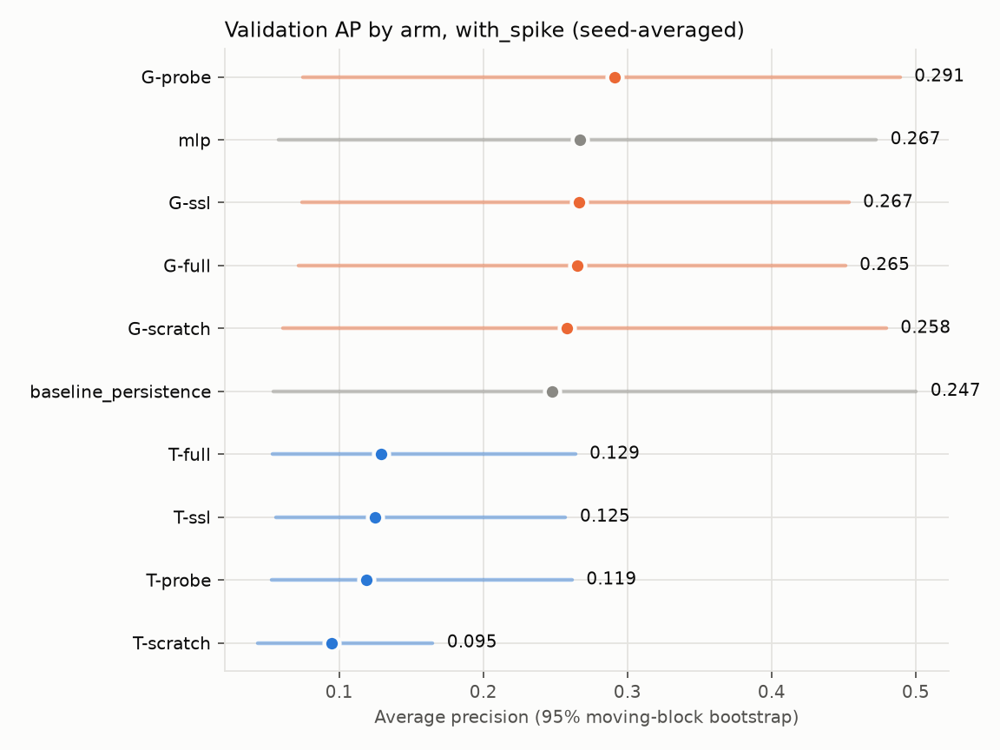
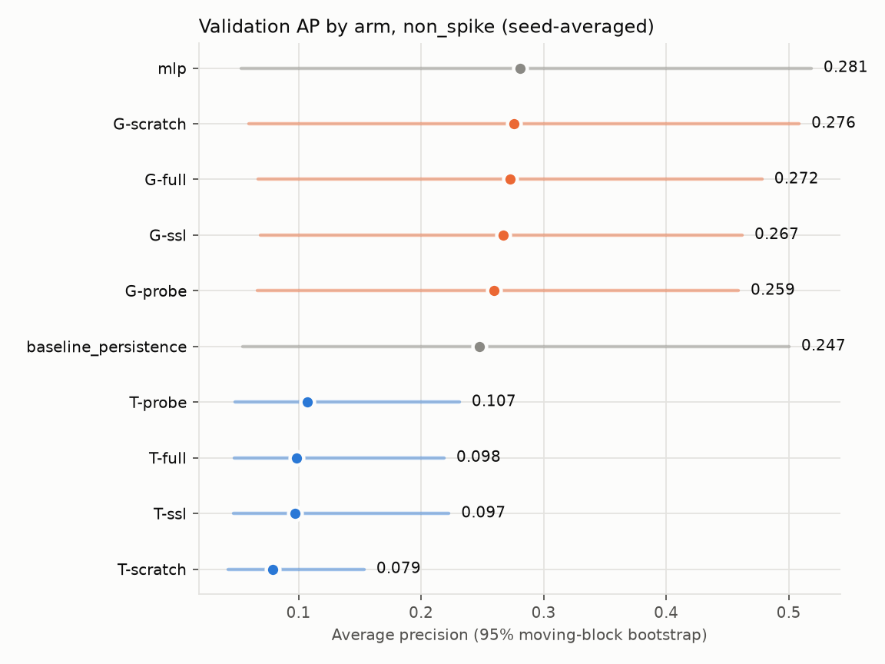
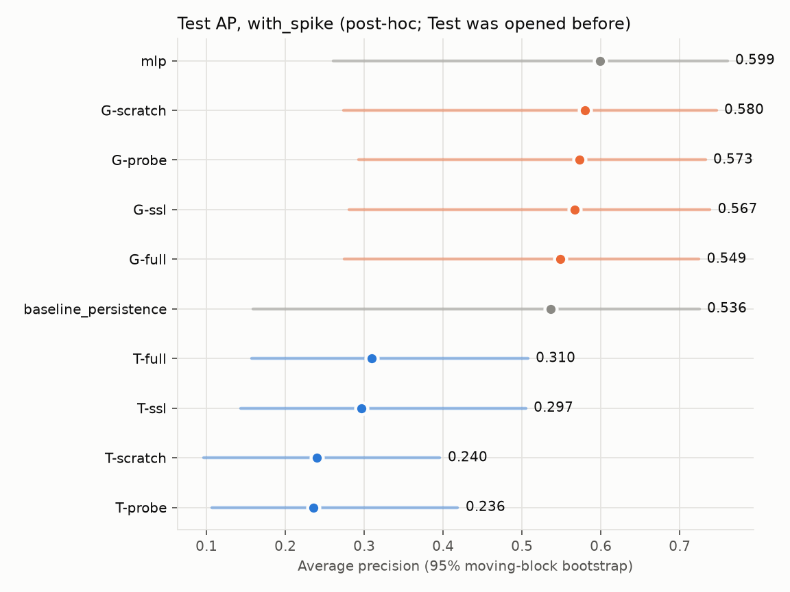
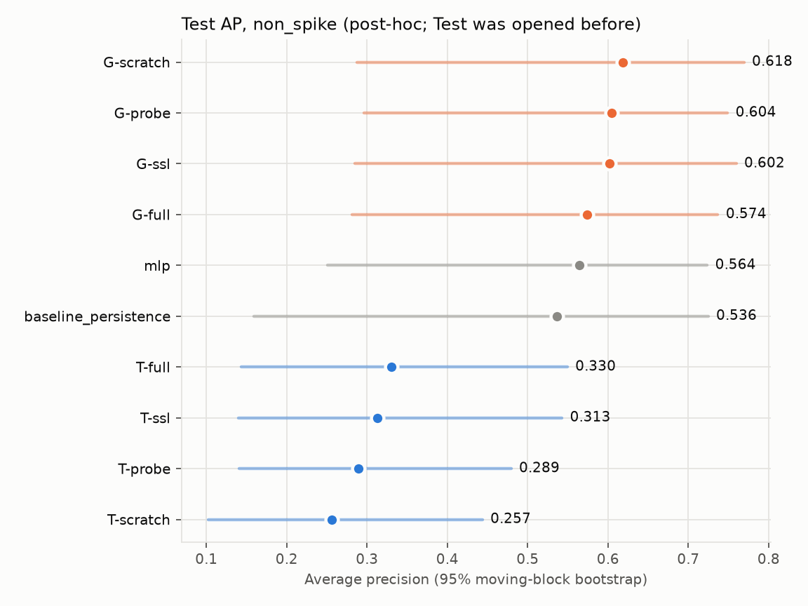
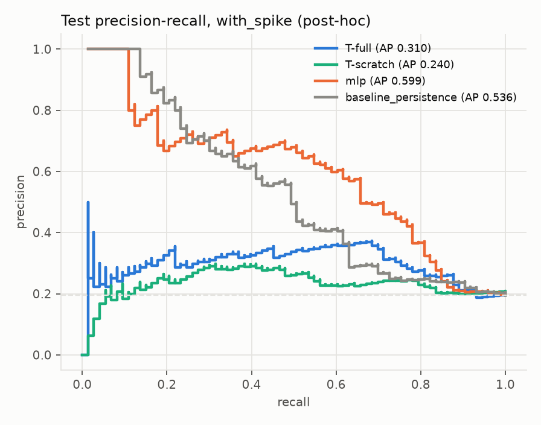
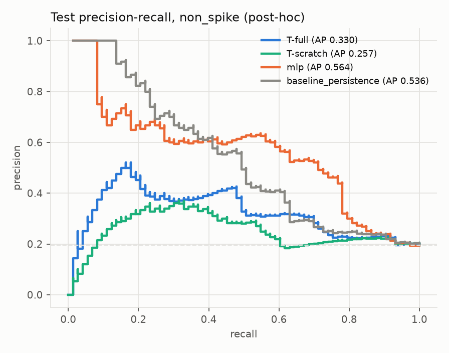
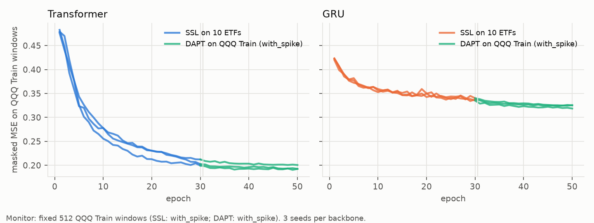
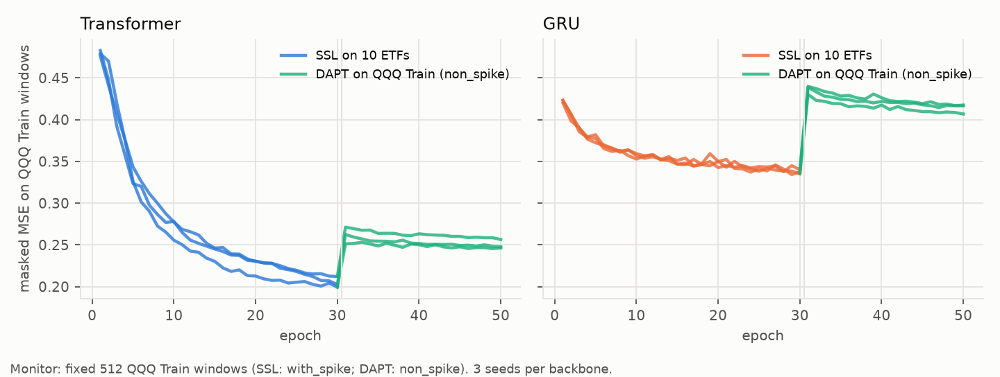

# Transfer Learning ด้วย Transformer/GRU จาก scratch — การทดลองเสริมหลังนำเสนอ

การทดลองนี้ตอบคำถามของอาจารย์หลังการนำเสนอว่า ถ้าให้โมเดลลำดับเวลา **เรียนจากหุ้น/ดัชนีตัวอื่นก่อน** ด้วย self-supervised learning และ domain-adaptive pretraining แล้วค่อย fine-tune กับ QQQ จะทำนาย `target_high_volatility` (ความผันผวน 5 วันข้างหน้าสูงกว่า Q75 ของ Train) ได้ดีกว่าโมเดลที่มองทีละวันอย่าง MLP หรือไม่

การทดลองแยกจาก 19 โมเดลเดิมโดยสมบูรณ์: ไม่แก้ข้อมูลหลัก, `outputs/modeling/`, `selection_lock.json` หรือ `finalize_receipt.json` ผลทั้งหมดอยู่ที่ `outputs/experiments/transfer_learning/`

## วิธีทดลอง

### ข้อมูลจากตลาดอื่น

- ETF 10 ตัวได้แก่ SPY, DIA, IWM (หุ้นสหรัฐฯ กว้าง), XLK, XLF, XLE, XLV, XLY (sector) และ EFA, EEM (ต่างประเทศ) ดึงจาก Nasdaq historical API **endpoint เดียวกับ QQQ** จึงได้ราคาแบบเดียวกัน คือไม่ปรับ dividend และไม่มี Adj Close ช่วงที่ API ให้คือ 2016-10-24..2026-10-23 รายละเอียดและ SHA-256 อยู่ใน [`manifest.json`](../../../outputs/experiments/transfer_learning/sources/manifest.json)
- ใช้ฟังก์ชัน cleaning, feature และ target **ของเดิม** (`clean_qqq_data`, `build_all_features`, `add_regression_target`) จึงได้ 8 ฟีเจอร์นิยามเดียวกับ QQQ
- **ตัดทุก ticker ที่ 2023-08-18 (วันสุดท้ายของ QQQ Train) ก่อนคำนวณ target** เพื่อไม่ให้ label ใดของ source ยาวเลยวันนั้น และไม่ใช้ข้อมูลตลาดอื่นในช่วง Validation/Test เพราะความผันผวนของตลาดที่เกิดพร้อมกันจะกลายเป็นข้อมูลอนาคตของ QQQ ผลคือได้ ticker ละราว 1,690 วัน รวมเป็น 16,317 window
- ไม่พบวันที่ |return_1d| > 25% (ซึ่งจะชี้ว่าเป็น split ที่ไม่ได้ปรับราคา) ใน ticker ใดก่อน cutoff
- standardize แต่ละ ticker ด้วยค่าเฉลี่ย/ส่วนเบี่ยงเบนของตัวเองก่อน cutoff ส่วน QQQ ใช้ scaler ที่ fit จาก QQQ Train แบบเดียวกับ trainer เดิม ไม่ใช้การ normalize ต่อ window (RevIN) เพราะจะลบระดับความผันผวนซึ่งเป็นสัญญาณหลัก

### โมเดล (NumPy ทั้งหมด รวม autograd)

- เขียน reverse-mode autograd เองใน `src/ml/transfer_learning/autograd.py` ส่วน softmax, layer norm, BCE-with-logits และ masked MSE ใช้ backward ที่ derive เอง ทุก op และทั้งสองโมเดลผ่าน **finite-difference gradient check** (float64, relative error < 1e-6; 22 tests)
- input ของวัน t คือ 8 ฟีเจอร์ของ 60 วันทำการ t-59..t window ของ Validation ใช้วันในช่วง purge และปลาย Train เป็น context ได้ เพราะฟีเจอร์เหล่านั้นรู้แล้ว ณ วัน t จึงประเมินได้ครบ 371 วัน ส่วน Train เหลือ 1,674 window (เสียต้นชุด 59 วันที่ไม่มีประวัติครบ ซึ่งไม่มี positive)
- **Transformer:** Linear 8→32 + learned positional embedding → pre-LN encoder 2 ชั้น (4 heads, FFN 64, GELU, dropout 0.1) → mean-pool → logit มี 19,665 พารามิเตอร์
- **GRU (ablation):** 1 ชั้น hidden 32 ใช้ hidden state วันสุดท้ายเข้า logit

### สามขั้นของการเรียน

1. **Self-supervised pretraining (SSL):** ซ่อนช่วง 5 วันจำนวน 2 ช่วงต่อ window (~17%) ด้วย mask token แล้วให้โมเดลเติมฟีเจอร์ที่หายไป (masked MSE) บน 16,317 window ของ ETF 10 ตัว 30 epochs (AdamW lr 1e-3)
2. **Domain-adaptive pretraining (DAPT):** ทำ masked reconstruction ต่อบน window ของ QQQ Train **โดยไม่ใช้ label** 20 epochs (lr 5e-4)
3. **Fine-tune:** BCE ถ่วงน้ำหนัก positive ด้วยอัตราส่วน neg/pos ของ Train หยุดก่อนกำหนดจาก AP บน 15% ท้ายของ Train (purge 5 วันก่อน tail แบบเดียวกับ MLP; patience 10, สูงสุด 100 epochs) และเก็บน้ำหนักของ epoch ที่ดีที่สุด ไม่ refit บน Train เต็มเหมือน MLP

### สองชุดข้อมูลเหมือน 19 โมเดลเดิม

ทุก arm รันทั้ง `with_spike` (Train 1,733 วัน) และ `non_spike` (Train 1,520 วันที่ตัดช่วงได้รับผลจาก spike) โดย Validation 371 วันเหมือนกัน และเทียบกับ MLP ของ variant เดียวกัน

- **SSL บน ETF** ไม่เห็นข้อมูล QQQ เลย จึงฝึกครั้งเดียวต่อ seed แล้วใช้ร่วมกันทั้งสอง variant
- **DAPT, scaler และ fine-tune** ใช้ Train ของ variant นั้นเอง
- ใน `non_spike` วันที่ถูกตัดออก **เสียแค่ label** ฟีเจอร์ของวันเหล่านั้นยังอยู่เป็น context ใน window เพราะถ้าตัดออกจาก window จะเป็นการต่อวันที่ไม่ได้อยู่ติดกัน ผลคือ `non_spike` ได้ 1,461 window สำหรับฝึก (positive 280) ส่วน `with_spike` ได้ 1,674 window (positive 433)

### Arms (ประกาศก่อนรัน Validation; ไม่ค้น hyperparameter)

| Arm | เริ่มจาก | ปรับ encoder ตอน fine-tune | คำถามที่ตอบ |
| --- | --- | --- | --- |
| `T-scratch` / `G-scratch` | สุ่ม | ✓ (lr 1e-3) | ลำดับเวลาอย่างเดียวช่วยไหม |
| `T-ssl` / `G-ssl` | SSL บน ETF | ✓ (lr 3e-4) | pretrain บนตลาดอื่นช่วยไหม |
| **`T-full`** / `G-full` | SSL + DAPT | ✓ (lr 3e-4) | **โมเดลหลัก** — DAPT ช่วยเพิ่มไหม |
| `T-probe` / `G-probe` | SSL + DAPT | ✗ (train แค่ head) | representation ใช้ได้เลยไหม |

ทุก arm ใช้ seed 0, 1, 2 โดยน้ำหนักเริ่มต้นและ head ใหม่ของแต่ละ seed เหมือนกันทุก arm ความต่างระหว่าง arm จึงมาจาก pretraining ไม่ใช่จากการสุ่ม คะแนนของ arm คือ **ค่าเฉลี่ยความน่าจะเป็นของ 3 seeds** และทำนาย positive เมื่อความน่าจะเป็น > 0.5 โมเดลที่ล็อกไว้ก่อนเปิด Test คือ `T-full` เสมอ ไม่ว่าผล Validation จะออกมาอย่างไร

**เกณฑ์ตัดสินที่ตั้งไว้ก่อนดูผล:**

- "transfer ช่วย" เมื่อ AP ของ `T-full` > `T-scratch` บน Validation ทั้งบนค่าเฉลี่ยและอย่างน้อย 2 ใน 3 seeds
- "เหนือ baseline ชัดเจน" เมื่อ AP สูงกว่าทั้ง MLP และ persistence อย่างน้อย 0.05 และ paired block-bootstrap 95% CI ไม่คร่อมศูนย์

Validation มี positive เพียง 34 วัน จึงคาดไว้ก่อนแล้วว่าช่วงความเชื่อมั่นของผลต่างมีแนวโน้มคร่อมศูนย์

## ผลลัพธ์

AP คือ average precision ใช้เป็น metric หลัก เพราะ positive มีน้อย: Validation มี 34/371 วัน (9.2%) และ Test มี 73/373 วัน (19.6%) จึงเทียบ AP ข้าม split ตรง ๆ ไม่ได้ ตัวเลขในวงเล็บคือช่วง 95% จาก moving-block bootstrap (ก้อน 20 วัน, 2,000 รอบ) คะแนนของแต่ละ arm คือค่าเฉลี่ยความน่าจะเป็นของ 3 seeds ส่วน confusion matrix เขียนเป็น `[[TN, FP], [FN, TP]]`

### `with_spike`

| Model | Validation AP | AP ราย seed (0/1/2) | Val ROC-AUC | Test AP (post-hoc) | Test ROC-AUC | Test confusion matrix |
| --- | --- | --- | ---: | --- | ---: | --- |
| `T-scratch` | 0.095 [0.043, 0.165] | 0.088 / 0.095 / 0.110 | 0.461 | 0.240 [0.096, 0.396] | 0.597 | `[[138,162],[24,49]]` |
| `T-ssl` | 0.125 [0.056, 0.257] | 0.091 / 0.097 / 0.131 | 0.563 | 0.297 [0.143, 0.505] | 0.676 | `[[214,86],[25,48]]` |
| **`T-full`** | **0.129 [0.054, 0.264]** | 0.101 / 0.117 / 0.134 | 0.580 | **0.310 [0.157, 0.507]** | 0.685 | `[[216,84],[24,49]]` |
| `T-probe` | 0.119 [0.053, 0.261] | 0.139 / 0.120 / 0.086 | 0.554 | 0.236 [0.107, 0.418] | 0.610 | `[[215,85],[46,27]]` |
| `G-scratch` | 0.258 [0.061, 0.479] | 0.282 / 0.253 / 0.260 | 0.714 | 0.580 [0.274, 0.746] | 0.783 | `[[229,71],[16,57]]` |
| `G-ssl` | 0.267 [0.074, 0.453] | 0.275 / 0.244 / 0.268 | 0.709 | 0.567 [0.281, 0.738] | 0.783 | `[[202,98],[14,59]]` |
| `G-full` | 0.265 [0.072, 0.451] | 0.271 / 0.220 / 0.269 | 0.709 | 0.549 [0.275, 0.724] | 0.781 | `[[197,103],[13,60]]` |
| `G-probe` | 0.291 [0.075, 0.489] | 0.294 / 0.245 / 0.284 | 0.707 | 0.573 [0.293, 0.732] | 0.792 | `[[199,101],[13,60]]` |
| MLP (headline เดิม) | 0.267 [0.058, 0.472] | – | 0.676 | 0.599 [0.260, 0.760] | 0.793 | `[[283,17],[37,36]]` |
| persistence | 0.247 [0.055, 0.500] | – | 0.721 | 0.536 [0.159, 0.725] | 0.726 | `[[260,40],[36,37]]` |

### `non_spike`

| Model | Validation AP | AP ราย seed (0/1/2) | Val ROC-AUC | Test AP (post-hoc) | Test ROC-AUC | Test confusion matrix |
| --- | --- | --- | ---: | --- | ---: | --- |
| `T-scratch` | 0.079 [0.042, 0.154] | 0.093 / 0.081 / 0.076 | 0.404 | 0.257 [0.102, 0.444] | 0.596 | `[[100,200],[28,45]]` |
| `T-ssl` | 0.097 [0.047, 0.223] | 0.097 / 0.093 / 0.100 | 0.473 | 0.313 [0.140, 0.543] | 0.662 | `[[147,153],[20,53]]` |
| **`T-full`** | **0.098 [0.048, 0.219]** | 0.101 / 0.081 / 0.101 | 0.479 | **0.330 [0.143, 0.549]** | 0.674 | `[[148,152],[20,53]]` |
| `T-probe` | 0.107 [0.048, 0.231] | 0.134 / 0.095 / 0.105 | 0.497 | 0.289 [0.141, 0.479] | 0.651 | `[[217,83],[35,38]]` |
| `G-scratch` | 0.276 [0.059, 0.508] | 0.272 / 0.272 / 0.291 | 0.713 | 0.618 [0.287, 0.769] | 0.792 | `[[206,94],[14,59]]` |
| `G-ssl` | 0.267 [0.069, 0.462] | 0.275 / 0.226 / 0.270 | 0.703 | 0.602 [0.285, 0.760] | 0.785 | `[[184,116],[13,60]]` |
| `G-full` | 0.272 [0.067, 0.478] | 0.268 / 0.241 / 0.268 | 0.709 | 0.574 [0.281, 0.737] | 0.791 | `[[186,114],[13,60]]` |
| `G-probe` | 0.259 [0.066, 0.459] | 0.289 / 0.245 / 0.219 | 0.712 | 0.604 [0.296, 0.749] | 0.795 | `[[192,108],[13,60]]` |
| MLP (headline เดิม) | 0.281 [0.053, 0.518] | – | 0.699 | 0.564 [0.251, 0.723] | 0.789 | `[[278,22],[41,32]]` |
| persistence | 0.247 [0.055, 0.500] | – | 0.721 | 0.536 [0.159, 0.725] | 0.726 | `[[260,40],[36,37]]` |

### ผลต่างแบบจับคู่ที่สำคัญ (AP ของตัวแรกลบตัวหลัง)

| เปรียบเทียบ | `with_spike` Val | `with_spike` Test | `non_spike` Val | `non_spike` Test |
| --- | --- | --- | --- | --- |
| `T-full − T-scratch` (transfer ช่วย Transformer ไหม) | +0.035 [+0.002, +0.131] | +0.070 [+0.013, +0.189] | +0.019 [−0.002, +0.095] | +0.074 [−0.003, +0.205] |
| `T-full − T-ssl` (DAPT เพิ่มอะไรไหม) | +0.005 [−0.016, +0.026] | +0.013 [−0.020, +0.040] | +0.002 [−0.009, +0.005] | +0.017 [−0.009, +0.027] |
| `T-full − MLP` | −0.138 [−0.303, +0.074] | −0.290 [−0.398, −0.052] | −0.182 [−0.407, +0.081] | −0.234 [−0.322, −0.048] |
| `G-full − G-scratch` (transfer ช่วย GRU ไหม) | +0.007 [−0.084, +0.062] | −0.031 [−0.096, +0.097] | −0.003 [−0.085, +0.052] | −0.044 [−0.088, +0.045] |
| `G-scratch − MLP` | −0.009 [−0.048, +0.051] | −0.019 [−0.060, +0.056] | −0.005 [−0.061, +0.074] | +0.054 [−0.028, +0.122] |

แถว `G-* − MLP` และ `G-full − G-scratch` คำนวณภายหลังด้วย `python -m src.ml.transfer_learning.analysis` ซึ่งอ่านไฟล์คำทำนายที่บันทึกไว้เท่านั้น ([`gru_vs_baselines.json`](../../../outputs/experiments/transfer_learning/report/gru_vs_baselines.json)) ส่วนแถวอื่นมาจาก `validation_summary.json` และ `test/<variant>/test_metrics.json`

### เกณฑ์ที่ตั้งไว้ก่อน

| เกณฑ์ | `with_spike` | `non_spike` |
| --- | --- | --- |
| transfer ช่วย (`T-full` > `T-scratch` และชนะ ≥ 2/3 seeds) | ผ่าน (ชนะ 3/3) | ผ่าน (ชนะ 2/3) |
| เหนือ MLP และ persistence ≥ 0.05 พร้อม CI ไม่คร่อมศูนย์ | ไม่ผ่าน | ไม่ผ่าน |

### Holdout หลัง snapshot (blind แต่เล็กมาก)

QQQ วันที่ 2026-08-24..2026-10-16 รวม 39 วัน มี positive เพียง **2 วัน** จึงเป็นหลักฐานเชิงพรรณนาเท่านั้น

- GRU ทุก arm และ MLP `with_spike` จัด 2 วันนั้นไว้อันดับบนสุด (AP 1.0) ส่วน MLP `non_spike` ได้ AP 0.833
- persistence ได้ AP 0.138
- Transformer ทุก arm ได้ AP ต่ำกว่า 0.08 และ ROC-AUC ไม่เกิน 0.5

ตัวเลขรายวันอยู่ใน `test/<variant>/holdout_predictions.csv`

## สรุปและการตีความ

1. **Transfer learning ช่วย Transformer จริงแต่ไม่พอใช้งาน** pretraining บน ETF ทำให้ `T-full` ดีกว่า `T-scratch` ทุก split และทั้งสอง variant (ช่วงของ `with_spike` ไม่คร่อมศูนย์ทั้ง Validation และ Test) แต่ Transformer ทุกแบบยังแย่กว่า MLP และ persistence ชัดเจน บน Test ผลต่างกับ MLP ไม่คร่อมศูนย์ จึงเป็นการทำให้โมเดลที่ใช้ไม่ได้ดีขึ้นเล็กน้อย ไม่ใช่การได้โมเดลที่ดีกว่าเดิม
2. **DAPT แทบไม่เพิ่มอะไรเหนือ SSL บนตลาดอื่น** (`T-full − T-ssl` ใกล้ศูนย์ทุกกรณี) ทั้งที่ masked loss บน QQQ ลดลงจริงระหว่าง DAPT การเติมฟีเจอร์ที่หายไปได้ดีขึ้นจึงไม่ได้แปลว่าทำนายความผันผวนอนาคตได้ดีขึ้น
3. **GRU ทำได้พอ ๆ กับ MLP แต่ไม่เหนือกว่าอย่างมีนัย** ทุกคู่ `G − MLP` มีช่วงคร่อมศูนย์ และ pretraining ไม่ช่วย GRU (`G-full − G-scratch` คร่อมศูนย์ทุกกรณี) ลำดับเวลา 60 วันจึงไม่ได้เพิ่มข้อมูลที่ 8 ฟีเจอร์ของวันล่าสุดยังไม่มี ซึ่งสอดคล้องกับที่ฟีเจอร์เดิม (`historical_volatility_20d`, `rsi_14`, `sma_ratio_5_20`) สรุปประวัติย้อนหลังไว้แล้ว
4. **ทำไม Transformer จึงล้ม (สมมติฐาน ไม่ใช่ข้อพิสูจน์):**
   - **ทำได้ดีใน Train แต่ไม่ดีใน Validation:** บน 15% ท้ายของ Train ที่ไม่ได้ใช้ฝึก Transformer ได้ ROC-AUC 0.65–0.81 แต่บน Validation ได้เพียง 0.38–0.61 ขณะที่ GRU ได้ 0.70–0.75 และ 0.67–0.73 (`T-scratch`/`T-full` และ `G-scratch`/`G-full` ทุก seed ทั้งสอง variant จาก [`generalization_diagnostics.csv`](../../../outputs/experiments/transfer_learning/report/generalization_diagnostics.csv))
   - **สถานะวันล่าสุด:** Spearman บน Validation ของชุดเดียวกัน พบว่าคะแนนของ GRU ตามสถานะวันล่าสุดใกล้ชิด (`historical_volatility_5d` +0.65 ถึง +0.81, `rsi_14` −0.71 ถึง −0.91) ส่วน Transformer ที่ mean-pool ทั้ง 60 วันตามได้อ่อนกว่ามาก (+0.04 ถึง +0.40 และ −0.23 ถึง −0.56) เป้าหมาย 5 วันข้างหน้าขึ้นกับสภาพล่าสุดมาก การเฉลี่ยทั้ง window จึงอาจกลบสัญญาณนี้
   - **Overfit เร็ว:** tail AP ของ Transformer สูงสุดภายใน epoch 3 ใน **20 จาก 24 runs** ขณะที่ GRU เป็นเช่นนั้น 0 จาก 24
   - **Positive กระจุก:** positive ใน Validation กระจุกอยู่ไม่กี่เหตุการณ์
   - **ไม่ได้แก้ในรอบนี้:** การแก้ เช่น ใช้ token สุดท้ายแทน mean-pool เป็นการเลือกหลังเห็นผล Validation จึงไม่ได้ทำในรอบนี้ และควรทดสอบกับข้อมูลอนาคตชุดใหม่
5. **คำตอบต่อคำถามของอาจารย์:** ในข้อมูลชุดนี้ การให้โมเดลลำดับเวลาเรียนจากตลาดอื่นก่อน **ไม่ได้ให้ผลดีกว่า MLP เดิม** GRU เสมอกับ MLP, Transformer แย่กว่า และ transfer ช่วยเฉพาะ Transformer ที่เริ่มจากจุดที่แย่ ข้อสรุปนี้จำกัดอยู่ที่ฟีเจอร์ 8 ตัวเดิม, universe 10 ETF และขนาดโมเดลที่เลือกไว้ล่วงหน้า

## ข้อจำกัด

- Validation มี positive 34 วันจากไม่กี่เหตุการณ์ ช่วงความเชื่อมั่นจึงกว้างมาก
- Test เคยถูกเปิดในงานหลักแล้ว (2026-10-11) ผล Test ที่นี่จึงเป็น **post-hoc** แม้ว่าการตั้งค่าทั้งหมดจะล็อกไว้ใน `decision.json` ก่อนรัน
- holdout ใหม่ blind จริงแต่มี positive เพียง 2 วัน
- Nasdaq API ให้ประวัติย้อนหลังแค่ 10 ปี จึงไม่มีเหตุการณ์ปี 2008 ใน source และหลัง cutoff เหลือราว 7 ปีต่อ ticker
- ไม่มีการค้น hyperparameter: ขนาดโมเดล, lookback และ learning rate ที่ตั้งไว้อาจไม่เหมาะกับ Transformer แต่การจูนหลังเห็นผลจะทำให้ Validation ไม่เป็นกลาง
- fine-tune เก็บน้ำหนักของ epoch ที่ดีที่สุดบน tail และไม่ refit บน Train เต็มเหมือน MLP

## การทำซ้ำ

```bat
rem ดึง ETF 10 ตัว + QQQ refresh แล้วเขียน manifest (ไม่ต้องรันซ้ำเมื่อมีไฟล์แล้ว)
.\.venv\Scripts\python.exe -m src.ml.transfer_learning.sources --as-of 2026-10-24
rem ฝึกทีละ backbone/seed/variant (SSL บน ETF ใช้ร่วมกันระหว่าง variant)
.\.venv\Scripts\python.exe -m src.ml.transfer_learning.experiment train --backbone transformer --seed 0 --variant with_spike
rem สรุป Validation และล็อก decision.json
.\.venv\Scripts\python.exe -m src.ml.transfer_learning.experiment summarize
rem Test + holdout ครั้งเดียว (มี receipt แล้ว รันซ้ำจะถูกปฏิเสธ)
.\.venv\Scripts\python.exe -m src.ml.transfer_learning.test_eval --allow-test
rem วิเคราะห์เพิ่มและสร้างรูปจาก artifact เท่านั้น
.\.venv\Scripts\python.exe -m src.ml.transfer_learning.analysis
.\.venv\Scripts\python.exe -m src.ml.transfer_learning.figures
```

หลักฐานอยู่ที่ `outputs/experiments/transfer_learning/`:

- [`decision.json`](../../../outputs/experiments/transfer_learning/decision.json) มี config และ SHA-256 ของ code, source manifest และทั้ง 48 checkpoints
- [`test_receipt.json`](../../../outputs/experiments/transfer_learning/test_receipt.json) ระบุ `post_hoc: true`
- `<variant>/validation_summary.json`
- `test/<variant>/{test_metrics,holdout_metrics}.json` และ CSV คำทำนายรายวัน
- `runs/<variant>/<arm>/seed_<k>/` มี `model.npz`, `config.json`, `history.json`, `validation_predictions.csv` และ `load_verification.json`

ตรวจซ้ำด้วย scikit-learn แล้ว AP/ROC-AUC จาก CSV ตรงกับ JSON (ต่างไม่เกิน 2.2×10⁻¹⁶) และ confusion matrix ตรงทุกโมเดล

`analysis.py` เขียนหลังจากมี `test_receipt.json` แล้ว ไม่เปิดข้อมูลชุดใดและไม่ refit จึงไม่อยู่ใน hash ของ `decision.json`

### Notebook และรายงาน

- [notebook 04](../../../notebooks/04_classification.ipynb) หัวข้อ 17: อันดับบน Validation รวม arm ใหม่, กราฟ SSL → DAPT, tail AP ตอน fine-tune, PR curve และ forest plot ของผลต่างแบบ paired
- [notebook 05](../../../notebooks/05_results_comparison.ipynb) หัวข้อ 12: อันดับบน Test, PR curve, confusion matrix, ผลต่างแบบ paired และ holdout โดยไม่โหลด Test ใน notebook
- รายงานฉบับส่ง ภาคผนวก จ ใน [`REPORT_DRAFT.md`](../../report/REPORT_DRAFT.md) และ `deliverables/report.docx`/`report.pdf`

### รูป

| รูป | `with_spike` | `non_spike` |
| --- | --- | --- |
| AP บน Validation ราย arm |  |  |
| AP บน Test (post-hoc) |  |  |
| PR curve บน Test |  |  |
| loss ของ SSL → DAPT |  |  |
