# การพยากรณ์ความผันผวนของกองทุน QQQ ล่วงหน้า 5 วันทำการ

ชื่อเรื่องภาษาอังกฤษ: Forecasting the 5-Day-Ahead Volatility of the QQQ ETF with Machine Learning

ผู้จัดทำ: นายพิทวัส เฉิน 67011509

ผู้จัดทำ: นายวิชญา ดิถีพรรณ 67011550

เสนอ: [กรอกชื่ออาจารย์ผู้สอน]

รายวิชา: รายงานนี้เป็นส่วนหนึ่งของการศึกษารายวิชา 01076641 [กรอกชื่อรายวิชา]

ภาคเรียน: ภาคเรียนที่ 1 ปีการศึกษา 2569

สถาบัน: [กรอกชื่อภาควิชา คณะ และสถาบัน]

> ไฟล์นี้คือต้นฉบับของรายงาน ตารางผลระหว่างเครื่องหมาย BEGIN GENERATED และ END GENERATED ถูกเติมจากไฟล์ผลด้วยคำสั่ง `python -m src.ml.docs_sync` จึงตรงกับไฟล์ใต้ `outputs/modeling/` เสมอ ห้ามแก้ตัวเลขในตารางเหล่านั้นด้วยมือ ส่วนปก สารบัญ สารบัญรูป และสารบัญตาราง ถูกสร้างตอนแปลงเป็นไฟล์ Word (`docs/report/README.md`)

## คำนำ

รายงานฉบับนี้เป็นส่วนหนึ่งของการศึกษารายวิชา 01076641 ภาคเรียนที่ 1 ปีการศึกษา 2569 จัดทำขึ้นเพื่อนำเสนอโครงงานการพยากรณ์ความผันผวนของกองทุน QQQ ล่วงหน้า 5 วันทำการด้วย machine learning เนื้อหาครอบคลุมการตั้งปัญหา ทฤษฎีและงานวิจัยที่เกี่ยวข้อง การเตรียมข้อมูล การเขียนโมเดลด้วยตนเอง 19 ตัว การวัดผล และการอภิปรายผล

ผู้จัดทำตั้งใจรายงานผลตามจริง รวมถึงผลที่ไม่เป็นไปตามที่คาดไว้ และระบุทุกครั้งว่าข้อสรุปใดมีหลักฐานทางสถิติรองรับ ข้อใดเป็นเพียงข้อสังเกต โค้ด ข้อมูล และผลการทดลองทั้งหมดอยู่ใน repository ของโครงงาน และทำซ้ำได้ตามขั้นตอนในภาคผนวก ค ส่วนภาคผนวก ง ถึง ฉ เป็นการทดลองเพิ่มเติมหลังส่งงานและหลังนำเสนอตามคำแนะนำของอาจารย์ ซึ่งแยกจากผลหลักที่ล็อกไว้

ผู้จัดทำขอขอบคุณอาจารย์ผู้สอนที่ให้ความรู้และคำแนะนำตลอดการทำโครงงาน หากรายงานฉบับนี้มีข้อผิดพลาดประการใด ผู้จัดทำขออภัยไว้ ณ ที่นี้

คณะผู้จัดทำ

ตุลาคม 2569

## บทคัดย่อ

โครงงานนี้ศึกษาการพยากรณ์ความผันผวนของกองทุน QQQ ล่วงหน้า 5 วันทำการ จากข้อมูลราคารายวัน 2,512 วันทำการ ตั้งแต่ 31 สิงหาคม 2016 ถึง 28 สิงหาคม 2026 ในสองรูปแบบ คือการทำนายค่าความผันผวน (regression) และการทำนายว่าจะเป็นช่วงผันผวนสูงหรือไม่ (classification) โดยมีคำถามวิจัยว่า การตัดช่วงที่ราคากระชากแรง (spike) ออกจากข้อมูลเทรน ทำให้โมเดลทำนายได้ดีขึ้นหรือแย่ลง

ผู้จัดทำสร้างฟีเจอร์ 8 ตัวจากราคาและปริมาณซื้อขายย้อนหลัง แบ่งข้อมูลตามลำดับเวลาเป็น Train 1,733 แถว Validation 371 แถว และ Test 373 แถว โดยเว้นช่องว่าง 5 วันทำการระหว่างชุด นิยาม spike ด้วยเกณฑ์ Q3 + 3 × IQR ของขนาดผลตอบแทนรายวันบน Train แล้วเขียนโมเดล 19 ตัวด้วย NumPy ทั้งหมด ได้แก่ regression 4 ตัว classification 13 ตัว และ clustering 2 ตัว ในจำนวนนี้มีโมเดลนอกเนื้อหาที่เรียนสองตัว คือ Elastic Net และ AdaBoost ทุกโมเดลถูกยืนยันผลเทียบกับ scikit-learn และ XGBoost การตั้งค่าของโมเดลถูกเลือกบน Validation โมเดลถูกล็อกก่อนเปิด Test และ Test ถูกอ่านเพียงครั้งเดียว ความไม่แน่นอนของผลวัดด้วย moving-block bootstrap 2,000 รอบ

ผลการศึกษาพบว่า (1) บน Test โมเดลตัวแทนของงาน classification คือ Multi-Layer Perceptron ได้ average precision 0.599 สูงกว่าการเดาสุ่ม (0.196) ชัดเจน แต่สูงกว่ากฎ "เท่ากับ 5 วันที่ผ่านมา" (0.536) เพียงเล็กน้อย ส่วน Elastic Net ได้ RMSE 0.117 ดีกว่าการทายค่าเฉลี่ย (0.138) (2) ผลต่างระหว่างการเทรนแบบมีและไม่มีช่วง spike มีช่วงความเชื่อมั่น 95% คร่อมศูนย์ใน 16 จาก 17 โมเดลบน Validation และ 14 จาก 17 โมเดลบน Test จึงยังสรุปไม่ได้ว่าการตัดช่วง spike ช่วยหรือทำร้ายโมเดล (3) โมเดลทำงานได้ในช่วงตลาดปกติ แต่ภายในช่วงรอบวัน spike แยกวันผันผวนสูงไม่ได้ และ (4) โมเดลที่ซับซ้อนไม่ได้ดีกว่าโมเดลพื้นฐานอย่างมีนัยสำคัญ

การทดลองเพิ่มเติมหลังส่งงานและหลังนำเสนอ (ภาคผนวก ง ถึง ฉ) ซึ่งประเมินบน Test แบบย้อนหลัง พบว่า RBF Kernel Perceptron แก้ปัญหาการไม่ลู่เข้าของ Perceptron ได้ แต่ไม่ได้ดีกว่าโมเดลตัวแทน การ pretrain โมเดล Transformer และ GRU บนข้อมูล ETF อื่น 10 ตัวไม่ได้ทำให้ดีกว่า MLP ส่วนโมเดล Log-HAR ได้ RMSE บน Test 0.109 ต่ำกว่า Elastic Net (0.117) แต่ผลต่างยังแยกจากความบังเอิญไม่ได้ และบน Validation ไม่ได้ดีกว่า

**คำสำคัญ:** การพยากรณ์ความผันผวน, กองทุน QQQ, machine learning, Elastic Net, AdaBoost, block bootstrap, transfer learning, HAR

## บทที่ 1 บทนำ

### 1.1 ความเป็นมาและความสำคัญของปัญหา

**ความผันผวน (volatility)** คือขนาดของการแกว่งตัวของราคา เราวัดจากส่วนเบี่ยงเบนมาตรฐานของผลตอบแทนรายวัน แล้วคูณ √252 เพื่อแปลงเป็นหน่วยต่อปี เช่น ค่า 0.20 หมายถึงราคาแกว่งราว 20% ต่อปี

ความผันผวนเป็นตัวแปรที่ใช้ตรง ๆ ในงานการเงินสามอย่าง คือการตั้งราคา option การกำหนดขนาดการลงทุน และการบริหารความเสี่ยง การรู้ล่วงหน้าแม้เพียง 5 วันว่าตลาดกำลังเข้าสู่ช่วงปั่นป่วน ช่วยให้ลดขนาดการลงทุนหรือป้องกันความเสี่ยงได้ทัน

โครงงานนี้พยากรณ์ความผันผวนของ **QQQ** (กองทุน ETF ที่ลงทุนตามดัชนี Nasdaq-100) ล่วงหน้า 5 วันทำการ ในสองรูปแบบ

- **Regression** ทำนายค่าความผันผวนของ 5 วันข้างหน้า (`target_volatility_5d`)
- **Classification** ทำนายว่า 5 วันข้างหน้าจะเป็นช่วง "ผันผวนสูง" หรือไม่ (`target_high_volatility`) โดยนิยามว่าผันผวนสูงเมื่อค่าเกินควอร์ไทล์ที่ 3 (Q75) ของข้อมูลเทรน

การพยากรณ์ความผันผวนเป็นปัญหาที่เหมาะกับ machine learning ด้วยเหตุผลสามข้อ

1. **ความสัมพันธ์ไม่ใช่เส้นตรงและเปลี่ยนตามสภาพตลาด** ความผันผวนกระจุกตัวเป็นช่วง (volatility clustering) และการกระจายของ target เบ้ขวามาก (skewness 2.80, excess kurtosis 16.26) ซึ่งต่างจากสมมติฐานของวิธีทางสถิติพื้นฐาน
2. **มีฟีเจอร์หลายตัวที่ทำงานร่วมกัน** เช่น ราคาร่วงพร้อมปริมาณซื้อขายสูงให้ความหมายต่างจากราคาร่วงเฉย ๆ การเขียนกฎ if-then ด้วยมือให้ครอบคลุมทุกกรณีทำได้ยาก
3. **มีข้อมูลพอให้เรียนรู้** 1,733 วันสำหรับเทรน

ตลาดหุ้นมีวันที่ราคากระชากแรงผิดปกติ เช่น ช่วงเดือนมีนาคม 2020 วันเหล่านี้มีจำนวนน้อยแต่มีค่าสุดโต่ง โครงงานนี้ตั้งคำถามว่า

> **การตัดช่วงที่ราคากระชากแรง (spike) ออกจากข้อมูลเทรน ทำให้โมเดลทำนายได้ดีขึ้นหรือแย่ลง**

เราตอบด้วยการทดลองแบบจับคู่: เทรนโมเดลทุกตัวสองครั้ง ครั้งหนึ่งด้วยข้อมูลเทรนเต็ม (`with_spike`) อีกครั้งด้วยข้อมูลเทรนที่ตัดช่วง spike ออก (`non_spike`) แล้ววัดผลบนข้อมูลชุดเดียวกันทุกประการ

### 1.2 วัตถุประสงค์ของการศึกษา

1. เพื่อพยากรณ์ความผันผวนของกองทุน QQQ ล่วงหน้า 5 วันทำการจากข้อมูลราคารายวัน ทั้งแบบ regression และ classification
2. เพื่อเขียนโมเดล machine learning 19 ตัวด้วยตนเอง และยืนยันความถูกต้องเทียบกับ library มาตรฐาน
3. เพื่อศึกษาและอธิบายกลไกภายในของโมเดลนอกเนื้อหาที่เรียนสองตัว คือ Elastic Net สำหรับ regression และ AdaBoost สำหรับ classification
4. เพื่อตอบคำถามวิจัยว่า การตัดช่วงที่ราคากระชากแรง (spike) ออกจากข้อมูลเทรน ทำให้โมเดลทำนายได้ดีขึ้นหรือแย่ลง
5. เพื่อเปรียบเทียบโมเดลด้วยตัวชี้วัดที่โจทย์กำหนด พร้อมช่วงความเชื่อมั่น และเทียบกับเส้นฐานที่ไม่ต้องเทรน

### 1.3 ขอบเขตของการศึกษา

1. **ข้อมูล** ราคารายวัน (Open, High, Low, Close, Volume) ของกองทุน QQQ จำนวน 2,512 วันทำการ ตั้งแต่ 31 สิงหาคม 2016 ถึง 28 สิงหาคม 2026 จาก Nasdaq
2. **ตัวแปรที่ใช้ทำนาย** ฟีเจอร์ 8 ตัวที่คำนวณจากราคาและปริมาณซื้อขายย้อนหลัง ไม่ใช้ข่าว ดัชนี VIX หรือปฏิทินเหตุการณ์
3. **สิ่งที่พยากรณ์** ความผันผวนของ 5 วันทำการข้างหน้า ทั้งเป็นค่าตัวเลข และเป็นคำตอบว่าผันผวนสูงหรือไม่
4. **โมเดล** 19 ตัว แบ่งเป็น regression 4 ตัว classification 13 ตัว และ clustering 2 ตัว เขียนด้วย NumPy ทั้งหมด ส่วน scikit-learn และ XGBoost ใช้เพื่อยืนยันผลเท่านั้น
5. **การวัดผล** เลือกการตั้งค่าของโมเดลบน Validation และวัดผลสุดท้ายบน Test ซึ่งเปิดเพียงครั้งเดียว
6. **สิ่งที่ไม่ครอบคลุม** การทดสอบกลยุทธ์การลงทุน ต้นทุนการซื้อขาย และสินทรัพย์อื่นนอกจาก QQQ

### 1.4 ประโยชน์ที่คาดว่าจะได้รับ

1. ได้แนวทางพยากรณ์ความผันผวนระยะสั้นจากข้อมูลราคาที่หาได้ทั่วไป พร้อมหลักฐานว่าดีกว่ากฎง่าย ๆ มากน้อยเพียงใด
2. ได้คำตอบเชิงประจักษ์ว่าควรตัดช่วง spike ออกจากข้อมูลเทรนหรือไม่ พร้อมระดับความไม่แน่นอนของคำตอบ
3. ได้ความเข้าใจกลไกภายในของโมเดล จากการเขียนเองและเทียบกับ library ทีละแถว
4. ได้ขั้นตอนการทดลองกับข้อมูลอนุกรมเวลาที่กันการรั่วของข้อมูลและทำซ้ำได้ ซึ่งนำไปใช้กับสินทรัพย์หรือโจทย์อื่นได้

### 1.5 นิยามศัพท์เฉพาะ

- **ผลตอบแทนรายวัน (daily return)** อัตราการเปลี่ยนแปลงของราคาปิดเทียบกับวันทำการก่อนหน้า
- **ความผันผวน (volatility)** ส่วนเบี่ยงเบนมาตรฐานของผลตอบแทนรายวันในช่วงเวลาหนึ่ง คูณ √252 เพื่อแปลงเป็นหน่วยต่อปี
- **target** ค่าที่โมเดลต้องทำนาย คือความผันผวนของ 5 วันทำการข้างหน้า (`target_volatility_5d`) และป้ายว่าผันผวนสูงหรือไม่ (`target_high_volatility`)
- **วันผันผวนสูง** วันที่ target มากกว่า 0.2531 ซึ่งเป็นควอร์ไทล์ที่ 3 (Q75) ของ target ในข้อมูลเทรน
- **ฟีเจอร์ (feature)** ข้อมูลที่ป้อนให้โมเดล ทุกตัวคำนวณจากข้อมูลถึงสิ้นวันที่ทำนายเท่านั้น
- **spike** วันที่ขนาดของผลตอบแทนรายวันมากกว่า Q3 + 3 × IQR ของข้อมูลเทรน ซึ่งเท่ากับ 4.65%
- **with_spike และ non_spike** ข้อมูลเทรนสองแบบ แบบแรกใช้ข้อมูลเทรนครบทุกแถว แบบหลังตัดแถวในช่วงรอบวัน spike ออก
- **Train, Validation และ Test** ข้อมูลสามชุดที่แบ่งตามลำดับเวลา ใช้ให้โมเดลเรียนรู้ ใช้เลือกการตั้งค่า และใช้วัดผลสุดท้าย ตามลำดับ
- **เส้นฐานเปรียบเทียบ (baseline)** กฎที่ไม่ต้องเทรน ใช้เป็นจุดเทียบว่าคะแนนของโมเดลดีหรือไม่
- **average precision (AP)** ตัวชี้วัดคุณภาพของการจัดอันดับวันที่น่าจะผันผวนสูง ค่าของการเดาสุ่มเท่ากับสัดส่วนวันผันผวนสูงของชุดข้อมูล
- **RMSE** รากที่สองของค่าเฉลี่ยความผิดพลาดกำลังสอง ใช้วัดงาน regression ยิ่งต่ำยิ่งดี
- **ช่วงความเชื่อมั่น 95% และคำว่า "คร่อมศูนย์"** ช่วงที่ค่าจริงน่าจะอยู่ ถ้าช่วงของผลต่างระหว่างสองโมเดลมีทั้งค่าบวกและค่าลบ เรียกว่าคร่อมศูนย์ และถือว่ายังบอกไม่ได้ว่าโมเดลใดดีกว่า
- **โมเดลตัวแทน (headline model)** โมเดลที่ได้คะแนนสูงสุดบน Validation ของแต่ละงาน ซึ่งถูกล็อกชื่อไว้ก่อนเปิด Test

## บทที่ 2 เอกสารและงานวิจัยที่เกี่ยวข้อง

### 2.1 แนวคิด ทฤษฎี และหลักการที่เกี่ยวข้อง

#### 2.1.1 ความผันผวนและลักษณะของผลตอบแทนทางการเงิน

ความผันผวนที่เกิดขึ้นจริง (realized volatility) ของช่วงเวลาหนึ่งวัดจากส่วนเบี่ยงเบนมาตรฐานของผลตอบแทนในช่วงนั้น โครงงานนี้ใช้ผลตอบแทนรายวัน 5 วัน แล้วคูณ √252 ให้เป็นหน่วยต่อปี

Cont (2001) รวบรวมลักษณะร่วมของผลตอบแทนสินทรัพย์ทางการเงิน (stylized facts) ซึ่งมีสี่ข้อที่เกี่ยวข้องกับโครงงานนี้โดยตรง

- **ความผันผวนกระจุกตัว (volatility clustering)** วันที่ราคาแกว่งแรงมักตามด้วยวันที่แกว่งแรง ความผันผวนในอดีตจึงมีข้อมูลเกี่ยวกับความผันผวนในอนาคต
- **หางหนา (heavy tails)** ผลตอบแทนขนาดใหญ่มากเกิดบ่อยกว่าที่การแจกแจงปกติทำนาย
- **leverage effect** ความผันผวนมีแนวโน้มสูงขึ้นเมื่อราคาลดลง
- **ความสัมพันธ์ระหว่างปริมาณซื้อขายกับความผันผวน** ปริมาณซื้อขายสัมพันธ์กับความผันผวนทุกแบบที่วัด

ข้อแรกเป็นพื้นฐานของฟีเจอร์ความผันผวนย้อนหลัง และของเส้นฐานที่ทายว่า "5 วันข้างหน้าจะผันผวนเท่ากับ 5 วันที่ผ่านมา" ข้อสองเป็นเหตุผลที่โครงงานนี้ใช้ควอร์ไทล์แทนส่วนเบี่ยงเบนมาตรฐานในการนิยาม spike (หัวข้อ 3.3.4) ข้อสามและข้อสี่เป็นเหตุผลของฟีเจอร์ผลตอบแทน ตัวชี้แนวโน้มราคา และปริมาณซื้อขาย

#### 2.1.2 โมเดล regression เชิงเส้นและการปรับค่าน้ำหนัก

Linear regression หาน้ำหนักของฟีเจอร์ที่ทำให้ผลรวมความผิดพลาดกำลังสองต่ำที่สุด (least squares) โครงงานนี้ใช้สามรูปแบบที่สอนในห้องเรียน (Hastie et al., 2009)

- **Simple Linear** เส้นตรงจากฟีเจอร์เดียว แก้ด้วยสูตรปิด โปรแกรมลองทั้ง 8 ฟีเจอร์แล้วเลือกตัวที่ดีที่สุด
- **Multiple Linear** เส้นตรงจากทั้ง 8 ฟีเจอร์ แก้ด้วย least squares
- **Polynomial** ยกกำลังฟีเจอร์เดียว (ดีกรี 2 หรือ 3) แล้วทำ linear regression

เมื่อฟีเจอร์สัมพันธ์กันสูง น้ำหนักจาก least squares จะไม่นิ่ง วิธีแก้ที่ใช้กันคือเพิ่มค่าปรับ (penalty) ให้น้ำหนักที่มีขนาดใหญ่ Hoerl และ Kennard (1970) เสนอ ridge regression ซึ่งใช้ค่าปรับแบบ L2 คือผลรวมกำลังสองของน้ำหนัก ทำให้น้ำหนักทุกตัวเล็กลงแต่ไม่เป็นศูนย์ Tibshirani (1996) เสนอ lasso ซึ่งใช้ค่าปรับแบบ L1 คือผลรวมค่าสัมบูรณ์ของน้ำหนัก ทำให้น้ำหนักบางตัวเป็นศูนย์พอดี จึงคัดฟีเจอร์ได้ในตัว แต่เมื่อฟีเจอร์สัมพันธ์กันเป็นกลุ่ม lasso มักเลือกเพียงตัวเดียวจากกลุ่ม

#### 2.1.3 Elastic Net: โมเดลนอกเนื้อหาที่เรียนสำหรับงาน regression

Zou และ Hastie (2005) เสนอ Elastic Net ซึ่งรวมค่าปรับของ lasso และ ridge ไว้ด้วยกัน เพื่อให้คัดฟีเจอร์ได้เหมือน lasso และให้ฟีเจอร์ที่สัมพันธ์กันได้น้ำหนักใกล้เคียงกันเหมือน ridge

**แนวคิด** linear regression ธรรมดาหาน้ำหนัก (coefficient) ที่ทำให้ความผิดพลาดต่ำที่สุดเพียงอย่างเดียว เมื่อฟีเจอร์ซ้ำซ้อนกัน น้ำหนักจะไม่นิ่ง: ขยับข้อมูลเล็กน้อย น้ำหนักเปลี่ยนมาก Elastic Net แก้ด้วยการเพิ่ม "ค่าปรับ" เมื่อน้ำหนักมีขนาดใหญ่

**สิ่งที่โมเดลทำให้ต่ำที่สุด**

`J(w) = (1/2n)·‖y − Xw‖² + α·ρ·‖w‖₁ + α·(1−ρ)/2·‖w‖²`

- พจน์แรกคือความผิดพลาดกำลังสองเฉลี่ย
- `α` (alpha) คือความแรงของค่าปรับ ยิ่งมากน้ำหนักยิ่งถูกบีบเข้าหาศูนย์
- `ρ` (l1_ratio) คือสัดส่วนของค่าปรับแบบ L1
- **L1** (`‖w‖₁` = ผลรวมค่าสัมบูรณ์ของน้ำหนัก) ทำให้น้ำหนักบางตัว **เป็นศูนย์พอดี** เท่ากับคัดฟีเจอร์นั้นทิ้ง
- **L2** (`‖w‖²` = ผลรวมกำลังสองของน้ำหนัก) ทำให้น้ำหนักทุกตัวเล็กลงแต่ไม่เป็นศูนย์ และทำให้ฟีเจอร์ที่ซ้ำซ้อนกันแบ่งน้ำหนักกันอย่างนิ่ง

**วิธีหาคำตอบ: coordinate descent** พจน์ L1 หาอนุพันธ์ที่ศูนย์ไม่ได้ จึงใช้ gradient descent ธรรมดาไม่ได้ เราปรับน้ำหนักทีละตัวโดยตรึงตัวอื่นไว้ ซึ่งมีคำตอบแบบสูตรปิดสำหรับแต่ละตัว

1. คำนวณ `ρ_j` = ความสัมพันธ์ระหว่างฟีเจอร์ j กับส่วนที่โมเดลยังอธิบายไม่ได้เมื่อไม่นับฟีเจอร์ j
2. ผ่าน **soft-threshold**: `S(v, γ) = sign(v)·max(|v| − γ, 0)` ถ้า `|ρ_j|` เล็กกว่า `α·ρ` น้ำหนักจะกลายเป็นศูนย์ นี่คือกลไกที่คัดฟีเจอร์ทิ้ง
3. หารด้วย `(z_j + α·(1−ρ))` โดย `z_j` คือขนาดของฟีเจอร์ j ตัวหารนี้คือจุดที่ L2 ทำงาน
4. วนทุกฟีเจอร์ซ้ำจนน้ำหนักเปลี่ยนน้อยกว่าค่าที่กำหนด

รวมเป็นสูตร: `w_j = S(ρ_j, α·ρ) / (z_j + α·(1−ρ))` โค้ดอยู่ที่ `src/ml/regression/elastic_net.py`

วิธี coordinate descent สำหรับโมเดลกลุ่มนี้อธิบายไว้โดย Friedman et al. (2010) ซึ่งเป็นวิธีเดียวกับที่ scikit-learn ใช้ โครงงานนี้จึงเทียบผลกับ `ElasticNet` ของ scikit-learn ได้โดยตรง

**ทำไมเหมาะกับข้อมูลนี้** ฟีเจอร์ความผันผวนย้อนหลัง 5 วันกับ 20 วันมีสหสัมพันธ์ 0.80 (หัวข้อ 4.1)

#### 2.1.4 โมเดล classification และ clustering

โมเดล classification 13 ตัวและ clustering 2 ตัวที่ใช้มีหลักการโดยย่อดังนี้

- **Logistic Regression** แปลงผลรวมถ่วงน้ำหนักเป็นความน่าจะเป็นด้วย sigmoid เทรนด้วย gradient descent
- **Gaussian Naive Bayes** สมมติว่าแต่ละฟีเจอร์กระจายแบบปกติและอิสระต่อกันภายในคลาส แล้วใช้กฎของ Bayes
- **k-Nearest Neighbors** ดูคลาสของเพื่อนบ้านที่ใกล้ที่สุด k ตัว ถ่วงน้ำหนักด้วยระยะทาง
- **Perceptron** ปรับน้ำหนักเมื่อทายผิด ลู่เข้าเฉพาะเมื่อข้อมูลแยกด้วยเส้นตรงได้ (ข้อมูลของโครงงานนี้แยกด้วยเส้นตรงไม่ได้ ดูหัวข้อ 4.2.5)
- **Single-Layer Perceptron (SLP)** โหนด sigmoid หนึ่งชั้น เทรนแบบ mini-batch
- **Multi-Layer Perceptron (MLP)** โครงข่ายประสาทที่มีชั้นซ่อน ใช้ ReLU และ backpropagation
- **Decision Tree** แบ่งข้อมูลด้วยคำถามทีละข้อ เลือกคำถามที่ลด Gini impurity มากที่สุด
- **Random Forest** ต้นไม้หลายต้นจากข้อมูลที่สุ่มซ้ำและสุ่มฟีเจอร์ แล้วเฉลี่ยผล (ทดลองร่วมกับ PCA ตามโจทย์)
- **Gradient Boosting** ต้นไม้ต่อกันทีละต้น แต่ละต้นแก้ความผิดพลาดของต้นก่อนหน้า
- **XGBoost** gradient boosting ที่ใช้อนุพันธ์อันดับสองและมี regularization
- **AdaBoost** ★ โมเดลอ่อนต่อกัน โดยเพิ่มน้ำหนักให้ตัวอย่างที่ทายผิด (หัวข้อ 2.1.5)
- **Stacking** ใช้คำทำนายของโมเดลฐานหลายตัวเป็น input ของโมเดลชั้นบน โดยสร้างคำทำนายแบบ out-of-fold ตามลำดับเวลาเพื่อกันข้อมูลรั่ว
- **Support Vector Machine** หาเส้นแบ่งที่มีระยะขอบกว้างที่สุด (linear kernel ทดลองร่วมกับ PCA ตามโจทย์)
- **k-Means** และ **Agglomerative** จัดกลุ่มวันที่มีฟีเจอร์คล้ายกันโดยไม่ใช้ label

หลักการของโมเดลกลุ่มนี้อ้างอิงจาก Hastie et al. (2009) ส่วน Random Forest, Gradient Boosting, XGBoost, Stacking และ Support Vector Machine อ้างอิงงานต้นฉบับของ Breiman (2001), Friedman (2001), Chen และ Guestrin (2016), Wolpert (1992) และ Cortes และ Vapnik (1995) ตามลำดับ

#### 2.1.5 AdaBoost: โมเดลนอกเนื้อหาที่เรียนสำหรับงาน classification

Freund และ Schapire (1997) เสนอ AdaBoost ซึ่งรวมโมเดลอ่อนหลายตัวเป็นโมเดลที่แม่นขึ้น โครงงานนี้ใช้อัลกอริทึม SAMME ของ Zhu et al. (2009) ซึ่งเป็นรูปทั่วไปสำหรับหลายคลาส และเมื่อมีสองคลาสจะเท่ากับ AdaBoost ดั้งเดิม

**แนวคิด** AdaBoost สร้างโมเดลอ่อน (weak learner) ต่อกันทีละตัว โดย **ตัวถัดไปตั้งใจแก้จุดที่ตัวก่อนหน้าทำผิด** โมเดลอ่อนที่ใช้คือ decision stump หรือต้นไม้ที่ถามคำถามเดียว เช่น "ความผันผวน 20 วันเกิน 0.25 หรือไม่"

**ขั้นตอน (อัลกอริทึม SAMME)**

1. ให้น้ำหนักทุกตัวอย่างเท่ากัน `w_i = 1/n`
2. ในรอบที่ m เทรน stump บนข้อมูลที่ถ่วงน้ำหนัก
3. คำนวณความผิดพลาดแบบถ่วงน้ำหนัก `ε_m` = ผลรวมน้ำหนักของตัวอย่างที่ stump ทายผิด
4. คำนวณสิทธิ์ออกเสียงของ stump: `α_m = learning_rate · ln((1 − ε_m) / ε_m)` ยิ่งผิดน้อย สิทธิ์ออกเสียงยิ่งมาก ถ้า `ε_m` เท่ากับ 0.5 (ไม่ดีกว่าเดาสุ่ม) สิทธิ์ออกเสียงจะเป็นศูนย์
5. ปรับน้ำหนักตัวอย่าง: ตัวที่ทายผิดถูกคูณด้วย `exp(α_m)` แล้วปรับให้ผลรวมเป็น 1 stump ตัวถัดไปจึงให้ความสนใจกับตัวอย่างที่ยากมากขึ้น
6. คำตอบสุดท้ายคือผลโหวตถ่วงน้ำหนัก `α_m` ของ stump ทั้งหมด

Friedman et al. (2000) แสดงว่า AdaBoost เทียบเท่ากับการสร้างโมเดลแบบบวกทีละขั้น (forward stagewise additive modeling) ที่ลด exponential loss `L(y, F) = exp(−y·F)` โดย y เป็น +1 หรือ −1 และ F คือผลโหวตรวม loss ชนิดนี้เพิ่มขึ้นแบบทวีคูณเมื่อทายผิดด้วยความมั่นใจสูง

**ทำไมเลือกโมเดลนี้** AdaBoost เทียบเท่ากับการลด exponential loss ซึ่งลงโทษตัวอย่างที่ทายผิดหนัก ๆ แบบทวีคูณ ตัวอย่างสุดโต่งจึงถูกเพิ่มน้ำหนักซ้ำแล้วซ้ำอีก เราตั้งสมมติฐานไว้ก่อนทดลองว่า **AdaBoost น่าจะเป็นโมเดลที่ได้ประโยชน์มากที่สุดเมื่อตัด spike ออก** (ผลอยู่ในหัวข้อ 4.5)

#### 2.1.6 ตัวชี้วัดที่ใช้ประเมินโมเดล

งาน classification นับผลการทำนายเป็นสี่กลุ่มใน confusion matrix คือ TP (ทายว่าผันผวนสูงและถูก), FP (ทายว่าผันผวนสูงแต่ผิด), TN (ทายว่าไม่ผันผวนสูงและถูก) และ FN (ทายว่าไม่ผันผวนสูงแต่ผิด) ตัวชี้วัดที่โจทย์กำหนดคำนวณจากสี่ค่านี้

**ตารางที่ 2.1** ตัวชี้วัดที่ใช้ประเมินโมเดล

| ตัวชี้วัด | สูตร | ความหมาย |
| --- | --- | --- |
| Accuracy | `(TP + TN) / n` | สัดส่วนที่ทายถูกทั้งหมด |
| Precision | `TP / (TP + FP)` | เมื่อทายว่าผันผวนสูง ถูกกี่ส่วน |
| Sensitivity (recall) | `TP / (TP + FN)` | วันผันผวนสูงจริง จับได้กี่ส่วน |
| Specificity (true negative rate) | `TN / (TN + FP)` | วันปกติจริง ทายถูกกี่ส่วน |
| F1-score | `2 · precision · recall / (precision + recall)` | ค่าเฉลี่ยฮาร์มอนิกของ precision และ recall |
| ROC-AUC | พื้นที่ใต้ ROC curve | โอกาสที่วันผันผวนสูงได้คะแนนสูงกว่าวันปกติ |
| Average precision (AP) | พื้นที่ใต้ precision-recall curve | คุณภาพของการจัดอันดับเมื่อคลาสไม่สมดุล |
| RMSE | `sqrt(mean((y − ŷ)²))` | ขนาดความผิดพลาดเฉลี่ยของงาน regression |
| R-Square | `1 − SS_res / SS_tot` | สัดส่วนความแปรปรวนของ target ที่โมเดลอธิบายได้ |
| Silhouette | ค่าเฉลี่ยของ `(b − a) / max(a, b)` | กลุ่มแยกจากกันชัดเพียงใด (งาน clustering) |

ROC curve พล็อตอัตราจับได้เทียบกับอัตราเตือนผิดเมื่อไล่ค่า threshold ส่วน precision-recall curve พล็อต precision เทียบกับ recall งานของ Davis และ Goadrich (2006) และของ Saito และ Rehmsmeier (2015) แสดงว่าเมื่อคลาสไม่สมดุล precision-recall curve ให้ภาพของผลงานที่ตรงกว่า ROC curve เพราะจำนวนวันปกติที่มากทำให้การเตือนผิดจำนวนมากดูเล็กใน ROC โครงงานนี้จึงใช้ AP เป็นตัวชี้วัดหลักของงาน classification

#### 2.1.7 การประเมินโมเดลกับข้อมูลอนุกรมเวลา

ข้อมูลอนุกรมเวลามีลำดับ และค่าของวันใกล้กันสัมพันธ์กัน วิธีประเมินที่ใช้กับข้อมูลทั่วไปจึงต้องปรับสามเรื่อง

- **การแบ่งข้อมูล** ต้องแบ่งตามลำดับเวลา ถ้าสุ่มแบ่ง ข้อมูลของอนาคตจะปนเข้าไปในข้อมูลเทรน (look-ahead leakage) เมื่อ target ของแต่ละวันใช้ข้อมูลของหลายวันข้างหน้า ต้องเว้นช่องว่างระหว่างชุดข้อมูลให้ target ไม่ซ้อนกัน ซึ่ง López de Prado (2018) เรียกว่า purging
- **การวัดความไม่แน่นอน** bootstrap แบบสุ่มทีละแถวถือว่าทุกแถวอิสระต่อกัน ซึ่งไม่จริงกับอนุกรมเวลา Künsch (1989) เสนอ block bootstrap ที่สุ่มเป็นก้อนของข้อมูลติดกัน เพื่อรักษาความสัมพันธ์ภายในก้อน
- **การหาค่าผิดปกติ** Tukey (1977) เสนอกฎที่ใช้ควอร์ไทล์ คือค่าที่อยู่ไกลจาก Q3 เกิน 1.5 เท่าของ IQR ถือเป็นค่าผิดปกติ และเกิน 3 เท่าถือเป็นค่าผิดปกติรุนแรง กฎนี้ไม่ถูกดึงโดยค่าสุดโต่ง เพราะควอร์ไทล์ขึ้นกับลำดับของข้อมูลเท่านั้น

การวัดความสำคัญของฟีเจอร์ใช้ permutation importance ตามแนวคิดของ Breiman (2001) คือสลับลำดับค่าของฟีเจอร์หนึ่งตัว แล้วดูว่าคะแนนของโมเดลแย่ลงเท่าไร

### 2.2 งานวิจัยที่เกี่ยวข้อง

**โมเดลความผันผวนแบบดั้งเดิม** Engle (1982) เสนอโมเดล ARCH ซึ่งให้ความแปรปรวน ณ เวลาหนึ่งขึ้นกับขนาดของความผิดพลาดในอดีต และ Bollerslev (1986) ขยายเป็น GARCH ซึ่งให้ความแปรปรวนขึ้นกับค่าของตัวเองในอดีตด้วย โมเดลกลุ่มนี้จับลักษณะความผันผวนกระจุกตัวได้ และเป็นมาตรฐานของการพยากรณ์ความผันผวนมาหลายทศวรรษ

**การวัดความผันผวนที่เกิดขึ้นจริง** Andersen และ Bollerslev (1998) ชี้ว่างานที่สรุปว่าโมเดลกลุ่ม GARCH พยากรณ์ได้ไม่ดีนั้น ใช้ผลตอบแทนกำลังสองของวันเดียวเป็นค่าจริง ซึ่งมีสัญญาณรบกวนสูง เมื่อวัดค่าจริงด้วย realized volatility ที่รวมจากผลตอบแทนความถี่สูง โมเดลเดิมพยากรณ์ได้ดีกว่าที่เคยรายงานมาก ข้อสังเกตนี้เกี่ยวข้องกับโครงงานนี้ เพราะ target ของเราคำนวณจากผลตอบแทนรายวันเพียง 5 ค่า จึงมีสัญญาณรบกวนสูงเช่นกัน

**โมเดลเชิงเส้นบนความผันผวนย้อนหลัง** Corsi (2009) เสนอโมเดล HAR-RV ซึ่งเป็น linear regression ของ realized volatility บนค่าเฉลี่ยของตัวเองย้อนหลังหนึ่งวัน หนึ่งสัปดาห์ และหนึ่งเดือน โมเดลนี้เรียบง่ายแต่พยากรณ์ได้ดี ฟีเจอร์ความผันผวนย้อนหลัง 5 วันและ 20 วันของโครงงานนี้ใช้แนวคิดเดียวกัน คือมองความผันผวนในอดีตหลายช่วงเวลา

**การเปรียบเทียบวิธีพยากรณ์** Poon และ Granger (2003) ทบทวนงานวิจัย 93 ชิ้นที่เปรียบเทียบวิธีพยากรณ์ความผันผวน และพบว่าความผันผวนที่แฝงอยู่ในราคา option (implied volatility) มักให้ผลพยากรณ์ดีที่สุด ส่วนวิธีที่ใช้ความผันผวนในอดีตกับโมเดลกลุ่ม GARCH ให้ผลใกล้เคียงกัน โครงงานนี้ไม่ใช้ implied volatility ซึ่งเป็นข้อจำกัดที่ระบุไว้ในบทที่ 5

**Machine learning กับการพยากรณ์ความผันผวน** Christensen et al. (2023) เปรียบเทียบ machine learning หลายกลุ่ม ได้แก่ regression ที่มีค่าปรับ โมเดลต้นไม้ และโครงข่ายประสาท กับโมเดลตระกูล HAR ในการพยากรณ์ realized variance ของหุ้นในดัชนี Dow Jones และพบว่า machine learning ให้ผลดีกว่า โดยได้เปรียบมากขึ้นเมื่อพยากรณ์ไกลขึ้นและเมื่อมีตัวแปรเพิ่มเติม

**ตำแหน่งของโครงงานนี้** โครงงานนี้ต่างจากงานข้างต้นสามเรื่อง คือ (1) ใช้เฉพาะข้อมูลราคารายวัน ไม่มีข้อมูลความถี่สูงหรือ implied volatility (2) เขียนโมเดลทุกตัวเองและยืนยันผลกับ library เพื่อให้เข้าใจกลไกภายใน และ (3) ตั้งคำถามเรื่องการตัดช่วงราคากระชากแรงออกจากข้อมูลเทรน ซึ่งทดสอบด้วยการทดลองแบบจับคู่บนข้อมูลวัดผลชุดเดียวกัน

## บทที่ 3 วิธีดำเนินการศึกษา

### 3.1 แหล่งข้อมูล

ประชากรของการศึกษาคือราคารายวันของกองทุน QQQ ซึ่งเป็นกองทุน ETF ที่ลงทุนตามดัชนี Nasdaq-100 กลุ่มตัวอย่างคือข้อมูล 2,512 วันทำการ ตั้งแต่ 31 สิงหาคม 2016 ถึง 28 สิงหาคม 2026 จากหน้าข้อมูลย้อนหลังของ Nasdaq (Nasdaq, 2026a) แต่ละวันมีราคาเปิด ราคาสูงสุด ราคาต่ำสุด ราคาปิด และปริมาณซื้อขาย

ข้อมูลมาจาก Nasdaq ซึ่งให้ดาวน์โหลดย้อนหลังได้ 10 ปีแบบเลื่อนไปทุกวัน ถ้าดาวน์โหลดใหม่ทุกครั้งที่รัน ข้อมูลจะไม่เหมือนเดิมและทำซ้ำผลไม่ได้ เราจึง **ตรึงข้อมูลชุดเดียว** (snapshot) ไว้ใน repo ที่ `data/raw/qqq_daily.csv` พร้อมบันทึกค่า SHA-256 ใน `data/manifests/qqq_daily_snapshot.json` โปรแกรมจะปฏิเสธการเขียนทับไฟล์นี้

รูปที่ 3.1 แสดงราคาปิดของ QQQ ตลอดช่วงข้อมูล ราคาเพิ่มจาก 116.44 ดอลลาร์ในวันแรกเป็น 716.43 ดอลลาร์ในวันสุดท้าย แต่ไม่ได้ขึ้นอย่างราบรื่น มีสี่ช่วงที่ราคาร่วงแรงจากจุดสูงสุดเดิม คือปลายปี 2018 (ลดลง 23.2% ถึงวันที่ 24 ธันวาคม 2018) เดือนมีนาคม 2020 (28.6% ถึงวันที่ 16 มีนาคม 2020) ปี 2022 (35.6% ถึงวันที่ 28 ธันวาคม 2022) และเดือนเมษายน 2025 (22.9% ถึงวันที่ 8 เมษายน 2025) ช่วงเหล่านี้คือช่วงที่ความผันผวนสูงขึ้นมาก และเป็นที่มาของวัน spike ในหัวข้อ 3.3.4

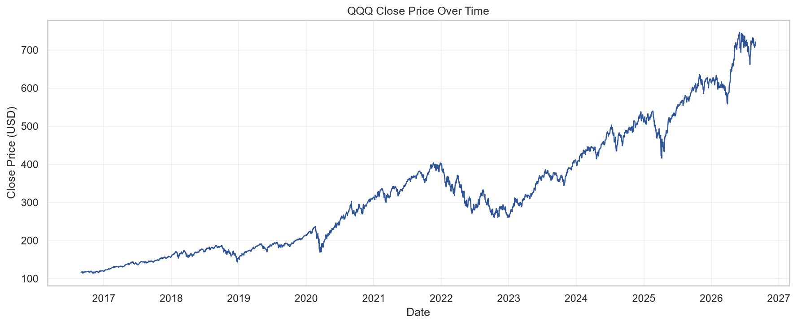

### 3.2 เครื่องมือที่ใช้ในการศึกษา

**ตารางที่ 3.1** เครื่องมือที่ใช้ในการศึกษา

| เครื่องมือ | รุ่น | ใช้ทำอะไร |
| --- | --- | --- |
| Python | 3.14.8 | ภาษาที่ใช้เขียนโปรแกรมทั้งหมด |
| NumPy | 2.5.3 | เขียนโมเดลทั้ง 19 ตัวและการคำนวณตัวชี้วัด |
| pandas | 3.0.6 | อ่านและจัดการตารางข้อมูล |
| Matplotlib | 3.11.2 | สร้างรูปทั้งหมด |
| scikit-learn | 1.9.1 | โมเดลอ้างอิงสำหรับยืนยันผลเท่านั้น |
| XGBoost | 3.4.1 | โมเดลอ้างอิงของ `xgboost` สำหรับยืนยันผลเท่านั้น |
| pytest | 9.1.1 | โปรแกรมทดสอบอัตโนมัติ 1,374 ข้อ |
| Jupyter Notebook | — | notebook 6 เล่มที่แสดงผลพร้อมคำอธิบาย |
| Git และ GitHub | — | เก็บประวัติของโค้ด ข้อมูล และผลการทดลอง |

ที่มา: `requirements-lock.txt` โมเดลอ้างอิงมาจาก scikit-learn (Pedregosa et al., 2011) และ XGBoost (Chen & Guestrin, 2016)

โจทย์กำหนดให้เขียนโมเดลเอง (from scratch) และอนุญาตให้ใช้ library เพื่อยืนยันผลเท่านั้น โมเดลทั้ง 19 ตัวจึงเขียนด้วย NumPy ล้วนใต้ `src/ml/` ทุกตัวมี interface เดียวกัน (`fit`, `predict`, `state_dict`, `load_state`, `reference`) เพื่อให้เทรน บันทึก โหลด และเทียบกับ library ได้ด้วยโค้ดชุดเดียว

### 3.3 วิธีการเก็บรวบรวมและเตรียมข้อมูล

#### 3.3.1 ขั้นตอนเตรียมข้อมูล

ข้อมูลถูกเก็บครั้งเดียวจากหน้าข้อมูลย้อนหลังของ Nasdaq แล้วตรึงไว้ตามหัวข้อ 3.1 จากนั้นผ่านขั้นตอนห้าขั้น

1. **ทำความสะอาด** ตรวจวันที่ซ้ำ ค่าว่าง และความสมเหตุสมผลของราคา
2. **สร้างฟีเจอร์** 8 ตัวจากข้อมูลถึงวัน t
3. **สร้าง target** จากผลตอบแทนของวัน t+1 ถึง t+5
4. **ตัดแถวที่คำนวณไม่ครบ** 20 แถวแรก (ฟีเจอร์ต้องใช้ข้อมูลย้อนหลัง 20 วัน) และ 5 แถวท้าย (target ต้องใช้ข้อมูลอนาคต 5 วัน) เหลือ 2,487 แถว
5. **แบ่งข้อมูลตามเวลา** 70% / 15% / 15%

**ผลการทำความสะอาด** กฎใน `src/clean_data.py` ตรวจวันที่ที่อ่านไม่ได้ ค่าว่าง แถวซ้ำ วันที่ซ้ำที่ข้อมูลขัดกัน ราคาที่ไม่เป็นบวก ราคาสูงสุดที่ต่ำกว่าราคาต่ำสุด ราคาเปิดที่อยู่นอกช่วงราคาของวัน และปริมาณซื้อขายที่ติดลบ ข้อมูลดิบผ่านทุกกฎโดยไม่มีแถวใดถูกตัด (ตารางที่ 3.2) จึงยังมี 2,512 แถวเท่าเดิม notebook 01 ตรวจซ้ำทุกข้อ และยืนยันว่าค่า SHA-256 ของไฟล์ต้นทางไม่เปลี่ยนหลังรัน

**ตารางที่ 3.2** ผลการตรวจคุณภาพข้อมูลก่อนและหลังทำความสะอาด

| รายการที่ตรวจ | ข้อมูลดิบ | หลังทำความสะอาด |
| --- | ---: | ---: |
| จำนวนแถว | 2,512 | 2,512 |
| วันแรก ถึง วันสุดท้าย | 31 ส.ค. 2016 – 28 ส.ค. 2026 | 31 ส.ค. 2016 – 28 ส.ค. 2026 |
| วันที่ซ้ำ | 0 | 0 |
| แถวที่มีค่าว่าง | 0 | 0 |
| ค่าอนันต์ | 0 | 0 |
| ราคาที่ไม่เป็นบวก | 0 | 0 |
| ราคาสูงสุดต่ำกว่าราคาต่ำสุด | 0 | 0 |
| ราคาเปิดอยู่นอกช่วงราคาของวัน | 0 | 0 |
| ปริมาณซื้อขายติดลบ | 0 | 0 |

ที่มา: `notebooks/01_data_cleaning.ipynb` หัวข้อ 4 ถึง 6

#### 3.3.2 ฟีเจอร์ 8 ตัว

ฟีเจอร์ (feature) คือข้อมูลที่ป้อนให้โมเดล ทุกตัวคำนวณจากข้อมูลถึงสิ้นวัน t เท่านั้น โมเดลจึงไม่เห็นอนาคต นิยามอยู่ใน `src/build_features.py`

**ตารางที่ 3.3** ฟีเจอร์ 8 ตัว นิยาม และเหตุผลที่เลือก

| ฟีเจอร์ | นิยาม | เหตุผลที่เลือก |
| --- | --- | --- |
| `return_1d` | ผลตอบแทนของวันนี้เทียบกับเมื่อวาน | วันที่ราคาร่วงแรงมักตามด้วยความผันผวน |
| `return_5d` | ผลตอบแทนสะสม 5 วัน | บอกทิศทางระยะสั้น ตลาดขาลงมักผันผวนกว่าขาขึ้น |
| `historical_volatility_5d` | ความผันผวนของ 5 วันที่ผ่านมา | ความผันผวนมักต่อเนื่อง ช่วงปั่นป่วนตามด้วยช่วงปั่นป่วน |
| `historical_volatility_20d` | ความผันผวนของ 20 วันที่ผ่านมา | บอกสภาพตลาดระยะกลาง นิ่งกว่าแบบ 5 วัน |
| `intraday_range` | (ราคาสูงสุด − ต่ำสุด) ÷ ราคาปิด ของวันนี้ | วัดการแกว่งตัวภายในวัน ซึ่งผลตอบแทนรายวันมองไม่เห็น |
| `sma_ratio_5_20` | ค่าเฉลี่ยราคา 5 วัน ÷ ค่าเฉลี่ย 20 วัน | บอกว่าราคาอยู่เหนือหรือใต้แนวโน้ม |
| `rsi_14` | ดัชนี RSI 14 วัน | บอกภาวะซื้อมากหรือขายมากเกินไป |
| `volume_zscore_20` | ปริมาณซื้อขายวันนี้เทียบกับค่าเฉลี่ย 20 วัน | ปริมาณซื้อขายที่ผิดปกติมักมาพร้อมข่าวสำคัญ |

โจทย์กำหนดให้ใช้ฟีเจอร์อย่างน้อย 5 ตัว โครงงานนี้ใช้ 8 ตัว

**ลักษณะของผลตอบแทนรายวัน** ตารางที่ 3.4 สรุปการกระจายของผลตอบแทนรายวันทั้งช่วงข้อมูล ค่าเฉลี่ยอยู่ที่ 0.08% ต่อวัน และส่วนเบี่ยงเบนมาตรฐาน 1.42% แต่ค่าต่ำสุดและสูงสุดอยู่ที่ −11.98% และ +12.00% ซึ่งห่างจากค่าเฉลี่ยกว่า 8 เท่าของส่วนเบี่ยงเบนมาตรฐาน excess kurtosis เท่ากับ 7.40 สูงกว่าค่าของการแจกแจงปกติ (0) มาก ยืนยันลักษณะหางหนาในหัวข้อ 2.1.1 ส่วน skewness −0.18 แปลว่าการกระจายเกือบสมมาตร แต่หางด้านขาลงยาวกว่าเล็กน้อย

**ตารางที่ 3.4** สถิติของผลตอบแทนรายวันของ QQQ ทั้งช่วงข้อมูล

| สถิติ | ค่า |
| --- | ---: |
| จำนวนวัน | 2,511 |
| ค่าเฉลี่ย | 0.08% |
| ส่วนเบี่ยงเบนมาตรฐาน | 1.42% |
| ค่าต่ำสุด และค่าสูงสุด | −11.98% และ +12.00% |
| เปอร์เซ็นไทล์ที่ 1 และ 99 | −3.92% และ +3.54% |
| เปอร์เซ็นไทล์ที่ 5 และ 95 | −2.27% และ +2.14% |
| skewness | −0.18 |
| excess kurtosis | 7.40 |

ที่มา: `notebooks/02_eda_and_features.ipynb` หัวข้อ 4 และคำนวณจาก `data/interim/qqq_features.csv`

รูปที่ 3.2 แสดงว่าวันที่ผลตอบแทนแกว่งแรงไม่ได้กระจายอย่างสม่ำเสมอ แต่เกาะกลุ่มอยู่ในบางช่วง โดยเฉพาะเดือนมีนาคม 2020 ปี 2022 และเดือนเมษายน 2025 ซึ่งคือลักษณะความผันผวนกระจุกตัว ส่วนรูปที่ 3.3 แสดงว่าการกระจายมียอดแหลมกว่าและมีหางยาวกว่าการแจกแจงปกติ

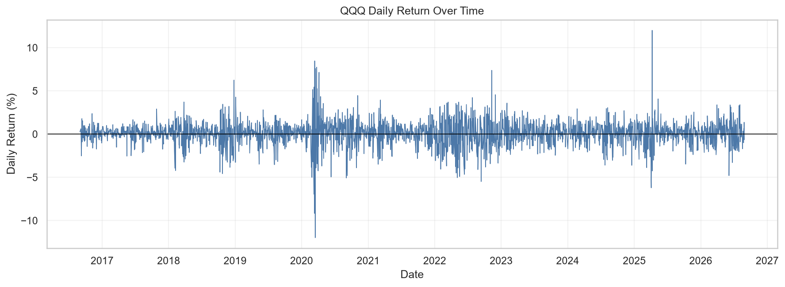

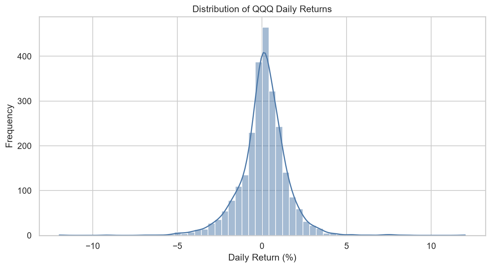

**ความผันผวนย้อนหลังสองช่วงเวลา** รูปที่ 3.4 เทียบความผันผวนย้อนหลัง 5 วันกับ 20 วัน แบบ 5 วันตอบสนองเร็วแต่แกว่งมาก โดยสูงสุดที่ 150% ต่อปีเมื่อ 17 มีนาคม 2020 ส่วนแบบ 20 วันเรียบกว่าและตามหลัง โดยสูงสุดที่ 92% เมื่อ 27 มีนาคม 2020 ค่ามัธยฐานของทั้งสองใกล้กันที่ 16% และ 17% ต่อปี สองฟีเจอร์นี้จึงให้ข้อมูลระยะสั้นและระยะกลางต่างกัน แต่สัมพันธ์กันสูง (หัวข้อ 4.1)

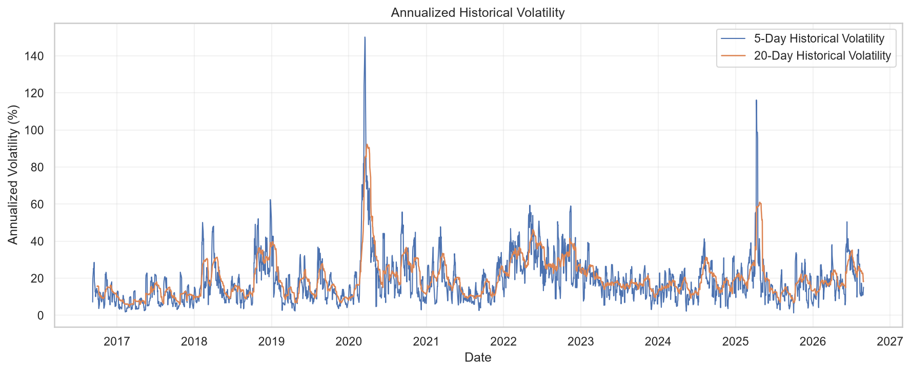

**การกระจายของฟีเจอร์** รูปที่ 3.5 แสดงการกระจายของฟีเจอร์ทั้ง 8 ตัวบนข้อมูลเทรน ฟีเจอร์ผลตอบแทนกระจายรอบศูนย์ ฟีเจอร์ความผันผวนและ `intraday_range` เบ้ขวา `sma_ratio_5_20` กระจุกใกล้ 1 และ `rsi_14` กระจายกว้างระหว่างราว 20 ถึง 85 ฟีเจอร์มีหน่วยต่างกันมาก โมเดลที่ใช้ระยะทางหรือ gradient จึงต้องปรับสเกลด้วยค่าเฉลี่ยและส่วนเบี่ยงเบนมาตรฐานของ Train ก่อน (หัวข้อ 3.4.2)

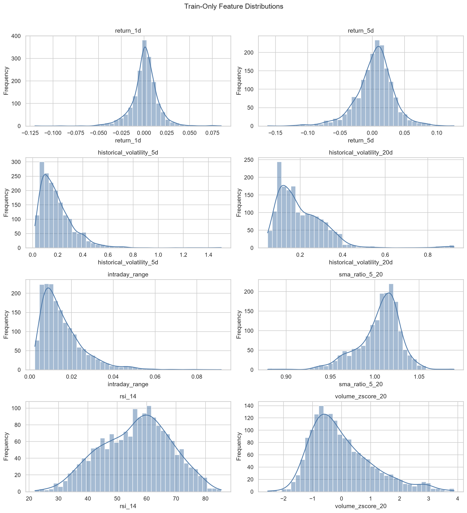

#### 3.3.3 target และการแบ่งข้อมูล

target ของงาน regression คือความผันผวนของผลตอบแทนรายวันของวัน t+1 ถึง t+5 ส่วน target ของงาน classification คือป้ายว่าค่านั้นเกินเส้นแบ่ง "ผันผวนสูง" หรือไม่ ข้อมูล 2,487 แถวถูกแบ่งตามลำดับเวลาเป็นสามชุด

**ตารางที่ 3.5** การแบ่งข้อมูลตามลำดับเวลา

| ชุดข้อมูล | ช่วงวันที่ | จำนวนแถว | วันผันผวนสูง | ใช้ทำอะไร |
| --- | --- | --- | --- | --- |
| Train | 29 ก.ย. 2016 – 18 ส.ค. 2023 | 1,733 | 433 (25.0%) | ให้โมเดลเรียนรู้ |
| Validation | 28 ส.ค. 2023 – 19 ก.พ. 2025 | 371 | 34 (9.2%) | เลือกการตั้งค่าของโมเดล |
| Test | 27 ก.พ. 2025 – 21 ส.ค. 2026 | 373 | 73 (19.6%) | วัดผลสุดท้าย ครั้งเดียว |

ที่มา: `outputs/reports/data_split_report.json` และ `docs/audit/DATA_FLOW.md`

**ทำไมไม่สุ่มแบ่งข้อมูล** ถ้าสุ่ม วันในอนาคตจะปนเข้าไปในข้อมูลเทรน โมเดลจะ "เห็นอนาคต" และได้คะแนนสูงเกินจริง (look-ahead leakage) เราจึงแบ่งตามลำดับเวลา และ **เว้นช่องว่าง 5 วันทำการ** (purge gap) ระหว่างชุด เพราะ target ของวันสุดท้ายในชุดหนึ่งใช้ข้อมูลของ 5 วันถัดไป ซึ่งมิฉะนั้นจะซ้อนกับชุดถัดไป

**เส้นแบ่ง "ผันผวนสูง"** คือ Q75 ของ target บน Train เท่านั้น ได้ค่า 0.2531 แล้วใช้เส้นเดียวกันกับ Validation และ Test สัดส่วนวันผันผวนสูงของสองชุดหลังจึงไม่ใช่ 25% และต่างกันเอง ซึ่งมีผลต่อการอ่านคะแนน (หัวข้อ 4.4)

**การกระจายของ target** บนข้อมูลเทรน target มีค่าเฉลี่ย 19.4% ต่อปี มัธยฐาน 16.2% และค่าสูงสุด 150.2% (รูปที่ 3.6) การกระจายเบ้ขวามาก (skewness 2.80) คือวันส่วนใหญ่ผันผวนปานกลาง แต่มีบางวันที่สูงมาก เส้นประในรูปคือ Q75 = 25.31% ซึ่งเป็นเส้นแบ่งของงาน classification ลักษณะนี้มีผลต่อการออกแบบสองข้อ ข้อแรก RMSE ถูกครอบงำโดยวันสุดโต่งไม่กี่วัน ข้อสอง การทำนายในสเกล log ช่วยลดผลนี้ ซึ่งเป็นแนวคิดของการทดลองในภาคผนวก ฉ

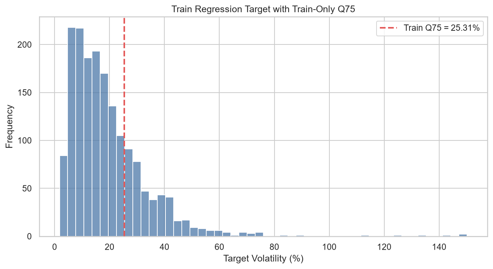

รูปที่ 3.7 แสดงจำนวนวันผันผวนสูงของแต่ละชุด Train มี 25.0% ตามนิยาม แต่ Validation มีเพียง 9.2% เพราะเป็นช่วงตลาดสงบ ส่วน Test มี 19.6% เพราะมีช่วงผันผวนแรงในเดือนเมษายน 2025

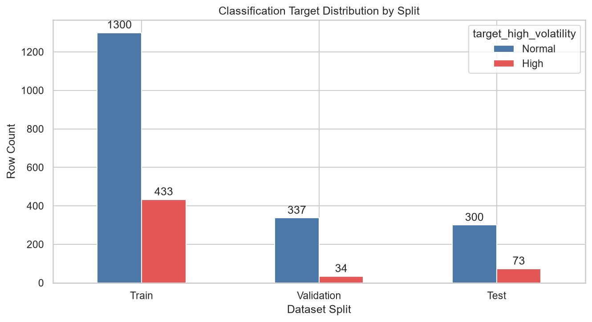

#### 3.3.4 การวิเคราะห์ spike

**นิยาม** spike คือวันที่ขนาดของผลตอบแทนรายวัน **มากกว่า** Q3 + 3 × IQR ของข้อมูลเทรน โดย Q1 และ Q3 คือค่าที่ 25% และ 75% ของวันในข้อมูลเทรนขยับน้อยกว่า และ IQR = Q3 − Q1 คือความกว้างของช่วงกลางที่วันครึ่งหนึ่งอยู่ บนข้อมูลเทรนได้ Q1 = 0.298%, Q3 = 1.387% และ IQR = 1.089% เส้นแบ่งจึงอยู่ที่ 1.387% + 3 × 1.089% = 4.65% เส้นนี้คำนวณจาก Train เท่านั้น แล้วใช้ค่าเดียวกันกับ Validation และ Test

รูปที่ 3.9 แสดงการกระจายของขนาดผลตอบแทนรายวันบนข้อมูลเทรน (แกนตั้งเป็นสเกล log) มีเพียง 19 จาก 1,733 วันที่อยู่เกินเส้นแบ่ง 4.65% ส่วนเส้นแบ่งแบบตัวคูณ 1.5 (3.02%) จะนับวันที่เป็นการแกว่งตัวตามปกติของตลาดผันผวนรวมเข้าไปด้วย

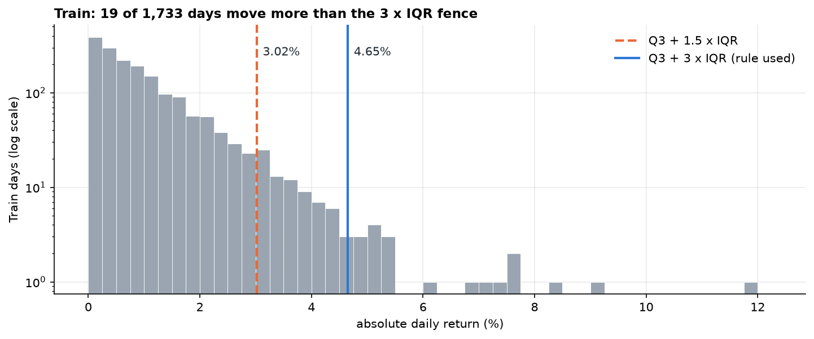

**ทำไมเลือกเกณฑ์นี้** มีเหตุผลสามข้อ หลักฐานทั้งหมดอยู่ใน `notebooks/06_spike_analysis.ipynb`

1. **กำหนดก่อนเห็นผลของโมเดล** เกณฑ์ถูกเลือกจากหลักการและตรึงไว้ก่อนเทรนโมเดลตัวแรก จึงไม่ได้ถูกปรับเพื่อให้ผลการทดลองออกมาทางใดทางหนึ่ง
2. **ควอร์ไทล์ไม่ถูกดึงโดยค่าที่กำลังตามหา** วิธีที่คุ้นกันคือ "ห่างจากค่าเฉลี่ยเกิน 3 เท่าของส่วนเบี่ยงเบนมาตรฐาน (SD)" แต่ SD ใหญ่ขึ้นตามวันสุดโต่ง เมื่อนำวัน spike 19 วันออกจากข้อมูลเทรน เส้นแบ่งแบบ 3 × SD ขยับ 11.8% (จาก 4.44% เป็น 3.92%) ส่วนเส้นแบ่งแบบ Q3 + 3 × IQR ขยับเพียง 3.0% (จาก 4.65% เป็น 4.51%)
3. **ตัวคูณ 3 จับเฉพาะวันที่สุดโต่งจริง** กฎ IQR ที่ John Tukey เสนอไว้ในหนังสือ Exploratory Data Analysis (1977) มีสองระดับ ตัวคูณ 1.5 ใช้หาค่าผิดปกติทั่วไป ตัวคูณ 3 ใช้หาค่าผิดปกติรุนแรง คำถามวิจัยพูดถึงวันที่ราคากระชากแรงผิดปกติ จึงใช้ระดับหลัง

ตารางถัดไปแสดงว่าถ้าใช้เกณฑ์อื่น ข้อมูลเทรนจะเหลือเท่าไร ข้อมูลเทรนเดิมมี 1,733 แถว และมีวันผันผวนสูง 433 วัน

**ตารางที่ 3.6** ข้อมูลเทรนที่เหลือเมื่อใช้เกณฑ์ spike แต่ละแบบ

| เกณฑ์ | เส้นแบ่ง | วัน spike | แถวที่ถูกตัด | วันผันผวนสูงที่เหลือ |
| --- | --- | --- | --- | --- |
| Q3 + 1.5 × IQR | 3.02% | 91 | 690 (39.8%) | 52 |
| Q3 + 3 × IQR (เกณฑ์ที่ใช้) | 4.65% | 19 | 213 (12.3%) | 280 |
| เปอร์เซ็นไทล์ที่ 99 | 4.88% | 18 | 211 (12.2%) | 281 |
| ห่างจากค่าเฉลี่ยเกิน 3 SD | 4.44% | 24 | 282 (16.3%) | 237 |
| robust z-score เกิน 3.5 | 3.21% | 72 | 638 (36.8%) | 60 |

ที่มา: `notebooks/06_spike_analysis.ipynb` หัวข้อ 3 คำนวณจากข้อมูลเทรนเท่านั้น

ตัวคูณ 1.5 จะตัดข้อมูลเทรนเกือบ 40% และเหลือวันผันผวนสูงเพียง 52 จาก 433 วัน ชุด "ไม่มี spike" จะกลายเป็นชุด "แทบไม่มีวันผันผวนสูง" และการทดลองจะไม่ได้ตอบคำถามเรื่อง spike อีกต่อไป ส่วนเปอร์เซ็นไทล์ที่ 99 ให้ผลแทบเท่ากับเกณฑ์ที่ใช้ ข้อสรุปจึงไม่ขึ้นกับการเลือกระหว่างสองนิยามนี้ ตารางนี้แสดงเฉพาะผลต่อจำนวนข้อมูล เกณฑ์ทางเลือกไม่ได้ถูกนำไปเทรนโมเดล และเราไม่ได้อ้างว่าตัวคูณ 3 เป็นเกณฑ์ที่ดีที่สุด

รูปที่ 3.10 แสดงเกณฑ์ในตารางที่ 3.6 รวมกับเกณฑ์อื่นอีกสี่แบบ แท่งที่เน้นสีคือเกณฑ์ที่ใช้ เกณฑ์ที่หลวมกว่าตัดแถวเพิ่มขึ้นอย่างรวดเร็ว และเหลือวันผันผวนสูงน้อยลงมาก

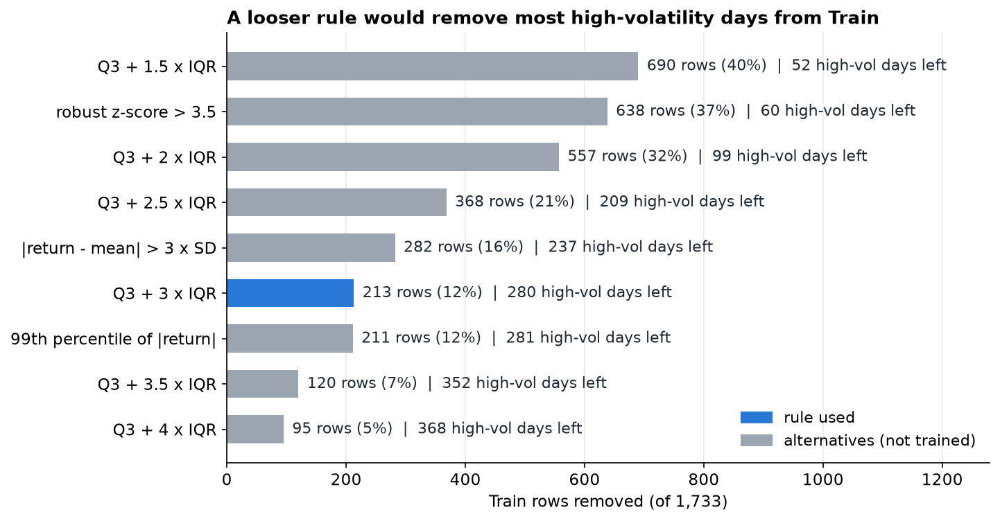

**ผลการตรวจ** พบ spike 23 วัน: Train 19 วัน หรือ 1.1% ของข้อมูลเทรน (11 วันอยู่ในช่วงกุมภาพันธ์ถึงเมษายน 2020), Validation 0 วัน, Test 4 วัน (3 วันในเดือนเมษายน 2025 และ 1 วันในเดือนมิถุนายน 2026) ทุกวันถูกตรวจย้อนถึงไฟล์ราคาดิบ และจัดเป็นการเคลื่อนไหวของตลาดจริง ไม่ใช่ข้อมูลผิดพลาด ที่มา: `outputs/reports/spike_event_audit.csv`

**ตารางที่ 3.7** วันที่ถูกจัดเป็น spike ทั้ง 23 วัน แยกตามเหตุการณ์

| ชุดข้อมูล | ช่วงเหตุการณ์ | วันที่และผลตอบแทนรายวัน |
| --- | --- | --- |
| Train | ธันวาคม 2018 | 26 ธ.ค. (+6.24%) |
| Train | กุมภาพันธ์ถึงเมษายน 2020 | 27 ก.พ. (−5.01%), 2 มี.ค. (+5.16%), 9 มี.ค. (−6.95%), 10 มี.ค. (+5.45%), 12 มี.ค. (−9.17%), 13 มี.ค. (+8.47%), 16 มี.ค. (−11.98%), 17 มี.ค. (+7.58%), 24 มี.ค. (+7.74%), 26 มี.ค. (+5.27%), 6 เม.ย. (+7.15%) |
| Train | มิถุนายนถึงกันยายน 2020 | 11 มิ.ย. (−4.95%), 3 ก.ย. (−5.07%), 8 ก.ย. (−4.81%) |
| Train | ปี 2022 | 5 พ.ค. (−5.04%), 18 พ.ค. (−4.91%), 13 ก.ย. (−5.48%), 10 พ.ย. (+7.38%) |
| Test | เมษายน 2025 | 3 เม.ย. (−5.35%), 4 เม.ย. (−6.21%), 9 เม.ย. (+12.00%) |
| Test | มิถุนายน 2026 | 5 มิ.ย. (−4.80%) |

ที่มา: `notebooks/06_spike_analysis.ipynb` หัวข้อ 4

spike เกิดทั้งในวันที่ราคาขึ้นและลง และมักมาเป็นคู่ วันที่ราคาร่วงแรงมักตามด้วยวันที่ราคาดีดกลับแรง เช่น 12 และ 13 มีนาคม 2020 (−9.17% ตามด้วย +8.47%) และ 16 และ 17 มีนาคม 2020 (−11.98% ตามด้วย +7.58%) ข้อนี้ตรงกับลักษณะความผันผวนกระจุกตัว คือเมื่อตลาดเข้าสู่ช่วงปั่นป่วน การแกว่งแรงจะเกิดต่อเนื่องหลายวัน

**การสร้างชุดข้อมูลแบบไม่มี spike** spike หนึ่งวันกระทบแถวรอบข้างด้วย เพราะฟีเจอร์ย้อนหลัง 20 วันและ target ล่วงหน้า 5 วันของแถวใกล้เคียงใช้ผลตอบแทนของวันนั้น เราจึงตัดทั้งหน้าต่าง ตั้งแต่ 5 วันก่อนถึง 19 วันหลังวัน spike คือ 25 แถวต่อ spike หนึ่งวัน หน้าต่างที่ซ้อนกันนับแต่ละแถวครั้งเดียว รวม 213 แถว ชุด `non_spike` จึงมีข้อมูลเทรน 1,520 แถว

รูปที่ 3.12 แสดงตัวอย่างจริงรอบวันที่ 26 ธันวาคม 2018 ซึ่งราคาขึ้น 6.24% target ของแถวที่อยู่ก่อน spike 6 วันยังเป็น 0.24 แต่แถวที่อยู่ก่อน 5 วันกระโดดเป็น 0.62 เพราะ 5 วันข้างหน้าของแถวนั้นเริ่มรวมวัน spike ส่วนความผันผวนย้อนหลัง 20 วันค้างสูงจนถึงวันที่ 19 หลัง spike แล้วลดจาก 0.31 เหลือ 0.24 ในวันถัดไป ขอบของหน้าต่างจึงตรงกับจุดที่ข้อมูลของวัน spike เข้าและออกจากการคำนวณ ข้อยกเว้นคือ `rsi_14` ซึ่งคำนวณแบบเฉลี่ยสะสม อิทธิพลของวัน spike จึงค่อย ๆ จางลง และอาจเหลืออยู่บ้างหลังหน้าต่าง

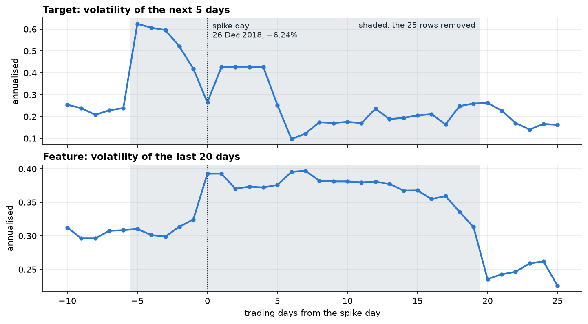

รูปที่ 3.13 แสดงความผันผวนย้อนหลัง 20 วัน (ฟีเจอร์) และความผันผวน 5 วันข้างหน้า (target) ของทั้งสามชุด แถบสีเหลืองคือหน้าต่างรอบวัน spike ภายในหน้าต่างเหล่านี้ทั้งฟีเจอร์และ target สูงผิดปกติ โดย target ขึ้นก่อนและลงก่อนฟีเจอร์ เพราะ target มองไปข้างหน้า ส่วน Validation ไม่มีหน้าต่างของ spike เลย และ Test มีสองหน้าต่าง

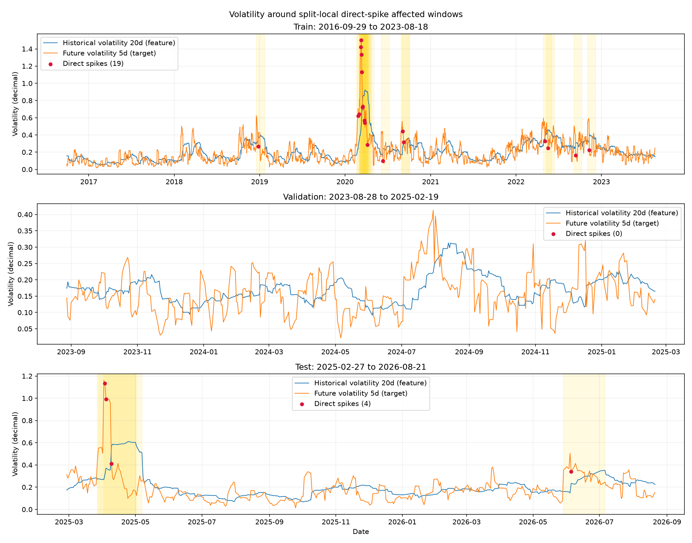

**สิ่งสำคัญสองข้อของการออกแบบ**

- ตัดเฉพาะข้อมูล **เทรน** ส่วน Validation และ Test เหมือนกันทั้งสองแบบ จึงเทียบกันได้ตรง ๆ
- แถวที่ถูกตัด 213 แถว เป็นวันผันผวนสูงถึง 153 แถว (71.8%) การตัดจึงเปลี่ยนสามอย่างพร้อมกัน: จำนวนแถว (1,733 เป็น 1,520), สัดส่วนวันผันผวนสูง (25.0% เป็น 18.4%) และช่วงตลาดที่โมเดลได้เห็น ผลต่างระหว่างสองแบบจึงเป็นผลของ **นโยบายตัดแถวทั้งชุด** เราแยกไม่ได้ว่ามาจากตัว spike เอง หรือจากสองปัจจัยที่เหลือ

**แถวที่ถูกตัดอยู่ช่วงใด** ตารางที่ 3.8 แยกแถวที่ถูกตัดตามปี แถวที่ถูกตัด 188 จาก 213 แถวอยู่ในปี 2020 และ 2022 และวันผันผวนสูงที่ถูกตัด 142 จาก 153 วันก็อยู่ในสองปีนี้ ชุด `non_spike` จึงเหลือวันผันผวนสูงของปี 2020 เพียง 30 จาก 112 วัน คือโมเดลแบบ `non_spike` แทบไม่ได้เห็นตลาดช่วงวิกฤตโควิด-19

**ตารางที่ 3.8** แถวของข้อมูลเทรนที่ถูกตัดเมื่อสร้างชุด non_spike แยกตามปี

| ปี | แถวใน Train | แถวที่ถูกตัด | วันผันผวนสูง | วันผันผวนสูงที่ถูกตัด |
| --- | ---: | ---: | ---: | ---: |
| 2016 | 65 | 0 | 0 | 0 |
| 2017 | 251 | 0 | 0 | 0 |
| 2018 | 251 | 9 | 69 | 9 |
| 2019 | 252 | 16 | 26 | 2 |
| 2020 | 253 | 104 | 112 | 82 |
| 2021 | 252 | 0 | 45 | 0 |
| 2022 | 251 | 84 | 160 | 60 |
| 2023 | 158 | 0 | 21 | 0 |
| รวม | 1,733 | 213 | 433 | 153 |

ที่มา: `notebooks/06_spike_analysis.ipynb` หัวข้อ 6

#### 3.3.5 การตรวจสอบความถูกต้องของข้อมูล

ก่อนสรุปผล เราตรวจสอบสายการเตรียมข้อมูลทั้งหมด (`docs/audit/DATA_PIPELINE_AUDIT.md`) ข้อสรุปคือข้อมูลใช้เทรนได้อย่างปลอดภัย ไม่มีการรั่วของข้อมูลอนาคต การตรวจที่สำคัญถูกเขียนเป็น test อัตโนมัติใน `tests/test_audit_guards.py` เช่น

- ตัดข้อมูลอนาคตออกแล้วคำนวณฟีเจอร์ใหม่ ค่าของวันในอดีตต้องไม่เปลี่ยน
- เส้นแบ่ง Q75 และเส้นแบ่ง spike ต้องคำนวณจาก Train เท่านั้น แม้จะแก้ค่าใน Validation หรือ Test
- ไม่มีโค้ดส่วนใดสุ่มสลับลำดับข้อมูล และมีเพียงไฟล์ในรายการที่อนุญาตที่อ้างถึง Test ได้ คือ 3 ไฟล์ของงานหลัก และ 3 ไฟล์ของการทดลองเพิ่มเติมในภาคผนวก ง ถึง ฉ ซึ่งแต่ละไฟล์ต้องมีใบรับรองการเปิด Test ของตัวเอง
- ไม่มีค่าว่างหรือค่าอนันต์ในข้อมูลที่ป้อนให้โมเดลทั้งสามชุด (notebook 02 หัวข้อ 13)

### 3.4 การวิเคราะห์ข้อมูลและสถิติที่ใช้

#### 3.4.1 โมเดลที่ใช้ในการศึกษา

**ตารางที่ 3.9** โมเดลทั้ง 19 ตัว

| งาน | โมเดล | จำนวน |
| --- | --- | --- |
| Regression | Simple Linear, Multiple Linear, Polynomial, **Elastic Net** ★ | 4 |
| Classification | Logistic Regression, Gaussian Naive Bayes, k-Nearest Neighbors, Perceptron, Single-Layer Perceptron, Multi-Layer Perceptron, Decision Tree, Random Forest, Gradient Boosting, XGBoost, **AdaBoost** ★, Stacking, Support Vector Machine | 13 |
| Clustering | k-Means, Agglomerative | 2 |

★ คือโมเดลนอกเนื้อหาที่เรียน ซึ่งอธิบายกลไกอย่างละเอียดในหัวข้อ 2.1.3 และ 2.1.5 การตั้งค่าที่ถูกเลือกของทุกโมเดลอยู่ในภาคผนวก ก

#### 3.4.2 ขั้นตอนการทดลอง

1. **เทรนบน Train** ของแต่ละแบบ (`with_spike` หรือ `non_spike`) การปรับสเกลข้อมูล (standardize) และ PCA คำนวณจาก Train เท่านั้น
2. **เลือกการตั้งค่าบน Validation** ลองทุกค่าใน grid แล้วเลือกชุดที่ได้คะแนนดีที่สุด: regression ใช้ RMSE, classification ใช้ average precision (AP)
3. **ไม่ปรับ threshold** classifier ตัดสินที่ความน่าจะเป็น 0.5 คงที่ เพื่อไม่เพิ่มการเลือกบน Validation อีกชั้น
4. **ล็อกก่อนเปิด Test** บันทึก hash ของไฟล์โมเดลทั้ง 38 ชุดและชื่อ "โมเดลตัวแทน" (headline) ของแต่ละงานลง `outputs/modeling/selection_lock.json` แล้ว commit
5. **เปิด Test ครั้งเดียว** ไม่เทรนใหม่บน Train+Validation และไม่เปลี่ยนอะไรหลังเห็นผล โปรแกรมบันทึกใบรับรอง `outputs/modeling/finalize_receipt.json` และปฏิเสธการรันซ้ำ

#### 3.4.3 ตัวชี้วัด

ตัวชี้วัดทั้งหมดในตารางที่ 2.1 ถูกคำนวณและรายงานครบ โดยมีตัวชี้วัดหลักที่ใช้เลือกการตั้งค่าและจัดอันดับสองตัว

- **RMSE** (regression): ขนาดความผิดพลาดเฉลี่ย ยิ่งต่ำยิ่งดี
- **Average precision หรือ AP** (classification): คุณภาพของการจัดอันดับวันที่น่าจะผันผวนสูง ยิ่งสูงยิ่งดี ค่าของการเดาสุ่มเท่ากับสัดส่วนวันผันผวนสูงของชุดนั้น เราใช้ AP แทน accuracy เพราะคลาสไม่สมดุล (หัวข้อ 4.2.2)

#### 3.4.4 การวัดความไม่แน่นอน

target ของวันติดกันใช้ผลตอบแทนช่วงเดียวกัน 4 ใน 5 วัน ค่าของวันติดกันจึงคล้ายกันมาก (autocorrelation ที่ lag 1 เท่ากับ 0.92) ข้อมูล 371 แถวจึงมีข้อมูลจริงเทียบเท่าตัวอย่างอิสระเพียงราว 50 ถึง 200 ตัว

เราจึงคำนวณช่วงความเชื่อมั่น 95% ด้วย **moving-block bootstrap**: สุ่มข้อมูลซ้ำเป็นก้อน 20 วันติดกัน 2,000 รอบ แทนการสุ่มทีละวันซึ่งจะให้ช่วงแคบเกินจริง

การเปรียบเทียบสองโมเดลใช้แบบ **จับคู่ (paired)**: คำนวณผลต่างบนแถวที่สุ่มชุดเดียวกันทุกรอบ ถ้าช่วง 95% ของผลต่าง **คร่อมศูนย์** ถือว่ายังบอกไม่ได้ว่าโมเดลใดดีกว่า กฎข้อนี้ใช้ตลอดทั้งรายงาน

#### 3.4.5 เส้นฐานเปรียบเทียบ

ตัวเลขคะแนนเดี่ยว ๆ บอกไม่ได้ว่าดีหรือแย่ เราจึงเทียบกับกฎที่ไม่ต้องเทรน

**ตารางที่ 3.10** เส้นฐานเปรียบเทียบที่ไม่ต้องเทรน

| ชื่อ | งาน | กฎ |
| --- | --- | --- |
| `baseline_train_mean` | regression | ทายค่าเฉลี่ยของ target ใน Train ทุกวัน |
| `baseline_persistence` | regression | ทายว่า 5 วันข้างหน้าจะผันผวนเท่ากับ 5 วันที่ผ่านมา |
| `baseline_majority` | classification | ทายว่า "ไม่ผันผวนสูง" ทุกวัน |
| `baseline_persistence` | classification | ใช้ความผันผวน 5 วันที่ผ่านมาเป็นคะแนนโดยตรง |

#### 3.4.6 การยืนยันผลเทียบกับ library

ทุกโมเดลมีเมธอด `reference()` ที่สร้างโมเดลของ scikit-learn หรือ XGBoost ด้วยการตั้งค่าเดียวกัน test ของแต่ละโมเดลเทรนทั้งสองฝั่งบนข้อมูลเดียวกันแล้วเทียบคำทำนายทีละแถว

**ตารางที่ 3.11** ผลต่างระหว่างโมเดลที่เขียนเองกับ library บน Validation

| กลุ่มโมเดล | ผลต่างจาก library บน Validation |
| --- | --- |
| `simple_linear`, `multiple_linear`, `polynomial`, `gaussian_nb`, `knn`, `adaboost`, `mlp` | ไม่เกิน 2e-15 (ตรงกันถึงทศนิยมสุดท้ายของ float64) |
| `perceptron`, `decision_tree`, `random_forest`, `gradient_boosting`, `xgboost` | 0 (ตรงกันทุกแถว) |
| `kmeans`, `agglomerative` | แบ่งกลุ่มตรงกัน 100% |
| `elastic_net` | ไม่เกิน 3e-06 (ใช้กฎหยุดวนรอบต่างจาก scikit-learn) |
| `svm` | ค่า objective ต่างไม่เกิน 3e-06 |
| `logistic` | ไม่เกิน 1e-03 (หยุดที่ 5,000 รอบ ก่อนลู่เข้าสมบูรณ์) |
| `slp` | 0.07 ถึง 0.29 (หยุดที่โควตา 1,000 รอบ ขณะที่โมเดลอ้างอิงลู่เข้าแล้ว) |
| `stacking` | ไม่มี library ที่ทำแบบเดียวกัน ตรวจด้วยการสร้าง fold ซ้ำทีละ fold และ test กันข้อมูลรั่ว |

ที่มา: `docs/models/PROGRESS_INDEX.md` และ test ใต้ `tests/ml/`

รายละเอียดที่ทำให้ผลตรงกันได้คือ โมเดลที่มีการสุ่มต้องใช้ตัวสุ่มชนิดเดียวกับ scikit-learn (`numpy.random.RandomState`) และเรียกใช้ตามลำดับเดียวกัน

**สามโมเดลที่ผลขึ้นกับโควตาการเทรน** `slp`, `perceptron` และ `logistic` หยุดเพราะครบจำนวนรอบที่กำหนด ไม่ใช่เพราะลู่เข้า โดยเฉพาะ `perceptron` ซึ่งไม่มีวันลู่เข้าเมื่อข้อมูลแยกด้วยเส้นตรงไม่ได้ คะแนนของสามตัวนี้จึงเป็นคะแนนของ "อัลกอริทึมภายใต้โควตาที่กำหนด" หลักฐานว่าข้อมูลแยกด้วยเส้นตรงไม่ได้และวิธีแก้ด้วย Kernel Perceptron อยู่ในหัวข้อ 4.2.5

#### 3.4.7 จำนวนรอบการเทรน และการบันทึก โหลด ทดสอบซ้ำ

แต่ละโมเดลถูกลองหลายการตั้งค่า (grid search) รวม 140 การตั้งค่าต่อแบบข้อมูล หรือ 280 ครั้งของการเทรนสำหรับทั้งสองแบบ เหลือผู้ชนะ 38 ชุด (19 โมเดล × 2 แบบ) ทั้งหมดสั่งรันได้ด้วยคำสั่งเดียว `python -m src.ml.run train --all --variant <variant>` รายการค่าที่ลองอยู่ใน `configs/modeling.json`

โจทย์กำหนดให้บันทึกโมเดล โหลดกลับ แล้วทดสอบซ้ำ เราพิสูจน์สามชั้น

1. ตอนเทรน โปรแกรมบันทึกโมเดลเป็น `model.npz` โหลดกลับทันที แล้วเทียบคำทำนายกับก่อนบันทึก ผลอยู่ใน `load_verification.json` ซึ่งผ่านครบ 38 ชุด
2. test `tests/ml/core/test_artifacts.py` โหลดโมเดลทั้ง 38 ชุดจากดิสก์แล้วทำนาย Validation ใหม่ ต้องได้ค่าเดียวกับที่บันทึกไว้
3. notebook 03 และ 04 ทำซ้ำขั้นตอนเดียวกันให้เห็นเป็นตาราง

ผลบน Test ทั้งหมดในรายงานนี้มาจากโมเดลที่ **โหลดจากไฟล์** ไม่ใช่โมเดลที่ค้างอยู่ในหน่วยความจำ

#### 3.4.8 การวิเคราะห์ความสำคัญของฟีเจอร์และความเสถียรของอันดับ

**Permutation importance** สลับลำดับค่าของฟีเจอร์หนึ่งตัวบน Validation เพื่อทำลายข้อมูลในฟีเจอร์นั้น แล้วดูว่าคะแนนของโมเดลแย่ลงเท่าไร ยิ่งแย่ลงมากฟีเจอร์นั้นยิ่งสำคัญ เราสลับเป็นก้อน 20 วันติดกันเพื่อรักษารูปแบบตามเวลา และทำซ้ำ 30 รอบ

**Walk-forward** เพื่อดูว่าอันดับของโมเดลขึ้นกับช่วงเวลาที่วัดมากแค่ไหน เราเทรนด้วยข้อมูลช่วงต้นของ Train ทดสอบกับช่วงถัดไป แล้วขยายหน้าต่างไปเรื่อย ๆ 4 รอบ ครอบคลุมปี 2019 ถึง 2023 ใช้การตั้งค่าเดิมของแต่ละโมเดล และไม่มีการเลือกโมเดลใหม่จากผลนี้

## บทที่ 4 ผลการวิเคราะห์ข้อมูล

### 4.1 ผลการวิเคราะห์ฟีเจอร์

**ความสัมพันธ์กับ target** บนข้อมูลเทรน ฟีเจอร์กลุ่มความผันผวนย้อนหลังสัมพันธ์กับ target มากที่สุด: `historical_volatility_5d` (r = 0.64), `intraday_range` (0.63), `historical_volatility_20d` (0.62) รองลงมาคือ `rsi_14` (−0.49) และ `sma_ratio_5_20` (−0.44) ส่วน `return_1d` (−0.13) และ `volume_zscore_20` (0.17) สัมพันธ์น้อย เครื่องหมายลบของ `rsi_14` และ `sma_ratio_5_20` สอดคล้องกับข้อเท็จจริงที่ว่าตลาดขาลงผันผวนกว่าขาขึ้น

**ฟีเจอร์ซ้ำซ้อนกัน** `historical_volatility_5d` กับ `historical_volatility_20d` มีสหสัมพันธ์กัน 0.80 เพราะวัดสิ่งเดียวกันคนละช่วงเวลา ข้อนี้เป็นเหตุผลที่เลือก Elastic Net เป็นโมเดลนอกห้องเรียนฝั่ง regression (หัวข้อ 2.1.3)

**ฟีเจอร์ที่โมเดลใช้จริง** ตารางที่ 4.1 แสดง permutation importance เฉลี่ยข้ามโมเดล (วิธีคำนวณอยู่ในหัวข้อ 3.4.8)

**ตารางที่ 4.1** Permutation importance เฉลี่ยข้ามโมเดล แบบ with_spike

<!-- BEGIN GENERATED: outputs/modeling/report/tables/feature_importance_with_spike.md -->
### Block-permutation importance averaged over models — with_spike

| feature | drop_in_ap_mean | drop_in_ap_std_across_models | rise_in_rmse_mean | rise_in_rmse_std_across_models |
| --- | --- | --- | --- | --- |
| return_1d | -0.0019 | 0.0081 | 0.0001 | 0.0001 |
| return_5d | 0.0017 | 0.0074 | -0.0001 | 0.0003 |
| historical_volatility_5d | 0.0053 | 0.0165 | -0.0004 | 0.0007 |
| historical_volatility_20d | 0.0336 | 0.0282 | 0.0038 | 0.0034 |
| intraday_range | 0.0060 | 0.0127 | -0.0005 | 0.0015 |
| sma_ratio_5_20 | 0.0040 | 0.0054 | 0.0002 | 0.0003 |
| rsi_14 | 0.0197 | 0.0155 | 0.0010 | 0.0019 |
| volume_zscore_20 | 0.0017 | 0.0057 | -0.0003 | 0.0007 |
<!-- END GENERATED -->

`historical_volatility_20d` สำคัญที่สุด ตามด้วย `rsi_14` ส่วน `return_1d` และ `volume_zscore_20` แทบไม่มีผล ค่าในคอลัมน์ `std_across_models` ใหญ่พอ ๆ กับค่าเฉลี่ย แปลว่าโมเดลแต่ละตัวพึ่งฟีเจอร์ต่างกันมาก ข้อจำกัดของวิธีนี้คือ ฟีเจอร์ที่สัมพันธ์กันจะแบ่งความสำคัญกัน เมื่อสลับตัวหนึ่ง อีกตัวยังให้ข้อมูลเดิมได้

รูปที่ 4.3 เทียบความสำคัญเฉลี่ยของข้อมูลเทรนสองแบบ อันดับต้นเหมือนกัน คือ `historical_volatility_20d` และ `rsi_14` แต่เมื่อตัด spike ออก โมเดลพึ่ง `historical_volatility_5d` (จาก 0.005 เป็น 0.019) และ `sma_ratio_5_20` (จาก 0.004 เป็น 0.013) มากขึ้น เส้นแสดงความคลาดเคลื่อนยาวเกือบทุกแท่ง แปลว่าโมเดลแต่ละตัวพึ่งฟีเจอร์ต่างกัน จึงควรอ่านเป็นแนวโน้มมากกว่าอันดับที่แน่นอน

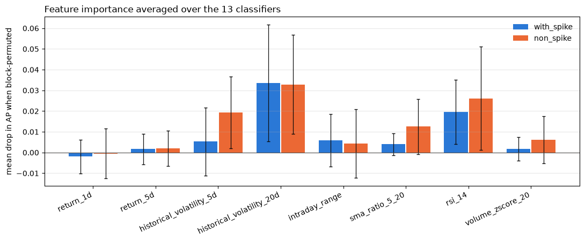

### 4.2 ผลบน Validation

หัวข้อนี้เป็นผลบน **Validation** ซึ่งเป็น **selection score** คือการตั้งค่าของทุกโมเดลถูกเลือกบนข้อมูลชุดนี้เอง ตัวเลขจึงดูดีกว่าความเป็นจริงเล็กน้อย ผลที่ไม่ลำเอียงคือผลบน Test ในหัวข้อ 4.4

**วิธีอ่านตาราง** คอลัมน์ที่ลงท้ายด้วย `_ci` เขียนเป็น `ค่า [ต่ำ, สูง]` คือค่าที่วัดได้และช่วงความเชื่อมั่น 95% · `tied_with_leader = yes` คือแยกจากอันดับหนึ่งไม่ได้ทางสถิติ · `beats_best_baseline` คือคะแนนดีกว่า baseline ตัวที่ดีที่สุดหรือไม่

#### 4.2.1 Regression

**ตารางที่ 4.2** ผลของโมเดล regression บน Validation แบบ with_spike

<!-- BEGIN GENERATED: outputs/modeling/report/with_spike/leaderboard_regression.md -->
### Validation leaderboard — regression — with_spike

| model | kind | rmse_ci | mae | r2_ci | tied_with_leader | beats_best_baseline |
| --- | --- | --- | --- | --- | --- | --- |
| elastic_net | model | 0.0668 [0.0610, 0.0739] | 0.0539 | 0.0169 [-0.2649, 0.2159] | yes | yes |
| multiple_linear | model | 0.0689 [0.0617, 0.0779] | 0.0542 | -0.0446 [-0.3994, 0.2085] | yes | yes |
| simple_linear | model | 0.0690 [0.0609, 0.0789] | 0.0557 | -0.0498 [-0.2829, 0.0997] | yes | yes |
| polynomial | model | 0.0691 [0.0606, 0.0797] | 0.0552 | -0.0507 [-0.2579, 0.0879] | yes | yes |
| baseline_train_mean | baseline | 0.0751 [0.0673, 0.0837] | 0.0623 | -0.2430 [-0.6975, -0.0225] | no | n/a |
| baseline_persistence | baseline | 0.0826 [0.0750, 0.0901] | 0.0673 | -0.5032 [-1.0576, -0.0677] | no | n/a |

> ตัวเลขบน Validation เป็น selection score: hyperparameter ของทุกโมเดลถูกเลือกบนแถวชุดนี้ จึงมองโลกในแง่ดีเกินจริง และโมเดลที่ `tied_with_leader = yes` แยกจากอันดับ 1 ไม่ได้ที่ระดับ 95% (moving-block bootstrap, block 20 วัน) ห้ามอ้างอันดับภายในกลุ่มนั้น
> 4 จาก 4 โมเดลอยู่ในกลุ่มที่แยกจากอันดับ 1 ไม่ได้
<!-- END GENERATED -->

**ตารางที่ 4.3** ผลของโมเดล regression บน Validation แบบ non_spike

<!-- BEGIN GENERATED: outputs/modeling/report/non_spike/leaderboard_regression.md -->
### Validation leaderboard — regression — non_spike

| model | kind | rmse_ci | mae | r2_ci | tied_with_leader | beats_best_baseline |
| --- | --- | --- | --- | --- | --- | --- |
| elastic_net | model | 0.0643 [0.0572, 0.0741] | 0.0510 | 0.0906 [-0.0841, 0.2010] | yes | yes |
| polynomial | model | 0.0661 [0.0596, 0.0755] | 0.0509 | 0.0389 [-0.1903, 0.1745] | yes | yes |
| simple_linear | model | 0.0665 [0.0582, 0.0783] | 0.0527 | 0.0265 [-0.1099, 0.0616] | yes | yes |
| multiple_linear | model | 0.0668 [0.0597, 0.0761] | 0.0530 | 0.0165 [-0.2942, 0.2361] | yes | yes |
| baseline_train_mean | baseline | 0.0676 [0.0585, 0.0805] | 0.0535 | -0.0076 [-0.1436, -0.0000] | yes | n/a |
| baseline_persistence | baseline | 0.0826 [0.0750, 0.0901] | 0.0673 | -0.5032 [-1.0576, -0.0677] | no | n/a |

> ตัวเลขบน Validation เป็น selection score: hyperparameter ของทุกโมเดลถูกเลือกบนแถวชุดนี้ จึงมองโลกในแง่ดีเกินจริง และโมเดลที่ `tied_with_leader = yes` แยกจากอันดับ 1 ไม่ได้ที่ระดับ 95% (moving-block bootstrap, block 20 วัน) ห้ามอ้างอันดับภายในกลุ่มนั้น
> 4 จาก 4 โมเดลอยู่ในกลุ่มที่แยกจากอันดับ 1 ไม่ได้
<!-- END GENERATED -->

- โมเดลทั้ง 4 ตัวได้ RMSE ต่ำกว่า baseline ทั้งสองตัว
- ทั้ง 4 ตัวอยู่ในกลุ่มที่แยกจากอันดับหนึ่งไม่ได้ จึงไม่อ้างว่าโมเดลใดดีที่สุด
- **R²** อยู่ใกล้ศูนย์หรือติดลบ R² ติดลบแปลว่าแย่กว่าการทายค่าเฉลี่ยของ Validation เอง สาเหตุคือ Validation สงบกว่า Train มาก (ส่วนเบี่ยงเบนมาตรฐานของ target 0.068 เทียบกับ 0.144) เมื่อค่าจริงแกว่งน้อย การทายค่าเฉลี่ยก็ผิดไม่มาก

รูปที่ 4.4 แสดงว่าคำทำนายกระจุกอยู่ในช่วงแคบกว่าค่าจริงมาก คำทำนาย 90% ตรงกลางของ `elastic_net` อยู่ระหว่าง 0.13 ถึง 0.23 ขณะที่ค่าจริงอยู่ระหว่าง 0.06 ถึง 0.29 ส่วน `multiple_linear` กระจายกว้างกว่าเล็กน้อย (0.11 ถึง 0.25) โมเดลจึงทายใกล้ค่ากลางมาก ซึ่งเป็นพฤติกรรมปกติเมื่อฟีเจอร์อธิบายความแปรปรวนได้น้อย

รูปที่ 4.5 แสดง residual (ค่าจริงลบค่าทำนาย) ตามเวลา residual ของทั้ง 4 โมเดลขึ้นลงไปพร้อมกันเกือบทั้งหมด และเป็นบวกขนาดใหญ่ในช่วงกรกฎาคมถึงสิงหาคม 2024 และปลายปี 2024 คือโมเดลทายต่ำกว่าจริงทุกครั้งที่ความผันผวนพุ่งขึ้นเร็ว ความผิดพลาดจึงมาจากข้อมูลที่ทุกโมเดลไม่มี มากกว่าจากการเลือกโมเดล

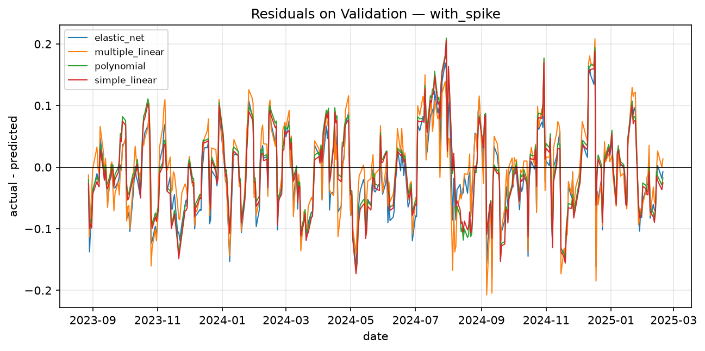

#### 4.2.2 Classification

**ทำไมไม่ใช้ accuracy เป็นหลัก** Validation มีวันผันผวนสูงเพียง 34 จาก 371 วัน ถ้าทายว่า "ไม่ผันผวนสูง" ทุกวันจะได้ accuracy 90.8% ทั้งที่จับวันผันผวนสูงไม่ได้เลย (แถว `baseline_majority`) เราจึงรายงาน accuracy คู่กับ AP, ROC-AUC, F1 และ recall เสมอ

**ตารางที่ 4.4** ผลของโมเดล classification บน Validation แบบ with_spike

<!-- BEGIN GENERATED: outputs/modeling/report/with_spike/leaderboard_classification.md -->
### Validation leaderboard — classification — with_spike

| model | kind | average_precision_ci | roc_auc_ci | f1_ci | recall_ci | precision | specificity | accuracy | loss_name | loss | tied_with_leader | beats_best_baseline |
| --- | --- | --- | --- | --- | --- | --- | --- | --- | --- | --- | --- | --- |
| mlp | model | 0.2668 [0.0579, 0.4724] | 0.6757 [0.3961, 0.8474] | 0.3200 [0.0000, 0.5556] | 0.2353 [0.0000, 0.4889] | 0.5000 | 0.9763 | 0.9084 | binary_cross_entropy | 0.3359 | yes | yes |
| random_forest | model | 0.2548 [0.0603, 0.4586] | 0.6862 [0.4634, 0.8323] | 0.2917 [0.0000, 0.5051] | 0.2059 [0.0000, 0.4255] | 0.5000 | 0.9792 | 0.9084 | log_loss | 0.3131 | yes | yes |
| gradient_boosting | model | 0.2531 [0.0548, 0.4746] | 0.6754 [0.4075, 0.8409] | 0.2449 [0.0000, 0.4330] | 0.1765 [0.0000, 0.3674] | 0.4000 | 0.9733 | 0.9003 | binary_logistic_loss | 0.3075 | yes | yes |
| svm | model | 0.2514 [0.0514, 0.4651] | 0.6786 [0.4339, 0.8404] | 0.2553 [0.0000, 0.4445] | 0.1765 [0.0000, 0.3674] | 0.4615 | 0.9792 | 0.9057 | hinge_loss | 0.2688 | yes | yes |
| xgboost | model | 0.2508 [0.0559, 0.4681] | 0.6693 [0.4080, 0.8368] | 0.2449 [0.0000, 0.4424] | 0.1765 [0.0000, 0.3674] | 0.4000 | 0.9733 | 0.9003 | binary_logistic_loss | 0.3263 | yes | yes |
| baseline_persistence | baseline | 0.2474 [0.0545, 0.5002] | 0.7214 [0.5384, 0.8407] | 0.2899 [0.0000, 0.5589] | 0.2941 [0.0000, 0.5601] | 0.2857 | 0.9258 | 0.8679 | n/a | n/a | yes | n/a |
| slp | model | 0.2427 [0.0545, 0.4432] | 0.6803 [0.4458, 0.8289] | 0.2609 [0.0000, 0.4615] | 0.1765 [0.0000, 0.3674] | 0.5000 | 0.9822 | 0.9084 | binary_cross_entropy | 0.3046 | yes | no |
| adaboost | model | 0.2363 [0.0626, 0.4381] | 0.6768 [0.4602, 0.8196] | 0.2222 [0.0000, 0.4226] | 0.1765 [0.0000, 0.3674] | 0.3000 | 0.9585 | 0.8868 | exponential_loss | 0.5771 | yes | no |
| logistic | model | 0.2330 [0.0526, 0.4301] | 0.6732 [0.4224, 0.8305] | 0.2609 [0.0000, 0.4615] | 0.1765 [0.0000, 0.3674] | 0.5000 | 0.9822 | 0.9084 | binary_cross_entropy | 0.3089 | yes | no |
| stacking | model | 0.2262 [0.0551, 0.4176] | 0.6641 [0.4218, 0.8155] | 0.2353 [0.0000, 0.4000] | 0.1765 [0.0000, 0.3674] | 0.3529 | 0.9674 | 0.8949 | log_loss | 0.3455 | yes | no |
| gaussian_nb | model | 0.2218 [0.0464, 0.4333] | 0.6665 [0.4217, 0.8214] | 0.2812 [0.0000, 0.5001] | 0.2647 [0.0000, 0.5228] | 0.3000 | 0.9377 | 0.8760 | log_loss | 0.6203 | yes | no |
| knn | model | 0.2037 [0.0610, 0.4015] | 0.6987 [0.5068, 0.8179] | 0.2000 [0.0000, 0.3509] | 0.1471 [0.0000, 0.3077] | 0.3125 | 0.9674 | 0.8922 | log_loss | 0.6345 | yes | no |
| decision_tree | model | 0.1732 [0.0494, 0.3562] | 0.6418 [0.4752, 0.7795] | 0.3099 [0.0000, 0.5094] | 0.3235 [0.0000, 0.5610] | 0.2973 | 0.9228 | 0.8679 | log_loss | 0.3350 | yes | no |
| baseline_majority | baseline | 0.0916 [0.0350, 0.1779] | 0.5000 [0.5000, 0.5000] | 0.0000 [0.0000, 0.0000] | 0.0000 [0.0000, 0.0000] | n/a | 1.0000 | 0.9084 | n/a | n/a | no | n/a |
| perceptron | model | 0.0648 [0.0310, 0.1334] | 0.2993 [0.1807, 0.4718] | 0.0000 [0.0000, 0.0000] | 0.0000 [0.0000, 0.0000] | 0.0000 | 0.9644 | 0.8760 | perceptron_criterion | 0.0008 | yes | no |

> ตัวเลขบน Validation เป็น selection score: hyperparameter ของทุกโมเดลถูกเลือกบนแถวชุดนี้ จึงมองโลกในแง่ดีเกินจริง และโมเดลที่ `tied_with_leader = yes` แยกจากอันดับ 1 ไม่ได้ที่ระดับ 95% (moving-block bootstrap, block 20 วัน) ห้ามอ้างอันดับภายในกลุ่มนั้น
> 13 จาก 13 โมเดลอยู่ในกลุ่มที่แยกจากอันดับ 1 ไม่ได้
<!-- END GENERATED -->

ตารางถัดไปแสดง metric ครบทุกตัวที่โจทย์ระบุ โดย `sensitivity` คือค่าเดียวกับ recall และ `specificity` คือค่าเดียวกับ `tnr` (true negative rate) โจทย์ระบุสองชื่อนี้แยกกัน จึงแสดงทั้งสองคอลัมน์ คอลัมน์ `loss` เทียบข้ามโมเดลที่ใช้ loss ต่างชนิดไม่ได้ (ดู `loss_name`) ค่าของ `adaboost` คือ exponential loss ตัวเดียวกับที่โมเดลลดระหว่างเทรน (เส้นในรูปที่ 4.9) วัดบน Validation

**ตารางที่ 4.5** ตัวชี้วัดครบทุกตัวที่โจทย์กำหนด บน Validation แบบ with_spike

<!-- BEGIN GENERATED: outputs/modeling/report/tables/classification_metrics_with_spike.md -->
### Every metric the assignment lists — Validation — with_spike

| model | loss_name | loss | tn | fp | fn | tp | accuracy | precision | sensitivity | specificity | tnr | f1 | roc_auc | average_precision |
| --- | --- | --- | --- | --- | --- | --- | --- | --- | --- | --- | --- | --- | --- | --- |
| mlp | binary_cross_entropy | 0.3359 | 329 | 8 | 26 | 8 | 0.9084 | 0.5000 | 0.2353 | 0.9763 | 0.9763 | 0.3200 | 0.6757 | 0.2668 |
| random_forest | log_loss | 0.3131 | 330 | 7 | 27 | 7 | 0.9084 | 0.5000 | 0.2059 | 0.9792 | 0.9792 | 0.2917 | 0.6862 | 0.2548 |
| gradient_boosting | binary_logistic_loss | 0.3075 | 328 | 9 | 28 | 6 | 0.9003 | 0.4000 | 0.1765 | 0.9733 | 0.9733 | 0.2449 | 0.6754 | 0.2531 |
| svm | hinge_loss | 0.2688 | 330 | 7 | 28 | 6 | 0.9057 | 0.4615 | 0.1765 | 0.9792 | 0.9792 | 0.2553 | 0.6786 | 0.2514 |
| xgboost | binary_logistic_loss | 0.3263 | 328 | 9 | 28 | 6 | 0.9003 | 0.4000 | 0.1765 | 0.9733 | 0.9733 | 0.2449 | 0.6693 | 0.2508 |
| baseline_persistence | n/a | n/a | 312 | 25 | 24 | 10 | 0.8679 | 0.2857 | 0.2941 | 0.9258 | 0.9258 | 0.2899 | 0.7214 | 0.2474 |
| slp | binary_cross_entropy | 0.3046 | 331 | 6 | 28 | 6 | 0.9084 | 0.5000 | 0.1765 | 0.9822 | 0.9822 | 0.2609 | 0.6803 | 0.2427 |
| adaboost | exponential_loss | 0.5771 | 323 | 14 | 28 | 6 | 0.8868 | 0.3000 | 0.1765 | 0.9585 | 0.9585 | 0.2222 | 0.6768 | 0.2363 |
| logistic | binary_cross_entropy | 0.3089 | 331 | 6 | 28 | 6 | 0.9084 | 0.5000 | 0.1765 | 0.9822 | 0.9822 | 0.2609 | 0.6732 | 0.2330 |
| stacking | log_loss | 0.3455 | 326 | 11 | 28 | 6 | 0.8949 | 0.3529 | 0.1765 | 0.9674 | 0.9674 | 0.2353 | 0.6641 | 0.2262 |
| gaussian_nb | log_loss | 0.6203 | 316 | 21 | 25 | 9 | 0.8760 | 0.3000 | 0.2647 | 0.9377 | 0.9377 | 0.2812 | 0.6665 | 0.2218 |
| knn | log_loss | 0.6345 | 326 | 11 | 29 | 5 | 0.8922 | 0.3125 | 0.1471 | 0.9674 | 0.9674 | 0.2000 | 0.6987 | 0.2037 |
| decision_tree | log_loss | 0.3350 | 311 | 26 | 23 | 11 | 0.8679 | 0.2973 | 0.3235 | 0.9228 | 0.9228 | 0.3099 | 0.6418 | 0.1732 |
| baseline_majority | n/a | n/a | 337 | 0 | 34 | 0 | 0.9084 | n/a | 0.0000 | 1.0000 | 1.0000 | 0.0000 | 0.5000 | 0.0916 |
| perceptron | perceptron_criterion | 0.0008 | 325 | 12 | 34 | 0 | 0.8760 | 0.0000 | 0.0000 | 0.9644 | 0.9644 | 0.0000 | 0.2993 | 0.0648 |
<!-- END GENERATED -->

**สิ่งที่ตารางบอก**

- classifier ส่วนใหญ่ได้ AP ราว 0.20 ถึง 0.27 สูงกว่าการเดาสุ่ม (0.092) แต่ช่วงความเชื่อมั่นกว้างมาก (ราว 0.05 ถึง 0.47) เพราะมีวันผันผวนสูงให้วัดเพียง 34 วัน
- **ทั้ง 13 โมเดลแยกจากอันดับหนึ่งไม่ได้** Validation จึงตัดสินผู้ชนะไม่ได้
- `baseline_persistence` ซึ่งไม่ได้เทรนอะไร อยู่กลางตารางด้าน AP และได้ ROC-AUC สูงกว่าทุกโมเดล มีเพียง 5 จาก 13 โมเดลที่ AP สูงกว่า baseline นี้
- โมเดลส่วนใหญ่ทำนายว่าผันผวนสูงน้อยเกินไป (recall 0.15 ถึง 0.32) เพราะเรียนจาก Train ที่ผันผวนกว่า Validation
- `perceptron` ได้ ROC-AUC ต่ำกว่า 0.5 และทาย positive ถูกเป็นศูนย์ เพราะข้อมูลสองคลาสแบ่งด้วยเส้นตรงไม่ได้ จึงไม่ลู่เข้า (อธิบายในหัวข้อ 4.2.5)

ตารางของแบบ `non_spike` อยู่ในภาคผนวก ข

#### 4.2.3 ROC และ Precision-Recall

**ROC curve** พล็อตอัตราจับได้เทียบกับอัตราเตือนผิดเมื่อไล่ threshold เส้นทแยงคือการเดาสุ่ม พื้นที่ใต้กราฟคือ ROC-AUC **Precision-recall curve** เหมาะกับข้อมูลที่คลาสไม่สมดุลมากกว่า เพราะการเตือนผิดหลายสิบครั้งดูเล็กใน ROC แต่ทำให้ precision ตกชัดเจน

เส้นของโมเดลส่วนใหญ่เกาะกลุ่มกัน สอดคล้องกับตารางที่ว่าแยกอันดับไม่ได้

#### 4.2.4 Performance curve

กราฟ loss ระหว่างเทรนของโมเดลที่เรียนแบบวนรอบ เส้นที่ลดลงแล้วราบแปลว่าลู่เข้าแล้ว ส่วน `perceptron` แกว่งไม่ลู่เข้า ซึ่งอธิบายสาเหตุและวิธีแก้ในหัวข้อ 4.2.5 โมเดลที่ไม่ได้เทรนด้วยการลด loss ทีละรอบ (`knn`, `decision_tree`, `gaussian_nb`, `random_forest`, `stacking`) ไม่มีกราฟ

สำหรับงาน regression (รูปที่ 4.10) โมเดลที่แก้ด้วยสูตรปิด คือ `simple_linear`, `multiple_linear` และ `polynomial` มี loss เพียงจุดเดียวเพราะไม่ได้วนรอบ ส่วน `elastic_net` ลด objective ของตัวเองลงและหยุดเมื่อน้ำหนักเปลี่ยนน้อยกว่าค่าที่กำหนด ภายใน 20 รอบ (`with_spike`) และ 13 รอบ (`non_spike`) ค่า loss ของ `elastic_net` คือ objective ที่หารด้วย 2n และรวมค่าปรับไว้ จึงเทียบระดับกับโมเดลอื่นในรูปเดียวกันตรง ๆ ไม่ได้

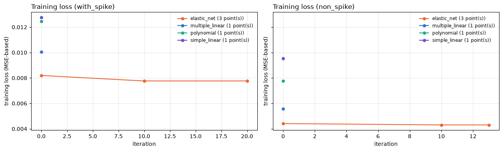

#### 4.2.5 กรณีของ Perceptron: ข้อมูลสองคลาสแบ่งด้วยเส้นตรงไม่ได้

ในรูปที่ 4.6 ถึง 4.9 กราฟของ `perceptron` ต่างจากโมเดลอื่นอย่างเห็นได้ชัด

- **Confusion matrix:** ของ `with_spike` ไม่ทายวันผันผวนสูงถูกเลยแม้แต่วันเดียว (TP = 0 จาก 34 วัน, `[[325,12],[34,0]]`)
- **ROC:** เส้นอยู่ **ต่ำกว่า** เส้นทแยงของการเดาสุ่ม ROC-AUC บน Validation เท่ากับ 0.2993 (`with_spike`) และ 0.3383 (`non_spike`)
- **Performance curve:** loss ไม่ลดลงแล้วราบเหมือนโมเดลอื่น แต่แกว่งขึ้นลงตลอดการเทรน

หัวข้อนี้อธิบายว่าสาเหตุไม่ใช่ข้อผิดพลาดของโค้ด แต่เป็นคุณสมบัติของอัลกอริทึมเมื่อใช้กับข้อมูลชุดนี้ และอธิบายวิธีแก้ที่ทดลองเพิ่มเติม

**หลักการของ Perceptron** Perceptron หาเส้นตรง ซึ่งเมื่อมีฟีเจอร์ 8 ตัวคือระนาบ `w·x + b = 0` ใน 8 มิติ เพื่อแบ่งวันผันผวนสูง (คลาส 1) ออกจากวันปกติ (คลาส 0) โดยวนผ่าน Train ทีละแถว เมื่อแถวใดถูกทายผิดก็ปรับ `w` และ `b` ไปทางที่ทำให้แถวนั้นถูก ทฤษฎีบทการลู่เข้าของ Perceptron รับประกันว่าการปรับจะหยุดได้ในจำนวนรอบจำกัด **เฉพาะเมื่อมีเส้นตรงที่แบ่งสองคลาสได้ถูกทุกแถว** (Hastie et al., 2009) ถ้าไม่มีเส้นแบบนั้น การแก้แถวหนึ่งจะทำให้แถวอื่นผิดแทน การเทรนจึงไม่มีวันหยุดเอง

**หลักฐานว่าข้อมูลของโครงงานนี้แบ่งด้วยเส้นตรงไม่ได้**

1. **ทดสอบด้วย linear programming:** ถามว่ามี `w` และ `b` ที่ทำให้ `y_i (w·x_i + b) ≥ 1` ได้ครบทุกแถวของ Train หรือไม่ (y เป็น ±1) ถ้ามี แปลว่ามีเส้นแบ่ง ผลคือ **infeasible** (ไม่มีคำตอบ) ทั้ง `with_spike` และ `non_spike` การทดสอบนี้อยู่ใน `tests/ml/classification/test_perceptron.py` และ notebook 04 หัวข้อ 16.0
2. **จำนวนการปรับไม่ลดลงเลย:** ทุก epoch ยังต้องปรับน้ำหนัก 247 ถึง 301 ครั้งใน `with_spike` และ 195 ถึง 237 ครั้งใน `non_spike` จนครบ 1,000 epochs เมื่อจบการเทรน Train ยังผิด 38.1% และ 42.4% ตามลำดับ (`docs/models/perceptron/MODEL_PROGRESS.md`)
3. **ภาพประกอบใน 2 มิติ:** รูปที่ 4.11 ซ้ายแสดงสองฟีเจอร์ที่สำคัญที่สุด จุดของคลาส 1 อยู่ปนกับคลาส 0 เป็นบริเวณกว้าง เพราะวันผันผวนสูงจำนวนมากมีฟีเจอร์เหมือนวันปกติ ภาพนี้เป็นเพียงตัวอย่าง เพราะข้อมูลจริงมี 8 มิติ หลักฐานที่ใช้ตัดสินคือข้อ 1

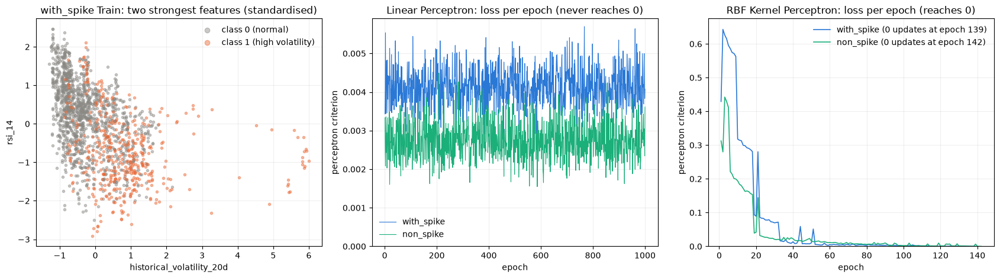

**ผลต่อกราฟและคะแนน**

- **การเทรนจบเพราะครบโควตา ไม่ใช่เพราะลู่เข้า:** loss จึงแกว่งตลอด (รูปที่ 4.11 กลาง)
- **น้ำหนักสุดท้ายไม่ใช่น้ำหนักที่ดีที่สุด:** น้ำหนักที่ได้คือน้ำหนักหลังการแก้ครั้งสุดท้าย ไม่ใช่น้ำหนักที่ดีที่สุดที่เคยผ่านมา ผลกับข้อมูลใหม่จึงขึ้นกับว่าการแก้ครั้งสุดท้ายตกที่แถวใด ซึ่งในข้อมูลนี้ให้คะแนนที่สัมพันธ์ **ผกผัน** กับคำตอบ ROC จึงต่ำกว่าเส้นทแยง และแทบไม่ทาย positive
- **ค่า learning rate ทั้งสามค่าให้ผลเหมือนกันทุกตัว:** เพราะน้ำหนักเริ่มจากศูนย์และทุกการปรับคูณด้วย learning rate น้ำหนักจึงเป็นสัดส่วนกับ learning rate ทิศทางของเส้นแบ่งไม่เปลี่ยน
- **ไม่ใช่ข้อผิดพลาดของโค้ด:** Perceptron ของ scikit-learn บนข้อมูลเดียวกันให้ค่าน้ำหนักตรงกับของเราที่ระดับ 10⁻¹⁰ และได้ ROC-AUC เท่ากัน
- **วิธีพื้นฐานไม่ช่วย:** ลองเก็บน้ำหนักที่ผิดน้อยที่สุด (pocket) และเฉลี่ยน้ำหนักทุก epoch แล้ว ได้ ROC-AUC บน Validation เพียง 0.36 / 0.33 และ 0.31 / 0.33 (`with_spike` / `non_spike`) จึงไม่ได้แทนโมเดลเดิม

**วิธีแก้: RBF Kernel Perceptron** ปัญหาอยู่ที่ "เส้นตรง" ไม่ใช่ที่วิธีปรับน้ำหนัก จึงเปลี่ยนให้ Perceptron วัดความคล้ายระหว่างวันด้วย RBF kernel `K(x, x') = exp(−γ‖x − x'‖²)` แทนผลคูณเชิงเส้น ผลเท่ากับการแบ่งข้อมูลในปริภูมิที่มีมิติสูงกว่า ซึ่งเส้นแบ่งในปริภูมินั้นเมื่อมองกลับมาที่ฟีเจอร์เดิมจะเป็นเส้นโค้ง กฎการปรับยังเหมือนเดิมทุกอย่าง ต่างกันแค่การวัดความคล้าย

- **Kernel Perceptron ลู่เข้าจริง:** loss ลดถึงศูนย์และไม่มีการปรับเลยที่ epoch 139 (`with_spike`) และ 142 (`non_spike`) (รูปที่ 4.11 ขวา) ทาย Train ถูกทุกแถว
- **การจัดอันดับดีขึ้นมาก:** ROC-AUC บน Validation เพิ่มจาก 0.30 / 0.34 เป็น 0.68 / 0.65 และบน Test จาก 0.27 / 0.26 เป็น 0.78 / 0.75 ผลต่าง AP กับ Perceptron เส้นตรงบน Test คือ +0.30 และ +0.24 โดยช่วงความเชื่อมั่น 95% ไม่คร่อมศูนย์
- **ข้อจำกัด:** การลู่เข้าบน Train ไม่ได้แปลว่าทำนายข้อมูลใหม่ได้ดีที่สุด
  - Kernel Perceptron อยู่อันดับ 13 ถึง 14 จาก 16 บน leaderboard และยังสรุปว่าดีกว่าโมเดล headline ไม่ได้
  - `non_spike` จับวันผันผวนสูงบน Test ได้เพียง 8 จาก 73 วัน
  - การทดลองนี้ทำหลังส่งงาน จึงแยกจาก 19 โมเดลที่ล็อกไว้และไม่ได้แทนผลของ Perceptron เดิม

รายละเอียดของการเทรน การเลือก γ ผลบน Test และการตรวจความทนทานอยู่ในภาคผนวก ง

#### 4.2.6 Clustering

**ตารางที่ 4.6** ผลของโมเดล clustering บน Validation แบบ with_spike

<!-- BEGIN GENERATED: outputs/modeling/report/with_spike/leaderboard_clustering.md -->
### Validation clustering metrics — with_spike

| model | variant | k | silhouette | inertia | cluster_sizes |
| --- | --- | --- | --- | --- | --- |
| agglomerative | with_spike | 2 | 0.3602 | 1070.4207 | {"0": 293, "1": 78} |
| kmeans | with_spike | 2 | 0.3666 | 1075.1372 | {"0": 73, "1": 298} |

> silhouette/inertia คำนวณบน Validation ไม่มีช่วงความเชื่อมั่น
<!-- END GENERATED -->

ทั้งสองวิธีเลือกจำนวนกลุ่ม k = 2 และได้ silhouette ราว 0.36 (ค่าอยู่ระหว่าง −1 ถึง 1 ยิ่งสูงกลุ่มยิ่งแยกชัด) เมื่อเทียบกลุ่มที่ได้กับ label จริง (ตารางที่ 4.7) กลุ่มหนึ่งมีสัดส่วนวันผันผวนสูงราว 20% อีกกลุ่มราว 6% แปลว่าฟีเจอร์เพียงอย่างเดียวแยกสภาพตลาดได้ระดับหนึ่งโดยไม่ต้องมี label ข้อจำกัดคือ Agglomerative ไม่มีขั้นตอนทำนายข้อมูลใหม่โดยธรรมชาติ เราจึงจัดวันใน Validation เข้ากลุ่มที่จุดศูนย์กลางใกล้ที่สุด

**ตารางที่ 4.7** กลุ่มที่ได้จาก clustering บน Validation เทียบกับวันผันผวนสูงจริง

| แบบข้อมูล | โมเดล | กลุ่ม | จำนวนวัน | วันผันผวนสูง | สัดส่วนวันผันผวนสูง |
| --- | --- | ---: | ---: | ---: | ---: |
| with_spike | k-Means | 0 | 73 | 16 | 21.9% |
| with_spike | k-Means | 1 | 298 | 18 | 6.0% |
| with_spike | Agglomerative | 0 | 293 | 18 | 6.1% |
| with_spike | Agglomerative | 1 | 78 | 16 | 20.5% |
| non_spike | k-Means | 0 | 267 | 16 | 6.0% |
| non_spike | k-Means | 1 | 104 | 18 | 17.3% |
| non_spike | Agglomerative | 0 | 359 | 28 | 7.8% |
| non_spike | Agglomerative | 1 | 12 | 6 | 50.0% |

ที่มา: `notebooks/04_classification.ipynb` หัวข้อ 10 สัดส่วนวันผันผวนสูงของ Validation ทั้งชุดคือ 9.2%

ทั้งสองวิธีแยกวันเป็นกลุ่มใหญ่ที่มีวันผันผวนสูงราว 6% และกลุ่มเล็กที่มีราว 17% ถึง 22% สูงกว่าสัดส่วนของทั้งชุดราวสองเท่า ยกเว้น Agglomerative ของแบบ `non_spike` ที่แยกกลุ่มเล็กเพียง 12 วัน แม้กลุ่มนั้นจะมีวันผันผวนสูงครึ่งหนึ่ง แต่ครอบคลุมวันผันผวนสูงเพียง 6 จาก 34 วัน การจัดกลุ่มโดยไม่ใช้ label จึงพอบอกสภาพตลาดได้ แต่ใช้แทน classifier ไม่ได้

#### 4.2.7 PCA กับ Random Forest และ SVM

โจทย์กำหนดให้ทดลองลดมิติของข้อมูลกับ Random Forest และ SVM เราใช้ PCA ที่ fit บนข้อมูลเทรนที่ปรับสเกลแล้ว ลองเก็บ 2, 4 และ 6 องค์ประกอบ เทียบกับการไม่ลดมิติ แล้วเลือกบน Validation ด้วย AP เช่นเดียวกับการตั้งค่าอื่น Random Forest ลอง PCA กับการตั้งค่าที่ดีที่สุดของตัวเองเท่านั้น ส่วน SVM ลอง PCA กับทุกค่า C

**ตารางที่ 4.8** Average precision บน Validation เมื่อใช้ PCA จำนวนองค์ประกอบต่าง ๆ

| แบบข้อมูล | โมเดล | ไม่ลดมิติ | 2 องค์ประกอบ | 4 องค์ประกอบ | 6 องค์ประกอบ | ที่ถูกเลือก |
| --- | --- | ---: | ---: | ---: | ---: | --- |
| with_spike | Random Forest | 0.2548 | 0.2045 | 0.2235 | 0.2172 | ไม่ลดมิติ |
| with_spike | SVM | 0.2151 | 0.2458 | 0.2514 | 0.2475 | 4 องค์ประกอบ |
| non_spike | Random Forest | 0.3010 | 0.1972 | 0.2164 | 0.2038 | ไม่ลดมิติ |
| non_spike | SVM | 0.2172 | 0.2485 | 0.2501 | 0.2452 | 4 องค์ประกอบ |

ที่มา: `notebooks/04_classification.ipynb` หัวข้อ 9

PCA ทำให้ SVM ดีขึ้นราว 0.03 ถึง 0.04 ในทั้งสองแบบข้อมูล แต่ทำให้ Random Forest แย่ลงทุกกรณี เหตุผลที่น่าจะเป็นคือ SVM ใช้ linear kernel ซึ่งได้ประโยชน์จากการรวมฟีเจอร์ที่ซ้ำซ้อนกันเป็นองค์ประกอบที่ตั้งฉากกัน และตัดสัญญาณรบกวนในองค์ประกอบท้าย ๆ ทิ้ง ส่วนต้นไม้แบ่งข้อมูลทีละฟีเจอร์และจัดการฟีเจอร์ที่ซ้ำซ้อนได้เองอยู่แล้ว การหมุนแกนด้วย PCA ทำให้เส้นแบ่งที่ต้นไม้หาได้ง่ายบนฟีเจอร์เดิมกลายเป็นเส้นเฉียงที่ต้องใช้การแบ่งหลายครั้ง อย่างไรก็ตาม ผลต่างทั้งหมดนี้ยังเล็กกว่าความกว้างของช่วงความเชื่อมั่นบน Validation (ตารางที่ 4.4)

### 4.3 ผลของโมเดลนอกเนื้อหาที่เรียน

#### 4.3.1 Elastic Net

**ผลที่ได้** การตั้งค่าที่ถูกเลือกคือ α = 0.1 และ l1_ratio = 0.25 ทั้งสองแบบข้อมูล โมเดลดันน้ำหนักเป็นศูนย์ 3 จาก 8 ฟีเจอร์ (`with_spike`) และ 4 จาก 8 (`non_spike`) ที่มา: `outputs/modeling/report/with_spike/linear_coefficients.csv` และ notebook 03 หัวข้อ 5 เมื่อเทียบกับ `ElasticNet` ของ scikit-learn คำทำนายต่างกันไม่เกิน 9e-07 (`with_spike`) และ 3e-06 (`non_spike`)

**การเลือกการตั้งค่า** ตารางที่ 4.9 แสดง RMSE บน Validation ของทุกการตั้งค่าใน grid ค่าปรับน้อย (α = 0.0001) ให้ผลเท่ากับ `multiple_linear` (0.0689 ใน `with_spike`) เพราะน้ำหนักแทบไม่ถูกบีบ เมื่อเพิ่ม α เป็น 0.1 คู่กับ l1_ratio 0.25 RMSE ลดเหลือ 0.0668 แต่ที่ α เดียวกัน ถ้าใช้ l1_ratio 0.75 RMSE กลับแย่ลงเป็น 0.0718 เพราะค่าปรับแบบ L1 ที่แรงตัดฟีเจอร์ที่มีประโยชน์ทิ้งมากเกินไป ส่วนผสมที่ดีที่สุดจึงเน้นค่าปรับแบบ L2 ซึ่งให้ฟีเจอร์ที่ซ้ำซ้อนกันแบ่งน้ำหนักกัน รูปแบบเดียวกันเกิดกับ `non_spike`

**ตารางที่ 4.9** RMSE บน Validation ของ Elastic Net ทุกการตั้งค่าใน grid

| แบบข้อมูล | α | l1_ratio 0.25 | l1_ratio 0.50 | l1_ratio 0.75 |
| --- | ---: | ---: | ---: | ---: |
| with_spike | 0.0001 | 0.06887 | 0.06887 | 0.06888 |
| with_spike | 0.001 | 0.06892 | 0.06899 | 0.06907 |
| with_spike | 0.01 | 0.06884 | 0.06829 | 0.06798 |
| with_spike | 0.1 | **0.06681** | 0.06812 | 0.07175 |
| non_spike | 0.0001 | 0.06681 | 0.06681 | 0.06680 |
| non_spike | 0.001 | 0.06675 | 0.06668 | 0.06661 |
| non_spike | 0.01 | 0.06620 | 0.06584 | 0.06550 |
| non_spike | 0.1 | **0.06426** | 0.06696 | 0.06764 |

ที่มา: `notebooks/03_regression.ipynb` หัวข้อ 5 ตัวเลขตัวหนาคือการตั้งค่าที่ถูกเลือก

**น้ำหนักที่ได้** รูปที่ 4.12 เทียบน้ำหนักบนฟีเจอร์ที่ปรับสเกลแล้วของ `multiple_linear` กับ `elastic_net` ใน `multiple_linear` น้ำหนักของ `historical_volatility_20d` สูงที่สุด (0.059) `sma_ratio_5_20` ได้น้ำหนักติดลบมาก (−0.023) และ `rsi_14` ได้น้ำหนักบวก (0.011) ทั้งที่สัมพันธ์กับ target ในทางลบ (r = −0.49) น้ำหนักที่มีเครื่องหมายขัดกับความสัมพันธ์จริงแบบนี้เกิดจากฟีเจอร์ที่ซ้ำซ้อนกันชดเชยกันเอง Elastic Net กระจายน้ำหนักระหว่างฟีเจอร์ความผันผวนสามตัว (`historical_volatility_5d` 0.021, `historical_volatility_20d` 0.024 และ `intraday_range` 0.029) ตั้งน้ำหนักของ `return_1d`, `return_5d` และ `volume_zscore_20` เป็นศูนย์ และให้ `rsi_14` ติดลบตามความสัมพันธ์จริง (ตัวเลขเป็นของแบบ `with_spike`)

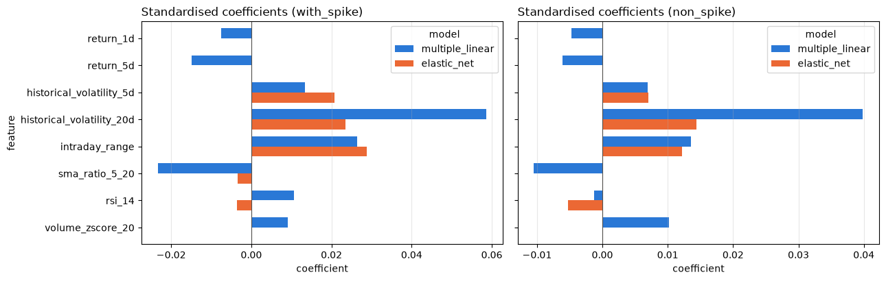

**ตารางที่ 4.10** ผลของ Elastic Net บน Validation และ Test

<!-- BEGIN GENERATED: outputs/modeling/report/cards/elastic_net.md -->
### ผลจริงของ `elastic_net`

| variant | split | params | rmse | mae | r2 |
| --- | --- | --- | --- | --- | --- |
| with_spike | validation (selection score) | {"alpha": 0.1, "l1_ratio": 0.25, "max_iter": 5000, "tol": 1e-06} | 0.0668 | 0.0539 | 0.0169 |
| with_spike | test (one-shot) | {"alpha": 0.1, "l1_ratio": 0.25, "max_iter": 5000, "tol": 1e-06} | 0.1174 | 0.0731 | 0.2758 |
| non_spike | validation (selection score) | {"alpha": 0.1, "l1_ratio": 0.25, "max_iter": 5000, "tol": 1e-06} | 0.0643 | 0.0510 | 0.0906 |
| non_spike | test (one-shot) | {"alpha": 0.1, "l1_ratio": 0.25, "max_iter": 5000, "tol": 1e-06} | 0.1230 | 0.0736 | 0.2059 |
<!-- END GENERATED -->

#### 4.3.2 AdaBoost

**ผลที่ได้** การตั้งค่าที่ถูกเลือกคือ stump 100 ตัว และ learning_rate 0.5 stump ตัวแรกมีความผิดพลาด 0.25 (`with_spike`) ส่วนตัวท้าย ๆ มีความผิดพลาดใกล้ 0.5 และมีสิทธิ์ออกเสียงเล็กมาก เพราะตัวอย่างที่เหลือให้แก้คือตัวอย่างที่ยากจริง ๆ (กราฟอยู่ใน notebook 04 หัวข้อ 8) คำทำนายตรงกับ `AdaBoostClassifier` ของ scikit-learn ทุกแถว

รูปที่ 4.13 แสดงความผิดพลาดแบบถ่วงน้ำหนักและสิทธิ์ออกเสียงของ stump ทั้ง 100 ตัว stump ตัวแรกผิดราว 0.25 (`with_spike`) และ 0.19 (`non_spike`) จึงได้สิทธิ์ออกเสียงสูงสุดราว 0.55 และ 0.72 ตามสูตร `α = 0.5 · ln((1 − ε) / ε)` หลังจากราว 10 รอบ ความผิดพลาดขึ้นไปใกล้ 0.5 และสิทธิ์ออกเสียงลดเกือบเป็นศูนย์ แปลว่า stump ช่วงหลังแทบไม่เพิ่มข้อมูลใหม่ เพราะน้ำหนักถูกย้ายไปอยู่กับตัวอย่างที่ stump แบบคำถามเดียวแยกไม่ได้ ข้อนี้สอดคล้องกับการที่ AdaBoost ไม่ได้ดีกว่าโมเดลเรียบง่ายในตารางที่ 4.4

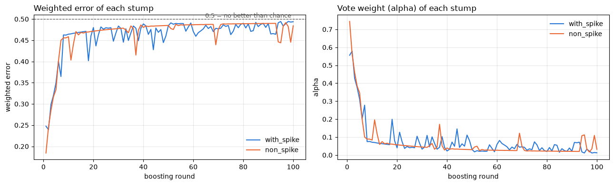

**ตารางที่ 4.11** ผลของ AdaBoost บน Validation และ Test

<!-- BEGIN GENERATED: outputs/modeling/report/cards/adaboost.md -->
### ผลจริงของ `adaboost`

| variant | split | params | average_precision | roc_auc | f1 | recall | precision | specificity | accuracy |
| --- | --- | --- | --- | --- | --- | --- | --- | --- | --- |
| with_spike | validation (selection score) | {"learning_rate": 0.5, "n_estimators": 100, "random_state": 42} | 0.2363 | 0.6768 | 0.2222 | 0.1765 | 0.3000 | 0.9585 | 0.8868 |
| with_spike | test (one-shot) | {"learning_rate": 0.5, "n_estimators": 100, "random_state": 42} | 0.4858 | 0.7614 | 0.4853 | 0.4521 | 0.5238 | 0.9000 | 0.8123 |
| non_spike | validation (selection score) | {"learning_rate": 0.5, "n_estimators": 100, "random_state": 42} | 0.2407 | 0.6409 | 0.2353 | 0.1765 | 0.3529 | 0.9674 | 0.8949 |
| non_spike | test (one-shot) | {"learning_rate": 0.5, "n_estimators": 100, "random_state": 42} | 0.5443 | 0.7735 | 0.5000 | 0.4110 | 0.6383 | 0.9433 | 0.8391 |
<!-- END GENERATED -->

### 4.4 ผลบน Test

Test ถูกเปิด **ครั้งเดียว** เมื่อ 11 ตุลาคม 2026 หลัง commit ไฟล์ล็อกแล้ว โมเดลทั้งหมดเทรนจาก Train และเลือกบน Validation ไม่มีการเทรนใหม่ ใบรับรองอยู่ในภาคผนวก ค

**โมเดลตัวแทนที่ล็อกไว้** คือผู้ที่ได้คะแนนสูงสุดบน Validation ของแต่ละงาน (ตารางที่ 4.12) การล็อกชื่อไว้ก่อนมีไว้เพื่อไม่ให้เลือกโมเดลย้อนหลังจากผล Test ได้

**ตารางที่ 4.12** โมเดลตัวแทนที่ล็อกไว้: คะแนนบน Validation คะแนนบน Test และเส้นฐานที่ดีที่สุด

<!-- BEGIN GENERATED: outputs/modeling/report/tables/test_headline_summary.md -->
### Locked headline models: Validation score, one-shot Test score and the best baseline

| task | variant | headline | metric | validation | test | test_low | test_high | rank_on_test | best_baseline | baseline_test | beats_baseline |
| --- | --- | --- | --- | --- | --- | --- | --- | --- | --- | --- | --- |
| classification | with_spike | mlp | average_precision | 0.2668 | 0.5991 | 0.2605 | 0.7603 | 1 of 13 | baseline_persistence | 0.5365 | yes |
| classification | non_spike | random_forest | average_precision | 0.3010 | 0.5240 | 0.2161 | 0.6796 | 10 of 13 | baseline_persistence | 0.5365 | no |
| regression | with_spike | elastic_net | rmse | 0.0668 | 0.1174 | 0.0709 | 0.1746 | 2 of 4 | baseline_train_mean | 0.1380 | yes |
| regression | non_spike | elastic_net | rmse | 0.0643 | 0.1230 | 0.0688 | 0.1859 | 3 of 4 | baseline_train_mean | 0.1400 | yes |
<!-- END GENERATED -->

**ตารางที่ 4.13** ผลของโมเดล classification บน Test แบบ with_spike

<!-- BEGIN GENERATED: outputs/modeling/final/with_spike/leaderboard_classification.md -->
### Test leaderboard — classification — with_spike

| model | kind | headline | validation_average_precision | average_precision_ci | roc_auc_ci | f1_ci | recall_ci | tied_with_leader | beats_best_baseline |
| --- | --- | --- | --- | --- | --- | --- | --- | --- | --- |
| mlp | model | yes | 0.2668 | 0.5991 [0.2605, 0.7603] | 0.7930 [0.6103, 0.9031] | 0.5714 [0.2104, 0.6929] | 0.4932 [0.1429, 0.6505] | yes | yes |
| random_forest | model | no | 0.2548 | 0.5775 [0.2366, 0.7393] | 0.7866 [0.5922, 0.8920] | 0.5000 [0.1764, 0.6047] | 0.4247 [0.1333, 0.5424] | yes | yes |
| svm | model | no | 0.2514 | 0.5716 [0.2402, 0.7438] | 0.7835 [0.5935, 0.8955] | 0.4874 [0.1176, 0.6102] | 0.3973 [0.0789, 0.5536] | yes | yes |
| gaussian_nb | model | no | 0.2218 | 0.5538 [0.2390, 0.7289] | 0.7703 [0.5749, 0.8838] | 0.5806 [0.3055, 0.6892] | 0.6164 [0.3158, 0.7444] | yes | yes |
| slp | model | no | 0.2427 | 0.5536 [0.2473, 0.7470] | 0.7798 [0.5865, 0.8954] | 0.5041 [0.1665, 0.6480] | 0.4247 [0.1052, 0.6186] | yes | yes |
| logistic | model | no | 0.2330 | 0.5518 [0.2482, 0.7452] | 0.7822 [0.5936, 0.8978] | 0.5203 [0.2083, 0.6564] | 0.4384 [0.1351, 0.6211] | yes | yes |
| knn | model | no | 0.2037 | 0.5472 [0.2187, 0.7309] | 0.7847 [0.6241, 0.8634] | 0.5512 [0.1886, 0.6804] | 0.4795 [0.1350, 0.6579] | yes | yes |
| baseline_persistence | baseline | no | n/a | 0.5365 [0.1589, 0.7246] | 0.7255 [0.5280, 0.8308] | 0.4933 [0.1599, 0.6335] | 0.5068 [0.1633, 0.6552] | yes | n/a |
| gradient_boosting | model | no | 0.2531 | 0.5332 [0.2223, 0.7096] | 0.7665 [0.5798, 0.8803] | 0.4390 [0.1591, 0.6000] | 0.3699 [0.1190, 0.5539] | yes | no |
| xgboost | model | no | 0.2508 | 0.5305 [0.2021, 0.7067] | 0.7716 [0.5844, 0.8839] | 0.4553 [0.1795, 0.6078] | 0.3836 [0.1333, 0.5582] | yes | no |
| stacking | model | no | 0.2262 | 0.5131 [0.2395, 0.7154] | 0.7902 [0.6082, 0.8877] | 0.5714 [0.2898, 0.6842] | 0.5753 [0.2439, 0.7385] | yes | no |
| adaboost | model | no | 0.2363 | 0.4858 [0.2145, 0.6807] | 0.7614 [0.5710, 0.8785] | 0.4853 [0.2268, 0.6555] | 0.4521 [0.1852, 0.6775] | no | no |
| decision_tree | model | no | 0.1732 | 0.3792 [0.1524, 0.5643] | 0.7450 [0.6021, 0.8449] | 0.4800 [0.2000, 0.6667] | 0.4932 [0.1621, 0.7527] | no | no |
| baseline_majority | baseline | no | n/a | 0.1957 [0.0885, 0.3003] | 0.5000 [0.5000, 0.5000] | 0.0000 [0.0000, 0.0000] | 0.0000 [0.0000, 0.0000] | no | n/a |
| perceptron | model | no | 0.0648 | 0.1374 [0.0657, 0.2463] | 0.2749 [0.1567, 0.4688] | 0.0577 [0.0000, 0.1840] | 0.0411 [0.0000, 0.1690] | no | no |

> ประเมินบน Test ครั้งเดียวด้วยโมเดลที่เทรนจาก Train และเลือกบน Validation (ไม่ refit) โมเดลเด่นของแต่ละ task ถูกระบุไว้ใน selection_lock.json ก่อนเปิด Test แถวอื่นในตารางเป็นข้อมูลประกอบ ห้ามเลือกโมเดลจากตารางนี้
<!-- END GENERATED -->

**ตารางที่ 4.14** ผลของโมเดล classification บน Test แบบ non_spike

<!-- BEGIN GENERATED: outputs/modeling/final/non_spike/leaderboard_classification.md -->
### Test leaderboard — classification — non_spike

| model | kind | headline | validation_average_precision | average_precision_ci | roc_auc_ci | f1_ci | recall_ci | tied_with_leader | beats_best_baseline |
| --- | --- | --- | --- | --- | --- | --- | --- | --- | --- |
| gaussian_nb | model | no | 0.2292 | 0.5884 [0.2441, 0.7462] | 0.7779 [0.5735, 0.8913] | 0.5824 [0.3299, 0.6817] | 0.7260 [0.4210, 0.8530] | yes | yes |
| xgboost | model | no | 0.2652 | 0.5823 [0.2509, 0.7436] | 0.7887 [0.6017, 0.8948] | 0.5469 [0.2034, 0.7000] | 0.4795 [0.1463, 0.6812] | yes | yes |
| svm | model | no | 0.2501 | 0.5805 [0.2446, 0.7504] | 0.7853 [0.5967, 0.8990] | 0.4587 [0.0974, 0.5922] | 0.3425 [0.0588, 0.5048] | yes | yes |
| gradient_boosting | model | no | 0.2525 | 0.5653 [0.2460, 0.7310] | 0.7861 [0.6087, 0.8920] | 0.3762 [0.1290, 0.5264] | 0.2603 [0.0789, 0.4000] | yes | yes |
| mlp | model | no | 0.2808 | 0.5639 [0.2507, 0.7235] | 0.7894 [0.5922, 0.8906] | 0.5039 [0.2127, 0.6449] | 0.4384 [0.1578, 0.6165] | yes | yes |
| logistic | model | no | 0.2513 | 0.5510 [0.2472, 0.7391] | 0.7782 [0.5841, 0.8940] | 0.5041 [0.1785, 0.6269] | 0.4247 [0.1111, 0.5943] | yes | yes |
| stacking | model | no | 0.2311 | 0.5499 [0.2440, 0.7150] | 0.7890 [0.6135, 0.8828] | 0.4853 [0.2432, 0.6016] | 0.4521 [0.2057, 0.5843] | yes | yes |
| adaboost | model | no | 0.2407 | 0.5443 [0.2261, 0.7297] | 0.7735 [0.5788, 0.8899] | 0.5000 [0.2051, 0.6348] | 0.4110 [0.1470, 0.5758] | yes | yes |
| knn | model | no | 0.2082 | 0.5389 [0.2514, 0.7067] | 0.8008 [0.6595, 0.8698] | 0.4237 [0.0894, 0.5658] | 0.3425 [0.0606, 0.4943] | yes | yes |
| baseline_persistence | baseline | no | n/a | 0.5365 [0.1589, 0.7246] | 0.7255 [0.5280, 0.8308] | 0.4933 [0.1599, 0.6335] | 0.5068 [0.1633, 0.6552] | yes | n/a |
| random_forest | model | yes | 0.3010 | 0.5240 [0.2161, 0.6796] | 0.7814 [0.5879, 0.8807] | 0.4715 [0.1667, 0.5556] | 0.3973 [0.1249, 0.4923] | yes | no |
| slp | model | no | 0.2474 | 0.4963 [0.2080, 0.6769] | 0.7420 [0.5497, 0.8583] | 0.5000 [0.2564, 0.6053] | 0.4795 [0.2143, 0.6164] | no | no |
| decision_tree | model | no | 0.1887 | 0.3844 [0.1761, 0.5137] | 0.6916 [0.5598, 0.7827] | 0.4310 [0.2142, 0.5246] | 0.3425 [0.1579, 0.4272] | no | no |
| baseline_majority | baseline | no | n/a | 0.1957 [0.0885, 0.3003] | 0.5000 [0.5000, 0.5000] | 0.0000 [0.0000, 0.0000] | 0.0000 [0.0000, 0.0000] | no | n/a |
| perceptron | model | no | 0.0742 | 0.1328 [0.0624, 0.2276] | 0.2626 [0.1410, 0.4434] | 0.0813 [0.0000, 0.2460] | 0.0685 [0.0000, 0.2817] | no | no |

> ประเมินบน Test ครั้งเดียวด้วยโมเดลที่เทรนจาก Train และเลือกบน Validation (ไม่ refit) โมเดลเด่นของแต่ละ task ถูกระบุไว้ใน selection_lock.json ก่อนเปิด Test แถวอื่นในตารางเป็นข้อมูลประกอบ ห้ามเลือกโมเดลจากตารางนี้
<!-- END GENERATED -->

**ตารางที่ 4.15** ผลของโมเดล regression บน Test แบบ with_spike

<!-- BEGIN GENERATED: outputs/modeling/final/with_spike/leaderboard_regression.md -->
### Test leaderboard — regression — with_spike

| model | kind | headline | validation_rmse | rmse_ci | r2_ci | tied_with_leader | beats_best_baseline |
| --- | --- | --- | --- | --- | --- | --- | --- |
| multiple_linear | model | no | 0.0689 | 0.1158 [0.0711, 0.1680] | 0.2959 [-0.1971, 0.3897] | yes | yes |
| elastic_net | model | yes | 0.0668 | 0.1174 [0.0709, 0.1746] | 0.2758 [-0.0402, 0.3258] | yes | yes |
| simple_linear | model | no | 0.0690 | 0.1356 [0.0754, 0.1985] | 0.0347 [-0.7702, 0.2310] | no | yes |
| baseline_train_mean | baseline | no | n/a | 0.1380 [0.0806, 0.2060] | -0.0006 [-0.2998, -0.0000] | yes | n/a |
| polynomial | model | no | 0.0691 | 0.1401 [0.0754, 0.2037] | -0.0314 [-1.1539, 0.2401] | no | no |
| baseline_persistence | baseline | no | n/a | 0.1502 [0.0919, 0.2222] | -0.1855 [-1.2071, 0.1280] | no | n/a |

> ประเมินบน Test ครั้งเดียวด้วยโมเดลที่เทรนจาก Train และเลือกบน Validation (ไม่ refit) โมเดลเด่นของแต่ละ task ถูกระบุไว้ใน selection_lock.json ก่อนเปิด Test แถวอื่นในตารางเป็นข้อมูลประกอบ ห้ามเลือกโมเดลจากตารางนี้
<!-- END GENERATED -->

**ตารางที่ 4.16** ผลของโมเดล regression บน Test แบบ non_spike

<!-- BEGIN GENERATED: outputs/modeling/final/non_spike/leaderboard_regression.md -->
### Test leaderboard — regression — non_spike

| model | kind | headline | validation_rmse | rmse_ci | r2_ci | tied_with_leader | beats_best_baseline |
| --- | --- | --- | --- | --- | --- | --- | --- |
| polynomial | model | no | 0.0661 | 0.1142 [0.0720, 0.1641] | 0.3155 [-0.0360, 0.4224] | yes | yes |
| multiple_linear | model | no | 0.0668 | 0.1180 [0.0705, 0.1732] | 0.2684 [-0.1829, 0.3623] | yes | yes |
| elastic_net | model | yes | 0.0643 | 0.1230 [0.0688, 0.1859] | 0.2059 [0.0554, 0.2619] | yes | yes |
| simple_linear | model | no | 0.0665 | 0.1372 [0.0733, 0.2087] | 0.0114 [-0.1001, 0.0488] | yes | yes |
| baseline_train_mean | baseline | no | n/a | 0.1400 [0.0745, 0.2132] | -0.0298 [-0.1430, -0.0001] | yes | n/a |
| baseline_persistence | baseline | no | n/a | 0.1502 [0.0919, 0.2222] | -0.1855 [-1.2071, 0.1280] | no | n/a |

> ประเมินบน Test ครั้งเดียวด้วยโมเดลที่เทรนจาก Train และเลือกบน Validation (ไม่ refit) โมเดลเด่นของแต่ละ task ถูกระบุไว้ใน selection_lock.json ก่อนเปิด Test แถวอื่นในตารางเป็นข้อมูลประกอบ ห้ามเลือกโมเดลจากตารางนี้
<!-- END GENERATED -->

**อ่านผล**

1. **Classification** โมเดลตัวแทนของ `with_spike` คือ `mlp` ได้ AP 0.599 และยังเป็นอันดับหนึ่งบน Test เทียบกับการเดาสุ่ม 0.196 และ `baseline_persistence` 0.536 แต่โมเดลตัวแทนของ `non_spike` คือ `random_forest` ได้ AP 0.524 ต่ำกว่า baseline และตกจากอันดับ 1 บน Validation ไปอยู่อันดับ 10 จาก 13 โมเดล นี่คือตัวอย่างของ selection bias: ผู้นำบน Validation ที่มีวันผันผวนสูงเพียง 34 วัน ไม่จำเป็นต้องเป็นผู้นำบนข้อมูลใหม่
2. **Regression** `elastic_net` ได้ RMSE 0.117 และ 0.123 ดีกว่า baseline ที่ทายค่าเฉลี่ย (0.138 และ 0.140) R² อยู่ที่ราว 0.2 ถึง 0.3 สูงกว่าบน Validation เพราะ Test มีช่วงผันผวนแรงให้โมเดลอธิบาย
3. **AP บน Test สูงกว่า Validation มาก** (0.6 เทียบกับ 0.27) ข้อนี้ไม่ได้แปลว่าโมเดลเก่งขึ้น AP ขึ้นกับสัดส่วนวันผันผวนสูง ซึ่ง Test มี 19.6% ส่วน Validation มี 9.2% จึงต้องเทียบกับ baseline ของชุดเดียวกันเสมอ

**แยกผลตามช่วงตลาด** Test มี 54 แถวที่อยู่ในหน้าต่างรอบวัน spike (เดือนเมษายน 2025 และมิถุนายน 2026) และ 319 แถวที่เป็นช่วงปกติ

**ตารางที่ 4.17** ผลบน Test แยกตามช่วงตลาด งาน classification

<!-- BEGIN GENERATED: outputs/modeling/report/tables/test_segments_classification.md -->
### Test metrics by diagnostic segment — classification

| model | variant | segment | rows | positives | average_precision | roc_auc | recall | precision | f1 |
| --- | --- | --- | --- | --- | --- | --- | --- | --- | --- |
| adaboost | non_spike | non_spike | 319 | 35 | 0.3372 | 0.7370 | 0.3714 | 0.5200 | 0.4333 |
| adaboost | non_spike | spike_affected | 54 | 38 | 0.8281 | 0.6102 | 0.4474 | 0.7727 | 0.5667 |
| adaboost | with_spike | non_spike | 319 | 35 | 0.3212 | 0.7251 | 0.3429 | 0.4138 | 0.3750 |
| adaboost | with_spike | spike_affected | 54 | 38 | 0.6804 | 0.3413 | 0.5526 | 0.6176 | 0.5833 |
| logistic | non_spike | non_spike | 319 | 35 | 0.3639 | 0.7444 | 0.2000 | 0.5385 | 0.2917 |
| logistic | non_spike | spike_affected | 54 | 38 | 0.7200 | 0.3668 | 0.6316 | 0.6486 | 0.6400 |
| logistic | with_spike | non_spike | 319 | 35 | 0.3882 | 0.7545 | 0.2286 | 0.6154 | 0.3333 |
| logistic | with_spike | spike_affected | 54 | 38 | 0.7168 | 0.3734 | 0.6316 | 0.6486 | 0.6400 |
| mlp | non_spike | non_spike | 319 | 35 | 0.4048 | 0.7454 | 0.2857 | 0.5263 | 0.3704 |
| mlp | non_spike | spike_affected | 54 | 38 | 0.7310 | 0.4227 | 0.5789 | 0.6286 | 0.6027 |
| mlp | with_spike | non_spike | 319 | 35 | 0.4451 | 0.7709 | 0.3429 | 0.5714 | 0.4286 |
| mlp | with_spike | spike_affected | 54 | 38 | 0.7837 | 0.5296 | 0.6316 | 0.7500 | 0.6857 |
| random_forest | non_spike | non_spike | 319 | 35 | 0.3898 | 0.7344 | 0.3714 | 0.4815 | 0.4194 |
| random_forest | non_spike | spike_affected | 54 | 38 | 0.7664 | 0.5510 | 0.4211 | 0.6957 | 0.5246 |
| random_forest | with_spike | non_spike | 319 | 35 | 0.3782 | 0.7455 | 0.3429 | 0.4800 | 0.4000 |
| random_forest | with_spike | spike_affected | 54 | 38 | 0.8011 | 0.5757 | 0.5000 | 0.7308 | 0.5938 |
<!-- END GENERATED -->

**ตารางที่ 4.18** ผลบน Test แยกตามช่วงตลาด งาน regression

<!-- BEGIN GENERATED: outputs/modeling/report/tables/test_segments_regression.md -->
### Test metrics by diagnostic segment — regression

| model | variant | segment | rows | rmse | mae | r2 |
| --- | --- | --- | --- | --- | --- | --- |
| elastic_net | non_spike | non_spike | 319 | 0.0692 | 0.0550 | 0.1752 |
| elastic_net | non_spike | spike_affected | 54 | 0.2759 | 0.1838 | -0.3351 |
| elastic_net | with_spike | non_spike | 319 | 0.0707 | 0.0564 | 0.1395 |
| elastic_net | with_spike | spike_affected | 54 | 0.2564 | 0.1722 | -0.1526 |
| multiple_linear | non_spike | non_spike | 319 | 0.0683 | 0.0525 | 0.1972 |
| multiple_linear | non_spike | spike_affected | 54 | 0.2620 | 0.1880 | -0.2042 |
| multiple_linear | with_spike | non_spike | 319 | 0.0694 | 0.0536 | 0.1714 |
| multiple_linear | with_spike | spike_affected | 54 | 0.2533 | 0.1819 | -0.1253 |
<!-- END GENERATED -->

- **ช่วงปกติ** (วันผันผวนสูง 35 จาก 319 วัน หรือ 11%): classifier ได้ ROC-AUC ราว 0.72 ถึง 0.77 และ AP ราว 0.32 ถึง 0.45 สูงกว่าการเดาสุ่ม (0.11) ชัดเจน regression ได้ RMSE ราว 0.07 ใกล้เคียงกับบน Validation
- **ช่วงรอบวัน spike** (วันผันผวนสูง 38 จาก 54 วัน หรือ 70%): ROC-AUC ของ classifier ในตารางอยู่ระหว่าง 0.34 ถึง 0.61 คือใกล้หรือต่ำกว่าการเดาสุ่ม **ภายในช่วงปั่นป่วน โมเดลแยกไม่ได้ว่าวันไหนจะผันผวนสูง** AP ที่ดูสูง (0.7 ถึง 0.8) มาจากการที่วันส่วนใหญ่ในช่วงนี้ผันผวนสูงอยู่แล้ว ส่วน regression ได้ RMSE ราว 0.25 ถึง 0.28 และ R² ติดลบ

สรุปคือ โมเดลรู้ว่า "ตอนนี้ตลาดกำลังปั่นป่วน" ซึ่งเป็นสิ่งที่ `baseline_persistence` ก็รู้ แต่ไม่รู้ว่าความปั่นป่วนจะเริ่มเมื่อไรหรือจะจบวันไหน ตาราง metric ครบทุกตัวบน Test อยู่ในภาคผนวก ข

### 4.5 ผลการเปรียบเทียบ with_spike กับ non_spike

**บน Validation** `delta = non_spike − with_spike` สำหรับ AP ค่าบวกคือดีขึ้นเมื่อตัด spike สำหรับ RMSE ค่าลบคือดีขึ้น

**ตารางที่ 4.19** ผลต่างแบบจับคู่ non_spike − with_spike บน Validation

<!-- BEGIN GENERATED: outputs/modeling/report/comparison_a_vs_b.md -->
### Paired comparison: non_spike − with_spike (Validation)

| model | task | metric | with_spike | non_spike | delta | delta_95 | verdict |
| --- | --- | --- | --- | --- | --- | --- | --- |
| elastic_net | regression | rmse | 0.0668 | 0.0643 | -0.0026 | [-0.0053, +0.0019] | inconclusive |
| multiple_linear | regression | rmse | 0.0689 | 0.0668 | -0.0020 | [-0.0036, -0.0000] | non_spike better |
| polynomial | regression | rmse | 0.0691 | 0.0661 | -0.0030 | [-0.0073, +0.0016] | inconclusive |
| simple_linear | regression | rmse | 0.0690 | 0.0665 | -0.0026 | [-0.0066, +0.0026] | inconclusive |
| adaboost | classification | average_precision | 0.2363 | 0.2407 | 0.0044 | [-0.0307, +0.0627] | inconclusive |
| decision_tree | classification | average_precision | 0.1732 | 0.1887 | 0.0155 | [-0.0380, +0.0970] | inconclusive |
| gaussian_nb | classification | average_precision | 0.2218 | 0.2292 | 0.0074 | [-0.0007, +0.0187] | inconclusive |
| gradient_boosting | classification | average_precision | 0.2531 | 0.2525 | -0.0006 | [-0.0445, +0.0223] | inconclusive |
| knn | classification | average_precision | 0.2037 | 0.2082 | 0.0045 | [-0.0441, +0.0601] | inconclusive |
| logistic | classification | average_precision | 0.2330 | 0.2513 | 0.0183 | [-0.0110, +0.0401] | inconclusive |
| mlp | classification | average_precision | 0.2668 | 0.2808 | 0.0139 | [-0.0429, +0.0772] | inconclusive |
| perceptron | classification | average_precision | 0.0648 | 0.0742 | 0.0094 | [-0.0012, +0.0575] | inconclusive |
| random_forest | classification | average_precision | 0.2548 | 0.3010 | 0.0462 | [-0.0168, +0.1155] | inconclusive |
| slp | classification | average_precision | 0.2427 | 0.2474 | 0.0047 | [-0.0477, +0.0441] | inconclusive |
| stacking | classification | average_precision | 0.2262 | 0.2311 | 0.0049 | [-0.0386, +0.0477] | inconclusive |
| svm | classification | average_precision | 0.2514 | 0.2501 | -0.0013 | [-0.0108, +0.0082] | inconclusive |
| xgboost | classification | average_precision | 0.2508 | 0.2652 | 0.0144 | [-0.0148, +0.0386] | inconclusive |
| agglomerative | clustering | silhouette | 0.3602 | 0.4642 | 0.1040 | n/a | no interval |
| kmeans | clustering | silhouette | 0.3666 | 0.3298 | -0.0367 | n/a | no interval |

> ผลต่างในตารางนี้คือผลของ **นโยบายตัดแถวทั้งชุด** ไม่ใช่ผลของ spike เพียงอย่างเดียว: การตัด 213 แถวทำให้ class prior ของ Train เปลี่ยนจาก 25.0% เป็น 18.4%, จำนวนแถวลดจาก 1,733 เป็น 1,520 และ regime ที่ผันผวนสูงหายไปจาก Train พร้อมกัน ทั้งสาม confound นี้แยกจากกันไม่ได้ด้วยการทดลองนี้ delta = non_spike − with_spike บน Validation 371 แถวชุดเดียวกัน ช่วง 95% จาก paired moving-block bootstrap (block 20 วัน) และเมื่อเทียบ 17 โมเดลพร้อมกัน ควรคาดว่าจะมีราว 1 แถวที่ช่วงไม่คร่อมศูนย์โดยบังเอิญ
<!-- END GENERATED -->

โมเดลส่วนใหญ่ได้คะแนนดีขึ้นเล็กน้อยเมื่อตัด spike แต่ 16 จาก 17 โมเดลได้คำตัดสิน `inconclusive` มีเพียง `multiple_linear` ที่ช่วงไม่คร่อมศูนย์ ซึ่งเมื่อเทียบ 17 โมเดลพร้อมกัน การเจอราว 1 โมเดลโดยบังเอิญเป็นเรื่องที่คาดได้ นอกจากนี้ Validation ไม่มีวัน spike เลย จึงทดสอบไม่ได้ว่าโมเดลแต่ละแบบรับมือ spike ได้ดีแค่ไหน

รูปที่ 4.17 แสดงผลต่างของ RMSE ในงาน regression ทุกโมเดลได้ RMSE ต่ำลงเล็กน้อยเมื่อตัด spike (0.0020 ถึง 0.0030) แต่มีเพียง `multiple_linear` ที่ช่วงไม่คร่อมศูนย์ และขอบบนของช่วงเกือบแตะศูนย์

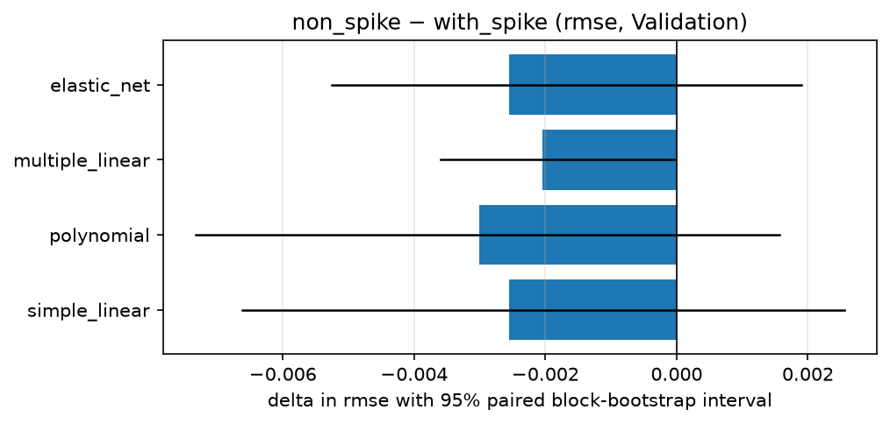

**บน Test** ใช้คำทำนายที่บันทึกไว้ตอน finalize และวิธี paired block bootstrap เดียวกัน

**ตารางที่ 4.20** โมเดลเดียวกันที่เทรนแบบมีและไม่มีช่วง spike บน Test

<!-- BEGIN GENERATED: outputs/modeling/report/tables/test_spike_policy.md -->
### Same model with and without spike rows, on Test (paired block bootstrap)

| task | model | metric | with_spike | non_spike | delta | delta_low | delta_high | direction | interval_excludes_zero |
| --- | --- | --- | --- | --- | --- | --- | --- | --- | --- |
| classification | adaboost | average_precision | 0.4858 | 0.5443 | 0.0585 | -0.0324 | 0.1168 | non_spike better | no |
| classification | decision_tree | average_precision | 0.3792 | 0.3844 | 0.0052 | -0.1502 | 0.1190 | non_spike better | no |
| classification | gaussian_nb | average_precision | 0.5538 | 0.5884 | 0.0346 | -0.0064 | 0.0632 | non_spike better | no |
| classification | gradient_boosting | average_precision | 0.5332 | 0.5653 | 0.0322 | -0.0254 | 0.0891 | non_spike better | no |
| classification | knn | average_precision | 0.5472 | 0.5389 | -0.0083 | -0.1005 | 0.0946 | with_spike better | no |
| classification | logistic | average_precision | 0.5518 | 0.5510 | -0.0008 | -0.0184 | 0.0156 | with_spike better | no |
| classification | mlp | average_precision | 0.5991 | 0.5639 | -0.0352 | -0.0792 | 0.0276 | with_spike better | no |
| classification | perceptron | average_precision | 0.1374 | 0.1328 | -0.0046 | -0.0313 | -0.0001 | with_spike better | yes |
| classification | random_forest | average_precision | 0.5775 | 0.5240 | -0.0534 | -0.1284 | 0.0106 | with_spike better | no |
| classification | slp | average_precision | 0.5536 | 0.4963 | -0.0573 | -0.1184 | -0.0038 | with_spike better | yes |
| classification | stacking | average_precision | 0.5131 | 0.5499 | 0.0368 | -0.0721 | 0.1233 | non_spike better | no |
| classification | svm | average_precision | 0.5716 | 0.5805 | 0.0088 | -0.0015 | 0.0184 | non_spike better | no |
| classification | xgboost | average_precision | 0.5305 | 0.5823 | 0.0518 | 0.0163 | 0.0931 | non_spike better | yes |
| regression | elastic_net | rmse | 0.1174 | 0.1230 | 0.0055 | -0.0045 | 0.0122 | with_spike better | no |
| regression | multiple_linear | rmse | 0.1158 | 0.1180 | 0.0022 | -0.0017 | 0.0051 | with_spike better | no |
| regression | polynomial | rmse | 0.1401 | 0.1142 | -0.0260 | -0.0575 | 0.0041 | non_spike better | no |
| regression | simple_linear | rmse | 0.1356 | 0.1372 | 0.0016 | -0.0288 | 0.0198 | with_spike better | no |
<!-- END GENERATED -->

- ทิศทางบน Test **ไม่ตรงกับ Validation**: classifier 7 ตัวดีขึ้นและ 6 ตัวแย่ลงเมื่อตัด spike ส่วน regression 3 จาก 4 ตัวแย่ลงเล็กน้อย
- ช่วงความเชื่อมั่นคร่อมศูนย์ใน 14 จาก 17 โมเดล อีก 3 โมเดลชี้ไปคนละทาง: `slp` และ `perceptron` ดีกว่าเมื่อเก็บ spike ไว้ ส่วน `xgboost` ดีกว่าเมื่อตัดออก
- ข้อสังเกตจากตารางแยกช่วงในหัวข้อ 4.4 (ไม่มีช่วงความเชื่อมั่น): โมเดลเชิงเส้นที่เทรนแบบไม่มี spike ทำได้ดีกว่าเล็กน้อยในช่วงปกติ แต่แย่กว่าในช่วงรอบวัน spike ซึ่งสมเหตุสมผล เพราะไม่เคยเห็นตัวอย่างแบบนั้นตอนเทรน

**สมมติฐานเรื่อง AdaBoost** บน Validation `adaboost` แทบไม่เปลี่ยน (+0.004) บน Test เป็นโมเดลที่ดีขึ้นมากที่สุดเมื่อตัด spike (AP 0.486 เป็น 0.544) ซึ่งสอดคล้องกับสมมติฐานในหัวข้อ 2.1.5 แต่ช่วงความเชื่อมั่นยังคร่อมศูนย์ จึงเป็นเพียงข้อสังเกตที่ไปในทิศทางเดียวกับสมมติฐาน ยังไม่ใช่ข้อพิสูจน์

### 4.6 ผลเทียบกับโมเดลพื้นฐานที่สอนในห้อง

เราเทียบโมเดลตัวแทนกับโมเดลพื้นฐานที่สอนในห้อง คือ `logistic` สำหรับ classification และ `multiple_linear` สำหรับ regression แบบจับคู่ คอลัมน์ `improvement_percent` เป็นบวกเมื่อโมเดลตัวแทนดีกว่า

**ตารางที่ 4.21** โมเดลตัวแทนเทียบกับโมเดลพื้นฐานที่สอนในห้อง บน Validation

<!-- BEGIN GENERATED: outputs/modeling/report/tables/validation_headline_vs_classroom.md -->
### Headline vs classroom model on Validation (paired block bootstrap)

| task | variant | metric | classroom_model | classroom_score | headline | headline_score | delta | delta_low | delta_high | improvement_percent | interval_excludes_zero |
| --- | --- | --- | --- | --- | --- | --- | --- | --- | --- | --- | --- |
| classification | with_spike | average_precision | logistic | 0.2330 | mlp | 0.2668 | 0.0338 | -0.0038 | 0.0699 | 14.5214 | no |
| classification | non_spike | average_precision | logistic | 0.2513 | random_forest | 0.3010 | 0.0497 | -0.0174 | 0.1004 | 19.7965 | no |
| regression | with_spike | rmse | multiple_linear | 0.0689 | elastic_net | 0.0668 | -0.0021 | -0.0059 | 0.0014 | 2.9883 | no |
| regression | non_spike | rmse | multiple_linear | 0.0668 | elastic_net | 0.0643 | -0.0026 | -0.0068 | 0.0020 | 3.8380 | no |
<!-- END GENERATED -->

**ตารางที่ 4.22** โมเดลตัวแทนเทียบกับโมเดลพื้นฐานที่สอนในห้อง บน Test

<!-- BEGIN GENERATED: outputs/modeling/report/tables/test_headline_vs_classroom.md -->
### Headline vs classroom model on Test (paired block bootstrap)

| task | variant | metric | classroom_model | classroom_score | headline | headline_score | delta | delta_low | delta_high | improvement_percent | interval_excludes_zero |
| --- | --- | --- | --- | --- | --- | --- | --- | --- | --- | --- | --- |
| classification | with_spike | average_precision | logistic | 0.5518 | mlp | 0.5991 | 0.0473 | -0.0137 | 0.0766 | 8.5643 | no |
| classification | non_spike | average_precision | logistic | 0.5510 | random_forest | 0.5240 | -0.0270 | -0.1678 | 0.0793 | -4.8974 | no |
| regression | with_spike | rmse | multiple_linear | 0.1158 | elastic_net | 0.1174 | 0.0016 | -0.0092 | 0.0089 | -1.4215 | no |
| regression | non_spike | rmse | multiple_linear | 0.1180 | elastic_net | 0.1230 | 0.0049 | -0.0119 | 0.0158 | -4.1832 | no |
<!-- END GENERATED -->

บน Validation โมเดลตัวแทนดีกว่าโมเดลพื้นฐาน 3% ถึง 20% แต่ช่วงความเชื่อมั่นคร่อมศูนย์ทุกแถว บน Test มีเพียง `mlp` ที่ยังดีกว่า `logistic` (ราว 8.6% และช่วงยังคร่อมศูนย์) ส่วน `random_forest` และ `elastic_net` ทำได้แย่กว่าโมเดลพื้นฐานเล็กน้อย

### 4.7 การวิเคราะห์ความผิดพลาดของโมเดล

จากคำทำนายของโมเดลตัวแทนบน Validation (notebook 05 หัวข้อ 7) วันผันผวนสูง 20 จาก 34 วันอยู่ในไตรมาส 3 ปี 2024 ซึ่งตลาดปรับฐานแรงต้นเดือนสิงหาคม โมเดลจับได้ 7 ถึง 8 วัน ทั้งหมดอยู่ในไตรมาสนั้น ส่วนอีก 14 วันที่กระจายอยู่ในไตรมาสอื่นพลาดทั้งหมด

**ตารางที่ 4.23** วันผันผวนสูงบน Validation แยกตามไตรมาส และผลการทำนายของโมเดลตัวแทน (mlp ของแบบ with_spike และ random_forest ของแบบ non_spike)

| ไตรมาส | วันผันผวนสูง | mlp TP | mlp FN | mlp FP | random_forest TP | random_forest FN | random_forest FP |
| --- | ---: | ---: | ---: | ---: | ---: | ---: | ---: |
| 2023 Q3 | 0 | 0 | 0 | 0 | 0 | 0 | 0 |
| 2023 Q4 | 2 | 0 | 2 | 0 | 0 | 2 | 0 |
| 2024 Q1 | 0 | 0 | 0 | 0 | 0 | 0 | 0 |
| 2024 Q2 | 1 | 0 | 1 | 0 | 0 | 1 | 0 |
| 2024 Q3 | 20 | 8 | 12 | 7 | 7 | 13 | 6 |
| 2024 Q4 | 6 | 0 | 6 | 1 | 0 | 6 | 1 |
| 2025 Q1 | 5 | 0 | 5 | 0 | 0 | 5 | 0 |
| รวม | 34 | 8 | 26 | 8 | 7 | 27 | 7 |

ที่มา: `notebooks/05_results_comparison.ipynb` หัวข้อ 7

รูปที่ 4.18 แสดงคะแนนของโมเดลตัวแทนตามเวลา จุดสีดำคือวันผันผวนสูงจริง คะแนนขึ้นเกินเส้น 0.5 อย่างชัดเจนเฉพาะช่วงกรกฎาคมถึงสิงหาคม 2024 และขึ้นหลังจากวันผันผวนสูงชุดแรกของช่วงนั้นเริ่มแล้ว ส่วนวันผันผวนสูงในไตรมาสอื่นส่วนใหญ่ได้คะแนนต่ำกว่าเส้น การเตือนผิด (FP) เกือบทั้งหมดก็อยู่ในไตรมาสเดียวกัน คือช่วงท้ายของเหตุการณ์ที่ตลาดเริ่มสงบแล้วแต่ฟีเจอร์ย้อนหลังยังสูงอยู่

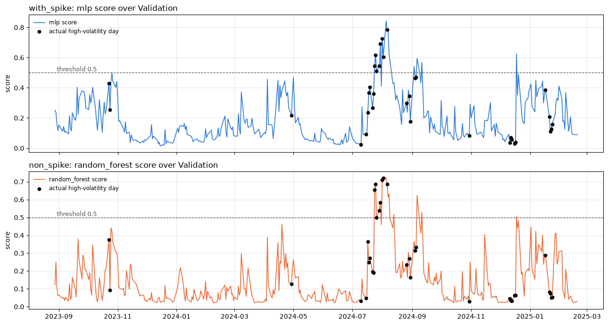

คะแนนของโมเดลขึ้นตาม **หลัง** ความผันผวนเริ่มแล้ว เพราะฟีเจอร์ทั้งหมดมองย้อนหลัง โมเดลจึงจับช่วงกลางและท้ายของเหตุการณ์ใหญ่ได้ แต่พลาดวันแรก ๆ และพลาดเหตุการณ์สั้น ๆ ผลบน Test (หัวข้อ 4.4) ยืนยันภาพเดียวกัน

### 4.8 ความเสถียรของอันดับข้ามช่วงเวลา

ผลของ walk-forward ภายในข้อมูลเทรน (วิธีอยู่ในหัวข้อ 3.4.8) ครอบคลุมวันผันผวนสูงรวม 353 วัน

**ตารางที่ 4.24** Average precision ของ walk-forward ภายใน Train แบบ with_spike

<!-- BEGIN GENERATED: outputs/modeling/report/tables/walk_forward_with_spike.md -->
### Walk-forward average precision inside Train — with_spike

| model | fold_0_ap | fold_1_ap | fold_2_ap | fold_3_ap | folds_used | positives | pooled_ap | pooled_low | pooled_high |
| --- | --- | --- | --- | --- | --- | --- | --- | --- | --- |
| gaussian_nb | 0.8282 | 0.6361 | 0.7775 | 0.4436 | 4 | 353 | 0.7124 | 0.5717 | 0.8151 |
| gradient_boosting | 0.8117 | 0.5722 | 0.8168 | 0.5522 | 4 | 353 | 0.7120 | 0.5857 | 0.8059 |
| logistic | 0.8173 | 0.6103 | 0.7847 | 0.4511 | 4 | 353 | 0.7030 | 0.5548 | 0.8083 |
| random_forest | 0.8079 | 0.6003 | 0.8018 | 0.5108 | 4 | 353 | 0.6833 | 0.5582 | 0.7797 |
| svm | 0.7946 | 0.6118 | 0.7839 | 0.4556 | 4 | 353 | 0.6718 | 0.5280 | 0.7842 |
| slp | 0.7946 | 0.5278 | 0.7658 | 0.4313 | 4 | 353 | 0.6717 | 0.5205 | 0.7813 |
| adaboost | 0.7998 | 0.5650 | 0.8330 | 0.4458 | 4 | 353 | 0.6708 | 0.5383 | 0.7772 |
| xgboost | 0.7604 | 0.5602 | 0.8042 | 0.5628 | 4 | 353 | 0.6690 | 0.5514 | 0.7645 |
| mlp | 0.7662 | 0.5310 | 0.8070 | 0.4385 | 4 | 353 | 0.6663 | 0.5203 | 0.7738 |
| stacking | n/a | 0.5861 | 0.8200 | 0.4417 | 3 | 273 | 0.6473 | 0.5119 | 0.7693 |
| knn | 0.7504 | 0.6400 | 0.7724 | 0.4553 | 4 | 353 | 0.6406 | 0.5153 | 0.7510 |
| decision_tree | 0.5803 | 0.4013 | 0.7242 | 0.3880 | 4 | 353 | 0.5750 | 0.4401 | 0.6958 |
| perceptron | 0.1852 | 0.5271 | 0.6226 | 0.2144 | 4 | 353 | 0.3337 | 0.2478 | 0.4690 |
<!-- END GENERATED -->

คะแนนของโมเดลเดียวกันต่างกันระหว่างรอบมากกว่าที่ต่างกันระหว่างโมเดลในรอบเดียวกัน (เช่น รอบที่ 0 ได้ AP ราว 0.8 ส่วนรอบที่ 3 ได้ราว 0.45) สภาพตลาดจึงมีผลต่อคะแนนมากกว่าชนิดของโมเดล อันดับจาก walk-forward สัมพันธ์กับอันดับบน Validation เพียงบางส่วน (Spearman 0.49 สำหรับ `with_spike` และ 0.17 สำหรับ `non_spike` คำนวณใน notebook 05 หัวข้อ 5)

รูปที่ 4.19 เทียบ AP บน Validation (แกนนอน) กับ AP รวมของ walk-forward (แกนตั้ง) ของแต่ละโมเดล ในแบบ `with_spike` จุดเรียงขึ้นตามกันบ้าง แต่ในแบบ `non_spike` แทบไม่สัมพันธ์กัน เช่น `svm` ซึ่งอยู่กลางตารางบน Validation กลับได้ AP ต่ำมากใน walk-forward ส่วน `perceptron` และ `decision_tree` อยู่มุมล่างซ้ายในทั้งสองแบบ

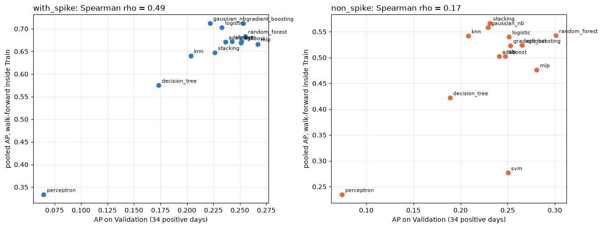

หมายเหตุ: `stacking` ไม่มีผลในรอบที่ 0 เพราะ 275 วันแรกของข้อมูลเทรนไม่มีวันผันผวนสูงเลย โมเดลซึ่งต้องแบ่งข้อมูลภายในอีกชั้นจึงเทรนบนประวัติที่สั้นที่สุดไม่ได้

## บทที่ 5 สรุปผล อภิปรายผล และข้อเสนอแนะ

### 5.1 สรุปผลการศึกษา

ผลการศึกษาสรุปตามวัตถุประสงค์ทั้งห้าข้อได้ดังนี้

1. **การพยากรณ์** จากข้อมูลราคาย้อนหลังเพียงอย่างเดียว โมเดลทำนายความผันผวน 5 วันข้างหน้าได้ดีกว่าการเดาสุ่มชัดเจน แต่เหนือกว่ากฎ "เท่ากับ 5 วันที่ผ่านมา" เพียงเล็กน้อย บน Test โมเดลตัวแทนของงาน classification ได้ AP 0.599 เทียบกับการเดาสุ่ม 0.196 และเส้นฐาน 0.536 ส่วนโมเดลตัวแทนของงาน regression ได้ RMSE 0.117 เทียบกับเส้นฐาน 0.138 (ตารางที่ 4.12)
2. **การเขียนโมเดลเอง** โมเดลทั้ง 19 ตัวเขียนด้วย NumPy และให้ผลตรงกับ scikit-learn หรือ XGBoost ตามเกณฑ์ในตารางที่ 3.11 โมเดลทั้ง 38 ชุดถูกบันทึก โหลดกลับ และทำนายซ้ำได้ค่าเดิม
3. **โมเดลนอกเนื้อหาที่เรียน** Elastic Net ดันน้ำหนักของฟีเจอร์เป็นศูนย์ 3 ถึง 4 ตัวจาก 8 ตัว และเป็นโมเดลตัวแทนของงาน regression ส่วน AdaBoost ให้คำทำนายตรงกับ library ทุกแถว (หัวข้อ 4.3)
4. **คำถามวิจัย** การตัดช่วงราคากระชากแรงออกจากข้อมูลเทรนไม่ได้ทำให้โมเดลดีขึ้นหรือแย่ลงอย่างที่วัดได้ ผลต่างเล็กกว่าความไม่แน่นอนของการวัด และทิศทางบน Validation กับ Test ไม่ตรงกัน
5. **การเปรียบเทียบโมเดล** โมเดลเรียบง่ายทำได้ดีพอ ๆ กับโมเดลซับซ้อน และผู้นำบน Validation ไม่ได้เป็นผู้นำบน Test เสมอไป โมเดลทำงานได้ในช่วงตลาดปกติ แต่ภายในช่วงปั่นป่วนแยกวันผันผวนสูงไม่ได้ ซึ่งเป็นช่วงที่การเตือนล่วงหน้ามีค่ามากที่สุด

**ผลการทดลองเพิ่มเติม** หลังส่งงานและหลังนำเสนอ ได้ทดลองโมเดลเพิ่มอีกสามแนวทางโดยแยกจาก 19 โมเดลที่ล็อกไว้ และประเมินบน Test แบบย้อนหลัง

- **RBF Kernel Perceptron** (ภาคผนวก ง) แก้การไม่ลู่เข้าของ Perceptron ได้และจัดอันดับดีกว่า Perceptron เส้นตรงชัดเจน แต่ไม่ได้ดีกว่าโมเดลตัวแทน
- **Transfer learning ด้วย Transformer และ GRU** (ภาคผนวก จ) การ pretrain บนข้อมูล ETF อื่น 10 ตัวช่วย Transformer ได้เล็กน้อย แต่ไม่มีแบบใดดีกว่า MLP โดย GRU ทำได้เทียบเท่า MLP
- **Log-HAR และ pooled-prior transfer** (ภาคผนวก ฉ) บน Test ได้ RMSE ต่ำกว่าและ R² สูงกว่า Elastic Net และทนต่อช่วง spike มากกว่า แต่ผลต่างยังคร่อมศูนย์ และบน Validation ไม่ได้ดีกว่า ส่วนที่ช่วยจริงคือฟีเจอร์ช่วงราคาในวันและ leverage ไม่ใช่ข้อมูลจากตลาดอื่น

### 5.2 อภิปรายผล

**ทำไมกฎง่าย ๆ จึงทำได้ใกล้เคียงโมเดล** ผลนี้สอดคล้องกับลักษณะความผันผวนกระจุกตัว (Cont, 2001; Engle, 1982) เมื่อความผันผวนของวันใกล้กันคล้ายกันมาก ความผันผวนของ 5 วันที่ผ่านมาจึงเป็นตัวทำนายที่ดีอยู่แล้ว และเป็นข้อมูลชุดเดียวกับที่โมเดลของเราใช้ ผลของ permutation importance ยืนยันว่าฟีเจอร์ที่โมเดลพึ่งมากที่สุดคือความผันผวนย้อนหลัง (หัวข้อ 4.1) ข้อค้นพบนี้ไปทางเดียวกับ Corsi (2009) ซึ่งพบว่า linear regression บนความผันผวนย้อนหลังไม่กี่ช่วงเวลาก็พยากรณ์ได้ดี

**โมเดลใดดีที่สุด**

คำตอบที่ซื่อตรงคือ **ข้อมูลไม่พอจะบอก** บน Validation ทั้ง 13 classifier และทั้ง 4 โมเดล regression อยู่ในกลุ่มที่แยกจากอันดับหนึ่งไม่ได้ บน Test กลุ่มนำของ classification ยังมี 10 จาก 13 โมเดลในทั้งสองแบบข้อมูล สิ่งที่บอกได้คือ

- `perceptron` และ `decision_tree` อยู่ท้ายตารางอย่างสม่ำเสมอ ทั้งบน Validation, Test และ walk-forward
- โมเดลที่เหลือ ตั้งแต่ `logistic` ที่เรียบง่าย ไปจนถึง `xgboost` และ `mlp` ทำได้ใกล้เคียงกันในระดับที่ข้อมูลชุดนี้แยกไม่ออก

เหตุผลที่น่าจะเป็นคือ ข้อมูลที่ทำนายได้อยู่ในฟีเจอร์ความผันผวนย้อนหลังไม่กี่ตัว และความสัมพันธ์ค่อนข้างเรียบง่าย โมเดลที่ซับซ้อนจึงไม่มีอะไรให้เรียนรู้เพิ่มมากนัก

ผลนี้ต่างจาก Christensen et al. (2023) ซึ่งพบว่า machine learning ดีกว่าโมเดลเชิงเส้น เหตุผลที่น่าจะเป็นคือ งานดังกล่าววัดความผันผวนจากข้อมูลความถี่สูงของหุ้นหลายตัว ค่าจริงจึงมีสัญญาณรบกวนต่ำและมีตัวอย่างมากกว่า ขณะที่โครงงานนี้คำนวณ target จากผลตอบแทนรายวันเพียง 5 ค่า และมีวันผันผวนสูงให้วัดเพียง 34 วันบน Validation และ 73 วันบน Test ความต่างระหว่างโมเดลที่อาจมีอยู่จริงจึงเล็กกว่าความไม่แน่นอนของการวัด ซึ่งเป็นประเด็นเดียวกับที่ Andersen และ Bollerslev (1998) ชี้ไว้เรื่องสัญญาณรบกวนของค่าจริง

เราจึง **ไม่อ้าง** ว่าโมเดลที่ซับซ้อนกว่าดีกว่าโมเดลที่สอนในห้องอย่างมีนัยสำคัญ ข้อค้นพบที่มีหลักฐานรองรับมากกว่าคือ บนโจทย์นี้ โมเดลเรียบง่ายอย่าง `logistic` และ `multiple_linear` ทำได้ดีพอ ๆ กับโมเดลที่ซับซ้อนที่สุดที่เราเขียน

**ทำไมยังสรุปเรื่อง spike ไม่ได้**

**คำตอบของคำถามวิจัย** ข้อมูลชุดนี้ **ไม่สนับสนุน** ว่านโยบายตัดแถวรอบวัน spike ออกจากข้อมูลเทรนทำให้โมเดลทำนายดีขึ้น และไม่สนับสนุนว่าทำให้แย่ลงเช่นกัน ผลต่างที่วัดได้เล็กกว่าความไม่แน่นอนของการวัด ทั้งบน Validation และ Test และทิศทางของสองชุดไม่ตรงกัน

เหตุผลมีสามข้อ ข้อแรก ผลต่างที่วัดได้เล็กเมื่อเทียบกับความกว้างของช่วงความเชื่อมั่น ซึ่งกว้างเพราะตัวอย่างของวันติดกันไม่อิสระต่อกัน (หัวข้อ 3.4.4) ข้อสอง การตัดแถวเปลี่ยนจำนวนแถว สัดส่วนคลาส และสภาพตลาดในข้อมูลเทรนพร้อมกัน จึงแยกผลของ spike ออกมาไม่ได้ (หัวข้อ 3.3.4) ข้อสาม Validation ไม่มีวัน spike เลย จึงทดสอบการรับมือกับ spike ได้เฉพาะบน Test ซึ่งมีเพียง 54 แถวในช่วงรอบวัน spike

สำหรับสมมติฐานเรื่อง AdaBoost ทฤษฎีของ Friedman et al. (2000) ทำนายว่าโมเดลที่ลด exponential loss จะไวต่อตัวอย่างสุดโต่ง ผลบน Test ไปในทิศทางเดียวกับคำทำนายนี้ คือ AdaBoost เป็นโมเดลที่ดีขึ้นมากที่สุดเมื่อตัดช่วง spike แต่ช่วงความเชื่อมั่นยังคร่อมศูนย์ จึงเป็นข้อสังเกตที่สอดคล้องกับทฤษฎี ยังไม่ใช่ข้อพิสูจน์

**ทำไมโมเดลพลาดในช่วงตลาดปั่นป่วน** ฟีเจอร์ทั้งหมดมองย้อนหลัง โมเดลจึงรู้ว่าตลาดกำลังปั่นป่วนหลังจากความปั่นป่วนเริ่มแล้ว แต่ไม่มีข้อมูลที่บอกว่าจะเริ่มหรือจบเมื่อไร (หัวข้อ 4.7) ข้อนี้สอดคล้องกับ Poon และ Granger (2003) ซึ่งพบว่า implied volatility ที่สะท้อนความคาดหวังของตลาดต่ออนาคต มักพยากรณ์ได้ดีกว่าวิธีที่ใช้ข้อมูลในอดีตเพียงอย่างเดียว

**ทำไมผู้นำบน Validation ไม่ได้นำบน Test** Validation มีวันผันผวนสูงเพียง 34 วัน และ classifier ทั้ง 13 ตัวแยกจากอันดับหนึ่งไม่ได้ การเลือกผู้ที่ได้คะแนนสูงสุดจึงใกล้กับการเลือกแบบสุ่มในกลุ่มที่เสมอกัน ตัวอย่างคือ `random_forest` ซึ่งเป็นโมเดลตัวแทนของแบบ `non_spike` ตกไปอยู่อันดับ 10 จาก 13 โมเดลบน Test ปรากฏการณ์นี้เรียกว่า selection bias ผลของ walk-forward ชี้ทางเดียวกัน คือสภาพตลาดมีผลต่อคะแนนมากกว่าชนิดของโมเดล (หัวข้อ 4.8)

**สิ่งที่ได้เรียนรู้จากการเขียนโมเดลเองทั้งหมด**

- การทำให้ผลตรงกับ library ถึงทศนิยมสุดท้าย บังคับให้เข้าใจรายละเอียดที่ตำราข้ามไป เช่น ลำดับการสุ่ม กฎการหยุดวนรอบ และการตัดสินเมื่อคะแนนเท่ากัน
- กับข้อมูลอนุกรมเวลา ความถูกต้องของขั้นตอน (แบ่งตามเวลา เว้นช่องว่าง คำนวณทุกอย่างจาก Train ล็อกก่อนเปิด Test) สำคัญกว่าการเลือกโมเดล
- ช่วงความเชื่อมั่นเปลี่ยนข้อสรุปได้มาก ถ้าดูเฉพาะค่าที่วัดได้ เราคงสรุปว่า "ตัด spike แล้วดีขึ้น" และ "MLP ดีกว่า logistic 14%" ซึ่งทั้งสองข้อไม่มีหลักฐานรองรับเพียงพอ

### 5.3 ข้อจำกัดของการศึกษา

1. **ตัวอย่างไม่อิสระต่อกัน** ข้อมูลจริงมีน้อยกว่าจำนวนแถวมาก ช่วงความเชื่อมั่นจึงกว้าง และข้อสรุปส่วนใหญ่ของรายงานนี้คือ "ยังสรุปไม่ได้"
2. **Validation เป็นสภาพตลาดแบบเดียว** สงบ ไม่มี spike และมีวันผันผวนสูง 34 วัน จึงเลือกโมเดลได้ไม่แม่น
3. **การเทียบสองแบบข้อมูลถูก confound** จำนวนแถว สัดส่วนคลาส และสภาพตลาดเปลี่ยนพร้อมกัน การแยกผลของ spike ต้องใช้การทดลองเพิ่ม เช่น ตัดแถวปกติจำนวนเท่ากันออกเป็นกลุ่มควบคุม
4. **ช่วงรอบวัน spike ใน Test มีเพียง 54 แถวจากสองเหตุการณ์** ผลแยกช่วงจึงเป็นข้อสังเกต
5. **threshold คงที่ 0.5** ทำให้ recall ต่ำเมื่อสภาพตลาดเปลี่ยน การปรับ threshold หรือปรับเทียบความน่าจะเป็น (calibration) อาจช่วยได้ แต่ต้องมีข้อมูลแยกสำหรับเลือก
6. **ไม่มีฟีเจอร์ที่มองไปข้างหน้า** เช่น implied volatility (VIX) หรือปฏิทินประกาศตัวเลขเศรษฐกิจ ซึ่งน่าจะเป็นสิ่งที่ช่วยทำนายจุดเริ่มของความผันผวนได้
7. **สินทรัพย์เดียว ช่วงเวลาเดียว** ผลอาจไม่ใช้กับสินทรัพย์อื่น
8. **ค่า SHA-256 ของไฟล์ข้อมูลที่สร้างขึ้นผูกกับ Windows** เพราะรูปแบบการขึ้นบรรทัดใหม่ของไฟล์ต่างกันตามระบบปฏิบัติการ (`docs/audit/PATH_AUDIT.md`)
9. **ทดลองกับเกณฑ์ spike เดียว** เกณฑ์ Q3 + 3 × IQR ถูกกำหนดล่วงหน้า เกณฑ์ทางเลือกในหัวข้อ 3.3.4 ถูกเทียบเฉพาะจำนวนข้อมูลที่เหลือ ไม่ได้นำไปเทรนโมเดล ผลของการทดลองจึงใช้กับนิยามนี้เท่านั้น

### 5.4 ข้อเสนอแนะ

#### 5.4.1 ข้อเสนอแนะในการนำผลการศึกษาไปใช้

1. ใช้คำทำนายของโมเดลคู่กับเส้นฐาน "เท่ากับ 5 วันที่ผ่านมา" เสมอ เพราะโมเดลให้ประโยชน์เพิ่มจากเส้นฐานเพียงเล็กน้อย
2. ใช้โมเดลเป็นตัวบอกสภาพตลาดปัจจุบัน มากกว่าเป็นสัญญาณเตือนล่วงหน้า เพราะโมเดลจับจุดเริ่มของช่วงปั่นป่วนไม่ได้
3. ไม่ควรตัดสินโมเดลด้วย accuracy เพียงอย่างเดียว เพราะคลาสไม่สมดุล ควรดู AP, precision และ recall ประกอบ และเทียบกับเส้นฐานของชุดข้อมูลเดียวกัน
4. threshold คงที่ 0.5 ให้ recall ต่ำเมื่อสภาพตลาดเปลี่ยน ผู้ใช้ควรกำหนด threshold ตามต้นทุนของการเตือนผิดและการพลาดของตน โดยใช้ข้อมูลที่แยกไว้สำหรับเลือก
5. จากหลักฐานที่มี ยังไม่มีเหตุผลพอให้ตัดช่วง spike ออกจากข้อมูลเทรน การใช้ข้อมูลครบเป็นทางเลือกที่ง่ายกว่า และให้โมเดลได้เห็นสภาพตลาดครบกว่า

#### 5.4.2 ข้อเสนอแนะสำหรับการศึกษาครั้งต่อไป

1. เพิ่มฟีเจอร์ที่มองไปข้างหน้า เช่น implied volatility (VIX) และปฏิทินประกาศตัวเลขเศรษฐกิจ
2. ทำกลุ่มควบคุมสำหรับการทดลอง spike โดยตัดแถวปกติจำนวนเท่ากันออก เพื่อแยกผลของ spike ออกจากผลของจำนวนแถวและสัดส่วนคลาส
3. ทดลองเกณฑ์ spike แบบอื่นด้วยการเทรนโมเดลจริง ไม่ใช่เทียบเฉพาะจำนวนข้อมูลที่เหลือ
4. ใช้ walk-forward ในการเลือกโมเดลแทน Validation ช่วงเดียว
5. ใช้ข้อมูลความถี่สูงเพื่อวัดความผันผวนที่เกิดขึ้นจริงให้แม่นขึ้น ตามแนวทางของ Andersen และ Bollerslev (1998)
6. ทดสอบกับสินทรัพย์อื่นและช่วงเวลาอื่น
7. ต่อยอดการทดลอง transfer learning ในภาคผนวก จ ซึ่งพบว่า GRU ทำได้เทียบเท่า MLP แต่ไม่ชนะ และ Transformer แย่กว่า แนวทางที่ควรลองต่อมีสามข้อ โดยต้องประเมินกับข้อมูลอนาคตชุดใหม่ เพราะ Validation และ Test ชุดเดิมถูกใช้ไปแล้ว
   - ให้ Transformer ใช้สถานะของวันล่าสุดแทนการเฉลี่ยทั้งหน้าต่าง
   - ใช้ข้อมูลตลาดอื่นที่ย้อนหลังยาวกว่า 10 ปีให้ครอบคลุมช่วงวิกฤต
   - เพิ่มข้อมูลข้ามตลาด เช่น VIX เป็นฟีเจอร์แทนการใช้เพื่อ pretrain อย่างเดียว
8. ทดสอบ Log-HAR ในภาคผนวก ฉ กับข้อมูลอนาคตที่มีช่วงผันผวน เพราะผลบน Test ดีกว่า Elastic Net แต่ผลบน Validation ไม่ดีกว่า และควรปรับสเกลของฟีเจอร์ leverage ก่อนใช้ค่าปรับแบบ ridge

## บรรณานุกรม

Andersen, T. G., & Bollerslev, T. (1998). Answering the skeptics: Yes, standard volatility models do provide accurate forecasts. International Economic Review, 39(4), 885–905.

Bollerslev, T. (1986). Generalized autoregressive conditional heteroskedasticity. Journal of Econometrics, 31(3), 307–327.

Breiman, L. (2001). Random forests. Machine Learning, 45(1), 5–32.

Chen, T., & Guestrin, C. (2016). XGBoost: A scalable tree boosting system. In Proceedings of the 22nd ACM SIGKDD International Conference on Knowledge Discovery and Data Mining (pp. 785–794). Association for Computing Machinery.

Cho, K., van Merriënboer, B., Gulcehre, C., Bahdanau, D., Bougares, F., Schwenk, H., & Bengio, Y. (2014). Learning phrase representations using RNN encoder–decoder for statistical machine translation. In Proceedings of the 2014 Conference on Empirical Methods in Natural Language Processing (pp. 1724–1734). Association for Computational Linguistics.

Christensen, K., Siggaard, M., & Veliyev, B. (2023). A machine learning approach to volatility forecasting. Journal of Financial Econometrics, 21(5), 1680–1727.

Cont, R. (2001). Empirical properties of asset returns: Stylized facts and statistical issues. Quantitative Finance, 1(2), 223–236.

Corsi, F. (2009). A simple approximate long-memory model of realized volatility. Journal of Financial Econometrics, 7(2), 174–196.

Corsi, F., & Renò, R. (2012). Discrete-time volatility forecasting with persistent leverage effect and the link with continuous-time volatility modeling. Journal of Business & Economic Statistics, 30(3), 368–380.

Cortes, C., & Vapnik, V. (1995). Support-vector networks. Machine Learning, 20(3), 273–297.

Davis, J., & Goadrich, M. (2006). The relationship between Precision-Recall and ROC curves. In Proceedings of the 23rd International Conference on Machine Learning (pp. 233–240). Association for Computing Machinery.

Engle, R. F. (1982). Autoregressive conditional heteroscedasticity with estimates of the variance of United Kingdom inflation. Econometrica, 50(4), 987–1007.

Freund, Y., & Schapire, R. E. (1997). A decision-theoretic generalization of on-line learning and an application to boosting. Journal of Computer and System Sciences, 55(1), 119–139.

Friedman, J. H. (2001). Greedy function approximation: A gradient boosting machine. The Annals of Statistics, 29(5), 1189–1232.

Friedman, J., Hastie, T., & Tibshirani, R. (2000). Additive logistic regression: A statistical view of boosting. The Annals of Statistics, 28(2), 337–407.

Friedman, J., Hastie, T., & Tibshirani, R. (2010). Regularization paths for generalized linear models via coordinate descent. Journal of Statistical Software, 33(1), 1–22.

Gururangan, S., Marasović, A., Swayamdipta, S., Lo, K., Beltagy, I., Downey, D., & Smith, N. A. (2020). Don't stop pretraining: Adapt language models to domains and tasks. In Proceedings of the 58th Annual Meeting of the Association for Computational Linguistics (pp. 8342–8360). Association for Computational Linguistics.

Hastie, T., Tibshirani, R., & Friedman, J. (2009). The elements of statistical learning: Data mining, inference, and prediction (2nd ed.). Springer.

Hoerl, A. E., & Kennard, R. W. (1970). Ridge regression: Biased estimation for nonorthogonal problems. Technometrics, 12(1), 55–67.

Künsch, H. R. (1989). The jackknife and the bootstrap for general stationary observations. The Annals of Statistics, 17(3), 1217–1241.

López de Prado, M. (2018). Advances in financial machine learning. Wiley.

Loshchilov, I., & Hutter, F. (2019). Decoupled weight decay regularization. In International Conference on Learning Representations.

Nasdaq. (2026a). Invesco QQQ Trust, Series 1 (QQQ) historical data [ชุดข้อมูลราคารายวัน 31 สิงหาคม 2016 ถึง 28 สิงหาคม 2026]. https://www.nasdaq.com/market-activity/etf/qqq/historical

Nasdaq. (2026b). Historical data of SPY, DIA, IWM, XLK, XLF, XLE, XLV, XLY, EFA and EEM [ชุดข้อมูลราคารายวัน 24 ตุลาคม 2016 ถึง 23 ตุลาคม 2026 และราคา QQQ ถึง 23 ตุลาคม 2026]. https://www.nasdaq.com/market-activity/etf

Patton, A. J. (2011). Volatility forecast comparison using imperfect volatility proxies. Journal of Econometrics, 160(1), 246–256.

Pedregosa, F., Varoquaux, G., Gramfort, A., Michel, V., Thirion, B., Grisel, O., Blondel, M., Prettenhofer, P., Weiss, R., Dubourg, V., Vanderplas, J., Passos, A., Cournapeau, D., Brucher, M., Perrot, M., & Duchesnay, E. (2011). Scikit-learn: Machine learning in Python. Journal of Machine Learning Research, 12, 2825–2830.

Poon, S.-H., & Granger, C. W. J. (2003). Forecasting volatility in financial markets: A review. Journal of Economic Literature, 41(2), 478–539.

Saito, T., & Rehmsmeier, M. (2015). The precision-recall plot is more informative than the ROC plot when evaluating binary classifiers on imbalanced datasets. PLOS ONE, 10(3), e0118432.

Tibshirani, R. (1996). Regression shrinkage and selection via the lasso. Journal of the Royal Statistical Society: Series B (Methodological), 58(1), 267–288.

Tukey, J. W. (1977). Exploratory data analysis. Addison-Wesley.

Vaswani, A., Shazeer, N., Parmar, N., Uszkoreit, J., Jones, L., Gomez, A. N., Kaiser, Ł., & Polosukhin, I. (2017). Attention is all you need. In Advances in Neural Information Processing Systems 30 (pp. 5998–6008).

Wolpert, D. H. (1992). Stacked generalization. Neural Networks, 5(2), 241–259.

Zerveas, G., Jayaraman, S., Patel, D., Bhamidipaty, A., & Eickhoff, C. (2021). A transformer-based framework for multivariate time series representation learning. In Proceedings of the 27th ACM SIGKDD Conference on Knowledge Discovery & Data Mining (pp. 2114–2124). Association for Computing Machinery.

Zhu, J., Zou, H., Rosset, S., & Hastie, T. (2009). Multi-class AdaBoost. Statistics and Its Interface, 2(3), 349–360.

Zou, H., & Hastie, T. (2005). Regularization and variable selection via the elastic net. Journal of the Royal Statistical Society: Series B (Statistical Methodology), 67(2), 301–320.

## ภาคผนวก ก การตั้งค่าที่ถูกเลือกของทุกโมเดล

`candidates` คือจำนวนการตั้งค่าที่ลอง · `reference` คือ class ของ library ที่ใช้ยืนยันผล · `params_*` คือการตั้งค่าที่ชนะบน Validation ของแต่ละแบบข้อมูล · `pca_*` คือจำนวน component ของ PCA (ว่างคือไม่ใช้)

**ตารางที่ ก.1** รายการโมเดลและการตั้งค่าที่ถูกเลือก

<!-- BEGIN GENERATED: outputs/modeling/report/tables/model_inventory.md -->
### Model inventory and selected settings

| model | task | candidates | reference | preprocess | params_with_spike | params_non_spike | pca_with_spike | pca_non_spike |
| --- | --- | --- | --- | --- | --- | --- | --- | --- |
| adaboost | classification | 6 | AdaBoostClassifier | none | {"learning_rate": 0.5, "n_estimators": 100, "random_state": 42} | {"learning_rate": 0.5, "n_estimators": 100, "random_state": 42} | n/a | n/a |
| agglomerative | clustering | 10 | AgglomerativeClustering | standardize | {"k": 2, "linkage": "ward"} | {"k": 2, "linkage": "average"} | n/a | n/a |
| decision_tree | classification | 6 | DecisionTreeClassifier | none | {"max_depth": 2, "max_features": null, "min_samples_leaf": 5, "random_state": 42} | {"max_depth": 5, "max_features": null, "min_samples_leaf": 5, "random_state": 42} | n/a | n/a |
| elastic_net | regression | 12 | ElasticNet | standardize | {"alpha": 0.1, "l1_ratio": 0.25, "max_iter": 5000, "tol": 1e-06} | {"alpha": 0.1, "l1_ratio": 0.25, "max_iter": 5000, "tol": 1e-06} | n/a | n/a |
| gaussian_nb | classification | 3 | GaussianNB | none | {"var_smoothing": 1e-07} | {"var_smoothing": 1e-08} | n/a | n/a |
| gradient_boosting | classification | 8 | GradientBoostingClassifier | none | {"learning_rate": 0.1, "max_depth": 1, "min_samples_leaf": 5, "n_estimators": 50, "random_state": 42} | {"learning_rate": 0.03, "max_depth": 2, "min_samples_leaf": 5, "n_estimators": 50, "random_state": 42} | n/a | n/a |
| kmeans | clustering | 5 | KMeans | standardize | {"k": 2, "max_iter": 300, "n_init": 10, "random_state": 42, "tol": 1e-06} | {"k": 2, "max_iter": 300, "n_init": 10, "random_state": 42, "tol": 1e-06} | n/a | n/a |
| knn | classification | 8 | KNeighborsClassifier | standardize | {"k": 15, "weights": "distance"} | {"k": 9, "weights": "distance"} | n/a | n/a |
| logistic | classification | 6 | LogisticRegression | standardize | {"class_weight": null, "l2": 0.01, "learning_rate": 0.05, "max_iter": 5000, "tol": 1e-06} | {"class_weight": null, "l2": 0, "learning_rate": 0.05, "max_iter": 5000, "tol": 1e-06} | n/a | n/a |
| mlp | classification | 12 | MLPClassifier | standardize | {"activation": "relu", "batch": 32, "hidden_layers": [16], "l2": 0, "learning_rate": 0.001, "max_epochs": 1000, "min_delta": 1e-06, "momentum": 0.9, "patience": 50, "random_state": 42} | {"activation": "relu", "batch": 32, "hidden_layers": [16, 8], "l2": 0, "learning_rate": 0.01, "max_epochs": 1000, "min_delta": 1e-06, "momentum": 0.9, "patience": 50, "random_state": 42} | n/a | n/a |
| multiple_linear | regression | 1 | LinearRegression | standardize | {"fit_intercept": true} | {"fit_intercept": true} | n/a | n/a |
| perceptron | classification | 3 | Perceptron | standardize | {"learning_rate": 0.001, "max_epochs": 1000} | {"learning_rate": 0.001, "max_epochs": 1000} | n/a | n/a |
| polynomial | regression | 16 | Pipeline | standardize | {"degree": 3, "feature": "historical_volatility_20d", "standardize_before_powers": true} | {"degree": 2, "feature": "return_5d", "standardize_before_powers": true} | n/a | n/a |
| random_forest | classification | 7 | RandomForestClassifier | none | {"bootstrap": true, "max_depth": 3, "max_features": "sqrt", "min_samples_leaf": 5, "n_estimators": 100, "random_state": 42} | {"bootstrap": true, "max_depth": 5, "max_features": "sqrt", "min_samples_leaf": 5, "n_estimators": 50, "random_state": 42} | n/a | n/a |
| simple_linear | regression | 8 | LinearRegression | none | {"feature": "historical_volatility_20d"} | {"feature": "return_1d"} | n/a | n/a |
| slp | classification | 8 | LogisticRegression | standardize | {"batch": 32, "l2": 0, "learning_rate": 0.001, "max_epochs": 1000, "min_delta": 1e-06, "patience": 50, "random_state": 42} | {"batch": "full", "l2": 0, "learning_rate": 0.01, "max_epochs": 1000, "min_delta": 1e-06, "patience": 50, "random_state": 42} | n/a | n/a |
| stacking | classification | 1 | StackingClassifier | base_specific | {"folds": 4, "initial_fraction": 0.4, "purge": 5, "random_state": 42} | {"folds": 4, "initial_fraction": 0.4, "purge": 5, "random_state": 42} | n/a | n/a |
| svm | classification | 12 | SVC | standardize | {"C": 0.1, "fit_intercept": true, "max_iter": 20000, "random_state": 42} | {"C": 10, "fit_intercept": true, "max_iter": 20000, "random_state": 42} | 4 | 4 |
| xgboost | classification | 8 | XGBClassifier | none | {"gamma": 0, "learning_rate": 0.03, "max_depth": 1, "n_estimators": 100, "random_state": 42, "reg_lambda": 1} | {"gamma": 0.1, "learning_rate": 0.03, "max_depth": 2, "n_estimators": 100, "random_state": 42, "reg_lambda": 10} | n/a | n/a |
<!-- END GENERATED -->

## ภาคผนวก ข ตารางเพิ่มเติม

### ข.1 Validation ของแบบ non_spike

**ตารางที่ ข.1** ผลของโมเดล classification บน Validation แบบ non_spike

<!-- BEGIN GENERATED: outputs/modeling/report/non_spike/leaderboard_classification.md -->
### Validation leaderboard — classification — non_spike

| model | kind | average_precision_ci | roc_auc_ci | f1_ci | recall_ci | precision | specificity | accuracy | loss_name | loss | tied_with_leader | beats_best_baseline |
| --- | --- | --- | --- | --- | --- | --- | --- | --- | --- | --- | --- | --- |
| random_forest | model | 0.3010 [0.0548, 0.5328] | 0.6766 [0.4439, 0.8313] | 0.2917 [0.0000, 0.5064] | 0.2059 [0.0000, 0.4287] | 0.5000 | 0.9792 | 0.9084 | log_loss | 0.3059 | yes | yes |
| mlp | model | 0.2808 [0.0534, 0.5184] | 0.6992 [0.4716, 0.8426] | 0.3077 [0.0000, 0.5435] | 0.2353 [0.0000, 0.4545] | 0.4444 | 0.9703 | 0.9030 | binary_cross_entropy | 0.3166 | yes | yes |
| xgboost | model | 0.2652 [0.0600, 0.4730] | 0.6853 [0.4608, 0.8256] | 0.2800 [0.0000, 0.5000] | 0.2059 [0.0000, 0.4255] | 0.4375 | 0.9733 | 0.9030 | binary_logistic_loss | 0.3088 | yes | yes |
| gradient_boosting | model | 0.2525 [0.0625, 0.4477] | 0.6732 [0.4577, 0.8152] | 0.2667 [0.0000, 0.4533] | 0.1765 [0.0000, 0.3674] | 0.5455 | 0.9852 | 0.9111 | binary_logistic_loss | 0.2966 | yes | yes |
| logistic | model | 0.2513 [0.0538, 0.4557] | 0.6824 [0.4529, 0.8310] | 0.2553 [0.0000, 0.4445] | 0.1765 [0.0000, 0.3674] | 0.4615 | 0.9792 | 0.9057 | binary_cross_entropy | 0.3014 | yes | yes |
| svm | model | 0.2501 [0.0520, 0.4672] | 0.6804 [0.4367, 0.8413] | 0.2727 [0.0000, 0.4667] | 0.1765 [0.0000, 0.3674] | 0.6000 | 0.9881 | 0.9137 | hinge_loss | 0.2539 | yes | yes |
| baseline_persistence | baseline | 0.2474 [0.0545, 0.5002] | 0.7214 [0.5384, 0.8407] | 0.2899 [0.0000, 0.5589] | 0.2941 [0.0000, 0.5601] | 0.2857 | 0.9258 | 0.8679 | n/a | n/a | yes | n/a |
| slp | model | 0.2474 [0.0489, 0.4531] | 0.6778 [0.4892, 0.8122] | 0.2258 [0.0000, 0.4156] | 0.2059 [0.0000, 0.4255] | 0.2500 | 0.9377 | 0.8706 | binary_cross_entropy | 0.3607 | yes | no |
| adaboost | model | 0.2407 [0.0556, 0.4722] | 0.6409 [0.3618, 0.8209] | 0.2353 [0.0000, 0.4444] | 0.1765 [0.0000, 0.3674] | 0.3529 | 0.9674 | 0.8949 | exponential_loss | 0.5875 | yes | no |
| stacking | model | 0.2311 [0.0582, 0.4204] | 0.6650 [0.4550, 0.8061] | 0.1961 [0.0000, 0.3509] | 0.1471 [0.0000, 0.3077] | 0.2941 | 0.9644 | 0.8895 | log_loss | 0.3304 | yes | no |
| gaussian_nb | model | 0.2292 [0.0485, 0.4434] | 0.6789 [0.4426, 0.8273] | 0.2381 [0.0000, 0.4355] | 0.2941 [0.0000, 0.5371] | 0.2000 | 0.8813 | 0.8275 | log_loss | 0.7534 | yes | no |
| knn | model | 0.2082 [0.0584, 0.3932] | 0.6455 [0.4610, 0.7802] | 0.2222 [0.0000, 0.3846] | 0.1765 [0.0000, 0.3514] | 0.3000 | 0.9585 | 0.8868 | log_loss | 1.2326 | yes | no |
| decision_tree | model | 0.1887 [0.0505, 0.4105] | 0.6924 [0.4917, 0.8233] | 0.1887 [0.0000, 0.3556] | 0.1471 [0.0000, 0.2963] | 0.2632 | 0.9585 | 0.8841 | log_loss | 0.5063 | yes | no |
| baseline_majority | baseline | 0.0916 [0.0350, 0.1779] | 0.5000 [0.5000, 0.5000] | 0.0000 [0.0000, 0.0000] | 0.0000 [0.0000, 0.0000] | n/a | 1.0000 | 0.9084 | n/a | n/a | yes | n/a |
| perceptron | model | 0.0742 [0.0343, 0.1688] | 0.3383 [0.1803, 0.5693] | 0.1159 [0.0000, 0.2571] | 0.1176 [0.0000, 0.3125] | 0.1143 | 0.9080 | 0.8356 | perceptron_criterion | 0.0010 | yes | no |

> ตัวเลขบน Validation เป็น selection score: hyperparameter ของทุกโมเดลถูกเลือกบนแถวชุดนี้ จึงมองโลกในแง่ดีเกินจริง และโมเดลที่ `tied_with_leader = yes` แยกจากอันดับ 1 ไม่ได้ที่ระดับ 95% (moving-block bootstrap, block 20 วัน) ห้ามอ้างอันดับภายในกลุ่มนั้น
> 13 จาก 13 โมเดลอยู่ในกลุ่มที่แยกจากอันดับ 1 ไม่ได้
<!-- END GENERATED -->

**ตารางที่ ข.2** ตัวชี้วัดครบทุกตัวที่โจทย์กำหนด บน Validation แบบ non_spike

<!-- BEGIN GENERATED: outputs/modeling/report/tables/classification_metrics_non_spike.md -->
### Every metric the assignment lists — Validation — non_spike

| model | loss_name | loss | tn | fp | fn | tp | accuracy | precision | sensitivity | specificity | tnr | f1 | roc_auc | average_precision |
| --- | --- | --- | --- | --- | --- | --- | --- | --- | --- | --- | --- | --- | --- | --- |
| random_forest | log_loss | 0.3059 | 330 | 7 | 27 | 7 | 0.9084 | 0.5000 | 0.2059 | 0.9792 | 0.9792 | 0.2917 | 0.6766 | 0.3010 |
| mlp | binary_cross_entropy | 0.3166 | 327 | 10 | 26 | 8 | 0.9030 | 0.4444 | 0.2353 | 0.9703 | 0.9703 | 0.3077 | 0.6992 | 0.2808 |
| xgboost | binary_logistic_loss | 0.3088 | 328 | 9 | 27 | 7 | 0.9030 | 0.4375 | 0.2059 | 0.9733 | 0.9733 | 0.2800 | 0.6853 | 0.2652 |
| gradient_boosting | binary_logistic_loss | 0.2966 | 332 | 5 | 28 | 6 | 0.9111 | 0.5455 | 0.1765 | 0.9852 | 0.9852 | 0.2667 | 0.6732 | 0.2525 |
| logistic | binary_cross_entropy | 0.3014 | 330 | 7 | 28 | 6 | 0.9057 | 0.4615 | 0.1765 | 0.9792 | 0.9792 | 0.2553 | 0.6824 | 0.2513 |
| svm | hinge_loss | 0.2539 | 333 | 4 | 28 | 6 | 0.9137 | 0.6000 | 0.1765 | 0.9881 | 0.9881 | 0.2727 | 0.6804 | 0.2501 |
| baseline_persistence | n/a | n/a | 312 | 25 | 24 | 10 | 0.8679 | 0.2857 | 0.2941 | 0.9258 | 0.9258 | 0.2899 | 0.7214 | 0.2474 |
| slp | binary_cross_entropy | 0.3607 | 316 | 21 | 27 | 7 | 0.8706 | 0.2500 | 0.2059 | 0.9377 | 0.9377 | 0.2258 | 0.6778 | 0.2474 |
| adaboost | exponential_loss | 0.5875 | 326 | 11 | 28 | 6 | 0.8949 | 0.3529 | 0.1765 | 0.9674 | 0.9674 | 0.2353 | 0.6409 | 0.2407 |
| stacking | log_loss | 0.3304 | 325 | 12 | 29 | 5 | 0.8895 | 0.2941 | 0.1471 | 0.9644 | 0.9644 | 0.1961 | 0.6650 | 0.2311 |
| gaussian_nb | log_loss | 0.7534 | 297 | 40 | 24 | 10 | 0.8275 | 0.2000 | 0.2941 | 0.8813 | 0.8813 | 0.2381 | 0.6789 | 0.2292 |
| knn | log_loss | 1.2326 | 323 | 14 | 28 | 6 | 0.8868 | 0.3000 | 0.1765 | 0.9585 | 0.9585 | 0.2222 | 0.6455 | 0.2082 |
| decision_tree | log_loss | 0.5063 | 323 | 14 | 29 | 5 | 0.8841 | 0.2632 | 0.1471 | 0.9585 | 0.9585 | 0.1887 | 0.6924 | 0.1887 |
| baseline_majority | n/a | n/a | 337 | 0 | 34 | 0 | 0.9084 | n/a | 0.0000 | 1.0000 | 1.0000 | 0.0000 | 0.5000 | 0.0916 |
| perceptron | perceptron_criterion | 0.0010 | 306 | 31 | 30 | 4 | 0.8356 | 0.1143 | 0.1176 | 0.9080 | 0.9080 | 0.1159 | 0.3383 | 0.0742 |
<!-- END GENERATED -->

**ตารางที่ ข.3** ผลของโมเดล clustering บน Validation แบบ non_spike

<!-- BEGIN GENERATED: outputs/modeling/report/non_spike/leaderboard_clustering.md -->
### Validation clustering metrics — non_spike

| model | variant | k | silhouette | inertia | cluster_sizes |
| --- | --- | --- | --- | --- | --- |
| agglomerative | non_spike | 2 | 0.4642 | 1844.8884 | {"0": 359, "1": 12} |
| kmeans | non_spike | 2 | 0.3298 | 1448.9259 | {"0": 267, "1": 104} |

> silhouette/inertia คำนวณบน Validation ไม่มีช่วงความเชื่อมั่น
<!-- END GENERATED -->

### ข.2 ตัวชี้วัดครบทุกตัวบน Test

**ตารางที่ ข.4** ตัวชี้วัดครบทุกตัวที่โจทย์กำหนด บน Test แบบ with_spike

<!-- BEGIN GENERATED: outputs/modeling/report/tables/test_classification_metrics_with_spike.md -->
### Every metric the assignment lists — Test — with_spike

| model | tn | fp | fn | tp | accuracy | precision | sensitivity | specificity | tnr | f1 | roc_auc | average_precision |
| --- | --- | --- | --- | --- | --- | --- | --- | --- | --- | --- | --- | --- |
| mlp | 283 | 17 | 37 | 36 | 0.8552 | 0.6792 | 0.4932 | 0.9433 | 0.9433 | 0.5714 | 0.7930 | 0.5991 |
| random_forest | 280 | 20 | 42 | 31 | 0.8338 | 0.6078 | 0.4247 | 0.9333 | 0.9333 | 0.5000 | 0.7866 | 0.5775 |
| svm | 283 | 17 | 44 | 29 | 0.8365 | 0.6304 | 0.3973 | 0.9433 | 0.9433 | 0.4874 | 0.7835 | 0.5716 |
| gaussian_nb | 263 | 37 | 28 | 45 | 0.8257 | 0.5488 | 0.6164 | 0.8767 | 0.8767 | 0.5806 | 0.7703 | 0.5538 |
| slp | 281 | 19 | 42 | 31 | 0.8365 | 0.6200 | 0.4247 | 0.9367 | 0.9367 | 0.5041 | 0.7798 | 0.5536 |
| logistic | 282 | 18 | 41 | 32 | 0.8418 | 0.6400 | 0.4384 | 0.9400 | 0.9400 | 0.5203 | 0.7822 | 0.5518 |
| knn | 281 | 19 | 38 | 35 | 0.8472 | 0.6481 | 0.4795 | 0.9367 | 0.9367 | 0.5512 | 0.7847 | 0.5472 |
| gradient_boosting | 277 | 23 | 46 | 27 | 0.8150 | 0.5400 | 0.3699 | 0.9233 | 0.9233 | 0.4390 | 0.7665 | 0.5332 |
| xgboost | 278 | 22 | 45 | 28 | 0.8204 | 0.5600 | 0.3836 | 0.9267 | 0.9267 | 0.4553 | 0.7716 | 0.5305 |
| stacking | 268 | 32 | 31 | 42 | 0.8311 | 0.5676 | 0.5753 | 0.8933 | 0.8933 | 0.5714 | 0.7902 | 0.5131 |
| adaboost | 270 | 30 | 40 | 33 | 0.8123 | 0.5238 | 0.4521 | 0.9000 | 0.9000 | 0.4853 | 0.7614 | 0.4858 |
| decision_tree | 259 | 41 | 37 | 36 | 0.7909 | 0.4675 | 0.4932 | 0.8633 | 0.8633 | 0.4800 | 0.7450 | 0.3792 |
| perceptron | 272 | 28 | 70 | 3 | 0.7373 | 0.0968 | 0.0411 | 0.9067 | 0.9067 | 0.0577 | 0.2749 | 0.1374 |
<!-- END GENERATED -->

**ตารางที่ ข.5** ตัวชี้วัดครบทุกตัวที่โจทย์กำหนด บน Test แบบ non_spike

<!-- BEGIN GENERATED: outputs/modeling/report/tables/test_classification_metrics_non_spike.md -->
### Every metric the assignment lists — Test — non_spike

| model | tn | fp | fn | tp | accuracy | precision | sensitivity | specificity | tnr | f1 | roc_auc | average_precision |
| --- | --- | --- | --- | --- | --- | --- | --- | --- | --- | --- | --- | --- |
| gaussian_nb | 244 | 56 | 20 | 53 | 0.7962 | 0.4862 | 0.7260 | 0.8133 | 0.8133 | 0.5824 | 0.7779 | 0.5884 |
| xgboost | 280 | 20 | 38 | 35 | 0.8445 | 0.6364 | 0.4795 | 0.9333 | 0.9333 | 0.5469 | 0.7887 | 0.5823 |
| svm | 289 | 11 | 48 | 25 | 0.8418 | 0.6944 | 0.3425 | 0.9633 | 0.9633 | 0.4587 | 0.7853 | 0.5805 |
| gradient_boosting | 291 | 9 | 54 | 19 | 0.8311 | 0.6786 | 0.2603 | 0.9700 | 0.9700 | 0.3762 | 0.7861 | 0.5653 |
| mlp | 278 | 22 | 41 | 32 | 0.8311 | 0.5926 | 0.4384 | 0.9267 | 0.9267 | 0.5039 | 0.7894 | 0.5639 |
| logistic | 281 | 19 | 42 | 31 | 0.8365 | 0.6200 | 0.4247 | 0.9367 | 0.9367 | 0.5041 | 0.7782 | 0.5510 |
| stacking | 270 | 30 | 40 | 33 | 0.8123 | 0.5238 | 0.4521 | 0.9000 | 0.9000 | 0.4853 | 0.7890 | 0.5499 |
| adaboost | 283 | 17 | 43 | 30 | 0.8391 | 0.6383 | 0.4110 | 0.9433 | 0.9433 | 0.5000 | 0.7735 | 0.5443 |
| knn | 280 | 20 | 48 | 25 | 0.8177 | 0.5556 | 0.3425 | 0.9333 | 0.9333 | 0.4237 | 0.8008 | 0.5389 |
| random_forest | 279 | 21 | 44 | 29 | 0.8257 | 0.5800 | 0.3973 | 0.9300 | 0.9300 | 0.4715 | 0.7814 | 0.5240 |
| slp | 268 | 32 | 38 | 35 | 0.8123 | 0.5224 | 0.4795 | 0.8933 | 0.8933 | 0.5000 | 0.7420 | 0.4963 |
| decision_tree | 282 | 18 | 48 | 25 | 0.8231 | 0.5814 | 0.3425 | 0.9400 | 0.9400 | 0.4310 | 0.6916 | 0.3844 |
| perceptron | 255 | 45 | 68 | 5 | 0.6971 | 0.1000 | 0.0685 | 0.8500 | 0.8500 | 0.0813 | 0.2626 | 0.1328 |
<!-- END GENERATED -->

### ข.3 Walk-forward และ feature importance ของแบบ non_spike

**ตารางที่ ข.6** Average precision ของ walk-forward ภายใน Train แบบ non_spike

<!-- BEGIN GENERATED: outputs/modeling/report/tables/walk_forward_non_spike.md -->
### Walk-forward average precision inside Train — non_spike

| model | fold_0_ap | fold_1_ap | fold_2_ap | fold_3_ap | folds_used | positives | pooled_ap | pooled_low | pooled_high |
| --- | --- | --- | --- | --- | --- | --- | --- | --- | --- |
| stacking | n/a | 0.5782 | 0.6482 | 0.4522 | 3 | 191 | 0.5666 | 0.4375 | 0.6853 |
| gaussian_nb | 0.3405 | 0.5518 | 0.6727 | 0.4235 | 4 | 211 | 0.5578 | 0.4271 | 0.6590 |
| random_forest | 0.3386 | 0.5408 | 0.6765 | 0.4222 | 4 | 211 | 0.5425 | 0.4098 | 0.6590 |
| knn | 0.3376 | 0.5442 | 0.7030 | 0.4203 | 4 | 211 | 0.5417 | 0.3957 | 0.6603 |
| logistic | 0.2622 | 0.4996 | 0.6770 | 0.4000 | 4 | 211 | 0.5399 | 0.4019 | 0.6477 |
| xgboost | 0.3175 | 0.5037 | 0.7020 | 0.3927 | 4 | 211 | 0.5238 | 0.3871 | 0.6469 |
| gradient_boosting | 0.3800 | 0.4836 | 0.6528 | 0.4287 | 4 | 211 | 0.5234 | 0.3883 | 0.6430 |
| slp | 0.3711 | 0.4578 | 0.6540 | 0.3513 | 4 | 211 | 0.5028 | 0.3635 | 0.6237 |
| adaboost | 0.2976 | 0.4025 | 0.6531 | 0.4130 | 4 | 211 | 0.5020 | 0.3604 | 0.6220 |
| mlp | 0.2944 | 0.4208 | 0.6439 | 0.3746 | 4 | 211 | 0.4761 | 0.3448 | 0.6136 |
| decision_tree | 0.1866 | 0.4120 | 0.5306 | 0.4232 | 4 | 211 | 0.4221 | 0.2996 | 0.5383 |
| svm | 0.1093 | 0.2361 | 0.3805 | 0.4177 | 4 | 211 | 0.2767 | 0.1913 | 0.3759 |
| perceptron | 0.0740 | 0.1586 | 0.4461 | 0.1975 | 4 | 211 | 0.2347 | 0.1619 | 0.3627 |
<!-- END GENERATED -->

**ตารางที่ ข.7** Permutation importance เฉลี่ยข้ามโมเดล แบบ non_spike

<!-- BEGIN GENERATED: outputs/modeling/report/tables/feature_importance_non_spike.md -->
### Block-permutation importance averaged over models — non_spike

| feature | drop_in_ap_mean | drop_in_ap_std_across_models | rise_in_rmse_mean | rise_in_rmse_std_across_models |
| --- | --- | --- | --- | --- |
| return_1d | -0.0005 | 0.0119 | 0.0006 | 0.0011 |
| return_5d | 0.0020 | 0.0086 | 0.0021 | 0.0045 |
| historical_volatility_5d | 0.0193 | 0.0174 | -0.0001 | 0.0005 |
| historical_volatility_20d | 0.0329 | 0.0238 | 0.0007 | 0.0008 |
| intraday_range | 0.0044 | 0.0165 | -0.0002 | 0.0010 |
| sma_ratio_5_20 | 0.0125 | 0.0133 | -0.0000 | 0.0000 |
| rsi_14 | 0.0261 | 0.0250 | 0.0001 | 0.0005 |
| volume_zscore_20 | 0.0062 | 0.0113 | -0.0002 | 0.0004 |
<!-- END GENERATED -->

### ข.4 รูปของแบบ non_spike

รูปในหัวข้อนี้เป็นชุดเดียวกับรูปในบทที่ 4 แต่ใช้โมเดลที่เทรนด้วยข้อมูลแบบ `non_spike` และวัดบน Validation ชุดเดิม รูปแบบโดยรวมเหมือนแบบ `with_spike` คือเส้นของโมเดลส่วนใหญ่เกาะกลุ่มกัน `perceptron` อยู่ต่ำกว่าเส้นทแยง และ residual ของโมเดล regression ขึ้นลงพร้อมกัน

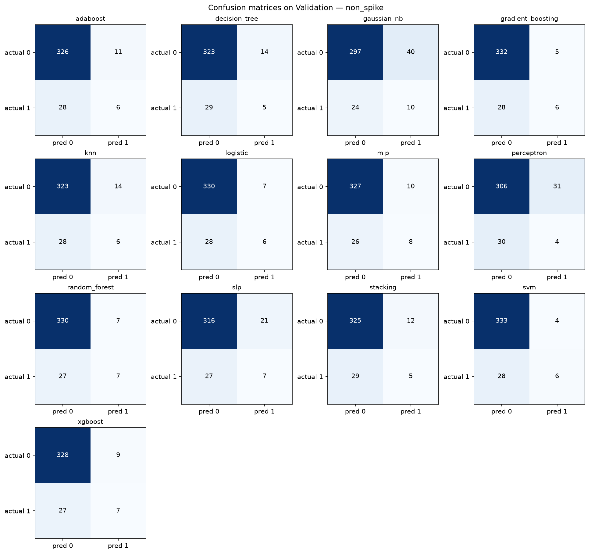

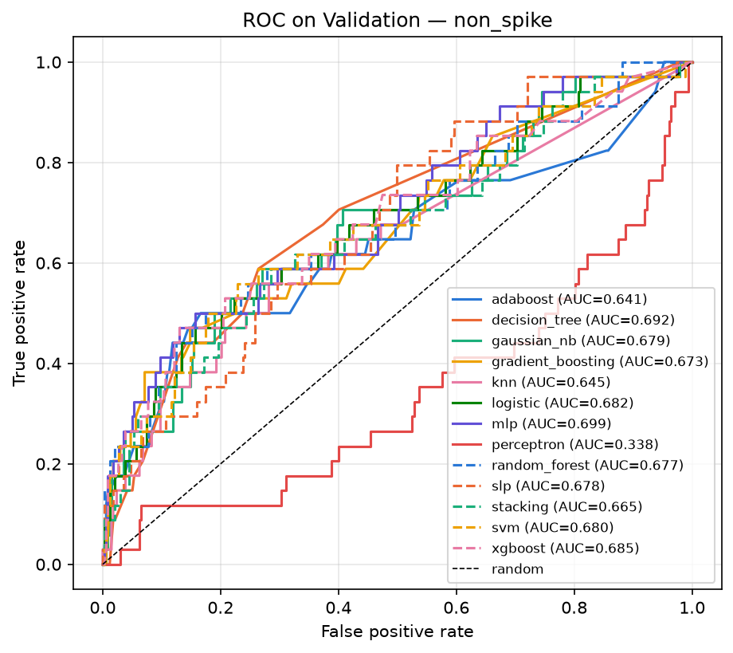

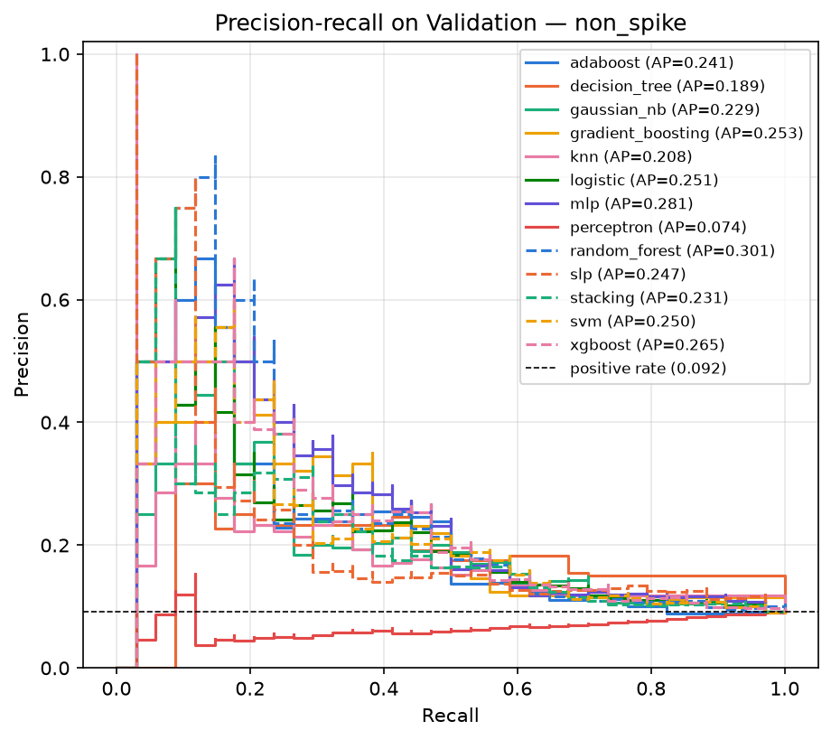

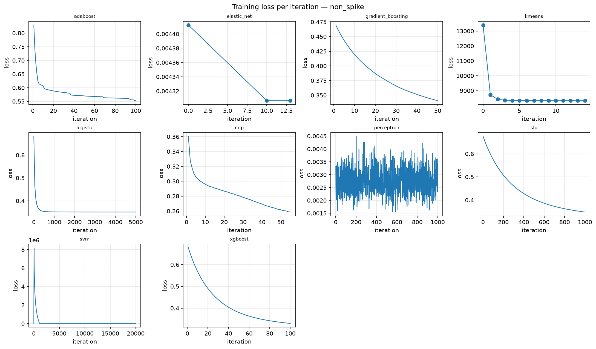

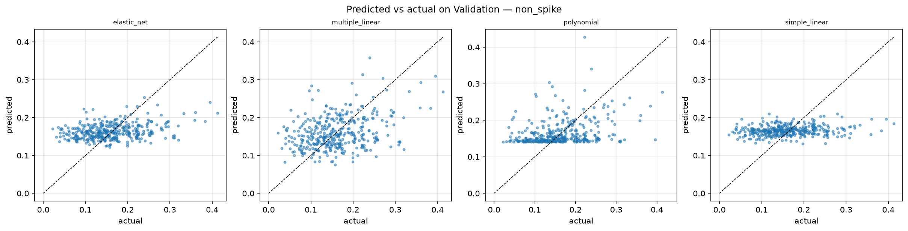

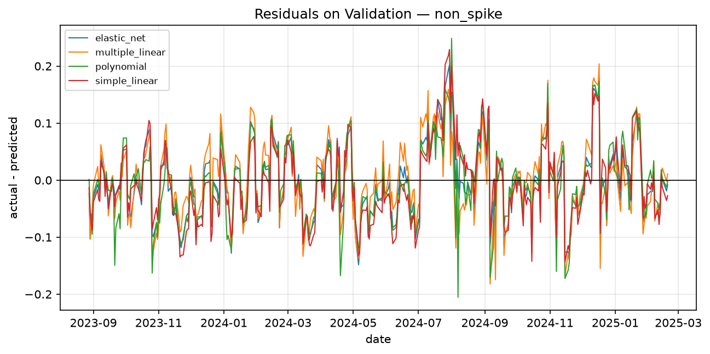

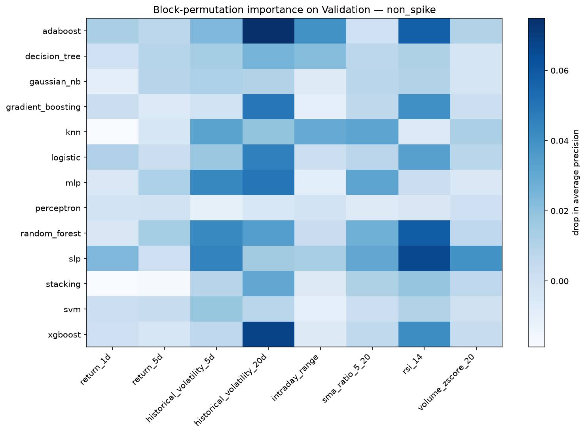

## ภาคผนวก ค หลักฐานการเปิด Test และวิธีทำซ้ำ

**ตารางที่ ค.1** ใบรับรองการเปิด Test (`outputs/modeling/finalize_receipt.json`)

| รายการ | ค่า |
| --- | --- |
| เวลาที่รัน (UTC) | 2026-10-11 14:02:01 |
| git revision ขณะรัน | `cb12d22` (working tree สะอาด) |
| จำนวนแถวของ Test | 373 (ช่วงปกติ 319, ช่วงรอบวัน spike 54) |
| จำนวนโมเดลที่ประเมิน | 38 |
| จำนวนรอบ bootstrap | 2,000 |
| รันซ้ำ | ไม่มี |

**วิธีทำซ้ำ** ขั้นตอนเต็มอยู่ใน `docs/guides/RUNBOOK.md`

1. ติดตั้งตาม RUNBOOK ข้อ 2 ถึง 5
2. `python -m src.ml.run report --variant with_spike` และ `--variant non_spike`
3. `python -m src.ml.run compare`
4. `python -m src.ml.run analyze --variant with_spike` และ `--variant non_spike`
5. `python -m src.ml.docs_sync`
6. เปิด notebook 03, 04, 05 และ 06

ช่วงความเชื่อมั่นใช้ seed คงที่ จึงได้ค่าเดิมทุกครั้ง คำสั่ง `finalize --allow-test` จะปฏิเสธการรันซ้ำ เพราะ Test ถูกเปิดไปแล้ว

**การทดลองเพิ่มเติม** การทดลองในภาคผนวก ง ถึง ฉ แยกจากงานหลัก แต่ละการทดลองล็อกการตั้งค่าไว้ก่อน มีคำสั่งเปิด Test ของตัวเอง และบันทึกใบรับรองที่ทำให้รันซ้ำไม่ได้ (ตารางที่ ค.2)

**ตารางที่ ค.2** ใบรับรองการเปิด Test ของการทดลองเพิ่มเติม

| การทดลอง | เวลาที่เปิด Test (UTC) | Test | holdout | ใบรับรอง |
| --- | --- | ---: | ---: | --- |
| RBF Kernel Perceptron (ภาคผนวก ง) | 2026-10-24 12:13:20 | 373 แถว | ไม่มี | `outputs/experiments/kernel_perceptron/test_receipt.json` |
| Transformer และ GRU (ภาคผนวก จ) | 2026-10-24 20:27:11 | 373 แถว | 39 วัน | `outputs/experiments/transfer_learning/test_receipt.json` |
| Log-HAR (ภาคผนวก ฉ) | 2026-10-24 22:50:52 | 373 แถว | 39 วัน | `outputs/experiments/log_har/test_receipt.json` |

คำสั่งทำซ้ำของแต่ละการทดลองอยู่ในบันทึกการทดลองของการทดลองนั้น ได้แก่ `docs/models/perceptron/KERNEL_EXPERIMENT.md`, `docs/models/transfer_learning/EXPERIMENT.md` และ `docs/models/log_har/EXPERIMENT.md` รูปในภาคผนวกที่มาจาก notebook ถูกบันทึกเป็นไฟล์ด้วยคำสั่ง `python docs/report/tools/export_notebook_figures.py`

## ภาคผนวก ง การทดลอง RBF Kernel Perceptron หลังส่งงาน

ภาคผนวกนี้เป็นผลติดตาม **หลัง** การส่งรายงานหลัก ไม่เปลี่ยนผล 19 โมเดลที่ล็อกไว้ก่อนเปิด Test และไม่ใช้ผล Test เลือกค่า hyperparameter ตัวเลขและรูปทั้งหมดมาจาก notebook 04 หัวข้อ 16 (ผลบน Train และ Validation) และ notebook 05 หัวข้อ 11 (ผลบน Test) ซึ่งอ่านจากไฟล์ใต้ `outputs/experiments/kernel_perceptron/` หลักฐานละเอียดและ receipt อยู่ใน [`docs/models/perceptron/KERNEL_EXPERIMENT.md`](../models/perceptron/KERNEL_EXPERIMENT.md)

### ง.1 ที่มาของการทดลอง

Perceptron แบบเส้นตรงในงานหลักไม่ลู่เข้า เพราะข้อมูล Train ทั้งสอง variant แบ่งด้วยเส้นตรงไม่ได้ โมเดลจึงหยุดที่รอบสูงสุดในสภาพที่ยังทายผิด และได้ ROC-AUC ต่ำกว่าการเดาสุ่ม คือ 0.2993 และ 0.3383 บน Validation และ 0.2749 และ 0.2626 บน Test (`with_spike` และ `non_spike`) คำถามของการทดลองนี้คือ ถ้าให้ Perceptron แบ่งข้อมูลแบบไม่เป็นเส้นตรงด้วย kernel โมเดลจะลู่เข้าและทำนายได้ดีขึ้นหรือไม่ หลักฐานว่าข้อมูลสองคลาสแบ่งด้วยเส้นตรงไม่ได้ และผลต่อกราฟของ Perceptron เดิม อยู่ในหัวข้อ 4.2.5 และรูปที่ 4.11

### ง.2 การเตรียมข้อมูล

การทดลองนี้ไม่เพิ่มข้อมูลใหม่ ใช้ข้อมูลชุดเดียวกับงานหลักทุกประการ

- ใช้ฟีเจอร์ 8 ตัวและ label `target_high_volatility` เดิมของ Train, Validation และ Test
- Train ของ `with_spike` มี 1,733 แถว (positive 433) ส่วน `non_spike` มี 1,520 แถว (positive 280) Validation มี 371 แถว (positive 34) และ Test มี 373 แถว (positive 73) เหมือนกันทั้งสอง variant
- ปรับสเกลด้วย `Standardizer` ที่ fit จาก Train ของ variant นั้นเท่านั้น เช่นเดียวกับ trainer ของ 19 โมเดล การปรับสเกลมีผลมากกับ RBF kernel เพราะ kernel ใช้ระยะทางระหว่างจุด ฟีเจอร์ที่มีหน่วยใหญ่จะครอบงำระยะทางถ้าไม่ปรับสเกลก่อน

### ง.3 อัลกอริทึมและการเทรน

Kernel Perceptron เขียนใน dual form ด้วย NumPy คะแนนของจุด x คือ `f(x) = Σ α_i K(x_i, x) + b` โดย `K(x, x') = exp(−γ‖x − x'‖²)` คือ RBF kernel ซึ่งวัดความคล้ายของสองวันจากระยะทางของฟีเจอร์ ค่า γ ยิ่งมาก ขอบเขตการตัดสินใจยิ่งโค้งตามจุดใกล้ตัวได้มาก

การเทรนวนผ่าน Train ตามลำดับเวลาทีละแถว เมื่อแถว i ถูกทายผิดหรืออยู่บนขอบ (`y_i f(x_i) ≤ 0` โดย y เป็น ±1) จะปรับ `α_i ← α_i + y_i` และ `b ← b + y_i` แล้วปรับคะแนนของทุกแถวทันที การเทรนหยุดเมื่อครบหนึ่ง epoch โดยไม่มีการปรับเลย ซึ่งแปลว่าทาย Train ถูกทุกแถว หรือเมื่อครบ 1,000 epochs ระหว่างเทรนบันทึกจำนวนการปรับและค่า `mean(max(0, −y f(x)))` ต่อ epoch เป็น performance curve แถวที่มี α ไม่เป็นศูนย์คือ support vector ที่เก็บไว้ใช้ทำนาย

ลองค่า γ ห้าค่า เลือกค่าที่ให้ average precision สูงสุดบน Validation แยกตาม variant ผลของทุก candidate อยู่ในตารางที่ ง.1

**ตารางที่ ง.1** ผลการเทรนของทุกค่า γ ที่ลอง (ทุก candidate ลู่เข้า คือ epoch สุดท้ายไม่มีการปรับ)

| variant | γ | epoch ที่หยุด | Validation AP | Validation ROC-AUC | เลือก |
| --- | ---: | ---: | ---: | ---: | --- |
| with_spike | 0.50 | 785 | 0.1375 | 0.6133 | |
| with_spike | 0.75 | 274 | 0.1686 | 0.6574 | |
| with_spike | 1.00 | 139 | **0.1732** | 0.6835 | ใช่ |
| with_spike | 1.50 | 92 | 0.1489 | 0.6764 | |
| with_spike | 2.00 | 72 | 0.1377 | 0.6622 | |
| non_spike | 0.50 | 275 | 0.1333 | 0.6304 | |
| non_spike | 0.75 | 142 | **0.1460** | 0.6533 | ใช่ |
| non_spike | 1.00 | 114 | 0.1355 | 0.6376 | |
| non_spike | 1.50 | 76 | 0.1263 | 0.6300 | |
| non_spike | 2.00 | 83 | 0.1295 | 0.6397 | |

γ ที่มากขึ้นลู่เข้าเร็วขึ้น เพราะขอบเขตโค้งตามจุดได้ง่าย แต่ AP บน Validation ไม่ได้ดีขึ้นตาม โมเดลที่เลือกมี support vector 929 จุด (`with_spike`) และ 722 จุด (`non_spike`) คือราวครึ่งหนึ่งของ Train ซึ่งบอกว่าโมเดลต้องจำตัวอย่างจำนวนมากเพื่อแบ่ง Train ให้ถูกทุกแถว

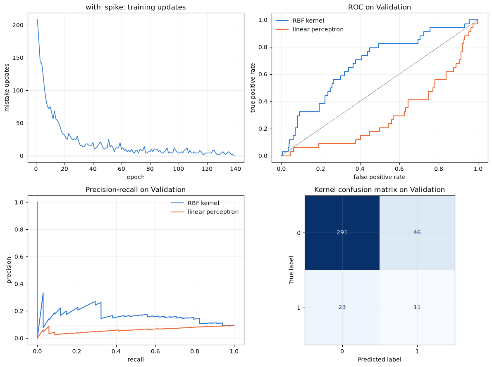

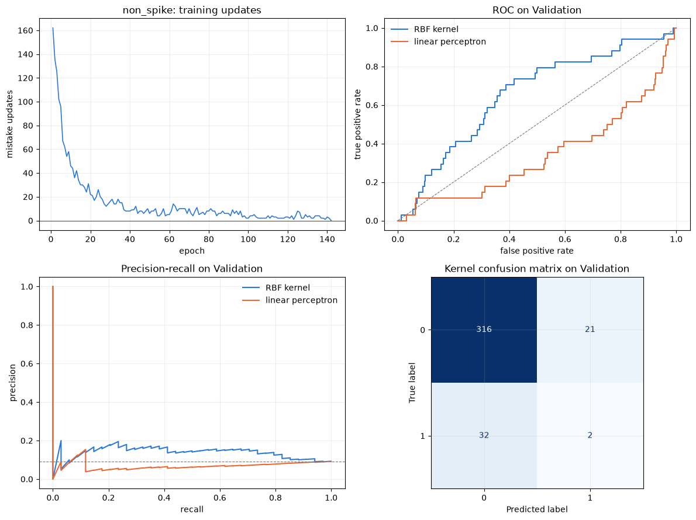

**อ่านรูปที่ ง.1 และ ง.2**

- **กราฟซ้ายบน (การลู่เข้า):** จำนวนการปรับลดจาก 208 ครั้งใน epoch แรก เหลือ 0 ที่ epoch 139 (`with_spike`) จึงยืนยันว่า kernel ทำให้ Train แบ่งได้
- **ROC และ precision-recall:** เส้นของ kernel อยู่เหนือเส้นทแยงและเหนือ Perceptron เส้นตรงซึ่งต่ำกว่าการเดาสุ่ม แต่ precision บน Validation ยังต่ำ ส่วนใหญ่ต่ำกว่า 0.3
- **Confusion matrix:** `with_spike` จับ positive ได้ 11 จาก 34 วัน และเตือนผิด 46 วัน

### ง.4 ผลบน Validation และ Test

หลังล็อก γ จาก Validation แล้ว โหลดโมเดลที่บันทึกไว้ไปประเมิน Test 373 แถวโดยไม่ refit ผลอยู่ในตารางที่ ง.2

**ตารางที่ ง.2** ผล RBF Kernel Perceptron ที่เลือกไว้ บน Validation และ Test แยกตาม variant

| variant | γ | epoch ที่ไม่มีการปรับ | Train ถูก | split | AP | ROC-AUC | accuracy | precision | recall | specificity | F1 | `[[TN,FP],[FN,TP]]` |
| --- | ---: | ---: | ---: | --- | ---: | ---: | ---: | ---: | ---: | ---: | ---: | --- |
| with_spike | 1.0 | 139 | 1733/1733 | Validation | 0.1732 | 0.6835 | 0.8140 | 0.1930 | 0.3235 | 0.8635 | 0.2418 | `[[291,46],[23,11]]` |
| with_spike | 1.0 | 139 | 1733/1733 | Test | 0.4416 | 0.7826 | 0.7962 | 0.4831 | 0.5890 | 0.8467 | 0.5309 | `[[254,46],[30,43]]` |
| non_spike | 0.75 | 142 | 1520/1520 | Validation | 0.1460 | 0.6533 | 0.8571 | 0.0870 | 0.0588 | 0.9377 | 0.0702 | `[[316,21],[32,2]]` |
| non_spike | 0.75 | 142 | 1520/1520 | Test | 0.3728 | 0.7469 | 0.7936 | 0.4000 | 0.1096 | 0.9600 | 0.1720 | `[[288,12],[65,8]]` |

เมื่อใส่ Kernel Perceptron ลงใน leaderboard เดิม (13 classifiers และ 2 baselines) จะอยู่อันดับ AP ที่ **13 จาก 16** สำหรับ `with_spike` และ **14 จาก 16** สำหรับ `non_spike` ทั้งบน Validation และ Test ช่วง 95% ของ AP บน Test คือ [0.2265, 0.5974] และ [0.1833, 0.5398]

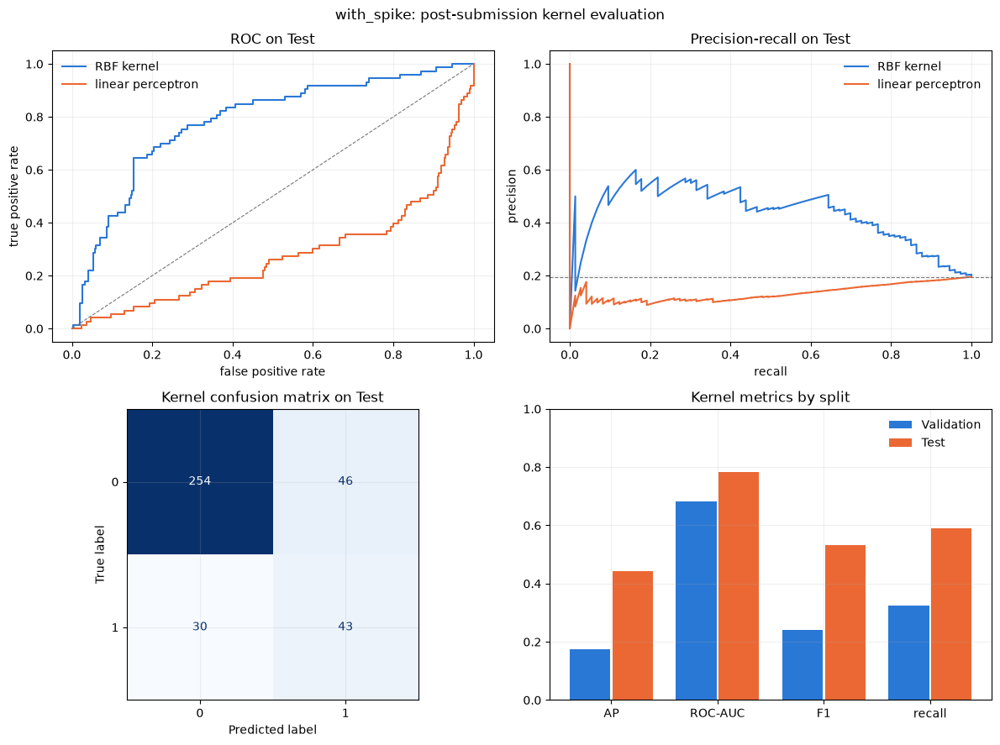

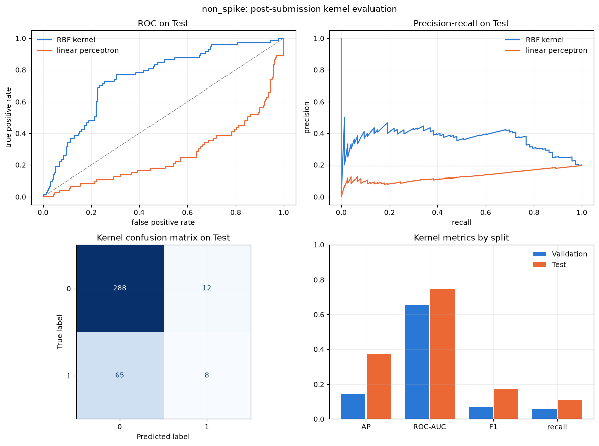

**อ่านรูปที่ ง.3 และ ง.4**

- **ROC บน Test:** เส้นของ kernel อยู่เหนือเส้นทแยงชัดเจน (ROC-AUC 0.78 และ 0.75) ขณะที่ Perceptron เส้นตรงยังต่ำกว่าการเดาสุ่ม
- **กราฟแท่งขวาล่าง:** metric บน Test สูงกว่าบน Validation ทุกตัว ส่วนใหญ่เพราะ Test มีสัดส่วน positive สูงกว่า (19.6% เทียบกับ 9.2%) และมีช่วง spike ที่ทำนายง่ายกว่า ไม่ได้แปลว่าโมเดลเก่งขึ้น จึงเทียบ AP ข้าม split ตรง ๆ ไม่ได้
- **non_spike recall ต่ำมาก:** จับ positive บน Test ได้เพียง 8 จาก 73 วัน แม้จะลู่เข้าบน Train

### ง.5 ความทนทานตามเวลา ความสำคัญของฟีเจอร์ และความไม่แน่นอน

**การทดสอบ walk-forward ภายใน Train**

- ใช้ γ ที่เลือกไว้แล้ว ไม่เลือกใหม่
- แบ่ง Train เป็น expanding window 4 fold: เริ่มจากประวัติ 40% แรก แล้วทำนายช่วงถัดไปทีละช่วง
- เว้น 5 วันทำการก่อนแต่ละช่วงทดสอบ และ fit scaler จากประวัติของ fold นั้นเท่านั้น

ทุก fold ลู่เข้า ผลอยู่ในตารางที่ ง.3

**ตารางที่ ง.3** ผล walk-forward ภายใน Train ของ Kernel Perceptron (ช่วง 95% ของแถว pooled มาจาก moving-block bootstrap 2,000 รอบ)

| variant | fold | แถวที่เทรน | แถวที่ทดสอบ | positive | epoch | AP | ROC-AUC |
| --- | --- | ---: | ---: | ---: | ---: | ---: | ---: |
| with_spike | 0 | 688 | 260 | 80 | 53 | 0.4948 | 0.7715 |
| with_spike | 1 | 948 | 260 | 77 | 31 | 0.5442 | 0.7318 |
| with_spike | 2 | 1,208 | 260 | 119 | 98 | 0.7021 | 0.7714 |
| with_spike | 3 | 1,468 | 260 | 77 | 145 | 0.4071 | 0.6466 |
| with_spike | pooled | – | 1,040 | 353 | – | 0.5127 [0.4049, 0.6249] | 0.7144 |
| non_spike | 0 | 663 | 183 | 20 | 51 | 0.2029 | 0.7052 |
| non_spike | 1 | 848 | 233 | 55 | 62 | 0.4189 | 0.7075 |
| non_spike | 2 | 1,079 | 226 | 86 | 82 | 0.5727 | 0.7150 |
| non_spike | 3 | 1,305 | 210 | 50 | 148 | 0.3473 | 0.6527 |
| non_spike | pooled | – | 852 | 211 | – | 0.3987 [0.2899, 0.5231] | 0.7133 |

AP ต่างกันมากระหว่าง fold (0.41 ถึง 0.70 ใน `with_spike`) ส่วน ROC-AUC ค่อนข้างคงที่ราว 0.65 ถึง 0.77 แปลว่าความสามารถในการจัดอันดับคงที่พอสมควร แต่ AP ขึ้นกับสัดส่วน positive ของแต่ละช่วง

**ความสำคัญของฟีเจอร์** วัดด้วย block-permutation importance บน Validation: สลับค่าของฟีเจอร์หนึ่งตัวเป็นก้อน 20 วัน 30 ครั้ง แล้ววัด AP ที่ลดลง ค่าบวกแปลว่าโมเดลพึ่งฟีเจอร์นั้น

**ตารางที่ ง.4** AP บน Validation ที่ลดลงเมื่อสลับฟีเจอร์ (ค่าเฉลี่ย ± ส่วนเบี่ยงเบนมาตรฐานของ 30 ครั้ง)

| ฟีเจอร์ | with_spike | non_spike |
| --- | ---: | ---: |
| `rsi_14` | 0.0317 ± 0.0195 | 0.0093 ± 0.0170 |
| `historical_volatility_20d` | 0.0282 ± 0.0106 | 0.0168 ± 0.0118 |
| `historical_volatility_5d` | 0.0195 ± 0.0160 | 0.0066 ± 0.0171 |
| `intraday_range` | 0.0127 ± 0.0211 | 0.0054 ± 0.0157 |
| `sma_ratio_5_20` | 0.0064 ± 0.0259 | 0.0114 ± 0.0198 |
| `return_1d` | 0.0001 ± 0.0164 | −0.0074 ± 0.0145 |
| `volume_zscore_20` | −0.0021 ± 0.0257 | −0.0035 ± 0.0207 |
| `return_5d` | −0.0036 ± 0.0387 | −0.0171 ± 0.0323 |

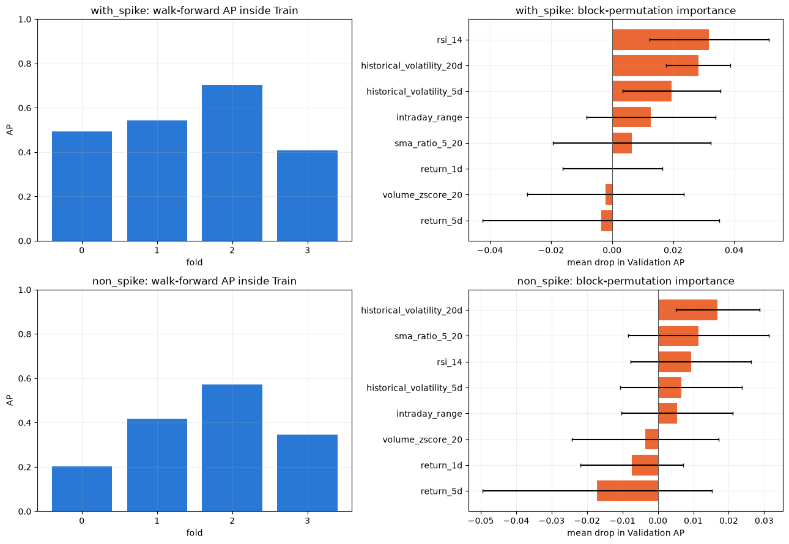

ฟีเจอร์ที่โมเดลพึ่งมากที่สุดคือฟีเจอร์ที่บอกระดับความผันผวนและแนวโน้มล่าสุด (`rsi_14`, `historical_volatility_20d`, `historical_volatility_5d`) ซึ่งตรงกับผลของ 19 โมเดลในหัวข้อ 4.1 ส่วนฟีเจอร์ผลตอบแทนมีค่าใกล้ศูนย์หรือติดลบ ค่าความสำคัญเป็นการพึ่งพาเชิงพยากรณ์ ไม่ใช่เหตุและผล

**ผลต่างแบบ paired** คำนวณบนวันเดียวกันด้วย moving-block bootstrap ก้อน 20 วัน 2,000 รอบ เทียบกับ Perceptron เส้นตรง และกับโมเดล headline ที่ล็อกไว้ก่อนเปิด Test (MLP ของ `with_spike` และ Random Forest ของ `non_spike`)

**ตารางที่ ง.5** ผลต่าง AP แบบ paired (Kernel ลบโมเดลอ้างอิง) พร้อมช่วงความเชื่อมั่น 95%

| split | variant | เทียบกับ Perceptron เส้นตรง | เทียบกับ headline ที่ล็อกไว้ |
| --- | --- | --- | --- |
| Validation | with_spike | +0.1084 [+0.0100, +0.2372] | −0.0936 [−0.2209, +0.0792] |
| Validation | non_spike | +0.0718 [−0.0417, +0.1855] | −0.1550 [−0.3081, +0.0493] |
| Test | with_spike | +0.3042 [+0.1030, +0.4360] | −0.1575 [−0.3320, +0.0648] |
| Test | non_spike | +0.2400 [+0.0784, +0.3730] | −0.1512 [−0.2922, +0.0522] |

Kernel ดีกว่า Perceptron เส้นตรงอย่างมีนัยในสามจากสี่กรณี (ช่วงไม่คร่อมศูนย์) แต่เมื่อเทียบกับโมเดล headline ช่วงคร่อมศูนย์ทุกกรณีและค่ากลางติดลบ จึงสรุปว่า Kernel ดีกว่า headline ไม่ได้

**ผลแยกช่วงบน Test** แบ่ง Test เป็นช่วงรอบวัน spike (54 แถว) และช่วงปกติ (319 แถว) ตามป้ายที่บันทึกไว้ในงานหลัก

**ตารางที่ ง.6** ผล Kernel Perceptron บน Test แยกช่วงตลาด

| variant | ช่วง | แถว | positive | AP | ROC-AUC | precision | recall | `[[TN,FP],[FN,TP]]` |
| --- | --- | ---: | ---: | ---: | ---: | ---: | ---: | --- |
| with_spike | รอบวัน spike | 54 | 38 | 0.8809 | 0.7138 | 0.8519 | 0.6053 | `[[12,4],[15,23]]` |
| with_spike | ปกติ | 319 | 35 | 0.2709 | 0.7241 | 0.3226 | 0.5714 | `[[242,42],[15,20]]` |
| non_spike | รอบวัน spike | 54 | 38 | 0.9101 | 0.7862 | 1.0000 | 0.1053 | `[[16,0],[34,4]]` |
| non_spike | ปกติ | 319 | 35 | 0.2329 | 0.6910 | 0.2500 | 0.1143 | `[[272,12],[31,4]]` |

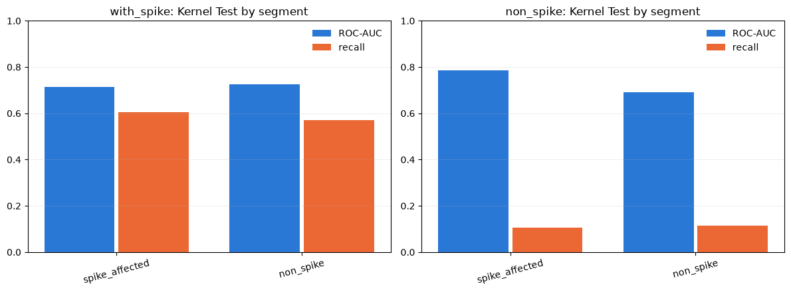

AP ของช่วงรอบวัน spike สูง (0.88 ถึง 0.91) เพราะ 70% ของวันในช่วงนั้นเป็น positive อยู่แล้ว จึงเทียบ AP ข้ามช่วงตรง ๆ ไม่ได้ ROC-AUC ของสองช่วงใกล้กัน ส่วน `non_spike` recall ต่ำทั้งสองช่วง (0.1053 และ 0.1143) คือโมเดลที่ไม่เคยเห็นช่วง spike ตอนเทรนให้คะแนนเกินเกณฑ์น้อยมาก

### ง.6 การตรวจเทียบกับ library

scikit-learn ไม่มีคลาส Kernel Perceptron แบบ online จึงตรวจสองระดับ

1. **การทำนายจากโมเดลที่บันทึกไว้:** คำนวณ RBF kernel ระหว่าง Validation กับ support vectors ด้วย `sklearn.metrics.pairwise.rbf_kernel` แล้วประกอบคะแนนด้วย α และ b ที่บันทึกไว้ ได้ label ตรงกันทุกแถว (371 แถว) และคะแนนต่างกันไม่เกิน 4.5 × 10⁻¹⁴ (`with_spike`) และ 5.7 × 10⁻¹⁴ (`non_spike`)
2. **ขั้นตอนการเทรน:** เทรนใหม่แบบอิสระโดยคำนวณคะแนนใหม่จาก α ทุกครั้งที่ปรับ ทั้งสอง variant ลู่เข้าและทาย Train ถูกทุกแถว `non_spike` มีประวัติการปรับตรงกันทุก epoch ส่วน `with_spike` หยุดที่ epoch 144 แทน 139 และได้ Validation AP 0.1744 แทน 0.1732 เพราะคะแนนบางแถวใกล้ศูนย์มาก (ต่างกันระดับ 10⁻¹⁷) ลำดับการบวกเลขทศนิยมจึงเปลี่ยนการตัดสินใจว่าจะปรับหรือไม่ จึง **ไม่อ้าง** ว่าขั้นตอนการเทรนตรงกันทุกครั้ง

### ง.7 สรุป

1. RBF kernel แก้ปัญหาการไม่ลู่เข้าของ Perceptron ได้จริง ทุก candidate ลู่เข้าและทาย Train ถูกทุกแถว
2. การลู่เข้าบน Train ไม่ได้แปลว่าทำนายข้อมูลใหม่ได้ดี โมเดลต้องใช้ support vector ราวครึ่งหนึ่งของ Train และอยู่อันดับ 13 ถึง 14 จาก 16 บน leaderboard
3. Kernel ดีกว่า Perceptron เส้นตรงอย่างชัดเจน แต่ยังสรุปว่าดีกว่าโมเดล headline ไม่ได้ และ `non_spike` มี recall ต่ำมาก
4. ผล Test เปิดหลังเห็นผลของ 19 โมเดลแล้ว จึงเป็นการติดตามผลเชิงสำรวจ ไม่ใช่การเปรียบเทียบแบบ blind

## ภาคผนวก จ การทดลอง transfer learning หลังนำเสนอ

ภาคผนวกนี้ตอบข้อเสนอของอาจารย์หลังการนำเสนอว่า ให้ลองโมเดลลำดับเวลาที่ **เรียนจากหุ้นและดัชนีตัวอื่นก่อน** ด้วย self-supervised learning และ domain-adaptive pretraining แล้วค่อยปรับเข้ากับ QQQ ว่าจะทำนายช่วงผันผวนสูงได้ดีกว่าโมเดลที่มองทีละวันอย่าง MLP หรือไม่ การทดลองแยกจาก 19 โมเดลเดิมโดยสมบูรณ์ ไม่แก้ข้อมูลหลักและผลที่ล็อกไว้ ตัวเลขและรูปมาจาก notebook 04 หัวข้อ 17 และ notebook 05 หัวข้อ 12 ซึ่งอ่านจากไฟล์ใต้ `outputs/experiments/transfer_learning/` หลักฐานเต็มอยู่ใน [`docs/models/transfer_learning/EXPERIMENT.md`](../models/transfer_learning/EXPERIMENT.md)

### จ.1 คำถามและแนวคิด

โมเดลในงานหลักรับฟีเจอร์ 8 ตัวของวันเดียว ส่วนประวัติย้อนหลังถูกสรุปไว้ในฟีเจอร์แล้ว เช่น `historical_volatility_20d` แนวคิดของการทดลองนี้มีสองข้อ

1. **ใช้ลำดับเวลาโดยตรง** ให้โมเดลเห็นฟีเจอร์ 60 วันย้อนหลังทั้งหมด แทนการเห็นเฉพาะวันล่าสุด
2. **เรียนจากตลาดอื่นก่อน** QQQ Train มีเพียงราว 1,700 วัน ถ้าโมเดลเรียนรูปแบบของความผันผวนจากตลาดอื่นที่มีข้อมูลมากกว่าก่อน แล้วค่อยปรับกับ QQQ อาจได้ representation ที่ดีกว่าการเริ่มจากศูนย์ นี่คือแนวคิดของ transfer learning

คำถามที่ต้องตอบจึงมีสี่ข้อ: ลำดับเวลาช่วยไหม, pretraining บนตลาดอื่นช่วยไหม, การปรับเข้ากับ QQQ โดยไม่ใช้ label (domain-adaptive) ช่วยเพิ่มไหม และโมเดลแบบ attention ต่างจาก RNN อย่างไร

### จ.2 การเตรียมข้อมูล

**ข้อมูลจากตลาดอื่น**

- ดึงราคารายวัน (Open, High, Low, Close, Volume) ของ ETF 10 ตัวในตารางที่ จ.1 จาก Nasdaq historical API ซึ่งเป็น endpoint เดียวกับที่ใช้ดึง QQQ (Nasdaq, 2026b)
- ราคาที่ได้จึงมีนโยบายเดียวกับ QQQ คือไม่ปรับเงินปันผล และไม่มีคอลัมน์ Adj Close
- API ให้ข้อมูลย้อนหลัง 10 ปี คือ 24 ตุลาคม 2016 ถึง 23 ตุลาคม 2026 ไฟล์ทุกไฟล์ถูกบันทึกพร้อม SHA-256 ใน `outputs/experiments/transfer_learning/sources/manifest.json`
- ไม่บันทึกไว้ใต้ `data/` เพราะชั้นข้อมูลของงานหลักถูกตรึงไว้

**ตารางที่ จ.1** ETF ที่ใช้ pretrain จำนวนแถวที่ดึงมา แถวที่ถูกตัดตอน cleaning และจำนวนหน้าต่าง 60 วันหลังตัดที่ cutoff

| ETF | กลุ่ม | ตามดัชนีหรือกลุ่มสินทรัพย์ | แถวที่ดึงมา | แถวที่ถูกตัด | หน้าต่างที่ใช้ |
| --- | --- | --- | ---: | ---: | ---: |
| SPY | หุ้นสหรัฐฯ กว้าง | S&P 500 | 2,514 | 1 | 1,632 |
| DIA | หุ้นสหรัฐฯ กว้าง | Dow Jones Industrial Average | 2,514 | 0 | 1,632 |
| IWM | หุ้นสหรัฐฯ กว้าง | Russell 2000 (บริษัทขนาดเล็ก) | 2,514 | 1 | 1,631 |
| XLK | กลุ่มอุตสาหกรรม | เทคโนโลยี | 2,514 | 0 | 1,632 |
| XLF | กลุ่มอุตสาหกรรม | การเงิน | 2,514 | 1 | 1,631 |
| XLE | กลุ่มอุตสาหกรรม | พลังงาน | 2,514 | 1 | 1,631 |
| XLV | กลุ่มอุตสาหกรรม | สุขภาพ | 2,514 | 0 | 1,632 |
| XLY | กลุ่มอุตสาหกรรม | สินค้าฟุ่มเฟือย | 2,514 | 0 | 1,632 |
| EFA | หุ้นต่างประเทศ | ตลาดพัฒนาแล้วนอกสหรัฐฯ | 2,514 | 0 | 1,632 |
| EEM | หุ้นต่างประเทศ | ตลาดเกิดใหม่ | 2,514 | 0 | 1,632 |
| รวม | | | | | 16,317 |

**ขั้นตอนการเตรียมข้อมูลของแต่ละ ETF**

1. **Cleaning:** ใช้ฟังก์ชัน cleaning ของงานหลัก แถวที่ถูกตัดคือวันที่ API ส่งปริมาณซื้อขายเป็น `N/A` เช่น SPY วันที่ 20 เมษายน 2026
2. **Cutoff:** ตัดทุก ETF ที่ 18 สิงหาคม 2023 ซึ่งเป็นวันสุดท้ายของ QQQ Train **ก่อน** คำนวณ target ทำให้ label 5 วันข้างหน้าของ ETF ไม่ยาวเลยวันนั้น และไม่มีข้อมูลตลาดอื่นในช่วง Validation หรือ Test เลย เหตุผลคือความผันผวนของตลาดอื่นในช่วงนั้นเกิดพร้อมกับของ QQQ ถ้านำมาฝึกจะเท่ากับให้โมเดลเห็นข้อมูลอนาคตของ QQQ ทางอ้อม
3. **ฟีเจอร์และ target:** สร้าง 8 ฟีเจอร์และ target ด้วยฟังก์ชันเดิมของงานหลัก จึงมีนิยามเหมือน QQQ ทุกประการ
4. **ตรวจ split ที่ไม่ได้ปรับราคา:** ตรวจว่าไม่มีวันที่ผลตอบแทนรายวันเกิน ±25% ซึ่งจะชี้ว่าเป็น split ไม่พบใน ETF ใดก่อน cutoff
5. **ปรับสเกล:** standardize แต่ละ ETF ด้วยค่าเฉลี่ยและส่วนเบี่ยงเบนของตัวเองก่อน cutoff เพราะ ETF แต่ละตัวมีระดับความผันผวนต่างกัน ไม่ใช้การปรับสเกลรายหน้าต่าง (RevIN) เพราะจะลบระดับความผันผวนซึ่งเป็นสัญญาณหลักของโจทย์

**ข้อมูล QQQ และหน้าต่างลำดับเวลา**

- อ่านฟีเจอร์ของ QQQ จาก `data/interim/qqq_features.csv` แล้วตรวจว่าตรงกับไฟล์ Train และ Validation ที่ตรึงไว้ทุกแถว (ต่างไม่เกิน 10⁻¹²)
- ปรับสเกลด้วย `Standardizer` ที่ fit จาก Train ของ variant นั้น แบบเดียวกับ 19 โมเดล
- input ของวัน t คือ 8 ฟีเจอร์ของวัน t−59 ถึง t รวม 60 วันทำการ หน้าต่างของ Validation ใช้ฟีเจอร์ของวันท้าย Train และวันในช่องว่าง 5 วันเป็น context ได้ เพราะฟีเจอร์เหล่านั้นรู้แล้ว ณ วัน t แต่ไม่ใช้ **label** ของวันในช่องว่าง Validation จึงได้ครบ 371 วัน ส่วน Train เสีย 59 วันแรกที่ไม่มีประวัติครบ
- ใน `non_spike` วันที่ถูกตัดออกเสียแค่ label ฟีเจอร์ของวันเหล่านั้นยังอยู่ใน context เพราะถ้าตัดออกจากหน้าต่าง จะเป็นการต่อวันที่ไม่ได้อยู่ติดกันเข้าด้วยกัน
- การหยุดก่อนกำหนดใช้ 15% ท้ายของ Train และตัด 5 วันทำการก่อนส่วนท้ายออกจากชุดเทรน แบบเดียวกับ MLP จำนวนแถวแต่ละส่วนอยู่ในตารางที่ จ.2

**ตารางที่ จ.2** จำนวนหน้าต่างของ QQQ แต่ละส่วนและน้ำหนักของคลาส positive

| variant | แถว Train เดิม | หน้าต่าง Train (positive) | ชุดเทรนย่อย | ส่วนท้าย (positive) | pos_weight | Validation (positive) |
| --- | ---: | ---: | ---: | ---: | ---: | ---: |
| with_spike | 1,733 | 1,674 (433) | 1,417 | 252 (76) | 2.97 | 371 (34) |
| non_spike | 1,520 | 1,461 (280) | 1,236 | 220 (53) | 4.57 | 371 (34) |

`pos_weight` คืออัตราส่วนวัน negative ต่อ positive ในชุดเทรนย่อย ใช้ถ่วงน้ำหนัก loss ของวัน positive เพื่อชดเชยคลาสไม่สมดุล

**holdout ใหม่** ดึงราคา QQQ ล่าสุดจาก endpoint เดิม ราคาช่วงที่ทับกับ snapshot ตรงกันทุกวัน แต่ถ้าคำนวณฟีเจอร์จากไฟล์ใหม่ลำพัง `rsi_14` จะต่างได้ถึง 0.35 เพราะ RSI แบบ Wilder จำจุดเริ่มต้นของอนุกรม จึงนำแถวใหม่ไปต่อท้าย snapshot เดิมแล้วคำนวณฟีเจอร์ทั้งอนุกรม ผลที่ได้ตรงกับฟีเจอร์เดิมทั้ง 2,492 แถว (ต่างไม่เกิน 7 × 10⁻¹⁵) ได้ holdout 39 วัน (24 สิงหาคม ถึง 16 ตุลาคม 2026) ใช้ threshold Q75 เดิมจาก Train มีวันผันผวนสูง 2 วัน

### จ.3 โมเดลและการเขียนจาก scratch

**Transformer** (Vaswani et al., 2017) ขนาดเล็ก มีพารามิเตอร์ 19,665 ตัว

- แปลงฟีเจอร์ 8 ตัวของแต่ละวันเป็นเวกเตอร์ 32 มิติด้วยชั้น linear แล้วบวก positional embedding ที่เรียนได้ เพื่อให้โมเดลรู้ลำดับของวัน
- ผ่าน encoder แบบ pre-LayerNorm 2 ชั้น แต่ละชั้นมี multi-head self-attention 4 heads และ feed-forward 64 หน่วยที่ใช้ GELU พร้อม dropout 0.1
- self-attention ให้แต่ละวันในหน้าต่างดูข้อมูลของทุกวันอื่นได้ทั้งก่อนและหลังภายในหน้าต่าง โดยน้ำหนักที่ให้แต่ละวันมาจาก `softmax(QKᵀ/√d)`
- เฉลี่ยผลของทั้ง 60 วัน (mean-pool) แล้วส่งเข้า head ที่ให้ความน่าจะเป็น

**GRU** (Cho et al., 2014) ชั้นเดียว hidden 32 หน่วย มีพารามิเตอร์ 4,337 ตัว

- อ่านหน้าต่างทีละวันจากอดีตไปปัจจุบัน
- ที่แต่ละวันคำนวณ reset gate r และ update gate z แล้วปรับสถานะ `h_t = (1 − z) ⊙ n + z ⊙ h_{t−1}` โดย n คือสถานะใหม่ที่เสนอ gate ทำให้โมเดลเลือกได้ว่าจะจำอดีตแค่ไหน
- ใช้สถานะของวันสุดท้ายส่งเข้า head

**การเขียนจาก scratch** เพื่อทำตามข้อกำหนดของโครงงาน จึงไม่ใช้ deep-learning framework

- เขียน reverse-mode automatic differentiation เองด้วย NumPy ทุกการดำเนินการบันทึกวิธีคำนวณ gradient ของตัวเอง แล้วไล่ย้อนจาก loss
- softmax, LayerNorm, BCE-with-logits และ masked MSE ใช้สูตร gradient ที่ derive เองเพื่อความเสถียรเชิงตัวเลข
- เขียน optimizer AdamW (Loshchilov & Hutter, 2019) เอง พร้อม gradient clipping
- ทุกการดำเนินการและทั้งสองโมเดลผ่านการตรวจ gradient ด้วย finite difference (ความคลาดเคลื่อนสัมพัทธ์ < 10⁻⁶ ใน float64; 22 tests) และทดสอบว่าโมเดลจำ batch เล็กได้ ใช้ seed เดิมแล้วได้ผลเดิม และบันทึกแล้วโหลดกลับได้คำทำนายเท่าเดิม

### จ.4 การเทรน

การเรียนแบ่งเป็นสามขั้น

1. **Self-supervised pretraining (SSL) บน ETF:** ในแต่ละหน้าต่างสุ่มซ่อนช่วง 5 วันจำนวน 2 ช่วง (ราว 17% ของวัน) โดยแทนด้วย mask token ที่เรียนได้ แล้วให้โมเดลเติมฟีเจอร์ของวันที่ถูกซ่อน วัดด้วย MSE เฉพาะวันที่ถูกซ่อน (Zerveas et al., 2021) ขั้นนี้ไม่ใช้ label และไม่เห็น QQQ จึงเทรนครั้งเดียวต่อ seed แล้วใช้ร่วมกันทั้งสอง variant
2. **Domain-adaptive pretraining (DAPT) บน QQQ:** ทำ masked reconstruction ต่อบนหน้าต่างของ QQQ Train ของ variant นั้น โดยไม่ใช้ label แนวคิดมาจาก Gururangan et al. (2020) ที่พบว่าการ pretrain ต่อบนข้อมูลของโดเมนเป้าหมายช่วยให้โมเดลปรับตัวกับโดเมนนั้น
3. **Fine-tune:** เปลี่ยนเป็น head ใหม่ที่ให้ความน่าจะเป็น แล้วเทรนด้วย binary cross-entropy ที่ถ่วงด้วย `pos_weight` หยุดเมื่อ AP บนส่วนท้ายของ Train ไม่ดีขึ้น 10 epoch ติดต่อกัน และเก็บน้ำหนักของ epoch ที่ดีที่สุด

การตั้งค่าทั้งหมดกำหนดไว้ก่อนดูผล Validation โดยไม่ค้น hyperparameter ตามตารางที่ จ.3

**ตารางที่ จ.3** การตั้งค่าของการเทรน

| รายการ | ค่า |
| --- | --- |
| ความยาวหน้าต่าง | 60 วันทำการ |
| batch | 128 หน้าต่าง |
| SSL บน ETF | 30 epochs, AdamW learning rate 1×10⁻³ |
| DAPT บน QQQ Train | 20 epochs, learning rate 5×10⁻⁴ |
| fine-tune | สูงสุด 100 epochs, patience 10, learning rate ของ head 1×10⁻³ |
| learning rate ของ encoder ตอน fine-tune | 3×10⁻⁴ ถ้า pretrain มาแล้ว, 1×10⁻³ ถ้าเริ่มจากศูนย์ |
| weight decay | 1×10⁻⁴ (ไม่ใช้กับ bias และ LayerNorm) |
| gradient clipping | norm ไม่เกิน 1.0 |
| seed | 0, 1, 2 (ทุก arm ใช้น้ำหนักเริ่มต้นและ head ใหม่ชุดเดียวกันต่อ seed) |
| เกณฑ์ทำนาย positive | ความน่าจะเป็นเฉลี่ยของ 3 seed > 0.5 |

**ตารางที่ จ.4** กลุ่มเปรียบเทียบ (arm) และคำถามที่แต่ละกลุ่มตอบ (`T-` คือ Transformer และ `G-` คือ GRU)

| arm | เริ่มจาก | ปรับ encoder ตอน fine-tune | คำถามที่ตอบ |
| --- | --- | --- | --- |
| `T-scratch`, `G-scratch` | น้ำหนักสุ่ม | ปรับ | ลำดับเวลาอย่างเดียวช่วยไหม |
| `T-ssl`, `G-ssl` | SSL บน ETF | ปรับ | pretraining บนตลาดอื่นช่วยไหม |
| `T-full`, `G-full` | SSL แล้ว DAPT | ปรับ | DAPT ช่วยเพิ่มไหม (`T-full` คือโมเดลหลักที่ล็อกไว้) |
| `T-probe`, `G-probe` | SSL แล้ว DAPT | ไม่ปรับ ฝึกแค่ head | representation ที่ได้ใช้ได้เลยไหม |

รวมเป็น 8 arms × 3 seeds × 2 variants = 48 โมเดล ทุกตัวผ่านการตรวจว่าบันทึกแล้วโหลดกลับได้คำทำนายบน Validation เท่าเดิมทุกค่า ก่อนเปิด Test ได้ล็อกการตั้งค่า SHA-256 ของโค้ด ข้อมูล และ checkpoint ทั้ง 48 ไฟล์ไว้ใน `decision.json`

**ผลของการ pretrain** วัด masked MSE บนหน้าต่าง QQQ Train 512 หน้าต่างที่ตรึงไว้ (ค่าเฉลี่ย 3 seed)

- **SSL:** Transformer ลดจาก 0.48 เป็น 0.20 และ GRU ลดจาก 0.42 เป็น 0.34 ทั้งที่ไม่เคยเห็น QQQ ระหว่างฝึก แปลว่ารูปแบบที่เรียนจากตลาดอื่นใช้กับ QQQ ได้ บนข้อมูล ETF เอง loss ลดจาก 0.85 เป็น 0.33 (Transformer) และ 0.77 เป็น 0.45 (GRU)
- **DAPT:** ลดต่ออีกเล็กน้อย คือ Transformer จาก 0.203 เป็น 0.195 และ GRU จาก 0.334 เป็น 0.323 ใน `with_spike` ส่วน `non_spike` จาก 0.262 เป็น 0.250 และ 0.436 เป็น 0.414 (ค่าของ `non_spike` ต่างเพราะวัดบนหน้าต่างของ `non_spike` เอง)
- **Transformer เติมข้อมูลได้ดีกว่า GRU มาก** เพราะ self-attention เห็นวันทั้งก่อนและหลังช่วงที่ถูกซ่อน ส่วน GRU อ่านทางเดียวจึงใช้ได้แค่อดีต

**ผลของการ fine-tune** epoch ที่ AP บนส่วนท้ายของ Train ดีที่สุดอยู่ในตารางที่ จ.5

**ตารางที่ จ.5** epoch ที่ดีที่สุดตอน fine-tune ของแต่ละ seed (seed 0, 1, 2) และ AP เฉลี่ยบนส่วนท้ายของ Train

| arm | with_spike: epoch ที่ดีที่สุด | with_spike: AP ส่วนท้าย | non_spike: epoch ที่ดีที่สุด | non_spike: AP ส่วนท้าย |
| --- | --- | ---: | --- | ---: |
| `T-scratch` | 1, 10, 2 | 0.471 | 2, 1, 1 | 0.426 |
| `T-ssl` | 1, 1, 3 | 0.525 | 3, 1, 3 | 0.551 |
| `T-full` | 1, 2, 3 | 0.517 | 3, 1, 3 | 0.543 |
| `T-probe` | 3, 4, 18 | 0.506 | 3, 35, 1 | 0.532 |
| `G-scratch` | 7, 6, 7 | 0.556 | 7, 8, 13 | 0.440 |
| `G-ssl` | 11, 9, 10 | 0.531 | 14, 8, 13 | 0.436 |
| `G-full` | 9, 7, 8 | 0.535 | 14, 17, 15 | 0.445 |
| `G-probe` | 26, 12, 20 | 0.545 | 35, 68, 4 | 0.452 |

Transformer ดีที่สุดภายใน 3 epoch ใน 20 จาก 24 รอบ แล้ว AP บนส่วนท้ายลดลงขณะที่ loss บนชุดเทรนยังลดต่อ ซึ่งเป็นอาการ overfit เร็ว ส่วน GRU ไม่มีรอบใดดีที่สุดก่อน epoch 4

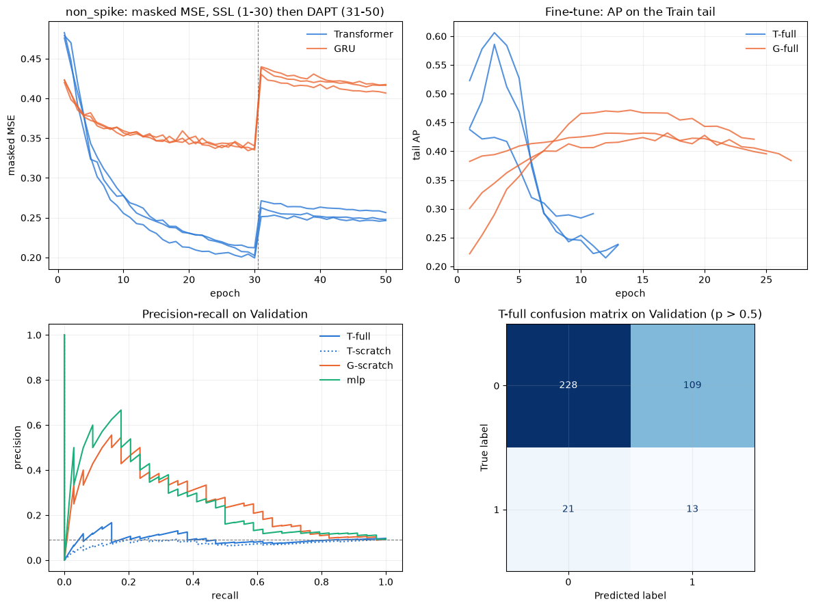

**อ่านรูปที่ จ.1 และ จ.2**

- **กราฟขวาบน:** tail AP ของ T-full (สีน้ำเงิน) ขึ้นสูงสุดในไม่กี่ epoch แรกแล้วลดลง ส่วน G-full (สีส้ม) ค่อย ๆ ดีขึ้น
- **กราฟซ้ายล่าง:** precision-recall ของ T-full และ T-scratch อยู่ใกล้เส้นประซึ่งคือสัดส่วน positive (0.092) ตลอด ส่วน G-scratch ซ้อนกับ MLP
- **confusion matrix ของ T-full ใน with_spike:** จับ positive ได้ 6 จาก 34 วัน และเตือนผิด 40 วัน

### จ.5 ผลบน Validation

ตารางที่ จ.6 แสดง average precision ของทุก arm และอันดับเมื่อใส่ลงใน leaderboard เดิมทีละตัว ส่วนตารางที่ จ.7 แสดงผลราย seed เพื่อดูว่าผลไม่ได้มาจาก seed เดียว

**ตารางที่ จ.6** average precision ของแต่ละ arm (ค่าเฉลี่ย 3 seed) และอันดับเมื่อใส่ลงใน leaderboard เดิม 15 แถว (ตัวเลขในวงเล็บคืออันดับจาก 16)

| โมเดล | with_spike Validation | with_spike Test | non_spike Validation | non_spike Test |
| --- | ---: | ---: | ---: | ---: |
| `T-scratch` | 0.095 (14) | 0.240 (14) | 0.079 (15) | 0.257 (14) |
| `T-ssl` | 0.125 (14) | 0.297 (14) | 0.097 (14) | 0.313 (14) |
| `T-full` (โมเดลหลักที่ล็อกไว้) | 0.129 (14) | 0.310 (14) | 0.098 (14) | 0.330 (14) |
| `T-probe` | 0.119 (14) | 0.236 (14) | 0.107 (14) | 0.289 (14) |
| `G-scratch` | 0.258 (2) | 0.580 (2) | 0.276 (3) | 0.618 (1) |
| `G-ssl` | 0.267 (2) | 0.567 (4) | 0.267 (3) | 0.602 (1) |
| `G-full` | 0.265 (2) | 0.549 (7) | 0.272 (3) | 0.574 (4) |
| `G-probe` | 0.291 (1) | 0.573 (3) | 0.259 (4) | 0.604 (1) |
| `mlp` (อันดับใน leaderboard เดิม 15 แถว) | 0.267 (1) | 0.599 (1) | 0.281 (2) | 0.564 (5) |
| `baseline_persistence` (อันดับใน leaderboard เดิม 15 แถว) | 0.247 (6) | 0.536 (8) | 0.247 (7) | 0.536 (10) |

**ตารางที่ จ.7** average precision บน Validation ราย seed (seed 0 / 1 / 2)

| arm | with_spike | non_spike |
| --- | --- | --- |
| `T-scratch` | 0.088 / 0.095 / 0.110 | 0.093 / 0.081 / 0.076 |
| `T-ssl` | 0.091 / 0.097 / 0.131 | 0.097 / 0.093 / 0.100 |
| `T-full` | 0.101 / 0.117 / 0.134 | 0.101 / 0.081 / 0.101 |
| `T-probe` | 0.139 / 0.120 / 0.086 | 0.134 / 0.095 / 0.105 |
| `G-scratch` | 0.282 / 0.253 / 0.260 | 0.272 / 0.272 / 0.291 |
| `G-ssl` | 0.275 / 0.244 / 0.268 | 0.275 / 0.226 / 0.270 |
| `G-full` | 0.271 / 0.220 / 0.269 | 0.268 / 0.241 / 0.268 |
| `G-probe` | 0.294 / 0.245 / 0.284 | 0.289 / 0.245 / 0.219 |

`T-full` ดีกว่า `T-scratch` ใน 3 จาก 3 seed ของ `with_spike` และ 2 จาก 3 seed ของ `non_spike` จึงผ่านเกณฑ์ "transfer ช่วย" ที่ตั้งไว้ก่อน (ค่าเฉลี่ยดีกว่าและชนะอย่างน้อย 2 จาก 3 seed) แต่ AP ของ Transformer ทุก arm อยู่ใกล้สัดส่วน positive (0.092) คือใกล้การเดาสุ่ม ขณะที่ GRU ทุก seed อยู่ระดับเดียวกับ MLP

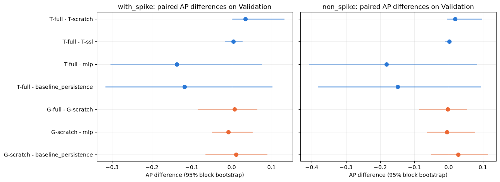

### จ.6 ผลบน Test และ holdout

Test ถูกเปิดหนึ่งครั้งเมื่อ 25 ตุลาคม 2026 หลังได้รับอนุมัติ ด้วยโมเดลที่ล็อกไว้ใน `decision.json` โดยไม่ refit ผลบน Test เป็น **post-hoc** เพราะ Test เคยถูกเปิดในงานหลักแล้ว ได้คำนวณ AP, ROC-AUC และ confusion matrix ซ้ำจากไฟล์คำทำนายด้วย scikit-learn แล้วตรงกับไฟล์ผล (ต่างไม่เกิน 2.2 × 10⁻¹⁶)

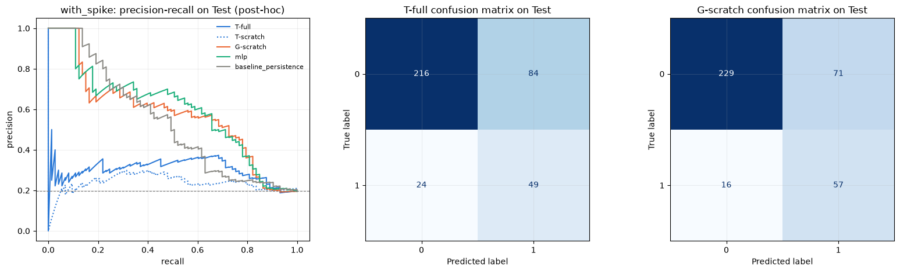

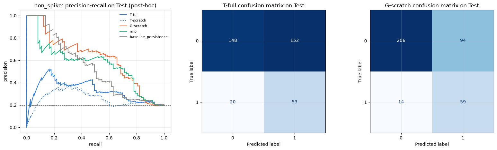

**อ่านรูปที่ จ.4 ถึง จ.6**

- **AP บน Test:** GRU ทุก arm อยู่กลุ่มเดียวกับ MLP และ persistence ส่วน Transformer ทุก arm ต่ำกว่าชัดเจน แม้จะสูงกว่าสัดส่วน positive ของ Test (0.196)
- **Confusion matrix:** G-scratch ใน with_spike จับ positive ได้ 57 จาก 73 วัน (MLP จับได้ 36 วัน) แต่เตือนผิด 71 วัน (MLP 17 วัน) เพราะความน่าจะเป็นถูกถ่วงด้วย `pos_weight` และใช้เกณฑ์ 0.5 คงที่ ส่วน T-full จับได้ 49 วันแต่เตือนผิด 84 วัน

**ตารางที่ จ.8** ผลต่าง average precision แบบ paired พร้อมช่วงความเชื่อมั่น 95% จาก moving-block bootstrap (ตัวแรกลบตัวหลัง)

| การเปรียบเทียบ | with_spike Validation | with_spike Test | non_spike Validation | non_spike Test |
| --- | --- | --- | --- | --- |
| `T-full` − `T-scratch` | +0.035 [+0.002, +0.131] | +0.070 [+0.013, +0.189] | +0.019 [−0.002, +0.095] | +0.074 [−0.003, +0.205] |
| `T-full` − `T-ssl` | +0.005 [−0.016, +0.026] | +0.013 [−0.020, +0.040] | +0.002 [−0.009, +0.005] | +0.017 [−0.009, +0.027] |
| `T-full` − `mlp` | −0.138 [−0.303, +0.074] | −0.290 [−0.398, −0.052] | −0.182 [−0.407, +0.081] | −0.234 [−0.322, −0.048] |
| `G-full` − `G-scratch` | +0.007 [−0.084, +0.062] | −0.031 [−0.096, +0.097] | −0.003 [−0.085, +0.052] | −0.044 [−0.088, +0.045] |
| `G-scratch` − `mlp` | −0.009 [−0.048, +0.051] | −0.019 [−0.060, +0.056] | −0.005 [−0.061, +0.074] | +0.054 [−0.028, +0.122] |

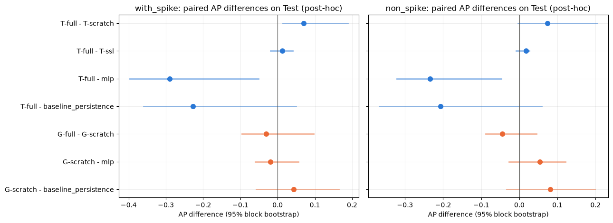

**holdout ใหม่** มีวันผันผวนสูงเพียง 2 วัน คือ 15 และ 16 ตุลาคม 2026 ตารางที่ จ.9 แสดงว่าแต่ละโมเดลจัดสองวันนั้นไว้อันดับใดจาก 39 วัน

**ตารางที่ จ.9** อันดับของวันผันผวนสูงสองวันบน holdout (15 / 16 ตุลาคม 2026) จากทั้งหมด 39 วัน และ average precision

| โมเดล | with_spike: อันดับ | with_spike: AP | non_spike: อันดับ | non_spike: AP |
| --- | --- | ---: | --- | ---: |
| `T-scratch` | 25 / 15 | 0.073 | 36 / 34 | 0.042 |
| `T-full` | 31 / 24 | 0.053 | 33 / 31 | 0.046 |
| `G-scratch` | 2 / 1 | 1.000 | 2 / 1 | 1.000 |
| `G-full` | 2 / 1 | 1.000 | 2 / 1 | 1.000 |
| `mlp` | 2 / 1 | 1.000 | 3 / 1 | 0.833 |
| `baseline_persistence` | 15 / 7 | 0.138 | 15 / 7 | 0.138 |

GRU และ MLP จัดสองวันนั้นไว้บนสุด ส่วน Transformer จัดไว้กลางถึงท้าย ผลนี้สอดคล้องกับ Test แต่สองวันน้อยเกินกว่าจะสรุปทางสถิติ

### จ.7 ทำไม Transformer จึงล้มเหลว

เพื่อตรวจว่าเป็นข้อผิดพลาดของโค้ดหรือไม่ ได้วัด ROC-AUC สามส่วน คือบนชุดเทรนย่อยที่ใช้ฝึก บนส่วนท้ายของ Train ที่ไม่ได้ใช้ฝึก และบน Validation พร้อมวัด Spearman correlation ระหว่างคะแนนบน Validation กับฟีเจอร์ของวันล่าสุด ผลอยู่ในตารางที่ จ.10 (ไฟล์ `report/generalization_diagnostics.csv`)

**ตารางที่ จ.10** ช่วงต่ำสุดถึงสูงสุดของตัวชี้วัดการ generalize ของ arm `scratch` และ `full` ทุก seed

| backbone | variant | ROC-AUC ส่วนท้ายของ Train | ROC-AUC Validation | Spearman กับ `historical_volatility_5d` | Spearman กับ `rsi_14` |
| --- | --- | --- | --- | --- | --- |
| Transformer | with_spike | 0.65 ถึง 0.80 | 0.45 ถึง 0.61 | 0.17 ถึง 0.40 | −0.56 ถึง −0.34 |
| Transformer | non_spike | 0.71 ถึง 0.81 | 0.38 ถึง 0.50 | 0.04 ถึง 0.24 | −0.45 ถึง −0.23 |
| GRU | with_spike | 0.71 ถึง 0.75 | 0.67 ถึง 0.73 | 0.65 ถึง 0.81 | −0.91 ถึง −0.71 |
| GRU | non_spike | 0.70 ถึง 0.73 | 0.69 ถึง 0.72 | 0.69 ถึง 0.81 | −0.88 ถึง −0.76 |

ข้อสังเกตจากตาราง

- **โค้ดทำงานถูกต้อง:** Transformer จัดอันดับส่วนท้ายของ Train ซึ่งไม่ได้ใช้ฝึกได้ดีพอ ๆ กับ GRU และทั้งสองโมเดลใช้หน้าต่าง scaler และการคำนวณคะแนนชุดเดียวกัน
- **ปัญหาอยู่ที่การ generalize ไปช่วงเวลาใหม่:** ROC-AUC ของ Transformer ลดลงเหลือใกล้หรือต่ำกว่า 0.5 บน Validation ส่วน GRU ลดลงเพียงเล็กน้อย
- **สมมติฐาน:** คะแนนของ GRU ตามสภาพของวันล่าสุดใกล้ชิด ส่วน Transformer ตามได้อ่อนกว่ามาก เป็นไปได้ว่าการเฉลี่ยผลของทั้ง 60 วันกลบสัญญาณของวันล่าสุด ซึ่งเป็นสิ่งที่ความผันผวน 5 วันข้างหน้าขึ้นอยู่ด้วยมากที่สุด ร่วมกับการ overfit เร็วในตารางที่ จ.5 และวัน positive ของ Validation ที่กระจุกอยู่ไม่กี่เหตุการณ์
- **ไม่ได้แก้ในรอบนี้:** การเปลี่ยนโครงสร้างหลังเห็นผล Validation จะทำให้การประเมินลำเอียง จึงเสนอเป็นงานต่อในหัวข้อ 5.4.2

### จ.8 สรุปและการตีความ

- **Pretraining ช่วย Transformer แต่ไม่พอใช้งาน** `T-full` ดีกว่า `T-scratch` ทุกชุดข้อมูลและทั้งสอง variant และช่วงความเชื่อมั่นของ `with_spike` ไม่คร่อมศูนย์ทั้งบน Validation และ Test แต่ Transformer ยังอยู่อันดับ 14 จาก 16 และแย่กว่า MLP อย่างชัดเจนบน Test
- **ขั้น domain-adaptive แทบไม่เพิ่มอะไร** แม้ masked MSE บน QQQ จะลดลงจริง การเติมข้อมูลที่หายไปได้ดีขึ้นจึงไม่ได้แปลว่าทำนายความผันผวนในอนาคตได้ดีขึ้น
- **GRU ทำได้เทียบเท่าโมเดลหัวตาราง แต่ไม่ชนะอย่างมีนัย** GRU อยู่อันดับ 1 ถึง 7 แต่ผลต่างกับ MLP คร่อมศูนย์ทุกกรณี และ pretraining ไม่ช่วย GRU ลำดับเวลา 60 วันจึงไม่ได้ให้ข้อมูลที่ฟีเจอร์ของวันล่าสุดยังไม่มี เพราะฟีเจอร์อย่าง `historical_volatility_20d`, `rsi_14` และ `sma_ratio_5_20` สรุปประวัติย้อนหลังไว้แล้ว
- **คำตอบต่อข้อเสนอ** ในข้อมูลชุดนี้ การให้โมเดลลำดับเวลาเรียนจากตลาดอื่นก่อน **ไม่ได้ให้ผลดีกว่า MLP เดิม** ข้อสรุปนี้จำกัดอยู่ที่ฟีเจอร์ 8 ตัวเดิม, ETF 10 ตัวที่ย้อนหลังได้เพียง 10 ปี (ไม่มีเหตุการณ์ปี 2008) และขนาดโมเดลที่กำหนดไว้ก่อน
- **ข้อจำกัด** Validation มีวัน positive เพียง 34 วัน ช่วงความเชื่อมั่นจึงกว้าง ผล Test เป็น post-hoc และ holdout ใหม่มีวัน positive เพียง 2 วัน

## ภาคผนวก ฉ การทดลอง Log-HAR และ pooled-prior transfer หลังนำเสนอ

ภาคผนวกนี้เป็นการทดลองเพิ่มเติมฝั่ง regression หลังการนำเสนอ เพื่อหาโมเดลนอกห้องเรียนที่ทำนาย `target_volatility_5d` ได้ดีกว่า Elastic Net และลองใช้ความรู้จากตลาดอื่นแบบ transfer learning ด้วยโมเดลเชิงเส้นที่อธิบายกลไกได้ การทดลองแยกจาก 19 โมเดลเดิมโดยสมบูรณ์ ไม่แก้ข้อมูลหลักและผลที่ล็อกไว้ ตัวเลขและรูปมาจาก notebook 03 หัวข้อ 12 และ notebook 05 หัวข้อ 13 ซึ่งอ่านจากไฟล์ใต้ `outputs/experiments/log_har/` หลักฐานเต็มอยู่ใน `docs/models/log_har/EXPERIMENT.md`

### ฉ.1 คำถามและแนวคิด

ผลในบทที่ 4 ชี้ปัญหาของงาน regression สามข้อ

- **Elastic Net ไม่ได้ชนะชัด** บน Test มีโมเดลในห้องเรียนที่ได้ RMSE ต่ำกว่าในทั้งสองแบบข้อมูล (ตารางที่ 4.15 และ 4.16)
- **R² บน Validation แทบเป็นศูนย์** คือโมเดลอธิบายความแปรปรวนของช่วงตลาดปกติได้น้อยมาก
- **target เบ้มาก** (skewness 2.80 บน Train) วันสุดโต่งไม่กี่วันจึงดึงน้ำหนักของ least squares ไปทางเดียวกับตัวเอง

แนวทางที่เลือกคือ **HAR-RV ในสเกล log** (Corsi, 2009) ซึ่งเป็นโมเดลมาตรฐานของงานพยากรณ์ความผันผวน แนวคิดคือนักลงทุนแต่ละกลุ่มมองตลาดในช่วงเวลาต่างกัน ความผันผวนในอนาคตจึงอธิบายได้ด้วยความผันผวนรายวัน รายสัปดาห์ และรายเดือน ส่วน transfer learning ทำผ่าน **prior** ของสัมประสิทธิ์ที่ประมาณจากตลาดอื่น ซึ่งเหมาะกับโมเดลเชิงเส้นที่มีพารามิเตอร์น้อย เพราะข้อมูลที่เพิ่มขึ้นช่วยลดความแปรปรวนของสัมประสิทธิ์โดยตรง คำถามที่ต้องตอบมีสามข้อ

1. HAR ในสเกล log ดีกว่า Elastic Net หรือไม่
2. ฟีเจอร์ช่วงราคาในวันและ leverage ช่วยเพิ่มหรือไม่
3. prior จากตลาดอื่นช่วยเพิ่มหรือไม่

### ฉ.2 การเตรียมข้อมูล

**ข้อมูล QQQ** ใช้ข้อมูลเทรน Validation และ Test ชุดเดิมทุกประการ ทั้งแบบ `with_spike` (1,733 แถว) และ `non_spike` (1,520 แถว) ฟีเจอร์ของ HAR สร้างในตัวโมเดลจาก 8 ฟีเจอร์เดิมของวันเดียวกัน จึงไม่ต้องแก้ชั้นข้อมูลและไม่มีหน้าต่างย้อนหลังเพิ่ม (ตารางที่ ฉ.1)

**ตารางที่ ฉ.1** ฟีเจอร์ของ Log-HAR และฟีเจอร์เดิมที่ใช้สร้าง

| ชื่อ | สูตร | ความหมาย |
| --- | --- | --- |
| `d` | log ของ max(ค่าสัมบูรณ์ของ `return_1d` × √252, 0.01) | ความผันผวนรายวัน |
| `w` | log ของ `historical_volatility_5d` | ความผันผวนรายสัปดาห์ |
| `m` | log ของ `historical_volatility_20d` | ความผันผวนรายเดือน |
| `r` | log ของ `intraday_range` | ความผันผวนจากช่วงราคาในวัน |
| `lev` | min(`return_5d`, 0) | leverage effect: ผลตอบแทนติดลบทำให้ความผันผวนสูงขึ้น (Corsi & Renò, 2012) |

- **ค่าต่ำสุดของ d** ข้อมูลเทรนมีวันที่ผลตอบแทนเป็นศูนย์พอดี 1 วัน ซึ่ง log หาค่าไม่ได้ จึงกำหนดค่าต่ำสุดไว้ที่ 1% ต่อปี ซึ่งต่ำกว่าค่าจริงทุกค่าที่พบมาก ฟีเจอร์อื่นที่ต้อง log ต้องเป็นบวก ถ้าพบศูนย์ โมเดลจะหยุดพร้อมแจ้ง แทนที่จะเทรนบนค่า −∞
- **target ในสเกล log** โมเดลทำนาย log ของความผันผวน ซึ่งทำให้การกระจายใกล้ระฆังคว่ำมากขึ้น แล้วแปลงกลับด้วย `exp(ŷ + s²/2)` โดย s² คือความแปรปรวนของ residual บน Train สูตรนี้คือค่าเฉลี่ยของการแจกแจง log-normal ถ้าใช้เพียง exp(ŷ) คำทำนายจะต่ำกว่าค่าเฉลี่ยจริงอย่างเป็นระบบ metric ทุกตัววัดบนสเกลเดิม จึงเทียบกับ 19 โมเดลได้ตรง ๆ

**ข้อมูลตลาดอื่น** ใช้ ETF 10 ตัวชุดเดียวกับภาคผนวก จ (SPY, DIA, IWM, XLK, XLF, XLE, XLV, XLY, EFA และ EEM) ซึ่งตัดที่ 18 สิงหาคม 2023 ก่อนคำนวณ target เหลือ 1,690 ถึง 1,691 แถวต่อตัว รวม 16,907 แถว หรือราว 10 เท่าของข้อมูลเทรนของ QQQ prior สร้างจาก ETF ทั้ง 10 ตัวเท่านั้น **ไม่รวม QQQ** เพื่อให้เป็นความรู้จากตลาดอื่นล้วน ๆ ส่วนข้อมูลของ QQQ เข้าสู่โมเดลผ่านขั้นการประมาณบน QQQ Train

### ฉ.3 โมเดลและวิธีประมาณค่า

**Pooled prior** ประมาณ β_pool ด้วย within estimator คือลบค่าเฉลี่ยของแต่ละ ETF ออกจากฟีเจอร์และ target ก่อน แล้วรวมทุก ETF ทำ least squares โดยไม่มี intercept การลบค่าเฉลี่ยรายตลาดตัดระดับความผันผวนเฉลี่ยซึ่งต่างกันในแต่ละตลาดออก และเหลือเฉพาะ "ความคงทน" ของความผันผวน คือความผันผวนวันนี้ส่งต่อไปถึงอนาคตมากเพียงใด ซึ่งใกล้กันในทุกตลาด

**Transfer ridge** ประมาณสัมประสิทธิ์ของ QQQ โดยให้ถูกดึงเข้าหา β_pool

`min ‖z − a − Fβ‖² + λ‖β − β_pool‖²,  λ = κ · n`

โดย z คือ log ของ target, F คือฟีเจอร์ HAR, a คือ intercept ซึ่งไม่ถูกปรับ และ n คือจำนวนแถวของ Train เมื่อลบค่าเฉลี่ยของข้อมูลออกแล้ว คำตอบเป็นสูตรปิด

`β = (FcᵀFc + λI)⁻¹ (Fcᵀzc + λ β_pool)`

- **κ = 0** คือ least squares บน QQQ อย่างเดียว
- **κ = ∞** คือใช้ β_pool ทั้งหมด แล้วประมาณเฉพาะระดับ (intercept) ของ QQQ
- **κ อยู่ระหว่างนั้น** คือถัวเฉลี่ยระหว่างความรู้จาก QQQ กับจากตลาดอื่น ยิ่ง κ มากยิ่งเชื่อตลาดอื่นมาก

เลือก κ จาก {0, 0.03, 0.1, 0.3, 1, 3, 10, ∞} ด้วย RMSE บน Validation ตามเกณฑ์เดียวกับงาน regression ในบทที่ 3 สองปลายของ grid เป็นการเปรียบเทียบในตัว คือ "QQQ อย่างเดียว" และ "ตลาดอื่นอย่างเดียว"

**การเขียนจาก scratch และการตรวจ** โมเดลเขียนด้วย NumPy (`lstsq` และ `solve`) จึงไม่มีการสุ่ม และเทียบกับ scikit-learn ได้ทุกค่า κ ที่ระดับ `rtol = 1e-5`: κ = 0 เทียบกับ `LinearRegression`, κ > 0 เทียบกับ `Ridge(alpha = λ)` บน target ที่เลื่อนด้วย F·β_pool แล้วบวก β_pool กลับ และ κ = ∞ เทียบกับ regression ที่มีเพียง intercept ส่วน β_pool ตรงกับ `LinearRegression(fit_intercept = False)` บนข้อมูลที่ลบค่าเฉลี่ยแล้ว การตรวจทั้งหมดอยู่ใน test 19 ข้อของ `tests/ml/log_har/` รวมถึงการบันทึกแล้วโหลดโมเดลกลับมาทำนายได้ค่าเดิม

**ตารางที่ ฉ.2** กลุ่มเปรียบเทียบ (arm) ที่ประกาศไว้ก่อนดูผล

| arm | ฟีเจอร์ | วิธีประมาณ | คำถามที่ตอบ |
| --- | --- | --- | --- |
| `H3-qqq` | d, w, m | least squares บน QQQ | HAR คลาสสิกในสเกล log ดีกว่า Elastic Net ไหม |
| `HX-qqq` | d, w, m, r, lev | least squares บน QQQ | ฟีเจอร์ช่วงราคาและ leverage ช่วยไหม |
| `HX-pool` | d, w, m, r, lev | β_pool และระดับของ QQQ (κ = ∞) | ความรู้จากตลาดอื่นอย่างเดียวพอไหม |
| `HX-prior` | d, w, m, r, lev | transfer ridge, κ เลือกบน Validation | โมเดลหลัก: transfer ช่วยเพิ่มไหม |

**เกณฑ์ตัดสินที่ตั้งไว้ก่อน** (บน Validation)

- **transfer ช่วย** เมื่อ RMSE ของ `HX-prior` ต่ำกว่า `HX-qqq` และช่วงความเชื่อมั่น 95% ของผลต่างไม่คร่อมศูนย์
- **ดีกว่า Elastic Net** เมื่อ RMSE ต่ำกว่าและช่วงไม่คร่อมศูนย์

QLIKE (Patton, 2011) รายงานเป็นตัวชี้วัดรอง QLIKE วัดจากอัตราส่วนระหว่างค่าจริงกับค่าทำนาย คือค่าเฉลี่ยของ `r − ln r − 1` โดย r = (ค่าจริง ÷ ค่าทำนาย)² จึงไม่ถูกครอบงำด้วยวันสุดโต่งแบบ RMSE และเป็น loss มาตรฐานของงานพยากรณ์ความผันผวน ค่ายิ่งต่ำยิ่งดี

### ฉ.4 การประมาณค่าและการเลือก κ

**ตารางที่ ฉ.3** สัมประสิทธิ์ของ Log-HAR (สเกล log ของความผันผวน)

| ที่มา | d | w | m | r | lev |
| --- | ---: | ---: | ---: | ---: | ---: |
| β_pool (ETF 10 ตัว) | −0.022 | 0.064 | 0.465 | 0.286 | −4.669 |
| ช่วงของ ETF รายตัว | −0.042 ถึง 0.008 | −0.024 ถึง 0.131 | 0.300 ถึง 0.618 | 0.184 ถึง 0.355 | −6.698 ถึง −2.758 |
| `HX-qqq` (with_spike) | −0.045 | 0.076 | 0.503 | 0.293 | −5.973 |
| `HX-qqq` (non_spike) | −0.055 | 0.107 | 0.452 | 0.282 | −6.751 |
| `HX-prior` (non_spike, κ = 1) | −0.033 | 0.072 | 0.467 | 0.290 | −4.669 |
| `H3-qqq` (with_spike) | 0.010 | 0.209 | 0.612 | – | – |
| `H3-qqq` (non_spike) | −0.003 | 0.228 | 0.563 | – | – |

ที่มา: `outputs/experiments/log_har/report/coefficients.csv` `HX-prior` ของแบบ with_spike เลือก κ = ∞ จึงเท่ากับ β_pool

**อ่านสัมประสิทธิ์** เพราะทั้งฟีเจอร์และ target อยู่ในสเกล log สัมประสิทธิ์ของ d, w, m และ r คือความยืดหยุ่น เช่น ถ้าความผันผวนรายเดือนสูงขึ้น 10% คำทำนายจะสูงขึ้นราว 4.5% (β_pool ของ m = 0.465 และ 1.1^0.465 ≈ 1.045)

- **ความผันผวนรายเดือนและช่วงราคาในวันสำคัญที่สุด** ทุกตลาดให้น้ำหนักกับ m และ r มากที่สุด ส่วน d ใกล้ศูนย์ เพราะข้อมูลของวันล่าสุดถูกจับไว้ใน r ซึ่งวัดจากราคาสูงสุดและต่ำสุดได้แม่นกว่าผลตอบแทนของวันเดียว
- **ผลรวมของสัมประสิทธิ์ความผันผวนราว 0.8** (β_pool: −0.022 + 0.064 + 0.465 + 0.286 = 0.79) น้อยกว่า 1 แปลว่าความผันผวนมีแนวโน้มกลับสู่ค่าเฉลี่ย (mean reversion) ช่วงที่ผันผวนสูงมักตามด้วยช่วงที่ผันผวนลดลง
- **leverage effect ชัดเจนทุกตลาด** lev ติดลบในทุก ETF ถ้าผลตอบแทน 5 วันเท่ากับ −5% คำทำนายจะสูงขึ้นราว exp(4.669 × 0.05) − 1 = 26% เทียบกับกรณีที่ผลตอบแทนไม่ติดลบ
- **สัมประสิทธิ์ของ QQQ อย่างเดียวอยู่ในช่วงเดียวกับของ ETF** ซึ่งสนับสนุนการใช้ prior ร่วมกัน

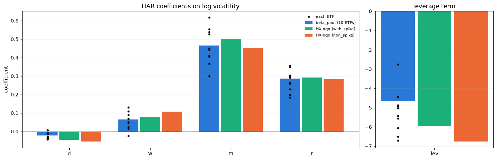

**การเลือก κ** ตารางที่ ฉ.4 แสดง RMSE บน Validation ตามค่า κ ทั้งสองแบบข้อมูลได้ RMSE ต่ำลงเพียงราว 0.0008 จาก κ = 0 ถึงค่าที่เลือก แบบ `with_spike` เลือก κ = ∞ ส่วน `non_spike` เลือก κ = 1 ซึ่งต่างจาก κ = 3 และ 10 ไม่ถึง 0.0001 เส้นทางจึงเกือบราบ และยังอยู่เหนือ RMSE ของ Elastic Net ตลอดทั้งเส้น (รูปที่ ฉ.2)

**ตารางที่ ฉ.4** RMSE บน Validation ของ `HX-prior` ตามค่า κ

| κ | with_spike | non_spike |
| ---: | ---: | ---: |
| 0 | 0.06817 | 0.06746 |
| 0.03 | 0.06789 | 0.06686 |
| 0.1 | 0.06782 | 0.06678 |
| 0.3 | 0.06770 | 0.06668 |
| 1 | 0.06756 | **0.06660** |
| 3 | 0.06745 | 0.06661 |
| 10 | 0.06738 | 0.06665 |
| ∞ | **0.06734** | 0.06668 |

ที่มา: `outputs/experiments/log_har/report/lambda_path.csv` ตัวเลขตัวหนาคือค่าที่ถูกเลือก

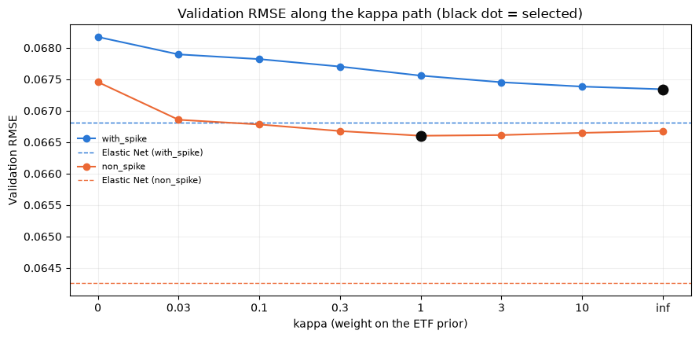

**ข้อสังเกตเรื่องสเกลของ penalty** penalty แบบ ridge ไม่คงที่ต่อสเกลของฟีเจอร์ `lev` มีสเกลเล็กมาก (ผลตอบแทนราว 0.02) สัมประสิทธิ์ของ lev จึงถูกดึงเข้าหา β_pool เกือบทั้งหมดตั้งแต่ κ = 0.03 (จาก −5.97 เหลือ −4.68 ในแบบ with_spike) ขณะที่สัมประสิทธิ์ตัวอื่นค่อย ๆ เคลื่อน ข้อนี้พบหลังเห็นผล Validation จึงไม่ได้เปลี่ยนการออกแบบ ผลกระทบต่อข้อสรุปมีน้อย เพราะปลายทั้งสองของ grid ไม่ขึ้นกับสเกล

### ฉ.5 ผลบน Validation และ Test

Test ถูกเปิดหนึ่งครั้งเมื่อ 25 ตุลาคม 2026 (เวลาประเทศไทย) หลังได้รับอนุมัติ ด้วยโมเดลและ κ ที่ล็อก hash ไว้ใน `decision.json` ผลบน Test เป็น **post-hoc** เพราะ Test เคยถูกเปิดในงานหลักแล้ว ส่วน holdout คือ QQQ 39 วันหลัง snapshot (24 สิงหาคม ถึง 16 ตุลาคม 2026) ซึ่งไม่เคยถูกใช้มาก่อน target ของ regression เป็นค่าต่อเนื่องทุกวัน holdout จึงใช้ได้ดีกว่าตอน classification แต่ยังสั้นและไม่มีช่วง spike ค่า RMSE, MAE และ R² ที่คำนวณซ้ำจากไฟล์คำทำนายด้วย scikit-learn ตรงกับไฟล์ผลทุกค่า (ต่างไม่เกิน 2.2 × 10⁻¹⁶)

**ตารางที่ ฉ.5** ผลของ Log-HAR และโมเดลเดิม แบบ with_spike (κ ที่เลือก = ∞)

| โมเดล | Val RMSE | Val R² | Val QLIKE | Test RMSE (post-hoc) | Test R² | Test QLIKE | Holdout RMSE | Holdout QLIKE |
| --- | --- | ---: | ---: | --- | ---: | ---: | ---: | ---: |
| `H3-qqq` | 0.0695 [0.0626, 0.0771] | −0.064 | 0.366 | 0.1293 [0.0762, 0.1886] | 0.121 | 0.720 | 0.0586 | 0.285 |
| `HX-qqq` | 0.0682 [0.0610, 0.0774] | −0.024 | 0.383 | **0.1076** [0.0699, 0.1521] | **0.392** | 0.580 | 0.0519 | 0.264 |
| `HX-pool` | 0.0673 [0.0606, 0.0762] | 0.001 | 0.372 | 0.1090 [0.0694, 0.1564] | 0.376 | 0.566 | 0.0521 | 0.256 |
| `HX-prior` | 0.0673 [0.0606, 0.0762] | 0.001 | 0.372 | 0.1090 [0.0694, 0.1564] | 0.376 | 0.566 | 0.0521 | 0.256 |
| `elastic_net` | **0.0668** [0.0610, 0.0739] | 0.017 | 0.336 | 0.1174 [0.0709, 0.1746] | 0.276 | 0.560 | 0.0528 | 0.229 |
| `multiple_linear` | 0.0689 [0.0617, 0.0779] | −0.045 | 0.400 | 0.1158 [0.0711, 0.1680] | 0.296 | 0.608 | **0.0492** | 0.222 |
| `polynomial` | 0.0691 [0.0606, 0.0797] | −0.051 | 0.382 | 0.1401 [0.0754, 0.2037] | −0.031 | 0.702 | 0.0594 | 0.308 |
| `baseline_train_mean` | 0.0751 [0.0673, 0.0837] | −0.243 | 0.378 | 0.1380 [0.0806, 0.2060] | −0.001 | 0.881 | 0.0694 | 0.317 |
| `baseline_persistence` | 0.0826 [0.0750, 0.0901] | −0.503 | 0.984 | 0.1502 [0.0919, 0.2222] | −0.185 | 1.830 | 0.0690 | 0.534 |

**ตารางที่ ฉ.6** ผลของ Log-HAR และโมเดลเดิม แบบ non_spike (κ ที่เลือก = 1)

| โมเดล | Val RMSE | Val R² | Val QLIKE | Test RMSE (post-hoc) | Test R² | Test QLIKE | Holdout RMSE | Holdout QLIKE |
| --- | --- | ---: | ---: | --- | ---: | ---: | ---: | ---: |
| `H3-qqq` | 0.0680 [0.0613, 0.0761] | −0.019 | 0.368 | 0.1276 [0.0748, 0.1890] | 0.145 | 0.743 | 0.0580 | 0.288 |
| `HX-qqq` | 0.0675 [0.0603, 0.0769] | −0.002 | 0.389 | **0.1055** [0.0689, 0.1501] | **0.416** | 0.591 | 0.0514 | 0.268 |
| `HX-pool` | 0.0667 [0.0597, 0.0760] | 0.021 | 0.382 | 0.1091 [0.0687, 0.1579] | 0.375 | 0.586 | 0.0523 | 0.268 |
| `HX-prior` | 0.0666 [0.0597, 0.0760] | 0.023 | 0.382 | 0.1091 [0.0687, 0.1577] | 0.375 | 0.589 | 0.0522 | 0.270 |
| `elastic_net` | **0.0643** [0.0572, 0.0741] | 0.091 | 0.334 | 0.1230 [0.0688, 0.1859] | 0.206 | 0.654 | 0.0525 | 0.231 |
| `multiple_linear` | 0.0668 [0.0597, 0.0761] | 0.017 | 0.402 | 0.1180 [0.0705, 0.1732] | 0.268 | 0.668 | **0.0496** | 0.224 |
| `polynomial` | 0.0661 [0.0596, 0.0755] | 0.039 | 0.340 | 0.1142 [0.0720, 0.1641] | 0.315 | 0.675 | 0.0524 | 0.214 |
| `baseline_train_mean` | 0.0676 [0.0585, 0.0805] | −0.008 | 0.361 | 0.1400 [0.0745, 0.2132] | −0.030 | 1.100 | 0.0573 | 0.260 |
| `baseline_persistence` | 0.0826 [0.0750, 0.0901] | −0.503 | 0.984 | 0.1502 [0.0919, 0.2222] | −0.185 | 1.830 | 0.0690 | 0.534 |

ที่มา: `outputs/experiments/log_har/<variant>/validation_summary.json` และ `test/<variant>/` ตัวเลขในวงเล็บคือช่วงความเชื่อมั่น 95% จาก moving-block bootstrap และตัวเลขตัวหนาคือค่าที่ดีที่สุดของแต่ละคอลัมน์ RMSE

เมื่อใส่ arm ใหม่ลงใน leaderboard regression เดิม (4 โมเดลและ 2 เส้นฐาน รวม 10 แถว) `HX-prior` อยู่อันดับ 2 (with_spike) และ 4 (non_spike) บน Validation ส่วนบน Test `HX-qqq` อยู่อันดับ 1 และ `HX-prior` อยู่อันดับ 2 ทั้งสองแบบข้อมูล ขณะที่ Elastic Net อยู่อันดับ 5 และ 6

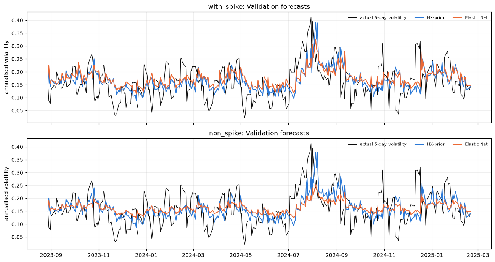

**อ่านรูปที่ ฉ.3** Validation เป็นช่วงตลาดสงบ ทั้งสองโมเดลทำนายใกล้ระดับเฉลี่ยของช่วงนี้และตามการขึ้นลงช่วงสั้นได้เพียงบางส่วน Log-HAR ตอบสนองต่อความผันผวนล่าสุดแรงกว่า Elastic Net เล็กน้อย

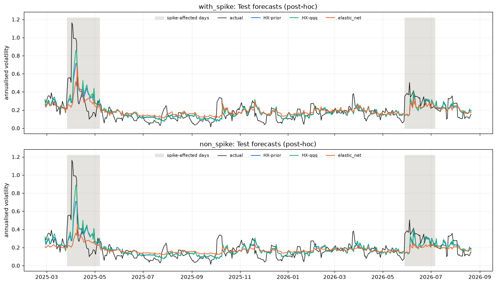

**อ่านรูปที่ ฉ.4** ในวันที่ความผันผวนพุ่งขึ้นต้นเดือนเมษายน 2025 ทุกโมเดลทายต่ำกว่าจริงมาก เพราะฟีเจอร์ทุกตัวมองย้อนหลัง แต่ Log-HAR ขึ้นตามได้เร็วกว่าและสูงกว่า Elastic Net เพราะใช้ช่วงราคาในวัน (r) และผลตอบแทนติดลบ (lev) ซึ่งตอบสนองทันที ส่วนในช่วงปกติ คำทำนายของทุกโมเดลใกล้กัน

**ตารางที่ ฉ.7** RMSE และ R² บน Test (post-hoc) แยกตามช่วงตลาด

| ช่วง | แถว | `HX-qqq` | `HX-prior` | `elastic_net` | `multiple_linear` |
| --- | ---: | --- | --- | --- | --- |
| with_spike: ปกติ | 319 | 0.0685 / 0.192 | 0.0683 / 0.198 | 0.0707 / 0.140 | 0.0694 / 0.171 |
| with_spike: รอบวัน spike | 54 | 0.2285 / 0.084 | 0.2335 / 0.044 | 0.2564 / −0.153 | 0.2533 / −0.125 |
| non_spike: ปกติ | 319 | 0.0675 / 0.215 | 0.0675 / 0.215 | 0.0692 / 0.175 | 0.0683 / 0.197 |
| non_spike: รอบวัน spike | 54 | 0.2235 / 0.124 | 0.2350 / 0.031 | 0.2759 / −0.335 | 0.2620 / −0.204 |

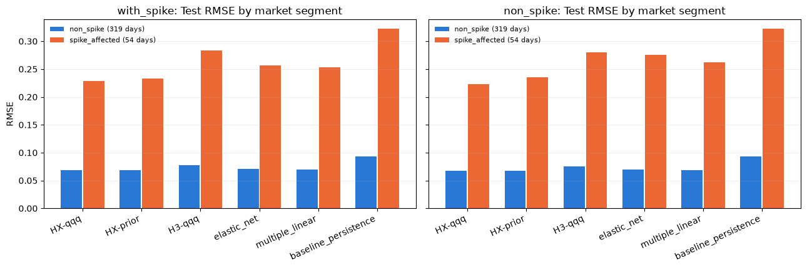

ผลต่างระหว่างโมเดลมาจากช่วงรอบวัน spike เป็นหลัก ในช่วงปกติทุกโมเดลได้ RMSE ใกล้กันราว 0.07 แต่ในช่วงรอบวัน spike มีเพียง arm ที่ใช้ฟีเจอร์ r และ lev (`HX-qqq`, `HX-pool` และ `HX-prior`) ที่ได้ R² เป็นบวก ส่วนโมเดลอื่นทุกตัวรวมถึง `H3-qqq` ได้ R² ติดลบ คือแย่กว่าการทายค่าเฉลี่ยของช่วงนั้นเอง

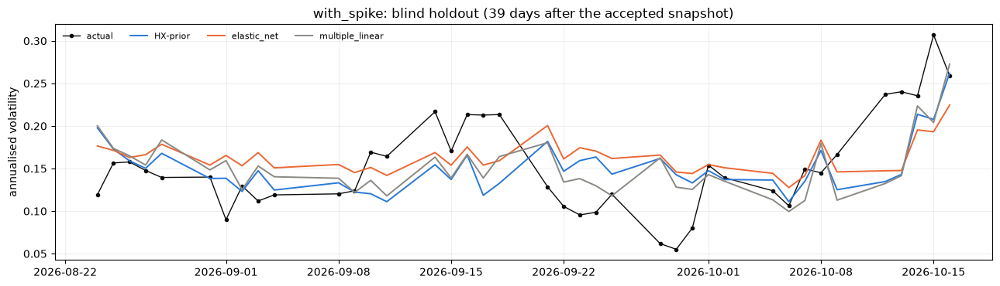

holdout เป็นช่วงสงบคล้าย Validation คำทำนายของทุกโมเดลใกล้กัน multiple_linear ได้ RMSE ต่ำสุด (0.049 และ 0.050) ส่วน Log-HAR อยู่ที่ราว 0.052 และ QLIKE ของ Log-HAR (0.26 ถึง 0.27) แย่กว่าของ Elastic Net และ multiple_linear (0.22 ถึง 0.23) ผลบน holdout จึงสอดคล้องกับผลบน Validation มากกว่าผลบน Test

**ตารางที่ ฉ.8** ผลต่าง RMSE แบบ paired พร้อมช่วงความเชื่อมั่น 95% (ตัวแรกลบตัวหลัง ค่าติดลบแปลว่าตัวแรกดีกว่า)

| การเปรียบเทียบ | with_spike Validation | with_spike Test | non_spike Validation | non_spike Test |
| --- | --- | --- | --- | --- |
| `HX-prior` − `elastic_net` | +0.0005 [−0.0019, +0.0035] | −0.0084 [−0.0198, +0.0040] | +0.0024 [−0.0013, +0.0059] | −0.0139 [−0.0304, +0.0065] |
| `HX-prior` − `multiple_linear` | −0.0015 [−0.0042, +0.0010] | −0.0068 [−0.0137, −0.0007] | −0.0002 [−0.0022, +0.0017] | −0.0090 [−0.0172, −0.0009] |
| `HX-prior` − `HX-qqq` (มีผลของการเลือก κ) | −0.0008 [−0.0018, +0.0000] | +0.0014 [−0.0026, +0.0051] | −0.0009 [−0.0020, +0.0003] | +0.0036 [−0.0004, +0.0081] |
| `HX-pool` − `HX-qqq` (ไม่มีการเลือก) | −0.0008 [−0.0018, +0.0000] | +0.0014 [−0.0026, +0.0051] | −0.0008 [−0.0019, +0.0005] | +0.0036 [−0.0006, +0.0082] |
| `HX-qqq` − `H3-qqq` | −0.0013 [−0.0047, +0.0027] | −0.0217 [−0.0379, −0.0042] | −0.0006 [−0.0042, +0.0034] | −0.0221 [−0.0398, −0.0036] |

แถว `HX-prior` − `HX-qqq` มีความลำเอียงจากการเลือก เพราะ κ ถูกเลือกบน Validation ชุดเดียวกัน และ grid มี κ = 0 ซึ่งคือ `HX-qqq` เอง จึงรายงานแถว `HX-pool` − `HX-qqq` ซึ่งเทียบสอง arm ที่กำหนดไว้ล่วงหน้าทั้งคู่ไว้ด้วย

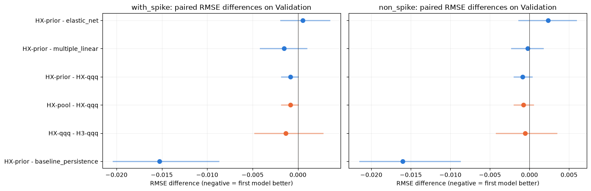

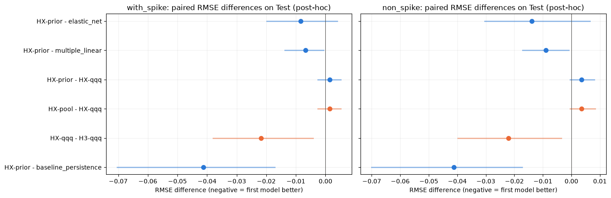

**เกณฑ์ที่ตั้งไว้ก่อน** ไม่ผ่านทั้งสองข้อในทั้งสองแบบข้อมูล คือ transfer ไม่ได้ช่วยอย่างมีนัย (ช่วงของ `HX-prior` − `HX-qqq` และ `HX-pool` − `HX-qqq` คร่อมศูนย์) และ Log-HAR ไม่ได้ดีกว่า Elastic Net บน Validation

### ฉ.6 สรุปและการตีความ

- **บน Validation ไม่ผ่านเกณฑ์ใด** Elastic Net ยังได้ RMSE ต่ำสุดในทั้งสองแบบข้อมูล แต่ช่วงของผลต่างคร่อมศูนย์ จึงแยก Log-HAR กับ Elastic Net ไม่ได้ Validation เป็นช่วงสงบซึ่งแทบไม่มีความแปรปรวนให้ฟีเจอร์ความผันผวนอธิบาย R² ของทุกโมเดลจึงใกล้ศูนย์
- **บน Test (post-hoc) Log-HAR ดีกว่า Elastic Net แต่ยังไม่มีนัยสำคัญ** RMSE ต่ำกว่า 0.008 และ 0.014 และ R² เพิ่มจาก 0.276 และ 0.206 เป็น 0.376 และ 0.375 แต่ช่วงของผลต่างยังคร่อมศูนย์ ส่วนเมื่อเทียบกับ multiple_linear ดีกว่าอย่างมีนัยในทั้งสองแบบข้อมูล
- **ส่วนที่ช่วยจริงคือฟีเจอร์ ไม่ใช่ transfer** การเพิ่ม r และ lev (`HX-qqq` − `H3-qqq`) ลด RMSE บน Test ราว 0.022 โดยช่วงไม่คร่อมศูนย์ทั้งสองแบบข้อมูล ส่วน prior จากตลาดอื่นช่วยเล็กน้อยบน Validation แต่ทำให้แย่ลงเล็กน้อยบน Test และไม่มีนัยทั้งสองทาง โมเดลที่ดีที่สุดบน Test จึงเป็น `HX-qqq` ซึ่งไม่ได้ใช้ข้อมูลตลาดอื่น
- **ทนต่อช่วง spike มากกว่า** การทำนายในสเกล log ลดอิทธิพลของวันสุดโต่งตอนเทรน และฟีเจอร์ช่วงราคาในวันกับ leverage จับการเริ่มของช่วงผันผวนได้เร็วกว่า arm ที่มีสองฟีเจอร์นี้จึงเป็นกลุ่มเดียวที่ได้ R² เป็นบวกในช่วงรอบวัน spike
- **คำตอบต่อคำถาม** ยังไม่มีหลักฐานพอว่า Log-HAR ดีกว่า Elastic Net อย่างมีนัย และ transfer จากตลาดอื่นไม่ได้ช่วยในงาน regression เช่นเดียวกับงาน classification ในภาคผนวก จ แต่ Log-HAR ที่มีฟีเจอร์ช่วงราคาและ leverage ให้ R² บน Test สูงสุดในบรรดาโมเดล regression ทั้งหมด และเป็นแนวทางที่ควรทดสอบต่อกับข้อมูลอนาคตที่มีช่วงผันผวน
- **ข้อจำกัด** ผล Test เป็น post-hoc และกลับทิศกับผลบน Validation ที่สงบ holdout มีเพียง 39 วันและไม่มีช่วง spike และข้อมูลตลาดอื่นย้อนหลังได้เพียง 10 ปี จึงไม่มีเหตุการณ์ปี 2008
