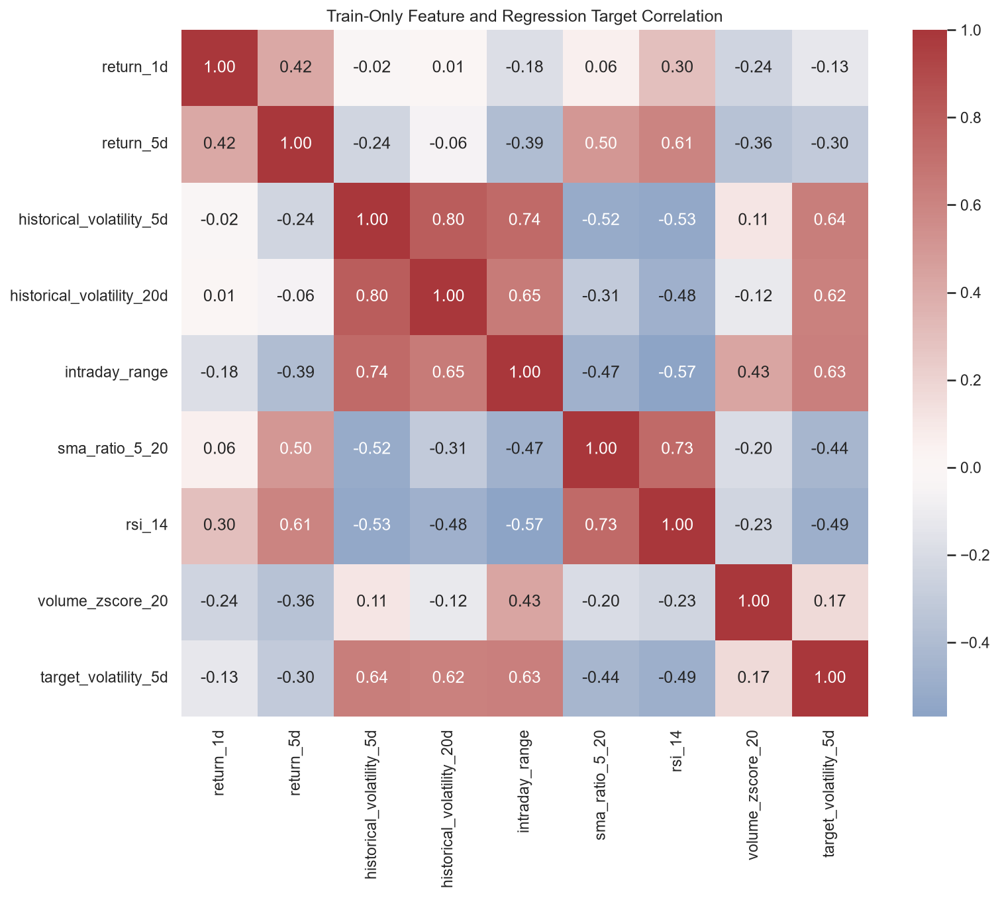
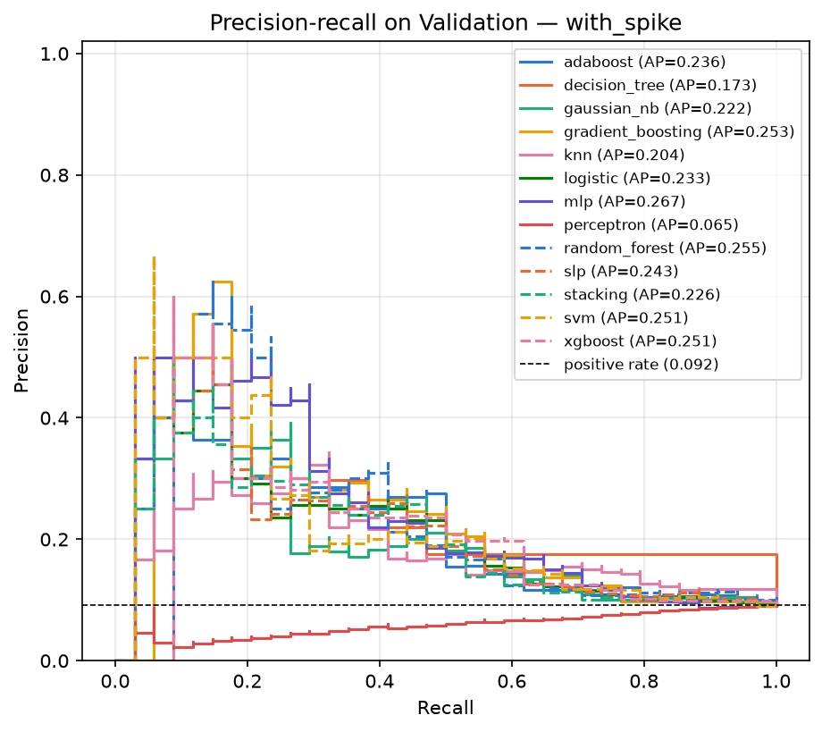

# การพยากรณ์ความผันผวนของกองทุน QQQ ล่วงหน้า 5 วันทำการ

รายงานโครงงานวิชา 01076641 ภาคเรียนที่ 1 ปีการศึกษา 2569

ผู้จัดทำ: [กรอกชื่อ–นามสกุล และรหัสนักศึกษาของสมาชิกทั้งสองคน]

วันที่จัดทำ: ตุลาคม 2569 (2026)

> ไฟล์นี้คือต้นฉบับของรายงาน ตารางผลทุกตารางถูกเติมจากไฟล์ผลด้วยคำสั่ง `python -m src.ml.docs_sync` จึงตรงกับไฟล์ใต้ `outputs/modeling/` เสมอ ห้ามแก้ตัวเลขในตารางด้วยมือ

## บทสรุปสำหรับผู้อ่านที่มีเวลาน้อย

**โจทย์** ใช้ข้อมูลราคารายวันของกองทุน QQQ ย้อนหลัง 10 ปี ทำนายว่าอีก 5 วันทำการข้างหน้าตลาดจะผันผวนแค่ไหน ทั้งแบบทำนายเป็นตัวเลข (regression) และแบบทำนายว่า "ผันผวนสูงหรือไม่" (classification)

**สิ่งที่ทำ** เขียนโมเดล machine learning 19 ตัวด้วย NumPy เองทั้งหมด ยืนยันความถูกต้องเทียบกับ scikit-learn และ XGBoost แล้วทดลองเทรนสองแบบ คือแบบใช้ข้อมูลทั้งหมด และแบบตัดช่วงที่ราคากระชากแรง (spike) ออก เพื่อตอบคำถามว่า spike ช่วยหรือทำร้ายการเรียนรู้ของโมเดล

**ผลหลัก** (วัดบน Test ซึ่งเปิดดูเพียงครั้งเดียว)

<!-- BEGIN GENERATED: outputs/modeling/report/tables/test_headline_summary.md -->
### Locked headline models: Validation score, one-shot Test score and the best baseline

| task | variant | headline | metric | validation | test | test_low | test_high | rank_on_test | best_baseline | baseline_test | beats_baseline |
| --- | --- | --- | --- | --- | --- | --- | --- | --- | --- | --- | --- |
| classification | with_spike | mlp | average_precision | 0.2668 | 0.5991 | 0.2605 | 0.7603 | 1 of 13 | baseline_persistence | 0.5365 | yes |
| classification | non_spike | random_forest | average_precision | 0.3010 | 0.5240 | 0.2161 | 0.6796 | 10 of 13 | baseline_persistence | 0.5365 | no |
| regression | with_spike | elastic_net | rmse | 0.0668 | 0.1174 | 0.0709 | 0.1746 | 2 of 4 | baseline_train_mean | 0.1380 | yes |
| regression | non_spike | elastic_net | rmse | 0.0643 | 0.1230 | 0.0688 | 0.1859 | 3 of 4 | baseline_train_mean | 0.1400 | yes |
<!-- END GENERATED -->

1. โมเดลทำนายได้ดีกว่าการเดาสุ่มชัดเจน แต่เหนือกว่ากฎง่าย ๆ ที่ไม่ต้องเทรนเพียงเล็กน้อย
2. ยังสรุปไม่ได้ว่าการตัด spike ช่วยหรือทำร้ายโมเดล ผลต่างเล็กกว่าความไม่แน่นอนของการวัด
3. โมเดลทำงานได้ในช่วงตลาดปกติ แต่ภายในช่วงปั่นป่วนแยกวันผันผวนสูงไม่ได้
4. โมเดลที่ซับซ้อนกว่าไม่ได้ดีกว่าโมเดลพื้นฐานที่สอนในห้องอย่างมีนัยสำคัญ

รายงานนี้ตั้งใจรายงานผลตามจริง รวมถึงผลที่ไม่เป็นไปตามที่คาดไว้ และระบุทุกครั้งว่าข้อสรุปใดมีหลักฐานทางสถิติรองรับ ข้อใดเป็นเพียงข้อสังเกต

## 1. บทนำและการตั้งปัญหา

### 1.1 ปัญหา

**ความผันผวน (volatility)** คือขนาดของการแกว่งตัวของราคา เราวัดจากส่วนเบี่ยงเบนมาตรฐานของผลตอบแทนรายวัน แล้วคูณ √252 เพื่อแปลงเป็นหน่วยต่อปี เช่น ค่า 0.20 หมายถึงราคาแกว่งราว 20% ต่อปี

โครงงานนี้พยากรณ์ความผันผวนของ **QQQ** (กองทุน ETF ที่ลงทุนตามดัชนี Nasdaq-100) ล่วงหน้า 5 วันทำการ ในสองรูปแบบ

- **Regression** ทำนายค่าความผันผวนของ 5 วันข้างหน้า (`target_volatility_5d`)
- **Classification** ทำนายว่า 5 วันข้างหน้าจะเป็นช่วง "ผันผวนสูง" หรือไม่ (`target_high_volatility`) โดยนิยามว่าผันผวนสูงเมื่อค่าเกินควอร์ไทล์ที่ 3 (Q75) ของข้อมูลเทรน

### 1.2 ทำไมเรื่องนี้สำคัญ

ความผันผวนเป็นตัวแปรที่ใช้ตรง ๆ ในงานการเงินสามอย่าง คือการตั้งราคา option การกำหนดขนาดการลงทุน และการบริหารความเสี่ยง การรู้ล่วงหน้าแม้เพียง 5 วันว่าตลาดกำลังเข้าสู่ช่วงปั่นป่วน ช่วยให้ลดขนาดการลงทุนหรือป้องกันความเสี่ยงได้ทัน

### 1.3 คำถามวิจัย

ตลาดหุ้นมีวันที่ราคากระชากแรงผิดปกติ เช่น ช่วงเดือนมีนาคม 2020 วันเหล่านี้มีจำนวนน้อยแต่มีค่าสุดโต่ง โครงงานนี้ตั้งคำถามว่า

> **การตัดช่วงที่ราคากระชากแรง (spike) ออกจากข้อมูลเทรน ทำให้โมเดลทำนายได้ดีขึ้นหรือแย่ลง**

เราตอบด้วยการทดลองแบบจับคู่: เทรนโมเดลทุกตัวสองครั้ง ครั้งหนึ่งด้วยข้อมูลเทรนเต็ม (`with_spike`) อีกครั้งด้วยข้อมูลเทรนที่ตัดช่วง spike ออก (`non_spike`) แล้ววัดผลบนข้อมูลชุดเดียวกันทุกประการ

### 1.4 ขอบเขต

ข้อมูลราคารายวัน (Open, High, Low, Close, Volume) ของ QQQ จำนวน 2,512 วันทำการ ตั้งแต่ 31 สิงหาคม 2016 ถึง 28 สิงหาคม 2026 โมเดลใช้เฉพาะข้อมูลราคาและปริมาณซื้อขายย้อนหลัง ไม่ใช้ข่าว ดัชนี VIX หรือปฏิทินเหตุการณ์

## 2. ฟีเจอร์และเหตุผลที่ต้องใช้ Machine Learning

### 2.1 ฟีเจอร์ 8 ตัว

ฟีเจอร์ (feature) คือข้อมูลที่ป้อนให้โมเดล ทุกตัวคำนวณจากข้อมูลถึงสิ้นวัน t เท่านั้น โมเดลจึงไม่เห็นอนาคต นิยามอยู่ใน `src/build_features.py`

| ฟีเจอร์ | นิยาม | เหตุผลที่เลือก |
| --- | --- | --- |
| `return_1d` | ผลตอบแทนของวันนี้เทียบกับเมื่อวาน | วันที่ราคาร่วงแรงมักตามด้วยความผันผวน |
| `return_5d` | ผลตอบแทนสะสม 5 วัน | บอกทิศทางระยะสั้น ตลาดขาลงมักผันผวนกว่าขาขึ้น |
| `historical_volatility_5d` | ความผันผวนของ 5 วันที่ผ่านมา | ความผันผวนมักต่อเนื่อง ช่วงปั่นป่วนตามด้วยช่วงปั่นป่วน |
| `historical_volatility_20d` | ความผันผวนของ 20 วันที่ผ่านมา | บอกสภาพตลาดระยะกลาง นิ่งกว่าแบบ 5 วัน |
| `intraday_range` | (ราคาสูงสุด − ต่ำสุด) ÷ ราคาปิด ของวันนี้ | วัดการแกว่งตัวภายในวัน ซึ่งผลตอบแทนรายวันมองไม่เห็น |
| `sma_ratio_5_20` | ค่าเฉลี่ยราคา 5 วัน ÷ ค่าเฉลี่ย 20 วัน | บอกว่าราคาอยู่เหนือหรือใต้แนวโน้ม |
| `rsi_14` | ดัชนี RSI 14 วัน | บอกภาวะซื้อมากหรือขายมากเกินไป |
| `volume_zscore_20` | ปริมาณซื้อขายวันนี้เทียบกับค่าเฉลี่ย 20 วัน | ปริมาณซื้อขายที่ผิดปกติมักมาพร้อมข่าวสำคัญ |

โจทย์กำหนดให้ใช้ฟีเจอร์อย่างน้อย 5 ตัว โครงงานนี้ใช้ 8 ตัว

### 2.2 สิ่งที่ข้อมูลบอกเกี่ยวกับฟีเจอร์

**ความสัมพันธ์กับ target** บนข้อมูลเทรน ฟีเจอร์กลุ่มความผันผวนย้อนหลังสัมพันธ์กับ target มากที่สุด: `historical_volatility_5d` (r = 0.64), `intraday_range` (0.63), `historical_volatility_20d` (0.62) รองลงมาคือ `rsi_14` (−0.49) และ `sma_ratio_5_20` (−0.44) ส่วน `return_1d` (−0.13) และ `volume_zscore_20` (0.17) สัมพันธ์น้อย เครื่องหมายลบของ `rsi_14` และ `sma_ratio_5_20` สอดคล้องกับข้อเท็จจริงที่ว่าตลาดขาลงผันผวนกว่าขาขึ้น

**ฟีเจอร์ซ้ำซ้อนกัน** `historical_volatility_5d` กับ `historical_volatility_20d` มีสหสัมพันธ์กัน 0.80 เพราะวัดสิ่งเดียวกันคนละช่วงเวลา ข้อนี้เป็นเหตุผลที่เลือก Elastic Net เป็นโมเดลนอกห้องเรียนฝั่ง regression (หัวข้อ 6.1)

**ฟีเจอร์ที่โมเดลใช้จริง** เราวัดด้วย permutation importance: สลับลำดับค่าของฟีเจอร์หนึ่งตัวบน Validation เพื่อทำลายข้อมูลในฟีเจอร์นั้น แล้วดูว่าคะแนนของโมเดลแย่ลงเท่าไร ยิ่งแย่ลงมากฟีเจอร์นั้นยิ่งสำคัญ เราสลับเป็นก้อน 20 วันติดกันเพื่อรักษารูปแบบตามเวลา และทำซ้ำ 30 รอบ ตารางถัดไปเฉลี่ยผลข้ามโมเดล

<!-- BEGIN GENERATED: outputs/modeling/report/tables/feature_importance_with_spike.md -->
### Block-permutation importance averaged over models — with_spike

| feature | drop_in_ap_mean | drop_in_ap_std_across_models | rise_in_rmse_mean | rise_in_rmse_std_across_models |
| --- | --- | --- | --- | --- |
| return_1d | -0.0019 | 0.0081 | 0.0001 | 0.0001 |
| return_5d | 0.0017 | 0.0074 | -0.0001 | 0.0003 |
| historical_volatility_5d | 0.0053 | 0.0165 | -0.0004 | 0.0007 |
| historical_volatility_20d | 0.0336 | 0.0282 | 0.0038 | 0.0034 |
| intraday_range | 0.0060 | 0.0127 | -0.0005 | 0.0015 |
| sma_ratio_5_20 | 0.0040 | 0.0054 | 0.0002 | 0.0003 |
| rsi_14 | 0.0197 | 0.0155 | 0.0010 | 0.0019 |
| volume_zscore_20 | 0.0017 | 0.0057 | -0.0003 | 0.0007 |
<!-- END GENERATED -->

`historical_volatility_20d` สำคัญที่สุด ตามด้วย `rsi_14` ส่วน `return_1d` และ `volume_zscore_20` แทบไม่มีผล ค่าในคอลัมน์ `std_across_models` ใหญ่พอ ๆ กับค่าเฉลี่ย แปลว่าโมเดลแต่ละตัวพึ่งฟีเจอร์ต่างกันมาก ข้อจำกัดของวิธีนี้คือ ฟีเจอร์ที่สัมพันธ์กันจะแบ่งความสำคัญกัน เมื่อสลับตัวหนึ่ง อีกตัวยังให้ข้อมูลเดิมได้

### 2.3 ทำไมต้องใช้ Machine Learning

1. **ความสัมพันธ์ไม่ใช่เส้นตรงและเปลี่ยนตามสภาพตลาด** ความผันผวนกระจุกตัวเป็นช่วง (volatility clustering) และการกระจายของ target เบ้ขวามาก (skewness 2.80, excess kurtosis 16.26) ซึ่งต่างจากสมมติฐานของวิธีทางสถิติพื้นฐาน
2. **มีฟีเจอร์หลายตัวที่ทำงานร่วมกัน** เช่น ราคาร่วงพร้อมปริมาณซื้อขายสูงให้ความหมายต่างจากราคาร่วงเฉย ๆ การเขียนกฎ if-then ด้วยมือให้ครอบคลุมทุกกรณีทำได้ยาก
3. **มีข้อมูลพอให้เรียนรู้** 1,733 วันสำหรับเทรน

อย่างไรก็ตาม ผลของโครงงานนี้ให้คำตอบที่ถ่อมตัวกว่าที่คาด: กฎง่าย ๆ ว่า "5 วันข้างหน้าจะผันผวนเท่ากับ 5 วันที่ผ่านมา" ทำได้ใกล้เคียงโมเดลส่วนใหญ่ในงาน classification (หัวข้อ 7 และ 8) ML จึงให้ประโยชน์เพิ่มจริง แต่ไม่มาก เมื่อใช้เพียงข้อมูลราคาย้อนหลัง

## 3. การเตรียมข้อมูล

### 3.1 แหล่งข้อมูลและการตรึงข้อมูล

ข้อมูลมาจาก Nasdaq ซึ่งให้ดาวน์โหลดย้อนหลังได้ 10 ปีแบบเลื่อนไปทุกวัน ถ้าดาวน์โหลดใหม่ทุกครั้งที่รัน ข้อมูลจะไม่เหมือนเดิมและทำซ้ำผลไม่ได้ เราจึง **ตรึงข้อมูลชุดเดียว** (snapshot) ไว้ใน repo ที่ `data/raw/qqq_daily.csv` พร้อมบันทึกค่า SHA-256 ใน `data/manifests/qqq_daily_snapshot.json` โปรแกรมจะปฏิเสธการเขียนทับไฟล์นี้

### 3.2 ขั้นตอนเตรียมข้อมูล

1. **ทำความสะอาด** ตรวจวันที่ซ้ำ ค่าว่าง และความสมเหตุสมผลของราคา
2. **สร้างฟีเจอร์** 8 ตัวจากข้อมูลถึงวัน t
3. **สร้าง target** จากผลตอบแทนของวัน t+1 ถึง t+5
4. **ตัดแถวที่คำนวณไม่ครบ** 20 แถวแรก (ฟีเจอร์ต้องใช้ข้อมูลย้อนหลัง 20 วัน) และ 5 แถวท้าย (target ต้องใช้ข้อมูลอนาคต 5 วัน) เหลือ 2,487 แถว
5. **แบ่งข้อมูลตามเวลา** 70% / 15% / 15%

| ชุดข้อมูล | ช่วงวันที่ | จำนวนแถว | วันผันผวนสูง | ใช้ทำอะไร |
| --- | --- | --- | --- | --- |
| Train | 29 ก.ย. 2016 – 18 ส.ค. 2023 | 1,733 | 433 (25.0%) | ให้โมเดลเรียนรู้ |
| Validation | 28 ส.ค. 2023 – 19 ก.พ. 2025 | 371 | 34 (9.2%) | เลือกการตั้งค่าของโมเดล |
| Test | 27 ก.พ. 2025 – 21 ส.ค. 2026 | 373 | 73 (19.6%) | วัดผลสุดท้าย ครั้งเดียว |

ที่มา: `outputs/reports/data_split_report.json` และ `docs/audit/DATA_FLOW.md`

**ทำไมไม่สุ่มแบ่งข้อมูล** ถ้าสุ่ม วันในอนาคตจะปนเข้าไปในข้อมูลเทรน โมเดลจะ "เห็นอนาคต" และได้คะแนนสูงเกินจริง (look-ahead leakage) เราจึงแบ่งตามลำดับเวลา และ **เว้นช่องว่าง 5 วันทำการ** (purge gap) ระหว่างชุด เพราะ target ของวันสุดท้ายในชุดหนึ่งใช้ข้อมูลของ 5 วันถัดไป ซึ่งมิฉะนั้นจะซ้อนกับชุดถัดไป

**เส้นแบ่ง "ผันผวนสูง"** คือ Q75 ของ target บน Train เท่านั้น ได้ค่า 0.2531 แล้วใช้เส้นเดียวกันกับ Validation และ Test สัดส่วนวันผันผวนสูงของสองชุดหลังจึงไม่ใช่ 25% และต่างกันเอง ซึ่งมีผลต่อการอ่านคะแนน (หัวข้อ 7.6)

### 3.3 การวิเคราะห์ spike

**นิยาม** วันที่ขนาดของผลตอบแทนรายวันเกิน Q3 + 3 × IQR ของข้อมูลเทรน ได้เส้นแบ่งที่ 4.65% เส้นนี้คำนวณจาก Train เท่านั้น

**ผลการตรวจ** พบ spike 23 วัน: Train 19 วัน (11 วันอยู่ในช่วงกุมภาพันธ์ถึงเมษายน 2020), Validation 0 วัน, Test 4 วัน (3 วันในเดือนเมษายน 2025 และ 1 วันในเดือนมิถุนายน 2026) ที่มา: `outputs/reports/spike_event_audit.csv`

**การสร้างชุดข้อมูลแบบไม่มี spike** spike หนึ่งวันกระทบแถวรอบข้างด้วย เพราะฟีเจอร์ย้อนหลัง 20 วันและ target ล่วงหน้า 5 วันของแถวใกล้เคียงใช้ผลตอบแทนของวันนั้น เราจึงตัดทั้งหน้าต่าง ตั้งแต่ 5 วันก่อนถึง 19 วันหลังวัน spike รวม 213 แถว ชุด `non_spike` จึงมีข้อมูลเทรน 1,520 แถว

**สิ่งสำคัญสองข้อของการออกแบบ**

- ตัดเฉพาะข้อมูล **เทรน** ส่วน Validation และ Test เหมือนกันทั้งสองแบบ จึงเทียบกันได้ตรง ๆ
- แถวที่ถูกตัด 213 แถว เป็นวันผันผวนสูงถึง 153 แถว (71.8%) การตัดจึงเปลี่ยนสามอย่างพร้อมกัน: จำนวนแถว (1,733 เป็น 1,520), สัดส่วนวันผันผวนสูง (25.0% เป็น 18.4%) และช่วงตลาดที่โมเดลได้เห็น ผลต่างระหว่างสองแบบจึงเป็นผลของ **นโยบายตัดแถวทั้งชุด** เราแยกไม่ได้ว่ามาจากตัว spike เอง หรือจากสองปัจจัยที่เหลือ

### 3.4 การตรวจสอบความถูกต้องของข้อมูล

ก่อนสรุปผล เราตรวจสอบสายการเตรียมข้อมูลทั้งหมด (`docs/audit/DATA_PIPELINE_AUDIT.md`) ข้อสรุปคือข้อมูลใช้เทรนได้อย่างปลอดภัย ไม่มีการรั่วของข้อมูลอนาคต การตรวจที่สำคัญถูกเขียนเป็น test อัตโนมัติใน `tests/test_audit_guards.py` เช่น

- ตัดข้อมูลอนาคตออกแล้วคำนวณฟีเจอร์ใหม่ ค่าของวันในอดีตต้องไม่เปลี่ยน
- เส้นแบ่ง Q75 และเส้นแบ่ง spike ต้องคำนวณจาก Train เท่านั้น แม้จะแก้ค่าใน Validation หรือ Test
- ไม่มีโค้ดส่วนใดสุ่มสลับลำดับข้อมูล และมีเพียง 3 ไฟล์ที่อ้างถึง Test ได้

## 4. ระเบียบวิธี

### 4.1 โมเดลทั้ง 19 ตัว

| งาน | โมเดล | จำนวน |
| --- | --- | --- |
| Regression | Simple Linear, Multiple Linear, Polynomial, **Elastic Net** ★ | 4 |
| Classification | Logistic Regression, Gaussian Naive Bayes, k-Nearest Neighbors, Perceptron, Single-Layer Perceptron, Multi-Layer Perceptron, Decision Tree, Random Forest, Gradient Boosting, XGBoost, **AdaBoost** ★, Stacking, Support Vector Machine | 13 |
| Clustering | k-Means, Agglomerative | 2 |

★ คือโมเดลนอกเนื้อหาที่สอน ซึ่งอธิบายกลไกอย่างละเอียดในหัวข้อ 6 การตั้งค่าที่ถูกเลือกของทุกโมเดลอยู่ในภาคผนวก ก

### 4.2 ทำไมเขียนเองทั้งหมด

โจทย์กำหนดให้เขียนโมเดลเอง (from scratch) และอนุญาตให้ใช้ library เพื่อยืนยันผลเท่านั้น โมเดลทั้ง 19 ตัวจึงเขียนด้วย NumPy ล้วนใต้ `src/ml/` ทุกตัวมี interface เดียวกัน (`fit`, `predict`, `state_dict`, `load_state`, `reference`) เพื่อให้เทรน บันทึก โหลด และเทียบกับ library ได้ด้วยโค้ดชุดเดียว

### 4.3 ขั้นตอนการทดลอง

1. **เทรนบน Train** ของแต่ละแบบ (`with_spike` หรือ `non_spike`) การปรับสเกลข้อมูล (standardize) และ PCA คำนวณจาก Train เท่านั้น
2. **เลือกการตั้งค่าบน Validation** ลองทุกค่าใน grid แล้วเลือกชุดที่ได้คะแนนดีที่สุด: regression ใช้ RMSE, classification ใช้ average precision (AP)
3. **ไม่ปรับ threshold** classifier ตัดสินที่ความน่าจะเป็น 0.5 คงที่ เพื่อไม่เพิ่มการเลือกบน Validation อีกชั้น
4. **ล็อกก่อนเปิด Test** บันทึก hash ของไฟล์โมเดลทั้ง 38 ชุดและชื่อ "โมเดลตัวแทน" (headline) ของแต่ละงานลง `outputs/modeling/selection_lock.json` แล้ว commit
5. **เปิด Test ครั้งเดียว** ไม่เทรนใหม่บน Train+Validation และไม่เปลี่ยนอะไรหลังเห็นผล โปรแกรมบันทึกใบรับรอง `outputs/modeling/finalize_receipt.json` และปฏิเสธการรันซ้ำ

**metric หลัก**

- **RMSE** (regression): ขนาดความผิดพลาดเฉลี่ย ยิ่งต่ำยิ่งดี
- **Average precision หรือ AP** (classification): คุณภาพของการจัดอันดับวันที่น่าจะผันผวนสูง ยิ่งสูงยิ่งดี ค่าของการเดาสุ่มเท่ากับสัดส่วนวันผันผวนสูงของชุดนั้น เราใช้ AP แทน accuracy เพราะคลาสไม่สมดุล (หัวข้อ 7.2)

### 4.4 การวัดความไม่แน่นอน

target ของวันติดกันใช้ผลตอบแทนช่วงเดียวกัน 4 ใน 5 วัน ค่าของวันติดกันจึงคล้ายกันมาก (autocorrelation ที่ lag 1 เท่ากับ 0.92) ข้อมูล 371 แถวจึงมีข้อมูลจริงเทียบเท่าตัวอย่างอิสระเพียงราว 50 ถึง 200 ตัว

เราจึงคำนวณช่วงความเชื่อมั่น 95% ด้วย **moving-block bootstrap**: สุ่มข้อมูลซ้ำเป็นก้อน 20 วันติดกัน 2,000 รอบ แทนการสุ่มทีละวันซึ่งจะให้ช่วงแคบเกินจริง

การเปรียบเทียบสองโมเดลใช้แบบ **จับคู่ (paired)**: คำนวณผลต่างบนแถวที่สุ่มชุดเดียวกันทุกรอบ ถ้าช่วง 95% ของผลต่าง **คร่อมศูนย์** ถือว่ายังบอกไม่ได้ว่าโมเดลใดดีกว่า กฎข้อนี้ใช้ตลอดทั้งรายงาน

### 4.5 เส้นฐานเปรียบเทียบ (baseline)

ตัวเลขคะแนนเดี่ยว ๆ บอกไม่ได้ว่าดีหรือแย่ เราจึงเทียบกับกฎที่ไม่ต้องเทรน

| ชื่อ | งาน | กฎ |
| --- | --- | --- |
| `baseline_train_mean` | regression | ทายค่าเฉลี่ยของ target ใน Train ทุกวัน |
| `baseline_persistence` | regression | ทายว่า 5 วันข้างหน้าจะผันผวนเท่ากับ 5 วันที่ผ่านมา |
| `baseline_majority` | classification | ทายว่า "ไม่ผันผวนสูง" ทุกวัน |
| `baseline_persistence` | classification | ใช้ความผันผวน 5 วันที่ผ่านมาเป็นคะแนนโดยตรง |

## 5. การ implement

### 5.1 Regression

- **Simple Linear** เส้นตรงจากฟีเจอร์เดียว แก้ด้วยสูตรปิด โปรแกรมลองทั้ง 8 ฟีเจอร์แล้วเลือกตัวที่ดีที่สุด
- **Multiple Linear** เส้นตรงจากทั้ง 8 ฟีเจอร์ แก้ด้วย least squares
- **Polynomial** ยกกำลังฟีเจอร์เดียว (ดีกรี 2 หรือ 3) แล้วทำ linear regression
- **Elastic Net** ★ linear regression ที่มีค่าปรับ L1 และ L2 (หัวข้อ 6.1)

### 5.2 Classification และ Clustering

- **Logistic Regression** แปลงผลรวมถ่วงน้ำหนักเป็นความน่าจะเป็นด้วย sigmoid เทรนด้วย gradient descent
- **Gaussian Naive Bayes** สมมติว่าแต่ละฟีเจอร์กระจายแบบปกติและอิสระต่อกันภายในคลาส แล้วใช้กฎของ Bayes
- **k-Nearest Neighbors** ดูคลาสของเพื่อนบ้านที่ใกล้ที่สุด k ตัว ถ่วงน้ำหนักด้วยระยะทาง
- **Perceptron** ปรับน้ำหนักเมื่อทายผิด ลู่เข้าเฉพาะเมื่อข้อมูลแยกด้วยเส้นตรงได้
- **Single-Layer Perceptron (SLP)** โหนด sigmoid หนึ่งชั้น เทรนแบบ mini-batch
- **Multi-Layer Perceptron (MLP)** โครงข่ายประสาทที่มีชั้นซ่อน ใช้ ReLU และ backpropagation
- **Decision Tree** แบ่งข้อมูลด้วยคำถามทีละข้อ เลือกคำถามที่ลด Gini impurity มากที่สุด
- **Random Forest** ต้นไม้หลายต้นจากข้อมูลที่สุ่มซ้ำและสุ่มฟีเจอร์ แล้วเฉลี่ยผล (ทดลองร่วมกับ PCA ตามโจทย์)
- **Gradient Boosting** ต้นไม้ต่อกันทีละต้น แต่ละต้นแก้ความผิดพลาดของต้นก่อนหน้า
- **XGBoost** gradient boosting ที่ใช้อนุพันธ์อันดับสองและมี regularization
- **AdaBoost** ★ โมเดลอ่อนต่อกัน โดยเพิ่มน้ำหนักให้ตัวอย่างที่ทายผิด (หัวข้อ 6.2)
- **Stacking** ใช้คำทำนายของโมเดลฐานหลายตัวเป็น input ของโมเดลชั้นบน โดยสร้างคำทำนายแบบ out-of-fold ตามลำดับเวลาเพื่อกันข้อมูลรั่ว
- **Support Vector Machine** หาเส้นแบ่งที่มีระยะขอบกว้างที่สุด (linear kernel ทดลองร่วมกับ PCA ตามโจทย์)
- **k-Means** และ **Agglomerative** จัดกลุ่มวันที่มีฟีเจอร์คล้ายกันโดยไม่ใช้ label

### 5.3 การยืนยันผลเทียบกับ library

ทุกโมเดลมีเมธอด `reference()` ที่สร้างโมเดลของ scikit-learn หรือ XGBoost ด้วยการตั้งค่าเดียวกัน test ของแต่ละโมเดลเทรนทั้งสองฝั่งบนข้อมูลเดียวกันแล้วเทียบคำทำนายทีละแถว

| กลุ่มโมเดล | ผลต่างจาก library บน Validation |
| --- | --- |
| `simple_linear`, `multiple_linear`, `polynomial`, `gaussian_nb`, `knn`, `adaboost`, `mlp` | ไม่เกิน 1e-15 (ตรงกันถึงทศนิยมสุดท้ายของ float64) |
| `perceptron`, `decision_tree`, `random_forest`, `gradient_boosting`, `xgboost` | 0 (ตรงกันทุกแถว) |
| `kmeans`, `agglomerative` | แบ่งกลุ่มตรงกัน 100% |
| `elastic_net` | ไม่เกิน 2e-06 (ใช้กฎหยุดวนรอบต่างจาก scikit-learn) |
| `svm` | ค่า objective ต่างไม่เกิน 3e-06 |
| `logistic` | ไม่เกิน 1e-03 (หยุดที่ 5,000 รอบ ก่อนลู่เข้าสมบูรณ์) |
| `slp` | 0.07 ถึง 0.29 (หยุดที่โควตา 1,000 รอบ ขณะที่โมเดลอ้างอิงลู่เข้าแล้ว) |
| `stacking` | ไม่มี library ที่ทำแบบเดียวกัน ตรวจด้วยการสร้าง fold ซ้ำทีละ fold และ test กันข้อมูลรั่ว |

ที่มา: `docs/tasks/claude-model-progress.md` และ test ใต้ `tests/ml/`

รายละเอียดที่ทำให้ผลตรงกันได้คือ โมเดลที่มีการสุ่มต้องใช้ตัวสุ่มชนิดเดียวกับ scikit-learn (`numpy.random.RandomState`) และเรียกใช้ตามลำดับเดียวกัน

**สามโมเดลที่ผลขึ้นกับโควตาการเทรน** `slp`, `perceptron` และ `logistic` หยุดเพราะครบจำนวนรอบที่กำหนด ไม่ใช่เพราะลู่เข้า โดยเฉพาะ `perceptron` ซึ่งไม่มีวันลู่เข้าเมื่อข้อมูลแยกด้วยเส้นตรงไม่ได้ คะแนนของสามตัวนี้จึงเป็นคะแนนของ "อัลกอริทึมภายใต้โควตาที่กำหนด"

### 5.4 จำนวนรอบการเทรน

แต่ละโมเดลถูกลองหลายการตั้งค่า (grid search) รวม 140 การตั้งค่าต่อแบบข้อมูล หรือ 280 ครั้งของการเทรนสำหรับทั้งสองแบบ เหลือผู้ชนะ 38 ชุด (19 โมเดล × 2 แบบ) ทั้งหมดสั่งรันได้ด้วยคำสั่งเดียว `python -m src.ml.run train --all --variant <variant>` รายการค่าที่ลองอยู่ใน `configs/modeling.json`

### 5.5 Save, load และทดสอบซ้ำ

โจทย์กำหนดให้บันทึกโมเดล โหลดกลับ แล้วทดสอบซ้ำ เราพิสูจน์สามชั้น

1. ตอนเทรน โปรแกรมบันทึกโมเดลเป็น `model.npz` โหลดกลับทันที แล้วเทียบคำทำนายกับก่อนบันทึก ผลอยู่ใน `load_verification.json` ซึ่งผ่านครบ 38 ชุด
2. test `tests/ml/core/test_artifacts.py` โหลดโมเดลทั้ง 38 ชุดจากดิสก์แล้วทำนาย Validation ใหม่ ต้องได้ค่าเดียวกับที่บันทึกไว้
3. notebook 03 และ 04 ทำซ้ำขั้นตอนเดียวกันให้เห็นเป็นตาราง

ผลบน Test ทั้งหมดในรายงานนี้มาจากโมเดลที่ **โหลดจากไฟล์** ไม่ใช่โมเดลที่ค้างอยู่ในหน่วยความจำ

## 6. โมเดลนอกห้องเรียน

### 6.1 Elastic Net (regression)

**แนวคิด** linear regression ธรรมดาหาน้ำหนัก (coefficient) ที่ทำให้ความผิดพลาดต่ำที่สุดเพียงอย่างเดียว เมื่อฟีเจอร์ซ้ำซ้อนกัน น้ำหนักจะไม่นิ่ง: ขยับข้อมูลเล็กน้อย น้ำหนักเปลี่ยนมาก Elastic Net แก้ด้วยการเพิ่ม "ค่าปรับ" เมื่อน้ำหนักมีขนาดใหญ่

**สิ่งที่โมเดลทำให้ต่ำที่สุด**

`J(w) = (1/2n)·‖y − Xw‖² + α·ρ·‖w‖₁ + α·(1−ρ)/2·‖w‖²`

- พจน์แรกคือความผิดพลาดกำลังสองเฉลี่ย
- `α` (alpha) คือความแรงของค่าปรับ ยิ่งมากน้ำหนักยิ่งถูกบีบเข้าหาศูนย์
- `ρ` (l1_ratio) คือสัดส่วนของค่าปรับแบบ L1
- **L1** (`‖w‖₁` = ผลรวมค่าสัมบูรณ์ของน้ำหนัก) ทำให้น้ำหนักบางตัว **เป็นศูนย์พอดี** เท่ากับคัดฟีเจอร์นั้นทิ้ง
- **L2** (`‖w‖²` = ผลรวมกำลังสองของน้ำหนัก) ทำให้น้ำหนักทุกตัวเล็กลงแต่ไม่เป็นศูนย์ และทำให้ฟีเจอร์ที่ซ้ำซ้อนกันแบ่งน้ำหนักกันอย่างนิ่ง

**วิธีหาคำตอบ: coordinate descent** พจน์ L1 หาอนุพันธ์ที่ศูนย์ไม่ได้ จึงใช้ gradient descent ธรรมดาไม่ได้ เราปรับน้ำหนักทีละตัวโดยตรึงตัวอื่นไว้ ซึ่งมีคำตอบแบบสูตรปิดสำหรับแต่ละตัว

1. คำนวณ `ρ_j` = ความสัมพันธ์ระหว่างฟีเจอร์ j กับส่วนที่โมเดลยังอธิบายไม่ได้เมื่อไม่นับฟีเจอร์ j
2. ผ่าน **soft-threshold**: `S(v, γ) = sign(v)·max(|v| − γ, 0)` ถ้า `|ρ_j|` เล็กกว่า `α·ρ` น้ำหนักจะกลายเป็นศูนย์ นี่คือกลไกที่คัดฟีเจอร์ทิ้ง
3. หารด้วย `(z_j + α·(1−ρ))` โดย `z_j` คือขนาดของฟีเจอร์ j ตัวหารนี้คือจุดที่ L2 ทำงาน
4. วนทุกฟีเจอร์ซ้ำจนน้ำหนักเปลี่ยนน้อยกว่าค่าที่กำหนด

รวมเป็นสูตร: `w_j = S(ρ_j, α·ρ) / (z_j + α·(1−ρ))` โค้ดอยู่ที่ `src/ml/regression/elastic_net.py`

**ทำไมเหมาะกับข้อมูลนี้** ฟีเจอร์ความผันผวนย้อนหลัง 5 วันกับ 20 วันมีสหสัมพันธ์ 0.80 (หัวข้อ 2.2)

**ผลที่ได้** การตั้งค่าที่ถูกเลือกคือ α = 0.1 และ l1_ratio = 0.25 ทั้งสองแบบข้อมูล โมเดลดันน้ำหนักเป็นศูนย์ 3 จาก 8 ฟีเจอร์ (`with_spike`) และ 4 จาก 8 (`non_spike`) ที่มา: `outputs/modeling/report/with_spike/linear_coefficients.csv` และ notebook 03 หัวข้อ 5 เมื่อเทียบกับ `ElasticNet` ของ scikit-learn คำทำนายต่างกันไม่เกิน 9e-07

<!-- BEGIN GENERATED: outputs/modeling/report/cards/elastic_net.md -->
### ผลจริงของ `elastic_net`

| variant | split | params | rmse | mae | r2 |
| --- | --- | --- | --- | --- | --- |
| with_spike | validation (selection score) | {"alpha": 0.1, "l1_ratio": 0.25, "max_iter": 5000, "tol": 1e-06} | 0.0668 | 0.0539 | 0.0169 |
| with_spike | test (one-shot) | {"alpha": 0.1, "l1_ratio": 0.25, "max_iter": 5000, "tol": 1e-06} | 0.1174 | 0.0731 | 0.2758 |
| non_spike | validation (selection score) | {"alpha": 0.1, "l1_ratio": 0.25, "max_iter": 5000, "tol": 1e-06} | 0.0643 | 0.0510 | 0.0906 |
| non_spike | test (one-shot) | {"alpha": 0.1, "l1_ratio": 0.25, "max_iter": 5000, "tol": 1e-06} | 0.1230 | 0.0736 | 0.2059 |
<!-- END GENERATED -->

### 6.2 AdaBoost (classification)

**แนวคิด** AdaBoost สร้างโมเดลอ่อน (weak learner) ต่อกันทีละตัว โดย **ตัวถัดไปตั้งใจแก้จุดที่ตัวก่อนหน้าทำผิด** โมเดลอ่อนที่ใช้คือ decision stump หรือต้นไม้ที่ถามคำถามเดียว เช่น "ความผันผวน 20 วันเกิน 0.25 หรือไม่"

**ขั้นตอน (อัลกอริทึม SAMME)**

1. ให้น้ำหนักทุกตัวอย่างเท่ากัน `w_i = 1/n`
2. ในรอบที่ m เทรน stump บนข้อมูลที่ถ่วงน้ำหนัก
3. คำนวณความผิดพลาดแบบถ่วงน้ำหนัก `ε_m` = ผลรวมน้ำหนักของตัวอย่างที่ stump ทายผิด
4. คำนวณสิทธิ์ออกเสียงของ stump: `α_m = learning_rate · ln((1 − ε_m) / ε_m)` ยิ่งผิดน้อย สิทธิ์ออกเสียงยิ่งมาก ถ้า `ε_m` เท่ากับ 0.5 (ไม่ดีกว่าเดาสุ่ม) สิทธิ์ออกเสียงจะเป็นศูนย์
5. ปรับน้ำหนักตัวอย่าง: ตัวที่ทายผิดถูกคูณด้วย `exp(α_m)` แล้วปรับให้ผลรวมเป็น 1 stump ตัวถัดไปจึงให้ความสนใจกับตัวอย่างที่ยากมากขึ้น
6. คำตอบสุดท้ายคือผลโหวตถ่วงน้ำหนัก `α_m` ของ stump ทั้งหมด

**ทำไมเลือกโมเดลนี้** AdaBoost เทียบเท่ากับการลด exponential loss ซึ่งลงโทษตัวอย่างที่ทายผิดหนัก ๆ แบบทวีคูณ ตัวอย่างสุดโต่งจึงถูกเพิ่มน้ำหนักซ้ำแล้วซ้ำอีก เราตั้งสมมติฐานไว้ก่อนทดลองว่า **AdaBoost น่าจะเป็นโมเดลที่ได้ประโยชน์มากที่สุดเมื่อตัด spike ออก** (ผลอยู่ในหัวข้อ 8.2)

**ผลที่ได้** การตั้งค่าที่ถูกเลือกคือ stump 100 ตัว และ learning_rate 0.5 stump ตัวแรกมีความผิดพลาด 0.25 (`with_spike`) ส่วนตัวท้าย ๆ มีความผิดพลาดใกล้ 0.5 และมีสิทธิ์ออกเสียงเล็กมาก เพราะตัวอย่างที่เหลือให้แก้คือตัวอย่างที่ยากจริง ๆ (กราฟอยู่ใน notebook 04 หัวข้อ 8) คำทำนายตรงกับ `AdaBoostClassifier` ของ scikit-learn ทุกแถว

<!-- BEGIN GENERATED: outputs/modeling/report/cards/adaboost.md -->
### ผลจริงของ `adaboost`

| variant | split | params | average_precision | roc_auc | f1 | recall | precision | specificity | accuracy |
| --- | --- | --- | --- | --- | --- | --- | --- | --- | --- |
| with_spike | validation (selection score) | {"learning_rate": 0.5, "n_estimators": 100, "random_state": 42} | 0.2363 | 0.6768 | 0.2222 | 0.1765 | 0.3000 | 0.9585 | 0.8868 |
| with_spike | test (one-shot) | {"learning_rate": 0.5, "n_estimators": 100, "random_state": 42} | 0.4858 | 0.7614 | 0.4853 | 0.4521 | 0.5238 | 0.9000 | 0.8123 |
| non_spike | validation (selection score) | {"learning_rate": 0.5, "n_estimators": 100, "random_state": 42} | 0.2407 | 0.6409 | 0.2353 | 0.1765 | 0.3529 | 0.9674 | 0.8949 |
| non_spike | test (one-shot) | {"learning_rate": 0.5, "n_estimators": 100, "random_state": 42} | 0.5443 | 0.7735 | 0.5000 | 0.4110 | 0.6383 | 0.9433 | 0.8391 |
<!-- END GENERATED -->

## 7. ผลการทดลอง

หัวข้อ 7.1 ถึง 7.5 เป็นผลบน **Validation** ซึ่งเป็น **selection score** คือการตั้งค่าของทุกโมเดลถูกเลือกบนข้อมูลชุดนี้เอง ตัวเลขจึงดูดีกว่าความเป็นจริงเล็กน้อย ผลที่ไม่ลำเอียงคือผลบน Test ในหัวข้อ 7.6

**วิธีอ่านตาราง** คอลัมน์ที่ลงท้ายด้วย `_ci` เขียนเป็น `ค่า [ต่ำ, สูง]` คือค่าที่วัดได้และช่วงความเชื่อมั่น 95% · `tied_with_leader = yes` คือแยกจากอันดับหนึ่งไม่ได้ทางสถิติ · `beats_best_baseline` คือคะแนนดีกว่า baseline ตัวที่ดีที่สุดหรือไม่

### 7.1 Regression

<!-- BEGIN GENERATED: outputs/modeling/report/with_spike/leaderboard_regression.md -->
### Validation leaderboard — regression — with_spike

| model | kind | rmse_ci | mae | r2_ci | tied_with_leader | beats_best_baseline |
| --- | --- | --- | --- | --- | --- | --- |
| elastic_net | model | 0.0668 [0.0610, 0.0739] | 0.0539 | 0.0169 [-0.2649, 0.2159] | yes | yes |
| multiple_linear | model | 0.0689 [0.0617, 0.0779] | 0.0542 | -0.0446 [-0.3994, 0.2085] | yes | yes |
| simple_linear | model | 0.0690 [0.0609, 0.0789] | 0.0557 | -0.0498 [-0.2829, 0.0997] | yes | yes |
| polynomial | model | 0.0691 [0.0606, 0.0797] | 0.0552 | -0.0507 [-0.2579, 0.0879] | yes | yes |
| baseline_train_mean | baseline | 0.0751 [0.0673, 0.0837] | 0.0623 | -0.2430 [-0.6975, -0.0225] | no | n/a |
| baseline_persistence | baseline | 0.0826 [0.0750, 0.0901] | 0.0673 | -0.5032 [-1.0576, -0.0677] | no | n/a |

> ตัวเลขบน Validation เป็น selection score: hyperparameter ของทุกโมเดลถูกเลือกบนแถวชุดนี้ จึงมองโลกในแง่ดีเกินจริง และโมเดลที่ `tied_with_leader = yes` แยกจากอันดับ 1 ไม่ได้ที่ระดับ 95% (moving-block bootstrap, block 20 วัน) ห้ามอ้างอันดับภายในกลุ่มนั้น
> 4 จาก 4 โมเดลอยู่ในกลุ่มที่แยกจากอันดับ 1 ไม่ได้
<!-- END GENERATED -->

<!-- BEGIN GENERATED: outputs/modeling/report/non_spike/leaderboard_regression.md -->
### Validation leaderboard — regression — non_spike

| model | kind | rmse_ci | mae | r2_ci | tied_with_leader | beats_best_baseline |
| --- | --- | --- | --- | --- | --- | --- |
| elastic_net | model | 0.0643 [0.0572, 0.0741] | 0.0510 | 0.0906 [-0.0841, 0.2010] | yes | yes |
| polynomial | model | 0.0661 [0.0596, 0.0755] | 0.0509 | 0.0389 [-0.1903, 0.1745] | yes | yes |
| simple_linear | model | 0.0665 [0.0582, 0.0783] | 0.0527 | 0.0265 [-0.1099, 0.0616] | yes | yes |
| multiple_linear | model | 0.0668 [0.0597, 0.0761] | 0.0530 | 0.0165 [-0.2942, 0.2361] | yes | yes |
| baseline_train_mean | baseline | 0.0676 [0.0585, 0.0805] | 0.0535 | -0.0076 [-0.1436, -0.0000] | yes | n/a |
| baseline_persistence | baseline | 0.0826 [0.0750, 0.0901] | 0.0673 | -0.5032 [-1.0576, -0.0677] | no | n/a |

> ตัวเลขบน Validation เป็น selection score: hyperparameter ของทุกโมเดลถูกเลือกบนแถวชุดนี้ จึงมองโลกในแง่ดีเกินจริง และโมเดลที่ `tied_with_leader = yes` แยกจากอันดับ 1 ไม่ได้ที่ระดับ 95% (moving-block bootstrap, block 20 วัน) ห้ามอ้างอันดับภายในกลุ่มนั้น
> 4 จาก 4 โมเดลอยู่ในกลุ่มที่แยกจากอันดับ 1 ไม่ได้
<!-- END GENERATED -->

- โมเดลทั้ง 4 ตัวได้ RMSE ต่ำกว่า baseline ทั้งสองตัว
- ทั้ง 4 ตัวอยู่ในกลุ่มที่แยกจากอันดับหนึ่งไม่ได้ จึงไม่อ้างว่าโมเดลใดดีที่สุด
- **R²** อยู่ใกล้ศูนย์หรือติดลบ R² ติดลบแปลว่าแย่กว่าการทายค่าเฉลี่ยของ Validation เอง สาเหตุคือ Validation สงบกว่า Train มาก (ส่วนเบี่ยงเบนมาตรฐานของ target 0.068 เทียบกับ 0.144) เมื่อค่าจริงแกว่งน้อย การทายค่าเฉลี่ยก็ผิดไม่มาก

### 7.2 Classification

**ทำไมไม่ใช้ accuracy เป็นหลัก** Validation มีวันผันผวนสูงเพียง 34 จาก 371 วัน ถ้าทายว่า "ไม่ผันผวนสูง" ทุกวันจะได้ accuracy 90.8% ทั้งที่จับวันผันผวนสูงไม่ได้เลย (แถว `baseline_majority`) เราจึงรายงาน accuracy คู่กับ AP, ROC-AUC, F1 และ recall เสมอ

<!-- BEGIN GENERATED: outputs/modeling/report/with_spike/leaderboard_classification.md -->
### Validation leaderboard — classification — with_spike

| model | kind | average_precision_ci | roc_auc_ci | f1_ci | recall_ci | precision | specificity | accuracy | loss_name | loss | tied_with_leader | beats_best_baseline |
| --- | --- | --- | --- | --- | --- | --- | --- | --- | --- | --- | --- | --- |
| mlp | model | 0.2668 [0.0579, 0.4724] | 0.6757 [0.3961, 0.8474] | 0.3200 [0.0000, 0.5556] | 0.2353 [0.0000, 0.4889] | 0.5000 | 0.9763 | 0.9084 | binary_cross_entropy | 0.3359 | yes | yes |
| random_forest | model | 0.2548 [0.0603, 0.4586] | 0.6862 [0.4634, 0.8323] | 0.2917 [0.0000, 0.5051] | 0.2059 [0.0000, 0.4255] | 0.5000 | 0.9792 | 0.9084 | log_loss | 0.3131 | yes | yes |
| gradient_boosting | model | 0.2531 [0.0548, 0.4746] | 0.6754 [0.4075, 0.8409] | 0.2449 [0.0000, 0.4330] | 0.1765 [0.0000, 0.3674] | 0.4000 | 0.9733 | 0.9003 | binary_logistic_loss | 0.3075 | yes | yes |
| svm | model | 0.2514 [0.0514, 0.4651] | 0.6786 [0.4339, 0.8404] | 0.2553 [0.0000, 0.4445] | 0.1765 [0.0000, 0.3674] | 0.4615 | 0.9792 | 0.9057 | hinge_loss | 0.2688 | yes | yes |
| xgboost | model | 0.2508 [0.0559, 0.4681] | 0.6693 [0.4080, 0.8368] | 0.2449 [0.0000, 0.4424] | 0.1765 [0.0000, 0.3674] | 0.4000 | 0.9733 | 0.9003 | binary_logistic_loss | 0.3263 | yes | yes |
| baseline_persistence | baseline | 0.2474 [0.0545, 0.5002] | 0.7214 [0.5384, 0.8407] | 0.2899 [0.0000, 0.5589] | 0.2941 [0.0000, 0.5601] | 0.2857 | 0.9258 | 0.8679 | n/a | n/a | yes | n/a |
| slp | model | 0.2427 [0.0545, 0.4432] | 0.6803 [0.4458, 0.8289] | 0.2609 [0.0000, 0.4615] | 0.1765 [0.0000, 0.3674] | 0.5000 | 0.9822 | 0.9084 | binary_cross_entropy | 0.3046 | yes | no |
| adaboost | model | 0.2363 [0.0626, 0.4381] | 0.6768 [0.4602, 0.8196] | 0.2222 [0.0000, 0.4226] | 0.1765 [0.0000, 0.3674] | 0.3000 | 0.9585 | 0.8868 | exponential_loss | n/a | yes | no |
| logistic | model | 0.2330 [0.0526, 0.4301] | 0.6732 [0.4224, 0.8305] | 0.2609 [0.0000, 0.4615] | 0.1765 [0.0000, 0.3674] | 0.5000 | 0.9822 | 0.9084 | binary_cross_entropy | 0.3089 | yes | no |
| stacking | model | 0.2262 [0.0551, 0.4176] | 0.6641 [0.4218, 0.8155] | 0.2353 [0.0000, 0.4000] | 0.1765 [0.0000, 0.3674] | 0.3529 | 0.9674 | 0.8949 | log_loss | 0.3455 | yes | no |
| gaussian_nb | model | 0.2218 [0.0464, 0.4333] | 0.6665 [0.4217, 0.8214] | 0.2812 [0.0000, 0.5001] | 0.2647 [0.0000, 0.5228] | 0.3000 | 0.9377 | 0.8760 | log_loss | 0.6203 | yes | no |
| knn | model | 0.2037 [0.0610, 0.4015] | 0.6987 [0.5068, 0.8179] | 0.2000 [0.0000, 0.3509] | 0.1471 [0.0000, 0.3077] | 0.3125 | 0.9674 | 0.8922 | log_loss | 0.6345 | yes | no |
| decision_tree | model | 0.1732 [0.0494, 0.3562] | 0.6418 [0.4752, 0.7795] | 0.3099 [0.0000, 0.5094] | 0.3235 [0.0000, 0.5610] | 0.2973 | 0.9228 | 0.8679 | log_loss | 0.3350 | yes | no |
| baseline_majority | baseline | 0.0916 [0.0350, 0.1779] | 0.5000 [0.5000, 0.5000] | 0.0000 [0.0000, 0.0000] | 0.0000 [0.0000, 0.0000] | n/a | 1.0000 | 0.9084 | n/a | n/a | no | n/a |
| perceptron | model | 0.0648 [0.0310, 0.1334] | 0.2993 [0.1807, 0.4718] | 0.0000 [0.0000, 0.0000] | 0.0000 [0.0000, 0.0000] | 0.0000 | 0.9644 | 0.8760 | perceptron_criterion | 0.0008 | yes | no |

> ตัวเลขบน Validation เป็น selection score: hyperparameter ของทุกโมเดลถูกเลือกบนแถวชุดนี้ จึงมองโลกในแง่ดีเกินจริง และโมเดลที่ `tied_with_leader = yes` แยกจากอันดับ 1 ไม่ได้ที่ระดับ 95% (moving-block bootstrap, block 20 วัน) ห้ามอ้างอันดับภายในกลุ่มนั้น
> 13 จาก 13 โมเดลอยู่ในกลุ่มที่แยกจากอันดับ 1 ไม่ได้
<!-- END GENERATED -->

ตารางถัดไปแสดง metric ครบทุกตัวที่โจทย์ระบุ โดย `sensitivity` คือค่าเดียวกับ recall และ `specificity` คือค่าเดียวกับ `tnr` (true negative rate) โจทย์ระบุสองชื่อนี้แยกกัน จึงแสดงทั้งสองคอลัมน์ คอลัมน์ `loss` เทียบข้ามโมเดลที่ใช้ loss ต่างชนิดไม่ได้ (ดู `loss_name`)

<!-- BEGIN GENERATED: outputs/modeling/report/tables/classification_metrics_with_spike.md -->
### Every metric the assignment lists — Validation — with_spike

| model | loss_name | loss | tn | fp | fn | tp | accuracy | precision | sensitivity | specificity | tnr | f1 | roc_auc | average_precision |
| --- | --- | --- | --- | --- | --- | --- | --- | --- | --- | --- | --- | --- | --- | --- |
| mlp | binary_cross_entropy | 0.3359 | 329 | 8 | 26 | 8 | 0.9084 | 0.5000 | 0.2353 | 0.9763 | 0.9763 | 0.3200 | 0.6757 | 0.2668 |
| random_forest | log_loss | 0.3131 | 330 | 7 | 27 | 7 | 0.9084 | 0.5000 | 0.2059 | 0.9792 | 0.9792 | 0.2917 | 0.6862 | 0.2548 |
| gradient_boosting | binary_logistic_loss | 0.3075 | 328 | 9 | 28 | 6 | 0.9003 | 0.4000 | 0.1765 | 0.9733 | 0.9733 | 0.2449 | 0.6754 | 0.2531 |
| svm | hinge_loss | 0.2688 | 330 | 7 | 28 | 6 | 0.9057 | 0.4615 | 0.1765 | 0.9792 | 0.9792 | 0.2553 | 0.6786 | 0.2514 |
| xgboost | binary_logistic_loss | 0.3263 | 328 | 9 | 28 | 6 | 0.9003 | 0.4000 | 0.1765 | 0.9733 | 0.9733 | 0.2449 | 0.6693 | 0.2508 |
| baseline_persistence | n/a | n/a | 312 | 25 | 24 | 10 | 0.8679 | 0.2857 | 0.2941 | 0.9258 | 0.9258 | 0.2899 | 0.7214 | 0.2474 |
| slp | binary_cross_entropy | 0.3046 | 331 | 6 | 28 | 6 | 0.9084 | 0.5000 | 0.1765 | 0.9822 | 0.9822 | 0.2609 | 0.6803 | 0.2427 |
| adaboost | exponential_loss | n/a | 323 | 14 | 28 | 6 | 0.8868 | 0.3000 | 0.1765 | 0.9585 | 0.9585 | 0.2222 | 0.6768 | 0.2363 |
| logistic | binary_cross_entropy | 0.3089 | 331 | 6 | 28 | 6 | 0.9084 | 0.5000 | 0.1765 | 0.9822 | 0.9822 | 0.2609 | 0.6732 | 0.2330 |
| stacking | log_loss | 0.3455 | 326 | 11 | 28 | 6 | 0.8949 | 0.3529 | 0.1765 | 0.9674 | 0.9674 | 0.2353 | 0.6641 | 0.2262 |
| gaussian_nb | log_loss | 0.6203 | 316 | 21 | 25 | 9 | 0.8760 | 0.3000 | 0.2647 | 0.9377 | 0.9377 | 0.2812 | 0.6665 | 0.2218 |
| knn | log_loss | 0.6345 | 326 | 11 | 29 | 5 | 0.8922 | 0.3125 | 0.1471 | 0.9674 | 0.9674 | 0.2000 | 0.6987 | 0.2037 |
| decision_tree | log_loss | 0.3350 | 311 | 26 | 23 | 11 | 0.8679 | 0.2973 | 0.3235 | 0.9228 | 0.9228 | 0.3099 | 0.6418 | 0.1732 |
| baseline_majority | n/a | n/a | 337 | 0 | 34 | 0 | 0.9084 | n/a | 0.0000 | 1.0000 | 1.0000 | 0.0000 | 0.5000 | 0.0916 |
| perceptron | perceptron_criterion | 0.0008 | 325 | 12 | 34 | 0 | 0.8760 | 0.0000 | 0.0000 | 0.9644 | 0.9644 | 0.0000 | 0.2993 | 0.0648 |
<!-- END GENERATED -->

**สิ่งที่ตารางบอก**

- classifier ส่วนใหญ่ได้ AP ราว 0.20 ถึง 0.27 สูงกว่าการเดาสุ่ม (0.092) แต่ช่วงความเชื่อมั่นกว้างมาก (ราว 0.05 ถึง 0.47) เพราะมีวันผันผวนสูงให้วัดเพียง 34 วัน
- **ทั้ง 13 โมเดลแยกจากอันดับหนึ่งไม่ได้** Validation จึงตัดสินผู้ชนะไม่ได้
- `baseline_persistence` ซึ่งไม่ได้เทรนอะไร อยู่กลางตารางด้าน AP และได้ ROC-AUC สูงกว่าทุกโมเดล มีเพียง 5 จาก 13 โมเดลที่ AP สูงกว่า baseline นี้
- โมเดลส่วนใหญ่ทำนายว่าผันผวนสูงน้อยเกินไป (recall 0.15 ถึง 0.32) เพราะเรียนจาก Train ที่ผันผวนกว่า Validation
- `perceptron` ได้ ROC-AUC ต่ำกว่า 0.5 เพราะไม่ลู่เข้า (หัวข้อ 5.3)

ตารางของแบบ `non_spike` อยู่ในภาคผนวก ข

### 7.3 ROC และ Precision-Recall

**ROC curve** พล็อตอัตราจับได้เทียบกับอัตราเตือนผิดเมื่อไล่ threshold เส้นทแยงคือการเดาสุ่ม พื้นที่ใต้กราฟคือ ROC-AUC **Precision-recall curve** เหมาะกับข้อมูลที่คลาสไม่สมดุลมากกว่า เพราะการเตือนผิดหลายสิบครั้งดูเล็กใน ROC แต่ทำให้ precision ตกชัดเจน

เส้นของโมเดลส่วนใหญ่เกาะกลุ่มกัน สอดคล้องกับตารางที่ว่าแยกอันดับไม่ได้

### 7.4 Performance curve

กราฟ loss ระหว่างเทรนของโมเดลที่เรียนแบบวนรอบ เส้นที่ลดลงแล้วราบแปลว่าลู่เข้าแล้ว ส่วน `perceptron` แกว่งไม่ลู่เข้า โมเดลที่ไม่ได้เทรนด้วยการลด loss ทีละรอบ (`knn`, `decision_tree`, `gaussian_nb`, `random_forest`, `stacking`) ไม่มีกราฟ

### 7.5 Clustering

<!-- BEGIN GENERATED: outputs/modeling/report/with_spike/leaderboard_clustering.md -->
### Validation clustering metrics — with_spike

| model | variant | k | silhouette | inertia | cluster_sizes |
| --- | --- | --- | --- | --- | --- |
| agglomerative | with_spike | 2 | 0.3602 | 1070.4207 | {"0": 293, "1": 78} |
| kmeans | with_spike | 2 | 0.3666 | 1075.1372 | {"0": 73, "1": 298} |

> silhouette/inertia คำนวณบน Validation ไม่มีช่วงความเชื่อมั่น
<!-- END GENERATED -->

ทั้งสองวิธีเลือกจำนวนกลุ่ม k = 2 และได้ silhouette ราว 0.36 (ค่าอยู่ระหว่าง −1 ถึง 1 ยิ่งสูงกลุ่มยิ่งแยกชัด) เมื่อเทียบกลุ่มที่ได้กับ label จริงใน notebook 04 หัวข้อ 10 กลุ่มหนึ่งมีสัดส่วนวันผันผวนสูงราว 20% อีกกลุ่มราว 6% แปลว่าฟีเจอร์เพียงอย่างเดียวแยกสภาพตลาดได้ระดับหนึ่งโดยไม่ต้องมี label ข้อจำกัดคือ Agglomerative ไม่มีขั้นตอนทำนายข้อมูลใหม่โดยธรรมชาติ เราจึงจัดวันใน Validation เข้ากลุ่มที่จุดศูนย์กลางใกล้ที่สุด

### 7.6 ผลบน Test

Test ถูกเปิด **ครั้งเดียว** เมื่อ 11 ตุลาคม 2026 หลัง commit ไฟล์ล็อกแล้ว โมเดลทั้งหมดเทรนจาก Train และเลือกบน Validation ไม่มีการเทรนใหม่ ใบรับรองอยู่ในภาคผนวก ค

**โมเดลตัวแทนที่ล็อกไว้** คือผู้ที่ได้คะแนนสูงสุดบน Validation ของแต่ละงาน (ตารางในบทสรุป) การล็อกชื่อไว้ก่อนมีไว้เพื่อไม่ให้เลือกโมเดลย้อนหลังจากผล Test ได้

<!-- BEGIN GENERATED: outputs/modeling/final/with_spike/leaderboard_classification.md -->
### Test leaderboard — classification — with_spike

| model | kind | headline | validation_average_precision | average_precision_ci | roc_auc_ci | f1_ci | recall_ci | tied_with_leader | beats_best_baseline |
| --- | --- | --- | --- | --- | --- | --- | --- | --- | --- |
| mlp | model | yes | 0.2668 | 0.5991 [0.2605, 0.7603] | 0.7930 [0.6103, 0.9031] | 0.5714 [0.2104, 0.6929] | 0.4932 [0.1429, 0.6505] | yes | yes |
| random_forest | model | no | 0.2548 | 0.5775 [0.2366, 0.7393] | 0.7866 [0.5922, 0.8920] | 0.5000 [0.1764, 0.6047] | 0.4247 [0.1333, 0.5424] | yes | yes |
| svm | model | no | 0.2514 | 0.5716 [0.2402, 0.7438] | 0.7835 [0.5935, 0.8955] | 0.4874 [0.1176, 0.6102] | 0.3973 [0.0789, 0.5536] | yes | yes |
| gaussian_nb | model | no | 0.2218 | 0.5538 [0.2390, 0.7289] | 0.7703 [0.5749, 0.8838] | 0.5806 [0.3055, 0.6892] | 0.6164 [0.3158, 0.7444] | yes | yes |
| slp | model | no | 0.2427 | 0.5536 [0.2473, 0.7470] | 0.7798 [0.5865, 0.8954] | 0.5041 [0.1665, 0.6480] | 0.4247 [0.1052, 0.6186] | yes | yes |
| logistic | model | no | 0.2330 | 0.5518 [0.2482, 0.7452] | 0.7822 [0.5936, 0.8978] | 0.5203 [0.2083, 0.6564] | 0.4384 [0.1351, 0.6211] | yes | yes |
| knn | model | no | 0.2037 | 0.5472 [0.2187, 0.7309] | 0.7847 [0.6241, 0.8634] | 0.5512 [0.1886, 0.6804] | 0.4795 [0.1350, 0.6579] | yes | yes |
| baseline_persistence | baseline | no | n/a | 0.5365 [0.1589, 0.7246] | 0.7255 [0.5280, 0.8308] | 0.4933 [0.1599, 0.6335] | 0.5068 [0.1633, 0.6552] | yes | n/a |
| gradient_boosting | model | no | 0.2531 | 0.5332 [0.2223, 0.7096] | 0.7665 [0.5798, 0.8803] | 0.4390 [0.1591, 0.6000] | 0.3699 [0.1190, 0.5539] | yes | no |
| xgboost | model | no | 0.2508 | 0.5305 [0.2021, 0.7067] | 0.7716 [0.5844, 0.8839] | 0.4553 [0.1795, 0.6078] | 0.3836 [0.1333, 0.5582] | yes | no |
| stacking | model | no | 0.2262 | 0.5131 [0.2395, 0.7154] | 0.7902 [0.6082, 0.8877] | 0.5714 [0.2898, 0.6842] | 0.5753 [0.2439, 0.7385] | yes | no |
| adaboost | model | no | 0.2363 | 0.4858 [0.2145, 0.6807] | 0.7614 [0.5710, 0.8785] | 0.4853 [0.2268, 0.6555] | 0.4521 [0.1852, 0.6775] | no | no |
| decision_tree | model | no | 0.1732 | 0.3792 [0.1524, 0.5643] | 0.7450 [0.6021, 0.8449] | 0.4800 [0.2000, 0.6667] | 0.4932 [0.1621, 0.7527] | no | no |
| baseline_majority | baseline | no | n/a | 0.1957 [0.0885, 0.3003] | 0.5000 [0.5000, 0.5000] | 0.0000 [0.0000, 0.0000] | 0.0000 [0.0000, 0.0000] | no | n/a |
| perceptron | model | no | 0.0648 | 0.1374 [0.0657, 0.2463] | 0.2749 [0.1567, 0.4688] | 0.0577 [0.0000, 0.1840] | 0.0411 [0.0000, 0.1690] | no | no |

> ประเมินบน Test ครั้งเดียวด้วยโมเดลที่เทรนจาก Train และเลือกบน Validation (ไม่ refit) โมเดลเด่นของแต่ละ task ถูกระบุไว้ใน selection_lock.json ก่อนเปิด Test แถวอื่นในตารางเป็นข้อมูลประกอบ ห้ามเลือกโมเดลจากตารางนี้
<!-- END GENERATED -->

<!-- BEGIN GENERATED: outputs/modeling/final/non_spike/leaderboard_classification.md -->
### Test leaderboard — classification — non_spike

| model | kind | headline | validation_average_precision | average_precision_ci | roc_auc_ci | f1_ci | recall_ci | tied_with_leader | beats_best_baseline |
| --- | --- | --- | --- | --- | --- | --- | --- | --- | --- |
| gaussian_nb | model | no | 0.2292 | 0.5884 [0.2441, 0.7462] | 0.7779 [0.5735, 0.8913] | 0.5824 [0.3299, 0.6817] | 0.7260 [0.4210, 0.8530] | yes | yes |
| xgboost | model | no | 0.2652 | 0.5823 [0.2509, 0.7436] | 0.7887 [0.6017, 0.8948] | 0.5469 [0.2034, 0.7000] | 0.4795 [0.1463, 0.6812] | yes | yes |
| svm | model | no | 0.2501 | 0.5805 [0.2446, 0.7504] | 0.7853 [0.5967, 0.8990] | 0.4587 [0.0974, 0.5922] | 0.3425 [0.0588, 0.5048] | yes | yes |
| gradient_boosting | model | no | 0.2525 | 0.5653 [0.2460, 0.7310] | 0.7861 [0.6087, 0.8920] | 0.3762 [0.1290, 0.5264] | 0.2603 [0.0789, 0.4000] | yes | yes |
| mlp | model | no | 0.2808 | 0.5639 [0.2507, 0.7235] | 0.7894 [0.5922, 0.8906] | 0.5039 [0.2127, 0.6449] | 0.4384 [0.1578, 0.6165] | yes | yes |
| logistic | model | no | 0.2513 | 0.5510 [0.2472, 0.7391] | 0.7782 [0.5841, 0.8940] | 0.5041 [0.1785, 0.6269] | 0.4247 [0.1111, 0.5943] | yes | yes |
| stacking | model | no | 0.2311 | 0.5499 [0.2440, 0.7150] | 0.7890 [0.6135, 0.8828] | 0.4853 [0.2432, 0.6016] | 0.4521 [0.2057, 0.5843] | yes | yes |
| adaboost | model | no | 0.2407 | 0.5443 [0.2261, 0.7297] | 0.7735 [0.5788, 0.8899] | 0.5000 [0.2051, 0.6348] | 0.4110 [0.1470, 0.5758] | yes | yes |
| knn | model | no | 0.2082 | 0.5389 [0.2514, 0.7067] | 0.8008 [0.6595, 0.8698] | 0.4237 [0.0894, 0.5658] | 0.3425 [0.0606, 0.4943] | yes | yes |
| baseline_persistence | baseline | no | n/a | 0.5365 [0.1589, 0.7246] | 0.7255 [0.5280, 0.8308] | 0.4933 [0.1599, 0.6335] | 0.5068 [0.1633, 0.6552] | yes | n/a |
| random_forest | model | yes | 0.3010 | 0.5240 [0.2161, 0.6796] | 0.7814 [0.5879, 0.8807] | 0.4715 [0.1667, 0.5556] | 0.3973 [0.1249, 0.4923] | yes | no |
| slp | model | no | 0.2474 | 0.4963 [0.2080, 0.6769] | 0.7420 [0.5497, 0.8583] | 0.5000 [0.2564, 0.6053] | 0.4795 [0.2143, 0.6164] | no | no |
| decision_tree | model | no | 0.1887 | 0.3844 [0.1761, 0.5137] | 0.6916 [0.5598, 0.7827] | 0.4310 [0.2142, 0.5246] | 0.3425 [0.1579, 0.4272] | no | no |
| baseline_majority | baseline | no | n/a | 0.1957 [0.0885, 0.3003] | 0.5000 [0.5000, 0.5000] | 0.0000 [0.0000, 0.0000] | 0.0000 [0.0000, 0.0000] | no | n/a |
| perceptron | model | no | 0.0742 | 0.1328 [0.0624, 0.2276] | 0.2626 [0.1410, 0.4434] | 0.0813 [0.0000, 0.2460] | 0.0685 [0.0000, 0.2817] | no | no |

> ประเมินบน Test ครั้งเดียวด้วยโมเดลที่เทรนจาก Train และเลือกบน Validation (ไม่ refit) โมเดลเด่นของแต่ละ task ถูกระบุไว้ใน selection_lock.json ก่อนเปิด Test แถวอื่นในตารางเป็นข้อมูลประกอบ ห้ามเลือกโมเดลจากตารางนี้
<!-- END GENERATED -->

<!-- BEGIN GENERATED: outputs/modeling/final/with_spike/leaderboard_regression.md -->
### Test leaderboard — regression — with_spike

| model | kind | headline | validation_rmse | rmse_ci | r2_ci | tied_with_leader | beats_best_baseline |
| --- | --- | --- | --- | --- | --- | --- | --- |
| multiple_linear | model | no | 0.0689 | 0.1158 [0.0711, 0.1680] | 0.2959 [-0.1971, 0.3897] | yes | yes |
| elastic_net | model | yes | 0.0668 | 0.1174 [0.0709, 0.1746] | 0.2758 [-0.0402, 0.3258] | yes | yes |
| simple_linear | model | no | 0.0690 | 0.1356 [0.0754, 0.1985] | 0.0347 [-0.7702, 0.2310] | no | yes |
| baseline_train_mean | baseline | no | n/a | 0.1380 [0.0806, 0.2060] | -0.0006 [-0.2998, -0.0000] | yes | n/a |
| polynomial | model | no | 0.0691 | 0.1401 [0.0754, 0.2037] | -0.0314 [-1.1539, 0.2401] | no | no |
| baseline_persistence | baseline | no | n/a | 0.1502 [0.0919, 0.2222] | -0.1855 [-1.2071, 0.1280] | no | n/a |

> ประเมินบน Test ครั้งเดียวด้วยโมเดลที่เทรนจาก Train และเลือกบน Validation (ไม่ refit) โมเดลเด่นของแต่ละ task ถูกระบุไว้ใน selection_lock.json ก่อนเปิด Test แถวอื่นในตารางเป็นข้อมูลประกอบ ห้ามเลือกโมเดลจากตารางนี้
<!-- END GENERATED -->

<!-- BEGIN GENERATED: outputs/modeling/final/non_spike/leaderboard_regression.md -->
### Test leaderboard — regression — non_spike

| model | kind | headline | validation_rmse | rmse_ci | r2_ci | tied_with_leader | beats_best_baseline |
| --- | --- | --- | --- | --- | --- | --- | --- |
| polynomial | model | no | 0.0661 | 0.1142 [0.0720, 0.1641] | 0.3155 [-0.0360, 0.4224] | yes | yes |
| multiple_linear | model | no | 0.0668 | 0.1180 [0.0705, 0.1732] | 0.2684 [-0.1829, 0.3623] | yes | yes |
| elastic_net | model | yes | 0.0643 | 0.1230 [0.0688, 0.1859] | 0.2059 [0.0554, 0.2619] | yes | yes |
| simple_linear | model | no | 0.0665 | 0.1372 [0.0733, 0.2087] | 0.0114 [-0.1001, 0.0488] | yes | yes |
| baseline_train_mean | baseline | no | n/a | 0.1400 [0.0745, 0.2132] | -0.0298 [-0.1430, -0.0001] | yes | n/a |
| baseline_persistence | baseline | no | n/a | 0.1502 [0.0919, 0.2222] | -0.1855 [-1.2071, 0.1280] | no | n/a |

> ประเมินบน Test ครั้งเดียวด้วยโมเดลที่เทรนจาก Train และเลือกบน Validation (ไม่ refit) โมเดลเด่นของแต่ละ task ถูกระบุไว้ใน selection_lock.json ก่อนเปิด Test แถวอื่นในตารางเป็นข้อมูลประกอบ ห้ามเลือกโมเดลจากตารางนี้
<!-- END GENERATED -->

**อ่านผล**

1. **Classification** โมเดลตัวแทนของ `with_spike` คือ `mlp` ได้ AP 0.599 และยังเป็นอันดับหนึ่งบน Test เทียบกับการเดาสุ่ม 0.196 และ `baseline_persistence` 0.537 แต่โมเดลตัวแทนของ `non_spike` คือ `random_forest` ได้ AP 0.524 ต่ำกว่า baseline และตกจากอันดับ 1 บน Validation ไปอยู่อันดับ 10 จาก 13 โมเดล นี่คือตัวอย่างของ selection bias: ผู้นำบน Validation ที่มีวันผันผวนสูงเพียง 34 วัน ไม่จำเป็นต้องเป็นผู้นำบนข้อมูลใหม่
2. **Regression** `elastic_net` ได้ RMSE 0.117 และ 0.123 ดีกว่า baseline ที่ทายค่าเฉลี่ย (0.138 และ 0.140) R² อยู่ที่ราว 0.2 ถึง 0.3 สูงกว่าบน Validation เพราะ Test มีช่วงผันผวนแรงให้โมเดลอธิบาย
3. **AP บน Test สูงกว่า Validation มาก** (0.6 เทียบกับ 0.27) ข้อนี้ไม่ได้แปลว่าโมเดลเก่งขึ้น AP ขึ้นกับสัดส่วนวันผันผวนสูง ซึ่ง Test มี 19.6% ส่วน Validation มี 9.2% จึงต้องเทียบกับ baseline ของชุดเดียวกันเสมอ

**แยกผลตามช่วงตลาด** Test มี 54 แถวที่อยู่ในหน้าต่างรอบวัน spike (เดือนเมษายน 2025 และมิถุนายน 2026) และ 319 แถวที่เป็นช่วงปกติ

<!-- BEGIN GENERATED: outputs/modeling/report/tables/test_segments_classification.md -->
### Test metrics by diagnostic segment — classification

| model | variant | segment | rows | positives | average_precision | roc_auc | recall | precision | f1 |
| --- | --- | --- | --- | --- | --- | --- | --- | --- | --- |
| adaboost | non_spike | non_spike | 319 | 35 | 0.3372 | 0.7370 | 0.3714 | 0.5200 | 0.4333 |
| adaboost | non_spike | spike_affected | 54 | 38 | 0.8281 | 0.6102 | 0.4474 | 0.7727 | 0.5667 |
| adaboost | with_spike | non_spike | 319 | 35 | 0.3212 | 0.7251 | 0.3429 | 0.4138 | 0.3750 |
| adaboost | with_spike | spike_affected | 54 | 38 | 0.6804 | 0.3413 | 0.5526 | 0.6176 | 0.5833 |
| logistic | non_spike | non_spike | 319 | 35 | 0.3639 | 0.7444 | 0.2000 | 0.5385 | 0.2917 |
| logistic | non_spike | spike_affected | 54 | 38 | 0.7200 | 0.3668 | 0.6316 | 0.6486 | 0.6400 |
| logistic | with_spike | non_spike | 319 | 35 | 0.3882 | 0.7545 | 0.2286 | 0.6154 | 0.3333 |
| logistic | with_spike | spike_affected | 54 | 38 | 0.7168 | 0.3734 | 0.6316 | 0.6486 | 0.6400 |
| mlp | non_spike | non_spike | 319 | 35 | 0.4048 | 0.7454 | 0.2857 | 0.5263 | 0.3704 |
| mlp | non_spike | spike_affected | 54 | 38 | 0.7310 | 0.4227 | 0.5789 | 0.6286 | 0.6027 |
| mlp | with_spike | non_spike | 319 | 35 | 0.4451 | 0.7709 | 0.3429 | 0.5714 | 0.4286 |
| mlp | with_spike | spike_affected | 54 | 38 | 0.7837 | 0.5296 | 0.6316 | 0.7500 | 0.6857 |
| random_forest | non_spike | non_spike | 319 | 35 | 0.3898 | 0.7344 | 0.3714 | 0.4815 | 0.4194 |
| random_forest | non_spike | spike_affected | 54 | 38 | 0.7664 | 0.5510 | 0.4211 | 0.6957 | 0.5246 |
| random_forest | with_spike | non_spike | 319 | 35 | 0.3782 | 0.7455 | 0.3429 | 0.4800 | 0.4000 |
| random_forest | with_spike | spike_affected | 54 | 38 | 0.8011 | 0.5757 | 0.5000 | 0.7308 | 0.5938 |
<!-- END GENERATED -->

<!-- BEGIN GENERATED: outputs/modeling/report/tables/test_segments_regression.md -->
### Test metrics by diagnostic segment — regression

| model | variant | segment | rows | rmse | mae | r2 |
| --- | --- | --- | --- | --- | --- | --- |
| elastic_net | non_spike | non_spike | 319 | 0.0692 | 0.0550 | 0.1752 |
| elastic_net | non_spike | spike_affected | 54 | 0.2759 | 0.1838 | -0.3351 |
| elastic_net | with_spike | non_spike | 319 | 0.0707 | 0.0564 | 0.1395 |
| elastic_net | with_spike | spike_affected | 54 | 0.2564 | 0.1722 | -0.1526 |
| multiple_linear | non_spike | non_spike | 319 | 0.0683 | 0.0525 | 0.1972 |
| multiple_linear | non_spike | spike_affected | 54 | 0.2620 | 0.1880 | -0.2042 |
| multiple_linear | with_spike | non_spike | 319 | 0.0694 | 0.0536 | 0.1714 |
| multiple_linear | with_spike | spike_affected | 54 | 0.2533 | 0.1819 | -0.1253 |
<!-- END GENERATED -->

- **ช่วงปกติ** (วันผันผวนสูง 35 จาก 319 วัน หรือ 11%): classifier ได้ ROC-AUC ราว 0.72 ถึง 0.77 และ AP ราว 0.32 ถึง 0.45 สูงกว่าการเดาสุ่ม (0.11) ชัดเจน regression ได้ RMSE ราว 0.07 ใกล้เคียงกับบน Validation
- **ช่วงรอบวัน spike** (วันผันผวนสูง 38 จาก 54 วัน หรือ 70%): ROC-AUC ของ classifier ในตารางอยู่ระหว่าง 0.34 ถึง 0.61 คือใกล้หรือต่ำกว่าการเดาสุ่ม **ภายในช่วงปั่นป่วน โมเดลแยกไม่ได้ว่าวันไหนจะผันผวนสูง** AP ที่ดูสูง (0.7 ถึง 0.8) มาจากการที่วันส่วนใหญ่ในช่วงนี้ผันผวนสูงอยู่แล้ว ส่วน regression ได้ RMSE ราว 0.25 ถึง 0.28 และ R² ติดลบ

สรุปคือ โมเดลรู้ว่า "ตอนนี้ตลาดกำลังปั่นป่วน" ซึ่งเป็นสิ่งที่ `baseline_persistence` ก็รู้ แต่ไม่รู้ว่าความปั่นป่วนจะเริ่มเมื่อไรหรือจะจบวันไหน ตาราง metric ครบทุกตัวบน Test อยู่ในภาคผนวก ข

## 8. Benchmarking และการอภิปราย

### 8.1 โมเดลใดดีที่สุด

คำตอบที่ซื่อตรงคือ **ข้อมูลไม่พอจะบอก** บน Validation ทั้ง 13 classifier และทั้ง 4 โมเดล regression อยู่ในกลุ่มที่แยกจากอันดับหนึ่งไม่ได้ บน Test กลุ่มนำของ classification ยังมี 10 จาก 13 โมเดลในทั้งสองแบบข้อมูล สิ่งที่บอกได้คือ

- `perceptron` และ `decision_tree` อยู่ท้ายตารางอย่างสม่ำเสมอ ทั้งบน Validation, Test และ walk-forward
- โมเดลที่เหลือ ตั้งแต่ `logistic` ที่เรียบง่าย ไปจนถึง `xgboost` และ `mlp` ทำได้ใกล้เคียงกันในระดับที่ข้อมูลชุดนี้แยกไม่ออก

เหตุผลที่น่าจะเป็นคือ ข้อมูลที่ทำนายได้อยู่ในฟีเจอร์ความผันผวนย้อนหลังไม่กี่ตัว และความสัมพันธ์ค่อนข้างเรียบง่าย โมเดลที่ซับซ้อนจึงไม่มีอะไรให้เรียนรู้เพิ่มมากนัก

### 8.2 คำถามวิจัย: ตัด spike ออกแล้วดีขึ้นหรือไม่

**บน Validation** `delta = non_spike − with_spike` สำหรับ AP ค่าบวกคือดีขึ้นเมื่อตัด spike สำหรับ RMSE ค่าลบคือดีขึ้น

<!-- BEGIN GENERATED: outputs/modeling/report/comparison_a_vs_b.md -->
### Paired comparison: non_spike − with_spike (Validation)

| model | task | metric | with_spike | non_spike | delta | delta_95 | verdict |
| --- | --- | --- | --- | --- | --- | --- | --- |
| elastic_net | regression | rmse | 0.0668 | 0.0643 | -0.0026 | [-0.0053, +0.0019] | inconclusive |
| multiple_linear | regression | rmse | 0.0689 | 0.0668 | -0.0020 | [-0.0036, -0.0000] | non_spike better |
| polynomial | regression | rmse | 0.0691 | 0.0661 | -0.0030 | [-0.0073, +0.0016] | inconclusive |
| simple_linear | regression | rmse | 0.0690 | 0.0665 | -0.0026 | [-0.0066, +0.0026] | inconclusive |
| adaboost | classification | average_precision | 0.2363 | 0.2407 | 0.0044 | [-0.0307, +0.0627] | inconclusive |
| decision_tree | classification | average_precision | 0.1732 | 0.1887 | 0.0155 | [-0.0380, +0.0970] | inconclusive |
| gaussian_nb | classification | average_precision | 0.2218 | 0.2292 | 0.0074 | [-0.0007, +0.0187] | inconclusive |
| gradient_boosting | classification | average_precision | 0.2531 | 0.2525 | -0.0006 | [-0.0445, +0.0223] | inconclusive |
| knn | classification | average_precision | 0.2037 | 0.2082 | 0.0045 | [-0.0441, +0.0601] | inconclusive |
| logistic | classification | average_precision | 0.2330 | 0.2513 | 0.0183 | [-0.0110, +0.0401] | inconclusive |
| mlp | classification | average_precision | 0.2668 | 0.2808 | 0.0139 | [-0.0429, +0.0772] | inconclusive |
| perceptron | classification | average_precision | 0.0648 | 0.0742 | 0.0094 | [-0.0012, +0.0575] | inconclusive |
| random_forest | classification | average_precision | 0.2548 | 0.3010 | 0.0462 | [-0.0168, +0.1155] | inconclusive |
| slp | classification | average_precision | 0.2427 | 0.2474 | 0.0047 | [-0.0477, +0.0441] | inconclusive |
| stacking | classification | average_precision | 0.2262 | 0.2311 | 0.0049 | [-0.0386, +0.0477] | inconclusive |
| svm | classification | average_precision | 0.2514 | 0.2501 | -0.0013 | [-0.0108, +0.0082] | inconclusive |
| xgboost | classification | average_precision | 0.2508 | 0.2652 | 0.0144 | [-0.0148, +0.0386] | inconclusive |
| agglomerative | clustering | silhouette | 0.3602 | 0.4642 | 0.1040 | n/a | no interval |
| kmeans | clustering | silhouette | 0.3666 | 0.3298 | -0.0367 | n/a | no interval |

> ผลต่างในตารางนี้คือผลของ **นโยบายตัดแถวทั้งชุด** ไม่ใช่ผลของ spike เพียงอย่างเดียว: การตัด 213 แถวทำให้ class prior ของ Train เปลี่ยนจาก 25.0% เป็น 18.4%, จำนวนแถวลดจาก 1,733 เป็น 1,520 และ regime ที่ผันผวนสูงหายไปจาก Train พร้อมกัน ทั้งสาม confound นี้แยกจากกันไม่ได้ด้วยการทดลองนี้ delta = non_spike − with_spike บน Validation 371 แถวชุดเดียวกัน ช่วง 95% จาก paired moving-block bootstrap (block 20 วัน) และเมื่อเทียบ 17 โมเดลพร้อมกัน ควรคาดว่าจะมีราว 1 แถวที่ช่วงไม่คร่อมศูนย์โดยบังเอิญ
<!-- END GENERATED -->

โมเดลส่วนใหญ่ได้คะแนนดีขึ้นเล็กน้อยเมื่อตัด spike แต่ 16 จาก 17 โมเดลได้คำตัดสิน `inconclusive` มีเพียง `multiple_linear` ที่ช่วงไม่คร่อมศูนย์ ซึ่งเมื่อเทียบ 17 โมเดลพร้อมกัน การเจอราว 1 โมเดลโดยบังเอิญเป็นเรื่องที่คาดได้ นอกจากนี้ Validation ไม่มีวัน spike เลย จึงทดสอบไม่ได้ว่าโมเดลแต่ละแบบรับมือ spike ได้ดีแค่ไหน

**บน Test** ใช้คำทำนายที่บันทึกไว้ตอน finalize และวิธี paired block bootstrap เดียวกัน

<!-- BEGIN GENERATED: outputs/modeling/report/tables/test_spike_policy.md -->
### Same model with and without spike rows, on Test (paired block bootstrap)

| task | model | metric | with_spike | non_spike | delta | delta_low | delta_high | direction | interval_excludes_zero |
| --- | --- | --- | --- | --- | --- | --- | --- | --- | --- |
| classification | adaboost | average_precision | 0.4858 | 0.5443 | 0.0585 | -0.0324 | 0.1168 | non_spike better | no |
| classification | decision_tree | average_precision | 0.3792 | 0.3844 | 0.0052 | -0.1502 | 0.1190 | non_spike better | no |
| classification | gaussian_nb | average_precision | 0.5538 | 0.5884 | 0.0346 | -0.0064 | 0.0632 | non_spike better | no |
| classification | gradient_boosting | average_precision | 0.5332 | 0.5653 | 0.0322 | -0.0254 | 0.0891 | non_spike better | no |
| classification | knn | average_precision | 0.5472 | 0.5389 | -0.0083 | -0.1005 | 0.0946 | with_spike better | no |
| classification | logistic | average_precision | 0.5518 | 0.5510 | -0.0008 | -0.0184 | 0.0156 | with_spike better | no |
| classification | mlp | average_precision | 0.5991 | 0.5639 | -0.0352 | -0.0792 | 0.0276 | with_spike better | no |
| classification | perceptron | average_precision | 0.1374 | 0.1328 | -0.0046 | -0.0313 | -0.0001 | with_spike better | yes |
| classification | random_forest | average_precision | 0.5775 | 0.5240 | -0.0534 | -0.1284 | 0.0106 | with_spike better | no |
| classification | slp | average_precision | 0.5536 | 0.4963 | -0.0573 | -0.1184 | -0.0038 | with_spike better | yes |
| classification | stacking | average_precision | 0.5131 | 0.5499 | 0.0368 | -0.0721 | 0.1233 | non_spike better | no |
| classification | svm | average_precision | 0.5716 | 0.5805 | 0.0088 | -0.0015 | 0.0184 | non_spike better | no |
| classification | xgboost | average_precision | 0.5305 | 0.5823 | 0.0518 | 0.0163 | 0.0931 | non_spike better | yes |
| regression | elastic_net | rmse | 0.1174 | 0.1230 | 0.0055 | -0.0045 | 0.0122 | with_spike better | no |
| regression | multiple_linear | rmse | 0.1158 | 0.1180 | 0.0022 | -0.0017 | 0.0051 | with_spike better | no |
| regression | polynomial | rmse | 0.1401 | 0.1142 | -0.0260 | -0.0575 | 0.0041 | non_spike better | no |
| regression | simple_linear | rmse | 0.1356 | 0.1372 | 0.0016 | -0.0288 | 0.0198 | with_spike better | no |
<!-- END GENERATED -->

- ทิศทางบน Test **ไม่ตรงกับ Validation**: classifier 7 ตัวดีขึ้นและ 6 ตัวแย่ลงเมื่อตัด spike ส่วน regression 3 จาก 4 ตัวแย่ลงเล็กน้อย
- ช่วงความเชื่อมั่นคร่อมศูนย์ใน 14 จาก 17 โมเดล อีก 3 โมเดลชี้ไปคนละทาง: `slp` และ `perceptron` ดีกว่าเมื่อเก็บ spike ไว้ ส่วน `xgboost` ดีกว่าเมื่อตัดออก
- ข้อสังเกตจากตารางแยกช่วงในหัวข้อ 7.6 (ไม่มีช่วงความเชื่อมั่น): โมเดลเชิงเส้นที่เทรนแบบไม่มี spike ทำได้ดีกว่าเล็กน้อยในช่วงปกติ แต่แย่กว่าในช่วงรอบวัน spike ซึ่งสมเหตุสมผล เพราะไม่เคยเห็นตัวอย่างแบบนั้นตอนเทรน

**สมมติฐานเรื่อง AdaBoost** บน Validation `adaboost` แทบไม่เปลี่ยน (+0.004) บน Test เป็นโมเดลที่ดีขึ้นมากที่สุดเมื่อตัด spike (AP 0.486 เป็น 0.544) ซึ่งสอดคล้องกับสมมติฐานในหัวข้อ 6.2 แต่ช่วงความเชื่อมั่นยังคร่อมศูนย์ จึงเป็นเพียงข้อสังเกตที่ไปในทิศทางเดียวกับสมมติฐาน ยังไม่ใช่ข้อพิสูจน์

**คำตอบของคำถามวิจัย** ข้อมูลชุดนี้ **ไม่สนับสนุน** ว่านโยบายตัดแถวรอบวัน spike ออกจากข้อมูลเทรนทำให้โมเดลทำนายดีขึ้น และไม่สนับสนุนว่าทำให้แย่ลงเช่นกัน ผลต่างที่วัดได้เล็กกว่าความไม่แน่นอนของการวัด ทั้งบน Validation และ Test และทิศทางของสองชุดไม่ตรงกัน

### 8.3 ดีกว่าโมเดลที่สอนในห้องเท่าไร

เราเทียบโมเดลตัวแทนกับโมเดลพื้นฐานที่สอนในห้อง คือ `logistic` สำหรับ classification และ `multiple_linear` สำหรับ regression แบบจับคู่ คอลัมน์ `improvement_percent` เป็นบวกเมื่อโมเดลตัวแทนดีกว่า

<!-- BEGIN GENERATED: outputs/modeling/report/tables/validation_headline_vs_classroom.md -->
### Headline vs classroom model on Validation (paired block bootstrap)

| task | variant | metric | classroom_model | classroom_score | headline | headline_score | delta | delta_low | delta_high | improvement_percent | interval_excludes_zero |
| --- | --- | --- | --- | --- | --- | --- | --- | --- | --- | --- | --- |
| classification | with_spike | average_precision | logistic | 0.2330 | mlp | 0.2668 | 0.0338 | -0.0038 | 0.0699 | 14.5214 | no |
| classification | non_spike | average_precision | logistic | 0.2513 | random_forest | 0.3010 | 0.0497 | -0.0174 | 0.1004 | 19.7965 | no |
| regression | with_spike | rmse | multiple_linear | 0.0689 | elastic_net | 0.0668 | -0.0021 | -0.0059 | 0.0014 | 2.9883 | no |
| regression | non_spike | rmse | multiple_linear | 0.0668 | elastic_net | 0.0643 | -0.0026 | -0.0068 | 0.0020 | 3.8380 | no |
<!-- END GENERATED -->

<!-- BEGIN GENERATED: outputs/modeling/report/tables/test_headline_vs_classroom.md -->
### Headline vs classroom model on Test (paired block bootstrap)

| task | variant | metric | classroom_model | classroom_score | headline | headline_score | delta | delta_low | delta_high | improvement_percent | interval_excludes_zero |
| --- | --- | --- | --- | --- | --- | --- | --- | --- | --- | --- | --- |
| classification | with_spike | average_precision | logistic | 0.5518 | mlp | 0.5991 | 0.0473 | -0.0137 | 0.0766 | 8.5643 | no |
| classification | non_spike | average_precision | logistic | 0.5510 | random_forest | 0.5240 | -0.0270 | -0.1678 | 0.0793 | -4.8974 | no |
| regression | with_spike | rmse | multiple_linear | 0.1158 | elastic_net | 0.1174 | 0.0016 | -0.0092 | 0.0089 | -1.4215 | no |
| regression | non_spike | rmse | multiple_linear | 0.1180 | elastic_net | 0.1230 | 0.0049 | -0.0119 | 0.0158 | -4.1832 | no |
<!-- END GENERATED -->

บน Validation โมเดลตัวแทนดีกว่าโมเดลพื้นฐาน 3% ถึง 20% แต่ช่วงความเชื่อมั่นคร่อมศูนย์ทุกแถว บน Test มีเพียง `mlp` ที่ยังดีกว่า `logistic` (ราว 8.6% และช่วงยังคร่อมศูนย์) ส่วน `random_forest` และ `elastic_net` ทำได้แย่กว่าโมเดลพื้นฐานเล็กน้อย

เราจึง **ไม่อ้าง** ว่าโมเดลที่ซับซ้อนกว่าดีกว่าโมเดลที่สอนในห้องอย่างมีนัยสำคัญ ข้อค้นพบที่มีหลักฐานรองรับมากกว่าคือ บนโจทย์นี้ โมเดลเรียบง่ายอย่าง `logistic` และ `multiple_linear` ทำได้ดีพอ ๆ กับโมเดลที่ซับซ้อนที่สุดที่เราเขียน

### 8.4 โมเดลพลาดตรงไหน

จากคำทำนายของโมเดลตัวแทนบน Validation (notebook 05 หัวข้อ 7) วันผันผวนสูง 20 จาก 34 วันอยู่ในไตรมาส 3 ปี 2024 ซึ่งตลาดปรับฐานแรงต้นเดือนสิงหาคม โมเดลจับได้ 7 ถึง 8 วัน ทั้งหมดอยู่ในไตรมาสนั้น ส่วนอีก 14 วันที่กระจายอยู่ในไตรมาสอื่นพลาดทั้งหมด

คะแนนของโมเดลขึ้นตาม **หลัง** ความผันผวนเริ่มแล้ว เพราะฟีเจอร์ทั้งหมดมองย้อนหลัง โมเดลจึงจับช่วงกลางและท้ายของเหตุการณ์ใหญ่ได้ แต่พลาดวันแรก ๆ และพลาดเหตุการณ์สั้น ๆ ผลบน Test (หัวข้อ 7.6) ยืนยันภาพเดียวกัน

### 8.5 ความเสถียรของอันดับข้ามช่วงเวลา

เพื่อดูว่าอันดับของโมเดลขึ้นกับช่วงเวลาที่วัดมากแค่ไหน เราทำ **walk-forward** ภายในข้อมูลเทรน: เทรนด้วยข้อมูลช่วงต้น ทดสอบกับช่วงถัดไป แล้วขยายหน้าต่างไปเรื่อย ๆ 4 รอบ ครอบคลุมปี 2019 ถึง 2023 และมีวันผันผวนสูงรวม 353 วัน ใช้การตั้งค่าเดิมของแต่ละโมเดล **ไม่มีการเลือกโมเดลใหม่** จากผลนี้

<!-- BEGIN GENERATED: outputs/modeling/report/tables/walk_forward_with_spike.md -->
### Walk-forward average precision inside Train — with_spike

| model | fold_0_ap | fold_1_ap | fold_2_ap | fold_3_ap | folds_used | positives | pooled_ap | pooled_low | pooled_high |
| --- | --- | --- | --- | --- | --- | --- | --- | --- | --- |
| gaussian_nb | 0.8282 | 0.6361 | 0.7775 | 0.4436 | 4 | 353 | 0.7124 | 0.5717 | 0.8151 |
| gradient_boosting | 0.8117 | 0.5722 | 0.8168 | 0.5522 | 4 | 353 | 0.7120 | 0.5857 | 0.8059 |
| logistic | 0.8173 | 0.6103 | 0.7847 | 0.4511 | 4 | 353 | 0.7030 | 0.5548 | 0.8083 |
| random_forest | 0.8079 | 0.6003 | 0.8018 | 0.5108 | 4 | 353 | 0.6833 | 0.5582 | 0.7797 |
| svm | 0.7946 | 0.6118 | 0.7839 | 0.4556 | 4 | 353 | 0.6718 | 0.5280 | 0.7842 |
| slp | 0.7946 | 0.5278 | 0.7658 | 0.4313 | 4 | 353 | 0.6717 | 0.5205 | 0.7813 |
| adaboost | 0.7998 | 0.5650 | 0.8330 | 0.4458 | 4 | 353 | 0.6708 | 0.5383 | 0.7772 |
| xgboost | 0.7604 | 0.5602 | 0.8042 | 0.5628 | 4 | 353 | 0.6690 | 0.5514 | 0.7645 |
| mlp | 0.7662 | 0.5310 | 0.8070 | 0.4385 | 4 | 353 | 0.6663 | 0.5203 | 0.7738 |
| stacking | n/a | 0.5861 | 0.8200 | 0.4417 | 3 | 273 | 0.6473 | 0.5119 | 0.7693 |
| knn | 0.7504 | 0.6400 | 0.7724 | 0.4553 | 4 | 353 | 0.6406 | 0.5153 | 0.7510 |
| decision_tree | 0.5803 | 0.4013 | 0.7242 | 0.3880 | 4 | 353 | 0.5750 | 0.4401 | 0.6958 |
| perceptron | 0.1852 | 0.5271 | 0.6226 | 0.2144 | 4 | 353 | 0.3337 | 0.2478 | 0.4690 |
<!-- END GENERATED -->

คะแนนของโมเดลเดียวกันต่างกันระหว่างรอบมากกว่าที่ต่างกันระหว่างโมเดลในรอบเดียวกัน (เช่น รอบที่ 0 ได้ AP ราว 0.8 ส่วนรอบที่ 3 ได้ราว 0.45) สภาพตลาดจึงมีผลต่อคะแนนมากกว่าชนิดของโมเดล อันดับจาก walk-forward สัมพันธ์กับอันดับบน Validation เพียงบางส่วน (Spearman 0.49 สำหรับ `with_spike` และ 0.17 สำหรับ `non_spike` คำนวณใน notebook 05 หัวข้อ 5)

หมายเหตุ: `stacking` ไม่มีผลในรอบที่ 0 เพราะ 275 วันแรกของข้อมูลเทรนไม่มีวันผันผวนสูงเลย โมเดลซึ่งต้องแบ่งข้อมูลภายในอีกชั้นจึงเทรนบนประวัติที่สั้นที่สุดไม่ได้

## 9. ข้อจำกัดและงานต่อ

1. **ตัวอย่างไม่อิสระต่อกัน** ข้อมูลจริงมีน้อยกว่าจำนวนแถวมาก ช่วงความเชื่อมั่นจึงกว้าง และข้อสรุปส่วนใหญ่ของรายงานนี้คือ "ยังสรุปไม่ได้"
2. **Validation เป็นสภาพตลาดแบบเดียว** สงบ ไม่มี spike และมีวันผันผวนสูง 34 วัน จึงเลือกโมเดลได้ไม่แม่น
3. **การเทียบสองแบบข้อมูลถูก confound** จำนวนแถว สัดส่วนคลาส และสภาพตลาดเปลี่ยนพร้อมกัน การแยกผลของ spike ต้องใช้การทดลองเพิ่ม เช่น ตัดแถวปกติจำนวนเท่ากันออกเป็นกลุ่มควบคุม
4. **ช่วงรอบวัน spike ใน Test มีเพียง 54 แถวจากสองเหตุการณ์** ผลแยกช่วงจึงเป็นข้อสังเกต
5. **threshold คงที่ 0.5** ทำให้ recall ต่ำเมื่อสภาพตลาดเปลี่ยน การปรับ threshold หรือปรับเทียบความน่าจะเป็น (calibration) อาจช่วยได้ แต่ต้องมีข้อมูลแยกสำหรับเลือก
6. **ไม่มีฟีเจอร์ที่มองไปข้างหน้า** เช่น implied volatility (VIX) หรือปฏิทินประกาศตัวเลขเศรษฐกิจ ซึ่งน่าจะเป็นสิ่งที่ช่วยทำนายจุดเริ่มของความผันผวนได้
7. **สินทรัพย์เดียว ช่วงเวลาเดียว** ผลอาจไม่ใช้กับสินทรัพย์อื่น
8. **ค่า SHA-256 ของไฟล์ข้อมูลที่สร้างขึ้นผูกกับ Windows** เพราะรูปแบบการขึ้นบรรทัดใหม่ของไฟล์ต่างกันตามระบบปฏิบัติการ (`docs/audit/PATH_AUDIT.md`)

**งานต่อที่น่าทำ** เพิ่มฟีเจอร์ที่มองไปข้างหน้า, ทำกลุ่มควบคุมสำหรับการทดลอง spike, ใช้ walk-forward ในการเลือกโมเดลแทน Validation ช่วงเดียว และทดสอบกับสินทรัพย์อื่น

## 10. สรุป

**ตอบคำถามวิจัย** การตัดช่วงราคากระชากแรงออกจากข้อมูลเทรนไม่ได้ทำให้โมเดลดีขึ้นหรือแย่ลงอย่างที่วัดได้ ผลต่างเล็กกว่าความไม่แน่นอนของการวัด และทิศทางบน Validation กับ Test ไม่ตรงกัน

**ข้อค้นพบหลัก**

1. จากข้อมูลราคาย้อนหลังเพียงอย่างเดียว โมเดลทำนายความผันผวน 5 วันข้างหน้าได้ดีกว่าการเดาสุ่มชัดเจน แต่เหนือกว่ากฎ "เท่ากับ 5 วันที่ผ่านมา" เพียงเล็กน้อย
2. โมเดลทำงานได้ในช่วงตลาดปกติ แต่ภายในช่วงปั่นป่วนแยกวันผันผวนสูงไม่ได้ ซึ่งเป็นช่วงที่การเตือนล่วงหน้ามีค่ามากที่สุด
3. โมเดลเรียบง่ายทำได้ดีพอ ๆ กับโมเดลซับซ้อน และผู้นำบน Validation ไม่ได้เป็นผู้นำบน Test เสมอไป

**สิ่งที่ได้เรียนรู้จากการเขียนโมเดลเองทั้งหมด**

- การทำให้ผลตรงกับ library ถึงทศนิยมสุดท้าย บังคับให้เข้าใจรายละเอียดที่ตำราข้ามไป เช่น ลำดับการสุ่ม กฎการหยุดวนรอบ และการตัดสินเมื่อคะแนนเท่ากัน
- กับข้อมูลอนุกรมเวลา ความถูกต้องของขั้นตอน (แบ่งตามเวลา เว้นช่องว่าง คำนวณทุกอย่างจาก Train ล็อกก่อนเปิด Test) สำคัญกว่าการเลือกโมเดล
- ช่วงความเชื่อมั่นเปลี่ยนข้อสรุปได้มาก ถ้าดูเฉพาะค่าที่วัดได้ เราคงสรุปว่า "ตัด spike แล้วดีขึ้น" และ "MLP ดีกว่า logistic 14%" ซึ่งทั้งสองข้อไม่มีหลักฐานรองรับเพียงพอ

## ภาคผนวก ก การตั้งค่าที่ถูกเลือกของทุกโมเดล

`candidates` คือจำนวนการตั้งค่าที่ลอง · `reference` คือ class ของ library ที่ใช้ยืนยันผล · `params_*` คือการตั้งค่าที่ชนะบน Validation ของแต่ละแบบข้อมูล · `pca_*` คือจำนวน component ของ PCA (ว่างคือไม่ใช้)

<!-- BEGIN GENERATED: outputs/modeling/report/tables/model_inventory.md -->
### Model inventory and selected settings

| model | task | candidates | reference | preprocess | params_with_spike | params_non_spike | pca_with_spike | pca_non_spike |
| --- | --- | --- | --- | --- | --- | --- | --- | --- |
| adaboost | classification | 6 | AdaBoostClassifier | none | {"learning_rate": 0.5, "n_estimators": 100, "random_state": 42} | {"learning_rate": 0.5, "n_estimators": 100, "random_state": 42} | n/a | n/a |
| agglomerative | clustering | 10 | AgglomerativeClustering | standardize | {"k": 2, "linkage": "ward"} | {"k": 2, "linkage": "average"} | n/a | n/a |
| decision_tree | classification | 6 | DecisionTreeClassifier | none | {"max_depth": 2, "max_features": null, "min_samples_leaf": 5, "random_state": 42} | {"max_depth": 5, "max_features": null, "min_samples_leaf": 5, "random_state": 42} | n/a | n/a |
| elastic_net | regression | 12 | ElasticNet | standardize | {"alpha": 0.1, "l1_ratio": 0.25, "max_iter": 5000, "tol": 1e-06} | {"alpha": 0.1, "l1_ratio": 0.25, "max_iter": 5000, "tol": 1e-06} | n/a | n/a |
| gaussian_nb | classification | 3 | GaussianNB | none | {"var_smoothing": 1e-07} | {"var_smoothing": 1e-08} | n/a | n/a |
| gradient_boosting | classification | 8 | GradientBoostingClassifier | none | {"learning_rate": 0.1, "max_depth": 1, "min_samples_leaf": 5, "n_estimators": 50, "random_state": 42} | {"learning_rate": 0.03, "max_depth": 2, "min_samples_leaf": 5, "n_estimators": 50, "random_state": 42} | n/a | n/a |
| kmeans | clustering | 5 | KMeans | standardize | {"k": 2, "max_iter": 300, "n_init": 10, "random_state": 42, "tol": 1e-06} | {"k": 2, "max_iter": 300, "n_init": 10, "random_state": 42, "tol": 1e-06} | n/a | n/a |
| knn | classification | 8 | KNeighborsClassifier | standardize | {"k": 15, "weights": "distance"} | {"k": 9, "weights": "distance"} | n/a | n/a |
| logistic | classification | 6 | LogisticRegression | standardize | {"class_weight": null, "l2": 0.01, "learning_rate": 0.05, "max_iter": 5000, "tol": 1e-06} | {"class_weight": null, "l2": 0, "learning_rate": 0.05, "max_iter": 5000, "tol": 1e-06} | n/a | n/a |
| mlp | classification | 12 | MLPClassifier | standardize | {"activation": "relu", "batch": 32, "hidden_layers": [16], "l2": 0, "learning_rate": 0.001, "max_epochs": 1000, "min_delta": 1e-06, "momentum": 0.9, "patience": 50, "random_state": 42} | {"activation": "relu", "batch": 32, "hidden_layers": [16, 8], "l2": 0, "learning_rate": 0.01, "max_epochs": 1000, "min_delta": 1e-06, "momentum": 0.9, "patience": 50, "random_state": 42} | n/a | n/a |
| multiple_linear | regression | 1 | LinearRegression | standardize | {"fit_intercept": true} | {"fit_intercept": true} | n/a | n/a |
| perceptron | classification | 3 | Perceptron | standardize | {"learning_rate": 0.001, "max_epochs": 1000} | {"learning_rate": 0.001, "max_epochs": 1000} | n/a | n/a |
| polynomial | regression | 16 | Pipeline | standardize | {"degree": 3, "feature": "historical_volatility_20d", "standardize_before_powers": true} | {"degree": 2, "feature": "return_5d", "standardize_before_powers": true} | n/a | n/a |
| random_forest | classification | 7 | RandomForestClassifier | none | {"bootstrap": true, "max_depth": 3, "max_features": "sqrt", "min_samples_leaf": 5, "n_estimators": 100, "random_state": 42} | {"bootstrap": true, "max_depth": 5, "max_features": "sqrt", "min_samples_leaf": 5, "n_estimators": 50, "random_state": 42} | n/a | n/a |
| simple_linear | regression | 8 | LinearRegression | none | {"feature": "historical_volatility_20d"} | {"feature": "return_1d"} | n/a | n/a |
| slp | classification | 8 | LogisticRegression | standardize | {"batch": 32, "l2": 0, "learning_rate": 0.001, "max_epochs": 1000, "min_delta": 1e-06, "patience": 50, "random_state": 42} | {"batch": "full", "l2": 0, "learning_rate": 0.01, "max_epochs": 1000, "min_delta": 1e-06, "patience": 50, "random_state": 42} | n/a | n/a |
| stacking | classification | 1 | StackingClassifier | base_specific | {"folds": 4, "initial_fraction": 0.4, "purge": 5, "random_state": 42} | {"folds": 4, "initial_fraction": 0.4, "purge": 5, "random_state": 42} | n/a | n/a |
| svm | classification | 12 | SVC | standardize | {"C": 0.1, "fit_intercept": true, "max_iter": 20000, "random_state": 42} | {"C": 10, "fit_intercept": true, "max_iter": 20000, "random_state": 42} | 4 | 4 |
| xgboost | classification | 8 | XGBClassifier | none | {"gamma": 0, "learning_rate": 0.03, "max_depth": 1, "n_estimators": 100, "random_state": 42, "reg_lambda": 1} | {"gamma": 0.1, "learning_rate": 0.03, "max_depth": 2, "n_estimators": 100, "random_state": 42, "reg_lambda": 10} | n/a | n/a |
<!-- END GENERATED -->

## ภาคผนวก ข ตารางเพิ่มเติม

### ข.1 Validation ของแบบ non_spike

<!-- BEGIN GENERATED: outputs/modeling/report/non_spike/leaderboard_classification.md -->
### Validation leaderboard — classification — non_spike

| model | kind | average_precision_ci | roc_auc_ci | f1_ci | recall_ci | precision | specificity | accuracy | loss_name | loss | tied_with_leader | beats_best_baseline |
| --- | --- | --- | --- | --- | --- | --- | --- | --- | --- | --- | --- | --- |
| random_forest | model | 0.3010 [0.0548, 0.5328] | 0.6766 [0.4439, 0.8313] | 0.2917 [0.0000, 0.5064] | 0.2059 [0.0000, 0.4287] | 0.5000 | 0.9792 | 0.9084 | log_loss | 0.3059 | yes | yes |
| mlp | model | 0.2808 [0.0534, 0.5184] | 0.6992 [0.4716, 0.8426] | 0.3077 [0.0000, 0.5435] | 0.2353 [0.0000, 0.4545] | 0.4444 | 0.9703 | 0.9030 | binary_cross_entropy | 0.3166 | yes | yes |
| xgboost | model | 0.2652 [0.0600, 0.4730] | 0.6853 [0.4608, 0.8256] | 0.2800 [0.0000, 0.5000] | 0.2059 [0.0000, 0.4255] | 0.4375 | 0.9733 | 0.9030 | binary_logistic_loss | 0.3088 | yes | yes |
| gradient_boosting | model | 0.2525 [0.0625, 0.4477] | 0.6732 [0.4577, 0.8152] | 0.2667 [0.0000, 0.4533] | 0.1765 [0.0000, 0.3674] | 0.5455 | 0.9852 | 0.9111 | binary_logistic_loss | 0.2966 | yes | yes |
| logistic | model | 0.2513 [0.0538, 0.4557] | 0.6824 [0.4529, 0.8310] | 0.2553 [0.0000, 0.4445] | 0.1765 [0.0000, 0.3674] | 0.4615 | 0.9792 | 0.9057 | binary_cross_entropy | 0.3014 | yes | yes |
| svm | model | 0.2501 [0.0520, 0.4672] | 0.6804 [0.4367, 0.8413] | 0.2727 [0.0000, 0.4667] | 0.1765 [0.0000, 0.3674] | 0.6000 | 0.9881 | 0.9137 | hinge_loss | 0.2539 | yes | yes |
| baseline_persistence | baseline | 0.2474 [0.0545, 0.5002] | 0.7214 [0.5384, 0.8407] | 0.2899 [0.0000, 0.5589] | 0.2941 [0.0000, 0.5601] | 0.2857 | 0.9258 | 0.8679 | n/a | n/a | yes | n/a |
| slp | model | 0.2474 [0.0489, 0.4531] | 0.6778 [0.4892, 0.8122] | 0.2258 [0.0000, 0.4156] | 0.2059 [0.0000, 0.4255] | 0.2500 | 0.9377 | 0.8706 | binary_cross_entropy | 0.3607 | yes | no |
| adaboost | model | 0.2407 [0.0556, 0.4722] | 0.6409 [0.3618, 0.8209] | 0.2353 [0.0000, 0.4444] | 0.1765 [0.0000, 0.3674] | 0.3529 | 0.9674 | 0.8949 | exponential_loss | n/a | yes | no |
| stacking | model | 0.2311 [0.0582, 0.4204] | 0.6650 [0.4550, 0.8061] | 0.1961 [0.0000, 0.3509] | 0.1471 [0.0000, 0.3077] | 0.2941 | 0.9644 | 0.8895 | log_loss | 0.3304 | yes | no |
| gaussian_nb | model | 0.2292 [0.0485, 0.4434] | 0.6789 [0.4426, 0.8273] | 0.2381 [0.0000, 0.4355] | 0.2941 [0.0000, 0.5371] | 0.2000 | 0.8813 | 0.8275 | log_loss | 0.7534 | yes | no |
| knn | model | 0.2082 [0.0584, 0.3932] | 0.6455 [0.4610, 0.7802] | 0.2222 [0.0000, 0.3846] | 0.1765 [0.0000, 0.3514] | 0.3000 | 0.9585 | 0.8868 | log_loss | 1.2326 | yes | no |
| decision_tree | model | 0.1887 [0.0505, 0.4105] | 0.6924 [0.4917, 0.8233] | 0.1887 [0.0000, 0.3556] | 0.1471 [0.0000, 0.2963] | 0.2632 | 0.9585 | 0.8841 | log_loss | 0.5063 | yes | no |
| baseline_majority | baseline | 0.0916 [0.0350, 0.1779] | 0.5000 [0.5000, 0.5000] | 0.0000 [0.0000, 0.0000] | 0.0000 [0.0000, 0.0000] | n/a | 1.0000 | 0.9084 | n/a | n/a | yes | n/a |
| perceptron | model | 0.0742 [0.0343, 0.1688] | 0.3383 [0.1803, 0.5693] | 0.1159 [0.0000, 0.2571] | 0.1176 [0.0000, 0.3125] | 0.1143 | 0.9080 | 0.8356 | perceptron_criterion | 0.0010 | yes | no |

> ตัวเลขบน Validation เป็น selection score: hyperparameter ของทุกโมเดลถูกเลือกบนแถวชุดนี้ จึงมองโลกในแง่ดีเกินจริง และโมเดลที่ `tied_with_leader = yes` แยกจากอันดับ 1 ไม่ได้ที่ระดับ 95% (moving-block bootstrap, block 20 วัน) ห้ามอ้างอันดับภายในกลุ่มนั้น
> 13 จาก 13 โมเดลอยู่ในกลุ่มที่แยกจากอันดับ 1 ไม่ได้
<!-- END GENERATED -->

<!-- BEGIN GENERATED: outputs/modeling/report/tables/classification_metrics_non_spike.md -->
### Every metric the assignment lists — Validation — non_spike

| model | loss_name | loss | tn | fp | fn | tp | accuracy | precision | sensitivity | specificity | tnr | f1 | roc_auc | average_precision |
| --- | --- | --- | --- | --- | --- | --- | --- | --- | --- | --- | --- | --- | --- | --- |
| random_forest | log_loss | 0.3059 | 330 | 7 | 27 | 7 | 0.9084 | 0.5000 | 0.2059 | 0.9792 | 0.9792 | 0.2917 | 0.6766 | 0.3010 |
| mlp | binary_cross_entropy | 0.3166 | 327 | 10 | 26 | 8 | 0.9030 | 0.4444 | 0.2353 | 0.9703 | 0.9703 | 0.3077 | 0.6992 | 0.2808 |
| xgboost | binary_logistic_loss | 0.3088 | 328 | 9 | 27 | 7 | 0.9030 | 0.4375 | 0.2059 | 0.9733 | 0.9733 | 0.2800 | 0.6853 | 0.2652 |
| gradient_boosting | binary_logistic_loss | 0.2966 | 332 | 5 | 28 | 6 | 0.9111 | 0.5455 | 0.1765 | 0.9852 | 0.9852 | 0.2667 | 0.6732 | 0.2525 |
| logistic | binary_cross_entropy | 0.3014 | 330 | 7 | 28 | 6 | 0.9057 | 0.4615 | 0.1765 | 0.9792 | 0.9792 | 0.2553 | 0.6824 | 0.2513 |
| svm | hinge_loss | 0.2539 | 333 | 4 | 28 | 6 | 0.9137 | 0.6000 | 0.1765 | 0.9881 | 0.9881 | 0.2727 | 0.6804 | 0.2501 |
| baseline_persistence | n/a | n/a | 312 | 25 | 24 | 10 | 0.8679 | 0.2857 | 0.2941 | 0.9258 | 0.9258 | 0.2899 | 0.7214 | 0.2474 |
| slp | binary_cross_entropy | 0.3607 | 316 | 21 | 27 | 7 | 0.8706 | 0.2500 | 0.2059 | 0.9377 | 0.9377 | 0.2258 | 0.6778 | 0.2474 |
| adaboost | exponential_loss | n/a | 326 | 11 | 28 | 6 | 0.8949 | 0.3529 | 0.1765 | 0.9674 | 0.9674 | 0.2353 | 0.6409 | 0.2407 |
| stacking | log_loss | 0.3304 | 325 | 12 | 29 | 5 | 0.8895 | 0.2941 | 0.1471 | 0.9644 | 0.9644 | 0.1961 | 0.6650 | 0.2311 |
| gaussian_nb | log_loss | 0.7534 | 297 | 40 | 24 | 10 | 0.8275 | 0.2000 | 0.2941 | 0.8813 | 0.8813 | 0.2381 | 0.6789 | 0.2292 |
| knn | log_loss | 1.2326 | 323 | 14 | 28 | 6 | 0.8868 | 0.3000 | 0.1765 | 0.9585 | 0.9585 | 0.2222 | 0.6455 | 0.2082 |
| decision_tree | log_loss | 0.5063 | 323 | 14 | 29 | 5 | 0.8841 | 0.2632 | 0.1471 | 0.9585 | 0.9585 | 0.1887 | 0.6924 | 0.1887 |
| baseline_majority | n/a | n/a | 337 | 0 | 34 | 0 | 0.9084 | n/a | 0.0000 | 1.0000 | 1.0000 | 0.0000 | 0.5000 | 0.0916 |
| perceptron | perceptron_criterion | 0.0010 | 306 | 31 | 30 | 4 | 0.8356 | 0.1143 | 0.1176 | 0.9080 | 0.9080 | 0.1159 | 0.3383 | 0.0742 |
<!-- END GENERATED -->

<!-- BEGIN GENERATED: outputs/modeling/report/non_spike/leaderboard_clustering.md -->
### Validation clustering metrics — non_spike

| model | variant | k | silhouette | inertia | cluster_sizes |
| --- | --- | --- | --- | --- | --- |
| agglomerative | non_spike | 2 | 0.4642 | 1844.8884 | {"0": 359, "1": 12} |
| kmeans | non_spike | 2 | 0.3298 | 1448.9259 | {"0": 267, "1": 104} |

> silhouette/inertia คำนวณบน Validation ไม่มีช่วงความเชื่อมั่น
<!-- END GENERATED -->

### ข.2 Metric ครบทุกตัวบน Test

<!-- BEGIN GENERATED: outputs/modeling/report/tables/test_classification_metrics_with_spike.md -->
### Every metric the assignment lists — Test — with_spike

| model | tn | fp | fn | tp | accuracy | precision | sensitivity | specificity | tnr | f1 | roc_auc | average_precision |
| --- | --- | --- | --- | --- | --- | --- | --- | --- | --- | --- | --- | --- |
| mlp | 283 | 17 | 37 | 36 | 0.8552 | 0.6792 | 0.4932 | 0.9433 | 0.9433 | 0.5714 | 0.7930 | 0.5991 |
| random_forest | 280 | 20 | 42 | 31 | 0.8338 | 0.6078 | 0.4247 | 0.9333 | 0.9333 | 0.5000 | 0.7866 | 0.5775 |
| svm | 283 | 17 | 44 | 29 | 0.8365 | 0.6304 | 0.3973 | 0.9433 | 0.9433 | 0.4874 | 0.7835 | 0.5716 |
| gaussian_nb | 263 | 37 | 28 | 45 | 0.8257 | 0.5488 | 0.6164 | 0.8767 | 0.8767 | 0.5806 | 0.7703 | 0.5538 |
| slp | 281 | 19 | 42 | 31 | 0.8365 | 0.6200 | 0.4247 | 0.9367 | 0.9367 | 0.5041 | 0.7798 | 0.5536 |
| logistic | 282 | 18 | 41 | 32 | 0.8418 | 0.6400 | 0.4384 | 0.9400 | 0.9400 | 0.5203 | 0.7822 | 0.5518 |
| knn | 281 | 19 | 38 | 35 | 0.8472 | 0.6481 | 0.4795 | 0.9367 | 0.9367 | 0.5512 | 0.7847 | 0.5472 |
| gradient_boosting | 277 | 23 | 46 | 27 | 0.8150 | 0.5400 | 0.3699 | 0.9233 | 0.9233 | 0.4390 | 0.7665 | 0.5332 |
| xgboost | 278 | 22 | 45 | 28 | 0.8204 | 0.5600 | 0.3836 | 0.9267 | 0.9267 | 0.4553 | 0.7716 | 0.5305 |
| stacking | 268 | 32 | 31 | 42 | 0.8311 | 0.5676 | 0.5753 | 0.8933 | 0.8933 | 0.5714 | 0.7902 | 0.5131 |
| adaboost | 270 | 30 | 40 | 33 | 0.8123 | 0.5238 | 0.4521 | 0.9000 | 0.9000 | 0.4853 | 0.7614 | 0.4858 |
| decision_tree | 259 | 41 | 37 | 36 | 0.7909 | 0.4675 | 0.4932 | 0.8633 | 0.8633 | 0.4800 | 0.7450 | 0.3792 |
| perceptron | 272 | 28 | 70 | 3 | 0.7373 | 0.0968 | 0.0411 | 0.9067 | 0.9067 | 0.0577 | 0.2749 | 0.1374 |
<!-- END GENERATED -->

<!-- BEGIN GENERATED: outputs/modeling/report/tables/test_classification_metrics_non_spike.md -->
### Every metric the assignment lists — Test — non_spike

| model | tn | fp | fn | tp | accuracy | precision | sensitivity | specificity | tnr | f1 | roc_auc | average_precision |
| --- | --- | --- | --- | --- | --- | --- | --- | --- | --- | --- | --- | --- |
| gaussian_nb | 244 | 56 | 20 | 53 | 0.7962 | 0.4862 | 0.7260 | 0.8133 | 0.8133 | 0.5824 | 0.7779 | 0.5884 |
| xgboost | 280 | 20 | 38 | 35 | 0.8445 | 0.6364 | 0.4795 | 0.9333 | 0.9333 | 0.5469 | 0.7887 | 0.5823 |
| svm | 289 | 11 | 48 | 25 | 0.8418 | 0.6944 | 0.3425 | 0.9633 | 0.9633 | 0.4587 | 0.7853 | 0.5805 |
| gradient_boosting | 291 | 9 | 54 | 19 | 0.8311 | 0.6786 | 0.2603 | 0.9700 | 0.9700 | 0.3762 | 0.7861 | 0.5653 |
| mlp | 278 | 22 | 41 | 32 | 0.8311 | 0.5926 | 0.4384 | 0.9267 | 0.9267 | 0.5039 | 0.7894 | 0.5639 |
| logistic | 281 | 19 | 42 | 31 | 0.8365 | 0.6200 | 0.4247 | 0.9367 | 0.9367 | 0.5041 | 0.7782 | 0.5510 |
| stacking | 270 | 30 | 40 | 33 | 0.8123 | 0.5238 | 0.4521 | 0.9000 | 0.9000 | 0.4853 | 0.7890 | 0.5499 |
| adaboost | 283 | 17 | 43 | 30 | 0.8391 | 0.6383 | 0.4110 | 0.9433 | 0.9433 | 0.5000 | 0.7735 | 0.5443 |
| knn | 280 | 20 | 48 | 25 | 0.8177 | 0.5556 | 0.3425 | 0.9333 | 0.9333 | 0.4237 | 0.8008 | 0.5389 |
| random_forest | 279 | 21 | 44 | 29 | 0.8257 | 0.5800 | 0.3973 | 0.9300 | 0.9300 | 0.4715 | 0.7814 | 0.5240 |
| slp | 268 | 32 | 38 | 35 | 0.8123 | 0.5224 | 0.4795 | 0.8933 | 0.8933 | 0.5000 | 0.7420 | 0.4963 |
| decision_tree | 282 | 18 | 48 | 25 | 0.8231 | 0.5814 | 0.3425 | 0.9400 | 0.9400 | 0.4310 | 0.6916 | 0.3844 |
| perceptron | 255 | 45 | 68 | 5 | 0.6971 | 0.1000 | 0.0685 | 0.8500 | 0.8500 | 0.0813 | 0.2626 | 0.1328 |
<!-- END GENERATED -->

### ข.3 Walk-forward และ feature importance ของแบบ non_spike

<!-- BEGIN GENERATED: outputs/modeling/report/tables/walk_forward_non_spike.md -->
### Walk-forward average precision inside Train — non_spike

| model | fold_0_ap | fold_1_ap | fold_2_ap | fold_3_ap | folds_used | positives | pooled_ap | pooled_low | pooled_high |
| --- | --- | --- | --- | --- | --- | --- | --- | --- | --- |
| stacking | n/a | 0.5782 | 0.6482 | 0.4522 | 3 | 191 | 0.5666 | 0.4375 | 0.6853 |
| gaussian_nb | 0.3405 | 0.5518 | 0.6727 | 0.4235 | 4 | 211 | 0.5578 | 0.4271 | 0.6590 |
| random_forest | 0.3386 | 0.5408 | 0.6765 | 0.4222 | 4 | 211 | 0.5425 | 0.4098 | 0.6590 |
| knn | 0.3376 | 0.5442 | 0.7030 | 0.4203 | 4 | 211 | 0.5417 | 0.3957 | 0.6603 |
| logistic | 0.2622 | 0.4996 | 0.6770 | 0.4000 | 4 | 211 | 0.5399 | 0.4019 | 0.6477 |
| xgboost | 0.3175 | 0.5037 | 0.7020 | 0.3927 | 4 | 211 | 0.5238 | 0.3871 | 0.6469 |
| gradient_boosting | 0.3800 | 0.4836 | 0.6528 | 0.4287 | 4 | 211 | 0.5234 | 0.3883 | 0.6430 |
| slp | 0.3711 | 0.4578 | 0.6540 | 0.3513 | 4 | 211 | 0.5028 | 0.3635 | 0.6237 |
| adaboost | 0.2976 | 0.4025 | 0.6531 | 0.4130 | 4 | 211 | 0.5020 | 0.3604 | 0.6220 |
| mlp | 0.2944 | 0.4208 | 0.6439 | 0.3746 | 4 | 211 | 0.4761 | 0.3448 | 0.6136 |
| decision_tree | 0.1866 | 0.4120 | 0.5306 | 0.4232 | 4 | 211 | 0.4221 | 0.2996 | 0.5383 |
| svm | 0.1093 | 0.2361 | 0.3805 | 0.4177 | 4 | 211 | 0.2767 | 0.1913 | 0.3759 |
| perceptron | 0.0740 | 0.1586 | 0.4461 | 0.1975 | 4 | 211 | 0.2347 | 0.1619 | 0.3627 |
<!-- END GENERATED -->

<!-- BEGIN GENERATED: outputs/modeling/report/tables/feature_importance_non_spike.md -->
### Block-permutation importance averaged over models — non_spike

| feature | drop_in_ap_mean | drop_in_ap_std_across_models | rise_in_rmse_mean | rise_in_rmse_std_across_models |
| --- | --- | --- | --- | --- |
| return_1d | -0.0005 | 0.0119 | 0.0006 | 0.0011 |
| return_5d | 0.0020 | 0.0086 | 0.0021 | 0.0045 |
| historical_volatility_5d | 0.0193 | 0.0174 | -0.0001 | 0.0005 |
| historical_volatility_20d | 0.0329 | 0.0238 | 0.0007 | 0.0008 |
| intraday_range | 0.0044 | 0.0165 | -0.0002 | 0.0010 |
| sma_ratio_5_20 | 0.0125 | 0.0133 | -0.0000 | 0.0000 |
| rsi_14 | 0.0261 | 0.0250 | 0.0001 | 0.0005 |
| volume_zscore_20 | 0.0062 | 0.0113 | -0.0002 | 0.0004 |
<!-- END GENERATED -->

## ภาคผนวก ค หลักฐานการเปิด Test และวิธีทำซ้ำ

**ใบรับรองการเปิด Test** (`outputs/modeling/finalize_receipt.json`)

| รายการ | ค่า |
| --- | --- |
| เวลาที่รัน (UTC) | 2026-10-11 14:02:01 |
| git revision ขณะรัน | `cb12d22` (working tree สะอาด) |
| จำนวนแถวของ Test | 373 (ช่วงปกติ 319, ช่วงรอบวัน spike 54) |
| จำนวนโมเดลที่ประเมิน | 38 |
| จำนวนรอบ bootstrap | 2,000 |
| รันซ้ำ | ไม่มี |

**วิธีทำซ้ำ** ขั้นตอนเต็มอยู่ใน `docs/guides/RUNBOOK.md`

1. ติดตั้งตาม RUNBOOK ข้อ 2 ถึง 5
2. `python -m src.ml.run report --variant with_spike` และ `--variant non_spike`
3. `python -m src.ml.run compare`
4. `python -m src.ml.run analyze --variant with_spike` และ `--variant non_spike`
5. `python -m src.ml.docs_sync`
6. เปิด notebook 03, 04 และ 05

ช่วงความเชื่อมั่นใช้ seed คงที่ จึงได้ค่าเดิมทุกครั้ง คำสั่ง `finalize --allow-test` จะปฏิเสธการรันซ้ำ เพราะ Test ถูกเปิดไปแล้ว
